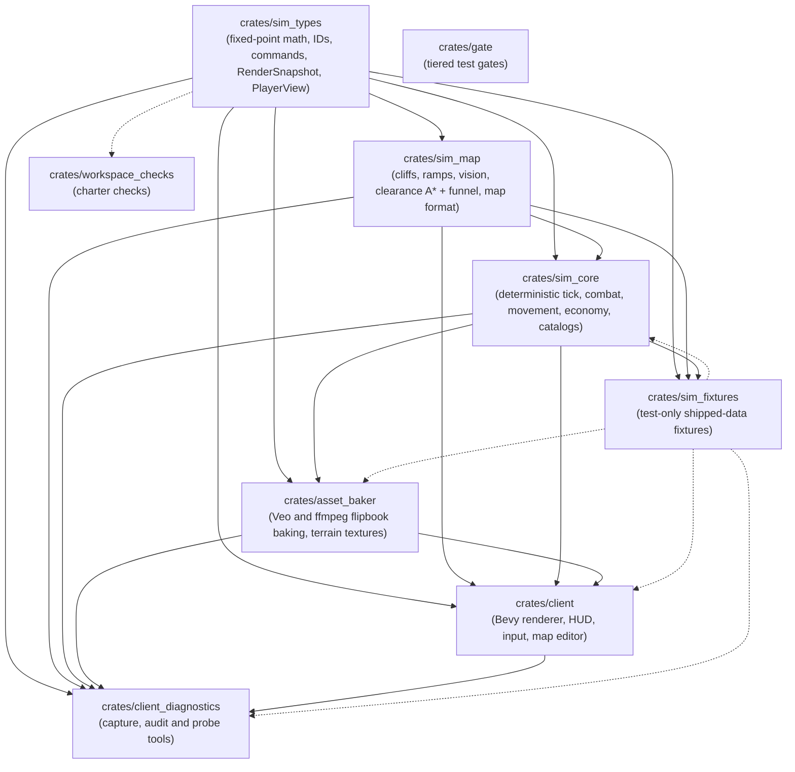

# AGENTS.md — Engineering Standards & Architectural Charter

This document is the binding engineering charter for all human developers and AI agents working on **Space Scuffle**. Every pull request, crate, module, shader, and test must adhere strictly to these principles. Each rule carries a tag saying how it is checked; §9 explains the tags.

---

## 1. Core Philosophy: A Textbook-Grade Reference Project

**Space Scuffle** is built to be an exemplary, production-grade software engineering showcase—a codebase that can be presented to university students and systems engineers as a reference for how to design, document, test, and scale a large, real-time, deterministic project in Rust.

### 1.1 Zero Shortcuts, Zero `TODO`s, Zero Placeholders
- **No `todo!()`, `unimplemented!()` or `TODO`/`FIXME`/`XXX` comments.** Every feature, function and match arm on
  `main` is complete, handled and tested. [CI: clippy, C3]
- **Do it right, not what is easiest.** No quick hacks, magic numbers or leaky abstractions; choose the sound data
  structure and algorithm from the start. [Review] No global mutable state. [CI: C13]
- **No silent failures:**
  - No `.unwrap()`. [CI: clippy]
  - Library crates (`sim_types`, `sim_map`, `sim_core`, `asset_baker`) return typed `thiserror` enums, never
    `String` or boxed errors. [CI: C14]
  - `expect` is permitted only when the immediately preceding code guarantees the invariant, and its message starts
    with `invariant:` and states it. [CI: clippy, C10]
  - A fallible result is never discarded with `let _ =` in the simulation crates. [CI: C12]

### 1.2 Zero Fake Assets, Procedural Stand-Ins, or Silent Workarounds
- **Never Fake High-Quality Media or Systems in Code:** [Review]
  - When a task requires real video sequences (e.g., Veo `.mp4` animations), real 3D rendering, or an external service/API, **never** invent a cheap programmatic hack to pretend the requirement is met (such as drawing crude pixel shapes in Rust, wobbling/translating a single static JPEG by a few pixels to fake a "walking/attacking video", or silently substituting dummy data).
- **Stop and Escalate When a Tool, Key, or Asset Is Blocked:** [Procedure]
  - If an API key is missing, a service is disabled, a shader fails to load, or a tool cannot produce the required quality, **fail loudly and ask the user immediately** rather than writing a silent fallback or low-quality workaround.
- **Real End-to-End Verification Only:** tests compile the real shaders, load real assets from the runtime paths the
  binary uses, and never pass by skipping work; a local GPU opt-out panics in CI. Procedural flipbooks exist only as
  temporary test fixtures, never under `assets/`. [CI: C15 subjects, `runtime_assets_tests.rs`,
  `runtime_media_tests.rs`, `bake_integrity_tests.rs`]

---

## 2. Code Clarity, Documentation & Pedagogical Quality

Because this codebase serves as a teaching example for large-scale architecture:

1. **Module-Level Architecture Docs (`//!`):** [CI: C4]
   - Every file/module must begin with a `//!` doc comment explaining **what responsibility this module owns**, **how it fits into the larger system**, and **what invariants it maintains**.
2. **Public API Docs (`///`):**
   - All public structs, enums, traits, and functions must have `///` rustdoc comments. [CI: missing_docs] They explain parameters, return values, coordinate spaces, and units (e.g., radians vs. binary angles, ticks vs. seconds, world units vs. grid cells). [Review]
3. **Justified Performance Optimizations (`// PERFORMANCE RATIONALE:`):** [CI: C11 format; Review]
   - Default to clean, idiomatic, readable, and type-safe Rust.
   - Whenever we diverge from the most idiomatic or elegant code for performance reasons (e.g., flat structure-of-arrays layout, lookup tables for deterministic trig, GPU buffer packing, avoiding allocations in hot loops), you **must** document it with a structured comment block:
     ```rust
     // PERFORMANCE RATIONALE:
     // Why: In a 400-unit battle, naive O(N^2) pairwise collision checks perform 160,000 tests/tick.
     // What: We partition entities into a fixed-size spatial hash grid using pre-allocated flat slabs.
     // Trade-off: Slightly more bookkeeping on position updates in exchange for O(N) neighborhood queries
     // and zero heap allocations during the simulation tick.
     ```
4. **Short Functions:**
   - No production function exceeds 100 lines, as counted by `clippy::too_many_lines` with the threshold in
     `clippy.toml`. Tests are exempt. A suppression outside test code is not allowed. [CI: clippy, C8]

---

## 3. Strict Determinism & Separation of Concerns

### 3.1 The Simulation Boundary (`sim_types`, `sim_map`, `sim_core`)
- **100% Platform-Independent Determinism:**
  - Simulation crates (`sim_types`, `sim_map`, `sim_core`) must produce **bit-for-bit identical results** across Linux (`x86_64`), Windows (`x86_64`), macOS (`ARM64`), and WebAssembly (`wasm32`).
  - **No Floats in Authoritative State:** positions, velocities, angles, health and cooldowns use `SimScalar`,
    `SimVec2` and `SimAngle`. Floats appear in the simulation crates only where they produce presentation output or
    read authored data. [CI: C7]
  - **Forbidden Non-Deterministic Collections and Clocks:** `std::collections::HashMap`, `HashSet`,
    `Instant::now` and `SystemTime::now` are disallowed in the simulation crates by their `clippy.toml`. All
    randomness comes from the seeded `ChaCha8Rng` in `SimWorld`. [CI: C9, clippy]
  - **Verified on every target:** a golden replay produces the same checksum at every checkpoint on Linux x86_64,
    Windows x86_64, macOS ARM64 and `wasm32-wasip1`, in debug and release. [CI: determinism jobs]
- **Zero Engine / GPU Dependencies in Simulation:**
  - `sim_types`, `sim_map` and `sim_core` never depend, even transitively, on `bevy`, `wgpu`, `winit`, `egui`,
    `naga` or windowing and audio libraries, and they build for `wasm32-unknown-unknown`. [CI: C2, determinism-wasm]
  - **Throughput:** every scenario of the release benchmark (`cargo bench -p sim_core --bench throughput`) runs at
    least in real time (25 ticks per second). Current figures are in `DESIGN.md` §5. [CI: throughput job]

### 3.2 The Visual & Client Layer (`client`, `asset_baker`)
- `client` owns the authoritative `SimWorld` of a match (`BattleSession`) and changes it only by submitting
  `PlayerCommand`s through the tick. It presents the world from `RenderSnapshot` and `PlayerView`, and reads the
  catalog and map for admission, placement and terrain. [Review]
- Fixed-point values become `f32` only on the way to presentation: in `RenderSnapshot` and `PlayerView` output, and
  in client code that meshes, picks or draws. No float flows back into simulation state except through
  `SimScalar`'s checked conversions of player input. [CI: C7 for the simulation side; Review for the client]

### 3.3 Data-Driven Game Catalog & Zero Hardcoded Creatures
- **Zero Hardcoded Identities in Rust:**
  - No crate defines unit-, structure-, faction-, weapon-class- or armour-class-specific constants, enums or string
    matches (e.g. `rhino_beetle`, `pulse_bot`, `marine`, `RhinoBeetle`). [CI: C5]
  - Adding, removing or rebalancing these requires zero code changes and zero recompilation: production code reads
    them at run time and embeds no catalog. [CI: C6, `runtime_catalog_tests.rs`]
  - They live in `assets/catalog/` (`assets/catalog/units.ron`, `assets/catalog/structures.ron`,
    `assets/catalog/upgrades.ron`, `assets/catalog/factions.ron`, `assets/catalog/start_loadouts.ron`) and
    `assets/scenarios/`.
- **Capability-Driven Mechanics:** [CI: C5 partial; Review]
  - Mechanics (e.g., stim/overclock, harvesting, detectors) must be queried via optional capability components on `UnitArchetype` (`Option<OverclockSpec>`, `Option<HarvesterSpec>`), never by branching on specific `UnitTypeId`s.
- **Dynamic Asset Loading & Zero Per-Frame Allocations:**
  - The client and asset baker discover flipbooks and catalog entries at run time.
  - Battle and preview synchronization systems allocate nothing in steady state and use no O(N²) search. [CI:
    `sync_allocation_count_tests.rs` (counted by valgrind for the live battle sync), `sync_steady_state_tests.rs`
    (assets, entities, retained buffers); Review for the rest]

---

## 4. Testing Standards (Unit, Property & Integration Tests)

Code without tests is considered incomplete.

1. **Unit Tests (`#[cfg(test)] mod tests`):** [CI: C15]
   - Test every nontrivial algorithm, edge case, boundary condition, and error path alongside the implementation.
2. **Integration & Behavioral Tests (`crates/<crate>/tests/*.rs`):** [CI: C15]
   - Every crate has `#[cfg(test)]` unit tests and `tests/*.rs` integration tests that verify end-to-end subsystem
     behaviour through public APIs. Each crate covers at least the subjects below, in the files named:

| Crate | Subject | Test files |
|---|---|---|
| `sim_types` | Fixed-point identities, overflow policy, trig, angle wrap, serialization; property tests | `math_identities.rs`, `overflow_policy_tests.rs`, `trig_determinism.rs`, `angle_extremes_tests.rs`, `scalar_serialization.rs`, `snapshot_serialization.rs`, `math_properties.rs` |
| `sim_map` | High-ground line of sight, air reveal, ramps, structure wall-offs, clearance field, A* corridor and funnel; property tests | `vision_tests.rs`, `ramp_vision_tests.rs`, `wall_off_tests.rs`, `clearance_field_tests.rs`, `funnel_tests.rs`, `reachability_tests.rs`, `pathfinding_properties.rs`, `validation_tests.rs` |
| `sim_core` | Weapon timing with cancelable backswing, turrets, shield and armour spillover, push priority versus Hold Position, a whole match through `PlayerCommand`, cross-target golden replay | `stutter_step_tests.rs`, `turret_tracking_tests.rs`, `damage_and_shields_tests.rs`, `push_priority_tests.rs`, `full_match_tests.rs`, `golden_replay_tests.rs` |
| `asset_baker` | Fixture flipbooks, frame validation, manifest round trip, media integrity, procedural output kept out of runtime paths | `procedural_tests.rs`, `bake_integrity_tests.rs`, `manifest_tests.rs`, `media_tests.rs` |
| `client` | Shader validation, uniform packing, camera, scene transitions, a skirmish won through input alone | `gpu_validation_tests.rs`, `round2_visual_tests.rs`, `camera_drag_tests.rs`, `lab_scene_tests.rs`, `skirmish_match_tests.rs` |
| `client_diagnostics` | Capture pipeline, one-way dependency on `client`, and the showcase storyboard, cards and a reproducible take | `runtime_capture_tests.rs`, `dependency_direction_tests.rs`, `showcase_tests.rs` |
| `sim_fixtures` | The embedded catalogs equal the shipped files; the battle sandbox is built whole | `fixture_tests.rs` |
| `workspace_checks` | The charter checks of §9 | `charter.rs` |
| `gate` | Selection, globs, scheduling, stamps, catalog consistency | `selection_tests.rs`, `suite_catalog_tests.rs` |

3. **Quality gates.** [CI: C16, C22] Tests are selected by `cargo gate`, from the catalog
   `crates/gate/suites.ron`, in four tiers:
   - `cargo gate quick`: optional, while working: fmt, clippy on the changed crates, their fast tests.
   - `cargo gate package`: required once per package, after merging `main`, on the package's final tree.
     Clippy on the whole workspace, `workspace_checks`, every test of the changed crates (GPU and valgrind tests
     when the change touches their triggers), the tests the catalog's path rules and downstream contracts select,
     and the golden replays in release and on `wasm32-wasip1` for simulation changes. The implementation agent
     hands back after `quick` and the tests its change needs; a verifier agent on a cheap model then runs `package`
     and reports the stamp, or the failing targets, which go back to the implementation agent (owner, Q0061).
   - `cargo gate merge <branch>`: the orchestrator, for each merge to `main`.
   - `cargo gate full`: the full gate, on `main` before a push that contains a crate change, and on CI. Push only a
     commit whose tree has a green stamp. When it is red, fix forward or revert within an hour, and add the missing
     catalog rule.
   - **Test a tree once.** A tier passes at once, without building or running anything, when its tree already has a
     green stamp of that tier or a stricter one; a green `package` stamp counts for `merge` and `full` when the
     agent merged `main` right before its gate and nothing landed since (the merged tree is the tested tree). Merge
     branches one at a time in that order, batch pushes to a few a day, and run at most one or two building agents
     at once (owner, Q0055).
   - **Full gate** (what `cargo gate full` and CI run):
     - `cargo fmt --all -- --check`
     - `cargo clippy --workspace --all-targets --locked -- -D warnings`
     - `cargo test --workspace --locked`
   - Docs-only changes: `cargo gate package` runs fmt and `workspace_checks` only.

---

## 5. Workspace Crate Ownership & Dependency Graph

The dependency graph is acyclic. An arrow points from a dependency to its dependent; a dashed arrow is a
dev-dependency. [CI: C1]



`asset_baker` depends on `sim_core` for the unit catalog it discovers archetypes from. `sim_fixtures` embeds the
shipped catalogs for tests only; `sim_core` uses it in its integration tests, and its own unit tests embed the same
files through `sim_core::test_support`, because a dev-dependency cycle would link a second copy of `sim_core`.
`gate` depends on no workspace crate: it reads `cargo metadata`, Git and the sources as data, so a broken crate
cannot break the tool that selects its tests.

---

## 6. Mandatory Two-Stage Sub-Agent Workflow (Plan First, Implement Second)

1. **Stage 1 — Plan.** Every change is planned before it is implemented, at one of two levels:
   - **A full plan** in `docs/plans/`, a complete, textbook-grade blueprint written by a planning sub-agent, is
     required for new subsystems or mechanics, anything that moves battle outcomes or golden replays, anything that
     changes the checksum format, and work that spans several packages.
   - **A short note** is enough for a small, well-specified change: config and data changes the owner dictated,
     test-only fixes, documentation, and single-cause bug fixes with an obvious test. The note is an amendment to the
     plan the change belongs to, or a decision note in the commit message, stating what changes, why, and how it is
     tested. The orchestrator writes it itself; no planning sub-agent is needed.
   - The orchestrator never edits code itself and never launches an implementation sub-agent without the plan or
     note the change requires.
2. **Stage 2 — Implementation Sub-Agent:**
   - Implementation sub-agents write the code and tests strictly following the plan or note.
3. **Tool-neutral:** the charter names no model or tool for either stage; each session uses the agents it has.
4. **Owner rule:** the split into full plans and short notes is the owner's (chat, 2026-11-05, recorded in Q0054).

---

## 7. Shared Development Server: GPU and Disk

Development runs on a shared VM. Its physical **AMD Radeon RX 580** (Ellesmere, `/dev/dri/renderD128`, driven by `radv`) is shared with another autonomous agent user, and the machine also has software Vulkan (`lavapipe` / `llvmpipe`). Every agent must follow these rules:

- **Use the physical GPU.** It is the default for every GPU task: rendering, visual checks, validation runs and GPU tests. The other users need it only about 1% of the time, so do not avoid it.
- **Hold the GPU lock per command, never for hours.** Wrap each command that runs on the physical GPU in `with-gpu-lock`, and release it between tasks so the other users get a short slot. Lock one test process or one capture at a time, not a whole test suite or session. A wait of a few seconds for the lock is normal. Unlocked use risks VRAM contention, driver resets, and skewed timings. This includes running `client` or any other binary with no driver selected, because Vulkan may then pick the physical GPU.
  ```bash
  WGPU_BACKEND=vulkan VK_ICD_FILENAMES=/usr/share/vulkan/icd.d/radeon_icd.json with-gpu-lock <command>
  ```
- **The lock's timeout is 600 seconds by default.** `with-gpu-lock` takes an exclusive `flock` on `/run/lock/gpu.lock` and releases it when the command exits. It no longer passes the lock to the command it runs, so a process the command leaves behind cannot hold it, and it logs every acquisition, timeout and release to `/run/lock/gpu-lock.log` (Q0060). Raise it with `GPU_LOCK_TIMEOUT=1200` only for a single long command, such as a frame-budget measurement.
- **Software Vulkan is the fallback, not the default.** Use `lavapipe` only where no physical GPU exists (CI) or to reproduce a CI result exactly. It needs no lock:
  ```bash
  WGPU_BACKEND=vulkan VK_ICD_FILENAMES=/usr/share/vulkan/icd.d/lvp_icd.json <command>
  ```
  `WGPU_BACKEND=vulkan` is required in both commands: `VK_ICD_FILENAMES` only filters Vulkan drivers, and without it wgpu may fall back to its OpenGL backend, which runs on the physical GPU through `radeonsi` with no lock. The ICD files are `radeon_icd.json` and `lvp_icd.json`; the `*.x86_64.json` names some distributions use do not exist on this server.
- **GPU tests lock the GPU themselves, one test child at a time.** `crates/client/tests/support/gpu_run.rs` runs
  each GPU test child on the physical GPU (`radv`, with `MESA_VK_WSI_DEBUG=sw` under `xvfb-run`). It takes
  `/run/lock/gpu.lock`, the lock `with-gpu-lock` uses, just before the child starts, and releases it when the
  child exits, so other users get the GPU between children. Run `cargo test --workspace` as it is and never wrap it
  in `with-gpu-lock`; the harness detects that and fails. A child waits up to `GPU_LOCK_TIMEOUT` (default 290 s)
  for the lock and then has 120 s to finish. Where the radeon driver, a usable render node or `with-gpu-lock` is
  missing, as on CI, the harness uses `lavapipe` with no lock. `SPACE_SCUFFLE_GPU_TEST_DRIVER=lavapipe` reproduces
  CI on this server, and `=radv` fails instead of falling back.
- **Run one `cargo gate` or workspace `cargo test` at a time across all worktrees.** `cargo gate` serializes
  itself through the gate lock (`~/scratch/gate.lock`, `crates/gate/src/gate_lock.rs`); wrap any other workspace
  `cargo test` in `flock ~/scratch/gate.lock`. Before other heavy runs, check the `anon` line of
  `/sys/fs/cgroup/user.slice/user-1002.slice/memory.stat` and keep it below about 36 GiB of the 44 GiB limit
  (`memory.current` also counts reclaimable page cache).
- **Large files go on `~/scratch`.** The root disk is small and shared. The main checkout's own `target/` may stay on it for fast linking, but every agent worktree must build with `CARGO_TARGET_DIR=/home/spacescuffle/scratch/cargo-target/<worktree-name>`, and large logs, captures and corpora belong under `~/scratch`. Remove a worktree, or at least its `target/`, once its branch is merged.

---

## 8. Asynchronous Questions for the Owner

Decisions that belong to the owner live in `docs/questions/`, one file per question. Every agent must read `docs/questions/README.md`, check `docs/questions/open/` at the start of each session and before each push, act on answered questions, and record new ones there with the default it will follow meanwhile.

- **Scoping is the agent's call, if written down.** An agent may narrow or defer scope without asking, and records
  each such decision in its plan's decisions or out-of-scope section, so it can be brought back (Q0002).
- **Unit mechanics follow StarCraft II.** Start from identical unit mechanics and values (patch 5.0.14) and very
  close behaviour; cite the source in the plan. A difference the owner has not named as a deviation is a bug,
  recorded until fixed. Deviations that allow more (preferably configurable) and minor differences in details are
  allowed if recorded; StarCraft II's own engine bugs need not be reproduced (Q0051, which supersedes Q0008; the
  sanctioned list is Q0052).

---

## 9. How This Charter Is Checked

Each rule above carries a tag. **[CI: …]** names a check that runs on every push to `main`: a clippy lint, a CI job
in `.github/workflows/ci.yml`, a named test, or a check `Cn` in `crates/workspace_checks/tests/charter.rs`.
**[Review]** marks a judgement CI cannot make; reviewers apply it. **[Procedure]** governs how agents work.
Sections 6 to 8 are procedures; §6 is governed by the owner (`docs/questions/`).

A statement of fact about the code that no check covers does not belong in this charter. Add the check, or reword
the statement as a rule for reviewers.

| Check | Verifies |
|---|---|
| C1 | §5 graph equals the Cargo graph |
| C2 | Simulation crates have no engine, GPU, window or audio dependency |
| C3 | No `TODO`, `FIXME`, `XXX` |
| C4 | Every Rust file begins with `//!` |
| C5 | No catalog identity in production Rust |
| C6 | No embedded `assets/` data in production code |
| C7 | Floats in the simulation crates only at listed boundaries |
| C8 | No `too_many_lines` suppression outside tests; one threshold everywhere |
| C9 | Simulation crates' `clippy.toml` disallow `HashMap`, `HashSet` and clocks |
| C10 | `expect` messages state an invariant |
| C11 | `PERFORMANCE RATIONALE` blocks have Why, What, Trade-off |
| C12 | No discarded results in the simulation crates |
| C13 | No mutable statics |
| C14 | Library crates return typed errors |
| C15 | §4 test subjects exist; every crate has unit and integration tests |
| C16 | CI runs the §4.3 full gate; every `cargo gate` tier §4 names exists |
| C17 | `DESIGN.md` links and evidence resolve; its tick rate matches the code |
| C18 | `docs/plans/README.md` indexes every plan once |
| C19 | No `file:///` links; lost `/tmp` evidence is marked |
| C20 | Paths named in this charter exist |
| C21 | No test builds a render device in its own process; GPU tests go through the harness of §7 |
| C22 | `crates/gate/suites.ron` names existing targets, classes every GPU and valgrind test, and covers every tracked path (in `crates/gate/tests/suite_catalog_tests.rs`) |
| C23 | Smog production code calls no host transcendental function outside `crates/client/src/smog/math.rs` |
| C24 | `README.md` exists, its links resolve, and its showcase image and link use the site of `.github/workflows/showcase.yml` and the file names `showcase assemble` writes |
