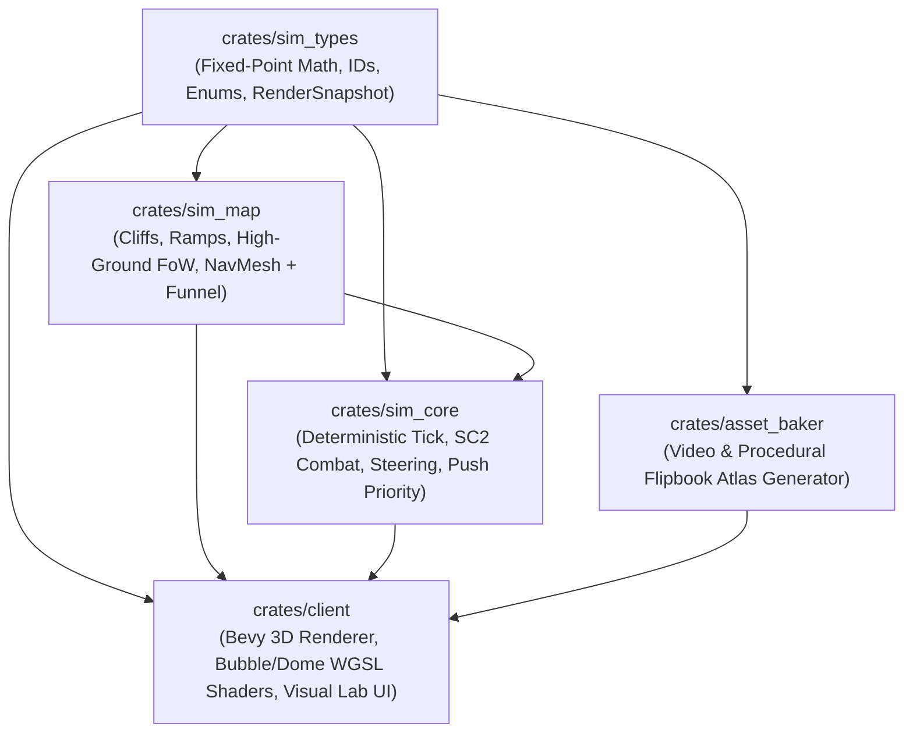

# AGENTS.md — Engineering Standards & Architectural Charter

This document is the binding engineering charter for all human developers and AI agents working on **Space Scuffle**. Every pull request, crate, module, shader, and test must adhere strictly to these principles.

---

## 1. Core Philosophy: A Textbook-Grade Reference Project

**Space Scuffle** is built to be an exemplary, production-grade software engineering showcase—a codebase that can be presented to university students and systems engineers as a reference for how to design, document, test, and scale a large, real-time, deterministic project in Rust.

### 1.1 Zero Shortcuts, Zero `TODO`s, Zero Placeholders
- **No `todo!()`, `unimplemented!()`, or `// TODO` comments:** Every feature, function, and match arm committed to a crate must be complete, handled properly, and tested.
- **Do It Right, Not "What's Easiest":** Never choose a quick hack, magic number, global mutable state, or leaky abstraction just to make something compile faster. Choose the architecturally sound data structure and algorithm from the start.
- **No Silent Failures or Blind `.unwrap()`:**
  - Production library crates (`sim_types`, `sim_map`, `sim_core`, `asset_baker`) must use explicit, strongly-typed error enums (`thiserror`) and `Result<T, E>`.
  - `expect("...")` is only permitted when an invariant is mathematically guaranteed by the immediately preceding lines, and the message must state the invariant (e.g., `.expect("invariant: non-empty polygon verified at line 42")`).

### 1.2 Zero Fake Assets, Procedural Stand-Ins, or Silent Workarounds
- **Never Fake High-Quality Media or Systems in Code:**
  - When a task requires real video sequences (e.g., Veo `.mp4` animations), real 3D rendering, or an external service/API, **never** invent a cheap programmatic hack to pretend the requirement is met (such as drawing crude pixel shapes in Rust, wobbling/translating a single static JPEG by a few pixels to fake a "walking/attacking video", or silently substituting dummy data).
- **Stop and Escalate When a Tool, Key, or Asset Is Blocked:**
  - If an API key is missing, a service is disabled, a shader fails to load, or a tool cannot produce the required quality, **fail loudly and ask the user immediately** rather than writing a silent fallback or low-quality workaround.
- **Real End-to-End Verification Only:**
  - Tests must verify that the real shader compiles, the real asset files exist at the exact runtime path used by the binary, and the actual visual entities appear inside the camera frustum—never pass a test by bypassing the real asset loader in a mock mode.

---

## 2. Code Clarity, Documentation & Pedagogical Quality

Because this codebase serves as a teaching example for large-scale architecture:

1. **Module-Level Architecture Docs (`//!`):**
   - Every file/module must begin with a `//!` doc comment explaining **what responsibility this module owns**, **how it fits into the larger system**, and **what invariants it maintains**.
2. **Public API Docs (`///`):**
   - All public structs, enums, traits, and functions must have `///` rustdoc comments explaining parameters, return values, coordinate spaces, and units (e.g., radians vs. binary angles, ticks vs. seconds, world units vs. grid cells).
3. **Justified Performance Optimizations (`// PERFORMANCE RATIONALE:`):**
   - Default to clean, idiomatic, readable, and type-safe Rust.
   - Whenever we diverge from the most idiomatic or elegant code for performance reasons (e.g., flat structure-of-arrays layout, lookup tables for deterministic trig, GPU buffer packing, avoiding allocations in hot loops), you **must** document it with a structured comment block:
     ```rust
     // PERFORMANCE RATIONALE:
     // Why: In a 400-unit battle, naive O(N^2) pairwise collision checks perform 160,000 tests/tick.
     // What: We partition entities into a fixed-size spatial hash grid using pre-allocated flat slabs.
     // Trade-off: Slightly more bookkeeping on position updates in exchange for O(N) neighborhood queries
     // and zero heap allocations during the simulation tick.
     ```

---

## 3. Strict Determinism & Separation of Concerns

### 3.1 The Simulation Boundary (`sim_types`, `sim_map`, `sim_core`)
- **100% Platform-Independent Determinism:**
  - Simulation crates (`sim_types`, `sim_map`, `sim_core`) must produce **bit-for-bit identical results** across Linux (`x86_64`), Windows (`x86_64`), macOS (`ARM64`), and WebAssembly (`wasm32`).
  - **Forbidden in Simulation State:** Never use `f32` or `f64` for authoritative simulation positions, velocities, angles, health, or cooldowns. Use the deterministic fixed-point types in `sim_types` (`SimScalar`, `SimVec2`, `SimAngle`).
  - **Forbidden Non-Deterministic Collections:** Never iterate over standard `std::collections::HashMap` or `HashSet` (which use randomized SipHash seeds per process). Use `BTreeMap`, `BTreeSet`, deterministic index maps, or sorted `Vec`s.
  - **No System Clock or Thread-Local RNG in Simulation:** All randomness in `sim_core` must come from an explicit, seeded deterministic PRNG (`ChaCha8Rng` or `Pcg64Mcg`) stored inside `SimWorld` state.
- **Zero Engine / GPU Dependencies in Simulation:**
  - `sim_types`, `sim_map`, and `sim_core` must **never** depend on `bevy`, `wgpu`, `winit`, or windowing/audio libraries. They must compile cleanly in headless environments and run at 10,000+ ticks/second in unit tests and bot runners.

### 3.2 The Visual & Client Layer (`client`, `asset_baker`)
- `client` consumes immutable `RenderSnapshot` values produced by the simulation (or by the interactive Visual Lab controller) and translates them into Bevy ECS components, `wgpu` shader instances, and `egui` inspector panels.
- Conversion from deterministic fixed-point (`SimScalar`) to GPU floating-point (`f32`) happens **only** at the `RenderSnapshot` boundary.

### 3.3 Data-Driven Game Catalog & Zero Hardcoded Creatures
- **Zero Hardcoded Creature / Building Identifiers in Rust:**
  - Rust source code across all crates (`sim_types`, `sim_core`, `asset_baker`, `client`) must **never** define unit-specific constants, enums, or string matches (e.g., `rhino_beetle`, `pulse_bot`, `marine`, `RhinoBeetle`).
  - Adding, removing, or rebalancing units must require **zero code changes and zero recompilation**.
  - All creature and building identities, vitals, weapon envelopes, faction lore, showcase flags, and media generation prompts reside strictly in declarative data files (`assets/catalog/units.ron`).
- **Capability-Driven Mechanics:**
  - Mechanics (e.g., stim/overclock, harvesting, detectors) must be queried via optional capability components on `UnitArchetype` (`Option<OverclockSpec>`, `Option<HarvesterSpec>`), never by branching on specific `UnitTypeId`s.
- **Dynamic Asset Loading & Zero Per-Frame Allocations:**
  - The client and asset baker dynamically discover flipbook textures and catalog entries.
  - Per-frame client synchronization systems must never perform heap allocations (e.g. allocating `HashMap`s every frame) or $O(N^2)$ linear searches.

---

## 4. Testing Standards (Unit, Property & Integration Tests)

Code without tests is considered incomplete. Every crate must include both unit tests and integration tests:

1. **Unit Tests (`#[cfg(test)] mod tests`):**
   - Test every nontrivial algorithm, edge case, boundary condition, and error path alongside the implementation.
2. **Integration & Behavioral Tests (`crates/<crate>/tests/*.rs`):**
   - Verify end-to-end subsystem behaviors through public APIs:
     - **`sim_types`:** Fixed-point arithmetic identities, overflow boundaries, trig accuracy, angle wrapping, and snapshot serialization.
     - **`sim_map`:** High-ground vs. low-ground line-of-sight occlusion, air-spotter reveal, building footprint placement & ramp wall-offs, dynamic NavMesh carving, and Simple Stupid Funnel shortest-path invariants.
     - **`sim_core`:** SC2 weapon timing state machine (`TurnRate` -> `DamagePoint` -> `Fire` -> cancelable `Backswing` for stutter-step micro + `Cooldown`), turret independent tracking, shield armor vs. life armor spillover, friendly push priority vs. `HoldPosition`, and multi-thousand-tick determinism checksum verification.
     - **`asset_baker`:** Procedural flipbook generation, frame dimension/count validation, and metadata round-trip serialization.
     - **`client`:** Shader pipeline compilation, material uniform packing, camera math, and headless/scene state transitions.
3. **Quality Gate Before Completing Any Task:**
   - Every agent must run and pass:
     - `cargo test --workspace`
     - `cargo clippy --workspace --all-targets -- -D warnings`
     - `cargo fmt --all -- --check`

---

## 5. Workspace Crate Ownership & Dependency Graph

To prevent circular dependencies and keep compilation fast, the dependency graph is strictly acyclic:



---

## 6. Mandatory Two-Stage Sub-Agent Workflow (Plan First, Implement Second)

1. **Stage 1 — Architect Planning Sub-Agent (`pro` / `inherit`):**
   - Before any feature, refactor, or bugfix is implemented, a high-reasoning Planning Sub-Agent must first analyze the problem and write a complete, textbook-grade implementation blueprint in `docs/plans/`.
   - The main orchestrator agent must **never** bypass the planning stage by editing code directly or launching an implementation sub-agent without an approved blueprint.
2. **Stage 2 — Implementation Sub-Agent (`flash`):**
   - Only after the detailed plan in `docs/plans/` is complete may `flash` Implementation Sub-Agents be launched to write the code and tests strictly following that blueprint.

