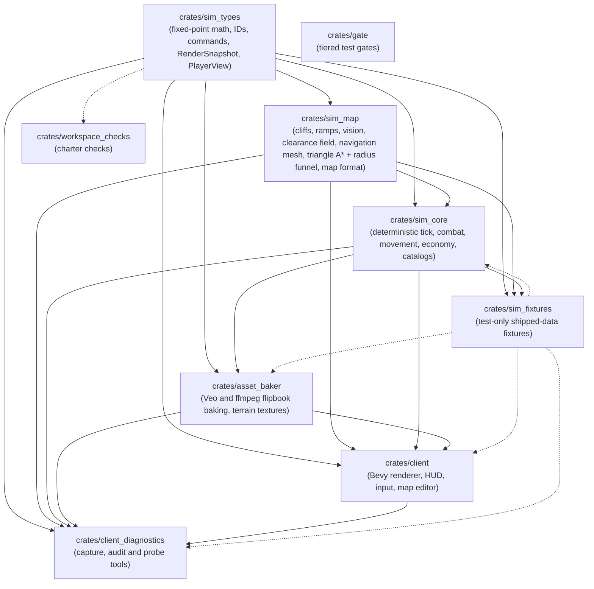

# Space Scuffle — Design and Current State

This document says what Space Scuffle is, how the code is put together, and what state each subsystem is in
today. It states what exists; anything planned but not built is labelled **intent, not built**. The rules for
working on the code are in the charter, [`AGENTS.md`](AGENTS.md). Check C17
(`crates/workspace_checks/tests/charter.rs`) keeps this document's links, evidence paths and tick rate true.

---

## 1. What Space Scuffle Is

Space Scuffle is a real-time strategy game in the spirit of *StarCraft II*: deterministic simulation, crisp unit
control, high-ground vision, turn rates and group movement. Instead of animated 3D models, every mobile unit is a
glass **bubble** and every structure a grounded **dome**, each showing a looping video of its creature or
building, with shader effects for team, facing, attack, damage and death.

**Pillars**

1. **Responsive, deterministic play.** A fixed-point simulation that produces the same result on every platform,
   with weapon wind-up and cancelable backswing for stutter-step micro, turn rates and high-ground vision.
2. **The bubble and dome look.** Units and structures read at a glance through radius, rim, altitude, team tint
   and video state rather than through meshes. Background:
   [`docs/02-bubble-visual-design.md`](docs/02-bubble-visual-design.md).
3. **Data, not code, defines the roster.** Factions, units, structures, upgrades, start loadouts and scenarios are
   RON files under [`assets/`](assets/), read at run time.
4. **Rust on Linux first.** Rust and Bevy (`wgpu`), developed on Linux; the simulation crates also build for
   WebAssembly.

**Intent, not built:** multiplayer over deterministic lockstep, recorded replays of real matches, and a Bot API
for third-party bots running headless matches. Nothing of these exists beyond the determinism they would rely on
(see §4).

---

## 2. Architecture

The workspace has nine crates. Charter §5 states the layering rule; the graph below draws every
workspace-internal dependency, and check C1 keeps the drawing equal to Cargo's and Cargo's edges within the rule. An
arrow points from a dependency to its dependent; a dashed arrow is a dev-dependency.

`asset_baker` depends on `sim_core` for the unit catalog it discovers archetypes from. `sim_fixtures` embeds the
shipped catalogs for tests only; `sim_core` uses it in its integration tests, and its own unit tests embed the same
files through `sim_core::test_support`, because a dev-dependency cycle would link a second copy of `sim_core`.
`gate` depends on no workspace crate: it reads `cargo metadata`, Git and the sources as data, so a broken crate
cannot break the tool that selects its tests.

- **`sim_types`** — the shared contract: fixed-point math (`SimScalar`, `SimVec2`, `SimAngle`), IDs, player
  commands (`PlayerCommand`, `TickBundle`), and the presentation outputs `RenderSnapshot` and `PlayerView`. It also
  owns the tick rate, `sim_types::TICKS_PER_SECOND`.
- **`sim_map`** — terrain: cliff levels, ramps, the map file format, line of sight with high ground, the
  clearance field, footprint shapes, and pathfinding on a constrained Delaunay navigation mesh with triangle A* and
  the radius funnel.
- **`sim_core`** — the deterministic tick (`SimWorld`): commands, economy, production and research,
  construction, transport, abilities, vision, targeting, movement, collision and push, weapons, the match result,
  the checksum and the catalogs.
- **`asset_baker`** — generates Veo clips within a total-spend budget, turns them into flipbook atlases through ffmpeg,
  bakes terrain textures, and audits media. It reads the unit catalog from `sim_core` to know which archetypes
  need media and which actions each publishes. A paid run goes `validate-prompts`, `generate-veo --dry-run`
  (both free, no credential read), `veo-preflight` (one free authenticated GET), `generate-veo --max-generations N
  --ledger docs/evidence/veo/ledger.jsonl --clips-dir ~/scratch/veo/clips`, `review`, `install-clip`, then
  `bake-unit-videos`; prompts and the house style are data (`assets/catalog/media_style.ron`), the total budget
  and the price per generation are `assets/media/veo_budget.ron` (every run prints spent and remaining dollars), and
  exit code 3 means a Google quota refusal ended the run.
- **`client`** — the Bevy game: renderer, bubble and dome shaders, smog fog presentation, HUD and command card,
  selection and input, result screen, the Visual Lab, and the map editor.
- **`client_diagnostics`** — capture, audit and probe tools built on the client; nothing in the game depends on
  it.
- **`sim_fixtures`** — test-only worlds and catalogs embedded from the shipped data.
- **`workspace_checks`** — the executable charter checks (C1 to C21, C23 and C24).
- **`gate`** — `cargo gate`: selects the tests a change can break from the catalog `crates/gate/suites.ron`
  and runs them in the tiers of charter §4.3 (`quick`, `package`, `merge`, `full`), with stamps, flake reruns,
  the red rule's suspect list and the CI timing summary; its catalog check is C22. It depends on no other
  workspace crate.

**Data flow of a match.** The client turns input into `PlayerCommand`s and submits them in a `TickBundle`.
`SimWorld::step_into` advances one tick and writes a `RenderSnapshot`; `PlayerView` gives each player what they
may know. The client presents both. Catalogs (`assets/catalog/`) and scenarios (`assets/scenarios/`) are loaded
from disk at start-up, so changing the roster needs no recompilation (charter §3.3).

---

## 3. Simulation

**Tick rate:** 25 Hz, one tick per 40 ms of game time (`sim_types::TICKS_PER_SECOND`). Every duration the
simulation stores is a whole number of ticks.

**The phases of `SimWorld::step_into`, in order:**

1. Validate transport links (a broken link reports a diagnostic and ends the tick after the checksum and snapshot).
2. Apply the tick's commands.
3. Production and research timers, buffs, regeneration and hazard zones.
4. Unit tasks: every unit whose front order is a task, such as harvesting or building, acts on it.
5. Vision for every player.
6. Target acquisition.
7. Movement and steering.
8. Collision and push.
9. Weapons and projectiles.
10. Reap destroyed entities and their transport groups, and update the match state.
11. Compute the state checksum.
12. Write the `RenderSnapshot`.

**Fixed-point model.** Authoritative positions, velocities, angles, health and timers are fixed-point
(`SimScalar`, 32.32). Floats appear in the simulation crates only where they produce presentation output or read
authored decimal data (check C7). Trigonometry uses a lookup table so every platform computes the same bits.

**Checksum and golden replay.** Each tick ends with a 64-bit checksum of the persistent state, including the RNG
position. A golden replay
([`crates/sim_core/tests/fixtures/golden_replay.ron`](crates/sim_core/tests/fixtures/golden_replay.ron)) must
reproduce every recorded checksum on Linux x86_64, Windows x86_64, macOS ARM64 and `wasm32-wasip1`, in debug and
release; CI's determinism jobs run it.

---

## 4. Subsystem Status

Status is `Working` (built, tested, in the shipped game), `Partial` (built but limited or not all shipped),
`Not built` or `Removed`. Evidence is the test that shows the subsystem working. Open owner questions are in
[`docs/questions/open/`](docs/questions/open/).

| Subsystem | Status | What exists | Evidence | Known gaps |
|---|---|---|---|---|
| Fixed-point math | Working | `SimScalar`, `SimVec2`, `SimAngle`, table trigonometry, checked overflow | `crates/sim_types/tests/math_identities.rs`, `crates/sim_types/tests/math_properties.rs` | none known |
| Tick and checksum | Working | The phase pipeline of §3; versioned checksum over persistent state and RNG | `crates/sim_core/tests/checksum_state_tests.rs` | none known |
| Cross-platform determinism | Working | Golden replay on three native targets and wasm32 in CI; a second fixture pins vision before acquisition and route upkeep before arrival (`c271226`) | `crates/sim_core/tests/golden_replay_tests.rs` (`golden_replay_orders_reproduces_every_checkpoint`) | none known |
| Combat | Working | Weapon timing with turn, damage point, cancelable backswing and cooldown; a hull-mounted weapon waits for its hull to face the target within the weapon's StarCraft II arc; turrets turning at their rates; shields and armour; splash; projectiles; ranges to and from a structure (weapon, scan, cast, projectile, missile, splash, Charge, boarding) measure to its 5.0.14 engine radius, authored as `radius` in `structures.ron`, while its dome is drawn at its footprint shape's smaller half-extent (B-135 fixed, plan `2026-11-18-structure-radius`; shapes and the cover rule `radius` ≥ the shape's farthest point, plan `2026-11-18-contour-footprints` D-10) | `crates/sim_core/tests/stutter_step_tests.rs`, `crates/sim_core/tests/combat_correctness_tests.rs`, `crates/sim_core/tests/damage_and_shields_tests.rs`, `crates/sim_core/tests/structure_radius_tests.rs` | Changed outcomes await the owner (Q0007); battle 33 investigated in [`docs/evidence/2026-11-03-battle-33-investigation.md`](docs/evidence/2026-11-03-battle-33-investigation.md), changes proposed in Q0035 to Q0041; how StarCraft II spaces melee attackers around a solid enemy is not researched: the contact rules of `d4109e2` stay for now; how StarCraft II spaces melee attackers is recorded bug B-50 in plan `2026-11-05-sc2-deviation-fixes` (WP16), follow-up F-1 of plan `2026-11-04-combat-sc2-alignment` (Q0035); Differences from StarCraft II are bugs, listed in the [bug register](#known-deviations-from-starcraft-ii-bugs) below |
| Movement and pathfinding | Working | Constrained Delaunay navigation mesh rebuilt on structure change, triangle A* with radius widths and the radius funnel (StarCraft II's reported design), each unit routed at its own radius (B-102 fixed, plan `2026-11-09-sc2-pathfinding` WP5 to WP10), steering, push priority and Hold Position; hulls turn at StarCraft II's per-tick rates, at most once per tick, at a stationary rate on ticks the unit does not move, and units flagged `turn_before_move` turn in place before a step their hull does not face (Q0050); routes are never rewritten for bodies: a corner is passed by position and terrain view, and a unit steers past a body parked on its corner on the outside of the turn, and corner waypoints keep each unit's own radius plus 0.05 from the corner (B-99, B-100 and B-101 fixed, plan `2026-11-09-sc2-pathfinding` WP2 to WP4); a unit blocked by friends that will not yield waits instead of stepping into a gap it cannot pass, and an attacker walks round the crowd on a side it keeps; only idle, standing friends are pushed, at StarCraft II's push priorities; a burrowed body touches only burrowed bodies (B-104, B-105, B-48 and B-93 fixed, B-103 narrowed, plan `2026-11-09-friendly-blocking`); an attacker queued behind a friend that holds its ground is not stalled, so it keeps its attack order, while a plain move into a blocked spot is still given up (Q0089, plan `2026-11-19-crowd-edge-steering` D-4); a spent surround walk waits without a timer and walks again when the side that closed last opens for a whole step, when the unit gains ground or when its target changes, and a walk in progress ends only on room beyond what its own retreat made (plan `2026-11-19-crowd-edge-steering-2` D-1, D-2); bodies are discs against terrain and structures, as in StarCraft II: no walk or push presses a disc deeper into a wall, a step into one slides along it, and a sliver of slide is waited out (B-113 fixed, plan `2026-11-11-contact-and-missiles`); bodies are discs against terrain and structures at their terrain radius (`min(InnerRadius, Radius)` of 5.0.14, authored as `terrain_radius` for 17 ground units), and against each other at their radius: routes, group lanes, the Charge path, the map-edge domain, placement, production exits and construction sites use it (B-116 fixed, plan `2026-11-18-inner-radius`); a registered structure is no body: it meets ground units through its footprint at their terrain radius (B-131 fixed, plan `2026-11-18-structure-contact`); a structure meets units through its 5.0.14 footprint shape (a chamfered box authored as `footprint_shape`), cut into the mesh on a quarter-cell lattice; its cells remain its placement footprint (B-134, B-138 fixed, plan `2026-11-18-contour-footprints` WP3 to WP6, `82ea0a36`, `a7ef86fc`); an automatically acquired chase is given up 21 from where it began, 5.0.14's `AcquireLeashRadius` (B-142 fixed, same plan, `f0086939`); ground units ordered together keep one lane round terrain obstacles: each member takes its group leader's lane (a homotopy class of terrain cut crossings) when that route is at most `lane_tolerance_permille` (75 ‰, `assets/catalog/movement_rules.ron`) longer than its own, and its own route otherwise (sanctioned deviation S-7, Q0079; 0 is StarCraft II's per-unit routing; plan `2026-11-10-group-routing`) | `crates/sim_map/tests/navmesh_tests.rs`, `crates/sim_map/tests/lane_tests.rs`, `crates/sim_core/tests/group_routing_tests.rs`, `crates/sim_map/tests/funnel_tests.rs`, `crates/sim_map/tests/clearance_field_tests.rs`, `crates/sim_core/tests/push_priority_tests.rs`, `crates/sim_core/tests/second_line_tests.rs`, `crates/sim_core/tests/crowd_edge_tests.rs`, `crates/sim_core/tests/burrow_attack_tests.rs`, `crates/sim_core/tests/hull_turning_tests.rs`, `crates/sim_core/tests/route_following_tests.rs`, `crates/sim_map/tests/wall_contact_tests.rs`, `crates/sim_core/tests/wall_contact_tests.rs`, `crates/sim_core/tests/terrain_radius_tests.rs`, `crates/sim_core/tests/structure_contact_tests.rs`, `crates/sim_core/tests/contour_footprint_tests.rs`, `crates/sim_map/tests/wall_off_tests.rs` | A move to an unreachable point walks to the nearest reachable one, by the owner's choice (Q0006); Differences from StarCraft II are bugs, listed in the [bug register](#known-deviations-from-starcraft-ii-bugs) below |
| Terrain, cliffs and ramps | Working | Cliff levels, ramps, the map format and its validation, and the client's terrain mesher; `MapDocument::encode` returns a typed error (`f53f73b`, tests `encode_rejects_*`); the terrain chunks cover the last dual column and row (`94130d5`, test `spawned_chunks_cover_every_dual_cell`); a ramp owns its footprint and the walls on its edges, so the upper floor ends where the ramp begins (`3baab60`, `ef26242`, plan `2026-11-09-ramp-geometry`) | `crates/sim_map/tests/ramp_traversal_tests.rs`, `crates/sim_map/tests/validation_tests.rs`, `crates/sim_map/tests/map_format_tests.rs`, `crates/client/tests/mesher_golden_tests.rs`, `crates/client/tests/terrain_tests.rs`, `crates/client/tests/ramp_geometry_tests.rs` | none known |
| Simulation vision and watchtowers | Working | Per-player vision with high ground, air reveal and watchtowers | `crates/sim_map/tests/vision_tests.rs`, `crates/sim_core/tests/watchtower_tick_tests.rs` | none known |
| Economy and gas | Working | Harvesting and income for minerals and gas; gas is enabled in the shipped game since its media was baked (Veo batch 1, `2c5ed5e`) | `crates/sim_core/tests/harvest_income_tests.rs`, `crates/client/tests/battle_card_path_tests.rs` (`gas_through_the_card_extractor_snap_harvest_and_income`) | none known |
| Construction | Working | Transactional build admission and a construction lifecycle | `crates/sim_core/tests/construction_lifecycle_tests.rs` | none known |
| Production and research | Working | Production and research queues, cancel and refund | `crates/sim_core/tests/production_transactions_tests.rs`, `crates/sim_core/tests/research_transaction_tests.rs`, `crates/client/tests/battle_card_path_tests.rs` (`research_through_the_card_then_overclock_works`) | none known; research is enabled in the shipped game since Veo batch 1 (`2c5ed5e`) |
| Transport | Working | Load and unload orders with ownership checks; enabled in the shipped game since Veo batch 1 (`2c5ed5e`) | `crates/sim_core/tests/transport_ownership_tests.rs`, `crates/sim_core/tests/load_orders_tests.rs`, `crates/client/tests/battle_card_path_tests.rs` (`load_and_unload_through_right_click_and_the_card`) | none known |
| Abilities and spells | Working | Data-defined abilities and modes, and spells as composable effect trees with statuses read from `assets/catalog/ability_effects.ron` and `statuses.ron` (plan `2026-11-10-spellcaster-mechanics`); Psionic Storm, Abduct, Fungal Growth and Blinding Cloud are shipped ([evidence](docs/evidence/2026-11-10-spellcaster-mechanics.md)); a mode switch given without Shift replaces the unit's orders, and a queued one reaches an anchored unit (plan `2026-11-09-client-mode-commands` D-6) | `crates/sim_core/tests/spells_and_abilities_tests.rs`, `crates/sim_core/tests/psionic_storm_tests.rs`, `crates/sim_core/tests/abduct_tests.rs`, `crates/sim_core/tests/fungal_growth_tests.rs`, `crates/sim_core/tests/blinding_cloud_tests.rs`, `crates/sim_core/tests/effect_tree_tests.rs` | The storm's and the cloud's area rings, Abduct's tether line and Fungal Growth's missile wait on Q0080; other missing abilities (B-69) |
| Match result | Working | Victory and defeat from the game rules | `crates/sim_core/tests/match_result_tests.rs` | Rules accepted by the owner (Q0008); where the spec is silent, they follow StarCraft II (charter §8) |
| `PlayerView` | Working | Per-player knowledge for the HUD and admission | `crates/sim_core/tests/player_view_tests.rs` | none known |
| Catalog data | Working | Factions, units, structures, upgrades, start loadouts and scenarios read at run time | `crates/sim_core/tests/runtime_catalog_tests.rs`, `crates/sim_core/tests/faction_catalog_tests.rs` | Data choices await the owner (Q0007) |
| Bubble and dome rendering | Working | Instanced bubbles and domes with optics, dome fill and validated shaders | `crates/client/tests/gpu_validation_tests.rs`, `crates/client/tests/bubble_optics_tests.rs`, `crates/client/tests/dome_fill_tests.rs` | none known |
| Smog fog presentation | Working | Smog field driven by the player's vision; one rule in `BattleFog` decides what of each unit reaches the player: an undetected burrowed enemy shows nothing and an undetected cloaked one only its shimmer, and neither is picked, targeted by click, inspected or given a health bar (B-106, effects WP3); the all-pairs kinematics fallback above 512 bubbles reports its peer bounces (`9987863`, unit test `all_pairs_fallback_reports_its_contacts`, `kinematics_all_pairs_fallback_golden`) | `crates/client/tests/smog_golden_tests.rs`, `crates/client/tests/battle_fog_tests.rs`, `crates/client/tests/concealment_gpu_tests.rs` | Smog goldens are host-independent: every transcendental function on a smog path is the `libm` crate's (`client::smog::math`, check C23, Q0014; `docs/evidence/2026-11-05-libm-smog-math.md`); the solver costs about 6 ms per frame during a 400-unit fight (C-18, partly fixed; §5) |
| Effect presentation | Working | Data-driven effects (plan [`2026-11-09-effect-visualization`](docs/plans/2026-11-09-effect-visualization.md)): a vocabulary of composed effects in `assets/catalog/effects.ron`, chosen per weapon, mode, status, ability and death by an `effects` block in the unit catalog and sized by the simulation's published splash zones, lines, areas and missiles; `client::effects` draws sprites, rings, ribbons, decals, particles and lights instanced within a budget with level of detail, cut at the viewer's fog, and puts an instant hit, a blow or a projectile's landing on the struck bubble's glass towards the attacker, the bubble found by the struck entity's id, and starts a projectile's flight on its shooter's glass, found by the shooter's id (`effects::struck`, plan [`2026-11-17-effect-snapshot-identity`](docs/plans/2026-11-17-effect-snapshot-identity.md)); `asset_baker` bakes effect textures. Shipped: the vertical slice (Amendment 3), splash impacts (WP7), mode transitions and stances (WP8), statuses and deaths (WP9), areas and links (WP10), and every weapon's own shot, impact and death look in place of the legacy combat cards, with Fungal Growth's missile (WP11, accepted, Amendment 28); from the snapshot identity plan, statuses shown by name (`fungal_affliction`), spell impacts laid from the simulation's `SpellImpact` event, and sustained beams held as one look that follows both bubbles; the showcase's `effects` take, whose scenes check the looks they spawn, and `frame_budget --effect-mix`, which draws every look of the vocabulary at once (WP14, Amendment 31). The plan is done (WP15, Amendment 32); B-106 to B-111 fixed | `crates/client/tests/effect_catalog_tests.rs`, `crates/client/tests/effect_runtime_tests.rs`, `crates/client/tests/effect_gpu_tests.rs`, `crates/client/tests/effect_slice_gpu_tests.rs`, `crates/client/tests/stance_gpu_tests.rs`, `crates/client/tests/status_gpu_tests.rs`, `crates/client/tests/weapon_look_tests.rs`, `crates/client/tests/weapon_battle_gpu_tests.rs`, `crates/client/tests/area_link_gpu_tests.rs`, `crates/client/tests/decal_identity_gpu_tests.rs`, `crates/client/tests/decal_age_gpu_tests.rs`, `crates/client_diagnostics/tests/frame_budget_tests.rs`, [`docs/evidence/2026-11-09-effect-visualization.md`](docs/evidence/2026-11-09-effect-visualization.md), [`docs/evidence/2026-11-17-effect-snapshot-identity.md`](docs/evidence/2026-11-17-effect-snapshot-identity.md) | An area look seen in part is cut along whole fog cells (B-132); a quiet-host confirmation of §10.3's relaxed splash-stress bar (Q0090; B-137 closed, lasting decals aged on the GPU, plan [`2026-11-19-retained-effect-instances`](docs/plans/2026-11-19-retained-effect-instances.md)); units without media (the Baneling and Colossus analogues among them) are not presented in a battle, so their looks are seen only in the lab, the tests and the frame budget; the reviews' polish items are recorded in the plan (Amendments 9, 24, 25, 27, 32) |
| Runtime mist | Removed | Deleted in `0f31027` (remediation decision D2) | none | none |
| HUD and command card | Working | Resources, selection card, command card and production queue, mode commands built from catalog `ToggleMode` abilities (Siege Mode, Burrow analogues; plan `2026-11-09-client-mode-commands`) | `crates/client/tests/battle_hud_tests.rs`, `crates/client/tests/battle_card_tests.rs`, `crates/client/tests/battle_mode_tests.rs` | keys are positional, not StarCraft II's per-ability keys ([Q0072](docs/questions/closed/0072-per-ability-hotkeys.md)) |
| Selection and input | Working | Selection, box select, control groups, right-click orders; one declared writer per client concern; input ownership sampled after the inspector draws | `crates/client/tests/battle_input_tests.rs`, `crates/client/tests/battle_context_order_tests.rs`, `crates/client/tests/system_ownership_tests.rs` | none known |
| Result screen | Working | Victory and defeat screen | `crates/client/tests/battle_result_tests.rs`, [`docs/evidence/2026-11-03-result-window-victory.md`](docs/evidence/2026-11-03-result-window-victory.md) | none known |
| Whole skirmish | Working | A skirmish won headless through input events alone | `crates/client/tests/skirmish_match_tests.rs` | none known |
| Map editor | Working | Paint, place, save, playtest and return; a load requested by the UI applies in the same frame | `crates/client/tests/editor_app_tests.rs` (including `document_load_applies_after_the_editor_ui_requests_it`), `crates/client/tests/editor_core_tests.rs` | none known |
| Asset baker | Working | Veo generation of exactly the published actions with prompts from data, a request ledger, a total-spend budget, a quota stop, a free preflight, keyframe chaining, review and install; ffmpeg import, flipbook atlases, terrain textures, media audit | `crates/asset_baker/tests/veo_cli_tests.rs`, `crates/asset_baker/tests/bake_integrity_tests.rs`, `crates/asset_baker/tests/ffmpeg_tests.rs` | none known; used live for 217 generations ($86.80 at list price, of the total budget, $230 since the owner's raise of 2026-11-18, $200 before) with loop pinning (`lastFrame`), seam repair, `loop-check`, letterboxing and provenance ([batch 1](docs/evidence/veo/2026-11-04-batch-1.md), [batch 2](docs/evidence/veo/2026-11-05-batch-2.md)) |
| Media coverage | Partial | Real Veo media for 30 of 91 catalog identities, all of them in `assets/media/required_set.ron` (tier `Required`: the skirmish's mineral, gas, research and transport paths, 10; tier `Expansion`: the Veo plan's WP6 batches 3 to 6, 20), which passes `audit-media --strict` with provenance and the request ledger, 30 of 30 (remediation step 8.5, B-1 fixed, `473b977`; [batch 5b](docs/evidence/veo/2026-11-09-batch-5b.md), [batch 6](docs/evidence/veo/2026-11-09-batch-6.md)); no atlas is a copy of `concept_video.png`; missing media fails loudly | `crates/client/tests/runtime_media_tests.rs`, `crates/client/tests/mode_atlas_gpu_tests.rs`, `crates/asset_baker/tests/media_tests.rs`, `crates/asset_baker/tests/mode_media_tests.rs`, [`docs/evidence/veo/2026-11-05-batch-2.md`](docs/evidence/veo/2026-11-05-batch-2.md), [`docs/evidence/veo/2026-11-09-batch-5b.md`](docs/evidence/veo/2026-11-09-batch-5b.md), [`docs/evidence/veo/2026-11-09-batch-6.md`](docs/evidence/veo/2026-11-09-batch-6.md) | `psi_grey` and `rhino_beetle` keep legacy atlases without provenance; the other 59 identities have none: `colossus_mech` has an Idle and an Attack but no accepted Walk, `grav_harvester` and `nectar_worker` wait for a later batch, the Enclave and the Swarm other than the Lurker analogue `burrow_scorpion` are out of scope; the two catalog modes of shipped units have mode atlases (the sieged `railgun_crawler`, the burrowed `burrow_scorpion`; Idle, Attack and the enter and leave morphs), shown in battle from the published stance (B-111 fixed, plan `2026-11-09-effect-visualization` Amendment 10, [evidence](docs/evidence/veo/2026-11-12-mode-clips.md)); the Lab and the inspector show the default stance |
| Terrain anisotropy on old lavapipe | Partial | Terrain sampling validated on `radv`; a test override for old lavapipe | `crates/client/tests/gpu_validation_tests.rs` | Override kept until this server's Mesa is 25.1 or later (Debian 13 ships 25.0.7), then deleted (Q0009) |
| Networking | Not built | Nothing; intent is deterministic lockstep | none | all |
| Replays | Partial | The two golden replay fixtures only | `crates/sim_core/tests/golden_replay_tests.rs` | No recording of real matches |
| Bot API | Not built | Nothing | none | all |
| Showcase video | Working | The `showcase` tool (`crates/client_diagnostics`) renders a storyboarded tour of a real skirmish through the production client at one tick per frame, in two takes: `battle` (the skirmish) and `effects` (`assets/scenarios/showcase_effects.ron`: a siege line anchors and burrows and raiders attack into it, its scenes failing when an effect they ask for is not spawned; plan [`2026-11-09-effect-visualization`](docs/plans/2026-11-09-effect-visualization.md) WP14); `.github/workflows/showcase.yml` renders it on `lavapipe` after green CI on `main` and publishes it to GitHub Pages for [`README.md`](README.md) (Q0056) | `crates/client_diagnostics/tests/showcase_tests.rs`, `crates/client_diagnostics/tests/showcase_storyboard_tests.rs`, `crates/client_diagnostics/tests/showcase_encode_tests.rs` | The CI video is `lavapipe` output, without terrain anisotropy on Mesa before 25.1 (Q0009); the battle shows fog only by hiding enemies, it does not shade terrain; the take leaves out the empty command panel ([evidence](docs/evidence/2026-11-05-showcase-video.md)); the CI render with both takes is estimated at about 35 min, not yet measured on CI (how to read it: [effect evidence](docs/evidence/2026-11-09-effect-visualization.md), WP14); the Baneling beat waits for the Baneling analogue's media |

### Known deviations from StarCraft II (bugs)

Unit mechanics and values follow StarCraft II 5.0.14, and unit behaviour stays very close to it (charter §8,
[Q0051](docs/questions/closed/0051-sc2-mechanics-standing-rule.md)). Every known difference that is still open is
listed here by its ID in plan [`2026-11-05-sc2-deviation-fixes`](docs/plans/2026-11-05-sc2-deviation-fixes.md), which
describes each one, cites the game data and schedules its fix. Accepted differences are not bugs and are not
listed: the sanctioned items S-1 to S-7 ([Q0052](docs/questions/closed/0052-sanctioned-sc2-deviations.md)) and the
detail differences of the plan's Amendment 2. Each work package removes its IDs from this list when it lands.

| ID | Deviation | Package |
|---|---|---|
| B-5 | Whether damage point and backswing hold an automatically attacking unit (not yet sourced) | WP16 |
| B-6 | Release range slop 0.5 for every weapon | WP9 |
| B-13 | Call-for-help radius, flee distance, leash and abandoned-target time are unsourced | WP16 |
| B-18 | One search per strike: the Colossus' two sweeps strike a unit on the line once per shot; the game's two sweeps strike it twice (plan Amendment 13, §9.3; held, it flips battle 12b) | WP8b |
| B-19 | Ultralisk cleave modelled as a circle | WP8c |
| B-20 | Mutalisk glaive does not bounce | WP8d |
| B-21 | Brood Lord spawns no Broodlings | WP18 |
| B-22 | Carrier interceptors are one 8-strike weapon | WP18 |
| B-27 | Liberator analogue has no Defender Mode, so no ground attack at all (its fighter-mode ground attack was removed by WP2) | WP18 |
| B-35 | No energy regeneration delay | WP15 |
| B-36 | Unfinished structures regenerate life | WP15 |
| B-38 | No burrowed Roach regeneration and no Tunneling Claws | WP15, WP18 |
=== end

=== end

| B-45 | Phoenix and Void Ray analogues cannot fire while moving | WP13e |
| B-46 | The Viking analogue cannot land | WP18 |
| B-49 | Which radius spaces units (`separation_radius` is unread) | WP16 |
| B-50 | Melee attackers pack around a solid enemy by our own rule (Q0035) | WP16 |
| B-52 | Projectile flight times of multi-phase movers, High Templar and Spine Crawler | WP14 |
| B-54 | A projectile fizzles when its target cloaks | WP14 |
| B-55 | A shooter hidden by high ground or fog is never revealed to its victim | WP14 |
| B-56 | Detection uses the sight radius | WP14 |
| B-57 | The edge cell of a sight blocker is seen from outside | WP14 |
| B-59 | Every queued job holds supply | WP17 |
| B-60 | No rally points | WP17 |
| B-61 | No mineral-patch occupancy | WP17 |
| B-62 | One construction model for every faction | WP17 |
| B-63 | No larva, warp-in, creep or power | WP17 |
| B-64 | Cargo size equals supply | WP17 |
| B-65 | Unload sets every passenger down at once and stops the carrier | WP17 |
| B-66 | A blocked exit stalls production | WP17 |
| B-67 | Next-patch search radius 12 is unsourced | WP17 |
| B-68 | 12 researchable upgrades have no effect | WP18 |
| B-69 | Missing abilities and spells | WP18 |
| B-70 | No Graviton Beam | WP18 |
| B-81 | The Liberator's first missile lands on the release tick; the game delays it 1 tick. The Colossus' strikes stay on the release tick by the owner's answer to [Q0064](docs/questions/closed/0064-colossus-damage-timing.md) | WP5 follow-up |
| B-83 | The Baneling's burst is centred on its target and strikes it directly; the game centres it on the Baneling | WP8 follow-up |
| B-84 | The Siege Tank splashes around targets of radius 1.25 or more; the game's shot at them has no area | WP8 follow-up |
=== end

| B-86 | Morphs (Baneling, Ravager, Lurker, Brood Lord, Orbital Command, Planetary Fortress, Lair, Hive, Greater Spire) cost their morph increment and the Zergling analogue one Zergling at the pair's price, while ours trains them whole | WP17 |
| B-88 | Structure attributes are derived in code (Psionic if shielded, else Mechanical); the game gives Protoss structures Armored and Structure, Zerg structures Armored, Biological and Structure | WP9 follow-up |
| B-89 | Whether the Liberator analogue's anti-air weapon turns on the `Liberator` turret: the game's unit lists a second weapon entry with that turret and no weapon (`void` UnitData:3317-3318); ours is a hull weapon | WP10 follow-up (research) |
| B-90 | A turreted weapon's wind-up does not hold its unit, and a turret works against the unit's `current_target` under any order; the game lets only weapons with `AllowedMovement` fire while moving. It reaches the Siege Tank analogue and, since WP10 (B-28), the Hellion, Immortal, Colossus, Lurker and Phoenix analogues | WP13e |
| B-92 | `LateralAcceleration` (how sharply a moving unit can curve) is not modelled; our units turn their velocity freely within the hull rate | WP16 |
| B-94 | Charge's autocast cannot be switched off; the game's is a player toggle, on by default | WP18 |
| B-95 | A queued mode switch toggles whatever stance the unit has when it runs; the game's morphs are one ability per direction, so a second queued switch would be refused | WP18 |
| B-96 | An order queued behind a switch into an anchoring mode stays at the front of the anchored unit's queue, and a `Move` there keeps it from acquiring targets; what the game does with such an order is not yet sourced | WP18 (research) |
| B-97 | The Lurker analogue's burrow cannot be cancelled while it runs; the game's can (`Interruptible`, a Cancel button) | WP18 |
| B-98 | Anchored units (sieged, burrowed) get no Stop or Hold Position on the card; the game's sieged tank has both | next client package |
| B-103 | A blocked unit at the edge of a crowd still steps back and forth now and then, and a rear unit in a corridor that cannot reach range still moves on some of its ticks. Measured on the tree of plan `2026-11-19-crowd-edge-steering-2` WP3: the showcase battle's default seed has 8 and 9 reversals per side (4 + 4 and 5 + 4 proposal + contact; 174 over nine seeds, 235 before), the matrix's seeds of record 4,659 (1,762 proposal-caused; 6,154 before), the synthetic arc 0, the walkers 16 and the corridor 3. Landed: a unit queued behind a friend that holds its ground keeps its attack order (D-4 of plan `2026-11-19-crowd-edge-steering`, Q0089); a spent surround walk has no timed retry and re-arms when the side that closed last opens for a whole step, on ground gained or on a new target (D-2 of plan `2026-11-19-crowd-edge-steering-2`); a walk does not end on the room its own retreat made (D-1 of that plan, R-A: walk-then-forward reversals 27 → 10 over nine showcase seeds). Open, each with its figure over the showcase's nine seeds: the step into a friend that stopped this tick (R-B, 31) and the overlap it leaves (R-D, 24; on the matrix battles 26 to 31 and 35 of record R-B 1,614 and R-D 1,035 of 3,999 reversals), for which plan `2026-11-19-crowd-slide` measured nine candidates (the settle against standing friends with and without a lane-exit slide made a locomotion rule, the slide at proposal time, a second proposal pass for the R-B pairs) and none holds: the plain anchored settle (4,294 of record) and the second pass (4,302) fall below the placebo floor (4,633) but stall or flip showcase seeds, and every slide keeps the showcase but raises the reversals of record by 7 to 33 %; the slide along a wall into a friend (R-C, 37); the walk's start retreat (forward then walk step, 32), which also holds the walk events that plan `2026-11-19-parked-body-aim` D-4 moved here from B-145 (a walk that starts or ends on the tick a route is adopted, labelled R-F by the class probe: 5 over the showcase's nine seeds, units 9 and 23; 7 on the matrix's seeds of record; traced on battle 28 seed 22: zergling 104 starts a walk on tick 1 against friends 103 and 106 that stand only because their order is one tick old, and the walk ends on tick 2 when they walk, reversing the step); the corridor's standing, where two rear units stand on 87 and 94.9 % of their ticks against a bound of 95 % (a residual accepted by that plan's Amendment 1, OQ-2; `no_room_means_waiting_still` ignored with its figures). R-E's rise (7 → 26) is B-144's class. D-1 moved two matrix ranges, restated by that plan's Amendment 2 (battle 26 `red: (2, 999)`, battle 36b `red: (9, 12)`); watch item: over the matrix's 20 seeds the zerglings of battle 26 win seed 16 (not of record) with 8 left, and a win on a seed of record re-opens the battle's claim, not its range. Plan `2026-11-19-crowd-slide` found that a placebo build (one raw unit added to `PUSH_RELAXATION`) makes the zerglings win seed 33 (of record) with 2 left, so the claim is within noise on that seed: a survivor miss is a stop only if no placebo of the same base shows it (that plan's D-2), and a re-examination of the claim starts from this finding. The every-tick oscillation is fixed, and a walk at a crowd's edge no longer ends and restarts every other tick (friendly-blocking Amendments 4, 5 and 7) | plans [`2026-11-19-crowd-edge-steering`](docs/plans/2026-11-19-crowd-edge-steering.md), [`2026-11-19-crowd-edge-steering-2`](docs/plans/2026-11-19-crowd-edge-steering-2.md) and [`2026-11-19-crowd-slide`](docs/plans/2026-11-19-crowd-slide.md) (evidence [`2026-11-19-crowd-edge-steering-2`](docs/evidence/2026-11-19-crowd-edge-steering-2.md)); open |
| B-107 | Splash damage had no presentation: a splash weapon drew no area at the simulation's radii (the slice drew three, WP7 four more) | [`2026-11-09-effect-visualization`](docs/plans/2026-11-09-effect-visualization.md) WP6, WP7, WP11; fixed (`59364764`, merged `3f5e898e`: every splash weapon of every shipped unit and structure, in every mode, names a `splash` look whose `Critical` layers bind the published zones or line, and the vocabulary has no default splash; checked by `crates/client/tests/effect_catalog_tests.rs` (`every_shipped_weapon_names_the_looks_of_the_event_it_publishes`, `every_shipped_splash_weapon_with_a_block_names_a_splash_effect_bound_to_its_extent`); looks accepted in the slice and scale-out reviews, [evidence](docs/evidence/2026-11-09-effect-visualization.md)). Units without media (the Baneling and Colossus analogues among them) are still not presented in a battle; that is media coverage, not this entry |
| B-108 | Mode transitions (siege, burrow) were invisible and the settled stance was not readable | [`2026-11-09-effect-visualization`](docs/plans/2026-11-09-effect-visualization.md) WP8, WP12, WP13; fixed (WP8 `fcc104f5` to `ce47b86f`, merged `08766a43`: `burrow_dig`, `burrow_mound`, `burrow_emerge`, `mode_seal_sweep` both ways and `siege_anchor` held from the published stance, checked by `crates/client/tests/stance_gpu_tests.rs`, accepted in independent review round 5; WP12 `2cdcab7f`, merged `5b503df5`: switched by key end to end in `crates/client/tests/skirmish_match_tests.rs`; WP13, merged `573a88cc` and `d9f9b0eb`: mode and morph atlases, B-111). The seal sweep's and the anchor's polish stays open in the plan's Amendment 9 |
| B-109 | Barrier, Charge dash and the concussive slow were invisible | [`2026-11-09-effect-visualization`](docs/plans/2026-11-09-effect-visualization.md) WP9; fixed (`81f3d84b` to `1fca0573`, merged `6398fb35`: `barrier_shell` with its absorb flash, `charge_streak` and `charge_dust`, `concussive_daze` and `stim_surge`, each held exactly while its status is published, checked by `crates/client/tests/status_gpu_tests.rs` (`the_outer_shell_is_drawn_only_while_the_barrier_has_absorption_left`, `status_looks_follow_their_statuses_and_deaths_replace_the_shatter`); accepted in independent review round 3) |
| B-110 | A projectile showed no impact when it arrived | [`2026-11-09-effect-visualization`](docs/plans/2026-11-09-effect-visualization.md) WP4, WP7, WP11; fixed (a `ProjectileVisual`'s arrival spawns its weapon's `impact` since WP4, `618263a9`; WP11 `59364764`, merged `3f5e898e`, names a flying travel and an impact or splash for every shipped projectile weapon, checked by `crates/client/tests/effect_catalog_tests.rs` and `crates/client/tests/weapon_look_tests.rs` and pictured per family by `crates/client/tests/weapon_battle_gpu_tests.rs`; the landing is on the struck bubble's glass since B-128, the start on the shooter's glass since B-133) |
| B-117 | Under the gate's parallel lanes on a loaded host, `client/effect_gpu_tests` (`effect_blocks_render_on_the_gpu`) once failed its soft-depth check: "the soft card steps 40 levels where it meets the ground (limit 24)"; it passed on the immediate rerun and 12 of 12 runs alone on radv (package gate of `effects-scale-out`, 2026-11-12, machine load about 350 from another user). Suspected cause: the depth or capture readback is sensitive to contention, not the effect change | [`2026-11-11-faster-gates`](docs/plans/2026-11-11-faster-gates.md) lane runtime; open, a second flake within a week makes it a bug to fix (tiered-gates blueprint §3.5) |
| B-118 | Under the gate's parallel lanes, `client/smog_bouncing_bubbles_tests` once failed after 469.5 s on the GPU lane (about 229 s expected) and passed alone in 187 s and in the repeated full run (full gate of `main` at `959ce4c`, 2026-11-11); the first attempt's log was not kept | [`2026-11-11-faster-gates`](docs/plans/2026-11-11-faster-gates.md) lane runtime; open, a second flake within a week makes it a bug to fix (tiered-gates blueprint §3.5) |
| B-119 | The `Distortion` block read Bevy's scene copy at viewport-relative coordinates, so `flame_line`'s and `lance_sweep`'s heat haze sampled the wrong screen region in every battle (the copy covers the whole target, the battle camera's viewport excludes the HUD panels) | [`2026-11-09-effect-visualization`](docs/plans/2026-11-09-effect-visualization.md) Amendment 11; fixed in `effects-wp8` (`distortion.wgsl` reads the copy at the fragment's own target position), checked by `crates/client/tests/stance_gpu_tests.rs` |
| B-120 | The bubble shader's low-health "critical glitch" (`FLAG_CRT_GLITCH`, `hp_ratio` below 0.35, `assets/shaders/bubble_dome.wgsl`) draws a rainbow speckle of chromatic aberration over a damaged unit, which reads as a rendering fault rather than as damage; not a StarCraft II deviation, kept here as the visual bug register (noted by the independent review of WP10 round 2 on units taking storm damage) | presentation polish; fixed (plan [`2026-11-09-effect-visualization`](docs/plans/2026-11-09-effect-visualization.md) Amendments 33 and 34, `a97b4f24`, `3f8a9b6b`, `a2c08906`: below 0.35 the media browns out, a flicker of its own colours seeded per entity, every channel sampled at one point; checked by `crates/client/tests/damage_look_gpu_tests.rs`; accepted in independent review round 3) |
| B-121 | When an Abduct pull arrives and the two bubbles overlap, the tether look turns round (the caster-to-victim line flips) and paints its red grip and swelling over both units for about 160 ms (independent review WP10 round 4, P4-1). Suggested fix: fade or shrink the grip and the caster's swelling once the line is shorter than the grip, or end the look when the bubbles touch | [`2026-11-09-effect-visualization`](docs/plans/2026-11-09-effect-visualization.md) WP10 polish; fixed (Amendments 33 and 34, `f7509fed`, `b953471d`: touching bodies give a tether of no length at their contact, and the grip and swelling shrink and fade with the tether's length below the grip's width; checked by `crates/client/tests/effect_runtime_tests.rs` (`a_shipped_tether_between_touching_bubbles_draws_no_line`) and the `areas` unit tests; accepted in independent review round 2) |
| B-122 | A damage-over-time status is published by kind only (`StatusFlags::damage_over_time`, `assets/catalog/statuses.ron` `presentation`), so the client cannot tell Fungal Growth's from Psionic Storm's: a look keyed on the kind would put Fungal Growth's spores on a storm's victims. No `DamageOverTime` look ships; a fungaled unit shows the slow (`concussive_daze`) and the fungal mark under it. Suggested fix: publish a presentation key per status (the status's name or a look id) in the snapshot, a simulation crate change (plan WP11 Amendment 24) | [`2026-11-09-effect-visualization`](docs/plans/2026-11-09-effect-visualization.md) WP11 follow-up; plan [`2026-11-17-effect-snapshot-identity`](docs/plans/2026-11-17-effect-snapshot-identity.md) D-5, WP5; fixed (`dc9e438b`, merged `8662f22b`: each bubble's statuses are published by `StatusId`, and `fungal_growth` wears its own named look `fungal_affliction` by status name, a storm's victims none; accepted in independent review, `independent_review_identity_2.md`; radv and lavapipe evidence in [`2026-11-17-effect-snapshot-identity.md`](docs/evidence/2026-11-17-effect-snapshot-identity.md)) |
| B-123 | Silent weapons: a weapon whose `visual_kind` is `Projectile` but which has no `projectile_speed` publishes no combat event at all, so it fires with no look, legacy or data-driven (the `jet_jumper`'s weapon, the `void_goliath`'s and the `colossus_mech`'s anti-air weapon in `assets/catalog/units.ron`; independent review WP11 round 1, E1-6). The `volatile_tick` has the same mismatch. In 5.0.14 all of them deliver on release (no launched missile), so the fix is the authored `visual_kind` (`Hitscan`, and `None` for the `volatile_tick`) plus a loader rule; `visual_kind` decides no tick and these weapons are never hashed, so no battle outcome or golden replay moves | simulation data; plan [`2026-11-17-effect-snapshot-identity`](docs/plans/2026-11-17-effect-snapshot-identity.md) D-7, WP3; fixed (`2cdaecb5`, merged `c4bf2f16`: `visual_kind` per 5.0.14, the loader rule in `WeaponSpecDef::validate`, looks named in the units' blocks; goldens and matrix bit-identical) |
| B-124 | A spell missile's impact (Fungal Growth's) is laid where the client last saw the missile plus half a published step, not where the simulation ended it: the simulation removes the missile on the tick it arrives, so the last published position is up to one tick of flight short of the target. Half a step is the expected shortfall; the remaining error is at most half a step along the path. Suggested fix: publish the missile's arrival point (or its target) in the snapshot, a simulation crate change (plan Amendment 25) | [`2026-11-09-effect-visualization`](docs/plans/2026-11-09-effect-visualization.md) WP11 follow-up; plan [`2026-11-17-effect-snapshot-identity`](docs/plans/2026-11-17-effect-snapshot-identity.md) D-6, WP6; fixed (`593811ab`, merged `c4bf2f16`: the impact is laid from the simulation's `SpellImpact` event, a fizzled missile lays none; its ring centred within 2 px of the aimed point on radv and lavapipe, [`2026-11-17-effect-snapshot-identity.md`](docs/evidence/2026-11-17-effect-snapshot-identity.md)) |
| B-125 | The client finds the bubble an instant hit or a blow struck by position: the presented bubble nearest the published hit point within its radius plus 0.35 units (`effects::struck`). Within one plane a mismatch (interpolation lag in a tight crowd) moves the hit by the neighbour's radius and height from the target's own centre, a few hundredths of a unit off its glass. Across planes it is large: the published height is always the ground plus 0.5, so a `Primary` weapon that hits both planes (most of the catalog's anti-air) shooting a flyer over a packed ground army may have its hit drawn on a ground unit's glass, about 2.5 units (about 50 px at the default zoom) below the flyer. Suggested fix: publish the target's entity id, or its drawn altitude in `to[2]`, in `HitscanTracer`, `BeamVisual` and `MeleeSlashVisual`, a simulation crate change (plan Amendments 26 to 28) | [`2026-11-09-effect-visualization`](docs/plans/2026-11-09-effect-visualization.md) WP11 follow-up; plan [`2026-11-17-effect-snapshot-identity`](docs/plans/2026-11-17-effect-snapshot-identity.md) D-3, WP4; fixed (`29b978f3`, merged `c4bf2f16`: the struck bubble is found by the struck entity's id, a killing hit's in the last presented frame; the `cross_plane` waves draw the impact on the flyer and not on the ground units under it on radv and lavapipe, [`2026-11-17-effect-snapshot-identity.md`](docs/evidence/2026-11-17-effect-snapshot-identity.md)) |
| B-126 | A sustained beam (the Void-Ray analogue's) is drawn as a series of 0.46 s shots, each a line fixed at its spawn: against a moving target consecutive beams splay apart for about 0.1 s, and the last one outlives a dead target by up to 0.46 s. Suggested fix: a held beam look keyed on source and target, released when either is gone (plan Amendment 26, P2-2) | [`2026-11-09-effect-visualization`](docs/plans/2026-11-09-effect-visualization.md) WP11 follow-up; plan [`2026-11-17-effect-snapshot-identity`](docs/plans/2026-11-17-effect-snapshot-identity.md) D-4, WP7; fixed (`9dfaaf34`, `963b9a80`, review rounds `f9c6d412`, `8a64bb72`, `babe788e`, merged `8662f22b`: a sustained beam is one held look keyed on attacker and weapon whose ends and per-strike burns follow both bubbles and which ends with its target; accepted in independent review, `independent_review_identity_3.md`; radv and lavapipe evidence in [`2026-11-17-effect-snapshot-identity.md`](docs/evidence/2026-11-17-effect-snapshot-identity.md)) |
| B-127 | Under the gate's lanes, `client/stance_gpu_tests` (`a_burrow_settles_after_its_channel_and_stances_follow_their_switches`, the siege child) once ran out of the harness's 120 s child limit on radv (Mesa 25.0.7): the child sat 119.3 s after its last log record, and the target passed on the immediate rerun (package gate of `effects-wp12` at tree `814e0172`, 2026-11-16; log `~/scratch/logs/gate/814e01727f067dfd97017d0d4ea83b1ecfefff50/package/client__stance_gpu_tests.log`). WP12 did not change the test; it was selected by a catalog-rule edit. Suspected cause: a GPU or driver stall, not the stance code. The run used Vulkan loader `libvulkan1` 1.4.309, which has the upstream loader use-after-free race between `loader_get_icd_and_device` and concurrent `vkCreateDevice`/`vkDestroyDevice` (KhronosGroup/Vulkan-Loader #2018, PR #1866, fixed in 1.4.345; owner, Q0082); the loader was updated to 1.4.363 the same day, so a recurrence after that would point elsewhere | [`2026-11-11-faster-gates`](docs/plans/2026-11-11-faster-gates.md) lane runtime; open, a second flake within a week makes it a bug to fix (tiered-gates blueprint §3.5) |
| B-128 | A projectile's flight and impact are not aimed at the struck bubble; the impact is laid at the target's centre at ground + 0.5, inside a ground bubble's masked interior and below a flyer. The simulation publishes a `ProjectileVisual` at ground + 0.5 at both ends, its arrival at the edge of the target's collision circle, so an impact look shows only where it spills past the struck bubble's glass, and an anti-air projectile flies and lands about 2.5 units under its flyer (the same cross-plane fault as B-125, for projectiles) | plan [`2026-11-17-effect-snapshot-identity`](docs/plans/2026-11-17-effect-snapshot-identity.md) §10, Amendment 3, WP4b; fixed (`5ed59171`, merged `c4bf2f16`: `ProjectileVisual` names its `ends`; the client lands the projectile on the struck bubble's glass, found by id through `effects::struck`); the launch is still published at the shooter's ground + 0.5, and the client starts the flight on the shooter's bubble since B-133 |
| B-129 | `client/gpu_validation_tests` flaked on CI's lavapipe in 3 of the last 30 runs (2026-11-13 twice, 2026-11-16), each time passing on its rerun; the logs were lost because the repeated full run hit the job's time limit and a cancelled job uploaded nothing. Reproduced on this server with lavapipe pinned to four CPUs (1 of 3 runs): `the_selected_driver_is_the_one_that_rendered` runs `client --lab --max-frames 10`, and the client failed with "Render verification reached its frame limit before valid GPU pipelines and battle assets were ready". Cause: `frame_limit_system` treated the frame count as a deadline, but pipelines compile and assets load asynchronously, so the frame at which they are ready depends on the host's speed; on lavapipe with four CPUs and no validation layer, `--lab` became ready at frames 3 to 10 (6.4 to 12.3 s) and `--skirmish` at frames 3 to 14 (9.7 to 12.9 s), so ten frames had no margin | [`2026-11-11-faster-gates`](docs/plans/2026-11-11-faster-gates.md) Amendment 1; fixed in `gate-resume`: the frame limit counts frames and, once reached, waits for a loading render up to `FRAME_LIMIT_READINESS_GRACE` (90 s of real time) before failing (`crates/client/src/lib.rs`, `frame_limit_verdict`); a failed pipeline or battle still fails at once. 15 of 15 lavapipe runs on four CPUs pass after the fix, 2 of them after waiting at frame 10 (ready at frame 11, 0.5 s later), which the old rule failed; CI now uploads the gate's logs of a cancelled run, and the full tier's repeat logs under `repeat/` instead of over the first attempt |
| B-130 | `client/concealment_gpu_tests` failed once on CI's lavapipe (run 42998586929, 2026-11-11, 38.0 s, a normal run's length, so an assertion or the child's exit and not a stall) and passed on its rerun; its log was lost with the cancelled run. Not reproduced in 35 lavapipe runs on this server (15 pinned to four CPUs, 20 pinned to two) nor in one run on radv; CI's runner (Ubuntu 26.04) has Mesa 26.0.8, this server 25.0.7 | [`2026-11-11-faster-gates`](docs/plans/2026-11-11-faster-gates.md) Amendment 1; open: the next occurrence keeps its log (CI uploads a cancelled run's logs, the repeat no longer overwrites the first attempt), which names the failing assertion |
| B-132 | An area look the viewer sees in part is cut along whole fog cells: the enemy's Fungal Growth ground stain at the edge of the viewer's sight ends in straight, axis-aligned edges (window about x 975 to 1035, y 310 to 380, right of the station in [`identity_wp5_fungal_window_radv.png`](docs/evidence/effects/review/identity_wp5_fungal_window_radv.png)), which reads as a rendering fault rather than fog. The fog rule itself holds (no unseen ground sample changes, E1-3); the cut follows the fog's cell grid without softening. Seen by the independent review of the identity WP5/WP7 (`independent_review_identity_2.md`, look notes) | plan [`2026-11-09-effect-visualization`](docs/plans/2026-11-09-effect-visualization.md) WP10 (areas' fog cut) and [`2026-11-17-effect-snapshot-identity`](docs/plans/2026-11-17-effect-snapshot-identity.md) WP6; open, not fixed in WP5/WP7 |
| B-133 | A projectile's launch is published at the shooter's ground + 0.5 (`ProjectileVisual::pos` on its launch tick), and the client starts its flight there: an anti-air flyer's projectile leaves from under its own bubble, about 2.5 units (about 50 px at the default zoom) below it ([`identity_wp4b_cross_plane_projectile_radv.png`](docs/evidence/effects/review/identity_wp4b_cross_plane_projectile_radv.png)). B-128 aimed only the struck end. Suggested fix: start the flight on the shooter's bubble, found by `ends.attacker` through the same lookup (`effects::struck`); presentation only | plan [`2026-11-17-effect-snapshot-identity`](docs/plans/2026-11-17-effect-snapshot-identity.md) Amendment 3 (open item of WP4b), Amendment 7; fixed (`d5449de9`, branch `projectile-launch`: the client starts the flight on the shooter's bubble, found by `ends.attacker` through `effects::struck` and counted apart, on its outline towards the target, the arrival kept; an unfound shooter keeps the published start; presentation only, no simulation change). `weapon_battle_gpu_tests`' cross-plane projectile subject bars the start within 3 px of the shooter's drawn outline: 0.00 px on radv ([`identity_b133_cross_plane_projectile_radv.png`](docs/evidence/effects/review/identity_b133_cross_plane_projectile_radv.png)) |
| B-139 | The flag sets of footprint layers are not modelled. A town hall analogue may be placed within reach of resources (`Footprint5x5Contour` `Check` excludes `NearResources`, Footprint:1994–2003; `FootprintGeyserRoundedBuilt` `Place` applies it on a ring, Footprint:941–957), and creep requirements (B-63) are not checked | plan [`2026-11-18-contour-footprints`](docs/plans/2026-11-18-contour-footprints.md) §2.2, §10; open, out of that plan's scope |
| B-141 | The radius funnel falls back to portal midpoints for some routes between points where the disc fits, with or without structures. Diagnosed (plan [`2026-11-19-funnel-fallbacks`](docs/plans/2026-11-19-funnel-fallbacks.md) §3), two disjoint classes: (E) a zero-room pinch, a disc exactly as wide as the gap (`(2r)² = w²`, r 0.5 and 1.0 on whole-cell gaps), most against a long wall edge of the start or goal triangle, where the fitted retry's `channel_width` does not look, so no inscribed or square-root tangent polyline passes the strict segment predicate; (M) a structure corner beyond an edge of the start or goal triangle, closer than `r` to the first or last leg, which the funnel's refinement never considers. On 150 seeded layouts of the default arena, 14 of 1,722 routes fall back with full-square structures and 11 of 1,729 with 5.0.14 contours, every one of class E (`navmesh_tests::contours_add_no_funnel_fallbacks`; the test's exact-fit detector counts 8 and 6) | plan [`2026-11-19-funnel-fallbacks`](docs/plans/2026-11-19-funnel-fallbacks.md) (Amendments 1 and 2); **fixed**: D-3 (the refinement considers every obstacle vertex near a leg, `cf289034`) and D-2 (a zero-room retry with circumscribed arcs bisected to a thirty-second of a turn and exact gate lines, `051d3759`, `243b8f74`). Fallbacks between fitting endpoints: 0 of 1,729 / 1,722 (150 layouts), 0 of 11,932 / 11,838 (1,000 layouts), 0 of 23,890 / 23,717 (2,000 flush layouts), from 11 / 14, 25 / 30 and 42 / 94; 123 of 124 fixed routes within 1.01 of the oracle (the other is TA*'s channel choice). Battles and golden replays bit-identical; `contour_route_checksum` and `CONTOUR_PATH_GOLDEN` re-pinned ([evidence](docs/evidence/2026-11-19-funnel-fallbacks.md)). A diagonal exact pinch keeps the counted fallback (plan §9), and wedged starts keep theirs (by design); B-146 is open |
| B-142 | An automatically acquired chase is leashed at twice the pursuer's scan range (`PURSUIT_LEASH_SCAN_RANGES`), measured by the route's length after a refused step and not at all on a direct chase. 5.0.14 sets one leash for every unit, `CGame` `AcquireLeashRadius` 21 with `AcquireLeashResetRadius` 5 and `AcquireMovementLimit` 21 (core `GameData.xml`:8–10 at `5444e12f13`). Community sources describe the leash as measured from where the unit acquired its target (SC2Mapster threads 172487 and 162386; the measure is not confirmed in the data). A worker analogue (scan 5, leash 10) gives up an attacker 10.5 away, which the game's 21 would keep | plan [`2026-11-18-contour-footprints`](docs/plans/2026-11-18-contour-footprints.md) Amendments 3 and 4, evidence §6c and §6d; fixed: an automatic chase is given up 21 from where it began (`movement_rules.ron` `pursuit.acquire_leash_radius`), routed or direct. Not modelled, unsourced in what they do: `AcquireLeashResetRadius` 5 and `AcquireMovementLimit` 21 (recorded minor difference) |
| B-144 | Steering takes the side for a single moving friend that crosses a unit's path from that friend's position on each tick, so the unit's step flips as the friend crosses its line (class R-E of plan `2026-11-19-crowd-edge-steering`; 7 showcase reversals over 9 seeds and about 230 on the matrix's seeds of record). The game's local avoidance has no data parameters (`CMoverAvoid` "Ground"), so a side rule for crossing bodies needs a threshold no source gives. Plan `2026-11-19-parked-body-aim` measured the only threshold-free side rule found (D-5: a moving, not co-moving body is put on the side its lateral velocity points to, so the unit passes behind it): the matrix of record rises to 5,566 reversals (4,659; placebo band [4,633, 4,698]), give-ups over all seeds 5 → 13, battle 35 seed 33 leaves its survivor range, player 0 wins the showcase's default seed, and R-E itself rises (26 → 49 on the showcase, 166 → 298 on the matrix): passing behind every crossing body works against a crowd's own flow. A further attempt needs a rule, with a source or a derivation, that tells a body crossing the unit's path from a crowd member flowing round it | open; a later note or plan (plan [`2026-11-19-parked-body-aim`](docs/plans/2026-11-19-parked-body-aim.md) D-5) |
| B-145 | A unit changes its aim between two consecutive ticks under an unchanged order, and its step reverses (class R-F of plan `2026-11-19-crowd-edge-steering`). Traced (that plan's WP0; restated by plan `2026-11-19-parked-body-aim` D-4 on `bf4252cf`): on the order's first tick a friend still stands on the unit's first corner, so the unit aims past it on the outside of the turn (`aim_past_parked_body`, plan `2026-11-09-sc2-pathfinding` D-9 A3); on the second tick the friend walks and is no longer parked, and the unit aims at the corner again (showcase rhino beetle 25 of player 1, tick 2: 9 reversals over nine seeds, one on every seed). The matrix has 0 aim flips: its 13 R-F events of record are 7 walk events (moved to B-103's walk's start retreat) and 6 Viking events of battle 35 after a tick in another branch, an untraced residual recorded here. The showcase's other 5 R-F events are walk events, also moved to B-103. The showcase's route groups have an empty lane and no `GroupLane` event, so group lanes are not the cause. Fix: a rounding once begun is held while a non-yielding body touches the corner (plan `2026-11-19-parked-body-aim` D-1) | open; plan [`2026-11-19-parked-body-aim`](docs/plans/2026-11-19-parked-body-aim.md) |
| B-146 | Under partial knowledge the radius funnel rounds portal vertices that are not obstacle points (corners of unknown structures), so routes zigzag and fall back (12 of 22 fallbacks of `CONTOUR_PATH_GOLDEN`'s corpus) | plan [`2026-11-19-funnel-fallbacks`](docs/plans/2026-11-19-funnel-fallbacks.md) §9 (proposed direction: free portal vertices pulled as points, `channel_width` restricted to obstacle points); open |

---

## 5. Performance

**Simulation throughput.** `cargo bench -p sim_core --bench throughput` runs each scenario of
[`crates/sim_core/benches/throughput_scenarios.ron`](crates/sim_core/benches/throughput_scenarios.ron): on each map,
two armies of the same unit in opposite corners attack-moving across it, 300 ticks per repeat, median of three
repeats. The flat maps measure steering and combat; `showcase_canyon` (64x64, cliffs, ramps and a central plateau)
measures routing on the navigation mesh. Measured on 2026-11-10 on the development server (16 cores, shared, load
average 5.5 to 6.5 during the runs), each run under the gate lock, release build of the tree that switched routes
to the navigation mesh (plan `2026-11-09-sc2-pathfinding` WP10); each figure is the median of three runs of the
benchmark, alternated with three runs of main `0157437` (grid corridor routes):

| Map | Units | Ticks/s | Grid routes (`0157437`) |
|---|---:|---:|---:|
| 64x64 | 0 | 3392 | 3383 |
| 64x64 | 100 | 1031 | 1031 |
| 64x64 | 400 | 173 | 177 |
| 128x128 | 400 | 203 | 209 |
| 256x256 | 0 | 208 | 210 |
| showcase_canyon | 400 | 127 | 145 |

The flat rows are unchanged within noise; the canyon runs 12 % below grid routes (the plan's limit is 15 %,
Amendment 5). The slowest scenario runs at about five times real time. The figures of 2026-11-03 at `56f243f`
(3395, 1187, 200, 225 and 213 ticks/s on the flat rows) were measured on an older tree at load average 7 to 11. CI's
`throughput` job runs the benchmark with `--floor 25`, the tick rate: a scenario below real time fails the job, and
every run's table is published in the job summary (charter §3.1).

Re-measured on 2026-11-11 after plan `2026-11-11-contact-and-missiles` (bodies are discs against walls, with the contact query's exact early-out), medians of three runs at load average 25 to 37: 3360, 953, 165, 196 and 210 ticks/s on the flat rows, 122 on `showcase_canyon` and 236 on the 67-caster battle below, within 5 % of the tree before the plan measured alongside ([evidence](docs/evidence/2026-11-11-contact-and-missiles.md) §4b).

A seventh row (plan `2026-11-10-spellcaster-mechanics` WP6) adds 67 spellcasters to the 64x64 battle of 400
units, casting Blinding Cloud, Psionic Storm and Fungal Growth throughout (13.7 live areas and 101 statuses per
measured tick): 243 ticks/s on 2026-11-11, when the other rows measured within 3 % of the table above
([evidence](docs/evidence/2026-11-10-spellcaster-mechanics.md) §6).

The handover's higher figures (11,114 ticks/s on the empty map, 639 at 400 units) came from the owner's notebook
and were never reproduced on this server at any commit. The 3 to 4 % residual at 400 units since `b263734` is code
layout (branch prediction), not a regression in the simulation
([`docs/evidence/2026-11-03-throughput-history.md`](docs/evidence/2026-11-03-throughput-history.md)).

**Frame budget.** `frame_budget` (`crates/client_diagnostics`) runs the real client on a flat 128×128 arena where
two players with 0, 100 or 200 units each attack-move to the arena's centre (Q0018, option (b), chosen by the owner;
plan `2026-11-11-scenario-outer-rings`). It measures 1,500 ticks (60 s of game time) after a warm-up. Measured on
2026-11-12 at `0eb6fbf` on the RX 580 through a headless KWin compositor, with hardware present, 1280×720 and vsync
off, and no monitor (the owner's choice, Q0019). Release build, the 16 CPUs of this user's slice, each run started
with them under 15 % busy and kept only if they stayed under 20 % busy during it. Each figure is the median of five
interleaved runs, in ms:

| Units | Frame interval p50 | p95 | p99 | max | Main update p50 | Simulation p50 |
|---:|---:|---:|---:|---:|---:|---:|
| 0 | 7.1 | 8.3 | 9.2 | 23.6 | 4.4 | 0.04 |
| 200 | 9.2 | 13.4 | 15.2 | 27.7 | 7.3 | 0.10 |
| 400 | 11.8 | 19.1 | 22.5 | 50.7 | 9.3 | 0.15 |

Reference lines (Q0015, no pass or fail): 16.7 ms is 60 frames per second, 33.3 ms is 30. At 400 units the median
is under 16.7 ms and p95 and p99 are over it, set by the fight: in its 750-tick combat window p95 and p99 are 20.3
and 23.5 ms, and after it 14.3 and 15.4 ms. Commands, every run, the runs repeated because another agent loaded
the slice, and the windows of the fight are in
[`docs/evidence/2026-11-12-frame-budget-two-armies.md`](docs/evidence/2026-11-12-frame-budget-two-armies.md).

**History.** The figures of record before were the eight-player arena (eight armies of 0, 25 or 50 units on a
circle) at `c918aa9` on 2026-11-03: 12.3, 15.6 and 16.3 ms median at 0, 200 and 400 units
([`docs/evidence/2026-11-03-frame-budget.md`](docs/evidence/2026-11-03-frame-budget.md)). They are not like for
like with the table above: a different scene, and a client before the C-17 and C-18 work. At `c918aa9` the
largest cost was the smog solver, about 8.2 ms of every frame at any unit count (finding C-18). Plan
`2026-11-04-open-findings-c17-c18-p9-gaps` pooled the combat-effect materials (C-17, `690be35`) and made the solver
skip resting bricks and bring a still field to rest (C-18, WP7 to WP9, last `3f3ab76`); both lie inside the
measured commit. An A/B against that plan's base `e85f79f`, medians of three interleaved runs at 400 units in the
eight-player arena: frame interval p50 16.75 → 12.03 ms, p95 36.30 → 20.92 ms, main update p50 14.97 → 9.82 ms.
The solver's own cost per frame (`perf`) fell from 5.0 to 0.3 ms at 0 units and from 7.8 to 6.1 ms at 400 units.
The 400-unit fight cost stays above the plan's 2 ms trigger, so C-18 is partly fixed and a lower fixed smog rate or
a worker thread is left for a later plan:
[`docs/evidence/2026-11-04-c18-smog-solver.md`](docs/evidence/2026-11-04-c18-smog-solver.md) §7 and §8, and
[`docs/evidence/2026-11-03-c17-combat-fx-pool.md`](docs/evidence/2026-11-03-c17-combat-fx-pool.md).

**Battle flipbook animation.** Plan `2026-11-04-battle-flipbook-animation` added the GPU flipbook clock and frame
blending (`4bd48cf`, `ec04bf4`, `d5779f7`). An A/B against `d5779f7` with those three merges reverted, at 400 units on
the RX 580 through headless KWin, medians of five interleaved runs: frame interval p50 12.13 → 12.03 ms, main
update p50 9.90 → 9.73 ms. The bubble pass costs 0.458 → 0.460 ms of GPU time. The animation has no measurable
frame-time cost. Two captures of the default script are byte-identical. These are attribution runs on a loaded
machine, not figures of record:
[`docs/evidence/2026-11-04-battle-flipbook-animation.md`](docs/evidence/2026-11-04-battle-flipbook-animation.md).

---

## 6. Documentation Map

- [`README.md`](README.md) — the front page: the pitch and the CI showcase video.
- [`AGENTS.md`](AGENTS.md) — the engineering charter and how each rule is checked.
- [`docs/guides/`](docs/guides/) — the charter's binding guides: test subjects and gate tiers, the charter
  checks, GPU and disk use on the shared server, and the `PERFORMANCE RATIONALE` example.
- [`docs/plans/README.md`](docs/plans/README.md) — every implementation plan and what became of it.
- [`docs/reviews/`](docs/reviews/) — independent reviews and findings.
- [`docs/questions/`](docs/questions/) — decisions waiting for the owner.
- [`docs/evidence/`](docs/evidence/) — kept evidence such as captures.
- `docs/01` to `docs/08` — background research written before the code, not a statement of current state:
  [engine evaluation](docs/01-engine-evaluation.md), [bubble visual design](docs/02-bubble-visual-design.md),
  [StarCraft II mechanics](docs/03-sc2-mechanics-reference.md),
  [pathfinding, networking and bot API ideas](docs/04-pathfinding-networking-bot-api.md),
  [early parallel plans](docs/05-parallel-implementation-plans.md),
  [factions and video style](docs/06-factions-and-video-style-guide.md),
  [roster mapping](docs/07-sc2-patch-5-0-14-roster-and-faction-mapping.md),
  [structures and tech tree](docs/08-sc2-structures-tech-tree-and-upgrades.md).
