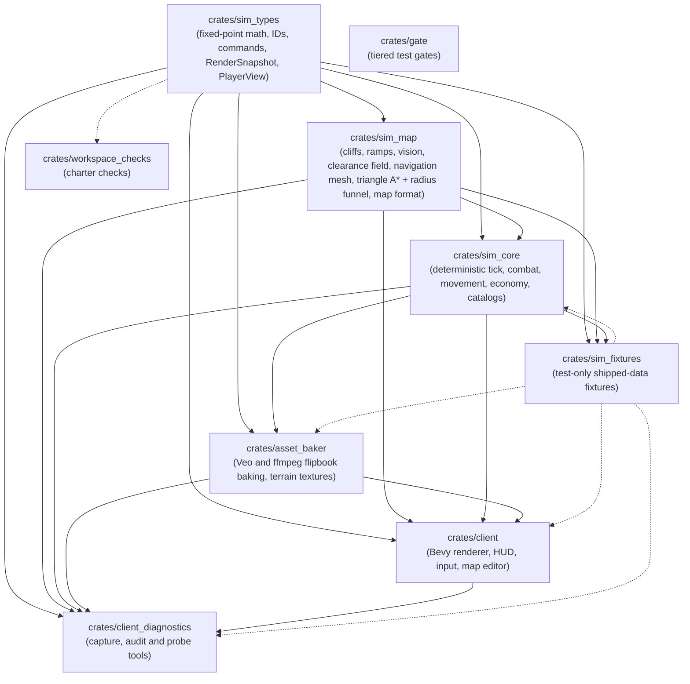

# Space Scuffle — Design and Current State

This document says what Space Scuffle is, how the code is put together, and what state each subsystem is in
today. It states what exists; anything planned but not built is labelled **intent, not built**. The rules for
working on the code are in the charter, [`AGENTS.md`](AGENTS.md). Check C17
(`crates/workspace_checks/tests/charter.rs`) keeps this document's links, evidence paths and tick rate true.

---

## 1. What Space Scuffle Is

Space Scuffle is a real-time strategy game in the spirit of *StarCraft II*: deterministic simulation, crisp unit
control, high-ground vision, turn rates and group movement. Instead of animated 3D models, every mobile unit is a
glass **bubble** and every structure a grounded **dome**, each showing a looping video of its creature or
building, with shader effects for team, facing, attack, damage and death.

**Pillars**

1. **Responsive, deterministic play.** A fixed-point simulation that produces the same result on every platform,
   with weapon wind-up and cancelable backswing for stutter-step micro, turn rates and high-ground vision.
2. **The bubble and dome look.** Units and structures read at a glance through radius, rim, altitude, team tint
   and video state rather than through meshes. Background:
   [`docs/02-bubble-visual-design.md`](docs/02-bubble-visual-design.md).
3. **Data, not code, defines the roster.** Factions, units, structures, upgrades, start loadouts and scenarios are
   RON files under [`assets/`](assets/), read at run time.
4. **Rust on Linux first.** Rust and Bevy (`wgpu`), developed on Linux; the simulation crates also build for
   WebAssembly.

**Intent, not built:** multiplayer over deterministic lockstep, recorded replays of real matches, and a Bot API
for third-party bots running headless matches. Nothing of these exists beyond the determinism they would rely on
(see §4).

---

## 2. Architecture

The workspace has nine crates. Charter §5 states the layering rule; the graph below draws every
workspace-internal dependency, and check C1 keeps the drawing equal to Cargo's and Cargo's edges within the rule. An
arrow points from a dependency to its dependent; a dashed arrow is a dev-dependency.

`asset_baker` depends on `sim_core` for the unit catalog it discovers archetypes from. `sim_fixtures` embeds the
shipped catalogs for tests only; `sim_core` uses it in its integration tests, and its own unit tests embed the same
files through `sim_core::test_support`, because a dev-dependency cycle would link a second copy of `sim_core`.
`gate` depends on no workspace crate: it reads `cargo metadata`, Git and the sources as data, so a broken crate
cannot break the tool that selects its tests.

- **`sim_types`** — the shared contract: fixed-point math (`SimScalar`, `SimVec2`, `SimAngle`), IDs, player
  commands (`PlayerCommand`, `TickBundle`), and the presentation outputs `RenderSnapshot` and `PlayerView`. It also
  owns the tick rate, `sim_types::TICKS_PER_SECOND`.
- **`sim_map`** — terrain: cliff levels, ramps, the map file format, line of sight with high ground, the
  clearance field, footprint shapes, and pathfinding on a constrained Delaunay navigation mesh with triangle A* and
  the radius funnel.
- **`sim_core`** — the deterministic tick (`SimWorld`): commands, economy, production and research,
  construction, transport, abilities, vision, targeting, movement, collision and push, weapons, the match result,
  the checksum and the catalogs.
- **`asset_baker`** — generates Veo clips within a total-spend budget, turns them into flipbook atlases through ffmpeg,
  bakes terrain textures, and audits media. It reads the unit catalog from `sim_core` to know which archetypes
  need media and which actions each publishes. A paid run goes `validate-prompts`, `generate-veo --dry-run`
  (both free, no credential read), `veo-preflight` (one free authenticated GET), `generate-veo --max-generations N
  --ledger docs/evidence/veo/ledger.jsonl --clips-dir ~/scratch/veo/clips`, `review`, `install-clip`, then
  `bake-unit-videos`; prompts and the house style are data (`assets/catalog/media_style.ron`), the total budget
  and the price per generation are `assets/media/veo_budget.ron` (every run prints spent and remaining dollars), and
  exit code 3 means a Google quota refusal ended the run.
- **`client`** — the Bevy game: renderer, bubble and dome shaders, smog fog presentation, HUD and command card,
  selection and input, result screen, the Visual Lab, and the map editor.
- **`client_diagnostics`** — capture, audit and probe tools built on the client; nothing in the game depends on
  it.
- **`sim_fixtures`** — test-only worlds and catalogs embedded from the shipped data.
- **`workspace_checks`** — the executable charter checks (C1 to C21, C23 and C24).
- **`gate`** — `cargo gate`: selects the tests a change can break from the catalog `crates/gate/suites.ron`
  and runs them in the tiers of charter §4.3 (`quick`, `package`, `merge`, `full`), with stamps, flake reruns,
  the red rule's suspect list and the CI timing summary; its catalog check is C22. It depends on no other
  workspace crate.

**Data flow of a match.** The client turns input into `PlayerCommand`s and submits them in a `TickBundle`.
`SimWorld::step_into` advances one tick and writes a `RenderSnapshot`; `PlayerView` gives each player what they
may know. The client presents both. Catalogs (`assets/catalog/`) and scenarios (`assets/scenarios/`) are loaded
from disk at start-up, so changing the roster needs no recompilation (charter §3.3).

---

## 3. Simulation

**Tick rate:** 25 Hz, one tick per 40 ms of game time (`sim_types::TICKS_PER_SECOND`). Every duration the
simulation stores is a whole number of ticks.

**The phases of `SimWorld::step_into`, in order:**

1. Validate transport links (a broken link reports a diagnostic and ends the tick after the checksum and snapshot).
2. Apply the tick's commands.
3. Production and research timers, buffs, regeneration and hazard zones.
4. Unit tasks: every unit whose front order is a task, such as harvesting or building, acts on it.
5. Vision for every player.
6. Target acquisition.
7. Movement and steering.
8. Collision and push.
9. Weapons and projectiles.
10. Reap destroyed entities and their transport groups, and update the match state.
11. Compute the state checksum.
12. Write the `RenderSnapshot`.

**Fixed-point model.** Authoritative positions, velocities, angles, health and timers are fixed-point
(`SimScalar`, 32.32). Floats appear in the simulation crates only where they produce presentation output or read
authored decimal data (check C7). Trigonometry uses a lookup table so every platform computes the same bits.

**Checksum and golden replay.** Each tick ends with a 64-bit checksum of the persistent state, including the RNG
position. A golden replay
([`crates/sim_core/tests/fixtures/golden_replay.ron`](crates/sim_core/tests/fixtures/golden_replay.ron)) must
reproduce every recorded checksum on Linux x86_64, Windows x86_64, macOS ARM64 and `wasm32-wasip1`, in debug and
release; CI's determinism jobs run it.

---

## 4. Subsystem Status

Status is `Working` (built, tested, in the shipped game), `Partial` (built but limited or not all shipped),
`Not built` or `Removed`. Evidence is the test that shows the subsystem working. Open owner questions are in
[`docs/questions/open/`](docs/questions/open/).

| Subsystem | Status | What exists | Evidence | Known gaps |
|---|---|---|---|---|
| Fixed-point math | Working | `SimScalar`, `SimVec2`, `SimAngle`, table trigonometry, checked overflow | `crates/sim_types/tests/math_identities.rs`, `crates/sim_types/tests/math_properties.rs` | none known |
| Tick and checksum | Working | The phase pipeline of §3; versioned checksum over persistent state and RNG | `crates/sim_core/tests/checksum_state_tests.rs` | none known |
| Cross-platform determinism | Working | Golden replay on three native targets and wasm32 in CI; a second fixture pins vision before acquisition and route upkeep before arrival (`c271226`) | `crates/sim_core/tests/golden_replay_tests.rs` (`golden_replay_orders_reproduces_every_checkpoint`) | none known |
| Combat | Working | Weapon timing with turn, damage point, cancelable backswing and cooldown; a hull-mounted weapon waits for its hull to face the target within the weapon's StarCraft II arc; turrets turning at their rates; shields and armour; life and energy regenerate only on completed entities, energy without a delay (plan `2026-11-23-regeneration`); splash, centred on the target or, by data, on the attacker, and opened by data only below a target radius (plan `2026-11-23-splash-centres`); an area keeps to its search point's cliff level unless its data say otherwise, and the Baneling strikes a target on another level directly (plan `2026-11-23-splash-cliff-levels`); a ramp counts as both its landings, and an air blast or air unit ignores levels (owner answers Q0099 1(c), 2(b), plan `2026-11-24-owner-answers-cliff-and-vision`); projectiles, and a missile whose target is lost flies on to the last point and lands there, its area striking around it (5.0.14 `PointFallback`); an air-plane attacker is revealed to the player it strikes (a `Snapshot` weapon instead leaves an unseen attacker's still image, `PlayerView::attack_snapshots`, plan `2026-11-24-attacker-snapshot`) and that player's allies (with no teams, the struck player alone; Q0101 4(b)) for 54 ticks by its weapons' `attack_visibility` (5.0.14 `Visibility Visible`, `AttackReveal`; plan `2026-11-23-vision-and-detection`), and a concealed attacker so revealed is a target where that player detects it (plan `2026-11-24-owner-answers-cliff-and-vision` D-4); a weapon starts, lands and tracks only a target its player sees (5.0.14 `TargetFilters Visible`), and its missile re-checks that filter and drops a target that teleports in flight unless its `missile_validation` clears either check (`ValidateWeapon`, `ValidateTeleport`; the Brood Lord analogue validates at impact; plan `2026-11-24-weapon-validation`); ranges to and from a structure (weapon, scan, cast, projectile, missile, splash, Charge, boarding) measure to its 5.0.14 engine radius, authored as `radius` in `structures.ron`, while its dome is drawn at its footprint shape's smaller half-extent (B-135 fixed, plan `2026-11-18-structure-radius`; shapes and the cover rule `radius` ≥ the shape's farthest point, plan `2026-11-18-contour-footprints` D-10) | `crates/sim_core/tests/stutter_step_tests.rs`, `crates/sim_core/tests/combat_correctness_tests.rs`, `crates/sim_core/tests/damage_and_shields_tests.rs`, `crates/sim_core/tests/structure_radius_tests.rs` | Changed outcomes await the owner (Q0007); battle 33 investigated in [`docs/evidence/2026-11-03-battle-33-investigation.md`](docs/evidence/2026-11-03-battle-33-investigation.md), changes proposed in Q0035 to Q0041; how StarCraft II spaces melee attackers around a solid enemy is not researched: the contact rules of `d4109e2` stay for now; how StarCraft II spaces melee attackers is recorded bug B-50 in plan `2026-11-05-sc2-deviation-fixes` (WP16), follow-up F-1 of plan `2026-11-04-combat-sc2-alignment` (Q0035); Differences from StarCraft II are bugs, listed in the [bug register](#known-deviations-from-starcraft-ii-bugs) below |
| Movement and pathfinding | Working | Constrained Delaunay navigation mesh rebuilt on structure change, triangle A* with radius widths and the radius funnel (StarCraft II's reported design), each unit routed at its own radius (B-102 fixed, plan `2026-11-09-sc2-pathfinding` WP5 to WP10), steering, push priority and Hold Position; local movement runs the contact-solver pipeline by default (plan `2026-11-20-contact-solver` WP6, `contact.pipeline: Solver` in `movement_rules.ron`): each unit steers by its intent with one time-to-collision side rule, and one position-based contact solver (Jacobi iterations, then a hard pass for enemies and fixed bodies) separates bodies after every unit moved; friends may overlap briefly, at most 5 % of the radius sum while moving and 1 % at rest (D-α), moving friends push each other by priority (D-β), an attacker walks to a free point of the ring at its weapon's reach and stands with its order when the ring is full (D-γ, Q0089), allies may nudge an engaged melee unit along its ring (D-δ, Q0095), and a pursuit reads its target's tick-start position, so processing order does not decide a fight (B-157 fixed); the open differences are B-188 to B-193 below. The legacy pipeline, which the rest of this entry describes where it differs (the waiting rule, the surround walk and the separate soft collision pass), stays selectable until the plan's WP7 deletes it; hulls turn at StarCraft II's per-tick rates, at most once per tick, at a stationary rate on ticks the unit does not move, and units flagged `turn_before_move` turn in place before a step their hull does not face (Q0050); routes are never rewritten for bodies: a corner is passed by position and terrain view, and a unit steers past a body parked on its corner on the outside of the turn and keeps rounding it while the corner stays occupied (plan `2026-11-19-parked-body-aim` D-1), and corner waypoints keep each unit's own radius plus 0.05 from the corner (B-99, B-100 and B-101 fixed, plan `2026-11-09-sc2-pathfinding` WP2 to WP4); a unit blocked by friends that will not yield waits instead of stepping into a gap it cannot pass, and an attacker walks round the crowd on a side it keeps; only idle, standing friends are pushed, at StarCraft II's push priorities; a burrowed body touches only burrowed bodies (B-104, B-105, B-48 and B-93 fixed, B-103 narrowed, plan `2026-11-09-friendly-blocking`); an attacker queued behind a friend that holds its ground is not stalled, so it keeps its attack order, while a plain move into a blocked spot is still given up (Q0089, plan `2026-11-19-crowd-edge-steering` D-4); a spent surround walk waits without a timer and walks again when the side that closed last opens for a whole step, when the unit gains ground or when its target changes, and a walk in progress ends only on room beyond what its own retreat made (plan `2026-11-19-crowd-edge-steering-2` D-1, D-2); bodies are discs against terrain and structures, as in StarCraft II: no walk or push presses a disc deeper into a wall, a step into one slides along it, and a sliver of slide is waited out (B-113 fixed, plan `2026-11-11-contact-and-missiles`); bodies are discs against terrain and structures at their terrain radius (`min(InnerRadius, Radius)` of 5.0.14, authored as `terrain_radius` for 17 ground units), and against each other at their radius: routes, group lanes, the Charge path, the map-edge domain, placement, production exits and construction sites use it (B-116 fixed, plan `2026-11-18-inner-radius`); a registered structure is no body: it meets ground units through its footprint at their terrain radius (B-131 fixed, plan `2026-11-18-structure-contact`); a structure meets units through its 5.0.14 footprint shape (a chamfered box authored as `footprint_shape`), cut into the mesh on a quarter-cell lattice; its cells remain its placement footprint (B-134, B-138 fixed, plan `2026-11-18-contour-footprints` WP3 to WP6, `82ea0a36`, `a7ef86fc`), and through resource nodes' footprints, a geyser's outline the void 16-gon (B-147 fixed, plan `2026-11-20-resource-footprints`); an automatically acquired chase is given up 21 from where it began, 5.0.14's `AcquireLeashRadius` (B-142 fixed, same plan, `f0086939`); ground units ordered together keep one lane round terrain obstacles: each member takes its group leader's lane (a homotopy class of terrain cut crossings) when that route is at most `lane_tolerance_permille` (75 ‰, `assets/catalog/movement_rules.ron`) longer than its own, and its own route otherwise (sanctioned deviation S-7, Q0079; 0 is StarCraft II's per-unit routing; plan `2026-11-10-group-routing`) | `crates/sim_map/tests/navmesh_tests.rs`, `crates/sim_map/tests/lane_tests.rs`, `crates/sim_core/tests/group_routing_tests.rs`, `crates/sim_map/tests/funnel_tests.rs`, `crates/sim_map/tests/clearance_field_tests.rs`, `crates/sim_core/tests/push_priority_tests.rs`, `crates/sim_core/tests/second_line_tests.rs`, `crates/sim_core/tests/crowd_edge_tests.rs`, `crates/sim_core/tests/burrow_attack_tests.rs`, `crates/sim_core/tests/hull_turning_tests.rs`, `crates/sim_core/tests/route_following_tests.rs`, `crates/sim_core/tests/movement_contact_tests.rs`, `crates/sim_core/tests/contact_solver_tests.rs`, `crates/sim_core/tests/solver_pipeline_tests.rs`, `crates/sim_fixtures/tests/harness_tests.rs`, `crates/sim_map/tests/wall_contact_tests.rs`, `crates/sim_core/tests/wall_contact_tests.rs`, `crates/sim_core/tests/terrain_radius_tests.rs`, `crates/sim_core/tests/structure_contact_tests.rs`, `crates/sim_core/tests/contour_footprint_tests.rs`, `crates/sim_map/tests/wall_off_tests.rs` | A move to an unreachable point walks to the nearest reachable one, by the owner's choice (Q0006); Differences from StarCraft II are bugs, listed in the [bug register](#known-deviations-from-starcraft-ii-bugs) below |
| Terrain, cliffs and ramps | Working | Cliff levels (`GameMap::cliff_span_at`, the levels a position belongs to, a ramp counting as both its landings, owner answer Q0099 1(c), plan `2026-11-24-owner-answers-cliff-and-vision` D-1), ramps, the map format and its validation, and the client's terrain mesher; `MapDocument::encode` returns a typed error (`f53f73b`, tests `encode_rejects_*`); the terrain chunks cover the last dual column and row (`94130d5`, test `spawned_chunks_cover_every_dual_cell`); a ramp owns its footprint and the walls on its edges, so the upper floor ends where the ramp begins (`3baab60`, `ef26242`, plan `2026-11-09-ramp-geometry`) | `crates/sim_map/tests/ramp_traversal_tests.rs`, `crates/sim_map/tests/validation_tests.rs`, `crates/sim_map/tests/map_format_tests.rs`, `crates/client/tests/mesher_golden_tests.rs`, `crates/client/tests/terrain_tests.rs`, `crates/client/tests/ramp_geometry_tests.rs` | none known |
| Simulation vision and watchtowers | Working | Per-player vision with high ground, air reveal and watchtowers; detection has its own radius (`detection_radius`, 11 on every shipped detector as 5.0.14's `Detector11`) and is a plain circle that no terrain stops, giving no sight of its own, and a detector under construction detects nothing (owner answers Q0101 2(b), 3(b), plan [`2026-11-24-owner-answers-cliff-and-vision`](docs/plans/2026-11-24-owner-answers-cliff-and-vision.md)); a ground source outside a sight blocker sees none of it, a source inside sees it and out of it (plan [`2026-11-23-vision-and-detection`](docs/plans/2026-11-23-vision-and-detection.md)) | `crates/sim_map/tests/vision_tests.rs`, `crates/sim_core/tests/blocker_edge_tests.rs`, `crates/sim_core/tests/watchtower_tick_tests.rs`, `crates/sim_core/tests/detection_circle_tests.rs` | Q0101 answered: air units and towers see into blockers, detection is a circle, detectors under construction do not detect, and a reveal goes to the struck player and its allies (no teams exist, so the struck player alone) |
| Economy and gas | Working | Harvesting and income for minerals and gas; gas is enabled in the shipped game since its media was baked (Veo batch 1, `2c5ed5e`). A town hall analogue cannot be placed within reach of resources (5.0.14 `NearResources`: the rings of `assets/catalog/placement_rules.ron`, refused by the rows whose `placement_excludes` names it), and the Spine and Spore Crawler analogues need their whole site in sight (`Fogged`), plan [`2026-11-19-footprint-flags`](docs/plans/2026-11-19-footprint-flags.md). Resource nodes have their 5.0.14 footprints (a mineral field 2×1, a geyser 3×3 with its void outline), authored in `placement_rules.ron` and cut into the navigation mesh; workers gather and deliver by contact; a mined-out field leaves the map (B-147 fixed, plan [`2026-11-20-resource-footprints`](docs/plans/2026-11-20-resource-footprints.md)). Harvest timings are the resource's 5.0.14 `HarvestTime`, `HarvestAmount` and `ReturnDelay`, authored per kind in `placement_rules.ron`: a mineral trip gathers 50 ticks for 5 and waits 9 at the field, a gas trip gathers 35 ticks for 4 (B-150, B-151 fixed, plan [`2026-11-22-harvest-timing`](docs/plans/2026-11-22-harvest-timing.md)). One worker at a time gathers a resource and the others wait in line; mineral workers spread to fields with fewer workers within the harvest ability's `AcquireRadius` 10, gas workers wait; an order given during `ReturnDelay` starts when the wait ends (B-61, B-67, B-160 fixed, plan [`2026-11-23-harvest-occupancy`](docs/plans/2026-11-23-harvest-occupancy.md)). The next worker in a resource's line starts `handoff_ticks` after the previous take, 2 on a mineral field and 1 at a geyser, the node's release tick hashed in `SimWorld::resource_lines` (B-162 fixed, plan [`2026-11-23-harvest-handoff`](docs/plans/2026-11-23-harvest-handoff.md)). A gas gatherer is inside its extractor, hidden, for its gather (5.0.14 `Flags HideHarvesters`, the structure capability `hides_harvesters`): not acquired, attacked, splashed, found by an effect search or ordered, it sees nothing, survives its extractor's death where it went in, and the client neither draws nor selects it (B-161 fixed, plan [`2026-11-24-hidden-harvesters`](docs/plans/2026-11-24-hidden-harvesters.md); Q0107 and Q0108 defaults) | `crates/sim_core/tests/harvest_income_tests.rs`, `crates/sim_core/tests/harvest_edge_tests.rs`, `crates/sim_core/tests/harvest_timing_tests.rs`, `crates/sim_core/tests/harvest_occupancy_tests.rs`, `crates/sim_core/tests/harvest_handoff_tests.rs`, `crates/sim_core/tests/hidden_harvester_tests.rs`, `crates/sim_core/tests/resource_footprint_tests.rs`, `crates/sim_map/tests/resource_footprint_tests.rs`, `crates/sim_core/tests/footprint_flag_tests.rs`, `crates/client/tests/battle_card_path_tests.rs` (`gas_through_the_card_extractor_snap_harvest_and_income`) | none known |
| Construction | Working | Transactional build admission and a construction lifecycle | `crates/sim_core/tests/construction_lifecycle_tests.rs` | none known |
| Production and research | Working | Production queues, cancel and refund, supply at the start of production, rally points, placed exits (plan [`2026-11-23-production-queue`](docs/plans/2026-11-23-production-queue.md)); rally slots from data (the Hatchery analogues' army and worker rallies), Shift-queued rally waypoints and rallies on enemy units (plan [`2026-11-25-rallies`](docs/plans/2026-11-25-rallies.md)) | `crates/sim_core/tests/production_transactions_tests.rs`, `crates/sim_core/tests/production_supply_tests.rs`, `crates/sim_core/tests/rally_tests.rs`, `crates/sim_core/tests/research_transaction_tests.rs`, `crates/client/tests/battle_card_path_tests.rs` (`research_through_the_card_then_overclock_works`) | none known; research is enabled in the shipped game since Veo batch 1 (`2c5ed5e`) |
| Transport | Working | Load and unload orders with ownership checks; enabled in the shipped game since Veo batch 1 (`2c5ed5e`) | `crates/sim_core/tests/transport_ownership_tests.rs`, `crates/sim_core/tests/load_orders_tests.rs`, `crates/client/tests/battle_card_path_tests.rs` (`load_and_unload_through_right_click_and_the_card`) | none known |
| Abilities and spells | Working | Data-defined abilities and modes, and spells as composable effect trees with statuses read from `assets/catalog/ability_effects.ron` and `statuses.ron` (plan `2026-11-10-spellcaster-mechanics`); Psionic Storm, Abduct, Fungal Growth and Blinding Cloud are shipped ([evidence](docs/evidence/2026-11-10-spellcaster-mechanics.md)); a mode switch given without Shift replaces the unit's orders, and a queued one reaches an anchored unit (plan `2026-11-09-client-mode-commands` D-6) | `crates/sim_core/tests/spells_and_abilities_tests.rs`, `crates/sim_core/tests/psionic_storm_tests.rs`, `crates/sim_core/tests/abduct_tests.rs`, `crates/sim_core/tests/fungal_growth_tests.rs`, `crates/sim_core/tests/blinding_cloud_tests.rs`, `crates/sim_core/tests/effect_tree_tests.rs` | The storm's and the cloud's area rings, Abduct's tether line and Fungal Growth's missile wait on Q0080; other missing abilities (B-69) |
| Match result | Working | Victory and defeat from the game rules | `crates/sim_core/tests/match_result_tests.rs` | Rules accepted by the owner (Q0008); where the spec is silent, they follow StarCraft II (charter §8) |
| `PlayerView` | Working | Per-player knowledge for the HUD and admission | `crates/sim_core/tests/player_view_tests.rs` | none known |
| Catalog data | Working | Factions, units, structures, upgrades, start loadouts and scenarios read at run time | `crates/sim_core/tests/runtime_catalog_tests.rs`, `crates/sim_core/tests/faction_catalog_tests.rs` | Data choices await the owner (Q0007) |
| Bubble and dome rendering | Working | Instanced bubbles and domes with optics, dome fill and validated shaders | `crates/client/tests/gpu_validation_tests.rs`, `crates/client/tests/bubble_optics_tests.rs`, `crates/client/tests/dome_fill_tests.rs` | none known |
| Smog fog presentation | Working | Smog field driven by the player's vision; one rule in `BattleFog` decides what of each unit reaches the player; an attacker that struck the viewer unseen leaves a still snapshot (`PlayerView::attack_snapshots`), drawn and never picked (plan `2026-11-24-attacker-snapshot`); an undetected burrowed enemy shows nothing and an undetected cloaked one only its shimmer, and neither is picked, targeted by click, inspected or given a health bar (B-106, effects WP3); an enemy whose attack reveals it to the viewer (`PlayerView::attack_revealed`) is in sight wherever it stands (plan `2026-11-23-vision-and-detection` D-6); the all-pairs kinematics fallback above 512 bubbles reports its peer bounces (`9987863`, unit test `all_pairs_fallback_reports_its_contacts`, `kinematics_all_pairs_fallback_golden`) | `crates/client/tests/smog_golden_tests.rs`, `crates/client/tests/battle_fog_tests.rs`, `crates/client/tests/concealment_gpu_tests.rs` | Smog goldens are host-independent: every transcendental function on a smog path is the `libm` crate's (`client::smog::math`, check C23, Q0014; `docs/evidence/2026-11-05-libm-smog-math.md`); the solver costs about 6 ms per frame during a 400-unit fight (C-18, partly fixed; §5) |
| Effect presentation | Working | Data-driven effects (plan [`2026-11-09-effect-visualization`](docs/plans/2026-11-09-effect-visualization.md)): a vocabulary of composed effects in `assets/catalog/effects.ron`, chosen per weapon, mode, status, ability and death by an `effects` block in the unit catalog and sized by the simulation's published splash zones, lines, areas and missiles; `client::effects` draws sprites, rings, ribbons, decals, particles and lights instanced within a budget with level of detail, cut at the viewer's fog, and puts an instant hit, a blow or a projectile's landing on the struck bubble's glass towards the attacker, the bubble found by the struck entity's id, and starts a projectile's flight on its shooter's glass, found by the shooter's id (`effects::struck`, plan [`2026-11-17-effect-snapshot-identity`](docs/plans/2026-11-17-effect-snapshot-identity.md)); `asset_baker` bakes effect textures. Shipped: the vertical slice (Amendment 3), splash impacts (WP7), mode transitions and stances (WP8), statuses and deaths (WP9), areas and links (WP10), and every weapon's own shot, impact and death look in place of the legacy combat cards, with Fungal Growth's missile (WP11, accepted, Amendment 28); from the snapshot identity plan, statuses shown by name (`fungal_affliction`), spell impacts laid from the simulation's `SpellImpact` event, and sustained beams held as one look that follows both bubbles; the showcase's `effects` take, whose scenes check the looks they spawn, and `frame_budget --effect-mix`, which draws every look of the vocabulary at once (WP14, Amendment 31). The plan is done (WP15, Amendment 32); B-106 to B-111 fixed | `crates/client/tests/effect_catalog_tests.rs`, `crates/client/tests/effect_runtime_tests.rs`, `crates/client/tests/effect_gpu_tests.rs`, `crates/client/tests/effect_slice_gpu_tests.rs`, `crates/client/tests/stance_gpu_tests.rs`, `crates/client/tests/status_gpu_tests.rs`, `crates/client/tests/weapon_look_tests.rs`, `crates/client/tests/weapon_battle_gpu_tests.rs`, `crates/client/tests/area_link_gpu_tests.rs`, `crates/client/tests/decal_identity_gpu_tests.rs`, `crates/client/tests/decal_age_gpu_tests.rs`, `crates/client_diagnostics/tests/frame_budget_tests.rs`, [`docs/evidence/2026-11-09-effect-visualization.md`](docs/evidence/2026-11-09-effect-visualization.md), [`docs/evidence/2026-11-17-effect-snapshot-identity.md`](docs/evidence/2026-11-17-effect-snapshot-identity.md) | An area look seen in part is cut along whole fog cells (B-132); a quiet-host confirmation of §10.3's relaxed splash-stress bar (Q0090; B-137 closed, lasting decals aged on the GPU, plan [`2026-11-19-retained-effect-instances`](docs/plans/2026-11-19-retained-effect-instances.md)); units without media (the Baneling and Colossus analogues among them) are not presented in a battle, so their looks are seen only in the lab, the tests and the frame budget; the reviews' polish items are recorded in the plan (Amendments 9, 24, 25, 27, 32) |
| Runtime mist | Removed | Deleted in `0f31027` (remediation decision D2) | none | none |
| HUD and command card | Working | Resources, selection card, command card and production queue (a job waiting for supply is marked), a selected structure's rally drawn on the ground and set by right click (plan `2026-11-23-production-queue` D-10), with a reticle per waypoint, chained lines tinted by slot, Shift-right-click waypoints and card entries per rally slot that arm a rally mode (plan `2026-11-25-rallies` D-8), mode commands built from catalog `ToggleMode` abilities (Siege Mode, Burrow analogues; plan `2026-11-09-client-mode-commands`), Stop and Hold shown and admitted by the settled stance's catalog `orders` (plan `2026-11-23-anchored-commands`), the A slot (Attack, or Scan Move for a selection with no member that has Attack) shown and admitted by the settled stance's catalog A command, and an A-click on any unit, one's own included, attacks it with the members that can and attack-moves the rest to it (plans `2026-11-23-stance-checked-orders`, `2026-11-24-attack-orders`) | `crates/client/tests/battle_hud_tests.rs`, `crates/client/tests/battle_card_tests.rs`, `crates/client/tests/battle_mode_tests.rs` | keys are positional, not StarCraft II's per-ability keys ([Q0072](docs/questions/closed/0072-per-ability-hotkeys.md)) |
| Selection and input | Working | Selection, box select, control groups, right-click orders; one declared writer per client concern; input ownership sampled after the inspector draws | `crates/client/tests/battle_input_tests.rs`, `crates/client/tests/battle_context_order_tests.rs`, `crates/client/tests/system_ownership_tests.rs` | none known |
| Result screen | Working | Victory and defeat screen | `crates/client/tests/battle_result_tests.rs`, [`docs/evidence/2026-11-03-result-window-victory.md`](docs/evidence/2026-11-03-result-window-victory.md) | none known |
| Whole skirmish | Working | A skirmish won headless through input events alone | `crates/client/tests/skirmish_match_tests.rs` | none known |
| Map editor | Working | Paint, place, save, playtest and return; a load requested by the UI applies in the same frame | `crates/client/tests/editor_app_tests.rs` (including `document_load_applies_after_the_editor_ui_requests_it`), `crates/client/tests/editor_core_tests.rs` | none known |
| Asset baker | Working | Veo generation of exactly the published actions with prompts from data, a request ledger, a total-spend budget, a quota stop, a free preflight, keyframe chaining, review and install; ffmpeg import, flipbook atlases, terrain textures, media audit | `crates/asset_baker/tests/veo_cli_tests.rs`, `crates/asset_baker/tests/bake_integrity_tests.rs`, `crates/asset_baker/tests/ffmpeg_tests.rs` | none known; used live for 217 generations ($86.80 at list price, of the total budget, $230 since the owner's raise of 2026-11-18, $200 before) with loop pinning (`lastFrame`), seam repair, `loop-check`, letterboxing and provenance ([batch 1](docs/evidence/veo/2026-11-04-batch-1.md), [batch 2](docs/evidence/veo/2026-11-05-batch-2.md)) |
| Media coverage | Partial | Real Veo media for 30 of 91 catalog identities, all of them in `assets/media/required_set.ron` (tier `Required`: the skirmish's mineral, gas, research and transport paths, 10; tier `Expansion`: the Veo plan's WP6 batches 3 to 6, 20), which passes `audit-media --strict` with provenance and the request ledger, 30 of 30 (remediation step 8.5, B-1 fixed, `473b977`; [batch 5b](docs/evidence/veo/2026-11-09-batch-5b.md), [batch 6](docs/evidence/veo/2026-11-09-batch-6.md)); no atlas is a copy of `concept_video.png`; missing media fails loudly | `crates/client/tests/runtime_media_tests.rs`, `crates/client/tests/mode_atlas_gpu_tests.rs`, `crates/asset_baker/tests/media_tests.rs`, `crates/asset_baker/tests/mode_media_tests.rs`, [`docs/evidence/veo/2026-11-05-batch-2.md`](docs/evidence/veo/2026-11-05-batch-2.md), [`docs/evidence/veo/2026-11-09-batch-5b.md`](docs/evidence/veo/2026-11-09-batch-5b.md), [`docs/evidence/veo/2026-11-09-batch-6.md`](docs/evidence/veo/2026-11-09-batch-6.md) | `psi_grey` and `rhino_beetle` keep legacy atlases without provenance; the other 59 identities have none: `colossus_mech` has an Idle and an Attack but no accepted Walk, `grav_harvester` and `nectar_worker` wait for a later batch, the Enclave and the Swarm other than the Lurker analogue `burrow_scorpion` are out of scope; the two catalog modes of shipped units have mode atlases (the sieged `railgun_crawler`, the burrowed `burrow_scorpion`; Idle, Attack and the enter and leave morphs), shown in battle from the published stance (B-111 fixed, plan `2026-11-09-effect-visualization` Amendment 10, [evidence](docs/evidence/veo/2026-11-12-mode-clips.md)); the Lab and the inspector show the default stance |
| Terrain anisotropy on old lavapipe | Partial | Terrain sampling validated on `radv`; a test override for old lavapipe | `crates/client/tests/gpu_validation_tests.rs` | Override kept until this server's Mesa is 25.1 or later (Debian 13 ships 25.0.7), then deleted (Q0009) |
| Networking | Not built | Nothing; intent is deterministic lockstep | none | all |
| Replays | Partial | The two golden replay fixtures only | `crates/sim_core/tests/golden_replay_tests.rs` | No recording of real matches |
| Bot API | Not built | Nothing | none | all |
| Showcase video | Working | The `showcase` tool (`crates/client_diagnostics`) renders a storyboarded tour of a real skirmish through the production client at one tick per frame, in two takes: `battle` (the skirmish) and `effects` (`assets/scenarios/showcase_effects.ron`: a siege line anchors and burrows and raiders attack into it, its scenes failing when an effect they ask for is not spawned; plan [`2026-11-09-effect-visualization`](docs/plans/2026-11-09-effect-visualization.md) WP14); `.github/workflows/showcase.yml` renders it on `lavapipe` after green CI on `main` and publishes it to GitHub Pages for [`README.md`](README.md) (Q0056) | `crates/client_diagnostics/tests/showcase_tests.rs`, `crates/client_diagnostics/tests/showcase_storyboard_tests.rs`, `crates/client_diagnostics/tests/showcase_encode_tests.rs` | The CI video is `lavapipe` output, without terrain anisotropy on Mesa before 25.1 (Q0009); the battle shows fog only by hiding enemies, it does not shade terrain; the take leaves out the empty command panel ([evidence](docs/evidence/2026-11-05-showcase-video.md)); the CI render with both takes is estimated at about 35 min, not yet measured on CI (how to read it: [effect evidence](docs/evidence/2026-11-09-effect-visualization.md), WP14); the Baneling beat waits for the Baneling analogue's media |

### Known deviations from StarCraft II (bugs)

Unit mechanics and values follow StarCraft II 5.0.14, and unit behaviour stays very close to it (charter §8,
[Q0051](docs/questions/closed/0051-sc2-mechanics-standing-rule.md)). Every known difference that is still open is
listed here by its ID in plan [`2026-11-05-sc2-deviation-fixes`](docs/plans/2026-11-05-sc2-deviation-fixes.md), which
describes each one, cites the game data and schedules its fix. Accepted differences are not bugs and are not
listed: the sanctioned items S-1 to S-7 ([Q0052](docs/questions/closed/0052-sanctioned-sc2-deviations.md)) and the
detail differences of the plan's Amendment 2. Each work package removes its IDs from this list when it lands.

| ID | Deviation | Package |
|---|---|---|
| B-5 | Whether damage point and backswing hold an automatically attacking unit (not yet sourced) | WP16 |
| B-6 | Release range slop 0.5 for every weapon | WP9 |
| B-13 | Call-for-help radius, flee distance, leash and abandoned-target time are unsourced | WP16 |
| B-18 | One search per strike: the Colossus' two sweeps strike a unit on the line once per shot; the game's two sweeps strike it twice (plan Amendment 13, §9.3; held, it flips battle 12b) | WP8b |
| B-19 | Ultralisk cleave modelled as a circle | WP8c |
| B-20 | Mutalisk glaive does not bounce | WP8d |
| B-21 | Brood Lord spawns no Broodlings | WP18 |
| B-22 | Carrier interceptors are one 8-strike weapon | WP18 |
| B-27 | Liberator analogue has no Defender Mode, so no ground attack at all (its fighter-mode ground attack was removed by WP2) | WP18 |
| B-35 | No energy regeneration delay | WP15; **not a deviation** by plan [`2026-11-23-regeneration`](docs/plans/2026-11-23-regeneration.md): no layer of the 5.0.14 data sets `EnergyRegenDelay` (S2), so energy rises on every tick as in the game; pinned by `regeneration_tests` (WP1 `07e86761`), [evidence](docs/evidence/2026-11-23-regeneration.md) |
| B-36 | Unfinished structures regenerate life | WP15; **fixed** by plan [`2026-11-23-regeneration`](docs/plans/2026-11-23-regeneration.md) WP1 (`07e86761`): no vital regenerates before a structure completes; a foundation's life follows its construction curve exactly (the game's rule **verify**, [Q0094](docs/questions/closed/0094-zerg-structure-regeneration-under-construction.md)), [evidence](docs/evidence/2026-11-23-regeneration.md) |
| B-38 | No burrowed Roach regeneration and no Tunneling Claws | WP15, WP18; regeneration value and hook recorded for WP18 in plan [`2026-11-23-regeneration`](docs/plans/2026-11-23-regeneration.md) §14 F-1 |
| B-45 | Phoenix and Void Ray analogues cannot fire while moving | **fixed** by plan [`2026-11-23-turret-wind-up`](docs/plans/2026-11-23-turret-wind-up.md): WP2 (`01f963f7`) lets the Phoenix analogue fire while moving at the best enemy it reaches; WP3 (D-6, Amendment 2) lets a `Moving` weapon's wind-up leave its unit walking, so the Phoenix analogue translates on every tick of a pass and the Void Ray analogue chases through its wind-up inside an attack order (5.0.14 lets it fire while moving only there; `turret_tracking_tests.rs`, `stutter_step_tests.rs`; [evidence](docs/evidence/2026-11-23-turret-wind-up.md)) |
| B-46 | The Viking analogue cannot land | WP18 |
| B-49 | Which radius spaces units (`separation_radius` is unread) | WP16 |
| B-50 | Melee attackers pack around a solid enemy by our own rule (Q0035) | WP16 |
| B-52 | Projectile flight times of multi-phase movers, High Templar and Spine Crawler | WP14 |
| B-54 | A missile whose target is lost (dies, is loaded, turns invulnerable, cloaks or burrows undetected) vanishes instead of landing on the point: 5.0.14's `CEffectLaunchMissile` default `PointFallback 1` (`core` EffectData:97) flies it on to the target's last position, where a splash weapon still strikes its area | **fixed** by plan [`2026-11-23-vision-and-detection`](docs/plans/2026-11-23-vision-and-detection.md) WP1 (`c847f873`; `lost_missile_tests.rs`; [evidence](docs/evidence/2026-11-23-vision-and-detection.md)) |
| B-55 | An air-plane attacker (air units and the Colossus) is never revealed to the player it strikes: 5.0.14 sets `Visibility Visible` on every damage effect of these units (`liberty` EffectData:2421, :1715, …), which makes the attacker targetable by the struck player for `AttackReveal`'s 3 Normal s (`core` BehaviorData:237–240); a ground attacker's `Snapshot` reveals no target | **fixed** by plan [`2026-11-23-vision-and-detection`](docs/plans/2026-11-23-vision-and-detection.md) WP4 and WP6 (`cf846dc3`, `4b67f9c5`; `attack_reveal_tests.rs`, battle 41; [evidence](docs/evidence/2026-11-23-vision-and-detection.md)); the reveal goes to the struck player and its allies (owner answer Q0101 4(b)), with no teams the struck player alone (plan [`2026-11-24-owner-answers-cliff-and-vision`](docs/plans/2026-11-24-owner-answers-cliff-and-vision.md) D-6) |
| B-56 | Detection has no radius of its own: 5.0.14's detection is a `Detector11`-style behaviour's `Detect` (`liberty` BehaviorData:1175–1178), separate from `Sight`; every modelled detector's equals its sight (11) | **fixed** by plan [`2026-11-23-vision-and-detection`](docs/plans/2026-11-23-vision-and-detection.md) WP2 (`be33a440`; `detection_radius` per row; [evidence](docs/evidence/2026-11-23-vision-and-detection.md)) |
| B-57 | The edge cell of a sight blocker is seen from outside: "Units inside obstructing terrain can't be seen by units or structures on the outside" (Blizzard, *Game Guide: Map Elements*) | **fixed** by plan [`2026-11-23-vision-and-detection`](docs/plans/2026-11-23-vision-and-detection.md) WP3 (`e52c0c83`; `vision_tests.rs`, `blocker_edge_tests.rs`; [evidence](docs/evidence/2026-11-23-vision-and-detection.md)) |
| B-59 | Every queued job holds supply | WP17; **fixed** by plan [`2026-11-23-production-queue`](docs/plans/2026-11-23-production-queue.md) WP2 (`19edaebe`): only the job in production holds supply; a job behind others pays its price, holds none and takes its supply when it reaches the front, waiting there (`SupplyWait`, its countdown not started) while it does not fit (5.0.14 `WaitForFood`) ([evidence](docs/evidence/2026-11-23-production-queue.md)) |
| B-60 | No rally points | WP17; **fixed** by plan [`2026-11-23-production-queue`](docs/plans/2026-11-23-production-queue.md) WP1 (`0ddc0b4f`, the town hall's auto-rally), WP3 (`e9268383`, `SetRally` and the new unit's order: move, harvest, board or go to the target's spot) and WP5 (`365f7568`, right click sets it, the selected structure draws it) ([evidence](docs/evidence/2026-11-23-production-queue.md)) |
| B-61 | No resource occupancy. In 5.0.14 one worker at a time gathers from a mineral field, and one at a time is inside an extractor (`Flags HideHarvesters 1`, liberty BehaviorData:817–852), which caps a saturated geyser at 169.6 gas a minute (Liquipedia, Resources); ours has no limit on either (three workers on one geyser earn three times one, plan [`2026-11-22-harvest-timing`](docs/plans/2026-11-22-harvest-timing.md) §7.2). When occupancy is built, a field is released at the take, before `ReturnDelay` ("The next worker can already begin operations during the pause") | WP17; restated by plan [`2026-11-22-harvest-timing`](docs/plans/2026-11-22-harvest-timing.md) D-9; **fixed** by plan [`2026-11-23-harvest-occupancy`](docs/plans/2026-11-23-harvest-occupancy.md) (`795a8195`): one worker at a time gathers a field or is inside an extractor, of any player; the others wait in line (most ticks waited, then lowest `EntityId`), the node free at the take; a mineral worker that finds its field occupied moves to a free field within `AcquireRadius` with at least two fewer workers assigned. Showcase line 446 / 893 / 1,200 / 1,200 minerals a minute with 1 to 4 a field, near geyser 61 / 121 / 171 / 171 gas, each within one load of its derivation, saturated lines exact, no move in a balanced line ([evidence](docs/evidence/2026-11-23-harvest-occupancy.md)) |
| B-62 | One construction model for every faction | WP17 |
| B-63 | No larva, warp-in, creep or power | WP17 |
| B-64 | Cargo size equals supply | WP17 |
| B-65 | Unload sets every passenger down at once and stops the carrier | WP17 |
| B-66 | A blocked exit stalls production | WP17; **fixed** by plan [`2026-11-23-production-queue`](docs/plans/2026-11-23-production-queue.md) WP4 (`d4486d19`): a full exit ring places the unit on the nearest outer ring with a free cell on the producer's level, nearest the rally point first ([evidence](docs/evidence/2026-11-23-production-queue.md)) |
| B-67 | Next-patch search radius 12 is unsourced. Task reach (0.75, `TASK_REACH`) no longer governs harvesting: workers gather and deliver by contact, as its effect on income is observable (plan [`2026-11-20-resource-footprints`](docs/plans/2026-11-20-resource-footprints.md) D-7, F-1); it stays a tolerance for building, construction and loading | WP17; **fixed** by plan [`2026-11-23-harvest-occupancy`](docs/plans/2026-11-23-harvest-occupancy.md) (`f5821ef0`): the search radius is the harvest ability's `AcquireRadius 10`, authored with `ResourceAcquire Minerals` on the worker rows (`harvester: Some((acquire_radius: 10.0, acquires: [Mineral]))`), so an exhausted geyser ends its workers' order ([evidence](docs/evidence/2026-11-23-harvest-occupancy.md)) |
| B-68 | 12 researchable upgrades have no effect | WP18 |
| B-69 | Missing abilities and spells | WP18 |
| B-70 | No Graviton Beam | WP18 |
| B-81 | The Liberator's first missile lands on the release tick; the game delays it 1 tick. The Colossus' strikes stay on the release tick by the owner's answer to [Q0064](docs/questions/closed/0064-colossus-damage-timing.md) | WP5 follow-up; **fixed** by plan [`2026-11-23-strike-delays`](docs/plans/2026-11-23-strike-delays.md) WP2 (`b8d20d12`): `WeaponSpec::first_strike_delay_ticks` (the burst persistent's first period) delays every strike of a burst, each validated when due; the Liberator analogue's missiles leave 1 and 2 ticks after the release. The Colossus part is closed as the owner's choice (Q0064) |
| B-83 | The Baneling's burst is centred on its target and strikes it directly; the game centres it on the Baneling | WP8 follow-up; **fixed** by plan [`2026-11-23-splash-centres`](docs/plans/2026-11-23-splash-centres.md) WP1 (`ffe2a55f`, `SplashImpact::Attacker`) and WP2 (`37a6c003`): the burst's 2.2 area is searched around the Baneling and strikes its target through the area, once; matrix battle 32 moved (marine wins 4 → 16 of 20, each burst reaching fewer of the block), every other measured world unchanged, [evidence](docs/evidence/2026-11-23-splash-centres.md); its offset reading is Q0096's default |
| B-84 | The Siege Tank splashes around targets of radius 1.25 or more; the game's shot at them has no area | WP8 follow-up; **fixed** by plan [`2026-11-23-splash-centres`](docs/plans/2026-11-23-splash-centres.md) WP1 (`ffe2a55f`, `target_radius_below`) and WP3 (`235bbccf`): the sieged cannon opens its area only below a target radius of 1.25, so the Supply Depot analogue and larger structures take the shot alone; no measured world moved, [evidence](docs/evidence/2026-11-23-splash-centres.md); the lowered Supply Depot's exception waits for depot lowering (plan §14 F-1) |
| B-86 | Morphs (Baneling, Ravager, Lurker, Brood Lord, Orbital Command, Planetary Fortress, Lair, Hive, Greater Spire) cost their morph increment and the Zergling analogue one Zergling at the pair's price, while ours trains them whole | WP17 |
| B-88 | Structure attributes are derived in code (Psionic if shielded, else Mechanical); the game gives Protoss structures Armored and Structure, Zerg structures Armored, Biological and Structure | WP9 follow-up; **fixed** by plan [`2026-11-23-structure-attributes`](docs/plans/2026-11-23-structure-attributes.md) WP1 (`5e3ac1ea`): every `structures.ron` row authors its 5.0.14 `Attributes` and validation keeps `Structure` on exactly the structure rows; latent: no shipped rule read the wrong attributes, so no world moved, [evidence](docs/evidence/2026-11-23-structure-attributes.md) |
| B-89 | Whether the Liberator analogue's anti-air weapon turns on the `Liberator` turret: the game's unit lists a second weapon entry with that turret and no weapon (`void` UnitData:3317-3318); ours is a hull weapon | WP10 follow-up (research) |
| B-90 | A turreted weapon's wind-up does not hold its unit, and a turret works against the unit's `current_target` under any order; the game lets only weapons with `AllowedMovement` fire while moving. It reaches the Siege Tank analogue and, since WP10 (B-28), the Hellion, Immortal, Colossus, Lurker and Phoenix analogues | **fixed** by plan [`2026-11-23-turret-wind-up`](docs/plans/2026-11-23-turret-wind-up.md): WP2 (`01f963f7`): only an attack order, a hold or the weapon's own data (`fires_outside_attack_order`, `allowed_movement`) lets a weapon fire; no measured world moved. WP3 (D-6, Amendment 2): a wind-up holds its unit unless the weapon of the swing is `Moving`, whatever the mount, under both movement pipelines; matrix battles 26, 28 and 30, the showcase effects scenario and `golden_replay` moved ([evidence](docs/evidence/2026-11-23-turret-wind-up.md)) |
| B-92 | `LateralAcceleration` (how sharply a moving unit can curve) is not modelled; our units turn their velocity freely within the hull rate | WP16 |
| B-94 | Charge's autocast cannot be switched off; the game's is a player toggle, on by default | WP18 |
| B-95 | A queued mode switch toggles whatever stance the unit has when it runs; the game's morphs are one ability per direction, so a second queued switch would be refused | WP18 |
| B-96 | An order queued behind a switch into an anchoring mode stays at the front of the anchored unit's queue, and a `Move` there keeps it from acquiring targets; what the game does with such an order is not yet sourced | WP18 (research) |
| B-97 | The Lurker analogue's burrow cannot be cancelled while it runs; the game's can (`Interruptible`, a Cancel button) | WP18 |
| B-98 | Anchored units are refused Stop and Hold Position although the card shows them; in 5.0.14 the sieged tank has Stop (`liberty` UnitData:5172) and the burrowed Lurker has Stop and Hold Position (`liberty` UnitData:796, `void` UnitData:767) | **fixed** by plan [`2026-11-23-anchored-commands`](docs/plans/2026-11-23-anchored-commands.md) WP2 (`5212e264`): each mode's `orders` in `units.ron` (WP1 `5f553bad`), read by the card and admission through `Entity::settled_stance_orders`; the sieged tank analogue takes Stop and no Hold, the burrowed Lurker analogue both; no measured world, golden or sandbox checksum moved, [evidence](docs/evidence/2026-11-23-anchored-commands.md) |
| B-103 | A blocked unit at the edge of a crowd still steps back and forth now and then, and a rear unit in a corridor that cannot reach range still moves on some of its ticks. Measured on the tree of plan `2026-11-19-parked-body-aim` WP2: the showcase battle's default seed has 8 and 5 reversals per side (5 + 3 and 4 + 1 proposal + contact; 132 over nine seeds, 174 on the tree of plan `2026-11-19-crowd-edge-steering-2` WP3, 235 before it), the matrix's seeds of record 4,659 (1,762 proposal-caused; 6,154 before crowd-edge-steering-2), the synthetic arc 0, the walkers 16 and the corridor 3. Landed: a unit queued behind a friend that holds its ground keeps its attack order (D-4 of plan `2026-11-19-crowd-edge-steering`, Q0089); a spent surround walk has no timed retry and re-arms when the side that closed last opens for a whole step, on ground gained or on a new target (D-2 of plan `2026-11-19-crowd-edge-steering-2`); a walk does not end on the room its own retreat made (D-1 of that plan, R-A: walk-then-forward reversals 27 → 10 over nine showcase seeds). Open, each with its figure over the showcase's nine seeds after plan `2026-11-19-parked-body-aim` D-1 (before it in brackets; that rule moves the showcase's figures by redistribution, its K-1: once rhino beetle 25 rounds instead of flipping, player 1's column leaves its start differently): the step into a friend that stopped this tick (R-B, 22 [31]) and the overlap it leaves (R-D, 20 [24]; on the matrix battles 26 to 31 and 35 of record R-B 1,614 and R-D 1,035 of 3,999 reversals), for which plan `2026-11-19-crowd-slide` measured nine candidates (the settle against standing friends with and without a lane-exit slide made a locomotion rule, the slide at proposal time, a second proposal pass for the R-B pairs) and none holds: the plain anchored settle (4,294 of record) and the second pass (4,302) fall below the placebo floor (4,633) but stall or flip showcase seeds, and every slide keeps the showcase but raises the reversals of record by 7 to 33 %; the slide along a wall into a friend (R-C, 10 [37]); the walk's start retreat (forward then walk step, 51 [32]; walk then forward 14 [10]), which also holds the walk events that plan `2026-11-19-parked-body-aim` D-4 moved here from B-145 (a walk that starts or ends on the tick a route is adopted, labelled R-F by the class probe: 5 over the showcase's nine seeds, units 9 and 23; 7 on the matrix's seeds of record; traced on battle 28 seed 22: zergling 104 starts a walk on tick 1 against friends 103 and 106 that stand only because their order is one tick old, and the walk ends on tick 2 when they walk, reversing the step); the corridor's standing, where two rear units stand on 87 and 94.9 % of their ticks against a bound of 95 % (a residual accepted by that plan's Amendment 1, OQ-2; `no_room_means_waiting_still` ignored with its figures). R-E's rise (7 → 26; 14 after parked-body-aim D-1) is B-144's class. D-1 moved two matrix ranges, restated by that plan's Amendment 2 (battle 26 `red: (2, 999)`, battle 36b `red: (9, 12)`); watch item: over the matrix's 20 seeds the zerglings of battle 26 win seed 16 (not of record) with 8 left, and a win on a seed of record re-opens the battle's claim, not its range. Plan `2026-11-19-crowd-slide` found that a placebo build (one raw unit added to `PUSH_RELAXATION`) makes the zerglings win seed 33 (of record) with 2 left, so the claim is within noise on that seed: a survivor miss is a stop only if no placebo of the same base shows it (that plan's D-2), and a re-examination of the claim starts from this finding. The every-tick oscillation is fixed, and a walk at a crowd's edge no longer ends and restarts every other tick (friendly-blocking Amendments 4, 5 and 7) | plans [`2026-11-19-crowd-edge-steering`](docs/plans/2026-11-19-crowd-edge-steering.md), [`2026-11-19-crowd-edge-steering-2`](docs/plans/2026-11-19-crowd-edge-steering-2.md) and [`2026-11-19-crowd-slide`](docs/plans/2026-11-19-crowd-slide.md) (evidence [`2026-11-19-crowd-edge-steering-2`](docs/evidence/2026-11-19-crowd-edge-steering-2.md)); open |
| B-107 | Splash damage had no presentation: a splash weapon drew no area at the simulation's radii (the slice drew three, WP7 four more) | [`2026-11-09-effect-visualization`](docs/plans/2026-11-09-effect-visualization.md) WP6, WP7, WP11; fixed (`59364764`, merged `3f5e898e`: every splash weapon of every shipped unit and structure, in every mode, names a `splash` look whose `Critical` layers bind the published zones or line, and the vocabulary has no default splash; checked by `crates/client/tests/effect_catalog_tests.rs` (`every_shipped_weapon_names_the_looks_of_the_event_it_publishes`, `every_shipped_splash_weapon_with_a_block_names_a_splash_effect_bound_to_its_extent`); looks accepted in the slice and scale-out reviews, [evidence](docs/evidence/2026-11-09-effect-visualization.md)). Units without media (the Baneling and Colossus analogues among them) are still not presented in a battle; that is media coverage, not this entry |
| B-108 | Mode transitions (siege, burrow) were invisible and the settled stance was not readable | [`2026-11-09-effect-visualization`](docs/plans/2026-11-09-effect-visualization.md) WP8, WP12, WP13; fixed (WP8 `fcc104f5` to `ce47b86f`, merged `08766a43`: `burrow_dig`, `burrow_mound`, `burrow_emerge`, `mode_seal_sweep` both ways and `siege_anchor` held from the published stance, checked by `crates/client/tests/stance_gpu_tests.rs`, accepted in independent review round 5; WP12 `2cdcab7f`, merged `5b503df5`: switched by key end to end in `crates/client/tests/skirmish_match_tests.rs`; WP13, merged `573a88cc` and `d9f9b0eb`: mode and morph atlases, B-111). The seal sweep's and the anchor's polish stays open in the plan's Amendment 9 |
| B-109 | Barrier, Charge dash and the concussive slow were invisible | [`2026-11-09-effect-visualization`](docs/plans/2026-11-09-effect-visualization.md) WP9; fixed (`81f3d84b` to `1fca0573`, merged `6398fb35`: `barrier_shell` with its absorb flash, `charge_streak` and `charge_dust`, `concussive_daze` and `stim_surge`, each held exactly while its status is published, checked by `crates/client/tests/status_gpu_tests.rs` (`the_outer_shell_is_drawn_only_while_the_barrier_has_absorption_left`, `status_looks_follow_their_statuses_and_deaths_replace_the_shatter`); accepted in independent review round 3) |
| B-110 | A projectile showed no impact when it arrived | [`2026-11-09-effect-visualization`](docs/plans/2026-11-09-effect-visualization.md) WP4, WP7, WP11; fixed (a `ProjectileVisual`'s arrival spawns its weapon's `impact` since WP4, `618263a9`; WP11 `59364764`, merged `3f5e898e`, names a flying travel and an impact or splash for every shipped projectile weapon, checked by `crates/client/tests/effect_catalog_tests.rs` and `crates/client/tests/weapon_look_tests.rs` and pictured per family by `crates/client/tests/weapon_battle_gpu_tests.rs`; the landing is on the struck bubble's glass since B-128, the start on the shooter's glass since B-133) |
| B-117 | Under the gate's parallel lanes on a loaded host, `client/effect_gpu_tests` (`effect_blocks_render_on_the_gpu`) once failed its soft-depth check: "the soft card steps 40 levels where it meets the ground (limit 24)"; it passed on the immediate rerun and 12 of 12 runs alone on radv (package gate of `effects-scale-out`, 2026-11-12, machine load about 350 from another user). Suspected cause: the depth or capture readback is sensitive to contention, not the effect change | [`2026-11-11-faster-gates`](docs/plans/2026-11-11-faster-gates.md) lane runtime; open, a second flake within a week makes it a bug to fix (tiered-gates blueprint §3.5) |
| B-118 | Under the gate's parallel lanes, `client/smog_bouncing_bubbles_tests` once failed after 469.5 s on the GPU lane (about 229 s expected) and passed alone in 187 s and in the repeated full run (full gate of `main` at `959ce4c`, 2026-11-11); the first attempt's log was not kept | [`2026-11-11-faster-gates`](docs/plans/2026-11-11-faster-gates.md) lane runtime; open, a second flake within a week makes it a bug to fix (tiered-gates blueprint §3.5) |
| B-119 | The `Distortion` block read Bevy's scene copy at viewport-relative coordinates, so `flame_line`'s and `lance_sweep`'s heat haze sampled the wrong screen region in every battle (the copy covers the whole target, the battle camera's viewport excludes the HUD panels) | [`2026-11-09-effect-visualization`](docs/plans/2026-11-09-effect-visualization.md) Amendment 11; fixed in `effects-wp8` (`distortion.wgsl` reads the copy at the fragment's own target position), checked by `crates/client/tests/stance_gpu_tests.rs` |
| B-120 | The bubble shader's low-health "critical glitch" (`FLAG_CRT_GLITCH`, `hp_ratio` below 0.35, `assets/shaders/bubble_dome.wgsl`) draws a rainbow speckle of chromatic aberration over a damaged unit, which reads as a rendering fault rather than as damage; not a StarCraft II deviation, kept here as the visual bug register (noted by the independent review of WP10 round 2 on units taking storm damage) | presentation polish; fixed (plan [`2026-11-09-effect-visualization`](docs/plans/2026-11-09-effect-visualization.md) Amendments 33 and 34, `a97b4f24`, `3f8a9b6b`, `a2c08906`: below 0.35 the media browns out, a flicker of its own colours seeded per entity, every channel sampled at one point; checked by `crates/client/tests/damage_look_gpu_tests.rs`; accepted in independent review round 3) |
| B-121 | When an Abduct pull arrives and the two bubbles overlap, the tether look turns round (the caster-to-victim line flips) and paints its red grip and swelling over both units for about 160 ms (independent review WP10 round 4, P4-1). Suggested fix: fade or shrink the grip and the caster's swelling once the line is shorter than the grip, or end the look when the bubbles touch | [`2026-11-09-effect-visualization`](docs/plans/2026-11-09-effect-visualization.md) WP10 polish; fixed (Amendments 33 and 34, `f7509fed`, `b953471d`: touching bodies give a tether of no length at their contact, and the grip and swelling shrink and fade with the tether's length below the grip's width; checked by `crates/client/tests/effect_runtime_tests.rs` (`a_shipped_tether_between_touching_bubbles_draws_no_line`) and the `areas` unit tests; accepted in independent review round 2) |
| B-122 | A damage-over-time status is published by kind only (`StatusFlags::damage_over_time`, `assets/catalog/statuses.ron` `presentation`), so the client cannot tell Fungal Growth's from Psionic Storm's: a look keyed on the kind would put Fungal Growth's spores on a storm's victims. No `DamageOverTime` look ships; a fungaled unit shows the slow (`concussive_daze`) and the fungal mark under it. Suggested fix: publish a presentation key per status (the status's name or a look id) in the snapshot, a simulation crate change (plan WP11 Amendment 24) | [`2026-11-09-effect-visualization`](docs/plans/2026-11-09-effect-visualization.md) WP11 follow-up; plan [`2026-11-17-effect-snapshot-identity`](docs/plans/2026-11-17-effect-snapshot-identity.md) D-5, WP5; fixed (`dc9e438b`, merged `8662f22b`: each bubble's statuses are published by `StatusId`, and `fungal_growth` wears its own named look `fungal_affliction` by status name, a storm's victims none; accepted in independent review, `independent_review_identity_2.md`; radv and lavapipe evidence in [`2026-11-17-effect-snapshot-identity.md`](docs/evidence/2026-11-17-effect-snapshot-identity.md)) |
| B-123 | Silent weapons: a weapon whose `visual_kind` is `Projectile` but which has no `projectile_speed` publishes no combat event at all, so it fires with no look, legacy or data-driven (the `jet_jumper`'s weapon, the `void_goliath`'s and the `colossus_mech`'s anti-air weapon in `assets/catalog/units.ron`; independent review WP11 round 1, E1-6). The `volatile_tick` has the same mismatch. In 5.0.14 all of them deliver on release (no launched missile), so the fix is the authored `visual_kind` (`Hitscan`, and `None` for the `volatile_tick`) plus a loader rule; `visual_kind` decides no tick and these weapons are never hashed, so no battle outcome or golden replay moves | simulation data; plan [`2026-11-17-effect-snapshot-identity`](docs/plans/2026-11-17-effect-snapshot-identity.md) D-7, WP3; fixed (`2cdaecb5`, merged `c4bf2f16`: `visual_kind` per 5.0.14, the loader rule in `WeaponSpecDef::validate`, looks named in the units' blocks; goldens and matrix bit-identical) |
| B-124 | A spell missile's impact (Fungal Growth's) is laid where the client last saw the missile plus half a published step, not where the simulation ended it: the simulation removes the missile on the tick it arrives, so the last published position is up to one tick of flight short of the target. Half a step is the expected shortfall; the remaining error is at most half a step along the path. Suggested fix: publish the missile's arrival point (or its target) in the snapshot, a simulation crate change (plan Amendment 25) | [`2026-11-09-effect-visualization`](docs/plans/2026-11-09-effect-visualization.md) WP11 follow-up; plan [`2026-11-17-effect-snapshot-identity`](docs/plans/2026-11-17-effect-snapshot-identity.md) D-6, WP6; fixed (`593811ab`, merged `c4bf2f16`: the impact is laid from the simulation's `SpellImpact` event, a fizzled missile lays none; its ring centred within 2 px of the aimed point on radv and lavapipe, [`2026-11-17-effect-snapshot-identity.md`](docs/evidence/2026-11-17-effect-snapshot-identity.md)) |
| B-125 | The client finds the bubble an instant hit or a blow struck by position: the presented bubble nearest the published hit point within its radius plus 0.35 units (`effects::struck`). Within one plane a mismatch (interpolation lag in a tight crowd) moves the hit by the neighbour's radius and height from the target's own centre, a few hundredths of a unit off its glass. Across planes it is large: the published height is always the ground plus 0.5, so a `Primary` weapon that hits both planes (most of the catalog's anti-air) shooting a flyer over a packed ground army may have its hit drawn on a ground unit's glass, about 2.5 units (about 50 px at the default zoom) below the flyer. Suggested fix: publish the target's entity id, or its drawn altitude in `to[2]`, in `HitscanTracer`, `BeamVisual` and `MeleeSlashVisual`, a simulation crate change (plan Amendments 26 to 28) | [`2026-11-09-effect-visualization`](docs/plans/2026-11-09-effect-visualization.md) WP11 follow-up; plan [`2026-11-17-effect-snapshot-identity`](docs/plans/2026-11-17-effect-snapshot-identity.md) D-3, WP4; fixed (`29b978f3`, merged `c4bf2f16`: the struck bubble is found by the struck entity's id, a killing hit's in the last presented frame; the `cross_plane` waves draw the impact on the flyer and not on the ground units under it on radv and lavapipe, [`2026-11-17-effect-snapshot-identity.md`](docs/evidence/2026-11-17-effect-snapshot-identity.md)) |
| B-126 | A sustained beam (the Void-Ray analogue's) is drawn as a series of 0.46 s shots, each a line fixed at its spawn: against a moving target consecutive beams splay apart for about 0.1 s, and the last one outlives a dead target by up to 0.46 s. Suggested fix: a held beam look keyed on source and target, released when either is gone (plan Amendment 26, P2-2) | [`2026-11-09-effect-visualization`](docs/plans/2026-11-09-effect-visualization.md) WP11 follow-up; plan [`2026-11-17-effect-snapshot-identity`](docs/plans/2026-11-17-effect-snapshot-identity.md) D-4, WP7; fixed (`9dfaaf34`, `963b9a80`, review rounds `f9c6d412`, `8a64bb72`, `babe788e`, merged `8662f22b`: a sustained beam is one held look keyed on attacker and weapon whose ends and per-strike burns follow both bubbles and which ends with its target; accepted in independent review, `independent_review_identity_3.md`; radv and lavapipe evidence in [`2026-11-17-effect-snapshot-identity.md`](docs/evidence/2026-11-17-effect-snapshot-identity.md)) |
| B-127 | Under the gate's lanes, `client/stance_gpu_tests` (`a_burrow_settles_after_its_channel_and_stances_follow_their_switches`, the siege child) once ran out of the harness's 120 s child limit on radv (Mesa 25.0.7): the child sat 119.3 s after its last log record, and the target passed on the immediate rerun (package gate of `effects-wp12` at tree `814e0172`, 2026-11-16; log `~/scratch/logs/gate/814e01727f067dfd97017d0d4ea83b1ecfefff50/package/client__stance_gpu_tests.log`). WP12 did not change the test; it was selected by a catalog-rule edit. Suspected cause: a GPU or driver stall, not the stance code. The run used Vulkan loader `libvulkan1` 1.4.309, which has the upstream loader use-after-free race between `loader_get_icd_and_device` and concurrent `vkCreateDevice`/`vkDestroyDevice` (KhronosGroup/Vulkan-Loader #2018, PR #1866, fixed in 1.4.345; owner, Q0082); the loader was updated to 1.4.363 the same day, so a recurrence after that would point elsewhere | [`2026-11-11-faster-gates`](docs/plans/2026-11-11-faster-gates.md) lane runtime; open, a second flake within a week makes it a bug to fix (tiered-gates blueprint §3.5) |
| B-128 | A projectile's flight and impact are not aimed at the struck bubble; the impact is laid at the target's centre at ground + 0.5, inside a ground bubble's masked interior and below a flyer. The simulation publishes a `ProjectileVisual` at ground + 0.5 at both ends, its arrival at the edge of the target's collision circle, so an impact look shows only where it spills past the struck bubble's glass, and an anti-air projectile flies and lands about 2.5 units under its flyer (the same cross-plane fault as B-125, for projectiles) | plan [`2026-11-17-effect-snapshot-identity`](docs/plans/2026-11-17-effect-snapshot-identity.md) §10, Amendment 3, WP4b; fixed (`5ed59171`, merged `c4bf2f16`: `ProjectileVisual` names its `ends`; the client lands the projectile on the struck bubble's glass, found by id through `effects::struck`); the launch is still published at the shooter's ground + 0.5, and the client starts the flight on the shooter's bubble since B-133 |
| B-129 | `client/gpu_validation_tests` flaked on CI's lavapipe in 3 of the last 30 runs (2026-11-13 twice, 2026-11-16), each time passing on its rerun; the logs were lost because the repeated full run hit the job's time limit and a cancelled job uploaded nothing. Reproduced on this server with lavapipe pinned to four CPUs (1 of 3 runs): `the_selected_driver_is_the_one_that_rendered` runs `client --lab --max-frames 10`, and the client failed with "Render verification reached its frame limit before valid GPU pipelines and battle assets were ready". Cause: `frame_limit_system` treated the frame count as a deadline, but pipelines compile and assets load asynchronously, so the frame at which they are ready depends on the host's speed; on lavapipe with four CPUs and no validation layer, `--lab` became ready at frames 3 to 10 (6.4 to 12.3 s) and `--skirmish` at frames 3 to 14 (9.7 to 12.9 s), so ten frames had no margin | [`2026-11-11-faster-gates`](docs/plans/2026-11-11-faster-gates.md) Amendment 1; fixed in `gate-resume`: the frame limit counts frames and, once reached, waits for a loading render up to `FRAME_LIMIT_READINESS_GRACE` (90 s of real time) before failing (`crates/client/src/lib.rs`, `frame_limit_verdict`); a failed pipeline or battle still fails at once. 15 of 15 lavapipe runs on four CPUs pass after the fix, 2 of them after waiting at frame 10 (ready at frame 11, 0.5 s later), which the old rule failed; CI now uploads the gate's logs of a cancelled run, and the full tier's repeat logs under `repeat/` instead of over the first attempt |
| B-130 | `client/concealment_gpu_tests` failed once on CI's lavapipe (run 42998586929, 2026-11-11, 38.0 s, a normal run's length, so an assertion or the child's exit and not a stall) and passed on its rerun; its log was lost with the cancelled run. Not reproduced in 35 lavapipe runs on this server (15 pinned to four CPUs, 20 pinned to two) nor in one run on radv; CI's runner (Ubuntu 26.04) has Mesa 26.0.8, this server 25.0.7 | [`2026-11-11-faster-gates`](docs/plans/2026-11-11-faster-gates.md) Amendment 1; open: the next occurrence keeps its log (CI uploads a cancelled run's logs, the repeat no longer overwrites the first attempt), which names the failing assertion |
| B-132 | An area look the viewer sees in part is cut along whole fog cells: the enemy's Fungal Growth ground stain at the edge of the viewer's sight ends in straight, axis-aligned edges (window about x 975 to 1035, y 310 to 380, right of the station in [`identity_wp5_fungal_window_radv.png`](docs/evidence/effects/review/identity_wp5_fungal_window_radv.png)), which reads as a rendering fault rather than fog. The fog rule itself holds (no unseen ground sample changes, E1-3); the cut follows the fog's cell grid without softening. Seen by the independent review of the identity WP5/WP7 (`independent_review_identity_2.md`, look notes) | plan [`2026-11-09-effect-visualization`](docs/plans/2026-11-09-effect-visualization.md) WP10 (areas' fog cut) and [`2026-11-17-effect-snapshot-identity`](docs/plans/2026-11-17-effect-snapshot-identity.md) WP6; open, not fixed in WP5/WP7 |
| B-133 | A projectile's launch is published at the shooter's ground + 0.5 (`ProjectileVisual::pos` on its launch tick), and the client starts its flight there: an anti-air flyer's projectile leaves from under its own bubble, about 2.5 units (about 50 px at the default zoom) below it ([`identity_wp4b_cross_plane_projectile_radv.png`](docs/evidence/effects/review/identity_wp4b_cross_plane_projectile_radv.png)). B-128 aimed only the struck end. Suggested fix: start the flight on the shooter's bubble, found by `ends.attacker` through the same lookup (`effects::struck`); presentation only | plan [`2026-11-17-effect-snapshot-identity`](docs/plans/2026-11-17-effect-snapshot-identity.md) Amendment 3 (open item of WP4b), Amendment 7; fixed (`d5449de9`, branch `projectile-launch`: the client starts the flight on the shooter's bubble, found by `ends.attacker` through `effects::struck` and counted apart, on its outline towards the target, the arrival kept; an unfound shooter keeps the published start; presentation only, no simulation change). `weapon_battle_gpu_tests`' cross-plane projectile subject bars the start within 3 px of the shooter's drawn outline: 0.00 px on radv ([`identity_b133_cross_plane_projectile_radv.png`](docs/evidence/effects/review/identity_b133_cross_plane_projectile_radv.png)) |
| B-139 | The flag sets of footprint layers are not modelled. A town hall analogue may be placed within reach of resources: the Command Center, Nexus and Hatchery families' footprints refuse `NearResources` in both their `Footprint` and `PlacementFootprint` (`Footprint5x5Contour` `Check` Footprint:1994–2003, `Footprint5x5DropOff` :1838, `Footprint6x5DropOffCreepSource` :2213), and mineral fields and geysers apply it 3 cells beyond their own cells (`FootprintMineralsRounded` `Place` Footprint:1077–1091; `FootprintGeyserRounded` `Place` Footprint:1554–1570 with rows 0, 1, 7 and 8 rounded by void Footprint:11–14). The Spine and Spore Crawler analogues may be placed in fog (`Footprint2x2Creep2` `Check` refuses `Fogged`, Footprint:1217). Creep requirements stay with B-63 | plan [`2026-11-19-footprint-flags`](docs/plans/2026-11-19-footprint-flags.md) (Amendment 1); **fixed**: the flags and rings as data (WP1 `299090dc`), the rule at admission, on arrival and in the preview (WP2 `5b3f2cf3`), the client's reasons (WP3 `7546795e`), five shipped geysers moved out of their start's reach (WP4 `2e2d782f`). Creep stays with B-63, `Masked` with B-148, the nodes' own footprints with B-147 |
| B-141 | The radius funnel falls back to portal midpoints for some routes between points where the disc fits, with or without structures. Diagnosed (plan [`2026-11-19-funnel-fallbacks`](docs/plans/2026-11-19-funnel-fallbacks.md) §3), two disjoint classes: (E) a zero-room pinch, a disc exactly as wide as the gap (`(2r)² = w²`, r 0.5 and 1.0 on whole-cell gaps), most against a long wall edge of the start or goal triangle, where the fitted retry's `channel_width` does not look, so no inscribed or square-root tangent polyline passes the strict segment predicate; (M) a structure corner beyond an edge of the start or goal triangle, closer than `r` to the first or last leg, which the funnel's refinement never considers. On 150 seeded layouts of the default arena, 14 of 1,722 routes fall back with full-square structures and 11 of 1,729 with 5.0.14 contours, every one of class E (`navmesh_tests::contours_add_no_funnel_fallbacks`; the test's exact-fit detector counts 8 and 6) | plan [`2026-11-19-funnel-fallbacks`](docs/plans/2026-11-19-funnel-fallbacks.md) (Amendments 1 and 2); **fixed**: D-3 (the refinement considers every obstacle vertex near a leg, `cf289034`) and D-2 (a zero-room retry with circumscribed arcs bisected to a thirty-second of a turn and exact gate lines, `051d3759`, `243b8f74`). Fallbacks between fitting endpoints: 0 of 1,729 / 1,722 (150 layouts), 0 of 11,932 / 11,838 (1,000 layouts), 0 of 23,890 / 23,717 (2,000 flush layouts), from 11 / 14, 25 / 30 and 42 / 94; 123 of 124 fixed routes within 1.01 of the oracle (the other is TA*'s channel choice). Battles and golden replays bit-identical; `contour_route_checksum` and `CONTOUR_PATH_GOLDEN` re-pinned ([evidence](docs/evidence/2026-11-19-funnel-fallbacks.md)). A diagonal exact pinch keeps the counted fallback (plan §9), and wedged starts keep theirs (by design); B-146 is open |
| B-142 | An automatically acquired chase is leashed at twice the pursuer's scan range (`PURSUIT_LEASH_SCAN_RANGES`), measured by the route's length after a refused step and not at all on a direct chase. 5.0.14 sets one leash for every unit, `CGame` `AcquireLeashRadius` 21 with `AcquireLeashResetRadius` 5 and `AcquireMovementLimit` 21 (core `GameData.xml`:8–10 at `5444e12f13`). Community sources describe the leash as measured from where the unit acquired its target (SC2Mapster threads 172487 and 162386; the measure is not confirmed in the data). A worker analogue (scan 5, leash 10) gives up an attacker 10.5 away, which the game's 21 would keep | plan [`2026-11-18-contour-footprints`](docs/plans/2026-11-18-contour-footprints.md) Amendments 3 and 4, evidence §6c and §6d; fixed: an automatic chase is given up 21 from where it began (`movement_rules.ron` `pursuit.acquire_leash_radius`), routed or direct. Not modelled, unsourced in what they do: `AcquireLeashResetRadius` 5 and `AcquireMovementLimit` 21 (recorded minor difference) |
| B-144 | Steering takes the side for a single moving friend that crosses a unit's path from that friend's position on each tick, so the unit's step flips as the friend crosses its line (class R-E of plan `2026-11-19-crowd-edge-steering`; 7 showcase reversals over 9 seeds and about 230 on the matrix's seeds of record). The game's local avoidance has no data parameters (`CMoverAvoid` "Ground"), so a side rule for crossing bodies needs a threshold no source gives. Plan `2026-11-19-parked-body-aim` measured the only threshold-free side rule found (D-5: a moving, not co-moving body is put on the side its lateral velocity points to, so the unit passes behind it): the matrix of record rises to 5,566 reversals (4,659; placebo band [4,633, 4,698]), give-ups over all seeds 5 → 13, battle 35 seed 33 leaves its survivor range, player 0 wins the showcase's default seed, and R-E itself rises (26 → 49 on the showcase, 166 → 298 on the matrix): passing behind every crossing body works against a crowd's own flow. A further attempt needs a rule, with a source or a derivation, that tells a body crossing the unit's path from a crowd member flowing round it | open; a later note or plan (plan [`2026-11-19-parked-body-aim`](docs/plans/2026-11-19-parked-body-aim.md) D-5) |
| B-145 | A unit changes its aim between two consecutive ticks under an unchanged order, and its step reverses (class R-F of plan `2026-11-19-crowd-edge-steering`). Traced (that plan's WP0; restated by plan `2026-11-19-parked-body-aim` D-4 on `bf4252cf`): on the order's first tick a friend still stands on the unit's first corner, so the unit aims past it on the outside of the turn (`aim_past_parked_body`, plan `2026-11-09-sc2-pathfinding` D-9 A3); on the second tick the friend walks and is no longer parked, and the unit aims at the corner again (showcase rhino beetle 25 of player 1, tick 2: 9 reversals over nine seeds, one on every seed). The matrix has 0 aim flips: its 13 R-F events of record are 7 walk events (moved to B-103's walk's start retreat) and 6 Viking events of battle 35 after a tick in another branch, an untraced residual recorded here. The showcase's other 5 R-F events are walk events, also moved to B-103. The showcase's route groups have an empty lane and no `GroupLane` event, so group lanes are not the cause. Fixed for the aim flip: a rounding once begun is held while a non-yielding body touches the corner (plan `2026-11-19-parked-body-aim` D-1, `1f129416`): the showcase's R-F falls from 14 to 1 over nine seeds (the one left is a B-103 walk event), its reversals from 174 to 132 (595 to 519 over 33 paired seeds, t = −2.9); the matrix, battle 31 and battle 33 are bit-identical. The Viking residual is traced (WP2): a surround walk of a chase that ends when its target dies (battle 35 seed 11, tick 230), not an aim change | fixed (aim flip), plan [`2026-11-19-parked-body-aim`](docs/plans/2026-11-19-parked-body-aim.md); Viking residual open as a walk-end event |
| B-146 | Under partial knowledge the radius funnel rounds portal vertices that are not obstacle points (free vertices: corners and interior cell-line ends of structures the player does not know, where `NavMesh::vertex_blocks` is false), as TA*'s width test does not: it gives each a circle of `r + margin`, shrinks every portal at a free end, lets the refinement insert free vertices, and `channel_width` measures between them. Routes zigzag across an unknown footprint, false pinches appear one cell from a real face, and routes fall back to portal midpoints: on `3c2f4c65`, 13 of 21 fallbacks of `CONTOUR_PATH_GOLDEN`'s corpus and 8 of 13 of `PATH_GOLDEN`'s are from fitting starts and round a free vertex; of the wedged starts, 5 of 8 and 3 of 5 round one too | plan [`2026-11-19-partial-knowledge-funnel`](docs/plans/2026-11-19-partial-knowledge-funnel.md) (Amendment 1); **fixed**: free portal vertices are pulled as points, never inserted by the refinement and left out of `channel_width` (D-1, D-4, D-5, `b3d9692c`); a free end inside an obstacle's clearance is clamped out of it along its portal, and a free vertex within `r + margin` of another obstacle vertex keeps its circle (D-2, D-3, `619b5eb2`). Fallbacks from fitting starts 13 → 0 and 8 → 0 in the two golden corpora; partial-knowledge layouts (150) 11 → 0 and 14 → 1 (whole structures), 17 → 1 and 32 → 5 (per cell); stress search 496 → 10; oracle 94.6 % → 99.1 % within 1.01; path-search cost −52 %; battles and golden replays bit-identical; `PATH_GOLDEN` and `CONTOUR_PATH_GOLDEN` re-pinned ([evidence](docs/evidence/2026-11-19-partial-knowledge-funnel.md)). Residuals: wedged starts on a wall line (pathfinding D-3, by design) and 3 wedged starts that still round a free vertex; per-cell contour layout 58 q 13, new against `main`, accepted (Amendment 1); the per-cell and stress residuals are flush contour pairs and a clamped point beside a known corner (R-2); TA*'s budget under partial knowledge is B-149, fixed by plan `2026-11-20-tastar-budget`, whose legal-only search (D-3) also removes the accepted residual per-cell contour layout 58 q 13 and the stress-search residual (10 → 0) |
| B-147 | Resource nodes had no 5.0.14 footprint: one cell that blocked no path, and a mined-out mineral node stayed on the map where the game removes the field (`RemoveWhenEmpty`, liberty BehaviorData:749); it included plan `2026-11-19-footprint-flags` D-3's recorded difference (the mineral `NearResources` reach anchored on our one cell). Fixed: each resource kind's 5.0.14 footprint is authored in `placement_rules.ron` (a mineral field 2×1 with the game's 8 × 7 ring, a geyser 3×3 with the void 16-vertex outline) and cut into the navigation mesh; workers gather and deliver by contact; a mined-out field leaves the map. Income on a showcase start is 60.3 minerals per worker-minute (the game's 55 to 61; 91.9 before) | fixed, plan [`2026-11-20-resource-footprints`](docs/plans/2026-11-20-resource-footprints.md) (`8fcda359`, `7280da8c`, `8a130efe`, `fb285e2d`, `bec14d5d`, `6efc053c`, `fb615fdd`, `1d41731f`); evidence [`2026-11-20-resource-footprints`](docs/evidence/2026-11-20-resource-footprints.md) |
| B-148 | `Masked` (an unexplored cell) is not checked when placing a structure; every 5.0.14 footprint's `Check` refuses it (core Footprint:3–17), but whether a melee map sets the black mask at all is not sourced (**verify**), and tick 0 has nothing explored | open; plan [`2026-11-19-footprint-flags`](docs/plans/2026-11-19-footprint-flags.md) D-6, a later plan |
| B-149 | Under partial knowledge TA* settles on a channel round an unknown footprint instead of across it. An unknown structure is open ground cut into two triangles per cell, and across that lattice every channel, straight or zigzag, gets nearly the same lower bound: consecutive portals share a vertex, so the eight-ancestor edge-to-edge bound adds almost nothing. Two caps measured on known terrain then cut the search: the anytime budget (`NAV_TA_STAR_EXTRA_EXPANSIONS`, 256 pops after the first route; the straight channel of the corpus's worst case needs 1,136) and the visit cap (`NAV_TA_STAR_TRIANGLE_VISITS`, 4: with near-equal bounds the four survivors at a state are arbitrary). S11 names the problem itself: small obstacles force "a large number of paths to each node … these paths differed very little in their g-values, keeping the searches from pruning them". 16 of 1,820 routes of a partial-knowledge layout corpus above 1.01 of the oracle, worst 1.134 | plan [`2026-11-20-tastar-budget`](docs/plans/2026-11-20-tastar-budget.md) (found by plan [`2026-11-19-partial-knowledge-funnel`](docs/plans/2026-11-19-partial-knowledge-funnel.md) §4.4 and §9); **fixed**: D-1 a channel-geodesic lower bound (the point funnel through the node's own channel, clampable free ends without a side, kept per node, `93a0f951`), D-2 S11's own termination (`NAV_TA_STAR_EXTRA_EXPANSIONS` removed, work bounded by the visit cap, `6bfd18ca`), D-3 a legal-only search before the portal-midpoint fallback (`aa228214`). Partial-knowledge oracle 1,804 → 1,815 of 1,820 within 1.01, worst 1.1343 → 1.0193 (the same on a map without the unknown structures); fallbacks from fitting starts per-cell contours 5 → 2, stress search 10 → 0, none new; battles and golden replays byte-identical; path search −0.1 %, showcase scenario +0.30 % instructions; `PATH_GOLDEN`, `CONTOUR_PATH_GOLDEN` and `contour_route_checksum` re-pinned on four builds ([evidence](docs/evidence/2026-11-20-tastar-budget.md)). The visit cap's residual is B-154 |
| B-150 | No `ReturnDelay`: a worker leaves a mineral field as soon as it has gathered; the game waits 0.5 game seconds (0.357 s, 8.93 ticks; liberty BehaviorData:750). Income is about 7 % high (plan `2026-11-20-resource-footprints` §6.2) | registered by plan [`2026-11-20-resource-footprints`](docs/plans/2026-11-20-resource-footprints.md) §13; **fixed** by plan [`2026-11-22-harvest-timing`](docs/plans/2026-11-22-harvest-timing.md) (`22df1d99`): a worker that has taken a load waits at the node, holding it, for the resource row's `return_delay_ticks` (9 for minerals) before it walks back; every mineral trip is the derived base trip + 9 ticks, the showcase start's mean 55.80 minerals per worker-minute (59.8 before; the game's 53.6 to 61.2) ([evidence](docs/evidence/2026-11-22-harvest-timing.md)) |
| B-151 | Gas harvest time and amount are the worker's (`harvest_rate_ticks` 50, `harvest_capacity` 5); in the game they are the resource's: `HarvestTime 1.981` (35.4 ticks) and `HarvestAmount 4` (liberty BehaviorData:817–828). Gas income per trip is 25 % high and each trip 41 % long | registered by plan [`2026-11-20-resource-footprints`](docs/plans/2026-11-20-resource-footprints.md) §13; **fixed** by plan [`2026-11-22-harvest-timing`](docs/plans/2026-11-22-harvest-timing.md) (`adb849ea`, `22df1d99`): harvest time, amount and return delay are the resource's, authored per kind in `placement_rules.ron` (`HarvesterSpec` keeps no fields); gas yields 4 after 35 ticks, the showcase's near geyser 60.61 gas per worker-minute (65.8 before; the game's 61) ([evidence](docs/evidence/2026-11-22-harvest-timing.md)) |
| B-152 | A unit beside rounded obstacles at a narrow gap can reverse its step on up to 12 consecutive ticks, hundreds of times (prototype of plan `2026-11-20-resource-footprints`, F-3: geysers spread at the showcase's exit, seed 6, unit 4, ticks 714 to 1,356, 345 reversals). It is why that plan's D-10 keeps geysers off the armies' path. Baseline measured by that plan (Amendment 1) with the geysers in the base corners: the showcase's reversals over nine seeds rise from 132 to 175 when nodes become obstacles (34 within 1.5 of a node), no unit reversing on more than 3 consecutive ticks | open; plan [`2026-11-20-resource-footprints`](docs/plans/2026-11-20-resource-footprints.md) F-3, out of its scope |
| B-153 | A route treats a resource node removed in fog as gone for every player (D-9); the game's rule for pathing round a fogged, removed field is not sourced (**verify**) | open; plan [`2026-11-20-resource-footprints`](docs/plans/2026-11-20-resource-footprints.md) D-9, a minor difference |
| B-154 | The TA* visit cap (`NAV_TA_STAR_TRIANGLE_VISITS`, 4) is a WP8 measurement on known terrain; under partial knowledge it discards a better channel at a state (after plan `2026-11-20-tastar-budget`, measured: 4 of 1,820 oracle routes from fitting starts above 1.01 for B-149's reason, at most 1.0185, which 64 visits bring within 1.0122; per-cell contours layout 140 q 8 +4.3 % against the plan's base, back at 64 visits; 46 q 0 back only at 255). Every measured replacement (8, 16 or 64 visits; a cap per state and funnel apex; S11's once-per-triangle rule) is worse or costs × 1.6 to × 9 | open; plan [`2026-11-20-tastar-budget`](docs/plans/2026-11-20-tastar-budget.md) §4.5 and D-4, for a later plan with a dominance rule that has a derivation |
| B-155 | A navigation mesh rebuild with the shipped resource nodes costs 3.04× the instructions of one without them on `default_arena` (2.74× on `showcase_canyon`), above plan `2026-11-20-resource-footprints`' 3× bar; 68.5 % of the time is in `ConstraintGraph::kind`, the per-edge lookup that the nodes' extra constraints multiply. Throughput holds (+2.25 % instructions, every scenario above 25 ticks/s) | plan [`2026-11-20-resource-footprints`](docs/plans/2026-11-20-resource-footprints.md) Amendments 3 and 5; fixed (`308630c0`): the structure edges are a bit table of one `u64` per cell, so a lookup is a bit test; meshes bit-identical, checked against the old sorted lookup kept as the oracle of `navmesh::edge_lookup_tests` on random layouts with nodes and structures. Instructions per rebuild (mesh and clearance), nodes standing against removed: `default_arena` 22.10 M against 14.11 M (1.57×; 40.16 M before), `showcase_canyon` 26.24 M against 18.13 M (1.45×; 46.69 M before); the node-free rebuild costs 6 to 7 % more than before (13.21 M and 17.06 M). Throughput bench 204.891 G instructions against 204.902 G |
| B-156 | An `Attack` publication without a swing takes its flipbook lanes from the tick the client observed it start, so the same simulation records draw different lane origins at 1-tick and 5-tick frame grouping (`battle_flipbook_tests::frame_grouping_does_not_change_attack`; exposed by plan `2026-11-20-resource-footprints`' showcase, entity 24 at ticks 674 to 689) | plan [`2026-11-20-resource-footprints`](docs/plans/2026-11-20-resource-footprints.md) Amendment 4; **fixed** (`f0f39d8f`): an `Attack` without a swing plays its slice at the clip speed looped from clock time 0, as the scenes' `Attack` does, so its lanes come from the record alone (battle flipbook plan D-5), checked by `flipbook_clock::tests::an_attack_without_a_swing_takes_its_lanes_from_the_record_alone` and `battle_flipbook_tests` |
| B-157 | Mirror asymmetry: blue (spawned first, lower entity ids) wins 43.8 % [40.0, 47.6] of decisive point-symmetric mirror battles on the development range of the movement harness (282 / 362 / 356 of 1,000). Traced to the pursuit reading its target's live position, which a target processed earlier in the tick has already moved: a scratch build reading the tick-start position gives 48.8 % [43.1, 54.5] | plan [`2026-11-20-contact-solver`](docs/plans/2026-11-20-contact-solver.md) WP5; **fixed** by WP6, which makes the solver pipeline the default: the pursuit reads its target's tick-start position, and blue wins 53.8 % [44.8, 62.6] of decisive mirror battles on the development range (883 draws) and 52.3 % [43.0, 61.3] on the held-out range (889 draws), T9 holding on both ([evidence](docs/evidence/2026-11-20-contact-solver.md) §13.10, §13.11) |
| B-158 | Give-ups with room: in the movement harness's development range, 454 units give their `Move` up in passable gap scenes (80.5 % of scenes complete), most at the shared destination after passing the gap, and 152 units in open crossings (94.6 % complete) | plan [`2026-11-20-contact-solver`](docs/plans/2026-11-20-contact-solver.md) K-10, evidence [§1.4](docs/evidence/2026-11-20-contact-solver.md); **narrowed** by WP6 (the solver pipeline is the default): 50 gap give-ups (97.4 % complete) and 2 crossing give-ups (99.8 %) on the development range; the rest is the T4 row below |
| B-159 | In a release build, GPU validation fails every validated child of 13 GPU targets with "VK_LAYER_KHRONOS_validation was not inserted", while all pass in debug (`docs/evidence/2026-11-20-tastar-budget.md` Amendment 2). Bevy 0.15.3 builds its instance flags as `InstanceFlags::default().with_env()`; in wgpu-types 23.0.0 the default is `DEBUG | VALIDATION` under `debug_assertions` and empty in release, and wgpu-hal 23.0.1 enables `VK_EXT_debug_utils` and its messenger, the only path by which the layer's and the loader's messages reach the log, only with `DEBUG`. The harness set `WGPU_VALIDATION=1` only, so in release the layer was requested but the loader's "inserted" line never reached the log | plan [`2026-11-20-gpu-lane`](docs/plans/2026-11-20-gpu-lane.md) D-5, WP2; **fixed**: `GpuCommand::run_validated` sets `WGPU_DEBUG=1` beside `WGPU_VALIDATION=1` (`GpuCommand::validated`), checked by `gpu_validation_tests::a_validated_child_requests_the_layer_and_the_debug_messenger` and by release runs of `combat_fx_slot_gpu_tests`, `concealment_gpu_tests` and `gpu_validation_tests` on radv ([evidence](docs/evidence/2026-11-20-gpu-lane.md) §3) |
| B-160 | An order given while a worker waits its `ReturnDelay` at a mineral field replaces the wait at once (the cargo stays on the worker). 5.0.14 marks the harvest ability's `WaitToReturn` stage uninterruptible (`UninterruptibleArray WaitToReturn 1`, core AbilData:379); what the engine does with an order given then (defer it or refuse it) is not in the data (**verify**). A minor difference: at most 9 ticks per order | open; plan [`2026-11-22-harvest-timing`](docs/plans/2026-11-22-harvest-timing.md) D-4, out of its scope (deferring orders by ability stage is a new mechanic of command admission); **fixed** by plan [`2026-11-23-harvest-occupancy`](docs/plans/2026-11-23-harvest-occupancy.md) (`3f6fe99e`): a non-queued order given during the wait carries its rest into the action lock (`cast_lock_ticks`), so it starts on the tick the wait would have ended; the cargo stays, a queued order is unchanged ([evidence](docs/evidence/2026-11-23-harvest-occupancy.md)) |
| B-161 | The gas gatherer stands at the extractor's edge, seen and targetable. 5.0.14 hides it inside (`Flags HideHarvesters 1`, liberty BehaviorData:817–852), and a hidden unit is excluded from searches that filter `Hidden` (**verify**). Not presentation only: it needs a hidden state in the simulation | fixed in the simulation and the client by plan [`2026-11-24-hidden-harvesters`](docs/plans/2026-11-24-hidden-harvesters.md) WP1 `e659fe6b`, WP2 `ba096000`, WP3 `56c44091` ([evidence](docs/evidence/2026-11-24-hidden-harvesters.md)); the movement half fixed by WP5 `78d68c64` (Amendment 1): a hidden unit is no collision pair, push partner or steering obstacle in either contact pipeline and takes no room for a displacement, by `is_hidden` rather than the mining walk's flag |
| B-162 | The next worker in a resource's line starts on the tick the previous one takes, with no repositioning; the game loses about 5 % of a saturated field to the hand-off (three workers 143 a minute against the theoretical 150.75, Liquipedia, Resources) and about 4 % of a saturated geyser (163 against 169.6). Here a saturated field earns 150 and an extractor 171.4. The hand-off's length is not sourced | registered by plan [`2026-11-23-harvest-occupancy`](docs/plans/2026-11-23-harvest-occupancy.md) D-9; **fixed** by plan [`2026-11-23-harvest-handoff`](docs/plans/2026-11-23-harvest-handoff.md) (`6288d3d1`, Q0100 default (a)): the next worker in line starts `handoff_ticks` after the take, 2 on a mineral field and 1 at a geyser (authored per kind in `placement_rules.ron`, read as the harvest ability's stages handing the resource over, **verify**); a saturated field earns 144.2 a minute, a geyser 166.7 and the showcase line with three a field 1,153.8, inside ±3 % of the game's 143, 163 and about 1,140; the rest is the whole-tick `HarvestTime` of S-5 ([evidence](docs/evidence/2026-11-23-harvest-handoff.md)) |
| B-163 | A rally on a unit sends the new unit to where the target stands when it leaves; in 5.0.14 the unit follows its target (Blizzard, Game Guide: Buildings). A follow order is a movement change. Since plan [`2026-11-25-rallies`](docs/plans/2026-11-25-rallies.md) this holds for a friendly waypoint, and for an enemy one the new unit cannot attack | open; plan [`2026-11-23-production-queue`](docs/plans/2026-11-23-production-queue.md) D-4 and D-11, a minor difference; stays open under plan [`2026-11-25-rallies`](docs/plans/2026-11-25-rallies.md) §14 (a follow order is a movement change) |
| B-164 | One rally per production structure. 5.0.14's Hatchery has a separate worker rally and its army rally cannot be set on a resource (`RallyHatchery`, liberty AbilData:885–897); here a resource rally sends other units to the node | **fixed** by plan [`2026-11-25-rallies`](docs/plans/2026-11-25-rallies.md) WP2 (`3104270f`): rally slots are catalog data (`rally` in `structures.ron`); the Hatchery, Lair and Hive analogues carry `RallyHatchery`'s army slot (no resources) and worker slot (not set by a right click on the ground), the Queen analogue on neither, and auto-rally the worker slot |
| B-165 | No Shift-queued rally waypoints (**verify** the game's) | **fixed** by plan [`2026-11-25-rallies`](docs/plans/2026-11-25-rallies.md) WP3 (`b86f6f13`): Shift appends a waypoint up to the row's `max_waypoints` (4; B-215), and a new unit gets one queued order per live waypoint |
| B-166 | A rally on an enemy unit is a point rally at its position; the game's behaviour is not sourced | **fixed** by plan [`2026-11-25-rallies`](docs/plans/2026-11-25-rallies.md) WP4 (`45341512`, the rally stores the enemy unit; a new unit that can attack it gets `AttackTarget`, one that cannot moves to it; the view shows the waypoint only while the enemy is seen) and WP5 (`64354899`, a right click on an enemy rallies to the unit) |
| B-167 | The exit order without a rally (clockwise from the ring's minimum corner) and the outer-ring search are this project's; the game's placement search is not in the data read (**verify**) | open; plan [`2026-11-23-production-queue`](docs/plans/2026-11-23-production-queue.md) D-9 and D-11, a minor difference; re-checked by plan [`2026-11-25-rallies`](docs/plans/2026-11-25-rallies.md) (S1 to S12): still unsourced (D-9) |
| B-168 | Structures never regenerate energy: the structure loader writes a rate of 0; the Orbital Command, Nexus and Shield Battery regenerate 0.5625 per Normal second (`liberty UnitData:10515`, `:4240`, `:1593`) | **fixed** by plan [`2026-11-23-regeneration`](docs/plans/2026-11-23-regeneration.md) WP2 (`98ffd617`): `energy_regen_per_tick` in `structures.ron`, 0.0315 on the three rows, [evidence](docs/evidence/2026-11-23-regeneration.md) |
| B-169 | The Planetary Fortress analogue has no splash; 5.0.14's `TwinIbiksCannon` splashes 0.5 / 0.8 / 1.25 at 100 / 75 / 37.5 % (`liberty` EffectData:2540–2542) | **fixed** by plan [`2026-11-23-splash-centres`](docs/plans/2026-11-23-splash-centres.md) WP4 (`b70d3200`): `TwinIbiksCannon`'s three zones in `structures.ron`, with the `shell_impact` look; no measured world moved, [evidence](docs/evidence/2026-11-23-splash-centres.md) |
| B-170 | Area damage reaches units on every cliff level; 5.0.14's damage-effect searches set `SameCliff` (`core` EffectData:67), and the Baneling strikes a target on another level directly (`voidmulti` EffectData:2327–2358); the flag's meaning on ramps and for air targets is not in the data | **fixed** by plan [`2026-11-23-splash-cliff-levels`](docs/plans/2026-11-23-splash-cliff-levels.md) WP2 (`e839bb4c`, the rules, schema 37) and WP4 (`fbd29238`, the data): `SplashSpec::cliff` (`Same` on the five circles, `Any` on the three lines) and the Baneling's `strike_target_on_other_level`; ramp and air readings per Q0099 (B-200): a ramp counts as both its landings, and an air blast or air unit ignores levels; no measured world moved, [evidence](docs/evidence/2026-11-23-splash-cliff-levels.md) |
| B-171 | Armed structures have no Stop: 5.0.14's Photon Cannon, Missile Turret, Planetary Fortress and rooted Spine and Spore Crawlers carry `stop` (`liberty` UnitData:11083, :6064, :10696, :8652–8654, :8784–8786); the card shows no Stop for a structure and admission refuses it | **fixed** by plan [`2026-11-23-stance-checked-orders`](docs/plans/2026-11-23-stance-checked-orders.md) WP2 (`48041dc5`): the default stance's Stop is `mobile || armed` (`UnitArchetype::stance_orders`, `stance_armed`), so the armed structures' cards and admission take Stop and the unarmed ones none; no measured world moved, [evidence](docs/evidence/2026-11-23-stance-checked-orders.md) |
| B-172 | The simulation does not check the stance for Stop and Hold Position; only the client applies `StanceOrders`, so a scripted command (matrix battles 37a, 37b, 39a and 39b) holds a sieged tank, which 5.0.14 has no command for (`liberty` UnitData:5172–5174) | **fixed** by plan [`2026-11-23-stance-checked-orders`](docs/plans/2026-11-23-stance-checked-orders.md) WP2 (`48041dc5`): `issue_plain_order` gives Stop and Hold Position only to the named units whose settled stance takes them (`ToSelection`); matrix battles 37a, 37b, 39a and 39b restated first (WP1 `31d222da`, sieged tanks take no order); no measured world moved, [evidence](docs/evidence/2026-11-23-stance-checked-orders.md) |
| B-173 | The card's Attack entry ignores the stance: it is shown for a type that is `mobile && armed`, so a burrowed Lurker analogue gets none although 5.0.14's has `attack` (`liberty` UnitData:793–804), and a sieged tank gets one whose click on the ground admission refuses; what 5.0.14 does with an anchored unit's attack on a point is **verify** | **fixed** by plan [`2026-11-23-stance-checked-orders`](docs/plans/2026-11-23-stance-checked-orders.md) WP3 (`e4cb94fa`): the card's Attack entry and admission follow the settled stance (`Entity::settled_armed`), and the Attack mode's click on an enemy unit attacks it; an anchored unit's attack on the ground is refused (Q0098's default), [evidence](docs/evidence/2026-11-23-stance-checked-orders.md) |
| B-174 | The unburrowed Lurker analogue has no Attack: 5.0.14's unburrowed Lurker carries `attack` without a weapon (`voidmulti` UnitData:974, `balancemulti` UnitData:909; card face `Attack`, `liberty` UnitData:735), so in an army A-moved across the map it walks with the others; here it has no Attack entry and an `AttackMove` drops it. The unburrowing Lurker analogue is refused `AttackTarget` by the settled stance, while 5.0.14's has `attack` from the start of the unburrow | **fixed** by plan [`2026-11-24-attack-orders`](docs/plans/2026-11-24-attack-orders.md) WP1 (`1d353ed4`, the A command as stance data; the Lurker analogue authors Attack in `default_stance_orders`), WP2 (`5e5b4fe8`, the simulation admits `AttackTarget` by `Entity::can_attack`) and WP3 (`86189817`, the card's A slot and admission by the settled A command), [evidence](docs/evidence/2026-11-24-attack-orders.md) |
| B-175 | Attack on a friendly unit: 5.0.14's attack ability skips own and allied units only for automatic acquisition and the smart click (`core` AbilData:118–119), so an A-click on one's own unit attacks it (**verify**); here it attack-moves to the unit's position | **fixed** by plan [`2026-11-24-attack-orders`](docs/plans/2026-11-24-attack-orders.md) WP2 (`5e5b4fe8`, `Entity::can_attack` reads no owner and refuses only the unit itself) and WP3 (`86189817`, an A-click on any unit, one's own included, attacks it), as the default of Q0104 (**verify**), [evidence](docs/evidence/2026-11-24-attack-orders.md) |
| B-176 | The simulation's movement admission does not check the stance: `validate_movement_order` accepts `Move` and `AttackMove` for a sieged tank, which 5.0.14 has no `move` for (`liberty` UnitData:5172–5174); the client refuses both | `AttackMove` half fixed by plan [`2026-11-24-attack-orders`](docs/plans/2026-11-24-attack-orders.md) WP5 (D-9, Q0098; `2174010b`, `31210942`): movement admission filters an `AttackMove` to the recipients mobile in their settled stance with an A command, and a command left with none is admitted and changes nothing; no measured world, golden or sandbox checksum moved. `Move` half open, deferred to plan [`2026-11-23-stance-checked-orders`](docs/plans/2026-11-23-stance-checked-orders.md) D-8 (the queued case depends on B-96) |
| B-177 | The Lurker analogue's spine searches run over every cliff level; 5.0.14's `LurkerMPSearch` runs only where the cliff level is 1 or more (`CliffLevelGE1`, `swarm` EffectData:3023, `core` ValidatorData:671–675); how the game's level numbers map onto ours is **verify** | open, deferred; plan [`2026-11-23-splash-cliff-levels`](docs/plans/2026-11-23-splash-cliff-levels.md) §14 F-1 (registered there as B-174, renumbered by its Amendment 1; needs a mapping of the game's levels to ours) |
| B-178 | `Slowing` is treated as `Stopped`: 5.0.14 lets a weapon with `AllowedMovement Slowing` (the SCV, Probe, Drone, Viking, Liberator, Banshee, Mutalisk, Corruptor, Brood Lord and Immortal) start while its unit still decelerates, and one with no `AllowedMovement` only at rest; here both fire only when the unit's order does not walk it, and under an attack order both start while braking into their band; the exact meaning of `Slowing` is **verify** | open, deferred; plan [`2026-11-23-turret-wind-up`](docs/plans/2026-11-23-turret-wind-up.md) §14 F-1 (needs the movement phase to report braking under the order apart from pushes) |
| B-179 | The Hellion analogue's turret keeps turning while it fires; 5.0.14 locks it (`InfernalFlameThrower` `LegacyOptions LockTurretWhileFiring 1`, `liberty` WeaponData:590) | **fixed** by plan [`2026-11-24-fire-rules`](docs/plans/2026-11-24-fire-rules.md) WP2 (`1b047eb4`, the wind-up) and WP4 (`b5522eb3`, the backswing): `locks_turret_while_firing`, `fire_rules_tests.rs`, `runtime_catalog_tests.rs`; no measured world moved by the lock, [evidence](docs/evidence/2026-11-24-fire-rules.md). Q0109 part 1 default (a). Registered by plan [`2026-11-23-turret-wind-up`](docs/plans/2026-11-23-turret-wind-up.md) §2.4 |
| B-180 | `OnlyFireAtAttackOrderTarget 0` is not modelled: inside an attack order the Phoenix's, Immortal's, Colossus' and Planetary Fortress' weapons may fire at targets other than the order's (`swarm` WeaponData:178, `balancemulti` WeaponData:186, :230, `liberty` WeaponData:140); here a unit's weapon fires at its order's target | **fixed** by plan [`2026-11-24-fire-rules`](docs/plans/2026-11-24-fire-rules.md) WP3 (`fb39028d`): `fires_at_other_targets`, `Entity::weapon_target`, `fire_rules_tests.rs`, `runtime_catalog_tests.rs`; no measured world moved, [evidence](docs/evidence/2026-11-24-fire-rules.md). Q0109 parts 3 and 4 defaults (a). The chase is read from reach, not from pursuit: a target crossing the band edge in the movement phase before its attacker splits the two for a tick (`chase_reading_tests`), so WP6 reads it from pursuit after the contact solver merges. Registered by plan [`2026-11-23-turret-wind-up`](docs/plans/2026-11-23-turret-wind-up.md) §14 F-2 |
| B-181 | `NoDeceleration` is not modelled: the SCV's, Probe's, Drone's, Baneling's and Mutalisk's weapons stop their unit without deceleration when they attack (`LegacyOptions NoDeceleration 1`, `voidmulti` WeaponData:103, :195, :218, `liberty` WeaponData:473, :400) | open, deferred; plan [`2026-11-23-turret-wind-up`](docs/plans/2026-11-23-turret-wind-up.md) §14 (§2.4; a movement rule under `movement/`, with B-39's glide) |
| B-182 | A missile keeps following a target that teleports: 5.0.14's `CEffectLaunchMissile` default `ValidateTeleport 1` (`core` EffectData:100) drops it, so a Blink dodges missiles in flight | **fixed** by plan [`2026-11-24-weapon-validation`](docs/plans/2026-11-24-weapon-validation.md) WP2 (`946194ea`; `weapon_validation_tests.rs`, `runtime_catalog_tests.rs`; [evidence](docs/evidence/2026-11-24-weapon-validation.md)); the teleport count of WP1 (`9a70cb6d`, schema 43) |
| B-183 | A ground attacker hidden by high ground or fog shows the struck player nothing; 5.0.14 leaves it a still, dimmed snapshot of the attacker in the fog and on the minimap, never a target, until it sees that spot or the attacker (damage `Visibility Snapshot`, `core` EffectData:62, the default of every weapon damage but the air-plane attackers' `Visible` and three `Hidden`; plan sources S2 to S9) | **fixed** for the battlefield view by plan [`2026-11-24-attacker-snapshot`](docs/plans/2026-11-24-attacker-snapshot.md) WP1 to WP3 (`f547d7e2` simulation and view, `032cf676` client, `3e8b5295` real shaders; `attack_snapshot_tests.rs`, `battle_fog_tests.rs`, `attack_snapshot_gpu_tests.rs`; no checksum, golden or schema moved, [evidence](docs/evidence/2026-11-24-attacker-snapshot.md)); the minimap half is B-204; a concealed attacker leaves one only where detected (Q0112 3(a)); the image also ends at most 1 second after the strike that made or last refreshed it (owner's difference Q0112 2(c), plan Amendment 1: `attack_snapshot_cap_ticks: Some(25)` in `assets/catalog/units.ron`; 5.0.14 keeps it until seen) |
| B-184 | Detectors under construction detect; the owner's answer to Q0101 3(b) is that they detect only once complete (5.0.14 hides the `Detector` button until construction ends, `Requirements="NotUnderConstruction"`, `liberty` UnitData:6074, :8796, :11092) | **fixed** by plan [`2026-11-24-owner-answers-cliff-and-vision`](docs/plans/2026-11-24-owner-answers-cliff-and-vision.md) WP5 (`a3e97544`; `detection_circle_tests.rs`; [evidence](docs/evidence/2026-11-24-owner-answers-cliff-and-vision.md)) |
| B-185 | A unit keeps tracking and firing at a non-concealed target outside its owner's vision; 5.0.14's weapon filter `Visible` (`core` WeaponData:29, every one of the 146 `TargetFilters` rows) drops it, and with `ValidateWeapon` (`core` EffectData:101) a missile whose target walks into fog lands on the point. Bounds B-55: a victim that acquired a revealed attacker keeps it after the reveal ends. This row is the weapon half (strikes, missiles, acquisition); the chase of a player's attack order is B-195 | **fixed** (weapon half) by plan [`2026-11-24-weapon-validation`](docs/plans/2026-11-24-weapon-validation.md) WP5 (`6459edae`; `weapon_validation_tests.rs`; [evidence](docs/evidence/2026-11-24-weapon-validation.md)): matrix battles 35 and 42, battle 31 and the showcase effects scenario moved, as WP0's probe counted; battle 35 restated by the plan's Amendment 1 (Colossi that flee out of sight survive). The chase of a player's attack order is B-195 |
| B-186 | Unarmed mobile units are dropped from an A-move. 5.0.14 puts Scan Move (`move,AcquireMove`) in their Attack slot (`liberty` UnitData:5485–5486 and plan [`2026-11-24-attack-orders`](docs/plans/2026-11-24-attack-orders.md) S6), so Medivacs, Ravens, Observers, Warp Prisms, Infestors, Vipers and Overlords walk with an A-moved army. Here client admission and scenario attack-moves leave them out (number provisional, next free at merge) | **fixed** by plan [`2026-11-24-attack-orders`](docs/plans/2026-11-24-attack-orders.md) WP1 (`1d353ed4`, Scan Move derived for every unarmed mobile unit), WP2 (`5e5b4fe8`, scenario attack-moves) and WP3 (`86189817`, the card's Scan Move entry and attack-move admission), [evidence](docs/evidence/2026-11-24-attack-orders.md) |
| B-187 | A Scan Move aimed at a unit, and (by Q0105's default) an attack by a unit that cannot attack the clicked unit, go to the point under it. 5.0.14's `AcquireMove` on a unit follows it (**verify**). This needs the follow order B-163 needs, a movement change (number provisional, next free at merge) | open, deferred; plan [`2026-11-24-attack-orders`](docs/plans/2026-11-24-attack-orders.md) D-8, §14 |
| B-188 | Oscillation above T1 under the contact solver: reversals per 1,000 moving unit-ticks, development / held-out range of the movement harness, gap M1 1.09 / 1.10 and M1-hi 0.267 / 0.257, arc M1 2.36 / 2.46, cross M1 1.19 / 1.20 and M1-hi 0.485 / 0.475, against T1's 1.0 and 0.25 (Legacy: 17.70, 3.20 and 4.27) | open; plan [`2026-11-20-contact-solver`](docs/plans/2026-11-20-contact-solver.md) Amendment 17 §17.2, [evidence](docs/evidence/2026-11-20-contact-solver.md) §13.10, §13.11 |
| B-189 | Give-ups and completion below T4 under the contact solver: a plain `Move` stalled 10 s in a crowd is given up (R4). Development / held-out: gap 50 give-ups, 97.4 % of scenes complete / 29, 98.3 %; cross 2, 99.8 % / 6, 99.6 % (R4 and the head-on residual of the side rule); corner 7, 99.7 % / 5, 99.8 % (Legacy's corner: 0) | open; plan [`2026-11-20-contact-solver`](docs/plans/2026-11-20-contact-solver.md) Amendment 17 §17.2, [evidence](docs/evidence/2026-11-20-contact-solver.md) §13.11, §13.12 |
| B-190 | Ring give-ups with room (E1) under the contact solver: attackers that give up a chase while their target's ring has room, development / held-out, arc 309 / 268 (Legacy 25 / 24) and corridor 20 / 25 (Legacy 275 / 345); the chord to a gap point runs into the engaged front rank (R1) | open; plan [`2026-11-20-contact-solver`](docs/plans/2026-11-20-contact-solver.md) Amendment 17 §17.2 (the detours P2 and 2′ were stopped), [evidence](docs/evidence/2026-11-20-contact-solver.md) §13.3, §13.5, §13.11 |
| B-191 | Friend overlap maximum above T7 under the contact solver: scenes with a friend pair above 15 % of the radius sum, development / held-out, gap 231 / 224 and corner 9 / 5 (Legacy 907 / 902 and 920 / 897): shares that cannot move a body held by terrain or by higher-priority neighbours (R5) | open; plan [`2026-11-20-contact-solver`](docs/plans/2026-11-20-contact-solver.md) Amendment 17 §17.2, [evidence](docs/evidence/2026-11-20-contact-solver.md) §13.11 |
| B-192 | R10: under the contact solver, an automatically acquired chase whose target's ring has no free angle stands (G-6), even while another enemy within its scan range has room on its ring. Matrix battle 28 (100 zerglings against 10 immortals) flips: the zerglings stand behind the immortals' near column and win 5 of 24 runs (Legacy 24) | open; plan [`2026-11-20-contact-solver`](docs/plans/2026-11-20-contact-solver.md) Amendment 17 §17.3 and Amendment 18; its step G-6′ (an automatic chase at a full ring takes the next enemy with room, D-ε) fixed battle 28 (24 of 24) but moved battles 33, 38a and 38b out of their ranges and was stopped for review (branch `contact-solver-g6p-wip`, [evidence](docs/evidence/2026-11-20-contact-solver.md) §13.12, §13.13); battle 28 keeps its claim and is marked `known_bug: Some("B-192")` in the matchup matrix, an expected failure until this is fixed (Q0103 (b), plan Amendment 19) |
| B-193 | Enemy contact moves engaged units under the contact solver: enemies separate evenly (C-8), and the solver passes a crowd's press through its front rank, so engaged immortals move 3.61 world units in total while in contact in battle 28's seed 1 (Legacy 0.85; 94.6 with G-6′, whose surround presses from every side). Whether 5.0.14 lets units push enemies at all is **verify** | open; plan [`2026-11-20-contact-solver`](docs/plans/2026-11-20-contact-solver.md) Amendment 18, [evidence](docs/evidence/2026-11-20-contact-solver.md) §13.12, §13.13 |
| B-194 | The Brood Lord analogue's missiles validate their target in flight like every other missile; 5.0.14's `BroodlingEscortLaunchA`, `BroodlingEscortMissile` and `BroodlingEscortFallbackMissile` clear `ValidateWeapon` (`liberty` EffectData:2668, :2749, :2780) and validate `BroodlingEscortFilters` at impact instead (:2679, :2785; ValidatorData:1723–1726), so they keep homing on a target that walks into fog or cloaks | **fixed** by plan [`2026-11-24-weapon-validation`](docs/plans/2026-11-24-weapon-validation.md) WP3 (`d75a8fde`; the two `spore_matriarch` rows, `weapon_validation_tests.rs`, `weapon_catalog_rules_tests.rs`, `runtime_catalog_tests.rs`; [evidence](docs/evidence/2026-11-24-weapon-validation.md)) |
| B-195 | A player's attack order on a target lost to fog keeps chasing it by its true position (and, after B-185, holds fire while it is unseen); the owner's answer to Q0106 part 1 is (a): it walks to where the target was last seen, stops there, and resumes the attack if the target is seen again on the way | **fixed** by plan [`2026-11-24-weapon-validation`](docs/plans/2026-11-24-weapon-validation.md) WP7 (Amendment 2; `MovementMemory::last_seen`, written by acquisition, walked by `walking_goal` in both pipelines; schema 47, provisional; `weapon_validation_tests.rs`; [evidence](docs/evidence/2026-11-24-weapon-validation.md)): no measured world moved (WP7's probe counted no player's order on a target lost to fog). A target never seen under the order is still followed, holding fire (Amendment 2, scoping) |
| B-196 | A worker can be sent to an extractor under construction in 5.0.14 (LotV): it waits beside it, collision suppressed, and gathers when construction ends (`WorkerPeriodicRefineryCheck`, `voidmulti` BehaviorData:1121–1146, EffectData:2554–2655, ValidatorData:951–970; the reading of the effect chain is **verify**). Here `Harvest` on an unfinished extractor is refused (`ExtractorRequired`). An admission and economy change, not part of hiding (number provisional, next free at merge) | open, deferred; plan [`2026-11-24-hidden-harvesters`](docs/plans/2026-11-24-hidden-harvesters.md) D-12 |
| B-197 | A turret does not face its target while its weapon cools down: it is frozen from the release of a shot until its cooldown runs out (`WeaponPhase::Cooldown` steps nothing, `step_backswing` turns only once the cooldown is 0). Every 5.0.14 legacy weapon faces its target in cooldown (`CWeaponLegacy` `LegacyOptions FaceTargetWhileInCooldown 1`, `core` WeaponData:34; no layer clears it), so the next swing waits for a turn the game made between shots (number provisional, next free at merge) | **fixed** by plan [`2026-11-24-fire-rules`](docs/plans/2026-11-24-fire-rules.md) WP4 (`b5522eb3`, Q0109 part 2 default (a)): turrets face their target through backswing and cooldown (`turret_tracking_tests.rs`, `fire_rules_tests.rs`); matrix battles 21, 26, 28, 30, 37b, 39b and 40 moved, no winner or claim changed, `golden_replay` re-recorded by turret angles alone, [evidence](docs/evidence/2026-11-24-fire-rules.md). The hull half is B-199 |
| B-198 | The Siege Tank analogue has no second, hidden weapon: 5.0.14's unsieged `SiegeTank` carries `90mmCannonsFake` beside `90mmCannons` (`balancemulti` UnitData:1473, `voidmulti` :1575), a hidden weapon with both attack-order options cleared and a harmless `CEffectDamage` (`balancemulti` WeaponData:7–20, EffectData:1066–1072) that lets the turret work against any enemy under any order; what the game shows with it is **verify** (number provisional, next free at merge) | **fixed** by plan [`2026-11-26-turret-tracking-weapon`](docs/plans/2026-11-26-turret-tracking-weapon.md) WP1 (`48023594`, `WeaponSpec::turret_tracks_any_enemy` on the tank-mode weapon, schema 49 provisional) and WP2 (`9a8e2ce2`, D-3, D-4) and Amendment 1 (`3666866d`, the tracked enemy in a world-level table, `SimWorld::tracked_targets`, instead of on `Entity`): acquisition chooses the nearest enemy in reach for a turret whose weapon tracks any enemy while the weapon has no workable target, and the combat phase turns the turret to it only when the weapon leaves the turret free, changing nothing else (`turret_tracking_tests`, T-1 to T-16); Q0116's defaults; no measured world, held-out world or golden checkpoint moved beyond the schema bytes; +0.07 % benchmark instructions, [evidence](docs/evidence/2026-11-26-turret-tracking-weapon.md). Found by plan [`2026-11-24-fire-rules`](docs/plans/2026-11-24-fire-rules.md) §2.5, §14 F-2 |
| B-199 | Between shots the hull of a hull-weapon unit on Hold Position stays where it fired: no rule turns it towards a target that moves during the cooldown, so its next swing waits for the ready step's turn. 5.0.14's `FaceTargetWhileInCooldown` (`core` WeaponData:34) is on every legacy weapon; under an attack order pursuit aims the hull in its band (`Pursuit::aim_if_in_range`), so only a holder (no pursuit) is affected. The hull half of B-197 (number provisional, next free at merge) | **fixed** by plan [`2026-11-25-wind-up-and-hold-facing`](docs/plans/2026-11-25-wind-up-and-hold-facing.md) WP2 (`3e333d6c`, D-4): between shots a hull weapon working for an attack order turns the hull of a unit that holds or is immobile at the stationary rate (`turret_tracking_tests::between_shots_a_holding_hull_faces_its_target`, `hull_turning_tests`); matrix battles 38a and 38b moved, no winner; holder turn waits 381 to 29 ticks; no golden checkpoint moved, [evidence](docs/evidence/2026-11-25-wind-up-and-hold-facing.md). Found by plan [`2026-11-24-fire-rules`](docs/plans/2026-11-24-fire-rules.md) R-7 |
| B-200 | A `SameCliff` area counts a ramp as its lower landing and an air blast or air unit as the level of the ground below; the owner's answer to Q0099 is that a ramp counts as both levels (1(c)) and air blasts ignore levels (2(b)) (number next free at merge) | **fixed** by plan [`2026-11-24-owner-answers-cliff-and-vision`](docs/plans/2026-11-24-owner-answers-cliff-and-vision.md) WP1 and WP2 (`c0094e7e`, `b74aaa10`; `grid.rs`, `ramp_profile_tests.rs`, `splash_cliff_tests.rs`; no measured world moved, [evidence](docs/evidence/2026-11-24-owner-answers-cliff-and-vision.md)) |
| B-201 | Detection follows the detector's line of sight (cliffs and blockers stop it); the owner's answer to Q0101 2(b) is a plain circle, with vision from any friendly unit (number next free at merge) | **fixed** by plan [`2026-11-24-owner-answers-cliff-and-vision`](docs/plans/2026-11-24-owner-answers-cliff-and-vision.md) WP3 and WP4 (`80ea859f`, `b0341876`; `vision_tests.rs`, `detection_circle_tests.rs`, `attack_reveal_tests.rs`, `player_view_tests.rs`; no measured world moved, [evidence](docs/evidence/2026-11-24-owner-answers-cliff-and-vision.md)) |
| B-204 | The client has no minimap, so the minimap half of B-183 (5.0.14 shows an attacker's snapshot on the minimap as well as in the fog) is missing; `PlayerView::attack_snapshots` holds what a minimap would draw (number provisional, next free at merge) | open, deferred; plan [`2026-11-24-attacker-snapshot`](docs/plans/2026-11-24-attacker-snapshot.md) §14, Q0112 part 1 (a minimap is out of scope since Phase 5, Q0002) |
| B-205 | A weapon missile's launch does not snapshot its caster. In 5.0.14 `Visibility` is a field of `CEffectLaunchMissile` as well as of `CEffectDamage`, default `Snapshot` (`core` EffectData:102), and no weapon launch overrides it (the five launch overrides, `liberty` :672, :2946, :2976 and `swarm` :2632, :2642, are spells), so the player whose unit a missile is aimed at gets the attacker's image when the missile leaves, a flight time before the impact's; an air-plane attacker shows that image before its impact reveals it. Ours records the impact only (number provisional, next free at merge) | open; plan [`2026-11-27-launch-and-spell-visibility`](docs/plans/2026-11-27-launch-and-spell-visibility.md) (Q0128 1(a), 3(a) defaults) |
| B-206 | Spell damage carries no `Visibility`: `sim_types::effects::DamageDef` has no such field, so a spell's caster is neither revealed nor snapshotted to the player its damage strikes. 5.0.14's `CEffectDamage` default is `Snapshot` (`core` EffectData:62) for spells as for weapons: Psionic Storm's first hit (`PsiStormDamageInitial`, `liberty` :2089–2096) and Fungal Growth's dummy and pulses (`liberty` :736–741, :603–607) snapshot the caster, a zero-amount damage included; the storm's pulses are `Hidden` (`PsiStormDamage`, `liberty` :2099); a spell missile aimed at a unit (Abduct's tongue, `YoinkLaunchMissile`, `swarm` :1486–1494) snapshots it at the launch (number provisional, next free at merge) | open; plan [`2026-11-27-launch-and-spell-visibility`](docs/plans/2026-11-27-launch-and-spell-visibility.md) (Q0128 2(a), 3(a) defaults) |
| B-207 | A wind-up whose target died on the tick before holds its unit for one more tick: the movement phase runs before the combat phase ends the swing, and reads it with the weapon an idle unit steps (`wind_up_holds`), so a unit whose weapon is not `Moving` stands a tick it would walk; 5.0.14 cancels an attack whose target dies. Hull weapons always did this; since plan `2026-11-23-turret-wind-up` WP3 turreted ones do too (it moved `golden_replay` and battle 26's seeds 4 and 12). Not holding for a gone target moves 17 matrix battles, battles 31 and 33 and the showcase on seeds 1 to 8, with two more expectation misses not of record (26 seed 13, 36a seed 2) (number provisional, next free at merge) | **fixed** by plan [`2026-11-25-wind-up-and-hold-facing`](docs/plans/2026-11-25-wind-up-and-hold-facing.md) WP1 (`3d68031e`, D-1, D-2): `SimWorld::end_lost_swings` ends every wind-up whose target is gone or fails the weapon's availability test after vision and before acquisition, so the unit is neither held nor kept from its next swing (`stutter_step_tests`, `weapon_validation_tests`, `hidden_harvester_tests`, `push_priority_tests`); 20 matrix battles, battles 31 and 33 and both showcases moved; battles 21 and 32 (not close) and 26, 31, 35 (close) changed winner on some seeds, no seed of record misses, recorded under §8 (plan Amendment 1); `golden_replay` re-recorded from checkpoint 4, [evidence](docs/evidence/2026-11-25-wind-up-and-hold-facing.md). Found by plan [`2026-11-23-turret-wind-up`](docs/plans/2026-11-23-turret-wind-up.md) Amendment 2 |
| B-208 | The contact solver's summed passes read pair corrections from before the last averaged iteration: a pair's cached correction was reused while neither body had `moved` in the latest application, and every application cleared that flag for every body, so after the hard friends' pass the enemy and fixed pass reused corrections computed before the averaged iteration had moved its bodies (K1-T1: −0.1000 reused where the fresh correction is −0.0437). Found by the parked enemy-contact plan (branch `enemy-contact-plan`, §2.2) | **fixed** on branch `solver-pair-cache` (`1a1c1d9b`, K-1): each body counts the applications that moved it and a pair reuses its correction only while both counts are those it was computed at (`solver::tests::the_enemy_pass_reads_corrections_at_its_own_positions`). The largest enemy overlap falls in battles 10, 26, 27, 29, 38a and 38b; no outcome of record moves; the golden replays and the sandbox checksum are unchanged. Landed by the orchestrator's decision of 2026-11-25, which accepted three strict B3 maxima and one B7′ reading as failures of a defect fix ([evidence](docs/evidence/2026-11-25-solver-pair-cache.md) §1) |
| B-209 | The colossus analogue collides with every ground body: 5.0.14's `Colossus` carries the `Collide` flags `Colossus`, `Structure` and `Flying` only (`liberty` UnitData:4066–4068), while the Zergling, Ultralisk, Immortal and Stalker carry `Ground` and `Small`, so small ground units walk beneath a colossus and colossi block only colossi. Matrix battle 26 (100 zerglings against 6 colossi) therefore measures a ring round a body the zerglings would walk under. Found by the parked enemy-contact plan (branch `enemy-contact-plan`, §2.6) | open; plan [`2026-11-25-collision-classes`](docs/plans/2026-11-25-collision-classes.md): the mechanism (WP1, latent) and the exits (WP2) are built; WP3's data change (`tall_walker`) moved battle 26 (zerglings win 24 of 24) with checks B4, B6 and B7′ failing, so it is parked on branch `collision-classes-wp3-wip` for the owner, question Q0117 ([evidence](docs/evidence/2026-11-25-collision-classes.md) §3) |
| B-210 | A structure under construction draws the dome's low-health damage look (the B-120 brown-out and the crack flicker, `hp_ratio` below 0.35 in `assets/shaders/bubble_dome.wgsl`) for most of its build, because its health starts at the placement share and climbs with progress; StarCraft II shows a building under construction with its construction look, not as damaged. Found while fixing the windowed skirmish test's flake (`767b4626`, which stages the foundation at full health) | **fixed** (`791222bd`, decision note in the commit): under construction the dome's damage look reads health over the health built so far (`Construction::built_hp`, published as `BubbleRenderInstance::construction_hp_ratio`), capped at 1, so a building, unhurt foundation shows its construction look and a hurt one shows damage in proportion; `hp_ratio` and the health bar still read real health; checked by `construction_lifecycle_tests.rs`, `headless_tests.rs` and the windowed `skirmish_match_tests.rs` construction-look test |
| B-211 | The colossus analogue does not touch air units: 5.0.14's `Colossus` carries the `Collide` flag `Flying` beside `Colossus` and `Structure` (`liberty` UnitData:4066–4068), and two units touch when their flag sets share a flag, so by the data a colossus would touch air units (**verify**: a pre-release Blizzard answer says the Colossus does not block flying units); here the ground and air layers never touch | not a bug: the owner answered [Q0114](docs/questions/closed/0114-colossus-and-air-units.md) (a), no contact (the `Flying` flag is for targeting, not air-body contact); plan [`2026-11-25-collision-classes`](docs/plans/2026-11-25-collision-classes.md) §2.3 |
| B-212 | Production exits ignore the burrowed class: `exit_point_clear` (`production/exits.rs`) filters occupants by movement layer only, so a burrowed body blocks a ground product's exit, although everywhere else a burrowed body touches only burrowed bodies (B-93) | **fixed** by plan [`2026-11-25-collision-classes`](docs/plans/2026-11-25-collision-classes.md) WP2 (D-6): an exit cell is blocked only by an occupant whose collision class the product's touches; A-10 (`production/exits.rs` unit tests) |
| B-213 | Cliff-walking and cliff-jumping movers traverse as plain ground: 5.0.14's `Colossus` mover has `PathMode Scaler` and `CliffJumper` `PathMode Jumper` (`liberty` MoverData:226–232), so the Colossus walks up and down cliffs and the Reaper jumps them; here `CliffWalker` and `CliffJumper` route and move as `Ground` | open, deferred; plan [`2026-11-25-collision-classes`](docs/plans/2026-11-25-collision-classes.md) §14 (a mover feature, plan `45-round6-authored-movement-layers`) |
| B-214 | The card's rally entries take positional keys; 5.0.14's standard keys are Y (rally) and G (worker rally) (Blizzard, Game Guide: Zerg Basics). Owner question [Q0115](docs/questions/closed/0115-rally-card-keys.md), default (a) positional keys (number provisional, next free at merge) | open; plan [`2026-11-25-rallies`](docs/plans/2026-11-25-rallies.md) D-8, a minor difference |
| B-215 | A Shift-click on a rally that holds `max_waypoints` (4, a community figure, **verify**) is not taken; what 5.0.14 does then is not sourced (number provisional, next free at merge) | open; plan [`2026-11-25-rallies`](docs/plans/2026-11-25-rallies.md) D-3 and D-5, a minor difference |
| B-216 | A rally set on one's own extractor sends new workers to walk to it; in 5.0.14 they harvest (a refinery is a harvestable resource, liberty ValidatorData `NotResources`' `HarvestableResource`). Found while planning (number provisional, next free at merge) | **fixed** by plan [`2026-11-25-rallies`](docs/plans/2026-11-25-rallies.md) WP5 (`64354899`): a right click on one's own completed extractor rallies to the node under it |
| B-217 | A new unit uses the first rally slot whose use rule takes it and gets no order when that slot is empty; the engine's slot choice is inferred from `RallyHatchery`'s filters (**verify**) (number provisional, next free at merge) | open; plan [`2026-11-25-rallies`](docs/plans/2026-11-25-rallies.md) D-4, a minor difference |
| B-218 | A weapon that may work outside attack orders but must stand to fire (the Immortal's `PhaseDisruptors`, `Slowing`; the Colossus' `ThermalLances`, `Stopped`) does not aim its turret while its unit walks under a non-attack order; the LotV beta note of 16 July 2015 says Immortals track the nearest enemy while moving (**verify**, Q0116 part 2). Found while planning (number provisional, next free at merge) | **fixed** by plan [`2026-11-26-turret-tracking-weapon`](docs/plans/2026-11-26-turret-tracking-weapon.md) Amendment 2 (Q0116 part 2 (b)), WP-A1 (`f25cf62a`): data only, the Immortal and Colossus analogues' weapons carry `turret_tracks_any_enemy` (A2.1 S16 to S20: 5.0.14 clears both attack-order options of `PhaseDisruptors` and `ThermalLances` while their units must slow or stand to fire), so their turrets aim at the nearest enemy in reach while the unit walks and fire once it stops; for the Colossus no patch note names it (**verify**); a data check (T-A2) keeps every such weapon flagged; no measured world, held-out world, golden or the sandbox moved, [evidence](docs/evidence/2026-11-26-turret-tracking-weapon.md). Found in §2.4, §14 F-1 |
| B-219 | Dense friendly crowds pressing a front overlap far beyond D-α's moving bound under the contact solver: its iteration count K (C-3, `contact.iterations` 21) is derived for one body whose other contacts are resolved, not for a crowd, where a correction travels one contact per averaged iteration and the iterations needed grow with the square of the crowd's depth. Battle 26 on `main`: 812 friend pair-ticks above 5 % per seed (12 seeds), largest 39 % after the spawn tick, 265 of 480 ticks of seed 15 at the cap; the 400-unit `pulse_bot` throughput clash reaches 47.5 %. A defect of C-3's bound, not a new deviation. Found while planning (number provisional, next free at merge) | open; plan [`2026-11-26-friend-crowd-overlap`](docs/plans/2026-11-26-friend-crowd-overlap.md) §2.5: C-3′ built switched off (WP1, `contact.crowd_iterations` equal to `iterations`). Owner question [Q0118](docs/questions/closed/0118-crowd-overlap-solver-cost.md) answered (a); the switch-over to 151 (P-1's value) removes 99 % of the crowds' pair-ticks above 5 % but failed the plan's checks F-2 (battle 27, 11.0 %), B1, B4 and B7′, and moved Class D battles, so it is stopped for review (plan Amendment 1, evidence [`2026-11-26-friend-crowd-overlap`](docs/evidence/2026-11-26-friend-crowd-overlap.md) §5) |
| B-220 | A friend pair with shares 0 / 1 whose share-1 body terrain holds is never resolved: `apply` and `contact_shares` never move the share to the partner, though the solver plan's C-6 says a body held by terrain acts as fixed after one iteration (the solver plan's Amendment 11, R5). The harness gap family's worst scenes (up to 96 %, mixed priorities in one-cell gaps). Found while planning (number provisional, next free at merge) | open, out of scope of plan [`2026-11-26-friend-crowd-overlap`](docs/plans/2026-11-26-friend-crowd-overlap.md) §10 (its fix changes shares) |
| B-227 | Three shipped weapons are delivered otherwise than 5.0.14 delivers them: the Phoenix analogue's Disruptor Beam (`flying_saucer`) and the Spine Crawler analogue's Impaler Spine (`thorn_lasher_dome`) strike at once, but the game's `IonCannons` launches two missiles (`IonCannonsLMLeft`, `IonCannonsLMRight`, `liberty` EffectData:1972, :1977) and `ImpalerTentacle` launches `ImpalerTentacleLM` (`liberty` WeaponData:365, EffectData:2151); the Carrier/Mothership analogue's Interceptor Fleet Salvo (`mothership_carrier`) is a missile, but the Carrier launches interceptors (`InterceptorLaunch` → `CarrierInterceptor`, a `CEffectUseMagazine`, `liberty` EffectData:893, :1940) and the Mothership's beam is instant (`MothershipBeam`, `voidmulti` EffectData:2669). So the launch image of B-205 is missing for the first two and shown where the game has none for the third (number provisional, next free at merge) | open, deferred; plan [`2026-11-27-launch-and-spell-visibility`](docs/plans/2026-11-27-launch-and-spell-visibility.md) §14 (a delivery change moves flight times and outcomes) |

---

## 5. Performance

**Simulation throughput.** `cargo bench -p sim_core --bench throughput` runs each scenario of
[`crates/sim_core/benches/throughput_scenarios.ron`](crates/sim_core/benches/throughput_scenarios.ron): on each map,
two armies of the same unit in opposite corners attack-moving across it, 300 ticks per repeat, median of three
repeats. The flat maps measure steering and combat; `showcase_canyon` (64x64, cliffs, ramps and a central plateau)
measures routing on the navigation mesh. Measured on 2026-11-10 on the development server (16 cores, shared, load
average 5.5 to 6.5 during the runs), each run under the gate lock, release build of the tree that switched routes
to the navigation mesh (plan `2026-11-09-sc2-pathfinding` WP10); each figure is the median of three runs of the
benchmark, alternated with three runs of main `0157437` (grid corridor routes):

| Map | Units | Ticks/s | Grid routes (`0157437`) |
|---|---:|---:|---:|
| 64x64 | 0 | 3392 | 3383 |
| 64x64 | 100 | 1031 | 1031 |
| 64x64 | 400 | 173 | 177 |
| 128x128 | 400 | 203 | 209 |
| 256x256 | 0 | 208 | 210 |
| showcase_canyon | 400 | 127 | 145 |

The flat rows are unchanged within noise; the canyon runs 12 % below grid routes (the plan's limit is 15 %,
Amendment 5). The slowest scenario runs at about five times real time. The figures of 2026-11-03 at `56f243f`
(3395, 1187, 200, 225 and 213 ticks/s on the flat rows) were measured on an older tree at load average 7 to 11. CI's
`throughput` job runs the benchmark with `--floor 25`, the tick rate: a scenario below real time fails the job, and
every run's table is published in the job summary (charter §3.1).

Re-measured on 2026-11-11 after plan `2026-11-11-contact-and-missiles` (bodies are discs against walls, with the contact query's exact early-out), medians of three runs at load average 25 to 37: 3360, 953, 165, 196 and 210 ticks/s on the flat rows, 122 on `showcase_canyon` and 236 on the 67-caster battle below, within 5 % of the tree before the plan measured alongside ([evidence](docs/evidence/2026-11-11-contact-and-missiles.md) §4b).

**The contact solver** (plan `2026-11-20-contact-solver` WP6, the default since then) against the legacy pipeline,
measured on 2026-11-24 at the WP6 tree (`96df6dda` and its successors, which change no simulation code), release
benchmark binaries with one scenario each, 400 `pulse_bot`, 300 ticks, `perf stat -e instructions:u`, each run
under the gate lock on the shared server. The owner's bar (Q0093 (c)) is at most +60 % instructions and at least
50 ticks per second:

| Scenario | Legacy | Solver | Change | Ticks/s (Solver) | Bar |
|---|---:|---:|---:|---:|---|
| 64x64, armies meet | 9.47 G | 15.79 G | +66.8 % | 111 | **fails** (instructions) |
| 128x128, armies apart | 10.06 G | 10.83 G | +7.6 % | 183 | holds |
| showcase_canyon | 17.16 G | 27.04 G | +57.6 % | 80 | holds |

Before main's turret wind-up merge (`36b914fd`), the same code measured +62.6 %, +7.2 % and +54.7 % (evidence §13.10).
The split and the behaviour-preserving optimisations tried are in
[evidence](docs/evidence/2026-11-20-contact-solver.md) §13.10 and §13.13; the owner's decision on the 64x64 figure is
[Q0102](docs/questions/closed/0102-solver-cost-gap.md).

A seventh row (plan `2026-11-10-spellcaster-mechanics` WP6) adds 67 spellcasters to the 64x64 battle of 400
units, casting Blinding Cloud, Psionic Storm and Fungal Growth throughout (13.7 live areas and 101 statuses per
measured tick): 243 ticks/s on 2026-11-11, when the other rows measured within 3 % of the table above
([evidence](docs/evidence/2026-11-10-spellcaster-mechanics.md) §6).

The handover's higher figures (11,114 ticks/s on the empty map, 639 at 400 units) came from the owner's notebook
and were never reproduced on this server at any commit. The 3 to 4 % residual at 400 units since `b263734` is code
layout (branch prediction), not a regression in the simulation
([`docs/evidence/2026-11-03-throughput-history.md`](docs/evidence/2026-11-03-throughput-history.md)).

**Frame budget.** `frame_budget` (`crates/client_diagnostics`) runs the real client on a flat 128×128 arena where
two players with 0, 100 or 200 units each attack-move to the arena's centre (Q0018, option (b), chosen by the owner;
plan `2026-11-11-scenario-outer-rings`). It measures 1,500 ticks (60 s of game time) after a warm-up. Measured on
2026-11-12 at `0eb6fbf` on the RX 580 through a headless KWin compositor, with hardware present, 1280×720 and vsync
off, and no monitor (the owner's choice, Q0019). Release build, the 16 CPUs of this user's slice, each run started
with them under 15 % busy and kept only if they stayed under 20 % busy during it. Each figure is the median of five
interleaved runs, in ms:

| Units | Frame interval p50 | p95 | p99 | max | Main update p50 | Simulation p50 |
|---:|---:|---:|---:|---:|---:|---:|
| 0 | 7.1 | 8.3 | 9.2 | 23.6 | 4.4 | 0.04 |
| 200 | 9.2 | 13.4 | 15.2 | 27.7 | 7.3 | 0.10 |
| 400 | 11.8 | 19.1 | 22.5 | 50.7 | 9.3 | 0.15 |

Reference lines (Q0015, no pass or fail): 16.7 ms is 60 frames per second, 33.3 ms is 30. At 400 units the median
is under 16.7 ms and p95 and p99 are over it, set by the fight: in its 750-tick combat window p95 and p99 are 20.3
and 23.5 ms, and after it 14.3 and 15.4 ms. Commands, every run, the runs repeated because another agent loaded
the slice, and the windows of the fight are in
[`docs/evidence/2026-11-12-frame-budget-two-armies.md`](docs/evidence/2026-11-12-frame-budget-two-armies.md).

**History.** The figures of record before were the eight-player arena (eight armies of 0, 25 or 50 units on a
circle) at `c918aa9` on 2026-11-03: 12.3, 15.6 and 16.3 ms median at 0, 200 and 400 units
([`docs/evidence/2026-11-03-frame-budget.md`](docs/evidence/2026-11-03-frame-budget.md)). They are not like for
like with the table above: a different scene, and a client before the C-17 and C-18 work. At `c918aa9` the
largest cost was the smog solver, about 8.2 ms of every frame at any unit count (finding C-18). Plan
`2026-11-04-open-findings-c17-c18-p9-gaps` pooled the combat-effect materials (C-17, `690be35`) and made the solver
skip resting bricks and bring a still field to rest (C-18, WP7 to WP9, last `3f3ab76`); both lie inside the
measured commit. An A/B against that plan's base `e85f79f`, medians of three interleaved runs at 400 units in the
eight-player arena: frame interval p50 16.75 → 12.03 ms, p95 36.30 → 20.92 ms, main update p50 14.97 → 9.82 ms.
The solver's own cost per frame (`perf`) fell from 5.0 to 0.3 ms at 0 units and from 7.8 to 6.1 ms at 400 units.
The 400-unit fight cost stays above the plan's 2 ms trigger, so C-18 is partly fixed and a lower fixed smog rate or
a worker thread is left for a later plan:
[`docs/evidence/2026-11-04-c18-smog-solver.md`](docs/evidence/2026-11-04-c18-smog-solver.md) §7 and §8, and
[`docs/evidence/2026-11-03-c17-combat-fx-pool.md`](docs/evidence/2026-11-03-c17-combat-fx-pool.md).

**Battle flipbook animation.** Plan `2026-11-04-battle-flipbook-animation` added the GPU flipbook clock and frame
blending (`4bd48cf`, `ec04bf4`, `d5779f7`). An A/B against `d5779f7` with those three merges reverted, at 400 units on
the RX 580 through headless KWin, medians of five interleaved runs: frame interval p50 12.13 → 12.03 ms, main
update p50 9.90 → 9.73 ms. The bubble pass costs 0.458 → 0.460 ms of GPU time. The animation has no measurable
frame-time cost. Two captures of the default script are byte-identical. These are attribution runs on a loaded
machine, not figures of record:
[`docs/evidence/2026-11-04-battle-flipbook-animation.md`](docs/evidence/2026-11-04-battle-flipbook-animation.md).

---

## 6. Documentation Map

- [`README.md`](README.md) — the front page: the pitch and the CI showcase video.
- [`AGENTS.md`](AGENTS.md) — the engineering charter and how each rule is checked.
- [`docs/guides/`](docs/guides/) — the charter's binding guides: test subjects and gate tiers, the charter
  checks, GPU and disk use on the shared server, and the `PERFORMANCE RATIONALE` example.
- [`docs/plans/README.md`](docs/plans/README.md) — every implementation plan and what became of it.
- [`docs/reviews/`](docs/reviews/) — independent reviews and findings.
- [`docs/questions/`](docs/questions/) — decisions waiting for the owner.
- [`docs/evidence/`](docs/evidence/) — kept evidence such as captures.
- `docs/01` to `docs/08` — background research written before the code, not a statement of current state:
  [engine evaluation](docs/01-engine-evaluation.md), [bubble visual design](docs/02-bubble-visual-design.md),
  [StarCraft II mechanics](docs/03-sc2-mechanics-reference.md),
  [pathfinding, networking and bot API ideas](docs/04-pathfinding-networking-bot-api.md),
  [early parallel plans](docs/05-parallel-implementation-plans.md),
  [factions and video style](docs/06-factions-and-video-style-guide.md),
  [roster mapping](docs/07-sc2-patch-5-0-14-roster-and-faction-mapping.md),
  [structures and tech tree](docs/08-sc2-structures-tech-tree-and-upgrades.md).
