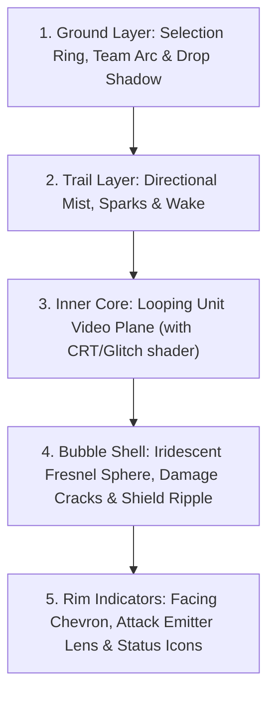

# 02 — Bubble Visual Design & Readability Specification

In *Space Scuffle*, the **Bubble** is the primary gameplay actor. Because players must make split-second micro decisions while looking at 10 to 200 bubbles on screen, every visual element of the bubble must serve a clear functional purpose while maintaining the stylized, non-photorealistic look of *StarCraft II* and *League of Legends*.

Reference concept renders in repository:
- [Normal Combat Bubbles](file:///home/cl/projects/space-scuffle/tmp/Gemini_Generated_Image_12da9g12da9g12da.jpg)
- [Damaged & Shattering Bubbles](file:///home/cl/projects/space-scuffle/tmp/damaged%20bubbles-Gemini_Generated_Image_mqt7trmqt7trmqt7.jpg)
- [Concept Video](file:///home/cl/projects/space-scuffle/tmp/gemini_generated_video_de659ff9.mp4)

---

## 1. Anatomy of a Unit Bubble

Each bubble is composed of **5 layered visual components** rendered together:

---

## 2. Solving the 6 Visual Information Channels

### 2.1 Movement Direction
- **Primary Indicator — Trailing Mist & Wake:**
  - As seen in [Gemini_Generated_Image_12da9g12da9g12da.jpg](file:///home/cl/projects/space-scuffle/tmp/Gemini_Generated_Image_12da9g12da9g12da.jpg), moving bubbles emit a soft, luminescent vapor/bubble-mist trail opposite to their velocity vector.
  - **Speed Scaling:** Trail length and particle turbulence scale directly with current speed:
    - *Stationary:* Zero trail; subtle ambient hover bobbing.
    - *Normal Walk:* Soft translucent mist wake (~1.5x bubble radius long).
    - *Speed Boosted (e.g., Stimpack / Charge / On Creep):* High-intensity streak lines and bright spark particles (like the top-right fast-moving bubble in the concept art).

### 2.2 Pointing / Facing Direction (Why It Matters in SC2 & How to Show It)
#### Is Facing Direction Relevant in StarCraft II?
**Yes, for three mechanical reasons:**
1. **Turn Rate & Retreating Delay:** In SC2, most units have a `TurnRate` (typically `540°/sec` to `999°/sec`, slower for heavy/capital units) and a weapon `FiringArc` (often `0°–15°`). When kiting (stutter-stepping away from enemies), a unit moving away at `180°` must physically rotate back to `0°` to fire, and rotate back to `180°` to resume fleeing.
2. **Turreted vs. Non-Turreted Units:**
   - A *Marine* or *Roach* must turn its entire body to shoot.
   - An *Immortal*, *Siege Tank*, or *Phoenix* has an independent **Turret** that stays locked onto the enemy even while moving away, making its micro behave very differently.
3. **Directional Abilities / Passives:** Cone attacks, directional shields, or line skillshots require clear orientation.

#### How the Bubble Shows Facing Direction:
- **Equatorial Rim Arrow (Hull Facing):** Both concept renders show a glowing curved arrow/chevron wrapping around the lower front rim of the bubble. This arrow rotates smoothly with the unit's `HeadingAngle`.
- **Horizontal Video Flip (Phase 1 — 1 Video per Action):** Even with only 1 video per action, if `cos(HeadingAngle)` points left on screen vs. right on screen, we can horizontally mirror (`UV.x = 1.0 - UV.x`) the video so the actor inside faces the general direction of travel/combat.
- **Multi-Angle Videos (Phase 2 — Optional 8 Directions):** Later, the texture array can seamlessly index `anim_id * 8 + octant_index` for units that have 8 directional recordings, with zero changes to the simulation code.

---

### 2.3 Attack Direction (Proposed Mechanisms)
When 30 units are firing in a battle, players need to immediately see **who is shooting**, **in what direction**, and **who is taking focus fire**.

Here are **4 complementary mechanisms** (used together based on weapon type):

1. **The "Attack Aperture / Focal Lens" on the Bubble Rim (Universal):**
   - Whenever a unit enters its attack state, a bright concentrated **Energy Ring / Lens** forms on the outer surface of the bubble at the exact point facing the target (`TargetAngle`).
   - For **Turreted units**, the lower Hull Chevron shows movement direction while the Attack Lens slides independently around the bubble's equator to track the target!
2. **Weapon-Specific Projectiles & Beams (Originating from the Focal Lens):**
   - **Instant / Hitscan Weapons (e.g., Marine rifle):** The Focal Lens flashes brightly (muzzle flash on the sphere surface), a crisp high-speed tracer streak crosses the gap, and an impact spark/ripple appears on the target bubble's facing hemisphere.
   - **Ballistic / Homing Projectiles (e.g., Marauder grenade, Stalker bolt, Roach acid):** Distinctly colored/shaped 3D energy bolts launch out of the Focal Lens toward the target.
   - **Continuous Beams / Channels (e.g., Void Ray, Sentry, Laser Turret):** As directly illustrated in both concept images, a sustained laser beam or crackling lightning arc connects the attacker's Focal Lens to the surface of the target bubble.
   - **Melee Attacks (e.g., Zealot, Zergling):** The attacker's bubble lunges slightly forward (`20%` of its radius during `DamagePoint`) and projects a sharp crescent slash wave / shockwave spike across the contact boundary into the target bubble.
3. **Target Impact Ripple (Who is Being Hit):**
   - When a bubble takes a hit, the hemisphere facing the attacker flashes with a directional **Shield Ripple** (if shields > 0) or **Red/Orange Impact Flare** (as seen on the left-center bubble in [damaged bubbles-Gemini_Generated_Image_mqt7trmqt7trmqt7.jpg](file:///home/cl/projects/space-scuffle/tmp/damaged%20bubbles-Gemini_Generated_Image_mqt7trmqt7trmqt7.jpg)), immediately telling the player *which direction damage is coming from*.

---

### 2.4 Team Ownership
In chaotic battles, team colors must never be lost behind video content or lighting:
1. **Segmented Ground Selection / Status Ring:**
   - Solid/segmented ring projected on the terrain directly beneath the bubble in the player's **Team Color** (Blue, Red, Teal, Purple, etc., or Green/Red in Competitive Team Color mode).
   - Selection state: Thin/dim ring when unselected; thick, bright, double-ring when selected by the player.
2. **Bubble Fresnel Rim Color & Inner Frame Border:**
   - The outer edge of the bubble sphere uses a Fresnel shader tinted with the Team Color, and the rectangular/circular "screen frame" holding the video inside has a team-colored border.

---

### 2.5 Unit Identity (Distinguishing Unit Types Instantly)
If every unit is just a smooth round ball of the same size, an army of Marines, Marauders, and Ghosts will look identical from RTS camera height. We solve this with **4 structural differentiators**:

1. **Bubble Footprint Radius:**
   - Directly matches gameplay collision size (`0.375` for tiny swarm units, `0.5` for standard infantry, `0.75` for heavy infantry/vehicles, `1.25+` for massive/capital units).
2. **Bubble Rim Casing / Silhouette Frame (Low-Poly Collar Mesh):**
   - Attach a simple, unmistakable 2D/3D geometric silhouette ring around the bubble's equator or base:
     - *Light Infantry / Scout:* Clean sleek ring with twin forward prongs.
     - *Heavy Armored / Siege:* Thick hexagonal/industrial bracket plates on the sides of the bubble.
     - *Caster / Support:* Floating halo or diamond pips orbiting the top of the bubble.
     - *Melee / Brawler:* Forward-facing teeth/blades on the front rim.
3. **Air vs. Ground Separation:**
   - Ground bubbles sit just above their ground ring.
   - Air bubbles hover high above the terrain (`z = +3.0`), cast a dark circular shadow on the ground directly below their true `(x, y)` playable coordinates, and drop a faint vertical height-line tether when selected or damaged (just like SC2 flyer helper lines).
4. **High-Contrast Video Composition & Color Coding:**
   - Videos recorded for units should use a dark or high-contrast neutral background (or automatic background removal / stylized tinting in the asset pipeline) and unit-distinctive props/colors so the silhouette inside the bubble reads clearly even at small pixel sizes.

---

### 2.6 Current Action, Damage & Status Effects
As shown in [damaged bubbles-Gemini_Generated_Image_mqt7trmqt7trmqt7.jpg](file:///home/cl/projects/space-scuffle/tmp/damaged%20bubbles-Gemini_Generated_Image_mqt7trmqt7trmqt7.jpg), the bubble surface itself acts as a diegetic health & status display (supplemented by optional overhead health bars):

| State | Visual Representation on Bubble |
| :--- | :--- |
| **Action State (`Idle`, `Walk`, `Attack`, `Cast`)** | Instant **hard cut** to the corresponding looping video clip inside the bubble. |
| **Healthy (75%–100% HP)** | Pristine, glossy, iridescent bubble glass; clean video feed. |
| **Damaged (35%–75% HP)** | Fracture lines appear around the rim; occasional horizontal CRT scanline distortion on the video; faint dark smoke wisps trailing from cracks. |
| **Critical (< 35% HP)** | Deep spiderweb glass cracks across the sphere, dark core fissures, red/orange electrical arcing across the shell, heavy RGB chromatic aberration on the video feed, black smoke trail. |
| **Death** | Bubble violently shatters into refractive glass shards + explosion flash (as seen on the right side of the damaged concept image). |
| **Shields Active** | Secondary outer energy sheen that ripples cyan/blue on impact and shimmers down when shields break. |
| **Cloaked / Invisible** | Bubble turns 80% transparent with a wavy refraction distortion shader (enemies without detection only see a subtle shimmer on the ground/air). |
| **Stunned / Frozen / Buffed** | Shader overlay on the shell (e.g., frost crystals around rim, golden upward energy rings for Stim/buffs). |

---

## 3. Buildings & Structures: Anchored Hemispheres / Domes

Instead of authoring complex 3D architectural models for structures, **buildings use the exact same video-in-glass paradigm**, adapted into **grounded Hemispheres / Domes**:

1. **Geometric Distinction (Sphere = Mobile Unit, Hemisphere Dome = Structure):**
   - Units are floating spheres with a circular gap between the bottom of the sphere and their ground ring.
   - Buildings are **anchored hemispheres (domes)** sitting flush on a metallic/team-colored grid foundation plate (`2x2`, `3x3`, or `5x5` cells).
2. **Building Video States:**
   - **Constructing / Warping In:** A wireframe/vertical scanline shader progressively fills the dome from bottom to top (`0% -> 100%` height) while playing a construction/sparking loop inside.
   - **Idle:** Plays the structure's ambient loop (e.g., command center radar operators, idle factory floor).
   - **Producing / Researching:** Hard-cuts to an active production video loop (e.g., welding sparks, glowing reactor core, unit silhouette being assembled) + a radial progress arc around the dome's base ring so the player can see production progress without clicking the building.
   - **Defensive Structures (Turrets / Bunkers / Photon Cannons):** Display an active gunner/turret video inside the dome and use the same **Attack Aperture / Focal Lens** on the dome surface to fire lasers or projectiles at enemies.
   - **Lifted-Off Buildings (Terran-style):** If a faction's buildings can lift off, the hemisphere dome detaches from its ground baseplate, morphs/retracts into a hovering sphere/capsule with downward thruster mist, and settles back into a dome when landing.
3. **Building Damage & Destruction:**
   - Uses the exact same shader pipeline as unit bubbles: progressive dome cracks, internal fire/smoke particles, video scanline glitching below 50% HP, and dome shattering upon destruction.

