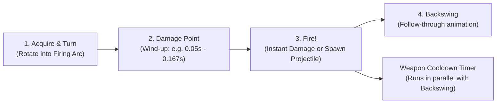

# 03 — StarCraft II Mechanics & Engine Capabilities Reference

To make *Space Scuffle* play with the depth and precision of *StarCraft II*, our internal simulation engine must model the specific data fields, state machines, and map mechanics that govern SC2 gameplay.

---

## 1. Complete Unit Data Model (What the Engine Tracks)

In SC2, every unit is defined by data tables (`Unit`, `Weapon`, `Turret`, `Mover`, `Behavior/Buff`, `Ability`, `Effect`, `Footprint`). Below is the exact breakdown of what our engine needs to track per unit type and per active instance.

### 1.1 Vitals & Regeneration
| Property | SC2 Behavior | Engine Representation |
| :--- | :--- | :--- |
| **Life (HP)** | Base health (`MaxHP`). Some factions/units regenerate passively (e.g., Zerg at `0.38 HP/sec`), others require repair/healing. | `hp_current`, `hp_max`, `hp_regen_per_tick` |
| **Shields** | Absorbs damage before HP. Regenerates rapidly (e.g., `2.8 HP/sec`) **only after `10 seconds` without taking damage**. | `shields_current`, `shields_max`, `shields_regen_per_tick`, `ticks_since_last_damage` |
| **Energy** | Mana pool for active/autocast abilities (`Max 200`, starts at `50` or `75`, regens at `~0.7875/sec`). | `energy_current`, `energy_max`, `energy_regen_per_tick` |

### 1.2 Armor, Attributes & Damage Formula
In SC2, units have **Attribute Tags** (`Light`, `Armored`, `Biological`, `Mechanical`, `Psionic`, `Massive`, `Structure`, `Heroic`).
- **SC2 Damage Formula (Per Hit):**
  $$\text{FinalDamage} = \max\left(0.5,\ (\text{BaseDamage} + \text{AttributeBonus} + \text{WeaponUpgrades}) - (\text{TargetArmor} + \text{ArmorUpgrades})\right)$$
  *(Note: If the target has Shields remaining, `ShieldArmor` reduces damage applied to Shields; any spillover damage into HP is then reduced by `LifeArmor`).*
- **Multi-Hit Weapons:** A unit with `Attacks = 2` (like a Zealot or Thor AA) applies target armor reduction **twice** (once per hit), making high-rate/multi-hit weapons weak against high-armor targets and strong against low-armor targets.

### 1.3 Weapon Timings (The Secret to Micro & Stutter-Stepping)
Every weapon in SC2 has **four critical timing values** (not just "attacks per second"):

1. **Weapon Cooldown (Period):** Total time before the weapon can fire again (e.g., `0.61s` for a Marine).
2. **Damage Point (Wind-up):** Time unit must stand still after aiming before the shot actually fires (e.g., `0.05s` for Marine, `0.167s` for Roach). If the player orders a `Move` *before* `DamagePoint` finishes, the shot is aborted!
3. **Backswing:** The post-shot animation duration. **Crucially:** A player can issue a `Move` command immediately after `DamagePoint` completes to **cancel the Backswing** and move while the weapon cooldown ticks down in the background. This is what makes **stutter-step micro (kiting)** possible!
4. **Random Delay (`-0.06s` to `+0.06s` in SC2):** SC2 adds a tiny deterministic pseudo-random offset to cooldowns so 20 Marines firing at once quickly desynchronize into a continuous rattle rather than firing in robotic unison forever.

### 1.4 Movement, Physics & Collision
| Property | SC2 Behavior | Why We Need It |
| :--- | :--- | :--- |
| **Speed, Acceleration & Deceleration** | Many SC2 ground units have near-instant acceleration (`1000`), while air units (Mutalisks, Phoenixes, Banshees) have lower acceleration/deceleration, allowing momentum/magic-box micro. | Gives distinct weight and control feel to infantry vs. vehicles vs. aircraft. |
| **Turn Rate & Stationary Turn Rate** | Degrees per second a unit can rotate. | Governs how fast units switch targets or kite. |
| **Radius & Inner Radius** | `Radius` for unit-vs-unit collision; `InnerRadius` for building-vs-unit tight squeezing. | Enables small units to slip between diagonal buildings while large units get blocked (wall-offs!). |
| **Push Priority** | Integer priority. When a friendly unit with a move order collides with an idle friendly unit (not on `Hold Position`), the idle unit temporarily yields and slides aside. | Prevents friendly armies from gridlocking themselves in bases. |
| **Mover Plane** | `Ground`, `Air`, `CliffJumper` (Reaper jumps up/down cliffs), `CliffWalker` (Colossus steps across cliffs and can be hit by both AA and Ground weapons!). | Core tactical diversity. |

### 1.5 Target Acquisition & AI Behavior Flags (Per Unit)
Even when controlled by a human, every RTS unit runs a small local **Auto-Behavior State Machine**:
- **Scan Range:** Distance at which an idle or `Attack-Moving` unit automatically notices enemies (usually slightly larger than `WeaponRange`).
- **Target Priority (`AttackTargetPriority`):** Combat units have priority `20`, Workers have priority `20` when attacking or `19` when harvesting, Buildings have priority `11`. Units automatically shoot the highest-priority threat in range unless explicitly right-clicked onto a specific target!
- **Leash Range:** How far an idle unit will chase an enemy before returning to its guard spot.
- **Hold Position:** Unit will not move or chase, even if attacked, and cannot be pushed by friendly units.

### 1.6 Special Unit Capabilities
- **Cloaking & Burrowing:** Unit cannot be targeted by attacks or single-target spells (though it still takes AoE/Splash damage!) unless inside an enemy `Detector`'s radius or revealed by a scan/spell.
- **Transports & Bunkers:** Units can load into transports (consuming `1, 2, 4, or 8` cargo slots) and be dropped one-by-one while the transport is moving ("moving drop"). Bunkers allow loaded units to fire their own weapons from inside the structure's protection.
- **Morphing / Mode Switching:** Siege Tank (Tank <-> Siege Mode), Viking (Fighter <-> Assault), Zerg morphs (Baneling, Lurker, Brood Lord).
- **Channeled & Autocast Abilities:** Medivac Heal, Repair, Sentry Forcefield, Blink, Stimpack.

---

## 2. Map Capabilities & Terrain Rules

| Map Feature | How It Works in SC2 | Implementation in Space Scuffle |
| :--- | :--- | :--- |
| **Discrete Cliff Levels (0, 1, 2, 3)** | Terrain is divided into flat plateaus at fixed heights connected by ramps. | 2D grid of `cliff_level: u8` + ramp tiles. |
| **High-Ground Fog of War** | A unit on Level 1 **cannot see onto Level 2**, even if within its `SightRadius`, unless an allied unit is on Level 2 or an allied Air unit provides vision. Attacking a high-ground unit reveals only a small splash around the attacker (or requires vision). | Raycast / flood-fill visibility check compares `viewer.cliff_level` vs `tile.cliff_level` (air units ignore cliff occlusion). |
| **Ramps & Wall-Off Grid** | Ramps allow ground movement between cliff levels. Players use `2x2` and `3x3` buildings at the top/bottom of ramps to create choke points or full wall-offs. | Crisp 1x1 cell placement grid overlay (Pressing `Build` displays green/red cells just like SC2). |
| **Line-of-Sight (LoS) Blockers** | Tall grass / smoke vents block vision across them for ground units outside the vent, and hide units standing inside them from outside ground vision. | Tile flag `LOS_BLOCKER` in the visibility grid. |
| **Watchtowers (Xel'Naga Towers)** | Neutral structure; when any player's ground unit stands next to it (with no enemy ground units adjacent), that player gains a huge circular vision radius. | Neutral capture region entity updated each tick. |
| **Destructible / Collapsible Rocks** | Neutral targetable structures with `HP` and `Armor`. Destructible rocks clear a path when killed; collapsible rock towers spawn rubble onto an adjacent path when killed. | Standard neutral structure entities that dynamically update the NavMesh when destroyed. |
| **Resources (Minerals & Gas)** | Minerals: 8 patches per base; workers mine 5 minerals per trip and ignore unit collision while actively mining ("mineral walking"). Gas: 2 geysers per base requiring a faction building on top (`3 workers` saturation each). | `Harvest` order state machine + `IGNORE_UNIT_COLLISION` flag while actively moving toward a mineral patch. |

---

## 3. SC2 Limitations: What to Keep vs. What We Can Improve

You mentioned: *"We will start with the exact same features as StarCraft 2 unless some limitations are unnecessary."* Here is a clear list of SC2 quirks and whether they are **essential gameplay features** or **unnecessary engine limitations**:

| SC2 Rule / Limitation | Keep or Remove? | Rationale |
| :--- | :--- | :--- |
| **Hard 200 Supply Cap** | **Configurable per Map/Mode (Default 200)** | Keep 200 for standard competitive 1v1 balance, but don't hardcode a 200 array limit in the engine so custom modes/4v4 can use 300–500+. |
| **Fixed 8-Direction Building Placement** | **Keep (1x1 Grid Alignment)** | Grid-aligned buildings are essential for deliberate base layout and wall-offs against melee swarms. |
| **High-Ground Vision Rule** | **Keep** | Essential for positional tactics, siege play, and defender's advantage. |
| **`DamagePoint` & `Backswing` Animation Canceling** | **Keep** | This is the heart of RTS micro and skill expression. |
| **Max 255 / 500 Selection Group Limit** | **Remove Limit** | Allow selecting any number of units with pagination/tabs in the bottom HUD. |
| **No Zoom Out Beyond Standard Camera Height** | **Keep Competitive Cap for Players, Remove for Spectators/Bots** | Players in fog-of-war matches have a standard max camera zoom, while spectators and replays can zoom all the way out to view the entire battlefield. |
| **SC2's Complex XML/Galaxy Editor Data Spaghetti** | **Replace with Clean TOML/JSON/RON Data Schemas** | In SC2, adding one unit requires linking 12 separate XML tables (`Actor`, `Model`, `Unit`, `Effect`, `Abil`, `Weapon`, `Mover`, `Validator`). We can define a unit cleanly in a single human-readable `.toml` or `.ron` file! |
