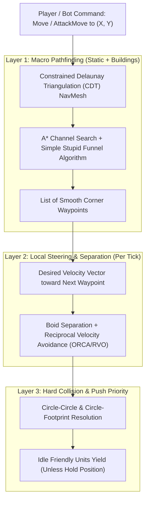

# 04 — Pathfinding, Lockstep Networking, Bot API & Map Editor

This document details the core technical subsystems that allow the **Visual Client (Track A)** and **Deterministic Simulation Core (Track B)** to be built in parallel.

---

## 1. Pathfinding & Steering Architecture

To achieve SC2's fluid unit movement, pathfinding is split into **three cooperative layers** that run inside the deterministic tick:



### 1.1 Layer 1: Dynamic CDT NavMesh + Funnel Algorithm
- **Why CDT NavMesh instead of Grid A*:**
  - Grid `A*` forces units onto 45° or 90° zig-zag paths and struggles with units of different radii (`0.375` vs `1.25`).
  - A **Constrained Delaunay Triangulation (CDT)** represents walkable terrain as triangles. When a building (`2x2`, `3x3`, `5x5`) is placed or a destructible rock dies, we dynamically insert or remove constraint edges in `< 0.5 ms`.
  - We store the **clearance width** of each triangle edge so a Massive unit (`radius = 1.25`) automatically routes around a tight gap between two buildings while a Marine (`radius = 0.375`) routes straight through it!
  - Once `A*` finds the sequence of triangles, the **Simple Stupid Funnel Algorithm** computes the exact shortest rubber-band string path around polygon corners in $O(k)$ time.

### 1.2 Layer 2: Boid Steering & Concave Arc Formation
- When 30 units move together, each unit combines:
  1. **Seek Vector:** Toward its current funnel waypoint.
  2. **Separation Force:** Repulsion from nearby units within `SeparationRadius`.
  3. **Arrival / Combat Arc Sliding:** When a unit has an `AttackMove` or `AttackTarget` order and its front-row allies are already stopped and firing at the target, blocked back-row units apply a **tangential steering force** perpendicular to the target vector, causing them to naturally wrap into a **concave firing arc** around the enemy!

### 1.3 Layer 3: Push Priority & Body Blocking
- Every tick, after velocity integration, overlapping unit circles are resolved deterministically:
  - **Enemy vs. Enemy:** Both resist equally (or scaled by mass) — enabling **surround micro and body-blocking**.
  - **Moving Friendly vs. Idle Friendly:** If Friendly Unit A is executing a move/attack order and collides with Idle Friendly Unit B (not on `Hold Position`), Unit B is given a temporary displacement vector perpendicular to Unit A's path so Unit A passes through cleanly.

---

## 2. Deterministic Lockstep over Lightweight Relay Server

We chose **Deterministic Lockstep over a Lightweight Relay Server** (with local hosting support for LAN/offline).

### 2.1 How the Lockstep Loop Works
- **Simulation Tick Rate:** `22.4 Hz` (~`44.6 ms` per tick, matching SC2 *Faster* speed) or `25 Hz` (`40.0 ms` per tick for clean integer math).
- **Command Turn Delay (Input Latency Window):** Configurable (`2` to `4` ticks = `80–160 ms` depending on ping, or `1` tick = `40 ms` on LAN/Bot matches).
  - Commands issued by a player during Tick `T` are stamped by the Relay Server for execution at Tick `T + TurnDelay`.
- **Per-Tick Packet Structure (`~64–256 bytes`):**
  ```rust
  pub struct TickBundle {
      pub tick: u32,
      pub player_commands: Vec<(PlayerId, Vec<GameCommand>)>,
      pub state_checksum: Option<u64>, // Sent every N ticks to immediately detect any desync
  }
  ```
- **Why This Makes Replays & Spectators Trivial:**
  - The Relay Server appends every `TickBundle` to a log.
  - A full 30-minute match (`45,000 ticks`) is just the initial `MapId + RngSeed` plus the list of player commands — typically **under 100 KB compressed**!
  - Live spectators can connect to the Relay Server with a configurable delay (e.g., 0s or 60s tournament delay) and simply receive the stream of `TickBundle`s.

---

## 3. Third-Party Bot API Design

Since there is no built-in scripted campaign AI, the **Bot API** is a first-class feature modeled after StarCraft II's `s2client-proto`.

### 3.1 Connection Modes
1. **Headless Step-Lock Mode (Training / Bot Tournaments):**
   - Runs `sim_core` directly without opening a graphics window or audio device.
   - The simulation advances to `Tick T + 1` as soon as both connected bots send their actions for `Tick T`.
   - Can run at **5,000 to 20,000 ticks per second** on a single CPU core!
2. **Real-Time Client/Server Mode (Human vs. Bot or Visual Spectating):**
   - A bot connects via local TCP/Unix Socket/WebSocket to a game client or directly to the Relay Server as a player participant.

### 3.2 Fog-of-War Honesty (Anti-Cheat by Design)
- When generating the `BotObservation` payload for Player `P`, the engine filters all world data through Player `P`'s `VisibilityGrid`:
  - Enemy units in `Fogged` or `Unexplored` tiles are **omitted** from the observation.
  - Enemy structures in previously explored (`Fogged`) tiles only report their **last-seen snapshot** (`position`, `unit_type`, `last_seen_tick`), just like what a human player sees under fog of war.
  - Cloaked/burrowed enemy units without detection only report a `Blip / Shimmer` coordinate if visible, without targetable `EntityId` until detected.

---

## 4. Map Format & Map Editor Strategy

To avoid spending months building a complex 3D CAD tool before we have a playable game, we use a **clean declarative Map Format** that supports both existing external editors and a future built-in editor:

### 4.1 Map File Format (`.scmap.ron` or `.scmap.json`)
A map is completely defined by a grid + entity list:
- `dimensions: (width, height)` (e.g., `160 x 160` cells)
- `cliff_height_grid: Vec<u8>` (`0, 1, 2, 3`)
- `terrain_type_grid: Vec<u8>` (`Grass`, `MetalPlate`, `Dirt`, `UnpathableAbyss`, `RampN/S/E/W/NE/NW/SE/SW`)
- `flags_grid: Vec<u8>` (`Buildable`, `Pathable`, `LoSBlocker`, `SpeedZone`)
- `spawns: Vec<SpawnPoint>`
- `resources: Vec<ResourceNode>` (Minerals, Gas Geysers)
- `neutral_structures: Vec<NeutralEntity>` (Destructible Rocks, Watchtowers)

### 4.2 Two-Stage Tooling Plan
1. **Stage 1 (Immediate):** Write a 150-line importer for **Tiled (`.tmj`)** maps + a procedural 3D cliff/ramp mesh generator. You can open Tiled on Linux today, paint cliff level 1 and 2, drop a ramp and mineral patches, hit Save, and the 3D client hot-reloads the stylized 3D terrain and recalculates the CDT NavMesh automatically.
2. **Stage 2 (In-Engine 3D Map Editor):** Add an `--editor` mode to the game client using `egui`, giving you brush tools to raise/lower cliff plateaus, paint textures, place buildings/rocks/minerals, preview the generated NavMesh triangles and high-ground vision cones in real time, and click **"Playtest Now"**.

---

## 5. Parallel Development Plan (Phase 1 + Phase 2 Concurrently)

Because `sim_core` and the visual client communicate through a clean snapshot boundary, we can advance **Track A (Visuals)** and **Track B (Simulation)** simultaneously:

| Track A: Visual Engine & Bubble Renderer | Track B: Deterministic Simulation & Mechanics |
| :--- | :--- |
| **A1.** Initialize window, RTS camera controller (edge pan, middle-mouse drag, zoom), and stylized 3D cliff/ramp terrain renderer. | **B1.** Fixed-point math types (`Vec2Fixed`, `AngleFixed`), deterministic `SimWorld` tick loop, and checksum generator. |
| **A2.** Implement the **Bubble Shader**: raymarched/mesh sphere, iridescent Fresnel rim, team ground ring, facing chevron, and Attack Focal Lens. | **B2.** Unit state machine: `Idle`, `Move`, `AttackMove`, `HoldPosition`, `Stop`, plus `TurnRate`, `DamagePoint`, `Backswing`, and `Cooldown`. |
| **A3.** Build the **Video Flipbook Texture Array pipeline** + progressive damage crack & CRT glitch shader + shatter particles. | **B3.** CDT NavMesh + Funnel pathfinding + Boid/RVO local steering + Friendly Push Priority. |
| **A4.** Trailing mist wake particles, hitscan tracers, lasers, projectiles, and RTS HUD (selection box, wireframe grid, command card, minimap). | **B4.** High-ground Fog of War, cliff occlusion, resources/harvesting, building placement grid, Lockstep Relay Server, and Bot API. |
