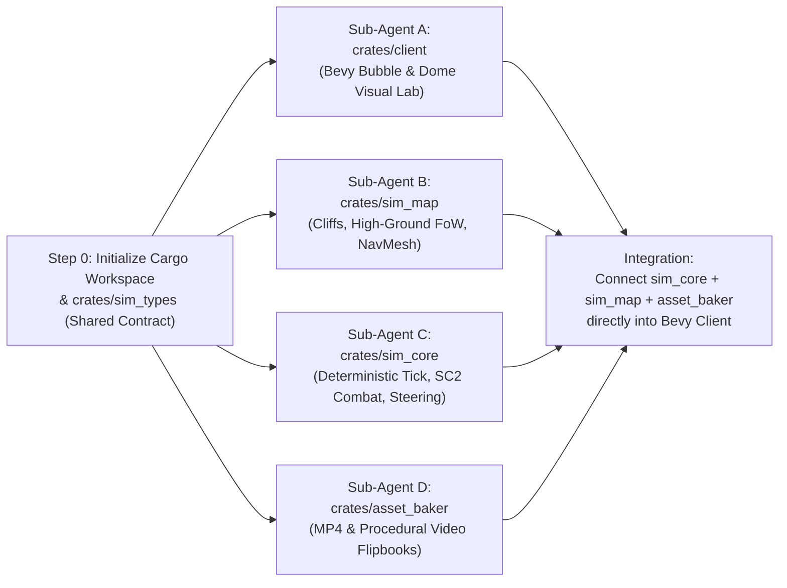

# 05 — Parallel Implementation Plans (Sub-Agent Blueprints)

## 1. Confirmed Architectural Decisions
- **Tech Stack:** **Rust + Bevy** (`wgpu` / WGSL shaders, `bevy_egui` for debug/editor UI) with a **100% decoupled, deterministic `sim_core`** crate using Fixed-Point Math.
- **Units & Buildings Unified Visual Paradigm:**
  - **Mobile Units:** Floating 3D holographic **Spheres (Bubbles)** displaying looping action videos.
  - **Buildings / Structures:** Ground-anchored **Hemispheres (Domes)** on grid baseplates displaying looping construction/idle/production/turret videos.
- **Networking Model:** **Deterministic Lockstep** over a lightweight Authoritative Relay Server (with local/LAN hosting support).
- **Immediate Goal:** Run **Phase 1 (Visual Bubble & Dome Interactive Lab)** and **Phase 2 (Deterministic Simulation, Combat & Pathfinding)** in parallel with zero merge conflicts between sub-agents.

---

## 2. Cargo Workspace Layout (Zero-Conflict Module Boundaries)

To allow multiple sub-agents to work concurrently without editing the same files, the repository will be organized as a **Cargo Workspace** where each sub-agent owns specific crates:

```text
space-scuffle/
├── Cargo.toml                  # Workspace root & shared dependency versions
├── DESIGN.md                   # Master index
├── docs/                       # Architecture & specifications
├── assets/                     # Shaders (WGSL), generated test flipbooks, test maps
│   ├── shaders/
│   ├── textures/
│   └── maps/
└── crates/
    ├── sim_types/              # [Step 0: Shared Contract] Pure data structs, IDs, Fixed-point math types, RenderSnapshot
    ├── sim_map/                # [Agent B] Map grid, cliff levels, ramps, high-ground Fog of War, NavMesh & Funnel pathing
    ├── sim_core/               # [Agent C] Deterministic tick loop, SC2 combat/weapons, steering, push priority, unit/dome states
    ├── asset_baker/            # [Agent D] CLI & library to convert MP4/videos + procedural test animations into GPU flipbooks
    └── client/                 # [Agent A] Bevy 3D Visual Client + Interactive "Bubble & Dome Visual Lab"
```

---

## 3. Step 0 — Shared Foundation (`crates/sim_types`)
*(Executed first in ~2 minutes before spawning parallel sub-agents so every crate compiles against an immutable interface)*

### Responsibilities & Exact Types in `crates/sim_types`:
1. **Deterministic Math Wrapper (`math.rs`):**
   - `SimScalar` (wrapping `fixed::types::I32F32` or deterministic `i64` millicells), `SimVec2 { x, y }`, `SimAngle` (0..65536 brad/turn units with lookup-table `sin`/`cos`/`atan2`).
   - Conversion helpers `.to_f32()` for the renderer.
2. **Core Identifiers & Enums (`ids.rs`, `enums.rs`):**
   - `EntityId(u32)`, `PlayerId(u8)`, `TeamId(u8)`, `UnitTypeId(u16)`.
   - `ShapeKind`: `UnitSphere`, `BuildingDome { footprint_w: u8, footprint_h: u8 }`.
   - `SilhouetteClass`: `LightProngs`, `HeavyHex`, `CasterHalo`, `MeleeSpikes`, `StructureBase`.
   - `AnimState`: `Constructing`, `Idle`, `Walk`, `Attack`, `Cast`, `Die`.
   - `WeaponVisualKind`: `None`, `Hitscan`, `Projectile`, `LaserBeam`, `LightningArc`, `MeleeSlash`.
   - `MoverType`: `Ground`, `Air`, `CliffJumper`, `CliffWalker`.
   - `AttributeFlags` (bitflags): `LIGHT`, `ARMORED`, `BIOLOGICAL`, `MECHANICAL`, `PSIONIC`, `MASSIVE`, `STRUCTURE`, `HEROIC`.
3. **The Renderer Contract (`snapshot.rs`):**
   - `RenderSnapshot`: Produced by `sim_core` (or by the Visual Lab's mock controls) every frame so `crates/client` can render any state without knowing internal simulation details:
     ```rust
     pub struct BubbleRenderInstance {
         pub entity_id: EntityId,
         pub shape: ShapeKind,
         pub silhouette: SilhouetteClass,
         pub unit_type: UnitTypeId,
         pub team_id: TeamId,
         pub world_pos: [f32; 3],        // x, y (ground), z (altitude + cliff height)
         pub ground_z: f32,              // terrain height directly below (for air unit shadow/tether)
         pub radius: f32,
         pub velocity: [f32; 2],         // drives trailing mist direction & length
         pub heading_angle_rad: f32,     // drives lower-rim chevron & video horizontal flip
         pub aim_angle_rad: f32,         // drives Attack Aperture / Focal Lens position on rim
         pub is_attacking: bool,
         pub anim_state: AnimState,
         pub anim_progress: f32,         // 0.0..1.0 or frame index
         pub hp_ratio: f32,              // 1.0 = pristine, <0.75 = minor cracks, <0.35 = heavy cracks + CRT glitch
         pub shield_ratio: f32,          // 0.0..1.0 outer energy sheen
         pub shield_hit_flash: f32,      // 0.0..1.0 decaying ripple intensity
         pub hull_hit_angle_rad: f32,    // direction the last hit came from
         pub hull_hit_flash: f32,        // 0.0..1.0 directional impact flare
         pub build_or_queue_progress: Option<f32>, // radial progress ring for domes
         pub selected: bool,
         pub cloaked: bool,
         pub speed_boosted: bool,
     }
     ```

---

## 4. Sub-Agent Plan A: Bevy Visual Bubble & Dome Lab (`crates/client`)

### Objective
Build the Bevy 3D visual client with an interactive **"Bubble & Dome Visual Lab" mode** so you can inspect, test, and tweak every visual mechanism from [02-bubble-visual-design.md](file:///home/cl/projects/space-scuffle/docs/02-bubble-visual-design.md) in real time at both close-up inspection zoom and standard RTS camera height.

### Detailed Tasks for Sub-Agent A
1. **RTS Camera & Stylized Two-Level Arena (`camera.rs`, `terrain_render.rs`):**
   - Implement an SC2-style perspective camera (`55°–60°` pitch, WASD / screen-edge pan, middle-mouse drag, scroll zoom from close-up macro view out to full battlefield view).
   - Generate a stylized 3D test arena featuring **Cliff Level 1 (low ground)**, **Cliff Level 2 (high groundplateau)**, a **navigable Ramp** connecting them, metallic grid plates (matching the concept renders), and directional sun + ambient sky lighting with shadows.
2. **Bubble & Dome Custom WGSL Shader (`assets/shaders/bubble.wgsl`, `bubble_material.rs`):**
   - **Unit Spheres & Building Domes:** Support both full floating spheres (for units) and flat-bottomed grounded hemispheres on metallic grid foundations (for structures).
   - **Inner Video Core:** Sample the active `AnimState` frame from a `texture_2d_array`, with automatic left/right horizontal mirroring based on `heading_angle_rad` and CRT scanlines / RGB chromatic aberration when `hp_ratio < 0.5`.
   - **Iridescent Glass Shell & Team Fresnel:** Refractive/iridescent outer sphere highlight tinted by the unit's `TeamId` color.
   - **Progressive Damage Cracks & Shield Ripple:**
     - Above 75% HP: clean glossy shell.
     - 35%–75% HP: procedural Voronoi/spiderweb edge cracks.
     - Below 35% HP: deep fractures, dark core spots, electrical orange/red crackle, heavy video glitching.
     - Directional impact flare & cyan/blue shield ripple centered at `hull_hit_angle_rad`.
3. **Rim & Ground Indicators (`indicators.rs`):**
   - **Segmented Ground Ring:** Team-colored ring projected below the bubble/dome; brighter double-ring when `selected == true`; radial progress arc when a building dome is constructing or producing a unit.
   - **Equatorial Hull Facing Chevron:** Glowing curved arrow hugging the front-bottom rim (matching the concept images) showing `heading_angle_rad`.
   - **Attack Aperture / Focal Lens:** Bright targeting reticle ring sliding along the bubble's equator at `aim_angle_rad` whenever `is_attacking == true`.
   - **Unit Class Silhouette Collars:** Toggleable low-poly rim attachments (`LightProngs`, `HeavyHex`, `CasterHalo`, `MeleeSpikes`, `StructureBase`) to test unit readability in large groups.
4. **Particle & Combat VFX (`vfx.rs`):**
   - **Trailing Mist & Sparks Wake:** Emitted behind moving bubbles opposite to `velocity`, scaling in length and adding bright streaks when `speed_boosted == true`.
   - **Weapon Visuals:**
     - *Hitscan:* Muzzle flash at the Focal Lens + fast tracer line + target impact ripple.
     - *Projectile:* Glowing plasma bolt traveling from attacker's Focal Lens to target bubble.
     - *Laser / Lightning Beam:* Continuous glowing beam and jagged electric arc connecting attacker to target (matching the red lasers and orange arcs in the concept renders).
     - *Melee:* Brief forward lunge + crescent shockwave slash.
   - **Death Shatter Effect:** Spawns explosive glass shards and a flash when a bubble or dome reaches `0 HP`.
5. **Interactive `egui` Visual Tweaker Panel (`lab_ui.rs`):**
   - Live sliders and buttons to:
     - Switch between **"Close-Up Showcase"** (5 bubbles + 2 building domes engaging each other) and **"Swarm Readability Stress Test"** (100–300 bubbles moving and fighting across the ramp).
     - Scrub `HP %`, `Shield %`, `Movement Speed`, `Heading Angle`, and `Aim Angle` (to see turreted vs. non-turreted rotation).
     - Trigger `Hitscan`, `Projectile`, `Laser Beam`, `Lightning`, `Melee`, and `Shatter Death` on demand.
     - Toggle `Silhouette Collars`, `Video Horizontal Flip`, `Crack Intensity`, `CRT Glitch`, and `Mist Trail Length` to find the exact visual sweet spot.

### Verification Criteria for Sub-Agent A
- `cargo check -p client` and `cargo test -p client` pass with zero warnings.
- Running `cargo run -p client -- --lab` opens the 3D window (or renders a headless verification screenshot if tested via offscreen target) displaying unit spheres, building domes, video flipbooks, trails, beams, cracks, and the `egui` control panel.

---

## 5. Sub-Agent Plan B: Map Grid, Cliffs, NavMesh & High-Ground Vision (`crates/sim_map`)

### Objective
Implement the deterministic map representation, SC2 cliff/ramp/wall-off rules, high-ground Fog of War, and NavMesh + Funnel pathfinding.

### Detailed Tasks for Sub-Agent B
1. **Map Grid & Terrain Representation (`grid.rs`, `loader.rs`):**
   - 1x1 cell grid storing `cliff_level: u8 (0..=3)`, `ramp_dir: Option<RampDir>`, `buildable: bool`, `ground_pathable: bool`, `los_blocker: bool`, `creep_or_zone: u8`.
   - Support loading maps from `.scmap.ron` and importing **Tiled (`.tmj`)** JSON maps.
   - Footprint placement validation (`can_place_building(x, y, w, h)`) supporting `2x2` (Supply Depot), `3x3` (Barracks), and `5x5` (Command Center) dome foundations, including ramp-top wall-off geometry.
2. **High-Ground Fog of War & Vision (`vision.rs`):**
   - Per-player `VisibilityGrid` (`Unexplored`, `Fogged`, `Visible`) + `DetectionGrid`.
   - Deterministic shadowcasting / raycasting that enforces **SC2 High-Ground Occlusion**:
     - A ground unit at `cliff_level = 1` **cannot** see tiles at `cliff_level = 2` unless an allied unit at `cliff_level >= 2` or an allied `Air` / `CliffWalker` unit reveals them.
     - `los_blocker` (tall grass / smoke vents) blocks vision for ground units outside the blocker.
     - Neutral **Watchtowers** grant circular high-ground vision while captured by an allied ground unit.
3. **Dynamic Pathfinding + Simple Stupid Funnel (`pathfinding.rs`):**
   - Build a walkable navigation graph / clearance grid that dynamically updates in `< 1 ms` when building domes (`2x2`, `3x3`, `5x5`) are constructed or destructible rocks are destroyed.
   - Account for **unit clearance radius** (`Small = 0.375`, `Medium = 0.625`, `Large = 1.125`) so small units can squeeze through diagonal building gaps that block larger units.
   - Run `A*` + **String-Pulling / Simple Stupid Funnel Algorithm** so returned paths are smooth straight-line segments around obstacle corners at arbitrary angles (not 8-way grid steps).

### Verification Criteria for Sub-Agent B
- Unit tests in `crates/sim_map` verifying:
  1. Low-ground units cannot see high-ground units up a cliff until an allied spotter or air unit moves in range.
  2. Placing two `3x3` domes and one `2x2` dome at the top of a ramp blocks large units or fully walls off the ramp.
  3. Funnel pathing produces smooth Euclidean corner-wrapping paths and identical bit-for-bit waypoints across runs.

---

## 6. Sub-Agent Plan C: Deterministic Simulation Core, SC2 Combat & Steering (`crates/sim_core`)

### Objective
Build the pure, deterministic fixed-tick RTS simulation engine (`25 Hz` / `40 ms` ticks) implementing SC2 unit/building behaviors, stutter-step weapon timings, damage math, and local Boid/push-priority steering.

### Detailed Tasks for Sub-Agent C
1. **Deterministic World & Tick Loop (`world.rs`, `checksum.rs`):**
   - `SimWorld` stepping deterministically via `world.step(&TickInputBundle) -> RenderSnapshot`.
   - Deterministic `xxHash64` state hashing over all entities, positions, vitals, and cooldowns to guarantee zero desyncs.
2. **Unit & Building Dome Data Definitions (`catalog.rs`):**
   - Clean declarative unit/structure catalog with initial SC2-inspired starter archetype roster for testing:
     - **Worker Bubble** (harvests minerals/gas, builds domes, repairs, mineral-walks ignoring unit collision while mining).
     - **Light Rifle Bubble ("Marine")** (fast turn rate, hitscan weapon, short `DamagePoint`, Stim speed/attack-rate buff).
     - **Heavy Shell Bubble ("Marauder / Stalker")** (projectile weapon with `+Armored` bonus damage, concussive slow or blink ability).
     - **Melee Brawler Bubble ("Zealot / Zergling")** (fast movement, twin-hit melee slash).
     - **Siege / Turreted Bubble ("Tank / Immortal")** (independent turret tracking while moving, splash damage with `100%/50%/25%` radii).
     - **Air Scout / Flyer Bubble ("Phoenix / Mutalisk")** (`MoverType::Air`, lower deceleration for momentum micro, elevated hover height).
     - **Structures (Hemisphere Domes):** Command Dome (`5x5`, trains workers, resource drop-off), Barracks Dome (`3x3`, trains combat units, optional lift-off), Supply Dome (`2x2`), Laser Turret Dome (`2x2`, defensive beam weapon + detector).
3. **SC2 Weapon State Machine & Stutter-Step Micro (`combat.rs`):**
   - Full implementation of:
     1. `AcquireTarget`: Auto-aggro within `ScanRange` sorted by `TargetPriority` (combat units > active workers > structures).
     2. `RotateToTarget`: Hull rotates at `TurnRate` until target is inside `FiringArc` (unless weapon has a `Turret`, which rotates independently at `TurretTurnRate`).
     3. `DamagePoint` (Wind-up): Tick countdown before shot fires. Moving during `DamagePoint` cancels the shot.
     4. `Fire`: Applies instant hitscan damage, spawns a deterministic `Projectile`, or maintains a `LaserBeam`.
     5. `Backswing` & `Cooldown`: Moving during `Backswing` **cancels the backswing immediately** while `Cooldown` continues ticking in the background—enabling exact SC2 stutter-step kiting!
4. **Local Steering, Concave Arcs & Push Priority (`steering.rs`):**
   - Follow funnel waypoints from `sim_map`.
   - Apply **Boid Separation** between nearby units.
   - **Concave Combat Arcs:** Units on `AttackMove` / `AttackTarget` blocked by already-firing front-row allies slide tangentially left/right around their allies until they enter weapon range.
   - **Friendly Push Priority:** Moving friendly units displace idle friendly units (not on `HoldPosition`) perpendicular to their path; enemy units hard-block each other for body-blocking/surrounds.

### Verification Criteria for Sub-Agent C
- Comprehensive unit tests in `crates/sim_core` proving:
  1. **Stutter-Step Test:** A kiting Rifle Bubble issuing alternating `Attack` -> `Move` commands after `DamagePoint` deals damage while retreating from a Melee Bubble.
  2. **Turret Test:** A Turreted Bubble maintains weapon lock at `180°` while moving at `0°`.
  3. **Push Priority vs. Hold Position Test:** A moving friendly unit pushes an `Idle` ally aside, but is blocked by an ally on `HoldPosition`.
  4. **Determinism Test:** Running two separate `SimWorld` instances for 5,000 ticks with identical commands produces the exact same `xxHash64` checksum.

---

## 7. Sub-Agent Plan D: Video-to-Flipbook Asset Baker (`crates/asset_baker`)

### Objective
Create the CLI pipeline and procedural test-animation generator so that any video clip (including `tmp/gemini_generated_video_de659ff9.mp4` or future camera recordings) is automatically converted into a GPU-ready Flipbook Atlas / Texture2DArray for unit bubbles and building domes.

### Detailed Tasks for Sub-Agent D
1. **Video & Image Sequence Importer (`importer.rs`):**
   - Accept `.mp4` / `.webm` (via `ffmpeg` CLI if installed or pure-Rust image/gif fallback) or folders of PNG/JPG frames.
   - Center-crop to square (`192x192` or `256x256`), resample to target framerate (`15` or `24` FPS), optionally apply circular/dome vignette or background chroma-key removal, and pack into a multi-layer flipbook texture + `.flipbook.ron` metadata file.
2. **Built-In Procedural Test Video Generator (`synth_videos.rs`):**
   - So the Visual Lab works out-of-the-box and tests distinct actions clearly, generate crisp stylized multi-frame animated flipbooks for:
     - **Unit Actions:** `Idle` (breathing/scanning silhouette), `Walk` (striding cycle), `Attack` (muzzle flash & recoil cycle), `Cast` (energy surge).
     - **Building Dome Actions:** `Constructing` (welding arcs & rising blueprint), `Idle` (rotating radar / reactor pulse), `Producing` (assembly arm & glowing core), `TurretFire` (tracking twin-laser emitter).
   - Also extract frames from `tmp/gemini_generated_video_de659ff9.mp4` into a ready-to-load flipbook asset in `assets/textures/`.

### Verification Criteria for Sub-Agent D
- `cargo run -p asset_baker -- --generate-defaults` generates all test unit & building dome flipbooks and converts `tmp/gemini_generated_video_de659ff9.mp4` into `assets/textures/`.

---

## 8. Execution Sequence (When You Say "Go")


