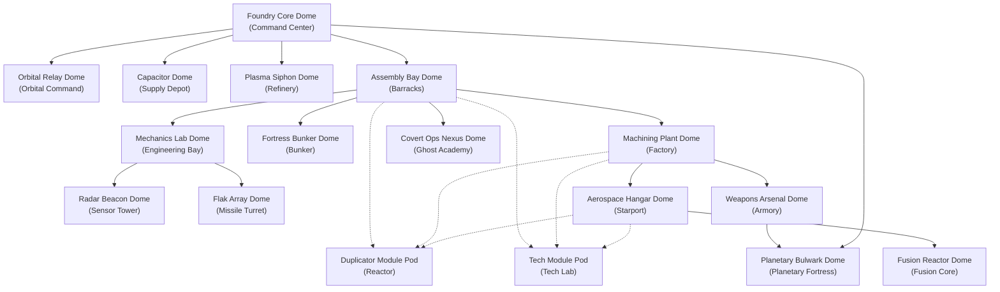
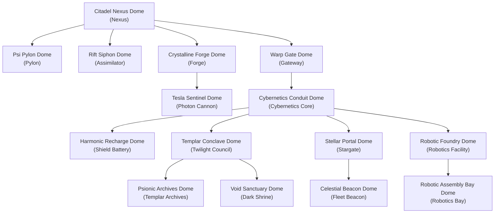
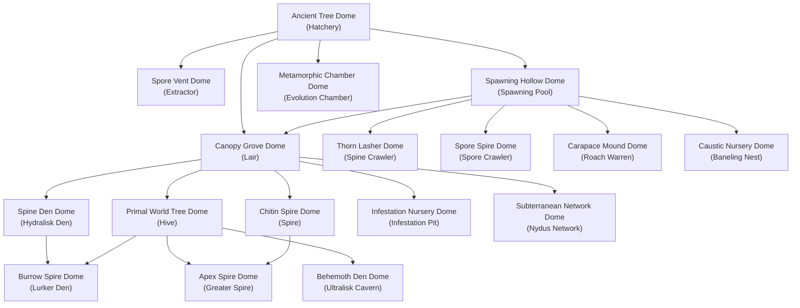

# 08 — StarCraft II Patch 5.0.14 Structures, Tech-Tree Hierarchies & Upgrade Matrices

> **Document Version:** 1.0.0  
> **Status:** Authoritative Architectural Design Document  
> **Pinned Reference:** *StarCraft II: Legacy of the Void (LotV)* **Patch 5.0.14** (November 25, 2024, Blizzard Entertainment & Community Balance Council)  
> **Simulation Frequency:** 25 Hz Fixed-Point Tick Rate (`1 real second = 25 ticks`, `1 tick = 40 ms`)  
> **Charter Compliance:** Strictly adheres to [AGENTS.md](file:///home/cl/projects/space-scuffle/AGENTS.md) Section 1 (Zero Placeholders & Textbook Grade Quality), Section 2 (Pedagogical Quality & Module Docs), Section 3 (Strict Determinism & Separation of Concerns), and Section 3.3 (Data-Driven Game Catalog & Zero Hardcoded Creatures).

---

## 1. Executive Summary & Historical SC2 Patch 5.0.14 Baseline

Following document `07-sc2-patch-5-0-14-roster-and-faction-mapping.md` which mapped the 54 mobile combat units of StarCraft II into Space Scuffle, this document provides the complete, authoritative mapping for:
1. **All Tech-Tree Structures (49 Structures & Add-Ons):**
   - **Automaton Directorate (17 Structures/Add-ons):** Command Center, Orbital Command, Planetary Fortress, Supply Depot, Refinery, Barracks, Engineering Bay, Bunker, Sensor Tower, Missile Turret, Factory, Ghost Academy, Starport, Armory, Fusion Core, Tech Lab, Reactor.
   - **Cosmic Enclave (15 Structures):** Nexus, Pylon, Assimilator, Gateway / Warp Gate, Forge, Photon Cannon, Shield Battery, Cybernetics Core, Twilight Council, Stargate, Robotics Facility, Templar Archives, Dark Shrine, Robotics Bay, Fleet Beacon.
   - **Sylvan Swarm (17 Structures/Metamorphoses):** Hatchery, Lair, Hive, Extractor, Spawning Pool, Evolution Chamber, Spine Crawler, Spore Crawler, Roach Warren, Baneling Nest, Hydralisk Den, Lurker Den, Spire, Greater Spire, Infestation Pit, Nydus Network, Ultralisk Cavern.
2. **All Weapon, Armor, Shield & Qualitative Upgrades (54 Upgrades):**
   - **Scaling Weapon/Armor/Shield Upgrades (Level 1 / 2 / 3):** Mineral/Gas costs, research durations in 25 Hz ticks, prerequisite structures, and mathematical stat bonuses per weapon and armor class.
   - **Unit-Specific Tech Upgrades:** Every unique ability-unlocking or stat-modifying upgrade (Combat Shield, Stimpack, Concussive Shells, Infernal Pre-Igniter, Drilling Claws, Smart Servos, Cloaking Field, Personal Cloaking, Neosteel Armor, Hi-Sec Auto Tracking, Advanced Ballistics; Charge, Blink, Resonating Glaives, Psionic Storm, Extended Thermal Lance, Gravitic Boosters, Gravitic Drive, Anion Pulse-Crystals, Flux Vanes, Shadow Stride; Metabolic Boost, Adrenal Glands, Centrifugal Hooks, Glial Reconstitution, Tunneling Claws, Muscular Augments, Grooved Spines, Nanomuscular Swell, Adaptive Talons, Seismic Spines, Pneumatized Carapace, Chitinous Plating, Anabolic Synthesis, Microbial Shroud, Neural Parasite).

### 1.1 Patch 5.0.14 Specific Structure & Upgrade Balancing
This catalog incorporates every specific structure and upgrade adjustment finalized in **Patch 5.0.14** (November 25, 2024):
- **Terran / Automaton Directorate:**
  - **Sensor Tower (`radar_beacon_dome`):** Cost reduced to `100` minerals and `50` gas (from `125/100`), radar sweep radius calibrated to `22.0` world units, and made salvageable.
  - **Planetary Fortress (`planetary_bulwark_dome`):** Base armor reduced from `3` to `2`.
  - **Liberator Advanced Ballistics (`advanced_ballistics`):** Defender Mode radius calibrated to `6.25`.
- **Protoss / Cosmic Enclave:**
  - **Nexus (`citadel_nexus_dome`):** Mineral cost calibrated to `400` minerals; provides `Energy Recharge` (`50` energy, `60s` cooldown = 1500 ticks, restores 100 energy to target unit or structure).
  - **Shield Battery (`harmonic_recharge_dome`):** Maximum range from closest Nexus increased from `10` to `12` tiles.
  - **Stalker (`warp_strider`):** Warp gate / gateway training duration calibrated to `27s` (`675 ticks`).
- **Zerg / Sylvan Swarm:**
  - **Hatchery (`ancient_tree_dome`):** Mineral cost reduced to `275` minerals (from `300`).
  - **Hydralisk Den (`spine_den_dome`):** New upgrade **Nanomuscular Swell** (`100/100`, `64s` = `1600 ticks`, requires Hive) unlocking **Lunge** (+100% movement speed for `0.71s` = `18 ticks`).
  - **Hydralisk Muscular Augments (`muscular_augments`):** Creep speed bonus tuned to `0.74` tiles/s.
  - **Ultralisk Anabolic Synthesis (`anabolic_synthesis`):** Off-creep speed bonus tuned to `0.57` tiles/s.

---

## 2. Mathematical Conversion & Architectural Formulas

### 2.1 Fixed-Point Time & Duration Conversion (25 Hz)
Durations are converted from SC2 "Faster" game seconds ($T_{\text{sec}}$) to authoritative integer tick counts ($T_{\text{ticks}}$):
$$T_{\text{ticks}} = \left\lfloor T_{\text{sec}} \times 25 + 0.5 \right\rfloor$$
Common standard durations:
- **18 seconds** (Depot, Pylon, Spore, Extractor) $= 18 \times 25 = 450\ \text{ticks}$
- **21 seconds** (Spawning Pool, Roach Warren, Baneling Nest) $= 21 \times 25 = 525\ \text{ticks}$
- **25 seconds** (Orbital Command, Engineering Bay) $= 25 \times 25 = 625\ \text{ticks}$
- **29 seconds** (Bunker, Photon Cannon, Shield Battery) $= 29 \times 25 = 725\ \text{ticks}$
- **32 seconds** (Forge, Cybernetics Core) $= 32 \times 25 = 800\ \text{ticks}$
- **36 seconds** (Starport, Templar Archives, Infestation Pit) $= 36 \times 25 = 900\ \text{ticks}$
- **43 seconds** (Factory, Stargate, Fleet Beacon, Spire) $= 43 \times 25 = 1075\ \text{ticks}$
- **46 seconds** (Barracks, Armory, Twilight Council, Robotics Facility) $= 46 \times 25 = 1150\ \text{ticks}$
- **50 seconds** (Planetary Fortress) $= 50 \times 25 = 1250\ \text{ticks}$
- **57 seconds** (Lair, Lurker Den, Hi-Sec) $= 57 \times 25 = 1425\ \text{ticks}$
- **71 seconds** (Command Center, Nexus, Hatchery, Dark Shrine) $= 71 \times 25 = 1775\ \text{ticks}$
- **114 seconds** (Level 1 Weapons/Armor) $= 114 \times 25 = 2850\ \text{ticks}$
- **136 seconds** (Level 2 Weapons/Armor) $= 136 \times 25 = 3400\ \text{ticks}$
- **157 seconds** (Level 3 Weapons/Armor) $= 157 \times 25 = 3925\ \text{ticks}$

### 2.2 Footprint Dimensions & NavMesh Carving
All building structures in Space Scuffle are represented visually and physically as **Building Domes** (`ShapeKind::BuildingDome`). Their placement footprints adhere strictly to discrete tile grids:
- **Town Halls (`5x5` tiles, radius $r = 2.5$):** Command Center / Orbital / Planetary, Nexus, Hatchery / Lair / Hive.
- **Medium Production & Tech Domes (`3x3` tiles, radius $r = 1.5$):** Barracks, Factory, Starport, Gateway, Forge, Cybernetics Core, Robotics Facility, Stargate, Spawning Pool, Roach Warren, Hydralisk Den, Evolution Chamber, Infestation Pit, Refineries / Extractors.
- **Small Logistics & Defense Domes (`2x2` tiles, radius $r = 1.0$):** Supply Depot, Pylon, Photon Cannon, Shield Battery, Missile Turret, Sensor Tower, Spine Crawler, Spore Crawler, Tech Lab, Reactor, Dark Shrine.

When a dome is placed on the map, its footprint coordinates carve impassable static obstacle flags into `CellFlags::OCCUPIED_BY_STRUCTURE` on the `GameMap`, updating the hierarchical NavMesh and high-ground visibility blocking.

### 2.3 Upgrade Stacking & Damage Mitigation Formulas
Authoritative damage calculation with researched upgrades:
$$\text{EffectiveDamage} = \text{BaseDamage} + \left(L_{\text{weapon}} \times \Delta_{\text{upgrade\_per\_level}}\right) + \text{BonusVsAttribute}$$
1. **Plasma Shield Absorption:**
   $$\text{ShieldArmor}_{\text{eff}} = \text{BaseShieldArmor} + L_{\text{shields}}$$
   $$\text{DamageToShields} = \max\left(0.5,\ \text{EffectiveDamage} - \text{ShieldArmor}_{\text{eff}}\right)$$
2. **Life Armor Mitigation:**
   $$\text{LifeArmor}_{\text{eff}} = \text{BaseLifeArmor} + L_{\text{armor}} + \text{BonusArmor}_{\text{tech}}$$
   $$\text{DamageToHull} = \max\left(0.5,\ \text{SpilloverDamage} - \text{LifeArmor}_{\text{eff}}\right)$$

---

## 3. Faction 1: The Automaton Directorate (Terran Mapping)

### 3.1 Tech Tree Flowchart

### 3.2 Complete Structures Catalog: Automaton Directorate

| # | Dome Name | Internal Slug | SC2 Analogue | Footprint | Cost (M/G) | Build Ticks | HP / Armor | Abilities & Production | Requires |
| :- | :--- | :--- | :--- | :---: | :---: | :---: | :---: | :--- | :--- |
| 1 | **Foundry Core Dome** | `foundry_core_dome` | Command Center | 5x5 | 400 / 0 | 1775 (71s) | 1500 / 1 | Trains `welder_drone`. Resource dropoff. Supply +15. Can lift off. | — |
| 2 | **Orbital Relay Dome** | `orbital_relay_dome` | Orbital Command | 5x5 | 150 / 0 | 625 (25s) | 1500 / 1 | Upgraded from Foundry Core. Unlocks Scanner Sweep, Supply Calldown, Mining Boost. | `assembly_bay_dome` |
| 3 | **Planetary Bulwark Dome** | `planetary_bulwark_dome` | Planetary Fortress | 5x5 | 150 / 150 | 1250 (50s) | 1500 / 2 *(5.0.14)* | Upgraded from Foundry Core. Heavy twin Ibiks cannon: 40 dmg / range 6.0 / period 50 ticks. Cannot lift. | `weapons_arsenal_dome` |
| 4 | **Capacitor Dome** | `capacitor_dome` | Supply Depot | 2x2 | 100 / 0 | 525 (21s) | 400 / 1 | Logistics node. Supply +8. Retractable sub-terrain gate allows allied pass-through. | — |
| 5 | **Plasma Siphon Dome** | `plasma_siphon_dome` | Refinery | 3x3 | 75 / 0 | 525 (21s) | 500 / 1 | Placed on Vespene Geyser. Allows 3 Welder Drones to harvest gas. | — |
| 6 | **Assembly Bay Dome** | `assembly_bay_dome` | Barracks | 3x3 | 150 / 0 | 1150 (46s) | 1000 / 1 | Trains `pulse_bot`, `shock_golem`, `jet_jumper`, `specter_android`. Can lift off. | `foundry_core_dome` |
| 7 | **Mechanics Lab Dome** | `mechanics_lab_dome` | Engineering Bay | 3x3 | 125 / 0 | 625 (25s) | 850 / 1 | Researches Infantry Weapons 1-3, Infantry Armor 1-3, Neosteel Armor, Hi-Sec Auto Tracking. Can lift. | `foundry_core_dome` |
| 8 | **Fortress Bunker Dome** | `fortress_bunker_dome` | Bunker | 3x3 | 100 / 0 | 725 (29s) | 400 / 1 | Garrisons 4 infantry (+1 range to occupants). Salvageable for 75% mineral refund. | `assembly_bay_dome` |
| 9 | **Radar Beacon Dome** | `radar_beacon_dome` | Sensor Tower | 2x2 | 100 / 50 *(5.0.14)* | 450 (18s) | 200 / 0 | Reveals enemy movement blips in 22.0 radius under Fog of War. Salvageable *(5.0.14)*. | `mechanics_lab_dome` |
| 10 | **Flak Array Dome** | `flak_array_dome` | Missile Turret | 2x2 | 100 / 0 | 450 (18s) | 250 / 0 | Static AA battery: 12x2 AA dmg / range 7.0 / period 15 ticks. Detector (LOS 11.0). | `mechanics_lab_dome` |
| 11 | **Machining Plant Dome** | `machining_plant_dome` | Factory | 3x3 | 150 / 100 | 1075 (43s) | 1250 / 1 | Trains `napalm_wheeler`, `railgun_crawler`, `colossus_mech`. Can lift off. | `assembly_bay_dome` |
| 12 | **Covert Ops Nexus Dome** | `covert_ops_nexus_dome` | Ghost Academy | 3x3 | 150 / 50 | 725 (29s) | 850 / 1 | Researches Personal Cloaking. Silo builds and stores Tactical Antimatter Warheads. | `assembly_bay_dome` |
| 13 | **Aerospace Hangar Dome** | `aerospace_hangar_dome` | Starport | 3x3 | 150 / 100 | 900 (36s) | 1000 / 1 | Trains `vector_interceptor`, `repair_shuttle`, `sky_bastion`, `cloak_gunship`, `omni_probe_drone`. Can lift. | `machining_plant_dome` |
| 14 | **Weapons Arsenal Dome** | `weapons_arsenal_dome` | Armory | 3x3 | 150 / 100 | 1150 (46s) | 750 / 1 | Researches Vehicle Weapons 1-3, Ship Weapons 1-3, Vehicle & Ship Plating 1-3. Unlocks L2/L3 Infantry upgrades. | `machining_plant_dome` |
| 15 | **Fusion Reactor Dome** | `fusion_reactor_dome` | Fusion Core | 3x3 | 150 / 150 | 1150 (46s) | 850 / 1 | Researches Advanced Ballistics. Unlocks advanced capital ordnance. | `aerospace_hangar_dome` |
| 16 | **Tech Module Pod** | `tech_module_pod` | Tech Lab | 2x2 | 50 / 25 | 450 (18s) | 400 / 1 | Add-on module. Unlocks specialized units (`shock_golem`, `railgun_crawler`, `cloak_gunship`) & tech upgrades. | Dome attachment |
| 17 | **Duplicator Module Pod** | `duplicator_module_pod` | Reactor | 2x2 | 50 / 50 | 450 (18s) | 400 / 1 | Add-on module. Allows the attached production dome to train 2 units in parallel. | Dome attachment |

### 3.3 Scaling Weapon, Armor & Plating Upgrades: Automaton Directorate

| Upgrade Slug | SC2 Analogue | Researched At | Level | Cost (M/G) | Research Ticks | Prerequisite | Affected Units & Exact Stat Bonus |
| :--- | :--- | :--- | :---: | :---: | :---: | :--- | :--- |
| `infantry_weapons_1` | Inf. Weapons 1 | `mechanics_lab_dome` | 1 | 100 / 100 | 2850 (114s) | — | `pulse_bot` +1, `shock_golem` +1 (+2 Armored), `jet_jumper` +1x2, `specter_android` +1 (+1 Light) |
| `infantry_weapons_2` | Inf. Weapons 2 | `mechanics_lab_dome` | 2 | 150 / 150 | 3400 (136s) | `weapons_arsenal_dome` | Same per-level scaling |
| `infantry_weapons_3` | Inf. Weapons 3 | `mechanics_lab_dome` | 3 | 200 / 200 | 3925 (157s) | `weapons_arsenal_dome` | Same per-level scaling |
| `infantry_armor_1` | Inf. Armor 1 | `mechanics_lab_dome` | 1 | 100 / 100 | 2850 (114s) | — | `welder_drone`, `pulse_bot`, `shock_golem`, `jet_jumper`, `specter_android` +1 Life Armor |
| `infantry_armor_2` | Inf. Armor 2 | `mechanics_lab_dome` | 2 | 150 / 150 | 3400 (136s) | `weapons_arsenal_dome` | Same per-level scaling |
| `infantry_armor_3` | Inf. Armor 3 | `mechanics_lab_dome` | 3 | 200 / 200 | 3925 (157s) | `weapons_arsenal_dome` | Same per-level scaling |
| `vehicle_weapons_1` | Veh. Weapons 1 | `weapons_arsenal_dome` | 1 | 100 / 100 | 2850 (114s) | — | `napalm_wheeler` +1 (+1 Light), `railgun_crawler` +2 (+2 Armored) / Siege +4 (+5 Armored), `colossus_mech` +3x2 Grnd / +3 (+2 Massive) Air |
| `vehicle_weapons_2` | Veh. Weapons 2 | `weapons_arsenal_dome` | 2 | 175 / 175 | 3400 (136s) | — | Same per-level scaling |
| `vehicle_weapons_3` | Veh. Weapons 3 | `weapons_arsenal_dome` | 3 | 250 / 250 | 3925 (157s) | — | Same per-level scaling |
| `ship_weapons_1` | Ship Weapons 1 | `weapons_arsenal_dome` | 1 | 100 / 100 | 2850 (114s) | — | `vector_interceptor` +1x2 (+1x2 Armored), `sky_bastion` +1x2 Air / +5 Defender Mode, `cloak_gunship` +1x2 |
| `ship_weapons_2` | Ship Weapons 2 | `weapons_arsenal_dome` | 2 | 175 / 175 | 3400 (136s) | — | Same per-level scaling |
| `ship_weapons_3` | Ship Weapons 3 | `weapons_arsenal_dome` | 3 | 250 / 250 | 3925 (157s) | — | Same per-level scaling |
| `vehicle_ship_plating_1`| Veh/Ship Plating 1 | `weapons_arsenal_dome` | 1 | 150 / 150 | 2850 (114s) | — | All vehicles and ships +1 Life Armor |
| `vehicle_ship_plating_2`| Veh/Ship Plating 2 | `weapons_arsenal_dome` | 2 | 225 / 225 | 3400 (136s) | — | All vehicles and ships +1 Life Armor |
| `vehicle_ship_plating_3`| Veh/Ship Plating 3 | `weapons_arsenal_dome` | 3 | 300 / 300 | 3925 (157s) | — | All vehicles and ships +1 Life Armor |

### 3.4 Unit-Specific Tech Upgrades: Automaton Directorate

| Upgrade Slug | SC2 Analogue | Researched At | Cost (M/G) | Research Ticks | Prerequisite | Target Unit & Effect |
| :--- | :--- | :--- | :---: | :---: | :--- | :--- |
| `combat_shield` | Combat Shield | `assembly_bay_dome` (Tech Lab) | 100 / 100 | 1975 (79s) | `tech_module_pod` | `pulse_bot`: Max HP increased by +10 (45 -> 55 HP). |
| `overclock_stim` | Stimpack | `assembly_bay_dome` (Tech Lab) | 100 / 100 | 3025 (121s) | `tech_module_pod` | Unlocks `Overclock` on `pulse_bot` and `shock_golem`: sacrifices 10/20 HP for +50% move speed and +50% attack speed for 178 ticks (7.1s). |
| `concussive_shells` | Concussive Shells | `assembly_bay_dome` (Tech Lab) | 50 / 50 | 1075 (43s) | `tech_module_pod` | `shock_golem`: Attacks inflict a 50-tick kinetic gravity snare slowing target move speed by 44%. |
| `infernal_preigniter` | Infernal Pre-Igniter | `machining_plant_dome` (Tech Lab) | 100 / 100 | 1975 (79s) | `weapons_arsenal_dome` | `napalm_wheeler`: Chemical napalm deals +5 additional bonus damage vs Light targets (8+6 -> 8+11). |
| `drilling_claws` | Drilling Claws | `machining_plant_dome` (Tech Lab) | 75 / 75 | 1975 (79s) | `weapons_arsenal_dome` | Subterranean droids burrow and rearm twice as fast (burrow duration halved from 50 to 25 ticks). |
| `smart_servos` | Smart Servos | `machining_plant_dome` (Tech Lab) | 100 / 100 | 1975 (79s) | `weapons_arsenal_dome` | `vector_interceptor`, `sky_bastion`: Reduces mode transformation duration by 66% (from 50 ticks to 17 ticks). |
| `personal_cloaking` | Personal Cloaking | `covert_ops_nexus_dome` | 150 / 150 | 2150 (86s) | — | `specter_android`: Unlocks active `Cloak` (25 energy activation, drains 1.3 energy/s, invisible to non-detectors). |
| `cloaking_field` | Cloaking Field | `aerospace_hangar_dome` (Tech Lab) | 100 / 100 | 1975 (79s) | `tech_module_pod` | `cloak_gunship`: Unlocks active `Cloak` (25 energy activation, drains 1.25 energy/s). |
| `neosteel_armor` | Neosteel Armor | `mechanics_lab_dome` | 150 / 150 | 2500 (100s) | — | All Automaton Domes gain +2 Base Armor; `fortress_bunker_dome` cargo capacity increased by +2 (4 -> 6). |
| `hi_sec_auto_tracking`| Hi-Sec Auto Tracking | `mechanics_lab_dome` | 100 / 100 | 1425 (57s) | — | `flak_array_dome`, `planetary_bulwark_dome`: Weapon range increased by +1.0 (Flak: 7.0 -> 8.0, Bulwark: 6.0 -> 7.0). |
| `advanced_ballistics` | Advanced Ballistics | `fusion_reactor_dome` | 150 / 150 | 1975 (79s) | — | `sky_bastion`: Defender Mode strike targeting range increased by +2.0 (9.0 -> 11.0); zone radius calibrated to 6.25 *(5.0.14)*. |

---

## 4. Faction 2: The Cosmic Enclave (Protoss Mapping)

### 4.1 Tech Tree Flowchart

### 4.2 Complete Structures Catalog: Cosmic Enclave

| # | Dome Name | Internal Slug | SC2 Analogue | Footprint | Cost (M/G) | Build Ticks | HP / Shields / Armor | Abilities & Production | Requires |
| :- | :--- | :--- | :--- | :---: | :---: | :---: | :---: | :--- | :--- |
| 1 | **Citadel Nexus Dome** | `citadel_nexus_dome` | Nexus | 5x5 | 400 / 0 *(5.0.14)* | 1775 (71s) | 1000 / 1000 / 1 | Trains `grav_harvester`. Resource dropoff. Supply +15. Casts **Energy Recharge** (50 en, 60s cd) *(5.0.14)*. | — |
| 2 | **Psi Pylon Dome** | `psi_pylon_dome` | Pylon | 2x2 | 100 / 0 | 450 (18s) | 200 / 200 / 0 | Projects Psionic Power Matrix in 6.5 tile radius. Powers Enclave domes. Supply +8. | — |
| 3 | **Rift Siphon Dome** | `rift_siphon_dome` | Assimilator | 3x3 | 75 / 0 | 450 (18s) | 450 / 450 / 1 | Placed on Vespene Geyser. Allows 3 Grav Harvesters to harvest gas. | — |
| 4 | **Warp Gate Dome** | `warp_gate_dome` | Gateway | 3x3 | 150 / 0 | 1150 (46s) | 500 / 500 / 1 | Trains `psi_grey`, `warp_strider`, `prism_weaver`, `astral_vagrant`. Upgrades into instant Warp Gate. | `citadel_nexus_dome` |
| 5 | **Crystalline Forge Dome** | `crystalline_forge_dome` | Forge | 3x3 | 150 / 0 | 800 (32s) | 500 / 500 / 1 | Researches Ground Weapons 1-3, Ground Armor 1-3, Plasma Shields 1-3. Unlocks Tesla Sentinel. | `citadel_nexus_dome` |
| 6 | **Tesla Sentinel Dome** | `tesla_sentinel_dome` | Photon Cannon | 2x2 | 150 / 0 | 725 (29s) | 150 / 150 / 0 | Static defense: 20 lightning arc / range 7.0 / period 22 ticks (ground & air). Detector (LOS 11.0). Requires power. | `crystalline_forge_dome` |
| 7 | **Harmonic Recharge Dome** | `harmonic_recharge_dome` | Shield Battery | 2x2 | 100 / 0 | 725 (29s) | 200 / 200 / 1 | Restores friendly shields (36 shields/s for 1 en/3 shields, 100 en pool). Max range 12 from Nexus *(5.0.14)*. | `cybernetics_conduit_dome`|
| 8 | **Cybernetics Conduit Dome**| `cybernetics_conduit_dome`| Cybernetics Core| 3x3 | 150 / 0 | 800 (32s) | 500 / 500 / 1 | Researches Warp Gate Tech, Air Weapons 1-3, Air Armor 1-3. Unlocks Stalker, Sentry, Twilight, Stargate, Robo. | `warp_gate_dome` |
| 9 | **Templar Conclave Dome** | `templar_conclave_dome` | Twilight Council| 3x3 | 150 / 100 | 1150 (46s) | 500 / 500 / 1 | Researches Charge, Blink, Resonating Glaives. Unlocks L2/L3 Forge Upgrades, Templar Archives, Dark Shrine. | `cybernetics_conduit_dome`|
| 10 | **Stellar Portal Dome** | `stellar_portal_dome` | Stargate | 3x3 | 150 / 150 | 1075 (43s) | 500 / 500 / 1 | Warps in `flying_saucer`, `prismatic_saucer`, `mothership_carrier`. | `cybernetics_conduit_dome`|
| 11 | **Robotic Foundry Dome** | `robotic_foundry_dome` | Robotics Facility| 3x3 | 150 / 100 | 1150 (46s) | 450 / 450 / 1 | Warps in `stealth_eye_orb`, `phase_prism_saucer`, `void_goliath`, `tripod_annihilator`. | `cybernetics_conduit_dome`|
| 12 | **Psionic Archives Dome** | `psionic_archives_dome` | Templar Archives| 3x3 | 150 / 200 | 900 (36s) | 500 / 500 / 1 | Researches Psionic Storm. Unlocks High Templar morph to Archon. | `templar_conclave_dome` |
| 13 | **Void Sanctuary Dome** | `void_sanctuary_dome` | Dark Shrine | 2x2 | 100 / 100 | 1775 (71s) | 500 / 500 / 1 | Researches Shadow Stride. Unlocks `shadow_visitor` (Dark Templar) warp-in and Archon morph. | `templar_conclave_dome` |
| 14 | **Robotic Assembly Bay Dome**| `robotic_assembly_bay_dome`| Robotics Bay | 3x3 | 150 / 150 | 1150 (46s) | 500 / 500 / 1 | Researches Extended Thermal Lance, Gravitic Boosters, Gravitic Drive. Unlocks Colossus warp-in. | `robotic_foundry_dome` |
| 15 | **Celestial Beacon Dome** | `celestial_beacon_dome` | Fleet Beacon | 3x3 | 300 / 200 | 1075 (43s) | 750 / 750 / 1 | Researches Anion Pulse-Crystals, Flux Vanes. Unlocks L2/L3 Air Upgrades and Mothership Carrier. | `stellar_portal_dome` |

### 4.3 Scaling Weapon, Armor & Shield Upgrades: Cosmic Enclave

| Upgrade Slug | SC2 Analogue | Researched At | Level | Cost (M/G) | Research Ticks | Prerequisite | Affected Units & Exact Stat Bonus |
| :--- | :--- | :--- | :---: | :---: | :---: | :--- | :--- |
| `ground_weapons_1` | Ground Weapons 1 | `crystalline_forge_dome` | 1 | 100 / 100 | 3025 (121s) | — | `psi_grey` +1x2, `warp_strider` +1 (+1 Armored), `prism_weaver` +1, `astral_vagrant` +1 (+1 Light), `cerebral_elder` +1, `shadow_visitor` +5, `void_goliath` +2 (+3 Armored), `tripod_annihilator` +1x2 (+1x2 Light) |
| `ground_weapons_2` | Ground Weapons 2 | `crystalline_forge_dome` | 2 | 150 / 150 | 3625 (145s) | `templar_conclave_dome` | Same per-level scaling |
| `ground_weapons_3` | Ground Weapons 3 | `crystalline_forge_dome` | 3 | 200 / 200 | 4200 (168s) | `templar_conclave_dome` | Same per-level scaling |
| `ground_armor_1` | Ground Armor 1 | `crystalline_forge_dome` | 1 | 100 / 100 | 3025 (121s) | — | All ground units +1 Life Armor |
| `ground_armor_2` | Ground Armor 2 | `crystalline_forge_dome` | 2 | 150 / 150 | 3625 (145s) | `templar_conclave_dome` | All ground units +1 Life Armor |
| `ground_armor_3` | Ground Armor 3 | `crystalline_forge_dome` | 3 | 200 / 200 | 4200 (168s) | `templar_conclave_dome` | All ground units +1 Life Armor |
| `plasma_shields_1` | Plasma Shields 1 | `crystalline_forge_dome` | 1 | 150 / 150 | 3025 (121s) | — | ALL Cosmic Enclave units and domes +1 Shield Armor |
| `plasma_shields_2` | Plasma Shields 2 | `crystalline_forge_dome` | 2 | 200 / 200 | 3625 (145s) | `templar_conclave_dome` | ALL Cosmic Enclave units and domes +1 Shield Armor |
| `plasma_shields_3` | Plasma Shields 3 | `crystalline_forge_dome` | 3 | 250 / 250 | 4200 (168s) | `templar_conclave_dome` | ALL Cosmic Enclave units and domes +1 Shield Armor |
| `air_weapons_1` | Air Weapons 1 | `cybernetics_conduit_dome`| 1 | 100 / 100 | 3025 (121s) | — | `flying_saucer` +1x2 (+1x2 Light), `prismatic_saucer` +1 (+1 Armored), `mothership_carrier` +1x2 per interceptor |
| `air_weapons_2` | Air Weapons 2 | `cybernetics_conduit_dome`| 2 | 150 / 150 | 3625 (145s) | `celestial_beacon_dome` | Same per-level scaling |
| `air_weapons_3` | Air Weapons 3 | `cybernetics_conduit_dome`| 3 | 200 / 200 | 4200 (168s) | `celestial_beacon_dome` | Same per-level scaling |
| `air_armor_1` | Air Armor 1 | `cybernetics_conduit_dome`| 1 | 100 / 100 | 3025 (121s) | — | All flying units +1 Life Armor |
| `air_armor_2` | Air Armor 2 | `cybernetics_conduit_dome`| 2 | 150 / 150 | 3625 (145s) | `celestial_beacon_dome` | All flying units +1 Life Armor |
| `air_armor_3` | Air Armor 3 | `cybernetics_conduit_dome`| 3 | 200 / 200 | 4200 (168s) | `celestial_beacon_dome` | All flying units +1 Life Armor |

### 4.4 Unit-Specific Tech Upgrades: Cosmic Enclave

| Upgrade Slug | SC2 Analogue | Researched At | Cost (M/G) | Research Ticks | Prerequisite | Target Unit & Effect |
| :--- | :--- | :--- | :---: | :---: | :--- | :--- |
| `warp_gate_tech` | Warp Gate | `cybernetics_conduit_dome`| 50 / 50 | 2500 (100s) | — | Transforms all `warp_gate_dome`s into Warp Gates, enabling instantaneous orbital deployment anywhere inside power matrix. |
| `charge` | Charge | `templar_conclave_dome` | 100 / 100 | 2500 (100s) | — | `psi_grey`: Movement speed increased by +0.038 world units/tick; intercepts fleeing targets with a 0.275 speed charge rush (10s cd). |
| `phase_blink` | Blink | `templar_conclave_dome` | 150 / 150 | 3025 (121s) | — | `warp_strider`: Unlocks `Phase Blink` ability (instantly teleports up to 8.0 units toward cursor, 175 tick cooldown). |
| `resonating_glaives` | Resonating Glaives| `templar_conclave_dome` | 100 / 100 | 2500 (100s) | — | `astral_vagrant`: Attack weapon period reduced from 40 ticks to 28 ticks (+43% attack rate). |
| `shadow_stride` | Shadow Stride | `void_sanctuary_dome` | 100 / 100 | 2500 (100s) | — | `shadow_visitor`: Unlocks short-range tactical phase leap (5.0 unit teleport dash, 350 tick cooldown). |
| `psionic_storm` | Psionic Storm | `psionic_archives_dome` | 200 / 200 | 1975 (79s) | — | `cerebral_elder`: Unlocks `Psionic Storm` (75 energy, blanket psionic lightning dealing 80 damage over 70 ticks across 3.0 radius). |
| `extended_thermal_lance`| Extended Thermal Lance| `robotic_assembly_bay_dome`| 150 / 150 | 2500 (100s) | — | `tripod_annihilator`: Thermal lance sweep range increased by +2.0 (7.0 -> 9.0 world units). |
| `gravitic_boosters`| Gravitic Boosters | `robotic_assembly_bay_dome`| 100 / 100 | 1425 (57s) | — | `stealth_eye_orb`: Movement speed increased by +50% (0.1052 -> 0.1578 world units/tick). |
| `gravitic_drive` | Gravitic Drive | `robotic_assembly_bay_dome`| 100 / 100 | 1425 (57s) | — | `phase_prism_saucer`: Movement speed increased by +30% (0.1652 -> 0.2148 world units/tick). |
| `anion_pulse_crystals`| Anion Pulse-Crystals| `celestial_beacon_dome` | 150 / 150 | 1600 (64s) | — | `flying_saucer`: Emerald ray attack range increased by +2.0 (5.0 -> 7.0 world units). |
| `flux_vanes` | Flux Vanes | `celestial_beacon_dome` | 100 / 100 | 1425 (57s) | — | `prismatic_saucer`: Movement speed increased by +20% (0.1540 -> 0.1848 world units/tick) with rapid acceleration. |

---

## 5. Faction 3: The Sylvan Swarm (Zerg Mapping)

### 5.1 Tech Tree Flowchart

### 5.2 Complete Structures Catalog: Sylvan Swarm

| # | Dome Name | Internal Slug | SC2 Analogue | Footprint | Cost (M/G) | Build Ticks | HP / Armor | Abilities & Production | Requires |
| :- | :--- | :--- | :--- | :---: | :---: | :---: | :---: | :--- | :--- |
| 1 | **Ancient Tree Dome** | `ancient_tree_dome` | Hatchery | 5x5 | 275 / 0 *(5.0.14)* | 1775 (71s) | 1500 / 1 | Spawns Larvae. Resource dropoff. Spreads bioluminescent creep moss. Morphs to Lair. Supply +6. | — |
| 2 | **Canopy Grove Dome** | `canopy_grove_dome` | Lair | 5x5 | 150 / 100 | 1425 (57s) | 2000 / 1 | Metamorphosed from Ancient Tree. Unlocks Tier-2 bio-structures & upgrades. Morphs to Hive. | `spawning_hollow_dome` |
| 3 | **Primal World Tree Dome** | `primal_world_tree_dome` | Hive | 5x5 | 200 / 150 | 1775 (71s) | 2500 / 1 | Apex Swarm Heart. Unlocks Tier-3 bio-structures, L3 bio-upgrades, and ultimate mutations. | `infestation_nursery_dome` |
| 4 | **Spore Vent Dome** | `spore_vent_dome` | Extractor | 3x3 | 25 / 0 | 525 (21s) | 500 / 1 | Morphed from Forager Ant onto Vespene Geyser. Allows 3 ants to harvest gas. | — |
| 5 | **Spawning Hollow Dome** | `spawning_hollow_dome` | Spawning Pool | 3x3 | 200 / 0 | 525 (21s) | 1000 / 1 | Enables `razor_mantis` metamorphosis and `hive_matron` (Queen) incubation. Researches Mantis tech. | `ancient_tree_dome` |
| 6 | **Metamorphic Chamber Dome**| `metamorphic_chamber_dome`| Evolution Chamber| 3x3| 75 / 0 | 450 (18s) | 750 / 1 | Researches Melee Attacks 1-3, Missile Attacks 1-3, Ground Carapace 1-3. | `ancient_tree_dome` |
| 7 | **Thorn Lasher Dome** | `thorn_lasher_dome` | Spine Crawler | 2x2 | 100 / 0 | 900 (36s) | 300 / 2 | Ground defense: 25 (+5 Armored) / range 7.0 / period 33 ticks. Can uproot and walk on creep. | `spawning_hollow_dome` |
| 8 | **Spore Spire Dome** | `spore_spire_dome` | Spore Crawler | 2x2 | 75 / 0 | 450 (18s) | 300 / 1 | Anti-air defense: 15 (+30 Bio) / range 7.0 / period 15 ticks. Detector (LOS 11.0). Uprootable. | `spawning_hollow_dome` |
| 9 | **Carapace Mound Dome** | `carapace_mound_dome` | Roach Warren | 3x3 | 150 / 0 | 525 (21s) | 850 / 1 | Enables `rhino_beetle` (Roach) metamorphosis. Researches Glial Reconstitution & Tunneling Claws. | `spawning_hollow_dome` |
| 10 | **Caustic Nursery Dome** | `caustic_nursery_dome` | Baneling Nest | 3x3 | 100 / 50 | 525 (21s) | 850 / 1 | Enables `volatile_tick` (Baneling) morph from Mantis. Researches Centrifugal Hooks. | `spawning_hollow_dome` |
| 11 | **Spine Den Dome** | `spine_den_dome` | Hydralisk Den | 3x3 | 100 / 100 | 700 (28s) | 850 / 1 | Enables `thorn_viper` (Hydralisk) metamorphosis. Researches Muscular Augments, Grooved Spines, Nanomuscular Swell *(5.0.14)*. | `canopy_grove_dome` |
| 12 | **Burrow Spire Dome** | `burrow_spire_dome` | Lurker Den | 3x3 | 150 / 150 | 1425 (57s) | 850 / 1 | Morphed from Spine Den. Enables `burrow_scorpion` (Lurker) morph. Researches Adaptive Talons & Seismic Spines. | `canopy_grove_dome` + `spine_den_dome` |
| 13 | **Chitin Spire Dome** | `chitin_spire_dome` | Spire | 3x3 | 200 / 200 | 1075 (43s) | 850 / 1 | Enables `sonic_bat` (Mutalisk) & `sky_leviathan` (Corruptor) metamorphosis. Researches Flyer Attacks/Carapace 1-3. | `canopy_grove_dome` |
| 14 | **Apex Spire Dome** | `apex_spire_dome` | Greater Spire | 3x3 | 100 / 150 | 900 (36s) | 1000 / 1 | Morphed from Chitin Spire. Enables `spore_matriarch` (Brood Lord) morph from Sky Leviathan. | `primal_world_tree_dome` + `chitin_spire_dome` |
| 15 | **Infestation Nursery Dome**| `infestation_nursery_dome`| Infestation Pit| 3x3 | 100 / 100 | 900 (36s) | 850 / 1 | Enables `mycelium_shaman` (Infestor). Researches Microbial Shroud & Neural Parasite. Unlocks Hive. | `canopy_grove_dome` |
| 16 | **Subterranean Network Dome**| `subterranean_network_dome`| Nydus Network | 3x3 | 150 / 150 | 900 (36s) | 850 / 1 | Summons Nydus Canals across revealed terrain for instant underground army relocation. | `canopy_grove_dome` |
| 17 | **Behemoth Den Dome** | `behemoth_den_dome` | Ultralisk Cavern| 3x3 | 150 / 200 | 1150 (46s) | 850 / 1 | Enables `stag_behemoth` (Ultralisk) metamorphosis. Researches Chitinous Plating & Anabolic Synthesis *(5.0.14)*. | `primal_world_tree_dome` |

### 5.3 Scaling Bio Attacks & Carapace Upgrades: Sylvan Swarm

| Upgrade Slug | SC2 Analogue | Researched At | Level | Cost (M/G) | Research Ticks | Prerequisite | Affected Units & Exact Stat Bonus |
| :--- | :--- | :--- | :---: | :---: | :---: | :--- | :--- |
| `melee_attacks_1` | Melee Attacks 1 | `metamorphic_chamber_dome` | 1 | 100 / 100 | 2850 (114s) | — | `nectar_worker` +1, `razor_mantis` +1, `stag_behemoth` +3 |
| `melee_attacks_2` | Melee Attacks 2 | `metamorphic_chamber_dome` | 2 | 150 / 150 | 3400 (136s) | `canopy_grove_dome` | Same per-level scaling |
| `melee_attacks_3` | Melee Attacks 3 | `metamorphic_chamber_dome` | 3 | 200 / 200 | 3925 (157s) | `primal_world_tree_dome` | Same per-level scaling |
| `missile_attacks_1` | Missile Attacks 1 | `metamorphic_chamber_dome` | 1 | 100 / 100 | 2850 (114s) | — | `rhino_beetle` +2, `mortar_stag` +2, `thorn_viper` +1 (ground & air), `burrow_scorpion` +2 (+1 Armored) |
| `missile_attacks_2` | Missile Attacks 2 | `metamorphic_chamber_dome` | 2 | 150 / 150 | 3400 (136s) | `canopy_grove_dome` | Same per-level scaling |
| `missile_attacks_3` | Missile Attacks 3 | `metamorphic_chamber_dome` | 3 | 200 / 200 | 3925 (157s) | `primal_world_tree_dome` | Same per-level scaling |
| `ground_carapace_1` | Ground Carapace 1 | `metamorphic_chamber_dome` | 1 | 150 / 150 | 2850 (114s) | — | All ground bio-units +1 Life Armor |
| `ground_carapace_2` | Ground Carapace 2 | `metamorphic_chamber_dome` | 2 | 225 / 225 | 3400 (136s) | `canopy_grove_dome` | All ground bio-units +1 Life Armor |
| `ground_carapace_3` | Ground Carapace 3 | `metamorphic_chamber_dome` | 3 | 300 / 300 | 3925 (157s) | `primal_world_tree_dome` | All ground bio-units +1 Life Armor |
| `flyer_attacks_1` | Flyer Attacks 1 | `chitin_spire_dome` | 1 | 100 / 100 | 2850 (114s) | — | `sonic_bat` +1 (bounces 0.33, 0.11), `sky_leviathan` +1 (+1 Massive), `spore_matriarch` +2 |
| `flyer_attacks_2` | Flyer Attacks 2 | `chitin_spire_dome` | 2 | 150 / 150 | 3400 (136s) | `canopy_grove_dome` | Same per-level scaling |
| `flyer_attacks_3` | Flyer Attacks 3 | `chitin_spire_dome` | 3 | 200 / 200 | 3925 (157s) | `primal_world_tree_dome` | Same per-level scaling |
| `flyer_carapace_1` | Flyer Carapace 1 | `chitin_spire_dome` | 1 | 150 / 150 | 2850 (114s) | — | All flying bio-units +1 Life Armor |
| `flyer_carapace_2` | Flyer Carapace 2 | `chitin_spire_dome` | 2 | 225 / 225 | 3400 (136s) | `canopy_grove_dome` | All flying bio-units +1 Life Armor |
| `flyer_carapace_3` | Flyer Carapace 3 | `chitin_spire_dome` | 3 | 300 / 300 | 3925 (157s) | `primal_world_tree_dome` | All flying bio-units +1 Life Armor |

### 5.4 Unit-Specific Tech Upgrades: Sylvan Swarm

| Upgrade Slug | SC2 Analogue | Researched At | Cost (M/G) | Research Ticks | Prerequisite | Target Unit & Effect |
| :--- | :--- | :--- | :---: | :---: | :--- | :--- |
| `metabolic_boost` | Metabolic Boost | `spawning_hollow_dome` | 100 / 100 | 1500 (60s) | — | `razor_mantis`: Movement speed increased by +50% (0.1652 -> 0.2478 world units/tick). |
| `adrenal_glands` | Adrenal Glands | `spawning_hollow_dome` | 200 / 200 | 2150 (86s) | `primal_world_tree_dome` | `razor_mantis`: Attack period reduced by 40% (12 ticks -> 7 ticks!). |
| `centrifugal_hooks` | Centrifugal Hooks | `caustic_nursery_dome` | 100 / 100 | 1775 (71s) | `canopy_grove_dome` | `volatile_tick`: Movement speed increased by +18% (0.1400 -> 0.1652) and Max HP +5 (30 -> 35 HP). |
| `glial_reconstitution`| Glial Reconstitution| `carapace_mound_dome` | 100 / 100 | 1775 (71s) | `canopy_grove_dome` | `rhino_beetle`: Movement speed increased by +33% (0.1200 -> 0.1600 world units/tick). |
| `tunneling_claws` | Tunneling Claws | `carapace_mound_dome` | 100 / 100 | 1975 (79s) | `canopy_grove_dome` | `rhino_beetle`: Gains ability to move while burrowed (speed 0.0560); subterranean HP regen +10 HP/s. |
| `muscular_augments` | Muscular Augments | `spine_den_dome` | 100 / 100 | 1775 (71s) | `canopy_grove_dome` | `thorn_viper`: Movement speed off creep increased by +10% (0.1260 -> 0.1386) *(creep bonus 0.74 in 5.0.14)*. |
| `grooved_spines` | Grooved Spines | `spine_den_dome` | 100 / 100 | 1775 (71s) | `canopy_grove_dome` | `thorn_viper`: Spine attack range increased by +1.0 (5.0 -> 6.0 world units). |
| `nanomuscular_swell`| Nanomuscular Swell| `spine_den_dome` | 100 / 100 | 1600 (64s) | `primal_world_tree_dome` *(5.0.14)* | `thorn_viper`: Unlocks **Lunge** ability (+100% movement speed sprint for 0.71s = 18 ticks) *(5.0.14)*. |
| `adaptive_talons` | Adaptive Talons | `burrow_spire_dome` | 100 / 100 | 1975 (79s) | `primal_world_tree_dome` | `burrow_scorpion`: Burrow duration reduced from 50 ticks to 27 ticks (1.07s). |
| `seismic_spines` | Seismic Spines | `burrow_spire_dome` | 150 / 150 | 1975 (79s) | `primal_world_tree_dome` | `burrow_scorpion`: Subterranean impaling spike attack range increased by +2.0 (8.0 -> 10.0 world units). |
| `pneumatized_carapace`| Pneumatized Carapace| `ancient_tree_dome` | 100 / 100 | 1075 (43s) | `canopy_grove_dome` | `amber_pollen_dome` (Overlord): Movement speed increased by +160% (0.0360 -> 0.0936 world units/tick). |
| `chitinous_plating` | Chitinous Plating | `behemoth_den_dome` | 150 / 150 | 1975 (79s) | `primal_world_tree_dome` | `stag_behemoth`: Base armor increased by +2 (2 -> 4 Life Armor). |
| `anabolic_synthesis`| Anabolic Synthesis | `behemoth_den_dome` | 150 / 150 | 1075 (43s) | `primal_world_tree_dome` *(5.0.14)* | `stag_behemoth`: Off-creep movement speed increased by +14% (0.1652 -> 0.1880) *(calibrated for 5.0.14)*. |
| `microbial_shroud` | Microbial Shroud | `infestation_nursery_dome`| 150 / 150 | 1975 (79s) | — | `mycelium_shaman`: Unlocks `Microbial Shroud` (100 en, reduces incoming ranged damage by 50% for 11s, lingers 3.6s) *(5.0.14)*. |
| `neural_parasite` | Neural Parasite | `infestation_nursery_dome`| 150 / 150 | 1975 (79s) | — | `mycelium_shaman`: Unlocks `Neural Parasite` (100 en, mind-controls target non-massive enemy entity up to 9.0 range). |

---

## 6. Global Upgrade & Tech Invariants Matrix

1. **Deterministic Upgrade State:** Each player in `SimWorld` owns a deterministic `PlayerUpgradeState` storing integer levels for weapon/armor/shield upgrades and bitflags for researched qualitative tech upgrades.
2. **Zero Run-Time Allocations:** Applying upgrades occurs at research completion via direct mutations to unit combat caches or during damage resolution via index lookups.
3. **No Hardcoded Slugs:** Weapon damage scaling uses a strongly-typed `weapon_class` tag on weapons (e.g. `InfantryBullet`, `VehicleShell`, `ProtossGroundEnergy`, `ZergBioMelee`) matching the researched upgrade, ensuring new weapons can be added strictly through data.
