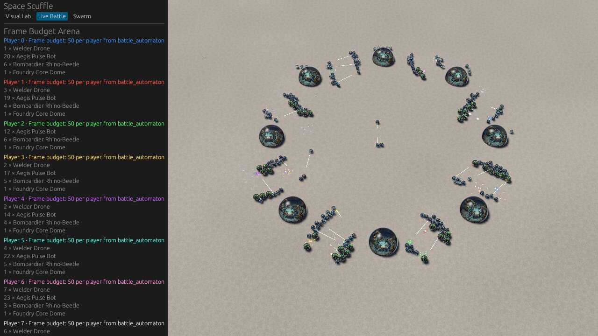

# Frame budget at 0, 200 and 400 units on the RX 580 (exits WP6)

> **Superseded as the figures of record (2026-11-12).** The frame budget of record is now the two-army series in
> [`2026-11-12-frame-budget-two-armies.md`](2026-11-12-frame-budget-two-armies.md), measured after the scenario
> builder learned to place 100 and 200 units per player (Q0018, option (b)). The tables below are history: a
> different scene (eight armies on a circle) and an earlier client.

This is the evidence for WP6 of `docs/plans/2026-11-03-close-phase-6-7-8-exits.md`, which records the third exit
criterion of remediation Phase 6: "frame budget measured at 200 and 400 units". It changes no code. The tool is
`frame_budget` in `crates/client_diagnostics` (WP5, WP5b). Its design is decision D-4 of that plan.

There are three tables, and only the first is the frame budget:

1. **Figures of record**: headless KWin, 1280×720, no diagnostics, 15 interleaved runs. These go into
   `DESIGN.md` §5 and the Phase 6 exit paragraph.
2. **Attribution runs**: the same path at a quarter of the pixels, with GPU pass timings, and under `perf`. They
   say where the time goes. They are not the frame budget.
3. **Xvfb with software present**: this VM's fallback path. It is not the game's frame time.

No pass or fail line applies. The owner chose (Q0015) to measure and publish against the 60 and 30 frames per
second reference lines (16.7 ms and 33.3 ms).

## Conclusions

1. **Frame budget (median of 5 runs, whole 60 s window).** Frame interval p50, p95 and p99: 12.3, 15.2 and 16.6 ms
   at 0 units; 15.6, 19.0 and 20.6 ms at 200 units; 16.3, 20.9 and 23.6 ms at 400 units. The 200 and 400 medians
   are under the 16.7 ms line, and their p95 and p99 are over it. Every figure is under the 33.3 ms line except the
   maximum of the 200 and 400 runs (44.7 and 68.7 ms). That maximum is one frame, always the frame of the first
   simulation tick after measurement starts (frame 3 or 4, tick 1). It is not part of the fight.
2. **The client is CPU-bound in the main world, not GPU-bound.** At 400 units the main-world update takes 14.1 of
   the 16.3 ms median frame. A quarter of the pixels (640×360) changes the median by 3 % (15.8 ms), inside the
   plan's 10 % line, so the frame is not limited by GPU fill. The GPU passes Bevy instruments add up to 3.1 ms per
   frame at 0 units and 3.6 ms at 400 units.
3. **The smog solver is the largest single cost: about 8.2 ms of every frame, at any unit count.**
   `client::smog::fluid::SmogGrid3d::step` took 30,253 of the `perf` run's 185 K samples (19.7 % of all cycles).
   That is 30.3 s of CPU over 3,694 rendered frames. It exceeds a quarter of the 400 scenario's main-update p50
   (3.5 ms), so it is recorded below as new finding **C-18 [R]** for a later plan. It also explains most of the
   0-unit baseline's 10.8 ms update.
4. **C-17 (one `CombatFxMaterial` per effect) has a measurable cost, below the finding threshold on the main
   thread, and visible in the frame interval of heavy combat frames.** Functions specialised for
   `CombatFxMaterial` took 1,624 `perf` samples of their own, about 0.44 ms per rendered frame averaged over the
   run. This is a lower bound: wgpu's buffer and bind-group creation for each new material is counted under
   wgpu's own symbols. With the tick cost held equal, frames with 10 to 49 combat events at 400 units have the
   same main-update median as frames with none (14.5 against 14.9 ms). Their frame interval is longer, though:
   20.4 against 15.1 ms at the median. Those frames are early in the fight, with 290 units alive, but the march
   frames with all 400 alive run at 15.3 ms. The extra time is spent outside the main world, in extraction,
   render-asset preparation and drawing, which is where C-17's per-effect material creation lands. The combat
   window's p95 and p99 (22.3 and 24.2 ms) are 2.9 and 3.4 ms above those after the fight (19.4 and 20.8 ms).
   C-17 stays open as the remediation plan records it, now with this measurement.
5. **Xvfb's software present path measures the VM.** The same build on the same GPU alternates between frames of
   about 18 ms and frames of 145 to 280 ms on that path, with a median of 26.7 ms at 0 units and 75.1 ms at 400
   units. This confirms the planning probe (plan §5.3) and is why that path is not the frame budget.

## Host, build and display path

- **Commit:** `c918aa9` (`main`), release build:
  `cargo build --release -p client_diagnostics --bin frame_budget --locked`, in
  `CARGO_TARGET_DIR=~/scratch/cargo-target/exits-wp6`.
- **Host:** the shared development VM, AMD EPYC 7301 (Zen 1) under KVM, Linux 6.12.115. This work had 16 dedicated
  cores (CPUs 32 to 47). Every run was pinned to them with `taskset -c 32-47`, and no build ran during the runs.
- **GPU:** AMD Radeon RX 580 Series (RADV POLARIS10), Mesa `25.0.7-2+deb13u1` (`mesa-vulkan-drivers`), Vulkan.
- **Compositor:** KWin 6.3.6 (`kwin_wayland --virtual --xwayland`), composited with OpenGL on the same RX 580.
- **Window:** 1280×720, present mode requested `AutoNoVsync`.
- **Display path:** `kwin-virtual`, the tool's own label: "headless KWin compositor through its Xwayland: hardware
  present, frames stay on the GPU and KWin composites them on the same GPU; no monitor". The server has no monitor.
  Xvfb has no DRI3, so radv can present into it only by copying each frame through the CPU
  (`MESA_VK_WSI_DEBUG=sw`), which costs about 100 ms per 1280×720 frame on this VM (plan §5.3, table 3 below). KWin's
  Xwayland gives radv its normal DRI3 present. This is the path of record, as the owner chose in
  [Q0019](../questions/closed/0019-frame-budget-display-path.md). Every report records the path, and the
  tool refuses an environment that contradicts it (WP5b).
- **Scenarios:** the eight-player arena of `crates/client_diagnostics/data/frame_budget.ron`, as
  option (a) of [Q0018](../questions/closed/0018-frame-budget-army-layout.md), chosen by the owner, describes: a
  flat 128×128 map, eight town halls on a circle, 0, 25 or 50 units per player (0, 200 or 400 in all), each
  player attack-moving to the opposite start. Warm-up is 180 frames after media and map presentation are ready. Measurement covers 1,500
  simulation ticks (60 s of game time). The combat window runs from the first frame with a combat event for 750
  ticks.
- **Frustum check:** on every measured frame of every run, 100 % of the live units were inside the camera's view
  (the tool fails a run below 95 %).

## How each run was taken

Each run was one `with-gpu-lock` command with KWin and the tool inside it, because KWin renders on the RX 580 too.
The lock was released between runs, with a 10 s gap. With `FB` the release binary and `W=~/scratch/exits_wp6`:

```bash
# Before each run: date -u, /proc/loadavg and nproc appended to ~/scratch/logs/exits_wp6_frame_budget.log,
# and the time just before asking for the lock written to $W/run-NN.lockreq.
WGPU_BACKEND=vulkan VK_ICD_FILENAMES=/usr/share/vulkan/icd.d/radeon_icd.json \
with-gpu-lock bash -c "date -u +%s.%N > $W/run-NN.lockgot; \
  grep -E '^cpu(3[2-9]|4[0-7]) ' /proc/stat > $W/run-NN.stat0; \
  taskset -c 32-47 kwin_wayland --virtual --xwayland --no-lockscreen --no-global-shortcuts \
    --width 1280 --height 720 --socket exits-wp6-NN \
    --exit-with-session '$FB --display-path kwin-virtual --work-dir $W/work --scenario S --out $W/run-NN.ron'; \
  grep -E '^cpu(3[2-9]|4[0-7]) ' /proc/stat > $W/run-NN.stat1"
```

- **Lock wait** is the time from `run-NN.lockreq` to `run-NN.lockgot`. The second is written by the first command
  inside the lock, so the gap is exactly the wait for the lock.
- **Load** is recorded in two ways. The one-minute load average at the start is the plan's measure (D-4: a run is
  "loaded" above 8). It counts the whole machine, including another user. The share of CPUs 32 to 47 that was busy
  during the run comes from `/proc/stat` before and after. It includes the run itself (KWin and the client, about
  2.8 of the 16 cores).
- **Acceptance:** KWin exits 0 even when its session fails, so a run counted only if its report file existed and
  its log did not contain `frame_budget failed`. All 22 runs passed both checks. None was rejected.
- **Fixture root:** prepared once without the GPU (plan WP6 step 3), on `lavapipe` under `xvfb-run`, with
  `--warmup-frames 1 --measure-frames 1`.

Raw reports, logs and `perf` data are under `~/scratch/exits_wp6/` and `~/scratch/logs/exits_wp6_*`. They are
scratch files that may be cleaned at any time, so the tables here are the record. Statistics were recomputed
from each report's frame rows with the tool's nearest-rank definition. They match the tool's own summaries to
0.01 ms.

## 1. Figures of record (headless KWin, 1280×720, vsync off)

Run on 2026-11-03 between 20:24 and 20:45 UTC, in the interleaved order of D-4. Times in ms.

| Run | Units | Load (1 min) | CPUs 32–47 busy | Lock wait | Frames | p50 | p95 | p99 | max | Update p50 | Update p95 | Simulation p50 | Simulation p95 |
|---|---:|---:|---:|---:|---:|---:|---:|---:|---:|---:|---:|---:|---:|
| 01 | 0 | **8.47** (loaded) | 17.5 % | 8 ms | 4,888 | 12.5 | 15.3 | 16.4 | 64.7 | 11.1 | 13.8 | 0.07 | 1.66 |
| 02 | 200 | 3.91 | 18.2 % | 9 ms | 3,856 | 15.7 | 19.0 | 20.2 | 44.7 | 13.9 | 17.4 | 0.10 | 2.20 |
| 03 | 400 | 2.25 | 18.1 % | 8 ms | 3,639 | 16.3 | 21.3 | 24.0 | 68.7 | 14.2 | 17.7 | 0.13 | 3.21 |
| 04 | 0 | 1.80 | 17.7 % | 8 ms | 4,999 | 12.3 | 15.0 | 16.2 | 22.8 | 11.0 | 13.8 | 0.07 | 1.50 |
| 05 | 200 | 2.08 | 17.8 % | 8 ms | 3,878 | 15.6 | 19.0 | 20.8 | 43.5 | 13.8 | 17.3 | 0.09 | 2.25 |
| 06 | 400 | 1.76 | 18.1 % | 8 ms | 3,784 | 15.8 | 19.9 | 21.9 | 68.7 | 13.7 | 17.7 | 0.10 | 3.08 |
| 07 | 0 | 2.34 | 17.5 % | 8 ms | 5,003 | 12.1 | 15.1 | 16.6 | 22.3 | 10.7 | 13.6 | 0.07 | 1.52 |
| 08 | 200 | 2.39 | 17.4 % | 8 ms | 4,002 | 15.1 | 18.6 | 20.0 | 44.7 | 13.4 | 17.1 | 0.09 | 2.12 |
| 09 | 400 | 1.99 | 18.1 % | 9 ms | 3,784 | 15.6 | 20.9 | 23.6 | 67.1 | 13.4 | 17.4 | 0.10 | 3.06 |
| 10 | 0 | 1.91 | 17.7 % | 7 ms | 4,916 | 12.3 | 15.2 | 16.6 | 22.6 | 10.8 | 13.6 | 0.07 | 1.51 |
| 11 | 200 | 1.64 | 17.8 % | 8 ms | 3,857 | 15.6 | 19.2 | 20.6 | 45.2 | 13.9 | 17.6 | 0.10 | 2.27 |
| 12 | 400 | 1.76 | 18.0 % | 7 ms | 3,670 | 16.3 | 20.8 | 23.1 | 68.9 | 14.1 | 17.8 | 0.10 | 3.15 |
| 13 | 0 | 2.14 | 17.1 % | 8 ms | 4,980 | 12.3 | 15.2 | 16.6 | 22.4 | 10.8 | 13.6 | 0.07 | 1.49 |
| 14 | 200 | 2.87 | 18.2 % | 8 ms | 3,863 | 15.5 | 19.0 | 20.9 | 53.3 | 13.9 | 17.4 | 0.09 | 2.23 |
| 15 | 400 | 2.06 | 17.8 % | 8 ms | 3,603 | 16.6 | 21.3 | 24.3 | 71.5 | 14.3 | 17.8 | 0.10 | 3.22 |

Run 01 started at a load of 8.47, left over from the release build that had just finished. It is kept, as D-4
says. The 0 scenario still has four unloaded runs, and their median differs from the median of all five by at most
0.1 ms on every statistic. Every 200 and 400 run was unloaded. Each locked command held the GPU for 67 to 68 s.

**Medians over the five runs of each scenario (the figures of record):**

| Units | Frame interval p50 | p95 | p99 | max | Main update p50 | p95 | Simulation p50 | p95 |
|---:|---:|---:|---:|---:|---:|---:|---:|---:|
| 0 | 12.3 | 15.2 | 16.6 | 22.6 | 10.8 | 13.6 | 0.07 | 1.51 |
| 200 | 15.6 | 19.0 | 20.6 | 44.7 | 13.9 | 17.4 | 0.09 | 2.23 |
| 400 | 16.3 | 20.9 | 23.6 | 68.7 | 14.1 | 17.7 | 0.10 | 3.15 |

**Windows of the fight (medians over the five runs).** In the eight-player arena neighbouring armies meet almost
at once: the first combat event comes at tick 20 at 200 units and at tick 14 at 400 units. The march window, before
the first combat event, is therefore only 28 to 63 frames long, and it holds the start-up spike. Its p99 is that
spike, so it cannot serve as the plan's march baseline for C-17. The frames after the combat window are used
instead: by then 13 (200) or 21 (400) units are left.

| Units | Window | Frames | p50 | p95 | p99 | max | Update p50 | Update p95 | Simulation p50 | Simulation p95 |
|---:|---|---:|---:|---:|---:|---:|---:|---:|---:|---:|
| 200 | march (before the first combat event) | 60 | 12.5 | 16.7 | 44.7 | 44.7 | 10.6 | 15.0 | 0.11 | 3.75 |
| 200 | combat (750 ticks from tick 20) | 1,940 | 15.4 | 19.0 | 20.7 | 25.4 | 13.5 | 17.3 | 0.09 | 2.44 |
| 200 | after the combat window | 1,868 | 15.7 | 19.0 | 20.8 | 24.8 | 14.2 | 17.4 | 0.09 | 1.76 |
| 400 | march (before the first combat event) | 32 | 15.3 | 21.3 | 68.7 | 68.7 | 12.4 | 19.4 | 0.14 | 8.12 |
| 400 | combat (750 ticks from tick 14) | 1,778 | 16.6 | 22.3 | 24.2 | 33.9 | 13.8 | 17.5 | 0.11 | 3.91 |
| 400 | after the combat window | 1,856 | 15.9 | 19.4 | 20.8 | 25.5 | 14.5 | 17.8 | 0.09 | 1.88 |

**Two observations, not attributed here:**

- The maximum of every 200 and 400 run, 43 to 72 ms, is frame 3 or 4: the frame of the first simulation tick
  (tick 1). It is one frame per battle and does not recur. The 0 runs have no such spike: their maximum, 22 to
  23 ms, falls anywhere in the window, except run 01's 64.7 ms at tick 460, the loaded run.
- After the fight, with 13 to 21 units left, the main update (14.2 and 14.5 ms) is as long as during the fight. It
  is 3.4 to 3.7 ms longer than the 0-unit baseline. The units alone do not explain it. The `perf` run below covers
  the whole run and cannot split it by window. A later profile per window should find out what stays expensive
  after units die.

## 2. Attribution runs (headless KWin; not the frame budget)

Each was one locked command, like the runs above, with the change stated. They were taken between 20:45 and 20:53
UTC, at a one-minute load of 1.4 to 2.1, with CPUs 32 to 47 18.2 to 18.6 % busy and a lock wait of 7 to 8 ms.

| Run | Units | Change | Frames | p50 | p95 | p99 | max | Update p50 | Simulation p50 |
|---|---:|---|---:|---:|---:|---:|---:|---:|---:|
| 16 | 400 | `--resolution 640x360`, KWin `--width 640 --height 360` | 3,752 | 15.8 | 21.1 | 23.5 | 68.8 | 13.6 | 0.10 |
| 17 | 0 | `--render-diagnostics` | 5,198 | 11.6 | 14.8 | 16.4 | 42.0 | 10.2 | 0.06 |
| 18 | 400 | `--render-diagnostics` | 3,654 | 16.3 | 21.3 | 24.0 | 65.7 | 14.0 | 0.10 |
| 19 | 400 | `perf record -F 997 -o $W/perf-19.data --` in front of `$FB` | 3,514 | 16.7 | 22.5 | 25.0 | 75.7 | 14.6 | 0.12 |

**Resolution.** At a quarter of the pixels the 400 median is 15.8 ms, 3 % below the 16.3 ms of record and inside
the plan's 10 % line. The frame is not limited by GPU fill.

**GPU passes (instrumented GPU passes only; the smog volume, egui, post-processing and present are not timed).**
Mean and maximum GPU time per frame from Bevy's `RenderDiagnosticsPlugin` timestamp queries, in ms. The shadow
cascades are nested in `shadows`. The sums count only passes not nested in another.

| Pass | 0 units mean | 0 units max | 400 units mean | 400 units max |
|---|---:|---:|---:|---:|
| `main_opaque_pass_3d` | 2.187 | 2.192 | 2.186 | 2.269 |
| `main_transparent_pass_3d` | 0.182 | 0.185 | 0.484 | 1.303 |
| `prepass` | 0.197 | 0.200 | 0.198 | 0.757 |
| `shadows` | 0.567 | 0.572 | 0.728 | 3.098 |
| `shadow pass … cascade 0` (nested) | 0.001 | 0.001 | 0.001 | 0.001 |
| `shadow pass … cascade 1` (nested) | 0.070 | 0.071 | 0.104 | 0.493 |
| `shadow pass … cascade 2` (nested) | 0.366 | 0.370 | 0.517 | 2.197 |
| **Sum of passes not nested** | **3.132** | | **3.596** | |

This settles the plan's **verify** on the list of instrumented passes: the prepass, the shadow passes (one per
cascade) and the main opaque and transparent passes. Nothing else is timed. At 400 units the instrumented GPU work
is about a fifth of the frame.

**`perf`, run 19.** `perf report --no-children --sort comm,sym`, top 15 by share of cycles. 185 K samples at
997 Hz. `Compute Task Po` is Bevy's compute task pool, where the main world's systems run. Per-frame figures are
samples ÷ 997 ÷ 3,694 rendered frames (3,514 measured plus 180 warm-up). The run's own frame figures are not used,
because `perf` slows it: here by about 3 % against the runs of record.

| Share of cycles | Samples | Thread | Symbol | ms per frame |
|---:|---:|---|---|---:|
| 19.42 % | 29,854 | Compute Task Po | `client::smog::fluid::SmogGrid3d::step` | 8.1 |
| 3.71 % | 5,735 | Compute Task Po | `__memmove_avx_unaligned_erms` | 1.6 |
| 1.43 % | 2,758 | Compute Task Po | `bevy_ecs::schedule::executor::multi_threaded::Context::tick_executor` | 0.7 |
| 1.21 % | 2,305 | Compute Task Po | `_int_malloc` | 0.6 |
| 0.96 % | 1,496 | Compute Task Po | `floorf` | 0.4 |
| 0.84 % | 1,506 | Compute Task Po | `sim_core::checksum::compute_simulation_checksum` | 0.4 |
| 0.84 % | 1,542 | Compute Task Po | `malloc` | 0.4 |
| 0.80 % | 1,559 | Compute Task Po | `futures_lite` `Or` future polled by `bevy_tasks::TaskPool` | 0.4 |
| 0.76 % | 1,365 | Compute Task Po | `malloc_consolidate` | 0.4 |
| 0.74 % | 1,515 | frame_budget | `__memmove_avx_unaligned_erms` | 0.4 |
| 0.70 % | 852 | Compute Task Po | `fdeflate::decompress::Decompressor::read` (start-up media decoding) | 0.2 |
| 0.62 % | 1,185 | Compute Task Po | `fixedbitset::FixedBitSet::is_disjoint` (Bevy's executor) | 0.3 |
| 0.60 % | 1,158 | Compute Task Po | `concurrent_queue::unbounded::Unbounded::pop` (Bevy's executor) | 0.3 |
| 0.59 % | 1,098 | frame_budget | `cfree` | 0.3 |
| 0.57 % | 1,520 | frame_budget | `bevy_ecs` `multi_threaded::Context::tick_executor` | 0.4 |

Across all threads, `SmogGrid3d::step` has 30,253 samples, about 8.2 ms per frame. The functions specialised for
`CombatFxMaterial` (render-asset get, insert and remove, material extraction and queueing, `Assets::get_mut`) have
1,624 samples, about 0.44 ms per frame averaged over the run. The simulation's checksum, computed once per tick by
`sim_core`, has 2,648 samples in all (`sim_core::checksum`), about 0.7 ms per frame averaged and inside the
simulation time. The client's own synchronisation systems are small. `update_indicators_system` has 198 samples,
`sync_live_battle_system` 177 and `sync_bubble_material` 105, each under 0.06 ms per frame.

**C-17, frames grouped by combat events, with exactly one tick that frame** (pooled over the five runs of record,
times in ms). Holding the tick count equal removes the cost of the tick itself from the comparison.

| Units | Ticks that frame | Combat events | Frames | Mean live units | Update p50 | Update minus simulation p50 | Interval p50 | Interval p95 |
|---:|---:|---|---:|---:|---:|---:|---:|---:|
| 0 | 1 | 0 | 7,500 | 0 | 11.53 | 10.08 | 12.12 | 14.50 |
| 200 | 1 | 0 | 2,265 | 32 | 14.95 | 13.31 | 15.18 | 18.00 |
| 200 | 1 | 1 to 9 | 5,080 | 65 | 14.69 | 12.80 | 14.97 | 18.16 |
| 200 | 1 | 10 to 49 | 155 | 170 | 12.84 | 10.18 | 14.73 | 17.86 |
| 400 | 1 | 0 | 1,790 | 44 | 14.92 | 13.16 | 15.05 | 18.42 |
| 400 | 1 | 1 to 9 | 4,869 | 97 | 15.07 | 12.89 | 15.52 | 19.81 |
| 400 | 1 | 10 to 49 | 829 | 290 | 14.53 | 10.89 | 20.39 | 24.16 |

No frame had 50 or more combat events.

## 3. Xvfb with software present (this VM's fallback path; not the game's frame time)

Same binary, same RX 580 (radv), but presenting into Xvfb through Mesa's software present path. Each run was one
locked command:

```bash
WGPU_BACKEND=vulkan VK_ICD_FILENAMES=/usr/share/vulkan/icd.d/radeon_icd.json MESA_VK_WSI_DEBUG=sw \
with-gpu-lock bash -c "... env -u WAYLAND_DISPLAY taskset -c 32-47 xvfb-run -a -s '-screen 0 1280x720x24' \
  $FB --display-path xvfb-software-present --work-dir $W/work --scenario S --out $W/run-NN.ron ..."
```

| Run | Units | Load (1 min) | CPUs 32–47 busy | Frames | p50 | p95 | p99 | max | Update p50 | Simulation p50 |
|---|---:|---:|---:|---:|---:|---:|---:|---:|---:|---:|
| 20 | 0 | 2.31 | 12.7 % | 523 | 26.7 | 278.3 | 279.5 | 287.7 | 14.1 | 1.85 |
| 21 | 400 | 1.93 | 12.1 % | 628 | 75.1 | 277.0 | 280.4 | 287.9 | 17.1 | 4.71 |

On this path the frame interval alternates: a short frame, then a long one that waits for the CPU copy of the
previous image into the X server. At 0 units, 262 of 523 frames took under 40 ms and 230 took 180 ms or more
(frames 100 to 111: 19, 278, 18, 271, 18, 268, …). At 400 units, 313 of 628 took under 40 ms, 208 took 40 to
180 ms and 107 took 180 ms or more (frames 100 to 111: 22, 150, 23, 160, 21, 145, …). The median depends on which side of the
alternation it lands on and on the server's load. WP5's 109 ms baseline was this path at a load of 15 to 31. These
figures describe the VM's display path, not the game.

## Screenshot of the 400 scenario



`2026-11-03-frame-budget-400.jpg` was taken in a separate locked run of the 400 scenario (run 22), not one of the
runs of record. The tool has no screenshot option, and `battle_capture` cannot run this map: its script needs the
full seven-goal profile, including ramp goals, and the arena is flat. So the KWin session script started
`frame_budget` and grabbed the client's X11 window every 5 s from outside the process, with ImageMagick's
`import -window <id>`. This frame was grabbed 14.6 s after measurement began, at about tick 365, near the middle of
the combat window (ticks 14 to 764). Run 22 itself measured a p50 of 15.2 ms.

What it shows: all eight town halls, the eight armies in contact around the ring, tracers and impact effects, and
the HUD. What it does not show: smog. No smog is visible around or behind the units at this camera distance on this
theme, although the solver runs (table 2). So this frame does **not** confirm C-7 (smog drawn behind every unit) in
a live battle. That question stays where the handover left it: proved by capture on the swarm scene only.

## New finding

| ID | Sev | Evidence | Defect | Where |
|---|---|---|---|---|
| C-18 | Med | **[R]** | The smog solver costs about 8.2 ms of CPU on every frame, whatever the unit count: 19.7 % of all cycles in a 400-unit `perf` run, more than half of the main-world update (14.1 ms p50) and most of the 0-unit baseline's 10.8 ms. It is the largest single client cost. For a later plan; no optimisation here | `client::smog::fluid::SmogGrid3d::step` |

C-17's measured cost is in Conclusion 4 and table 2. It stays below the plan's threshold for a new finding on the
main thread, and its row in remediation §4.4 stays open.
