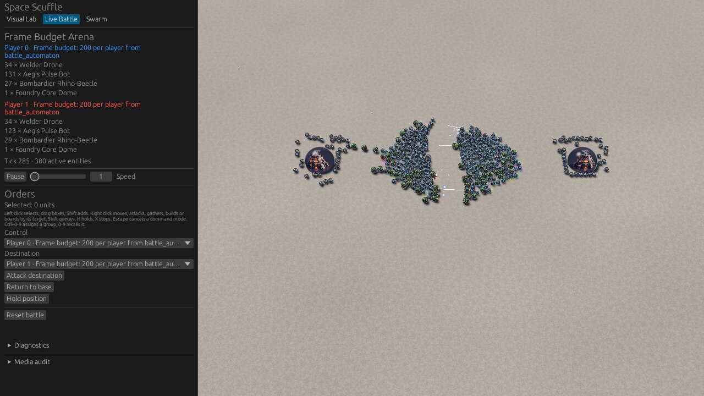

# Frame budget with two armies at 0, 200 and 400 units on the RX 580 (outer rings WP3)

This is the evidence for WP3 of `docs/plans/2026-11-11-scenario-outer-rings.md`, which carries out the owner's
answer to [Q0018](../questions/closed/0018-frame-budget-army-layout.md), option (b). The scenario builder now places
starting units on rings 4, 5, … around a town hall (WP1), so two armies of 100 and 200 units load, and the
`frame_budget` tool's spec measures two armies instead of eight (WP2, Amendment 2). These are the new figures of
record. They replace the eight-player figures of
[`2026-11-03-frame-budget.md`](2026-11-03-frame-budget.md), which stay there as history.

No pass or fail line applies. The owner chose (Q0015) to measure and publish against the 60 and 30 frames per
second reference lines (16.7 ms and 33.3 ms).

## Conclusions

1. **Frame budget (median of 5 runs, whole 60 s window).** Frame interval p50, p95 and p99: 7.1, 8.3 and 9.2 ms at
   0 units; 9.2, 13.4 and 15.2 ms at 200 units; 11.8, 19.1 and 22.5 ms at 400 units. Every median and every p95
   and p99 at 0 and 200 units is under the 16.7 ms line. At 400 units the median is under it, and p95 and p99 are
   over it. Every figure is under the 33.3 ms line except the maximum at 400 units (50.7 ms, the median of the five
   runs' single worst frames).
2. **The scene is not the 2026-11-03 scene, so the two sets of figures are not like for like.** The new scene has
   two town halls instead of eight and two armies that meet at the centre, instead of eight armies in a ring. It is
   also measured on a later client (the C-17 and C-18 work, `690be35` to `3f3ab76`, lies inside this commit). For
   orientation only: at 400 units the median frame was 16.3 ms on 2026-11-03 and is 11.8 ms here, and the 0-unit
   baseline went from 12.3 to 7.1 ms.
3. **The fight, not the march, sets the 400-unit tail.** In the combat window (750 ticks from the first combat
   event at tick 97) the 400-unit p95 and p99 are 20.3 and 23.5 ms; after it, with the survivors standing at the
   centre, 14.3 and 15.4 ms. The 400-unit march, before contact, has the highest median (15.0 ms over about 250
   frames), as all 400 units are moving at once.
4. **The armies stay in view.** On every measured frame of every run, 100 % of the live units were inside the
   camera's view (the tool fails a run below 95 %), with the camera pose of the eight-player spec unchanged.

## What changed in the scene, and why (plan Amendment 2)

The spec of WP2 sent each army to the other's start. Measured that way, the `200` and `400` runs failed the tool's
own check: one army won and destroyed the other town hall, which defeats that player and ends the match, at tick
1,087 (`200`) and tick 1,434 (`400`), inside the 1,500-tick window. Player 0 won every time, in the simulation alone
as in the client. Amendment 2 lets a spec player attack-move to a stated cell (`target_cell`), and the spec sends
both armies to the arena centre `(64, 64)`. The armies meet in the middle, the survivors stop there, and no hall
falls: a simulation-only probe shows both scenarios still in progress at tick 3,000, with the fight over at about
tick 1,000 (`200`, 17 and 28 units left) and tick 1,500 (`400`, 34 and 72 left). The simulation is unchanged.

## Host, build and display path

- **Commit:** `0eb6fbf` on branch `outer-rings-wp3`: `main` at `c05b766` (WP1 and WP2 merged), Amendment 2's note
  (`ebc686e`) and its `target_cell` change. Release build:
  `cargo build --release -p client_diagnostics --bin frame_budget --locked`, in
  `CARGO_TARGET_DIR=~/scratch/cargo-target/outer-rings-wp3`. No build ran during the runs.
- **Host:** the shared development VM, AMD EPYC 7301 (Zen 1) under KVM, Linux 6.12.115. This user's cgroup slice has
  16 CPUs, 32 to 47 (`cpuset.cpus.effective`), as on 2026-11-03. Every run was pinned to them with `taskset -c 32-47`.
- **GPU:** AMD Radeon RX 580 Series (RADV POLARIS10), Mesa `25.0.7-2+deb13u1`, Vulkan.
- **Compositor:** KWin 6.3.6 (`kwin_wayland --virtual --xwayland`), composited on the same RX 580.
- **Window:** 1280×720, present mode requested `AutoNoVsync`.
- **Display path:** `kwin-virtual`, headless KWin with hardware present and no monitor, the path of record the owner
  chose in [Q0019](../questions/closed/0019-frame-budget-display-path.md).
- **Scenarios:** `crates/client_diagnostics/data/frame_budget.ron` at `0eb6fbf`: the flat 128×128 arena, seed
  `1592639215`, `battle_automaton`'s unit mix scaled to 0, 100 or 200 units per player (0, 200 or 400 in all), two
  players with 5×5 starts at `(84, 62)` and `(40, 62)`, both attack-moving to `(64, 64)`. 200 units fill rings 1 to
  5 around each hall. Warm-up is 180 frames after media and map presentation are ready; measurement covers 1,500
  simulation ticks (60 s of game time); the combat window runs 750 ticks from the first combat event (tick 113 at
  200 units, tick 97 at 400).
- **Fixture root:** prepared once without the GPU, on `lavapipe` under `xvfb-run`, with
  `--warmup-frames 1 --measure-frames 1`.

## How each run was taken

The protocol is the one of record (plan §7, and the 2026-11-03 evidence): fifteen runs interleaved `0, 200, 400`
× 5, each **one** `with-gpu-lock` command with KWin and the tool inside it, released between runs with a 10 s gap.
With `FB` the release binary and `W=~/scratch/outer_rings_wp3`:

```bash
WGPU_BACKEND=vulkan VK_ICD_FILENAMES=/usr/share/vulkan/icd.d/radeon_icd.json \
with-gpu-lock bash -c "date -u +%s.%N > $W/run-NN.lockgot; cat /proc/loadavg > $W/run-NN.load; \
  grep -E '^cpu(3[2-9]|4[0-7]) ' /proc/stat > $W/run-NN.stat0; \
  taskset -c 32-47 kwin_wayland --virtual --xwayland --no-lockscreen --no-global-shortcuts \
    --width 1280 --height 720 --socket outer-rings-NN \
    --exit-with-session '$FB --display-path kwin-virtual --work-dir $W/work --scenario S --out $W/run-NN.ron'; \
  grep -E '^cpu(3[2-9]|4[0-7]) ' /proc/stat > $W/run-NN.stat1; date -u +%s.%N > $W/run-NN.lockrel"
```

- **Load.** The machine's one-minute load average was 19 to 48 throughout, because the other user of the VM builds
  on CPUs 0 to 31, outside this slice. By the 2026-11-03 rule (a run is loaded above 8) every run would be marked,
  so the measure that matters here is this slice's own: before asking for the lock, each run waited until CPUs 32
  to 47 were under 15 % busy over 5 s (Amendment 2); the share of CPUs 32 to 47 busy during the run is recorded
  from `/proc/stat` and includes the run itself (KWin and the client, about 16 % of the 16 CPUs). Both are in the
  table; "Load (1 min)" is the machine's.
- **Lock wait** is the time from asking for the lock to the first command inside it.
- **Acceptance of a run:** its report file exists, its log has no `frame_budget failed`, and the tool's own checks
  passed (exact unit count, at least 95 % in view on every frame, no early match end). All 24 runs passed them.
- **Repeats.** A run was repeated when it had a single frame over 1 s (Amendment 2), or when CPUs 32 to 47 were over
  20 % busy during it: another agent of this user was running effect GPU tests in the same slice, at times taking
  60 % of it and the GPU lock between our runs. Runs 04 (a 1,516 ms first frame), 11 (21.2 %), 14 (56.0 %) and 15
  (64.2 %) were repeated as runs 16 to 19, all four of which the same agent loaded (21.8 to 64.8 %). They were
  repeated again with a stricter wait (30 s of quiet before the lock): run 20 was still loaded (63.8 %), and runs 21
  to 24 were clean. The rejected runs are listed below the table of record.

Raw reports and logs are under `~/scratch/outer_rings_wp3/` and `~/scratch/logs/outer_rings_wp3_*`. They are scratch
files, so the tables here are the record. Statistics were recomputed from each report's frame rows with the tool's
nearest-rank definition and match the tool's own summaries to 0.01 ms for every run.

## 1. Figures of record (headless KWin, 1280×720, vsync off)

Run on 2026-11-12 between 00:30 and 01:21 UTC. Times in ms. The runs are listed in the order taken; 21 to 24 replace
04, 11, 14 and 15.

| Run | Units | Load (1 min) | CPUs 32–47 busy | Lock wait | Frames | p50 | p95 | p99 | max | Update p50 | Update p95 | Simulation p50 | Simulation p95 |
|---|---:|---:|---:|---:|---:|---:|---:|---:|---:|---:|---:|---:|---:|
| 01 | 0 | 24.33 | 15.9 % | 15 ms | 8,666 | 7.0 | 8.3 | 9.1 | 32.5 | 4.4 | 5.9 | 0.04 | 1.43 |
| 02 | 200 | 22.94 | 16.0 % | 13 ms | 5,994 | 9.7 | 14.0 | 15.8 | 27.7 | 7.6 | 11.9 | 0.10 | 3.70 |
| 03 | 400 | 23.82 | 16.4 % | 13 ms | 4,606 | 12.2 | 19.7 | 22.5 | 29.8 | 9.5 | 17.5 | 0.16 | 7.63 |
| 05 | 200 | 25.35 | 16.8 % | 13 ms | 6,283 | 9.2 | 13.2 | 15.3 | 21.1 | 7.3 | 11.1 | 0.10 | 3.60 |
| 06 | 400 | 23.92 | 16.8 % | 13 ms | 3,545 | 15.1 | 29.6 | 39.2 | 60.4 | 11.9 | 25.7 | 0.19 | 9.22 |
| 07 | 0 | 34.91 | 15.9 % | 19 ms | 8,869 | 6.8 | 8.3 | 9.3 | 16.0 | 4.3 | 6.0 | 0.04 | 1.40 |
| 08 | 200 | 24.46 | 16.8 % | 14 ms | 6,197 | 9.4 | 13.5 | 15.1 | 28.2 | 7.5 | 11.6 | 0.10 | 3.67 |
| 09 | 400 | 22.40 | 16.3 % | 15 ms | 5,630 | 9.7 | 16.9 | 18.9 | 80.0 | 7.6 | 15.1 | 0.11 | 7.08 |
| 10 | 0 | 39.70 | 16.2 % | 14 ms | 8,630 | 7.1 | 8.1 | 8.7 | 23.6 | 4.4 | 5.9 | 0.05 | 1.52 |
| 12 | 400 | 36.35 | 18.3 % | 14 ms | 5,025 | 11.1 | 18.5 | 22.6 | 50.7 | 8.7 | 16.4 | 0.15 | 7.27 |
| 13 | 0 | 26.90 | 19.3 % | 13 ms | 8,269 | 7.3 | 8.9 | 10.1 | 25.7 | 4.7 | 6.3 | 0.05 | 1.48 |
| 21 | 0 | 22.17 | 16.4 % | 9,144 ms | 8,518 | 7.1 | 8.5 | 9.2 | 20.3 | 4.5 | 6.0 | 0.04 | 1.44 |
| 22 | 200 | 19.82 | 15.7 % | 5,335 ms | 6,311 | 9.2 | 13.4 | 14.8 | 25.8 | 7.3 | 11.5 | 0.10 | 3.59 |
| 23 | 200 | 19.45 | 16.4 % | 23,890 ms | 6,405 | 9.1 | 13.4 | 15.2 | 30.4 | 7.2 | 11.5 | 0.09 | 3.62 |
| 24 | 400 | 20.35 | 16.0 % | 13 ms | 4,758 | 11.8 | 19.1 | 21.5 | 29.8 | 9.3 | 17.0 | 0.15 | 7.50 |

Runs 21 to 23 waited 5 to 24 s for the lock, held by the other agent's GPU tests; once the lock was ours, the
slice was as quiet as in the first runs. Each locked command held the GPU for 70 to 77 s. Run 06 is the slowest
`400` run (p50 15.1 ms) with an ordinary slice load and lock wait; no cause was found, and it is kept. It is the
highest of the five, so the median does not depend on it.

**Medians over the five runs of each scenario (the figures of record):**

| Units | Frame interval p50 | p95 | p99 | max | Main update p50 | p95 | Simulation p50 | p95 |
|---:|---:|---:|---:|---:|---:|---:|---:|---:|
| 0 | 7.1 | 8.3 | 9.2 | 23.6 | 4.4 | 6.0 | 0.04 | 1.44 |
| 200 | 9.2 | 13.4 | 15.2 | 27.7 | 7.3 | 11.5 | 0.10 | 3.62 |
| 400 | 11.8 | 19.1 | 22.5 | 50.7 | 9.3 | 17.0 | 0.15 | 7.50 |

**Windows of the fight (medians over the five runs).** The march runs from the first measured frame to the first
combat event; the combat window is the 750 ticks from it; "after" is the rest, with the survivors standing at the
centre.

| Units | Window | Frames | p50 | p95 | p99 | max | Update p50 | Update p95 | Simulation p50 | Simulation p95 |
|---:|---|---:|---:|---:|---:|---:|---:|---:|---:|---:|
| 200 | march (ticks 0 to 113) | 408 | 10.5 | 14.5 | 18.1 | 20.1 | 7.8 | 12.8 | 0.12 | 4.18 |
| 200 | combat (750 ticks from tick 113) | 2,799 | 10.3 | 14.2 | 15.6 | 25.8 | 8.3 | 12.1 | 0.11 | 3.90 |
| 200 | after the combat window | 3,014 | 8.3 | 10.5 | 12.0 | 18.3 | 6.5 | 8.8 | 0.08 | 1.72 |
| 400 | march (ticks 0 to 97) | 251 | 15.0 | 20.2 | 24.0 | 30.4 | 9.2 | 18.2 | 0.20 | 7.77 |
| 400 | combat (750 ticks from tick 97) | 2,061 | 13.4 | 20.3 | 23.5 | 50.7 | 10.3 | 18.1 | 0.18 | 8.14 |
| 400 | after the combat window | 2,441 | 10.4 | 14.3 | 15.4 | 22.4 | 8.3 | 12.2 | 0.12 | 3.79 |

**Rejected runs** (repeated; not part of the medians):

| Run | Units | Why | CPUs 32–47 busy | Lock wait | p50 | p95 | p99 | max |
|---|---:|---|---:|---:|---:|---:|---:|---:|
| 04 | 0 | first frame 1,516 ms (update 4.4 ms) | 16.3 % | 15 ms | 7.3 | 8.8 | 10.0 | 1,515.7 |
| 11 | 200 | slice over 20 % busy | 21.2 % | 13 ms | 9.7 | 14.9 | 20.5 | 118.4 |
| 14 | 200 | slice over 20 % busy | 56.0 % | 14 ms | 18.3 | 62.4 | 144.0 | 249.3 |
| 15 | 400 | slice over 20 % busy | 64.2 % | 24 ms | 17.5 | 43.3 | 58.7 | 177.3 |
| 16 | 0 | slice over 20 % busy | 21.8 % | 13 ms | 7.4 | 9.6 | 21.5 | 40.6 |
| 17 | 200 | slice over 20 % busy | 64.8 % | 17,000 ms | 20.1 | 39.8 | 51.9 | 165.7 |
| 18 | 400 | slice over 20 % busy | 59.5 % | 34,757 ms | 13.8 | 36.4 | 44.2 | 54.4 |
| 19 | 200 | slice over 20 % busy | 64.6 % | 26,952 ms | 13.5 | 29.7 | 36.3 | 50.5 |
| 20 | 0 | slice over 20 % busy | 63.8 % | 23,412 ms | 11.5 | 26.5 | 32.7 | 51.8 |

The loaded runs show what a busy slice does to this measurement: at 60 % busy the 200-unit median doubles and the
p99 rises tenfold. That is why they are not the record.

## Screenshot of the 400 scenario



`2026-11-12-frame-budget-two-armies-400.jpg` was taken in a separate locked run of the 400 scenario, not one of the
runs of record, by the method of 2026-11-03: the KWin session script started `frame_budget` and grabbed its X11
window every 5 s with ImageMagick's `import -window <id>`. This frame is at tick 285, inside the combat window
(ticks 97 to 846). That run measured a p50 of 12.2 ms. It shows the two halls, the two armies in contact at the
centre with tracers, and the HUD. The units still in rings around each hall are the harvesters (`Welder Drone`),
which an initial attack-move does not order (`apply_initial_orders`).
