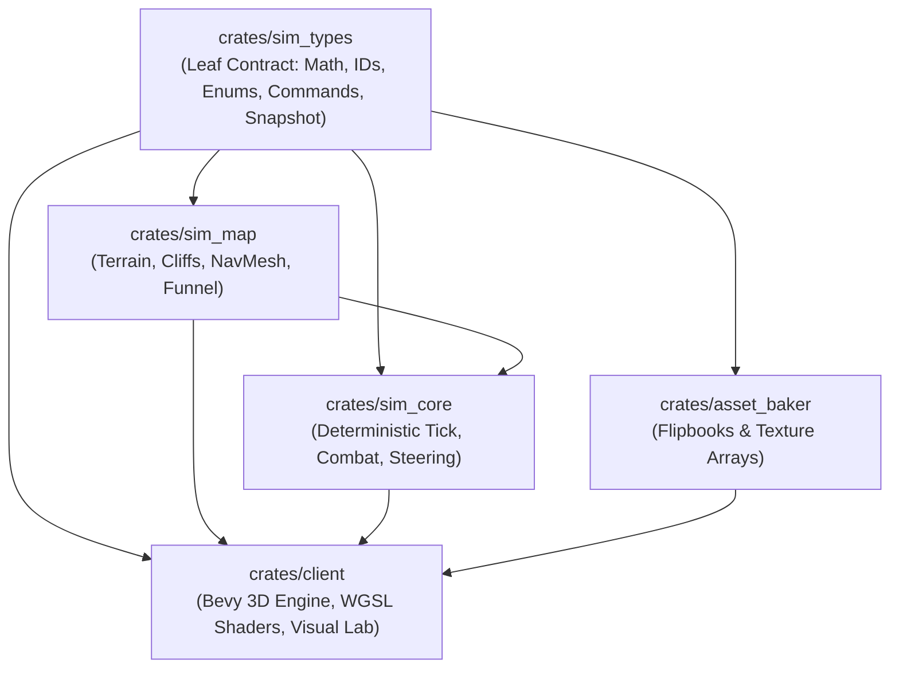

# 01 — Implementation Plan: `crates/sim_types` & Root Cargo Workspace

> **Charter Invariant:** This document provides the textbook-grade, production-ready architectural blueprint for `crates/sim_types` and the root Cargo workspace in **Space Scuffle**. It serves as an unambiguous specification for implementation agents. Zero placeholders, zero `todo!()`, and zero blind `.unwrap()` calls are permitted.

---

## 1. Architectural Vision & Core Invariants

`crates/sim_types` is the foundational leaf crate of the Space Scuffle dependency graph. It establishes the authoritative data contracts, numeric representations, and snapshot boundaries consumed by all downstream crates (`sim_map`, `sim_core`, `asset_baker`, and `client`).



### 1.1 Strict Determinism Guarantee
1. **Forbidden Authoritative Floats:** Authoritative simulation state (positions, velocities, angles, health, cooldowns) must **never** use `f32` or `f64`. IEEE 754 floating-point divergence across `x86_64`, `ARM64` (Apple Silicon), and `wasm32` (e.g., FMA fusing, transcendental instruction differences) destroys lockstep determinism. All simulation scalars use fixed-point arithmetic (`I32F32`).
2. **Floating-Point Isolation:** Floats (`f32`) are restricted strictly to:
   - The `RenderSnapshot` conversion boundary (`to_f32()`) for GPU uniform buffer consumption.
   - Non-authoritative debug visualizers in `crates/client`.
3. **No Non-Deterministic Hashing:** `std::collections::HashMap` and `HashSet` are strictly forbidden in simulation state due to randomized SipHash seeding. All lookups rely on `BTreeMap`, `BTreeSet`, index-slabs, or deterministic hashing (`xxhash-rust`).
4. **No System Clock / Ambient State:** No `std::time::Instant`, `SystemTime`, or thread-local RNG may be accessed. All temporal progress is measured in discrete `Tick` units.

### 1.2 Zero-Dependency Simulation Boundary
`sim_types` must compile cleanly with zero graphics or windowing dependencies (`bevy`, `wgpu`, `winit` are strictly forbidden). It must target headless Linux servers, embedded runners, and WebAssembly targets with minimal compilation overhead.

---

## 2. Root `Cargo.toml` Specification

The root `Cargo.toml` establishes workspace-wide compiler flags, strict lints, and unified dependency versions to prevent version skew and duplicate crate builds.

### 2.1 Complete Root `Cargo.toml`
```toml
[workspace]
resolver = "2"
members = [
    "crates/sim_types",
    "crates/sim_map",
    "crates/sim_core",
    "crates/asset_baker",
    "crates/client",
]

[workspace.package]
version = "0.1.0"
edition = "2021"
rust-version = "1.80.0"
authors = ["Space Scuffle Systems Engineering Team"]
license = "MIT OR Apache-2.0"
repository = "https://github.com/space-scuffle/space-scuffle"

[workspace.lints.rust]
unsafe_code = "forbid"
missing_docs = "warn"
rust_2018_idioms = "warn"
trivial_casts = "warn"
trivial_numeric_casts = "warn"
unused_qualifications = "warn"

[workspace.lints.clippy]
pedantic = { level = "warn", priority = -1 }
# Pedagogical zero-shortcuts rules:
unwrap_used = "deny"
expect_used = "warn"
panic = "warn"
todo = "deny"
unimplemented = "deny"
# Style adjustments for domain terminology:
module_name_repetitions = "allow"
similar_names = "allow"
cast_possible_truncation = "warn"
cast_precision_loss = "warn"
cast_sign_loss = "warn"

[workspace.dependencies]
# Fixed-point deterministic math
fixed = { version = "1.28.0", features = ["serde"] }

# Serialization
serde = { version = "1.0.218", features = ["derive"] }
ron = "0.8.0"

# Error handling
thiserror = "2.0.12"

# Bit manipulation & flags
bitflags = { version = "2.8.0", features = ["serde"] }

# Fast deterministic hashing
xxhash-rust = { version = "0.8.15", features = ["xxh64", "xxh3"] }

# Deterministic PRNG
rand = { version = "0.8.5", default-features = false }
rand_chacha = { version = "0.3.1", default-features = false }

# Image processing (asset baking & flipbook textures)
image = { version = "0.25.5", default-features = false, features = ["png", "jpeg"] }

# Rendering Engine & UI (Visual Client crate only)
bevy = { version = "0.15.3", default-features = true }
bevy_egui = "0.33.0"

# Internal Workspace Crates
sim_types = { path = "crates/sim_types" }
sim_map = { path = "crates/sim_map" }
sim_core = { path = "crates/sim_core" }
asset_baker = { path = "crates/asset_baker" }
```

### 2.2 `crates/sim_types/Cargo.toml`
```toml
[package]
name = "sim_types"
version.workspace = true
edition.workspace = true
rust-version.workspace = true
license.workspace = true
authors.workspace = true
description = "Deterministic fixed-point math, IDs, enums, player commands, and render snapshots for Space Scuffle"

[lints]
workspace = true

[dependencies]
fixed.workspace = true
serde.workspace = true
thiserror.workspace = true
bitflags.workspace = true

[dev-dependencies]
ron.workspace = true
```

---

## 3. Module Breakdown & Public API Design

The crate directory structure in `crates/sim_types`:
```text
crates/sim_types/
├── Cargo.toml
├── src/
│   ├── lib.rs          # Pedagogical module documentation & public re-exports
│   ├── errors.rs       # Strongly-typed error enum (MathError)
│   ├── math.rs         # SimScalar (I32F32), SimVec2, SimAngle (BRad LUT/Polynomial)
│   ├── ids.rs          # EntityId, PlayerId, TeamId, UnitTypeId, Tick newtypes
│   ├── enums.rs        # ShapeKind, SilhouetteClass, AnimState, WeaponVisualKind, etc.
│   ├── commands.rs     # UnitOrder, PlayerCommand, TickInputBundle
│   └── snapshot.rs     # BubbleRenderInstance, CombatEventVisual, RenderSnapshot
└── tests/
    ├── math_identities.rs
    ├── trig_determinism.rs
    └── snapshot_serialization.rs
```

---

### 3.1 `lib.rs` — Pedagogical Gateway & Re-exports
`lib.rs` enforces root module documentation and cleanly re-exports types so downstream crates use idiomatic paths (e.g., `sim_types::SimScalar`, `sim_types::EntityId`).

```rust
//! # `sim_types` — Foundational Contract of Space Scuffle
//!
//! This crate defines the foundational types, deterministic fixed-point math,
//! gameplay identifiers, unit/building states, and rendering snapshot boundaries
//! for the Space Scuffle real-time strategy engine.
//!
//! ## Architectural Charter & Guarantees
//! 1. **100% Determinism:** Authoritative simulation types use fixed-point arithmetic
//!    (`SimScalar`, `SimVec2`, `SimAngle`). Floats (`f32`) are completely forbidden
//!    in authoritative state.
//! 2. **Platform Independence:** Math operations yield identical bit-level results
//!    across `x86_64`, `aarch64`, and `wasm32`.
//! 3. **Decoupled Snapshot Boundary:** Conversion to floating-point occurs strictly at
//!    the `RenderSnapshot` boundary, shielding the simulation from rendering details.
//! 4. **Zero Unchecked Failures:** All fallible operations return explicit `Result<T, MathError>`.

#![forbid(unsafe_code)]
#![warn(missing_docs)]

pub mod commands;
pub mod enums;
pub mod errors;
pub mod ids;
pub mod math;
pub mod snapshot;

// Flat convenient re-exports
pub use commands::{PlayerCommand, TickInputBundle, UnitOrder};
pub use enums::{
    AnimState, AttributeFlags, MoverType, ShapeKind, SilhouetteClass, VisibilityState,
    WeaponVisualKind,
};
pub use errors::MathError;
pub use ids::{EntityId, PlayerId, TeamId, Tick, UnitTypeId};
pub use math::{SimAngle, SimScalar, SimVec2};
pub use snapshot::{BubbleRenderInstance, CombatEventVisual, RenderSnapshot};
```

---

### 3.2 `errors.rs` — Strongly-Typed Error Handling
Per Section 1.1 of `AGENTS.md`, library crates must use explicit `thiserror` error types instead of panics or unhandled errors.

```rust
//! Strongly-typed domain error types for deterministic math and conversions.

use thiserror::Error;

/// Errors arising during deterministic mathematical evaluation.
#[derive(Error, Debug, Clone, Copy, PartialEq, Eq)]
pub enum MathError {
    /// Attempted to compute square root of a negative fixed-point value.
    #[error("domain error: square root of negative value ({value:?})")]
    NegativeSquareRoot {
        /// The negative raw value passed into `sqrt`.
        value: i64,
    },

    /// Division by zero in fixed-point arithmetic.
    #[error("division by zero in fixed-point operation")]
    DivisionByZero,

    /// Arithmetic overflow in checked arithmetic operation.
    #[error("arithmetic overflow during fixed-point evaluation")]
    Overflow,

    /// Normalization failed because the vector length is zero or below epsilon.
    #[error("cannot normalize zero-length vector")]
    ZeroLengthVector,
}
```

---

### 3.3 `math.rs` — Deterministic Fixed-Point Arithmetic

#### Mathematical Foundation: Q32.32 Fixed-Point
- **Type:** Wrapped `fixed::types::I32F32`.
- **Layout:** Signed 64-bit integer, where high 32 bits represent integer portion $[-2^{31}, 2^{31}-1]$ and low 32 bits represent fractional portion in increments of $2^{-32} \approx 2.3283 \times 10^{-10}$.
- **Map Scale Invariant:** In Space Scuffle, $1.0$ `SimScalar` corresponds to $1$ standard grid tile ($1.0\text{ m}$). The smallest measurable movement per tick is $< 0.001\text{ nm}$, entirely preventing numerical creep or rounding drift over 100,000 game ticks.

#### 1. `SimScalar` Specification
```rust
/// Deterministic 64-bit fixed-point scalar with 32 integer and 32 fractional bits (Q32.32).
#[derive(Copy, Clone, PartialEq, Eq, PartialOrd, Ord, Hash, Default, Serialize, Deserialize)]
#[repr(transparent)]
pub struct SimScalar(pub fixed::types::I32F32);
```

**Key Constants:**
- `ZERO = SimScalar(I32F32::ZERO)`
- `ONE = SimScalar(I32F32::ONE)`
- `HALF = SimScalar(I32F32::from_bits(1 << 31))`
- `EPSILON = SimScalar(I32F32::from_bits(1))` ($2^{-32}$)
- `MAX = SimScalar(I32F32::MAX)`
- `MIN = SimScalar(I32F32::MIN)`
- `PI = SimScalar(I32F32::PI)`
- `TWO_PI = SimScalar(I32F32::PI * 2)`
- `HALF_PI = SimScalar(I32F32::FRAC_PI_2)`

**Constructors & Conversions:**
- `const fn from_raw(raw: i64) -> Self`: Construct directly from raw bits.
- `const fn raw(self) -> i64`: Extract raw bit representation.
- `const fn from_i32(val: i32) -> Self`: Lossless conversion from integer.
- `fn from_num<T: fixed::traits::ToFixed>(val: T) -> Self`: Generic constructor.
- `fn to_f32(self) -> f32`: Boundary conversion for rendering uniforms only.
- `fn from_f32_lossy(val: f32) -> Self`: Boundary parsing helper (for config/assets only, forbidden in tick loop).

**Arithmetic Methods:**
- `saturating_add(self, rhs: Self) -> Self`
- `saturating_sub(self, rhs: Self) -> Self`
- `saturating_mul(self, rhs: Self) -> Self`
- `saturating_div(self, rhs: Self) -> Self`
- `checked_add(self, rhs: Self) -> Option<Self>`
- `checked_sub(self, rhs: Self) -> Option<Self>`
- `checked_mul(self, rhs: Self) -> Option<Self>`
- `checked_div(self, rhs: Self) -> Option<Self>`
- `abs(self) -> Self`
- `signum(self) -> Self`
- `clamp(self, min: Self, max: Self) -> Self`
- `min(self, other: Self) -> Self`
- `max(self, other: Self) -> Self`
- `sqrt(self) -> Result<Self, MathError>`:
  Bitwise integer square root algorithm on the internal 64-bit representation shifted left by 32 bits (computing 128-bit intermediate integer root), providing bit-identical output across all architectures without depending on hardware float instructions.

**Standard Operator Implementations:**
- `Add`, `Sub`, `Mul`, `Div`, `Neg` for `SimScalar` and `&SimScalar`.
- `AddAssign`, `SubAssign`, `MulAssign`, `DivAssign`.
- Integer scaling operators: `Mul<i32>`, `Div<i32>`.

---

#### 2. `SimVec2` Specification
2D deterministic vector representing coordinates, velocities, and directional vectors on the $XY$ ground plane.

```rust
/// 2D deterministic fixed-point vector.
#[derive(Copy, Clone, PartialEq, Eq, Hash, Default, Serialize, Deserialize)]
pub struct SimVec2 {
    /// X coordinate (East-West axis).
    pub x: SimScalar,
    /// Y coordinate (North-South axis).
    pub y: SimScalar,
}
```

**Key Constants:**
- `ZERO = SimVec2 { x: SimScalar::ZERO, y: SimScalar::ZERO }`
- `X_AXIS = SimVec2 { x: SimScalar::ONE, y: SimScalar::ZERO }`
- `Y_AXIS = SimVec2 { x: SimScalar::ZERO, y: SimScalar::ONE }`

**Methods:**
- `const fn new(x: SimScalar, y: SimScalar) -> Self`
- `fn from_i32(x: i32, y: i32) -> Self`
- `fn dot(self, rhs: Self) -> SimScalar`: $x_1 x_2 + y_1 y_2$
- `fn cross_2d(self, rhs: Self) -> SimScalar`: Deterministic 2D cross product (perp-dot product) $x_1 y_2 - y_1 x_2$. Essential for funnel string-pulling, triangle orientation tests, and concave combat arc steering.
- `fn length_sq(self) -> SimScalar`: $x^2 + y^2$
- `fn length(self) -> SimScalar`: $\sqrt{x^2 + y^2}$
- `fn distance_sq(self, rhs: Self) -> SimScalar`
- `fn distance(self, rhs: Self) -> SimScalar`
- `fn normalize(self) -> Result<Self, MathError>`
- `fn normalize_or_zero(self) -> Self`: Normalizes if length > `SimScalar::EPSILON`, else returns `SimVec2::ZERO`. Essential for steering behaviors to prevent division-by-zero crashes.
- `fn rotate_by(self, angle: SimAngle) -> Self`:
  Rotates vector counter-clockwise using deterministic trigonometry:
  $$x' = x \cos(\theta) - y \sin(\theta)$$
  $$y' = x \sin(\theta) + y \cos(\theta)$$
- `fn to_f32_array(self) -> [f32; 2]`

---

#### 3. `SimAngle` Specification (Binary Radians / BAMS)
To avoid transcendental function divergence and eliminate modulo operations at the $2\pi$ circle boundary, `SimAngle` is implemented using **Binary Radians (BRad)** as a 16-bit unsigned integer `u16`.

```rust
/// Deterministic binary angle representing [0, 2π) mapped across the full range of `u16` (0..=65535).
///
/// Under this representation, modular circle wrapping is handled automatically by CPU unsigned integer
/// overflow arithmetic, guaranteeing zero rounding errors or branch mispredictions at 0/360 boundary.
#[derive(Copy, Clone, PartialEq, Eq, PartialOrd, Ord, Hash, Default, Serialize, Deserialize)]
#[repr(transparent)]
pub struct SimAngle(pub u16);
```

**Binary Angle Mathematical Invariants:**
- Full turn ($2\pi\text{ rad} = 360^\circ$) = $65536$ units ($2^{16}$).
- Right angle ($\frac{\pi}{2}\text{ rad} = 90^\circ$) = $16384$ ($0\text{x}4000$).
- Opposite angle ($\pi\text{ rad} = 180^\circ$) = $32768$ ($0\text{x}8000$).
- Resolution: $\frac{360^\circ}{65536} \approx 0.005493^\circ$ ($\approx 0.00009587\text{ radians}$). This provides sub-millimeter precision at standard SC2 weapon ranges.

**Key Methods:**
- `const fn from_raw(raw: u16) -> Self`
- `const fn raw(self) -> u16`
- `fn from_degrees(deg: i32) -> Self`: Computes `((deg.rem_euclid(360) as i64 * 65536) / 360) as u16`.
- `fn to_degrees_f32(self) -> f32`: `(self.0 as f32 / 65536.0) * 360.0`.
- `fn to_radians_f32(self) -> f32`: `(self.0 as f32 / 65536.0) * std::f32::consts::TAU`.
- `fn diff(self, other: Self) -> i16`:
  Computes the **shortest signed angular difference** from `self` to `other` in range $[-32768, 32767]$ (where positive values indicate counter-clockwise rotation and negative values indicate clockwise rotation).
  Implemented cleanly as:
  ```rust
  (other.0.wrapping_sub(self.0)) as i16
  ```
- `fn rotate_towards(self, target: Self, max_step: u16) -> Self`:
  Steps `self` towards `target` by at most `max_step` units along the shortest path. If the remaining distance is $\le \text{max\_step}$, snaps directly to `target` (preventing oscillation).

**Trigonometric Functions (`sin`, `cos`, `atan2`):**
```rust
// PERFORMANCE RATIONALE:
// Why: Standard libc `f32::sin`/`f32::cos` can diverge between x86 and ARM platforms, breaking lockstep.
// Computing trigonometric series via Taylor polynomial at runtime introduces high CPU instruction overhead.
// What: We use a 1024-entry precomputed fixed-point Lookup Table (LUT) for the first quadrant [0, π/2],
// exploiting 4-quadrant symmetry for `sin` and `cos`.
// Trade-off: 4 KB of static read-only memory in exchange for O(1) branch-predictable lookups and
// 100% bit-for-bit determinism across all targets.
```

- `fn sin(self) -> SimScalar`: Quadrant-folded lookup in a static table of 1024 values.
- `fn cos(self) -> SimScalar`: Implemented as `(self + SimAngle(16384)).sin()`.
- `fn atan2(y: SimScalar, x: SimScalar) -> SimAngle`:
  Deterministic bit-exact coordinate angle calculation using an 8-iteration CORDIC algorithm or rational polynomial minimax approximation that guarantees bit-identical results without hardware floating point.

---

### 3.4 `ids.rs` — Strongly-Typed Gameplay Newtypes
All entities, players, teams, unit types, and simulation ticks are wrapped in strongly-typed newtypes to eliminate parameter swapping bugs (e.g. passing `PlayerId` where `EntityId` was expected).

```rust
//! Strongly-typed newtype identifiers for entities, players, teams, and ticks.

use std::fmt;
use serde::{Deserialize, Serialize};

/// Monotonic tick counter for the simulation.
#[derive(Copy, Clone, Debug, PartialEq, Eq, PartialOrd, Ord, Hash, Default, Serialize, Deserialize)]
#[repr(transparent)]
pub struct Tick(pub u32);

impl Tick {
    /// Initial zero tick.
    pub const ZERO: Self = Self(0);

    /// Advance tick by one.
    #[must_use]
    pub const fn next(self) -> Self {
        Self(self.0 + 1)
    }

    /// Ticks elapsed between `self` and an earlier tick.
    #[must_use]
    pub const fn duration_since(self, earlier: Self) -> u32 {
        self.0.saturating_sub(earlier.0)
    }
}

/// Unique deterministic entity handle.
#[derive(Copy, Clone, Debug, PartialEq, Eq, PartialOrd, Ord, Hash, Default, Serialize, Deserialize)]
#[repr(transparent)]
pub struct EntityId(pub u32);

/// Zero-indexed player slot identifier (0..=15, 255 = Neutral/Hostile).
#[derive(Copy, Clone, Debug, PartialEq, Eq, PartialOrd, Ord, Hash, Default, Serialize, Deserialize)]
#[repr(transparent)]
pub struct PlayerId(pub u8);

impl PlayerId {
    /// Slot assigned to neutral map entities (minerals, destructible rocks, critters).
    pub const NEUTRAL: Self = Self(255);
}

/// Alliance team group identifier (0 = Neutral, 1 = Team 1, 2 = Team 2).
#[derive(Copy, Clone, Debug, PartialEq, Eq, PartialOrd, Ord, Hash, Default, Serialize, Deserialize)]
#[repr(transparent)]
pub struct TeamId(pub u8);

impl TeamId {
    /// Neutral team.
    pub const NEUTRAL: Self = Self(0);
}

/// Unit archetype identifier indexing into the static Unit Catalog.
#[derive(Copy, Clone, Debug, PartialEq, Eq, PartialOrd, Ord, Hash, Default, Serialize, Deserialize)]
#[repr(transparent)]
pub struct UnitTypeId(pub u16);
```

**Display Implementations:**
Each newtype implements `fmt::Display` (e.g. `write!(f, "Entity({})", self.0)`, `write!(f, "Tick({})", self.0)`).

---

### 3.5 `enums.rs` — Discrete Gameplay & Visual States
Enums represent categorical state for the simulation and renderer, with explicit discriminants and `serde` compatibility.

```rust
//! Categorical enums for geometry, silhouettes, animation, weapons, and classification.

use bitflags::bitflags;
use serde::{Deserialize, Serialize};

/// Geometric shape category determining base model geometry and collision bounds.
#[derive(Copy, Clone, Debug, PartialEq, Eq, Hash, Serialize, Deserialize)]
pub enum ShapeKind {
    /// Floating 3D holographic sphere for mobile units.
    UnitSphere,
    /// Grounded hemisphere mounted on a foundation grid plate for structures.
    BuildingDome {
        /// Foundation width in 1x1 map cells.
        footprint_w: u8,
        /// Foundation height in 1x1 map cells.
        footprint_h: u8,
    },
}

/// Distinct geometric collar/attachment on the bubble rim for swarm readability.
#[derive(Copy, Clone, Debug, PartialEq, Eq, Hash, Serialize, Deserialize)]
pub enum SilhouetteClass {
    /// Slender triangular prongs for light infantry (e.g., Marine).
    LightProngs,
    /// Reinforced heavy hexagonal bracket for armored assault (e.g., Marauder, Roach).
    HeavyHex,
    /// Floating glowing halo ring for spellcasters and support units (e.g., Sentry, Raven).
    CasterHalo,
    /// Radial curved spikes for melee assault units (e.g., Zealot, Zergling).
    MeleeSpikes,
    /// Foundation structural ring with industrial anchoring plates for buildings.
    StructureBase,
}

/// High-level unit action state driving inner video playback and procedural shaders.
#[derive(Copy, Clone, Debug, PartialEq, Eq, Hash, Serialize, Deserialize)]
pub enum AnimState {
    /// Blueprint assembly / foundation welding (buildings only).
    Constructing,
    /// Ambient idling loop.
    Idle,
    /// Locomotion / movement cycle.
    Walk,
    /// Attack windup, damage execution, and recoil cycle.
    Attack,
    /// Ability channel or casting cycle.
    Cast,
    /// Shatter collapse / explosion cycle before entity destruction.
    Die,
}

/// Visual category of an active weapon attack.
#[derive(Copy, Clone, Debug, PartialEq, Eq, Hash, Serialize, Deserialize)]
pub enum WeaponVisualKind {
    /// No weapon visual active.
    None,
    /// Instant directional tracer line + muzzle flash (e.g., Marine Gauss Rifle).
    Hitscan,
    /// Physical traveling projectile bolt (e.g., Stalker Particle Disruptor).
    Projectile,
    /// Continuous sustained energy beam (e.g., Void Ray Prismatic Beam).
    LaserBeam,
    /// Jagged electric branch arc (e.g., High Templar Psionic Storm / Lightning Sentry).
    LightningArc,
    /// Crescent shockwave slash at close range (e.g., Zealot Psi-Blade).
    MeleeSlash,
}

/// Terrain traversal capabilities of a unit.
#[derive(Copy, Clone, Debug, PartialEq, Eq, Hash, Serialize, Deserialize)]
pub enum MoverType {
    /// Standard ground unit obeying NavMesh boundaries and cliff heights.
    Ground,
    /// Aerial unit floating above terrain, ignoring cliffs, ground pathing, and ramps.
    Air,
    /// Ground unit capable of hopping up/down cliff edges (e.g., Reaper).
    CliffJumper,
    /// Tall unit walking over cliffs while retaining ground footprint (e.g., Colossus).
    CliffWalker,
}

bitflags! {
    /// Bitflags representing unit combat and armor classification attributes.
    #[derive(Copy, Clone, Debug, PartialEq, Eq, Hash, Serialize, Deserialize)]
    pub struct AttributeFlags: u16 {
        /// Light units susceptible to anti-light weapon bonuses.
        const LIGHT       = 1 << 0;
        /// Armored units susceptible to anti-armor weapon bonuses.
        const ARMORED     = 1 << 1;
        /// Living organic units susceptible to biological abilities.
        const BIOLOGICAL  = 1 << 2;
        /// Robotic/mechanical units repairable by workers.
        const MECHANICAL  = 1 << 3;
        /// Psionic entities vulnerable to feedback/EMP.
        const PSIONIC     = 1 << 4;
        /// Massive tier-3 units immune to concussive slow and certain crowd controls.
        const MASSIVE     = 1 << 5;
        /// Fixed building domes and defensive structures.
        const STRUCTURE   = 1 << 6;
        /// Special campaign or commander heroes.
        const HEROIC      = 1 << 7;
    }
}

/// Fog-of-war visibility state of a map tile or entity for a specific player.
#[derive(Copy, Clone, Debug, PartialEq, Eq, Hash, Serialize, Deserialize)]
pub enum VisibilityState {
    /// Black shroud: never seen by player, no terrain or units visible.
    Unexplored,
    /// Fogged: terrain and static structures previously explored; dynamic units hidden.
    Fogged,
    /// Fully revealed by allied line-of-sight.
    Visible,
}
```

---

### 3.6 `commands.rs` — Player Commands & Lockstep Inputs
`commands.rs` specifies user intents serialized across the network or bot API, bundled into deterministic tick inputs.

```rust
//! Player intent, unit orders, and lockstep tick input bundles.

use serde::{Deserialize, Serialize};
use crate::ids::{EntityId, PlayerId, Tick, UnitTypeId};
use crate::math::SimVec2;

/// Concrete order issued to an individual unit or selection group.
#[derive(Clone, Debug, PartialEq, Eq, Hash, Serialize, Deserialize)]
pub enum UnitOrder {
    /// Clear orders and enter idle scanning state.
    Idle,
    /// Move to target position, ignoring hostile encounters.
    Move {
        /// Ground target coordinates.
        target: SimVec2,
    },
    /// Move toward destination, engaging any hostile target entering scan range.
    AttackMove {
        /// Ground target coordinates.
        target: SimVec2,
    },
    /// Focus attack on a specific hostile entity, pursuing if necessary.
    AttackTarget {
        /// Target entity handle.
        target: EntityId,
    },
    /// Stay fixed in place; engage targets within range without displacing.
    HoldPosition,
    /// Immediately halt current movement and cancel active backswing.
    Stop,
    /// Activate speed and attack rate buff at the cost of health (e.g., Marine Stimpack).
    UseStim,
    /// Order a production building dome to queue a unit archetype.
    Produce {
        /// Archetype ID to build.
        unit_type: UnitTypeId,
    },
}

/// Command issued by a player targeting one or more entities during a tick.
#[derive(Clone, Debug, PartialEq, Eq, Hash, Serialize, Deserialize)]
pub struct PlayerCommand {
    /// Authoring player slot.
    pub player_id: PlayerId,
    /// Entities to which this order applies.
    pub entities: Vec<EntityId>,
    /// Order to execute.
    pub order: UnitOrder,
    /// If true, append to existing unit order queue (Shift-command); otherwise replace.
    pub queue: bool,
}

/// Network/relay bundle containing all validated player commands scheduled for a tick.
#[derive(Clone, Debug, PartialEq, Eq, Serialize, Deserialize)]
pub struct TickInputBundle {
    /// Target simulation tick.
    pub tick: Tick,
    /// Player commands executed at this tick.
    pub commands: Vec<PlayerCommand>,
    /// Expected simulation state checksum of the preceding tick (for desync detection).
    pub state_checksum: Option<u64>,
}
```

---

### 3.7 `snapshot.rs` — The Visual Client & Renderer Boundary
The `RenderSnapshot` decouples the Bevy client from internal simulation representations. Every field corresponds directly to a visual effect or shader uniform in the custom Bubble & Dome WGSL pipeline.

```rust
//! Authoritative rendering snapshot consumed by the client visualization layer.

use serde::{Deserialize, Serialize};
use crate::enums::{AnimState, ShapeKind, SilhouetteClass, WeaponVisualKind};
use crate::ids::{EntityId, TeamId, Tick, UnitTypeId};

/// Comprehensive visual parameters for a single bubble or building dome.
#[derive(Clone, Debug, PartialEq, Serialize, Deserialize)]
pub struct BubbleRenderInstance {
    /// Entity identifier for selection picking and visual persistence.
    pub entity_id: EntityId,
    /// Sphere (unit) or Hemisphere (building).
    pub shape: ShapeKind,
    /// Collar/bracket ornament on the rim.
    pub silhouette: SilhouetteClass,
    /// Unit archetype ID for flipbook video texture array indexing.
    pub unit_type: UnitTypeId,
    /// Owning team for rim Fresnel and ground ring tinting.
    pub team_id: TeamId,
    /// Center coordinates in world space: [x, ground_y, altitude_z].
    pub world_pos: [f32; 3],
    /// Height of terrain directly below bubble (for air unit tether/shadow projection).
    pub ground_z: f32,
    /// Outer glass shell radius in world units.
    pub radius: f32,
    /// Current velocity [vx, vy] driving trailing mist wake particles.
    pub velocity: [f32; 2],
    /// Facing orientation angle in radians [-π, π], driving rim chevron and video flip.
    pub heading_angle_rad: f32,
    /// Weapon aim direction in radians, positioning the Attack Focal Lens on the rim.
    pub aim_angle_rad: f32,
    /// Whether weapon is currently in active firing/windup state.
    pub is_attacking: bool,
    /// Visual style of weapon attack.
    pub weapon_visual: WeaponVisualKind,
    /// World position of current attack target, if any.
    pub attack_target_pos: Option<[f32; 3]>,
    /// High-level animation cycle to display on the internal video core.
    pub anim_state: AnimState,
    /// Normalized animation progress [0.0, 1.0] within the current loop.
    pub anim_progress: f32,
    /// Health ratio (0.0..=1.0) driving spiderweb glass cracks and CRT glitch shader.
    pub hp_ratio: f32,
    /// Shield energy ratio (0.0..=1.0) driving outer energy sheen.
    pub shield_ratio: f32,
    /// Decaying ripple intensity (0.0..=1.0) at shield impact point.
    pub shield_hit_flash: f32,
    /// Direction the last hull hit originated from in radians.
    pub hull_hit_angle_rad: f32,
    /// Decaying impact flare intensity (0.0..=1.0) at hull impact point.
    pub hull_hit_flash: f32,
    /// Construction/production progress for building domes (radial ground ring fill).
    pub build_or_queue_progress: Option<f32>,
    /// Selection highlight flag (activates double ground ring).
    pub selected: bool,
    /// Stealth cloaking flag (translucent refractive shimmer).
    pub cloaked: bool,
    /// Stim/speed boost flag (intensifies wake particle emission).
    pub speed_boosted: bool,
}

/// Instantaneous transient visual combat event (tracers, beams, slashes, explosions).
#[derive(Clone, Debug, PartialEq, Serialize, Deserialize)]
pub enum CombatEventVisual {
    /// Instant bullet/slug tracer line connecting emitter to target.
    HitscanTracer {
        /// Firing aperture origin.
        from: [f32; 3],
        /// Impact position.
        to: [f32; 3],
        /// Firing team for tracer color tint.
        team_id: TeamId,
    },
    /// Traveling plasma or kinetic missile bolt.
    ProjectileVisual {
        /// Current world position.
        pos: [f32; 3],
        /// Directional velocity vector.
        vel: [f32; 3],
        /// Firing team.
        team_id: TeamId,
    },
    /// Continuous laser beam or jagged lightning arc.
    BeamVisual {
        /// Beam origin.
        from: [f32; 3],
        /// Beam endpoint.
        to: [f32; 3],
        /// If true, render jagged branching arc; if false, render straight focused laser.
        is_lightning: bool,
        /// Firing team.
        team_id: TeamId,
    },
    /// Close-quarters melee blade shockwave.
    MeleeSlashVisual {
        /// Center of slash arc.
        pos: [f32; 3],
        /// Direction of slash in radians.
        angle_rad: f32,
        /// Radius of slash sweep.
        radius: f32,
    },
    /// Bubble glass fracture and explosive collapse upon entity death.
    BubbleShatter {
        /// Center of shattered bubble.
        pos: [f32; 3],
        /// Original bubble radius.
        radius: f32,
        /// True if building dome, false if unit sphere.
        is_dome: bool,
        /// Owning team for shard tinting.
        team_id: TeamId,
    },
}

/// Complete, immutable snapshot of a single simulation frame passed to the renderer.
#[derive(Clone, Debug, PartialEq, Serialize, Deserialize)]
pub struct RenderSnapshot {
    /// Current tick index.
    pub tick: Tick,
    /// State checksum of this frame (for HUD display and desync logging).
    pub checksum: u64,
    /// All active unit bubbles and building domes.
    pub bubbles: Vec<BubbleRenderInstance>,
    /// Visual combat events triggered during this tick.
    pub combat_events: Vec<CombatEventVisual>,
}
```

---

## 4. Comprehensive Testing & Verification Plan

Per Section 4 of `AGENTS.md`, code without tests is considered incomplete. The implementation agent must execute all tests detailed below.

### 4.1 Unit Test Specifications

#### 1. Fixed-Point Arithmetic & Saturating Behavior (`math::tests`)
- **`test_fixed_point_basic_arithmetic`:**
  - Verify identity laws: $x + 0 = x$, $x \times 1 = x$, $x - x = 0$.
  - Precision test: verify $0.1 + 0.2$ maintains consistent Q32.32 representation.
- **`test_saturating_bounds`:**
  - Verify `SimScalar::MAX.saturating_add(SimScalar::ONE) == SimScalar::MAX`.
  - Verify `SimScalar::MIN.saturating_sub(SimScalar::ONE) == SimScalar::MIN`.
- **`test_deterministic_sqrt`:**
  - Verify $\sqrt{0} = 0$, $\sqrt{1} = 1$, $\sqrt{4} = 2$, $\sqrt{9} = 3$, $\sqrt{100} = 10$, $\sqrt{250000} = 500$.
  - Verify error handling: `SimScalar(-1).sqrt()` returns `Err(MathError::NegativeSquareRoot)`.
- **`test_division_by_zero_handling`:**
  - Verify `checked_div` returns `None` on zero denominator.
  - Verify vector `normalize_or_zero()` on `SimVec2::ZERO` returns `SimVec2::ZERO` without panic.

#### 2. Vector Algebra (`math::tests`)
- **`test_simvec2_dot_and_cross`:**
  - Orthogonal vectors $(1, 0)$ and $(0, 1)$: `dot == 0`, `cross_2d == 1`.
  - Parallel vectors $(2, 0)$ and $(3, 0)$: `dot == 6`, `cross_2d == 0`.
  - Antiparallel vectors $(1, 0)$ and $(-1, 0)$: `dot == -1`, `cross_2d == 0`.
- **`test_simvec2_rotation`:**
  - Rotate $(1, 0)$ by $90^\circ$ (`SimAngle(16384)`): result must equal $(0, 1)$ within $\epsilon$.
  - Rotate $(1, 0)$ by $180^\circ$ (`SimAngle(32768)`): result must equal $(-1, 0)$ within $\epsilon$.
  - Rotate $(1, 0)$ by $360^\circ$ (`SimAngle(0)`): result must equal $(1, 0)$.

#### 3. Binary Angle Arithmetic & Shortest Path (`math::tests`)
- **`test_simangle_wrapping`:**
  - Verify `SimAngle(65535) + SimAngle(1) == SimAngle(0)`.
  - Verify `SimAngle(0) - SimAngle(1) == SimAngle(65535)`.
- **`test_simangle_shortest_diff`:**
  - From $10^\circ$ to $20^\circ$: diff is $+10^\circ$ ($+1820$ units).
  - From $20^\circ$ to $10^\circ$: diff is $-10^\circ$ ($-1820$ units).
  - Across $0^\circ$ wrap: From $355^\circ$ ($64627$) to $5^\circ$ ($910$): diff is $+10^\circ$ ($+1819$ units).
  - From $5^\circ$ to $355^\circ$: diff is $-10^\circ$ ($-1819$ units).
- **`test_simangle_rotate_towards`:**
  - Stepping with `max_step = 500` towards target 2000 units away advances by exactly 500.
  - Stepping with `max_step = 500` towards target 200 units away snaps directly to target without overshooting.

#### 4. Trigonometric Table Symmetry & Bounds (`math::tests`)
- **`test_trig_symmetry`:**
  - $\sin(0) = 0$, $\sin(90^\circ) = 1$, $\sin(180^\circ) = 0$, $\sin(270^\circ) = -1$.
  - $\cos(0) = 1$, $\cos(90^\circ) = 0$, $\cos(180^\circ) = -1$, $\cos(270^\circ) = 0$.
  - Pythagorean identity: $\sin^2(\theta) + \cos^2(\theta) \approx 1$ within fixed-point error margin ($< 0.001$) across all 65536 possible discrete angles.
- **`test_atan2_quadrants`:**
  - $(x=1, y=0) \to 0^\circ$
  - $(x=0, y=1) \to 90^\circ$
  - $(x=-1, y=0) \to 180^\circ$
  - $(x=0, y=-1) \to 270^\circ$
  - $(x=1, y=1) \to 45^\circ$

#### 5. Identifier Traits & Enums (`ids::tests`, `enums::tests`)
- **`test_id_traits`:**
  - Ordering, hashing in BTree collections, Display string format.
- **`test_attribute_bitflags`:**
  - Union: `LIGHT | BIOLOGICAL`.
  - Membership check: `flags.contains(AttributeFlags::LIGHT)`.
  - Serde round-trip via RON and JSON.

---

### 4.2 Integration Test Specifications

#### 1. `tests/math_identities.rs`
- Run exhaustive validation on 10,000 randomized fixed-point pairs:
  - Commutativity of addition and multiplication.
  - Distributivity: $a(b + c) = ab + ac$ within saturating bounds.
  - Monotonicity of square root: $a \le b \implies \sqrt{a} \le \sqrt{b}$.

#### 2. `tests/trig_determinism.rs`
- Hash checksum validation of the full trigonometric table:
  - Generate a 64-bit `xxHash` over `(0..=65535).map(|a| SimAngle(a).sin().raw())`.
  - Compare against a hardcoded constant checksum to ensure zero regressions across compiler versions or platform targets.

#### 3. `tests/snapshot_serialization.rs`
- Build a realistic `RenderSnapshot` with:
  - 10 unit bubbles (varying silhouettes, HP ratios, heading angles, aim angles, mist velocities).
  - 2 building domes with footprint and construction progress.
  - 5 combat visual events (hitscan tracer, laser beam, shatter event).
- Serialize to RON string; deserialize back; verify deep structural equality with original.

---

## 5. Step-by-Step Implementation Checklist

The implementation agent executing this blueprint will follow these steps in exact order:

1. **Step 1: Root Workspace Initialization**
   - Create root `/home/cl/projects/space-scuffle/Cargo.toml` with `members`, `workspace.lints`, and `workspace.dependencies`.
   - Create dummy `crates/sim_map/Cargo.toml`, `crates/sim_core/Cargo.toml`, `crates/asset_baker/Cargo.toml`, and `crates/client/Cargo.toml` skeletons with minimal packages so the workspace builds cleanly.
2. **Step 2: `crates/sim_types` Crate Setup**
   - Create `crates/sim_types/Cargo.toml` inheriting workspace dependencies.
   - Implement `src/errors.rs` with `MathError`.
   - Implement `src/math.rs` with `SimScalar`, `SimVec2`, and `SimAngle` (including the 1024-entry lookup table and integer sqrt).
   - Implement `src/ids.rs` with strongly-typed newtypes and `Display`.
   - Implement `src/enums.rs` with `ShapeKind`, `SilhouetteClass`, `AnimState`, `WeaponVisualKind`, `MoverType`, `AttributeFlags`, and `VisibilityState`.
   - Implement `src/commands.rs` with `UnitOrder`, `PlayerCommand`, and `TickInputBundle`.
   - Implement `src/snapshot.rs` with `BubbleRenderInstance`, `CombatEventVisual`, and `RenderSnapshot`.
   - Re-export everything cleanly in `src/lib.rs`.
3. **Step 3: Unit & Integration Test Implementation**
   - Add unit tests in each module (`#[cfg(test)] mod tests`).
   - Add integration tests in `crates/sim_types/tests/math_identities.rs`, `trig_determinism.rs`, and `snapshot_serialization.rs`.
4. **Step 4: Verification Quality Gate**
   - Run `cargo check --workspace`
   - Run `cargo test --workspace`
   - Run `cargo clippy --workspace --all-targets -- -D warnings`
   - Run `cargo fmt --all -- --check`
   - Guarantee zero compiler warnings and zero test failures.
