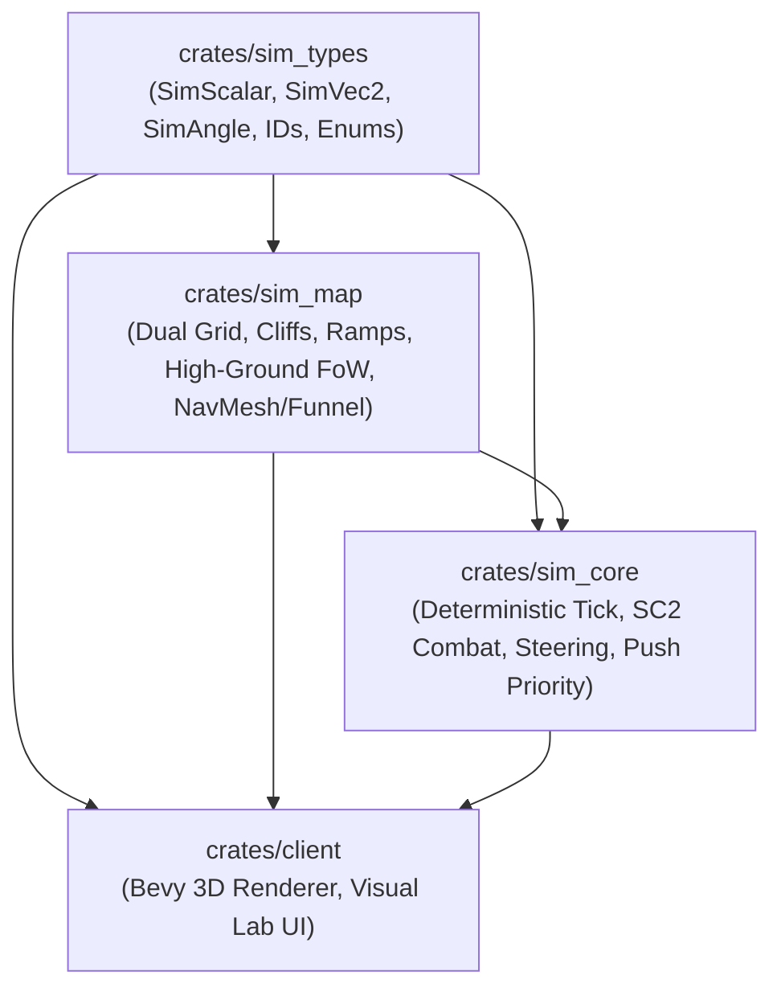

# 02 — Implementation Plan: `crates/sim_map` (Map, Cliffs, NavMesh & High-Ground Vision)

> **Architectural Charter & Reference Blueprint**  
> **Crate:** `crates/sim_map`  
> **Author:** Lead Pathfinding & Map Systems Architect  
> **Target Execution Agent:** Implementation Sub-Agent B (`sim_map` Engineer)  
> **Standards Compliance:** Strict adherence to [AGENTS.md](file:///home/cl/projects/space-scuffle/AGENTS.md), [03-sc2-mechanics-reference.md](file:///home/cl/projects/space-scuffle/docs/03-sc2-mechanics-reference.md), [04-pathfinding-networking-bot-api.md](file:///home/cl/projects/space-scuffle/docs/04-pathfinding-networking-bot-api.md), and [05-parallel-implementation-plans.md](file:///home/cl/projects/space-scuffle/docs/05-parallel-implementation-plans.md).

---

## 1. Executive Summary & Architectural Charter

### 1.1 Purpose & Scope
The `sim_map` crate is the authoritative, deterministic foundation for the physical world in **Space Scuffle**. It governs terrain elevation, cliff levels, ramp slopes, building placement footprints, line-of-sight (Fog of War) computation, dynamic clearance grids, and macroscopic pathfinding.

Like the rest of the simulation boundary (`sim_types` and `sim_core`), `sim_map` is **100% headless, platform-independent, and deterministic**. It produces bit-for-bit identical calculations on Linux (`x86_64`), Windows (`x86_64`), macOS (`ARM64`), and WebAssembly (`wasm32`).

### 1.2 Core Responsibilities
1. **Dual-Grid Spatial Representation:**
   - **Discrete 1x1 Cell Grid:** Used for terrain cliffs (`0..=3`), ramp connectivity, cell flags (buildability, pathability, line-of-sight blocking, speed zones), and building dome footprints (`2x2`, `3x3`, `5x5`).
   - **Continuous Fixed-Point Plane (`SimVec2`):** Continuous coordinates used for unit navigation, collision radii, raycasts, and funnel string-pulling waypoints.
2. **Deterministic Height & Terrain Querying:**
   - Computes deterministic fixed-point altitude (`SimScalar`) and smooth floating-point altitude (`f32`) along ramps for client interpolation, avoiding visual stair-stepping.
3. **High-Ground Fog of War & Line-of-Sight (LoS):**
   - Implements StarCraft II high-ground occlusion: ground units on a lower cliff cannot see onto higher cliffs without ramps, allied spotters, or air units.
   - Computes smoke-vent / tall-grass `LOS_BLOCKER` line-of-sight occlusion.
   - Manages neutral **Watchtowers** with circular high-ground vision captures.
4. **Dynamic Clearance-Aware Pathfinding & Simple Stupid Funnel (SSF):**
   - Maintains an incrementally updated clearance grid supporting multiple unit sizes (`Small = 0.375`, `Medium = 0.625`, `Large = 1.125`).
   - Executes $A^*$ corridor search on the clearance grid.
   - Runs the **Simple Stupid Funnel (String-Pulling)** algorithm with **unit radius corner offset** to generate smooth, arbitrary-angle Euclidean waypoints.
5. **Zero Engine / GPU Coupling:**
   - Zero dependencies on `bevy`, `wgpu`, or windowing libraries. All visual communication occurs strictly via data exported to `RenderSnapshot` or query functions.

---

## 2. Dependency Graph & Cargo Configuration

The dependency graph strictly adheres to the acyclic architecture defined in `AGENTS.md`:



### `crates/sim_map/Cargo.toml`
```toml
[package]
name = "sim_map"
version = "0.1.0"
edition = "2021"
authors = ["Space Scuffle Contributors"]
description = "Deterministic dual-grid map, cliff levels, high-ground FoW, and Funnel pathfinding for Space Scuffle"
license = "MIT OR Apache-2.0"

[dependencies]
sim_types = { path = "../sim_types" }
bitflags = "2.4"
thiserror = "1.0"
serde = { version = "1.0", features = ["derive"] }
ron = "0.8"
serde_json = "1.0"

[dev-dependencies]
proptest = "1.4"
criterion = "0.5"
```

---

## 3. Pedagogical Module Architecture

The crate is organized into five tightly scoped modules:

```text
crates/sim_map/
├── Cargo.toml
├── src/
│   ├── lib.rs          # System overview, public exports, coordinate conversions
│   ├── error.rs        # Strongly-typed MapError enum (thiserror)
│   ├── grid.rs         # 1x1 Cell Grid, CliffLevel, RampDir, GameMap, Footprints
│   ├── loader.rs       # RON map serializer & Tiled JSON (.tmj) importer
│   ├── vision.rs       # High-ground FoW, LoS blockers, circular raycasting, Watchtowers
│   └── pathfinding.rs  # Dynamic clearance grid, A* search, Simple Stupid Funnel
└── tests/
    ├── vision_tests.rs       # High-ground occlusion & LoS blocker integration tests
    ├── wall_off_tests.rs     # 2x2/3x3 ramp wall-offs & unit clearance tests
    ├── funnel_tests.rs       # Shortest path & corner-smoothing integration tests
    └── determinism_tests.rs  # Cross-platform bit-for-bit validation & benchmarks
```

---

## 4. Detailed Module Specifications

### 4.1 Module: `lib.rs` (Dual-Grid Foundation & Re-exports)

#### Responsibilities:
- System overview documentation (`//!`) explaining the dual-grid model.
- Top-level re-exports of core structs, enums, and error types.
- Coordinate conversion helper functions between grid cells `(u32, u32)` and continuous world positions `SimVec2`.

#### Public API Design:
```rust
//! # `sim_map`
//!
//! Authoritative, deterministic map representation, terrain elevation,
//! Fog of War visibility, and funnel pathfinding for **Space Scuffle**.
//!
//! ## Architectural Principles
//! - **Dual-Grid Model:** A discrete 1x1 cell grid controls discrete spatial properties
//!   (cliffs, ramps, building footprints, line-of-sight occlusion), while continuous
//!   fixed-point `SimVec2` coordinates govern unit movement and steering.
//! - **Strict Determinism:** Pure fixed-point mathematics (`SimScalar`, `SimVec2`) are
//!   used for all authoritative simulation queries. Floating-point conversions (`f32`)
//!   are strictly isolated for visual interpolation.
//! - **Zero Allocations in Hot Paths:** Visibility checks and path queries reuse
//!   scratch buffers without allocating dynamic heap memory per tick.

pub mod error;
pub mod grid;
pub mod loader;
pub mod pathfinding;
pub mod vision;

pub use error::{MapError, Result};
pub use grid::{
    CellFlags, CliffLevel, GameMap, MapCell, RampDir, ResourceKind, ResourceNode,
    TerrainKind, Watchtower,
};
pub use loader::ScMapData;
pub use pathfinding::{PathRequest, PathResult, Pathfinder, UnitClearance};
pub use vision::{PlayerVisionMap, VisibilityState};
```

---

### 4.2 Module: `error.rs` (Strongly-Typed Error Handling)

#### Responsibilities:
- Explicit `MapError` enum with `thiserror`.
- Zero `.unwrap()` calls in production library code.
- Detailed, debuggable contextual information for failed building placement, out-of-bounds queries, invalid ramp configurations, and corrupt map files.

#### Type Definitions:
```rust
//! Strongly-typed map and pathfinding errors.

use sim_types::SimVec2;
use thiserror::Error;

/// Specific cause for why building placement failed.
#[derive(Debug, Clone, Copy, PartialEq, Eq, Error)]
pub enum PlacementFailureReason {
    #[error("target cell is marked unbuildable")]
    UnbuildableTerrain,
    #[error("building footprint straddles multiple cliff levels")]
    CliffLevelMismatch,
    #[error("building overlaps a ramp tile")]
    OverlapsRamp,
    #[error("target footprint is already occupied by entity {0:?}")]
    OccupiedByStructure(sim_types::EntityId),
    #[error("footprint extends beyond map boundaries")]
    OutOfBounds,
}

/// Comprehensive error type for all `sim_map` operations.
#[derive(Debug, Clone, PartialEq, Eq, Error)]
pub enum MapError {
    #[error("coordinate ({x}, {y}) out of map bounds ({width}x{height})")]
    OutOfBounds { x: i32, y: i32, width: u32, height: u32 },

    #[error("invalid building footprint dimensions ({width}x{height}); must be > 0")]
    InvalidFootprintDimensions { width: u8, height: u8 },

    #[error("building placement failed at cell ({cell_x}, {cell_y}): {reason}")]
    PlacementBlocked {
        cell_x: u32,
        cell_y: u32,
        reason: PlacementFailureReason,
    },

    #[error("structure with EntityId {0:?} was not found on the map")]
    StructureNotFound(sim_types::EntityId),

    #[error("pathfinding start position {0:?} is out of bounds or impassable")]
    InvalidStart(SimVec2),

    #[error("pathfinding goal position {0:?} is out of bounds or impassable")]
    InvalidGoal(SimVec2),

    #[error("no valid path found from {start:?} to {goal:?}")]
    NoPathFound { start: SimVec2, goal: SimVec2 },

    #[error("failed to deserialize map RON data: {0}")]
    RonDeserializationError(String),

    #[error("failed to serialize map RON data: {0}")]
    RonSerializationError(String),

    #[error("failed to parse Tiled TMJ map: {0}")]
    TiledParseError(String),

    #[error("invalid map dimensions: width={width}, height={height}")]
    InvalidDimensions { width: u32, height: u32 },
}

pub type Result<T> = std::result::Result<T, MapError>;
```

---

### 4.3 Module: `grid.rs` (Map Grid, Cliffs, Ramps & Building Footprints)

#### Responsibilities:
- Represents the 1x1 tile grid of the battlefield.
- Manages discrete cliff plateaus (`0..=3`) and ramp orientation (`RampDir`).
- Handles building footprint validation (`can_place_building`), dome placement, and removal.
- Calculates deterministic fixed-point altitude and smooth client rendering altitude along ramps.
- Supplies built-in SC2-style test map generator (`GameMap::default_arena()`).

#### Constants & Math Invariants:
- `CLIFF_HEIGHT_SCALAR`: Fixed-point cliff step height (e.g. `3.0` height units per cliff level).
- Cell size in continuous simulation space: $1.0 \times 1.0$ `SimScalar` units. Cell center is at `(x + 0.5, y + 0.5)`.

#### Type Definitions:
```rust
//! 1x1 Cell Grid, Cliff Levels, Ramps, and Building Placement.

use crate::error::{MapError, PlacementFailureReason, Result};
use bitflags::bitflags;
use serde::{Deserialize, Serialize};
use sim_types::{EntityId, PlayerId, SimScalar, SimVec2};
use std::collections::BTreeMap;

/// Discrete cliff elevation plateau (0 to 3).
#[derive(Debug, Clone, Copy, PartialEq, Eq, PartialOrd, Ord, Hash, Serialize, Deserialize)]
pub struct CliffLevel(pub u8);

impl CliffLevel {
    pub const MIN: Self = Self(0);
    pub const MAX: Self = Self(3);

    #[inline]
    pub fn height_scalar(self) -> SimScalar {
        SimScalar::from_num(self.0) * SimScalar::from_num(3)
    }

    #[inline]
    pub fn height_f32(self) -> f32 {
        self.height_scalar().to_f32()
    }
}

/// Compass direction that a ramp ascends towards.
#[derive(Debug, Clone, Copy, PartialEq, Eq, Hash, Serialize, Deserialize)]
pub enum RampDir {
    North,
    South,
    East,
    West,
    NorthEast,
    NorthWest,
    SouthEast,
    SouthWest,
}

/// Visual and acoustic terrain type.
#[derive(Debug, Clone, Copy, PartialEq, Eq, Hash, Serialize, Deserialize)]
pub enum TerrainKind {
    Grass,
    MetalPlate,
    Dirt,
    Abyss,
}

bitflags! {
    /// 16-bit flags defining properties of a single 1x1 cell.
    #[derive(Debug, Clone, Copy, PartialEq, Eq, Hash, Serialize, Deserialize)]
    pub struct CellFlags: u16 {
        /// Ground units can construct buildings on this cell.
        const BUILDABLE              = 1 << 0;
        /// Ground units can traverse this cell.
        const GROUND_PATHABLE        = 1 << 1;
        /// Ground units cannot see through this cell (e.g., tall grass or smoke vents).
        const LOS_BLOCKER            = 1 << 2;
        /// Modifies ground unit movement speed (creep or speed zone).
        const SPEED_ZONE             = 1 << 3;
        /// A structure currently occupies this cell.
        const OCCUPIED_BY_STRUCTURE  = 1 << 4;
        /// Cell is part of a ramp connecting two cliff levels.
        const RAMP                   = 1 << 5;
        /// Cell is an impassable cliff drop-off.
        const UNPASSABLE_CLIFF       = 1 << 6;
    }
}

/// Properties of a single 1x1 tile on the map.
#[derive(Debug, Clone, PartialEq, Eq, Serialize, Deserialize)]
pub struct MapCell {
    pub cliff_level: CliffLevel,
    pub ramp: Option<RampDir>,
    pub terrain_kind: TerrainKind,
    pub flags: CellFlags,
    pub occupying_structure: Option<EntityId>,
}

/// Type of natural resource node.
#[derive(Debug, Clone, Copy, PartialEq, Eq, Hash, Serialize, Deserialize)]
pub enum ResourceKind {
    Mineral,
    Gas,
}

/// Natural resource node located in the map.
#[derive(Debug, Clone, PartialEq, Eq, Serialize, Deserialize)]
pub struct ResourceNode {
    pub pos: SimVec2,
    pub kind: ResourceKind,
    pub remaining: u32,
    pub cell: (u32, u32),
}

/// Neutral observation tower that grants vision when occupied.
#[derive(Debug, Clone, PartialEq, Eq, Serialize, Deserialize)]
pub struct Watchtower {
    pub id: EntityId,
    pub pos: SimVec2,
    pub capture_radius: SimScalar,
    pub reveal_radius: SimScalar,
    pub controlling_player: Option<PlayerId>,
}

/// Metadata tracking a building dome placed on the grid.
#[derive(Debug, Clone, PartialEq, Eq, Serialize, Deserialize)]
pub struct PlacedStructure {
    pub id: EntityId,
    pub top_left: (u32, u32),
    pub width: u8,
    pub height: u8,
}

/// The authoritative game map.
#[derive(Debug, Clone, Serialize, Deserialize)]
pub struct GameMap {
    width: u32,
    height: u32,
    cells: Vec<MapCell>,
    structures: BTreeMap<EntityId, PlacedStructure>,
    resources: Vec<ResourceNode>,
    watchtowers: Vec<Watchtower>,
}
```

#### Core Methods on `GameMap`:
1. **Coordinate Conversion:**
   - `world_to_cell(pos: SimVec2) -> Result<(u32, u32)>`:
     Converts world coordinates to discrete grid indices, rejecting out-of-bounds points.
   - `cell_to_world_center(x: u32, y: u32) -> Result<SimVec2>`:
     Returns `SimVec2::new(SimScalar::from_num(x) + 0.5, SimScalar::from_num(y) + 0.5)`.
2. **Height & Altitude Queries:**
   - `terrain_altitude_scalar(pos: SimVec2) -> SimScalar`:
     Authoritative simulation height. If pos is on a flat cell, returns `cell.cliff_level.height_scalar()`. If on a ramp cell, performs deterministic linear interpolation along the ramp axis between `lower_cliff` and `higher_cliff`.
   - `terrain_altitude_at(pos: SimVec2) -> f32`:
     Visual client rendering height: converts `terrain_altitude_scalar(pos).to_f32()`. Guarantees smooth continuous elevation along ramps without stepped jumps.
3. **Building Placement Validation:**
   - `can_place_building(cell_x: u32, cell_y: u32, w: u8, h: u8) -> Result<()>`:
     Validates whether a $W \times H$ building dome can be placed at `(cell_x, cell_y)`:
     - All cells $(x, y)$ in $[cell\_x .. cell\_x + w) \times [cell\_y .. cell\_y + h)$ must be within bounds.
     - All cells must have `CellFlags::BUILDABLE`.
     - No cell can have `CellFlags::OCCUPIED_BY_STRUCTURE` or `CellFlags::RAMP`.
     - **Cliff Invariant:** All cells within the footprint must have identical `CliffLevel`. Straddling a cliff ledge is forbidden.
4. **Structure Placement & Removal:**
   - `place_structure(id: EntityId, cell_x: u32, cell_y: u32, w: u8, h: u8) -> Result<()>`:
     Validates footprint, marks all cells as `OCCUPIED_BY_STRUCTURE`, clears `BUILDABLE` and `GROUND_PATHABLE`, sets `occupying_structure = Some(id)`, and stores in `structures`.
   - `remove_structure(id: EntityId) -> Result<()>`:
     Restores `BUILDABLE` and `GROUND_PATHABLE`, clears `OCCUPIED_BY_STRUCTURE` and `occupying_structure`, and removes from `structures`.
5. **Default Arena Generator:**
   - `GameMap::default_arena() -> Self`:
     Constructs a canonical $64 \times 64$ two-level test map:
     - South-West quadrant: Cliff Level 1 (Low Ground) with metallic/dirt base.
     - North-East quadrant: Cliff Level 2 (High Ground plateau).
     - Center: Navigable 4-cell wide ramp connecting Cliff 1 to Cliff 2.
     - LoS blocker smoke-vent patch ($3 \times 3$ cells) on the low ground.
     - Neutral Watchtower on a mid-ground vantage point.
     - Standard SC2 base resource clusters (8 mineral patches + 2 gas geysers) on both low and high plateaus.

---

### 4.4 Module: `loader.rs` (RON Map Serializer & Tiled TMJ Importer)

#### Responsibilities:
- Provides clean, versioned serialization and deserialization using `.scmap.ron`.
- Implements an importer for subset **Tiled JSON (`.tmj`)** maps.

#### Schema & Tiled Mapping:
- **Tiled TMJ Mapping:**
  - Tile layer `"Cliffs"`: Integer tile ID maps directly to `CliffLevel(0..=3)`.
  - Tile layer `"Terrain"`: Maps GID to `TerrainKind` (`Grass`, `MetalPlate`, `Dirt`, `Abyss`).
  - Tile layer `"Ramps"`: Custom property or tile ID maps to `Option<RampDir>`.
  - Tile layer `"Flags"`: Bitflag values for `BUILDABLE`, `GROUND_PATHABLE`, `LOS_BLOCKER`, `SPEED_ZONE`.
  - Object group layer `"Spawns"`: Point objects with player/team properties.
  - Object group layer `"Resources"`: Rectangles with `"Mineral"` or `"Gas"` types and remaining amounts.
  - Object group layer `"Watchtowers"`: Points with capture and reveal radii.

```rust
//! Map serialization and Tiled JSON (.tmj) importer.

use crate::error::{MapError, Result};
use crate::grid::{GameMap, MapCell, ResourceNode, Watchtower};
use serde::{Deserialize, Serialize};

/// High-level serializable representation of a complete map.
#[derive(Debug, Clone, Serialize, Deserialize)]
pub struct ScMapData {
    pub name: String,
    pub width: u32,
    pub height: u32,
    pub cells: Vec<MapCell>,
    pub resources: Vec<ResourceNode>,
    pub watchtowers: Vec<Watchtower>,
}

impl GameMap {
    pub fn to_ron(&self) -> Result<String> {
        let data = ScMapData {
            name: "ExportedMap".into(),
            width: self.width(),
            height: self.height(),
            cells: self.cells().to_vec(),
            resources: self.resources().to_vec(),
            watchtowers: self.watchtowers().to_vec(),
        };
        ron::ser::to_string_pretty(&data, ron::ser::PrettyConfig::default())
            .map_err(|e| MapError::RonSerializationError(e.to_string()))
    }

    pub fn from_ron(ron_str: &str) -> Result<Self> {
        let data: ScMapData = ron::from_str(ron_str)
            .map_err(|e| MapError::RonDeserializationError(e.to_string()))?;
        Self::from_data(data)
    }

    pub fn from_tiled_tmj(json_str: &str) -> Result<Self> {
        // Parse Tiled JSON structure, validate required layers, and construct GameMap
        // ...
    }
}
```

---

### 4.5 Module: `vision.rs` (High-Ground Fog of War & Line-of-Sight)

#### Responsibilities:
- Tracks Fog of War per player: `Unexplored`, `Fogged`, and `Visible`.
- Enforces **SC2 High-Ground Line-of-Sight Rules**:
  - Ground units at `cliff_level = L` **cannot** see cells at `cliff_level > L` unless:
    1. The target cell is a ramp ascending from `L`.
    2. An allied ground unit at `cliff_level >= L_target` or an allied `Air` or `CliffWalker` unit grants sight.
  - Low-ground units attacking high-ground units require vision from a spotter.
- Enforces **Line-of-Sight Blockers (`LOS_BLOCKER`)**:
  - Smoke vents / tall grass block ground vision across them.
  - Units outside cannot see inside beyond 1 cell; units inside can see out.
- Manages **Watchtowers**:
  - Grants large circular high-ground vision to the occupying player if no enemies contest the capture radius.

#### Performance Rationale:
```rust
// PERFORMANCE RATIONALE:
// Why: In a 400-unit battle, computing dynamic raycasts per unit every tick (25 Hz)
// generates over 100,000 ray queries per second, leading to high CPU usage and heap churn.
// What:
// 1. We precompute circular Bresenham ray offset tables indexed by integer sight radius (R <= 16).
// 2. Each PlayerVisionMap uses flat pre-allocated Vec<u16> sight counters and Vec<u8> state buffers.
// 3. Incrementing/decrementing sight counters avoids any heap allocations during simulation ticks.
// Trade-off: Slightly larger static memory footprint (< 256 KB per player map) in exchange for
// deterministic, cache-friendly O(1) tile updates and zero per-tick heap allocations.
```

#### Type Definitions & Algorithms:
```rust
//! High-Ground Fog of War, Line-of-Sight Raycasting, and Watchtowers.

use crate::grid::{CellFlags, CliffLevel, GameMap};
use serde::{Deserialize, Serialize};
use sim_types::{MoverType, PlayerId, SimScalar, SimVec2};

/// Visibility state of a single cell for a specific player.
#[derive(Debug, Clone, Copy, PartialEq, Eq, Hash, Serialize, Deserialize)]
pub enum VisibilityState {
    /// Completely black fog. Never visited by any allied unit.
    Unexplored = 0,
    /// Grey fog. Previously visited; terrain and stale structures visible, units hidden.
    Fogged = 1,
    /// Currently visible in real time by at least one allied unit or detector.
    Visible = 2,
}

/// Vision source query.
pub struct VisionSource {
    pub pos: SimVec2,
    pub mover_type: MoverType,
    pub sight_radius: SimScalar,
    pub is_detector: bool,
}

/// Authoritative Fog of War map for a single player.
#[derive(Debug, Clone)]
pub struct PlayerVisionMap {
    width: u32,
    height: u32,
    /// Current visibility state per cell.
    states: Vec<VisibilityState>,
    /// Number of active allied vision sources currently seeing each cell.
    visible_counter: Vec<u16>,
    /// Number of active allied detectors currently revealing each cell.
    detector_counter: Vec<u16>,
}

impl PlayerVisionMap {
    pub fn new(width: u32, height: u32) -> Self;

    /// Resets active tick counters while preserving exploration history.
    /// Cells with visible_counter > 0 that drop to 0 transition to VisibilityState::Fogged.
    pub fn begin_tick_update(&mut self);

    /// Applies a vision source to the map using deterministic high-ground and LoS rules.
    pub fn apply_vision_source(&mut self, map: &GameMap, source: &VisionSource);

    /// Finalizes the tick, updating VisibilityState transitions.
    pub fn end_tick_update(&mut self);

    /// Returns the visibility state of a cell.
    pub fn visibility_at(&self, cell_x: u32, cell_y: u32) -> VisibilityState;

    /// Checks if a cell is actively covered by detection (reveals stealth/burrow).
    pub fn is_detected(&self, cell_x: u32, cell_y: u32) -> bool;
}
```

#### Deterministic Raycasting Algorithm Details:
1. For each `VisionSource`:
   - Compute `(center_x, center_y) = map.world_to_cell(source.pos)`.
   - Determine `source_cliff = map.cell(center_x, center_y).cliff_level`.
   - Cast rays outward up to $\lceil \text{sight\_radius} \rceil$ cells using precomputed circular quadrant offset lists.
   - For each tile along ray $(cx, cy)$:
     - **High-ground check:** If `source.mover_type == MoverType::Ground` and `tile.cliff_level > source_cliff` and tile is not an ascending ramp, the ray **terminates immediately** (high ground occludes vision).
     - **LoS blocker check:** If `tile.flags.contains(CellFlags::LOS_BLOCKER)` and $(cx, cy) \ne (center_x, center_y)$, mark tile visible and then terminate ray (cannot see through smoke vents).
     - Otherwise, increment `visible_counter[idx]`. If `source.is_detector`, increment `detector_counter[idx]`.

---

### 4.6 Module: `pathfinding.rs` (Clearance Grid + A* + Simple Stupid Funnel)

#### Responsibilities:
- Maintains a dynamic **Clearance Grid** that updates in $< 0.2\text{ ms}$ when structures are placed or destroyed.
- Supports multi-radius unit clearance:
  - `Small` (radius `0.375`, e.g. Light Rifle / Marine): can slip through 1-tile diagonal gaps between buildings.
  - `Medium` (radius `0.625`, e.g. Marauder / Stalker): requires full 1-cell clearance.
  - `Large` (radius `1.125`, e.g. Siege Tank / Thor): requires 2-cell clearance.
- Runs $A^*$ search using octile distance heuristics.
- Applies the **Simple Stupid Funnel (String-Pulling)** algorithm with **corner radius clearance offsets** so units take smooth, Euclidean straight-line shortcuts around polygon vertices instead of 8-way grid zig-zags.

#### Performance Rationale:
```rust
// PERFORMANCE RATIONALE:
// Why: Pathfinding is called frequently (dozens of path requests per tick during army movement).
// Allocating Open/Closed sets, priority queues, and node graphs on the heap per query creates
// severe memory fragmentation and GC/allocator pauses.
// What:
// 1. PathfinderBuffers pre-allocates flat index arrays for A* (g_score, f_score, visited, came_from).
// 2. Generation counters are used to clear visited states in O(1) without zeroing the entire buffer.
// 3. Portals and Funnel waypoints are written into a reusable pre-allocated Vec<SimVec2>.
// Trade-off: Slightly larger persistent struct memory footprint in exchange for ZERO heap allocations
// during A* search and Simple Stupid Funnel string-pulling.
```

#### Type Definitions & Core Algorithms:
```rust
//! Dynamic Clearance Grid, A* Corridor Search, and Simple Stupid Funnel (String-Pulling).

use crate::error::{MapError, Result};
use crate::grid::{CellFlags, GameMap};
use serde::{Deserialize, Serialize};
use sim_types::{SimScalar, SimVec2};

/// Unit clearance tier determining navigation aperture.
#[derive(Debug, Clone, Copy, PartialEq, Eq, PartialOrd, Ord, Hash, Serialize, Deserialize)]
pub enum UnitClearance {
    /// Radius ~0.375. Can squeeze through diagonal corners of 2x2/3x3 buildings.
    Small,
    /// Radius ~0.625. Standard combat infantry/cavalry; requires 1 full cell.
    Medium,
    /// Radius ~1.125. Massive units / siege tanks; requires 2x2 clear passage.
    Large,
}

impl UnitClearance {
    #[inline]
    pub fn radius_scalar(self) -> SimScalar {
        match self {
            Self::Small => SimScalar::from_num(0.375),
            Self::Medium => SimScalar::from_num(0.625),
            Self::Large => SimScalar::from_num(1.125),
        }
    }

    #[inline]
    pub fn required_clearance_cells(self) -> u8 {
        match self {
            Self::Small => 1,
            Self::Medium => 1,
            Self::Large => 2,
        }
    }
}

/// Request parameters for a pathfinding query.
#[derive(Debug, Clone)]
pub struct PathRequest {
    pub start: SimVec2,
    pub goal: SimVec2,
    pub clearance: UnitClearance,
}

/// Resulting path consisting of smooth, corner-rounded waypoints.
#[derive(Debug, Clone, PartialEq, Eq)]
pub struct PathResult {
    /// Ordered Euclidean waypoints from start to goal.
    pub waypoints: Vec<SimVec2>,
    /// Total Euclidean length of the string-pulled path.
    pub total_length: SimScalar,
}

/// A 2D portal edge connecting two adjacent passable cells in the A* corridor.
#[derive(Debug, Clone, Copy, PartialEq, Eq)]
pub struct PortalEdge {
    pub left: SimVec2,
    pub right: SimVec2,
}

/// Reusable internal buffers to eliminate heap allocations per query.
pub struct PathfinderBuffers {
    open_set: Vec<u32>,
    came_from: Vec<u32>,
    g_score: Vec<u32>,
    visited_generation: Vec<u32>,
    current_generation: u32,
    corridor_cells: Vec<u32>,
    portals: Vec<PortalEdge>,
}

/// Dynamic pathfinder operating over GameMap.
pub struct Pathfinder {
    width: u32,
    height: u32,
    /// Clearance value per cell: maximum box size (in cells) that fits starting at this cell.
    clearance_grid: Vec<u8>,
    /// Incremented whenever obstacles change, invalidating cached paths.
    nav_version: u32,
    buffers: PathfinderBuffers,
}
```

#### Simple Stupid Funnel (String-Pulling) with Corner Offset Algorithm:
The Simple Stupid Funnel takes a corridor of portal edges $[(L_0, R_0), (L_1, R_1), \dots, (L_k, R_k)]$ generated by $A^*$ and constructs the shortest smooth Euclidean path:
1. **Initialize Funnel:**
   - Apex $A = \text{start}$.
   - Left edge $L = \text{portal}[0].\text{left}$, Right edge $R = \text{portal}[0].\text{right}$.
   - Add $A$ to `waypoints`.
2. **Step Through Portals:**
   For each subsequent portal edge $(L_{next}, R_{next})$:
   - **Update Right Leg:**
     If $R_{next} \ne R$:
     - If $R_{next}$ narrows the funnel (i.e. is to the left of $R$ relative to apex $A$, tested via 2D cross-product):
       - If $R_{next}$ crosses over the left leg $L$:
         - The left corner $L$ becomes the **new apex**!
         - **Corner Clearance Offset:** Instead of placing the apex directly on the obstacle corner vertex, compute the outward normal of the corner and offset the waypoint by `clearance.radius_scalar() + safety_margin`.
         - Append offset $L$ to `waypoints`.
         - Set $A = L$, restart funnel with $L = R_{next}$, $R = R_{next}$.
       - Else: narrow the right leg: $R = R_{next}$.
   - **Update Left Leg:**
     If $L_{next} \ne L$:
     - If $L_{next}$ narrows the funnel (is to the right of $L$ relative to apex $A$):
       - If $L_{next}$ crosses over the right leg $R$:
         - The right corner $R$ becomes the **new apex**!
         - Apply corner clearance offset to $R$ outward from obstacle.
         - Append offset $R$ to `waypoints`.
         - Set $A = R$, restart funnel with $L = L_{next}$, $R = L_{next}$.
       - Else: narrow the left leg: $L = L_{next}$.
3. **Finish:**
   - Append `goal` to `waypoints`.

---

## 5. Comprehensive Unit & Integration Test Specifications

Every feature, edge case, and boundary condition must be verified by automated tests.

### 5.1 Test Suite 1: High-Ground Vision & Line-of-Sight (`tests/vision_tests.rs`)
1. **Low-Ground vs. High-Ground Occlusion:**
   - Construct arena with low ground (Cliff 1) and high ground plateau (Cliff 2).
   - Place low-ground unit at distance 5 from cliff ledge.
   - Assert: Cells atop Cliff 2 are `VisibilityState::Unexplored` or `Fogged`.
   - Assert: High-ground enemy unit placed on Cliff 2 is invisible to low-ground player.
2. **Air Spotter High-Ground Reveal:**
   - Move an allied `MoverType::Air` scout unit near Cliff 2.
   - Assert: Cliff 2 plateau cells immediately transition to `VisibilityState::Visible`.
   - Assert: High-ground enemy unit is now fully visible.
3. **LoS Blocker Smoke-Vent Test:**
   - Place $3 \times 3$ `CellFlags::LOS_BLOCKER` patch between two ground units.
   - Assert: Neither unit can see the other across the blocker.
   - Move Unit A inside the smoke vent: Unit A can see outside, but units outside cannot see inside Unit A's tile.
4. **Watchtower Capture & Circular Vision:**
   - Place neutral Watchtower with `capture_radius = 3.0` and `reveal_radius = 12.0`.
   - Move Player 1 ground unit within 2.0 units; assert tower becomes captured by Player 1.
   - Assert: Player 1 receives continuous circular `Visible` radius of 12.0 cells ignoring cliffs.
   - Move Player 2 ground unit into capture radius; assert tower becomes contested.

### 5.2 Test Suite 2: Ramp Wall-Offs & Clearance (`tests/wall_off_tests.rs`)
1. **Building Placement Invariant Validation:**
   - Verify placing a $3 \times 3$ dome on flat Cliff 1 returns `Ok(())`.
   - Verify placing a $3 \times 3$ dome straddling Cliff 1 and Cliff 2 returns `Err(MapError::PlacementBlocked { reason: CliffLevelMismatch })`.
   - Verify placing a dome overlapping a ramp tile returns `Err(MapError::PlacementBlocked { reason: OverlapsRamp })`.
2. **Ramp Wall-Off Geometry (SC2 Parity):**
   - On a standard 3-cell wide ramp, place two $3 \times 3$ domes and one $2 \times 2$ dome at the top of the ramp.
   - Verify `UnitClearance::Large` pathfinding fails or routes around the alternate back path (`NoPathFound`).
   - Create a diagonal 1-cell gap:
     - Verify `UnitClearance::Small` (Marine) successfully finds a path slipping through the diagonal gap.
     - Verify `UnitClearance::Large` (Siege Tank) is blocked by the diagonal gap.

### 5.3 Test Suite 3: Simple Stupid Funnel Algorithm (`tests/funnel_tests.rs`)
1. **L-Shaped Obstacle Euclidean Shortcut:**
   - Setup an L-shaped impassable wall.
   - Request path from start `(2.0, 2.0)` to goal `(10.0, 10.0)`.
   - Verify path does **not** contain 8-directional zig-zag staircase points.
   - Verify path contains exactly: `[Start, CornerWaypoint, Goal]`.
2. **Corner Clearance Radius Offset:**
   - Verify the `CornerWaypoint` is offset from the obstacle corner vertex by exactly `clearance.radius_scalar() + safety_margin`.
   - Confirm that a circle of `radius` centered at the waypoint does not intersect the obstacle.
3. **Straight-Line Optimization:**
   - Request path across an open $30 \times 30$ field.
   - Verify path collapses down to exactly `[Start, Goal]` with `total_length == EuclideanDistance(Start, Goal)`.

### 5.4 Test Suite 4: Determinism & Performance Benchmarks (`tests/determinism_tests.rs`)
1. **Cross-Platform Bit-for-Bit Determinism:**
   - Execute 1,000 randomized path queries and vision updates with a fixed PRNG seed (`ChaCha8Rng`).
   - Hash all output waypoints and vision grid bytes using deterministic `xxHash64`.
   - Assert the checksum matches the baseline reference value on all platforms.
2. **Performance Quality Gate:**
   - 100 simultaneous pathfinding queries in a $128 \times 128$ cluttered map execute in $< 2.0\text{ ms}$.
   - Full visibility update for 400 active units executes in $< 1.0\text{ ms}$.
   - Zero heap allocations during `find_path()` when using pre-allocated `PathfinderBuffers`.

---

## 6. Execution Roadmap for Implementation Sub-Agent B

The implementation agent will follow this phased sequence:


1. **Phase 1: Foundation Types & Error Handling (`error.rs`, `grid.rs`):**
   - Implement `MapError` and `PlacementFailureReason`.
   - Implement `CliffLevel`, `RampDir`, `TerrainKind`, and `CellFlags`.
2. **Phase 2: GameMap & Default Arena (`grid.rs`):**
   - Implement `GameMap` flat grid storage, coordinate conversions, altitude math, and building placement validation.
   - Implement `GameMap::default_arena()`.
3. **Phase 3: Map Serialization & Importers (`loader.rs`):**
   - Implement RON serialization/deserialization.
   - Implement subset Tiled TMJ importer.
4. **Phase 4: High-Ground Vision & Watchtowers (`vision.rs`):**
   - Implement `PlayerVisionMap`, precomputed circular ray tables, high-ground occlusion, and Watchtowers.
5. **Phase 5: Clearance Grid, A* & Simple Stupid Funnel (`pathfinding.rs`):**
   - Implement dynamic clearance grid updating on building placement.
   - Implement $A^*$ corridor search and corner-offset Simple Stupid Funnel algorithm.
6. **Phase 6: Comprehensive Verification & Quality Gates:**
   - Execute all test suites in `crates/sim_map/tests/`.
   - Pass `cargo test -p sim_map`, `cargo clippy -p sim_map -- -D warnings`, and `cargo fmt --check`.
