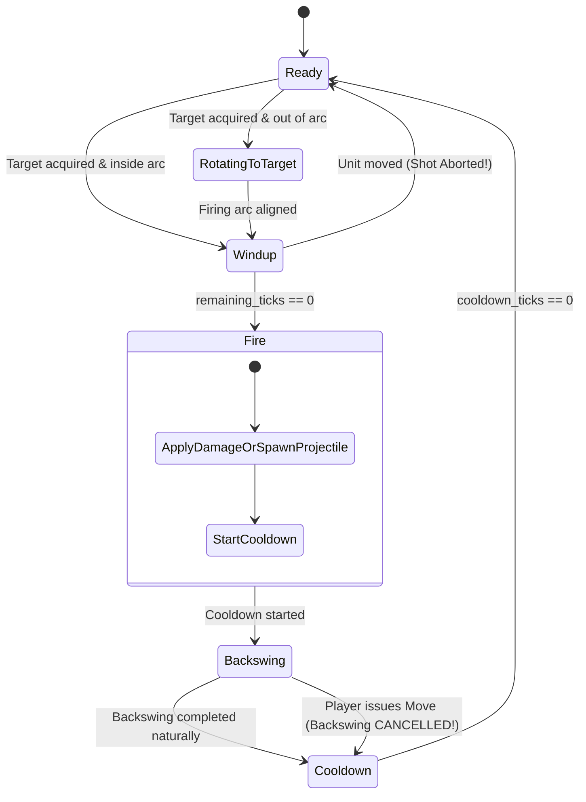
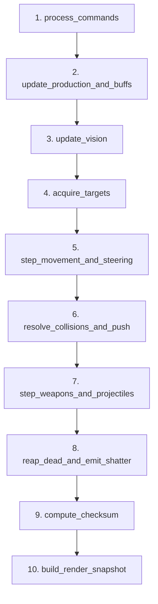

# 03 — Implementation Blueprint: Deterministic Simulation Core (`crates/sim_core`)

> **Architectural Charter & Pedagogical Standard:**
> This blueprint specifies the complete architectural, algorithmic, and mathematical design of `crates/sim_core` for **Space Scuffle**.
> As mandated by [AGENTS.md](file:///home/cl/projects/space-scuffle/AGENTS.md), this document is a textbook-grade engineering reference. It defines bit-for-bit cross-platform determinism, StarCraft II combat timing parity, multi-layer steering with Boid separation and push priority, and an authoritative fixed-tick pipeline operating at $25\text{ Hz}$ ($40\text{ ms}$ per tick).
> Zero placeholders, zero floating-point numbers in simulation state, and zero non-deterministic standard collections.

---

## 1. Executive Architectural Charter & Determinism Manifesto

### 1.1 The Golden Rules of `sim_core`
1. **Bit-for-Bit Cross-Platform Determinism:**
   Simulations executed with identical inputs must produce bit-for-bit identical state across Linux (`x86_64`), Windows (`x86_64`), macOS (`aarch64`), and WebAssembly (`wasm32`).
2. **Forbidden Float Invariant:**
   Neither `f32` nor `f64` shall appear in authoritative simulation state, structs, algorithms, or helper functions. All coordinates, velocities, health, armor, timings, and ranges use `SimScalar`, `SimVec2`, and `SimAngle` from `sim_types`.
   *Conversion to floating-point occurs strictly at the `RenderSnapshot` boundary.*
3. **Deterministic Collections Invariant:**
   Standard `std::collections::HashMap` and `HashSet` are strictly forbidden due to per-process randomized SipHash keys. The simulation must use `BTreeMap`, `BTreeSet`, or deterministic dense arenas with sorted index iteration.
4. **Zero GPU / Windowing Dependencies:**
   `sim_core` has zero dependencies on `bevy`, `wgpu`, `winit`, or audio subsystems. It compiles cleanly in headless environments and targets $10{,}000+$ ticks/second execution speed in bot training and continuous integration test suites.
5. **Acyclic Dependency Hierarchy:**
   ```mermaid
   flowchart TD
       ST["crates/sim_types<br/>(Deterministic Types, IDs, Math, Snapshot)"] --> SM["crates/sim_map<br/>(Cliffs, High-Ground FoW, NavMesh)"]
       ST --> SC["crates/sim_core<br/>(Deterministic Tick, Combat, Steering)"]
       SM --> SC
   ```

---

## 2. Deterministic Time, Units & Fixed-Point Constants

### 2.1 The $25\text{ Hz}$ Timebase
The simulation executes at exactly $25\text{ Hz}$ ($40\text{ ms}$ per tick). This frequency was selected over SC2's $22.4\text{ Hz}$ to provide clean, integer millisecond calculations while preserving identical strategic responsiveness:
- $1\text{ second} = 25\text{ ticks}$.
- $0.1\text{ seconds} = 2.5\text{ ticks}$ (quantized deterministically to alternating ticks or fixed tick counts).
- $10.0\text{ seconds}$ (SC2 shield regeneration delay) $= 250\text{ ticks}$.

### 2.2 SC2 to Space Scuffle Unit Conversion Table
| Dimension | Real-World / SC2 Units | `sim_core` Internal Representation | Fixed-Point Calculation (`SimScalar`) |
| :--- | :--- | :--- | :--- |
| **Time** | $1.0\text{ s}$ | $25\text{ ticks}$ | Integer ticks (`u32` / `u16`) |
| **Distance** | $1.0\text{ grid cell}$ | $1.0\text{ world unit}$ | `SimScalar::from_num(1)` |
| **Speed** | $3.15\text{ cells/s}$ (Marine) | $3.15 / 25 = 0.126\text{ units/tick}$ | `SimScalar::from_num(3.15) / SimScalar::from_num(25)` |
| **Turn Rate** | $999.0^\circ/\text{s}$ (Marine) | Instantaneous / full turn | `SimAngle::from_degrees(999) / 25` |
| **Turn Rate** | $360.0^\circ/\text{s}$ (Siege Tank) | $14.4^\circ/\text{tick} = 2621\text{ brads/tick}$ | `SimAngle::from_degrees(360) / 25` |
| **Shield Delay** | $10.0\text{ s}$ | $250\text{ ticks}$ | `250u16` |
| **Min Damage** | $0.5\text{ HP}$ | $0.5\text{ HP}$ | `SimScalar::from_num(0.5)` |

---

## 3. Pedagogical Module Structure of `crates/sim_core`

The crate is partitioned into seven focused modules:

```text
crates/sim_core/
├── Cargo.toml
├── src/
│   ├── lib.rs          # Fixed-tick architecture overview, error types, and public API
│   ├── catalog.rs      # Archetype data tables & starter 10-unit/dome roster
│   ├── entity.rs       # Deterministic entity storage, components, and state fields
│   ├── combat.rs       # SC2 weapon state machine, damage formulas, and target acquisition
│   ├── steering.rs     # Spatial hash grid, funnel tracking, Boid separation, and push priority
│   ├── checksum.rs     # xxHash64 authoritative state digest generator
│   └── world.rs        # SimWorld lifecycle, 10-phase tick pipeline, and snapshot generation
└── tests/
    ├── stutter_step.rs # Stutter-step kiting and backswing cancellation verification
    ├── turret.rs       # Independent turret tracking while retreating verification
    ├── damage_math.rs  # SC2 shield spillover, life armor, and 10s regen delay verification
    ├── vision_fow.rs   # High-ground cliff occlusion and spotter acquisition verification
    ├── push_priority.rs# Friendly yielding vs. HoldPosition hard-blocking verification
    └── determinism.rs  # 2,000-tick multi-instance lockstep checksum verification
```

---

## 4. Module Specifications & Architectural Deep Dives

### 4.1 `lib.rs`: Public API, Architecture Overview & Error Types

`lib.rs` serves as the entry point and documentation header for the simulation engine. It re-exports high-level entry points and defines the crate's strongly-typed error hierarchy.

#### Pedagogical Module Header (`//!`)
```rust
//! # Sim Core: Deterministic RTS Simulation Engine
//!
//! `sim_core` implements the authoritative, deterministic simulation tick loop for
//! **Space Scuffle**. It models StarCraft II-grade RTS combat mechanics, including:
//! - 4-phase weapon state machines with animation backswing cancellation.
//! - Independent turret tracking decoupled from hull navigation.
//! - Shield absorption, armor reduction, spillover damage, and 10-second shield regen delays.
//! - Local steering with Boid separation, concave firing arc sliding, and push priority yielding.
//! - Dynamic cliff-aware line-of-sight target acquisition.
//!
//! ## Invariants Maintained:
//! 1. All calculations use deterministic fixed-point math (`SimScalar`, `SimVec2`, `SimAngle`).
//! 2. Entity iteration order is strictly sorted by `EntityId` to guarantee identical checksums.
//! 3. Simulation ticks run at an invariant rate of 25 Hz (40 ms per tick).
```

#### Core Error Enum
```rust
use thiserror::Error;
use sim_types::EntityId;

#[derive(Error, Debug, Clone, PartialEq, Eq)]
pub enum SimCoreError {
    #[error("Entity with ID {0:?} does not exist")]
    EntityNotFound(EntityId),

    #[error("Invalid command for entity {0:?}: {1}")]
    InvalidCommand(EntityId, String),

    #[error("Insufficient resources: required {required} minerals, player has {available}")]
    InsufficientResources { required: u32, available: u32 },

    #[error("Supply cap exceeded: current {current}, max {max}")]
    SupplyCapExceeded { current: u32, max: u32 },

    #[error("Building placement invalid at ({x}, {y}): obstructed or unpathable")]
    InvalidBuildingPlacement { x: u32, y: u32 },

    #[error("Catalog archetype {0} not found")]
    ArchetypeNotFound(u16),
}

pub type SimResult<T> = Result<T, SimCoreError>;
```

---

### 4.2 `catalog.rs`: Strongly-Typed Archetypes & SC2 Starter Roster

`catalog.rs` defines the static rules, attributes, costs, and combat specifications for every unit and structure in the game.

#### Data Structures
```rust
use sim_types::{
    AttributeFlags, MoverType, ShapeKind, SilhouetteClass, SimAngle, SimScalar,
    UnitTypeId, WeaponVisualKind,
};

/// Definition of weapon capabilities, firing geometry, and timing envelopes.
#[derive(Debug, Clone, PartialEq, Eq)]
pub struct WeaponSpec {
    pub name: &'static str,
    pub visual_kind: WeaponVisualKind,
    pub target_flags: AttributeFlags,       // Targets Ground, Air, or Both
    pub min_range: SimScalar,               // e.g., Siege Tank min range = 2.0
    pub max_range: SimScalar,               // Weapon engagement radius
    pub firing_arc: SimAngle,               // Max angular deviation from target (e.g. 15°)
    pub has_turret: bool,                   // Independent turret rotation
    pub turret_turn_rate: SimAngle,         // Angular tracking speed per tick
    pub base_damage: SimScalar,             // Raw damage per hit
    pub bonus_armored: SimScalar,           // Bonus damage against ARMORED targets
    pub bonus_light: SimScalar,             // Bonus damage against LIGHT targets
    pub attacks_count: u8,                  // Hits per attack cycle (e.g., Zealot = 2)
    pub period_ticks: u16,                  // Total cooldown between attacks (e.g., 15 ticks)
    pub damage_point_ticks: u16,            // Wind-up before damage application (e.g., 2 ticks)
    pub backswing_ticks: u16,               // Post-shot animation follow-through (e.g., 6 ticks)
    pub splash: Option<SplashSpec>,         // Area-of-effect parameters
    pub projectile_speed: Option<SimScalar>,// None for hitscan/beams; Some(speed) for projectiles
}

/// Concentric circular splash falloff parameters (StarCraft II standard).
#[derive(Debug, Clone, PartialEq, Eq)]
pub struct SplashSpec {
    pub inner_radius: SimScalar,            // 100% damage zone
    pub middle_radius: SimScalar,           // 50% damage zone
    pub outer_radius: SimScalar,            // 25% damage zone
    pub friendly_fire: bool,                // Does splash damage allied units?
}

/// Static archetype specification defining baseline vitals, movement, and abilities.
#[derive(Debug, Clone, PartialEq, Eq)]
pub struct UnitArchetype {
    pub unit_type_id: UnitTypeId,
    pub name: &'static str,
    pub shape: ShapeKind,
    pub silhouette: SilhouetteClass,
    pub mover_type: MoverType,
    pub attributes: AttributeFlags,
    pub max_hp: SimScalar,
    pub max_shields: SimScalar,
    pub max_energy: SimScalar,
    pub life_armor: SimScalar,
    pub shield_armor: SimScalar,
    pub hp_regen_per_tick: SimScalar,
    pub shield_regen_per_tick: SimScalar,   // Active only after 250 ticks without damage
    pub energy_regen_per_tick: SimScalar,
    pub max_speed: SimScalar,               // Linear translation per tick
    pub acceleration: SimScalar,            // Speed increase per tick
    pub deceleration: SimScalar,            // Speed decrease per tick
    pub turn_rate: SimAngle,                // Hull angular tracking speed per tick
    pub collision_radius: SimScalar,        // Hard circle-circle collision radius
    pub separation_radius: SimScalar,       // Boid repulsion boundary
    pub push_priority: u8,                  // Integer mass/priority for displacement
    pub sight_radius: SimScalar,            // High-ground/LoS visibility radius
    pub scan_range: SimScalar,              // Auto-aggro acquisition radius
    pub mineral_cost: u32,
    pub gas_cost: u32,
    pub supply_cost: u32,
    pub supply_provided: u32,
    pub build_time_ticks: u32,
    pub weapon: Option<WeaponSpec>,
    pub is_detector: bool,
}
```

#### The SC2 Starter Archetype Roster (The 10 Built-In Units & Domes)
The catalog provides pre-configured constants for the 10 core entities:

```rust
// PERFORMANCE RATIONALE:
// Why: Static archetype definitions prevent repetitive heap allocation and parsing during ticks.
// What: Archetypes are compiled as immutable static tables indexed by `UnitTypeId` in O(1) time.
// Trade-off: Archetype schemas must be known at compile time; runtime modding uses a static array fallback.

pub struct UnitCatalog {
    archetypes: [Option<UnitArchetype>; 64],
}

impl UnitCatalog {
    pub fn new_starter_roster() -> Self {
        let mut catalog = Self { archetypes: [const { None }; 64] };
        catalog.register(Self::worker());
        catalog.register(Self::marine());
        catalog.register(Self::marauder());
        catalog.register(Self::zealot());
        catalog.register(Self::siege_tank());
        catalog.register(Self::sky_scout());
        catalog.register(Self::command_dome());
        catalog.register(Self::barracks_dome());
        catalog.register(Self::supply_dome());
        catalog.register(Self::laser_turret_dome());
        catalog
    }

    pub fn get(&self, id: UnitTypeId) -> SimResult<&UnitArchetype> {
        let idx = id.0 as usize;
        self.archetypes.get(idx)
            .and_then(|opt| opt.as_ref())
            .ok_or(SimCoreError::ArchetypeNotFound(id.0))
    }
}
```

##### Exact Specifications for the 10 Roster Members:
1. **`Worker` ("Harvester Bubble"):**
   - Shape: `ShapeKind::UnitSphere` (`radius = 0.375`).
   - Mover: `MoverType::Ground`. Attributes: `LIGHT | BIOLOGICAL`.
   - Vitals: HP $45$, Shields $0$, Armor $0$. Speed: $2.81\text{ cells/s} = 0.1124\text{ units/tick}$.
   - Turn Rate: $999^\circ/\text{s}$ (instantaneous). Push Priority: $10$.
   - Weapon: Drill Slash (`range = 0.2`, `damage = 5`, `period = 19 ticks`, `damage_point = 2 ticks`, `backswing = 4 ticks`).
   - Special: When executing `Harvest` or `ReturnCargo`, ignores unit-unit collision (`IGNORE_UNIT_COLLISION` mineral walking).
2. **`Marine` ("Vanguard Rifle Bubble"):**
   - Shape: `ShapeKind::UnitSphere` (`radius = 0.375`).
   - Mover: `MoverType::Ground`. Attributes: `LIGHT | BIOLOGICAL`.
   - Vitals: HP $45$, Shields $0$, Armor $0$. Speed: $3.15\text{ cells/s} = 0.126\text{ units/tick}$.
   - Turn Rate: $999^\circ/\text{s}$. Push Priority: $20$.
   - Weapon: Gauss Rifle (`range = 5.0`, `damage = 6`, `attacks = 1`, `period = 15 ticks`, `damage_point = 2 ticks`, `backswing = 6 ticks`, `hitscan`).
   - Ability: *Stimpack* (Costs $10\text{ HP}$, grants $+50\%$ movement speed and $+50\%$ weapon attack rate for $250\text{ ticks}$).
3. **`Marauder` ("Striker Shell Bubble"):**
   - Shape: `ShapeKind::UnitSphere` (`radius = 0.5`).
   - Mover: `MoverType::Ground`. Attributes: `ARMORED | BIOLOGICAL`.
   - Vitals: HP $125$, Shields $0$, Armor $1$. Speed: $2.25\text{ cells/s} = 0.09\text{ units/tick}$.
   - Turn Rate: $720^\circ/\text{s} = 28.8^\circ/\text{tick}$. Push Priority: $25$.
   - Weapon: Concussive Grenade Launcher (`range = 6.0`, `base_damage = 10`, `bonus_armored = 10`, `period = 27 ticks`, `damage_point = 3 ticks`, `backswing = 7 ticks`, `projectile_speed = 0.75`).
   - Passive: *Concussive Shells* (Inflicts $-50\%$ speed slow debuff on non-Massive targets for $75\text{ ticks}$).
4. **`Zealot` ("Brawler Blade Bubble"):**
   - Shape: `ShapeKind::UnitSphere` (`radius = 0.5`).
   - Mover: `MoverType::Ground`. Attributes: `LIGHT | BIOLOGICAL`.
   - Vitals: HP $100$, Shields $50$, Life Armor $1$, Shield Armor $0$. Speed: $3.15\text{ cells/s} = 0.126\text{ units/tick}$.
   - Turn Rate: $999^\circ/\text{s}$. Push Priority: $25$.
   - Weapon: Dual Psi-Blades (`range = 0.15`, `damage = 8`, `attacks_count = 2`, `period = 21 ticks`, `damage_point = 2 ticks`, `backswing = 5 ticks`, `melee`).
5. **`SiegeTank` ("Siege Turret Bubble"):**
   - Shape: `ShapeKind::UnitSphere` (`radius = 0.875`).
   - Mover: `MoverType::Ground`. Attributes: `ARMORED | MECHANICAL`.
   - Vitals: HP $160$, Shields $0$, Armor $1$. Speed: $2.25\text{ cells/s} = 0.09\text{ units/tick}$.
   - Hull Turn Rate: $360^\circ/\text{s} = 14.4^\circ/\text{tick}$. Turret Turn Rate: $540^\circ/\text{s} = 21.6^\circ/\text{tick}$.
   - Weapon: 90mm Twin Cannon (`has_turret = true`, `min_range = 0.0`, `max_range = 7.0`, `base_damage = 15`, `bonus_armored = 10`, `period = 26 ticks`, `damage_point = 3 ticks`, `backswing = 6 ticks`, `projectile_speed = 1.0`).
   - Splash: Circular falloff (`inner = 0.46875` at $100\%$, `middle = 0.78125` at $50\%$, `outer = 1.25` at $25\%$, `friendly_fire = false`).
6. **`SkyScout` ("Interceptor Air Bubble"):**
   - Shape: `ShapeKind::UnitSphere` (`radius = 0.625`).
   - Mover: `MoverType::Air`. Attributes: `LIGHT | MECHANICAL`.
   - Vitals: HP $120$, Shields $60$, Armor $0$. Speed: $4.0\text{ cells/s} = 0.16\text{ units/tick}$.
   - Acceleration: $0.008\text{ units/tick}^2$ (momentum glide feel). Deceleration: $0.006\text{ units/tick}^2$.
   - Weapon: Pulse Beams (`range = 5.0`, `damage = 5`, `attacks_count = 2`, `period = 18 ticks`, `damage_point = 2 ticks`, `backswing = 4 ticks`, `hitscan`).
7. **`CommandDome` (`5x5` Hemisphere Dome):**
   - Shape: `ShapeKind::BuildingDome { footprint_w: 5, footprint_h: 5 }`.
   - Attributes: `STRUCTURE | ARMORED | MECHANICAL`.
   - Vitals: HP $1500$, Shields $0$, Armor $1$. Resource drop-off hub; trains `Worker`.
8. **`BarracksDome` (`3x3` Hemisphere Dome):**
   - Shape: `ShapeKind::BuildingDome { footprint_w: 3, footprint_h: 3 }`.
   - Attributes: `STRUCTURE | ARMORED | MECHANICAL`.
   - Vitals: HP $1000$, Shields $0$, Armor $1$. Trains `Marine`, `Marauder`, `Zealot`.
9. **`SupplyDome` (`2x2` Hemisphere Dome):**
   - Shape: `ShapeKind::BuildingDome { footprint_w: 2, footprint_h: 2 }`.
   - Attributes: `STRUCTURE | ARMORED | MECHANICAL`.
   - Vitals: HP $400$, Shields $0$, Armor $1$. Supplies $+8$ capacity. Can lower/raise gate to permit friendly passage.
10. **`LaserTurretDome` (`2x2` Hemisphere Dome):**
    - Shape: `ShapeKind::BuildingDome { footprint_w: 2, footprint_h: 2 }`.
    - Attributes: `STRUCTURE | ARMORED | MECHANICAL`.
    - Vitals: HP $250$, Shields $0$, Armor $1$. `is_detector = true` (`detection_radius = 11.0`).
    - Weapon: Continuous High-Energy Laser Beam (`range = 7.0`, `base_damage = 12`, `period = 20 ticks`, `damage_point = 1 tick`, `backswing = 0 ticks`, `beam`).

---

### 4.3 `entity.rs`: Deterministic Storage & State Fields

`entity.rs` manages the state of all active simulation entities.

#### Deterministic Storage Rationale
```rust
// PERFORMANCE RATIONALE:
// Why: Standard HashMap iteration is non-deterministic across executions, causing lockstep desyncs.
// Naive sorting of keys on every tick incurs an O(N log N) overhead per query.
// What: Authoritative entities are stored in a sorted `BTreeMap<EntityId, Entity>` or a flat,
// densely-packed generational index arena with deterministic traversal by EntityId.
// Trade-off: BTreeMap has slightly higher cache-miss overhead compared to contiguous Vecs,
// but guarantees strict, deterministic, allocation-free in-order iteration for checksums and systems.
```

#### State Definitions
```rust
use std::collections::VecDeque;
use sim_types::{EntityId, PlayerId, SimAngle, SimScalar, SimVec2, UnitTypeId};

/// Represents the active phase of an entity's weapon cycle.
#[derive(Debug, Clone, PartialEq, Eq)]
pub enum WeaponPhase {
    /// Weapon is charged and ready to fire as soon as a target is valid.
    Ready,
    /// Unit or turret is rotating to bring the target within the firing arc.
    RotatingToTarget { target_id: EntityId },
    /// DamagePoint wind-up in progress. Moving before completion cancels the attack.
    Windup {
        target_id: EntityId,
        remaining_ticks: u16,
    },
    /// Damage has been applied; unit is executing the post-shot backswing animation.
    /// Can be interrupted and cancelled by a Move command.
    Backswing {
        target_id: EntityId,
        remaining_ticks: u16,
    },
    /// Weapon is on cooldown following an attack. Unit can move and perform other actions.
    Cooldown,
}

/// An active timed buff or debuff affecting unit stats.
#[derive(Debug, Clone, PartialEq, Eq)]
pub struct ActiveBuff {
    pub buff_id: u8,
    pub remaining_ticks: u16,
    pub speed_multiplier: SimScalar,       // e.g., 1.5 for Stim, 0.5 for Concussive
    pub attack_rate_multiplier: SimScalar, // e.g., 1.5 for Stim
}

/// Queued unit order adhering to StarCraft II command semantics.
#[derive(Debug, Clone, PartialEq, Eq)]
pub enum UnitOrder {
    Move { target_pos: SimVec2 },
    AttackMove { target_pos: SimVec2 },
    AttackTarget { target_id: EntityId },
    HoldPosition,
    Stop,
    Harvest { resource_node_id: EntityId },
    ReturnCargo,
    Build { structure_type: UnitTypeId, cell_x: u32, cell_y: u32 },
    Train { unit_type: UnitTypeId },
}

/// Authoritative simulation entity state.
#[derive(Debug, Clone, PartialEq, Eq)]
pub struct Entity {
    pub id: EntityId,
    pub unit_type_id: UnitTypeId,
    pub owner: PlayerId,
    pub position: SimVec2,
    pub velocity: SimVec2,
    pub heading: SimAngle,
    pub turret_angle: SimAngle,
    pub hp: SimScalar,
    pub shields: SimScalar,
    pub energy: SimScalar,
    /// Ticks elapsed since the entity last sustained damage.
    /// Shields regenerate only when this value >= 250 (10.0 seconds).
    pub ticks_since_last_damage: u16,
    pub order_queue: VecDeque<UnitOrder>,
    pub current_funnel_waypoints: Vec<SimVec2>,
    pub weapon_phase: WeaponPhase,
    pub weapon_cooldown_remaining: u16,
    pub active_buffs: Vec<ActiveBuff>,
    pub production_queue: VecDeque<(UnitTypeId, u16)>, // (Type, remaining ticks)
    pub is_mineral_walking: bool,
    pub is_holding_position: bool,
}
```

---

### 4.4 `combat.rs`: SC2 Weapon State Machine & Exact Damage Resolution

`combat.rs` is the mechanical core of *Space Scuffle*. It enforces the StarCraft II combat timing state machine and exact damage arithmetic.

#### SC2 Weapon Timing State Machine



#### Stutter-Step Backswing Cancellation Logic
```rust
impl Entity {
    /// Handles player move/stop input during combat, executing SC2 backswing cancellation.
    pub fn handle_interrupting_move(&mut self, move_pos: SimVec2) {
        match self.weapon_phase {
            WeaponPhase::Windup { .. } => {
                // ABORT: Shot was winding up; moving cancels the shot with zero damage.
                self.weapon_phase = WeaponPhase::Ready;
                self.order_queue.push_front(UnitOrder::Move { target_pos: move_pos });
            }
            WeaponPhase::Backswing { .. } => {
                // CANCEL BACKSWING: Damage has already been applied!
                // Terminate the backswing animation immediately.
                // The weapon cooldown continues to tick down in the background.
                self.weapon_phase = WeaponPhase::Cooldown;
                self.order_queue.push_front(UnitOrder::Move { target_pos: move_pos });
            }
            _ => {
                self.order_queue.push_front(UnitOrder::Move { target_pos: move_pos });
            }
        }
    }
}
```

#### SC2 Exact Damage Formula & Shield Spillover
The damage calculation accounts for attribute bonuses, shield armor, life armor, multi-hit iterations, and the $0.5\text{ HP}$ minimum damage clamp.

```rust
// PERFORMANCE RATIONALE:
// Why: Combat damage resolution happens up to hundreds of times per tick in large engagements.
// What: Pure fixed-point scalar math with no heap allocations or intermediate buffers.
// Trade-off: Exact branch structure mimics SC2 engine execution precisely.

pub struct DamageResolution {
    pub shield_damage: SimScalar,
    pub life_damage: SimScalar,
    pub killed: bool,
}

pub fn calculate_hit_damage(
    attacker_spec: &WeaponSpec,
    target_archetype: &UnitArchetype,
    target_shields: SimScalar,
    target_hp: SimScalar,
) -> DamageResolution {
    let half = SimScalar::from_num(0.5);

    // 1. Calculate incoming raw damage per hit
    let mut raw_damage = attacker_spec.base_damage;
    if target_archetype.attributes.contains(AttributeFlags::ARMORED) {
        raw_damage += attacker_spec.bonus_armored;
    }
    if target_archetype.attributes.contains(AttributeFlags::LIGHT) {
        raw_damage += attacker_spec.bonus_light;
    }

    let mut applied_shield_damage = SimScalar::ZERO;
    let mut applied_life_damage = SimScalar::ZERO;

    if target_shields > SimScalar::ZERO {
        // Shield mitigation: incoming damage reduced by target's shield armor
        let shield_mitigated = (raw_damage - target_archetype.shield_armor).max(half);

        if shield_mitigated <= target_shields {
            // Full damage absorbed by shields
            applied_shield_damage = shield_mitigated;
        } else {
            // Shield broken: absorb remaining shields, spillover unmitigated portion into HP
            applied_shield_damage = target_shields;

            // SC2 unmitigated spillover ratio
            let absorbed_ratio = target_shields / shield_mitigated;
            let leftover_raw = raw_damage * (SimScalar::ONE - absorbed_ratio);
            applied_life_damage = (leftover_raw - target_archetype.life_armor).max(half);
        }
    } else {
        // Direct HP damage mitigated by target's life armor
        applied_life_damage = (raw_damage - target_archetype.life_armor).max(half);
    }

    let remaining_hp = target_hp - applied_life_damage;
    DamageResolution {
        shield_damage: applied_shield_damage,
        life_damage: applied_life_damage,
        killed: remaining_hp <= SimScalar::ZERO,
    }
}
```

#### Target Acquisition Priority
Target acquisition operates over visible enemies within `scan_range`. Candidates are sorted deterministically:
$$\text{PriorityKey} = (\text{threat\_priority } \mathbf{DESC},\ \text{distance\_sq } \mathbf{ASC},\ \text{entity\_id } \mathbf{ASC})$$

```rust
#[derive(Debug, Clone, Copy, PartialEq, Eq, PartialOrd, Ord)]
pub struct TargetPriorityKey {
    pub threat_priority: u8, // Higher is attacked first
    pub distance_sq: SimScalar,
    pub entity_id: EntityId,
}

pub fn compute_threat_priority(archetype: &UnitArchetype, order: Option<&UnitOrder>) -> u8 {
    if archetype.weapon.is_some() {
        match order {
            Some(UnitOrder::AttackMove { .. }) | Some(UnitOrder::AttackTarget { .. }) => 20,
            _ => 19, // Combat unit not actively attacking
        }
    } else if archetype.attributes.contains(AttributeFlags::STRUCTURE) {
        if archetype.is_detector { 15 } else { 5 }
    } else {
        10 // Worker or utility unit
    }
}
```

---

### 4.5 `steering.rs`: Spatial Hash Grid, Concave Arcs & Push Priority

`steering.rs` executes the 3-layer movement architecture: macro funnel waypoint navigation, local Boid separation, combat arc sliding, and push-priority collision resolution.

#### Spatial Hash Grid Specification
```rust
// PERFORMANCE RATIONALE:
// Why: Naive O(N^2) pairwise distance checks for 400 units perform 160,000 checks per tick.
// What: Partition 2D world space into a flat spatial hash grid with 2.0x2.0 cell sizing.
// Trade-off: Memory pre-allocated once during world initialization; neighborhood queries
// run in O(1) time per entity, reducing pairwise checks to O(N).

pub const SPATIAL_CELL_SIZE: usize = 2; // 2 world units per cell
pub const GRID_WIDTH: usize = 128;
pub const GRID_HEIGHT: usize = 128;

pub struct SpatialHashGrid {
    buckets: Vec<Vec<EntityId>>,
}

impl SpatialHashGrid {
    pub fn new() -> Self {
        Self {
            buckets: vec![Vec::with_capacity(8); GRID_WIDTH * GRID_HEIGHT],
        }
    }

    pub fn clear(&mut self) {
        for bucket in self.buckets.iter_mut() {
            bucket.clear();
        }
    }

    pub fn insert(&mut self, id: EntityId, pos: SimVec2) {
        let cx = (pos.x.to_num::<i32>().clamp(0, GRID_WIDTH as i32 - 1)) as usize / SPATIAL_CELL_SIZE;
        let cy = (pos.y.to_num::<i32>().clamp(0, GRID_HEIGHT as i32 - 1)) as usize / SPATIAL_CELL_SIZE;
        self.buckets[cy * (GRID_WIDTH / SPATIAL_CELL_SIZE) + cx].push(id);
    }
}
```

#### Concave Combat Arc Formation
When rear units on an `AttackMove` order are blocked by firing allies, they apply tangential steering forces to wrap around the allied line and form a concave firing arc:

$$\vec{v}_{\text{tangent}} = \text{perp}(\vec{p}_{\text{target}} - \vec{p}_{\text{unit}})$$

```rust
pub fn compute_concave_arc_steering(
    unit_pos: SimVec2,
    target_pos: SimVec2,
    blocked_by_allies: bool,
    steer_left: bool,
) -> SimVec2 {
    if !blocked_by_allies {
        return SimVec2::ZERO;
    }
    let to_target = target_pos - unit_pos;
    let perp = if steer_left {
        SimVec2::new(-to_target.y, to_target.x)
    } else {
        SimVec2::new(to_target.y, -to_target.x)
    };
    perp.normalized()
}
```

#### Friendly Push Priority vs. Hold Position
```rust
// PERFORMANCE RATIONALE:
// Why: RTS armies gridlock in narrow chokes if friendly units act as rigid bodies.
// What: Moving friendly units gently displace idle friendly units perpendicular to the path.
// HoldPosition units and enemy units act as unyielding hard obstacles.

pub fn resolve_push_interaction(
    moving_unit: &Entity,
    other_unit: &mut Entity,
    distance: SimScalar,
    combined_radius: SimScalar,
) {
    let overlap = combined_radius - distance;
    if overlap <= SimScalar::ZERO {
        return;
    }

    // Rule 1: Enemies never yield (hard repulsion for surround micro & body-blocking)
    if moving_unit.owner != other_unit.owner {
        let separation_vec = (other_unit.position - moving_unit.position).normalized();
        other_unit.position += separation_vec * (overlap * SimScalar::from_num(0.5));
        return;
    }

    // Rule 2: Friendly units on Hold Position act as immovable walls
    if other_unit.is_holding_position {
        let separation_vec = (moving_unit.position - other_unit.position).normalized();
        // Moving unit must route around or stop; HoldPosition unit stays anchored
        return;
    }

    // Rule 3: Idle friendly units yield sideways perpendicular to moving unit's velocity
    if other_unit.velocity.length_squared() == SimScalar::ZERO {
        let move_dir = moving_unit.velocity.normalized();
        let perp = SimVec2::new(-move_dir.y, move_dir.x); // Lateral displacement
        other_unit.position += perp * overlap;
    }
}
```

---

### 4.6 `checksum.rs`: Authoritative State xxHash64 Digest

`checksum.rs` computes a platform-independent 64-bit hash of authoritative world state at the conclusion of every simulation tick.

```rust
use xxhash_rust::xxh64::Xxh64;

// PERFORMANCE RATIONALE:
// Why: Hashing dynamic simulation state must execute in under 0.1 ms per tick.
// What: xxHash64 processes 5 GB/s of memory. We stream primitive integer byte representations
// in strictly sorted EntityId order directly into a persistent hasher.

pub fn compute_world_checksum(
    tick: u64,
    rng_seed: u64,
    entities: &std::collections::BTreeMap<sim_types::EntityId, Entity>,
) -> u64 {
    let mut hasher = Xxh64::new(0);

    hasher.update(&tick.to_le_bytes());
    hasher.update(&rng_seed.to_le_bytes());

    for (id, entity) in entities.iter() {
        hasher.update(&id.0.to_le_bytes());
        hasher.update(&entity.unit_type_id.0.to_le_bytes());
        hasher.update(&entity.owner.0.to_le_bytes());

        // Fixed-point scalar bits (guaranteed platform-independent)
        hasher.update(&entity.position.x.to_bits().to_le_bytes());
        hasher.update(&entity.position.y.to_bits().to_le_bytes());
        hasher.update(&entity.velocity.x.to_bits().to_le_bytes());
        hasher.update(&entity.velocity.y.to_bits().to_le_bytes());
        hasher.update(&entity.heading.to_bits().to_le_bytes());
        hasher.update(&entity.turret_angle.to_bits().to_le_bytes());

        hasher.update(&entity.hp.to_bits().to_le_bytes());
        hasher.update(&entity.shields.to_bits().to_le_bytes());
        hasher.update(&entity.energy.to_bits().to_le_bytes());
        hasher.update(&entity.ticks_since_last_damage.to_le_bytes());
        hasher.update(&entity.weapon_cooldown_remaining.to_le_bytes());

        let phase_tag: u8 = match entity.weapon_phase {
            WeaponPhase::Ready => 0,
            WeaponPhase::RotatingToTarget { .. } => 1,
            WeaponPhase::Windup { .. } => 2,
            WeaponPhase::Backswing { .. } => 3,
            WeaponPhase::Cooldown => 4,
        };
        hasher.update(&[phase_tag]);
    }

    hasher.digest()
}
```

---

### 4.7 `world.rs`: Fixed-Order 10-Phase Tick Pipeline & `SimWorld`

`SimWorld` encapsulates all authoritative simulation components, driving the deterministic tick loop through an unalterable 10-phase pipeline.



#### Detailed Phase Execution Matrix
| Phase | Function | Responsibilities |
| :--- | :--- | :--- |
| **1** | `process_commands` | Dequeue player inputs stamped for current tick; validate resource costs; append to entity order queues. |
| **2** | `update_production_and_buffs` | Advance dome build timers; spawn completed units; decrement buff durations; apply passive HP/Energy regen; apply shield regen if `ticks_since_last_damage >= 250`. |
| **3** | `update_vision` | Delegate to `sim_map` Fog of War raycaster; update per-player visibility matrices with high-ground cliff occlusion. |
| **4** | `acquire_targets` | Evaluate idle and attack-moving units against visible enemies; rank by `(priority DESC, dist ASC, id ASC)`. |
| **5** | `step_movement_and_steering` | Advance waypoints along NavMesh funnel paths; calculate seek, separation, and concave arc forces; integrate velocities. |
| **6** | `resolve_collisions_and_push` | Spatial hash collision tests; apply lateral displacement to idle allies; apply rigid repulsion to enemies and `HoldPosition` units. |
| **7** | `step_weapons_and_projectiles` | Advance weapon state machines; rotate turrets; resolve hitscan/beam damage; step projectiles; apply splash falloff. |
| **8** | `reap_dead_and_emit_shatter` | Cull entities with $\text{HP} \le 0$; remove NavMesh building footprint blocks; emit death shatter instances for renderer. |
| **9** | `compute_checksum` | Run `xxHash64` digest over all authoritative simulation state; record checksum in tick log. |
| **10** | `build_render_snapshot` | Generate immutable `RenderSnapshot` converting fixed-point state to `f32` render instances for `crates/client`. |

#### `SimWorld` Struct Definition
```rust
use std::collections::BTreeMap;
use rand_chacha::ChaCha8Rng;
use sim_types::{EntityId, PlayerId, RenderSnapshot, TickBundle};
use sim_map::SimMap;

pub struct SimWorld {
    pub current_tick: u64,
    pub rng: ChaCha8Rng,
    pub entities: BTreeMap<EntityId, Entity>,
    pub next_entity_id: u32,
    pub map: SimMap,
    pub catalog: UnitCatalog,
    pub spatial_hash: SpatialHashGrid,
    pub player_resources: [PlayerResources; 8],
    pub last_checksum: u64,
}

impl SimWorld {
    /// Advances the deterministic simulation by exactly one 40ms tick.
    pub fn step(&mut self, input: &TickBundle) -> RenderSnapshot {
        self.process_commands(input);
        self.update_production_and_buffs();
        self.update_vision();
        self.acquire_targets();
        self.step_movement_and_steering();
        self.resolve_collisions_and_push();
        self.step_weapons_and_projectiles();
        self.reap_dead_and_emit_shatter();
        self.last_checksum = self.compute_checksum();
        self.build_render_snapshot()
    }
}
```

---

## 5. Comprehensive Unit & Integration Test Specification

The implementation agent must create and verify the following textbook integration tests in `crates/sim_core/tests/`:

### 5.1 Test 1: Stutter-Step Kiting & Backswing Cancellation (`tests/stutter_step.rs`)
- **Objective:** Prove that issuing a `Move` command during `WeaponPhase::Backswing` immediately cancels the follow-through animation, increases separation distance from a melee chaser, and maintains full weapon DPS.
- **Scenario:**
  - Place a `Marine` (Rifle Bubble) at $(10.0, 10.0)$ and a `Zealot` (Brawler Blade Bubble) at $(14.0, 10.0)$.
  - Marine issues `AttackTarget(Zealot)`.
  - At tick 2 (`DamagePoint` finishes, shot fires, damage dealt), Marine receives `Move(0.0, 10.0)`.
- **Assertions:**
  1. At tick 2, Zealot shields drop from $50$ to $45$ (damage dealt).
  2. At tick 3, Marine's state transitions immediately from `Backswing` to `Cooldown`.
  3. Marine's position at tick 5 has moved west by $3 \times 0.126 = 0.378$ units.
  4. Compare with an un-microed Marine that does not cancel backswing: the microed Marine maintains $+0.756\text{ units}$ greater distance over a 60-tick engagement while dealing identical damage.

### 5.2 Test 2: Independent Turret Tracking While Retreating (`tests/turret.rs`)
- **Objective:** Verify that a unit with `has_turret = true` rotates its turret independently to fire at a pursuer while its hull navigates in the opposite direction.
- **Scenario:**
  - Place a `SiegeTank` at $(20.0, 20.0)$ facing South ($180^\circ$).
  - Target enemy is at $(20.0, 15.0)$ (due North, $0^\circ$).
  - Issue Tank a `Move(20.0, 30.0)` order (moving South) while ordered to attack the enemy to the North.
- **Assertions:**
  1. Tank hull `heading` remains oriented South ($180^\circ$) and velocity translates South at full speed ($0.09\text{ units/tick}$).
  2. Tank `turret_angle` rotates independently towards North at $21.6^\circ/\text{tick}$.
  3. When `turret_angle` aligns within the $15^\circ$ firing arc, the cannon begins `Windup` and fires without interrupting movement.

### 5.3 Test 3: SC2 Damage Math, Shield Spillover & 10s Regen Delay (`tests/damage_math.rs`)
- **Objective:** Verify exact SC2 shield mitigation, spillover calculation, life armor reduction, and the 250-tick shield regeneration cooldown.
- **Scenario:**
  - Spawn target with $20$ Shields (`ShieldArmor = 1`) and $100$ HP (`LifeArmor = 2`).
  - Strike target with a single hit of $30$ raw damage.
- **Calculations & Assertions:**
  1. Shield portion absorbs: mitigated by ShieldArmor $1 \to 30 - 1 = 29$ damage.
  2. Since $29 > 20$, target shields drop to $0$.
  3. Leftover unmitigated damage spills over into HP:
     $$\text{AbsorbedRatio} = \frac{20}{29} \approx 0.689655$$
     $$\text{LeftoverRaw} = 30 \times (1 - 0.689655) \approx 9.31034$$
     $$\text{LifeDamage} = \max(0.5,\ 9.31034 - 2.0) \approx 7.31034$$
  4. `ticks_since_last_damage` resets to $0$.
  5. Step simulation for $249\text{ ticks}$: Shields remain exactly $0.0$.
  6. Step simulation to tick $250$ ($10.0\text{ seconds}$): Shields begin regenerating by `shield_regen_per_tick`.

### 5.4 Test 4: High-Ground Vision Combat Occlusion (`tests/vision_fow.rs`)
- **Objective:** Verify that ground units on low ground cannot target high-ground enemies without high-ground spotter vision.
- **Scenario:**
  - Construct a map with Cliff Level 1 (Low Ground) and Cliff Level 2 (High Ground).
  - Place a Player 1 `Marine` on Cliff Level 1 at $(10.0, 10.0)$.
  - Place an enemy Player 2 `Zealot` on Cliff Level 2 at $(12.0, 10.0)$ (within Marine's 5.0 weapon range).
- **Assertions:**
  1. Player 1's `VisibilityGrid` evaluates $(12.0, 10.0)$ as `Fogged` / non-visible due to cliff occlusion.
  2. Marine's target acquisition returns `None`; Marine does not fire.
  3. Spawn a Player 1 `SkyScout` (Air mover) at $(10.0, 10.0)$ hovering above the cliff.
  4. Cliff Level 2 tile becomes `Visible`.
  5. Marine immediately acquires the Zealot and enters `RotatingToTarget` / `Windup`.

### 5.5 Test 5: Friendly Push Priority vs. Hold Position (`tests/push_priority.rs`)
- **Objective:** Verify that moving friendly units displace idle allies but are rigidly blocked by allies on `HoldPosition` and enemy units.
- **Scenario:**
  - Case A: Moving Marine collides with an `Idle` friendly Marine.
    - *Assertion:* Idle Marine is displaced laterally; moving Marine passes without deceleration.
  - Case B: Moving Marine collides with a friendly Marine on `HoldPosition`.
    - *Assertion:* Marine on `HoldPosition` remains at its exact fixed coordinate; moving Marine stops or navigates around.
  - Case C: Moving Marine collides with an enemy Zealot.
    - *Assertion:* Hard circle-circle collision prevents overlap; enemy does not yield.

### 5.6 Test 6: 2,000-Tick Multi-Instance Determinism Checksum (`tests/determinism.rs`)
- **Objective:** Verify bit-for-bit lockstep determinism across two completely separate `SimWorld` instances.
- **Scenario:**
  - Instantiate `SimWorld A` and `SimWorld B` with identical map and RNG seed (`0xDEADBEEF`).
  - Execute a recorded script of 2,000 ticks containing 50 units moving, harvesting, forming concave arcs, casting abilities, and fighting.
- **Assertions:**
  1. Every 50 ticks, assert `checksum_a == checksum_b`.
  2. At tick 2,000, assert `hasher_a.digest() == hasher_b.digest()`.
  3. Every entity field in world A matches world B bit-for-bit.

---

## 6. Implementation Checklist & File Creation Map

The implementation sub-agent will execute the following concrete steps:

1. **Workspace & Dependencies:**
   - Create `crates/sim_core/Cargo.toml` with dependencies:
     - `sim_types = { path = "../sim_types" }`
     - `sim_map = { path = "../sim_map" }`
     - `thiserror = "2.0"`
     - `xxhash-rust = { version = "0.8", features = ["xxh64"] }`
     - `rand = { version = "0.8", default-features = false }`
     - `rand_chacha = { version = "0.3", default-features = false }`
2. **Implement Modules in Order:**
   - `src/lib.rs`: Error types, tick constants, public exports.
   - `src/catalog.rs`: Archetypes, starter 10-unit roster.
   - `src/entity.rs`: Storage, vitals, order queue, weapon phase.
   - `src/combat.rs`: Weapon state machine, SC2 damage math, priority sorting.
   - `src/steering.rs`: Spatial hash, Boid separation, concave arc, push priority.
   - `src/checksum.rs`: Deterministic state serializer and xxHash64 generator.
   - `src/world.rs`: 10-phase tick pipeline and `RenderSnapshot` generation.
3. **Execute Integration Test Suite:**
   - `tests/stutter_step.rs`
   - `tests/turret.rs`
   - `tests/damage_math.rs`
   - `tests/vision_fow.rs`
   - `tests/push_priority.rs`
   - `tests/determinism.rs`
4. **Pass Quality Gate:**
   - `cargo test -p sim_core`
   - `cargo clippy -p sim_core --all-targets -- -D warnings`
   - `cargo fmt -p sim_core -- --check`
