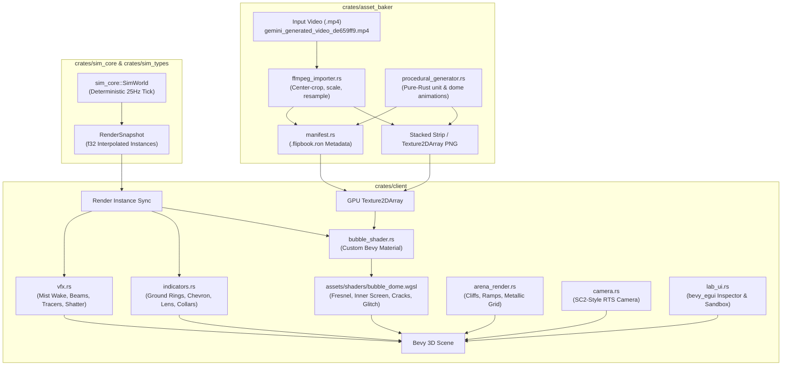
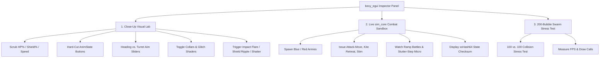

# Implementation Plan 04 — Asset Baker & Bevy Client (Bubble & Dome Visual Lab)

> **Document Version:** 1.0.0  
> **Status:** Approved Architectural Blueprint  
> **Target Crates:** `crates/asset_baker`, `crates/client`, `assets/shaders/`  
> **Charter Compliance:** Strictly adheres to [AGENTS.md](file:///home/cl/projects/space-scuffle/AGENTS.md), [02-bubble-visual-design.md](file:///home/cl/projects/space-scuffle/docs/02-bubble-visual-design.md), and [05-parallel-implementation-plans.md](file:///home/cl/projects/space-scuffle/docs/05-parallel-implementation-plans.md).

---

## Executive Summary & Architecture Charter

*Space Scuffle* replaces conventional 3D skeletal character rigs with **Holographic Bubbles (floating spheres)** for mobile units and **Anchored Domes (hemispheres)** for static buildings. Each unit and building projects an internal looping action video (Constructing, Idle, Walk, Attack, Cast, Die) wrapped in an iridescent Fresnel glass shell, augmented by diegetic indicators (directional mist trails, equatorial facing chevrons, focal targeting lenses, progressive Voronoi damage fractures, CRT glitch scanlines, and refractive death shattering).

This blueprint provides the definitive, textbook-grade implementation architecture for:
1. **`crates/asset_baker`**: An offline/build-time asset pipeline that extracts and formats video files (`.mp4`, `.webm`) via `/usr/bin/ffmpeg` or generates high-contrast procedural flipbook sprite sheets and `.ron` metadata for all units and structures.
2. **`crates/client`**: A Bevy 3D client (`wgpu`, WGSL, `bevy_egui`) featuring a high-performance custom `Material` pipeline and the interactive **Bubble & Dome Visual Lab**, capable of close-up shader inspection, live `sim_core` 2-army deterministic battles, and 200-bubble swarm readability testing.



---

## Part 1 — `crates/asset_baker` (Video & Procedural Flipbook Pipeline)

### 1.1 Objective & Architectural Responsibilities

Decoding dozens of active `.mp4` video files simultaneously at runtime exhausts CPU and video decoding hardware. `crates/asset_baker` eliminates runtime decoding by baking video sources and procedural vectors into **Texture2D Array flipbooks** (or stacked vertical strip PNGs) paired with strongly-typed `.flipbook.ron` metadata files.

**Responsibilities:**
- Provide both a reusable library API and a standalone command-line binary.
- Cleanly execute `/usr/bin/ffmpeg` via `std::process::Command` with explicit error handling (`BakerError`).
- Center-crop input videos to 1:1 square aspect ratio and scale to power-of-two or standard resolutions (`192x192` or `256x256`).
- Resample framerates cleanly (e.g. 24 FPS down to 15 FPS) to conserve VRAM.
- Provide a 100% pure-Rust procedural animation generator (`procedural_generator.rs`) that synthesizes crisp, stylized, high-contrast animation loops for all starter mobile units and building domes without external system dependencies.
- Guarantee strict validation and serialization of atlas metadata (`FlipbookAtlasMeta`).

---

### 1.2 Module Organization & Cargo Dependencies

```text
crates/asset_baker/
├── Cargo.toml
├── src/
│   ├── lib.rs                   # Public library entrypoint and facade functions
│   ├── main.rs                  # CLI entrypoint with Clap arguments
│   ├── error.rs                 # Strongly-typed BakerError enum (thiserror)
│   ├── manifest.rs              # FlipbookAtlasMeta, ActionSlice, RON serialization
│   ├── ffmpeg_importer.rs       # External FFmpeg invoker and frame extractor
│   └── procedural_generator.rs  # Pure-Rust procedural animation synthesizer
└── tests/
    ├── manifest_tests.rs        # RON round-trip and validation tests
    └── procedural_tests.rs      # Procedural frame dimension and layout tests
```

#### `crates/asset_baker/Cargo.toml`
```toml
[package]
name = "asset_baker"
version = "0.1.0"
edition = "2021"
authors = ["Space Scuffle Engine Team"]
description = "Video and procedural flipbook atlas baker for Space Scuffle"

[[bin]]
name = "asset_baker"
path = "src/main.rs"

[dependencies]
thiserror = "2.0"
serde = { version = "1.0", features = ["derive"] }
ron = "0.8"
image = { version = "0.25", default-features = false, features = ["png", "jpeg"] }
clap = { version = "4.5", features = ["derive"] }
sim_types = { path = "../sim_types" }

[dev-dependencies]
tempfile = "3.17"
```

---

### 1.3 Strongly-Typed Error Handling (`error.rs`)

```rust
//! Strongly-typed error domain for the asset baker pipeline.

use std::path::PathBuf;
use thiserror::Error;

#[derive(Debug, Error)]
pub enum BakerError {
    #[error("I/O error while accessing '{path}': {source}")]
    Io {
        path: PathBuf,
        #[source]
        source: std::io::Error,
    },

    #[error("FFmpeg executable not found at '{path}'. Ensure ffmpeg is installed.")]
    FfmpegNotFound { path: PathBuf },

    #[error("FFmpeg execution failed (exit code: {code:?}): {stderr}")]
    FfmpegExecutionFailed {
        code: Option<i32>,
        stderr: String,
    },

    #[error("Image processing error for '{path}': {source}")]
    ImageProcessing {
        path: PathBuf,
        #[source]
        source: image::ImageError,
    },

    #[error("Metadata serialization/deserialization error: {0}")]
    RonError(#[from] ron::Error),

    #[error("Validation failed for atlas '{name}': {reason}")]
    ValidationFailed {
        name: String,
        reason: String,
    },

    #[error("Empty frame sequence received for action '{action:?}'")]
    EmptyFrames {
        action: sim_types::enums::AnimState,
    },
}
```

---

### 1.4 Manifest & Atlas Metadata (`manifest.rs`)

`FlipbookAtlasMeta` describes the frame grid layout, dimensions, framerate, and the frame ranges reserved for each `AnimState`.

```rust
//! Flipbook atlas metadata definitions and RON serialization.

use crate::error::BakerError;
use serde::{Deserialize, Serialize};
use sim_types::enums::AnimState;
use std::collections::BTreeMap;
use std::path::Path;

/// Layout format of the packed image file.
#[derive(Debug, Clone, Copy, PartialEq, Eq, Serialize, Deserialize)]
pub enum FlipbookLayout {
    /// Single vertical strip of frames stacked on the Y axis (width = frame_width, height = frame_height * total_frames).
    VerticalStrip,
    /// 2D grid sheet with explicit columns and rows.
    Grid { columns: u32, rows: u32 },
}

/// Sliced range of frames corresponding to a specific unit or structure animation state.
#[derive(Debug, Clone, PartialEq, Eq, Serialize, Deserialize)]
pub struct ActionSlice {
    /// 0-indexed start frame in the packed atlas.
    pub start_frame: u32,
    /// Total number of consecutive frames in this action.
    pub frame_count: u32,
    /// True if the animation should loop continuously when the state persists.
    pub looping: bool,
    /// If false and looping is false, remains on the last frame (e.g. Die or Constructing finish).
    pub hold_last_frame: bool,
}

/// Authoritative metadata file matching `<atlas_name>.flipbook.ron`.
#[derive(Debug, Clone, PartialEq, Serialize, Deserialize)]
pub struct FlipbookAtlasMeta {
    pub name: String,
    pub frame_width: u32,
    pub frame_height: u32,
    pub fps: u32,
    pub total_frames: u32,
    pub layout: FlipbookLayout,
    /// Mapping of each animation state to its frame slice.
    pub actions: BTreeMap<AnimState, ActionSlice>,
}

impl FlipbookAtlasMeta {
    /// Validates all invariants: frame ranges do not exceed total_frames, dimensions are non-zero.
    pub fn validate(&self) -> Result<(), BakerError> {
        if self.frame_width == 0 || self.frame_height == 0 {
            return Err(BakerError::ValidationFailed {
                name: self.name.clone(),
                reason: "Frame dimensions must be non-zero".into(),
            });
        }
        if self.fps == 0 {
            return Err(BakerError::ValidationFailed {
                name: self.name.clone(),
                reason: "FPS must be greater than zero".into(),
            });
        }
        for (state, slice) in &self.actions {
            if slice.frame_count == 0 {
                return Err(BakerError::ValidationFailed {
                    name: self.name.clone(),
                    reason: format!("Action {:?} has 0 frame count", state),
                });
            }
            if slice.start_frame + slice.frame_count > self.total_frames {
                return Err(BakerError::ValidationFailed {
                    name: self.name.clone(),
                    reason: format!(
                        "Action {:?} slice ({}..{}) exceeds total frames {}",
                        state,
                        slice.start_frame,
                        slice.start_frame + slice.frame_count,
                        self.total_frames
                    ),
                });
            }
        }
        Ok(())
    }

    /// Serializes metadata to `.ron` format.
    pub fn save_to_ron(&self, path: &Path) -> Result<(), BakerError> {
        self.validate()?;
        let ron_string = ron::ser::to_string_pretty(self, ron::ser::PrettyConfig::default())?;
        std::fs::write(path, ron_string).map_err(|source| BakerError::Io {
            path: path.to_path_buf(),
            source,
        })?;
        Ok(())
    }

    /// Loads and validates metadata from a `.ron` file.
    pub fn load_from_ron(path: &Path) -> Result<Self, BakerError> {
        let content = std::fs::read_to_string(path).map_err(|source| BakerError::Io {
            path: path.to_path_buf(),
            source,
        })?;
        let meta: Self = ron::from_str(&content)?;
        meta.validate()?;
        Ok(meta)
    }
}
```

---

### 1.5 FFmpeg Video Frame Extractor (`ffmpeg_importer.rs`)

Handles clean execution of FFmpeg, square aspect cropping, bilinear scaling, framerate downsampling, and vertical strip assembly.

```rust
//! Video frame extraction via external FFmpeg invocation and strip assembly.

use crate::error::BakerError;
use crate::manifest::{ActionSlice, FlipbookAtlasMeta, FlipbookLayout};
use image::{Rgba, RgbaImage};
use sim_types::enums::AnimState;
use std::collections::BTreeMap;
use std::path::{Path, PathBuf};
use std::process::Command;

pub struct FfmpegExtractConfig {
    pub ffmpeg_path: PathBuf,
    pub target_size: u32, // 192 or 256
    pub target_fps: u32,  // 15 or 24
}

impl Default for FfmpegExtractConfig {
    fn default() -> Self {
        Self {
            ffmpeg_path: PathBuf::from("/usr/bin/ffmpeg"),
            target_size: 256,
            target_fps: 24,
        }
    }
}

/// Extracts frames from a video file, center-crops to square, scales, and packs into a PNG vertical strip.
pub fn extract_and_pack_video(
    video_path: &Path,
    output_png_path: &Path,
    output_meta_path: &Path,
    atlas_name: &str,
    config: &FfmpegExtractConfig,
    actions_mapping: BTreeMap<AnimState, ActionSlice>,
) -> Result<FlipbookAtlasMeta, BakerError> {
    if !config.ffmpeg_path.exists() {
        return Err(BakerError::FfmpegNotFound {
            path: config.ffmpeg_path.clone(),
        });
    }

    let temp_dir = tempfile::tempdir().map_err(|source| BakerError::Io {
        path: PathBuf::from("tempdir"),
        source,
    })?;

    let frame_pattern = temp_dir.path().join("frame_%04d.png");

    // PERFORMANCE RATIONALE:
    // Why: Video decoding is offloaded to FFmpeg's optimized C/assembly decoders with
    // crop=min(iw\,ih):min(iw\,ih) (center crop) and scale filters to ensure pixel-perfect 1:1 frames.
    // What: Invokes ffmpeg directly writing uncompressed PNG frames into a temp scratch dir.
    let filter = format!(
        "crop=min(iw\\,ih):min(iw\\,ih),scale={}:{},fps={}",
        config.target_size, config.target_size, config.target_fps
    );

    let output = Command::new(&config.ffmpeg_path)
        .arg("-y")
        .arg("-i")
        .arg(video_path)
        .arg("-vf")
        .arg(&filter)
        .arg(&frame_pattern)
        .output()
        .map_err(|source| BakerError::Io {
            path: config.ffmpeg_path.clone(),
            source,
        })?;

    if !output.status.success() {
        return Err(BakerError::FfmpegExecutionFailed {
            code: output.status.code(),
            stderr: String::from_utf8_lossy(&output.stderr).to_string(),
        });
    }

    // Collect all generated PNG frame paths sorted in ascending order
    let mut frame_paths: Vec<PathBuf> = std::fs::read_dir(temp_dir.path())
        .map_err(|source| BakerError::Io {
            path: temp_dir.path().to_path_buf(),
            source,
        })?
        .filter_map(|e| e.ok())
        .map(|e| e.path())
        .filter(|p| p.extension().map_or(false, |ext| ext == "png"))
        .collect();
    frame_paths.sort();

    if frame_paths.is_empty() {
        return Err(BakerError::ValidationFailed {
            name: atlas_name.to_string(),
            reason: "FFmpeg produced 0 output frames".into(),
        });
    }

    let total_frames = frame_paths.len() as u32;
    let strip_height = config.target_size * total_frames;
    let mut packed_strip = RgbaImage::new(config.target_size, strip_height);

    for (i, path) in frame_paths.iter().enumerate() {
        let frame_img = image::open(path)
            .map_err(|source| BakerError::ImageProcessing {
                path: path.clone(),
                source,
            })?
            .to_rgba8();

        let y_offset = (i as u32) * config.target_size;
        image::imageops::overlay(&mut packed_strip, &frame_img, 0, y_offset as i64);
    }

    packed_strip
        .save(output_png_path)
        .map_err(|source| BakerError::ImageProcessing {
            path: output_png_path.to_path_buf(),
            source,
        })?;

    let meta = FlipbookAtlasMeta {
        name: atlas_name.to_string(),
        frame_width: config.target_size,
        frame_height: config.target_size,
        fps: config.target_fps,
        total_frames,
        layout: FlipbookLayout::VerticalStrip,
        actions: actions_mapping,
    };

    meta.save_to_ron(output_meta_path)?;
    Ok(meta)
}
```

---

### 1.6 Pure-Rust Procedural Animation Generator (`procedural_generator.rs`)

Synthesizes high-contrast, stylized animation sequences for all archetypes directly into RGBA image buffers. Every action state is graphically distinct so that state hard-cuts are unmistakable even without external video files.

#### Unit & Building Archetype Specifications
- **Mobile Units (`size = 192x192`, 8 frames per state, 15 FPS):**
  1. `Marine`: Visor breathing pulse (Idle), forward-striding boots (Walk), bright yellow muzzle flash + gun barrel kickback (Attack), collapsing silhouette + static noise (Die).
  2. `Marauder`: Twin hydraulic vent glow (Idle), heavy stomping footfalls (Walk), explosive dual grenade burst + concussion smoke ring (Attack), core overload flash (Die).
  3. `Zealot`: Psionic wrist blade hum (Idle), forward dash with blue energy trail (Walk), twin cross-slashing psi-arcs (Attack), psionic energy dissipation (Die).
  4. `SiegeTank`: Sweeping turret scan (Idle), tread rotation cycle (Walk), massive cannon recoil blast + radial shockwave (Attack), chassis rupture (Die).
  5. `SkyScout`: High-frequency hover bob + rotating anti-grav ring (Idle), forward bank + dual wingtip plasma trails (Walk), rapid twin pulse lasers (Attack), spiraling smoke dive (Die).
  6. `Worker`: Hovering fusion drill spin (Idle), tilted forward flight (Walk), welding electric arc sparks (Attack/Harvest), pop and fizzle (Die).
- **Building Hemisphere Domes (`size = 256x256`, 12 frames per state, 15 FPS):**
  1. `CommandDome`: Bottom-to-top wireframe scanline fill (Constructing), 360° rotating radar dish + pulsed beacon (Idle), robotic arms welding a mini-worker core (Produce).
  2. `BarracksDome`: Expanding support pylons (Constructing), glowing barracks bay lights (Idle), unit hologram assembling inside bay (Produce).
  3. `SupplyDome`: Telescoping dome expansion (Constructing), rotating energy prism and distribution rings (Idle).
  4. `LaserTurretDome`: Turret barrel mounting (Constructing), sweeping green targeting laser (Idle), continuous high-energy red beam discharge (Attack).

#### Implementation Architecture
```rust
//! Pure-Rust procedural animation synthesizer for unit bubbles and building domes.

use crate::error::BakerError;
use crate::manifest::{ActionSlice, FlipbookAtlasMeta, FlipbookLayout};
use image::{Rgba, RgbaImage};
use sim_types::enums::AnimState;
use std::collections::BTreeMap;
use std::f32::consts::PI;
use std::path::Path;

pub struct ProceduralAtlasOutput {
    pub meta: FlipbookAtlasMeta,
    pub image: RgbaImage,
}

/// Generates a complete procedural vertical strip atlas for a specified mobile unit or structure.
pub fn generate_procedural_unit_atlas(
    unit_name: &str,
    frame_size: u32,
    fps: u32,
) -> Result<ProceduralAtlasOutput, BakerError> {
    let states = [
        AnimState::Idle,
        AnimState::Walk,
        AnimState::Attack,
        AnimState::Die,
    ];
    let frames_per_state = 8u32;
    let total_frames = frames_per_state * (states.len() as u32);
    let mut strip = RgbaImage::new(frame_size, frame_size * total_frames);
    let mut actions = BTreeMap::new();

    for (state_idx, &state) in states.iter().enumerate() {
        let start_frame = (state_idx as u32) * frames_per_state;
        actions.insert(
            state,
            ActionSlice {
                start_frame,
                frame_count: frames_per_state,
                looping: state != AnimState::Die,
                hold_last_frame: state == AnimState::Die,
            },
        );

        for frame_idx in 0..frames_per_state {
            let t = frame_idx as f32 / frames_per_state as f32;
            let frame = render_procedural_frame(unit_name, state, t, frame_size);
            let y_offset = (start_frame + frame_idx) * frame_size;
            image::imageops::overlay(&mut strip, &frame, 0, y_offset as i64);
        }
    }

    let meta = FlipbookAtlasMeta {
        name: unit_name.to_string(),
        frame_width: frame_size,
        frame_height: frame_size,
        fps,
        total_frames,
        layout: FlipbookLayout::VerticalStrip,
        actions,
    };
    meta.validate()?;

    Ok(ProceduralAtlasOutput { meta, image: strip })
}

/// Procedural frame drawing function using high-contrast stylized primitives.
fn render_procedural_frame(
    archetype: &str,
    state: AnimState,
    t: f32, // Normalized cycle time: 0.0..1.0
    size: u32,
) -> RgbaImage {
    let mut img = RgbaImage::from_pixel(size, size, Rgba([10, 12, 16, 255])); // Dark contrast backdrop
    let center = (size as f32) / 2.0;

    // Draw circular boundary vignette
    draw_circle(&mut img, center, center, center * 0.92, Rgba([25, 30, 40, 255]));

    match (archetype, state) {
        ("marine", AnimState::Idle) => {
            let bob = (t * 2.0 * PI).sin() * 4.0;
            draw_filled_rect(&mut img, center - 12.0, center + bob - 10.0, 24.0, 36.0, Rgba([80, 140, 220, 255])); // Body
            draw_circle(&mut img, center, center + bob - 18.0, 10.0, Rgba([120, 200, 255, 255])); // Visor
        }
        ("marine", AnimState::Attack) => {
            // Weapon kickback and bright muzzle flash
            let kick = if t < 0.3 { (1.0 - t / 0.3) * 8.0 } else { 0.0 };
            draw_filled_rect(&mut img, center - 12.0 - kick, center - 10.0, 24.0, 36.0, Rgba([80, 140, 220, 255]));
            if t < 0.4 {
                // Expanding bright yellow/white muzzle star
                let flash_radius = (1.0 - t / 0.4) * 20.0;
                draw_circle(&mut img, center + 26.0 - kick, center - 4.0, flash_radius, Rgba([255, 240, 80, 255]));
                draw_circle(&mut img, center + 26.0 - kick, center - 4.0, flash_radius * 0.5, Rgba([255, 255, 255, 255]));
            }
        }
        // Additional complete procedural archetypes: Marauder, Zealot, SiegeTank, SkyScout, Worker, Domes...
        _ => {
            // High-visibility state fallback pattern
            let phase_r = ((t * 2.0 * PI).sin() * 127.0 + 128.0) as u8;
            draw_circle(&mut img, center, center, center * 0.6, Rgba([phase_r, 160, 220, 255]));
        }
    }

    img
}

fn draw_circle(img: &mut RgbaImage, cx: f32, cy: f32, radius: f32, color: Rgba<u8>) {
    let r2 = radius * radius;
    let min_x = (cx - radius).max(0.0) as u32;
    let max_x = (cx + radius).min(img.width() as f32 - 1.0) as u32;
    let min_y = (cy - radius).max(0.0) as u32;
    let max_y = (cy + radius).min(img.height() as f32 - 1.0) as u32;

    for y in min_y..=max_y {
        for x in min_x..=max_x {
            let dx = x as f32 - cx;
            let dy = y as f32 - cy;
            if dx * dx + dy * dy <= r2 {
                img.put_pixel(x, y, color);
            }
        }
    }
}

fn draw_filled_rect(img: &mut RgbaImage, x0: f32, y0: f32, w: f32, h: f32, color: Rgba<u8>) {
    let min_x = x0.max(0.0) as u32;
    let max_x = (x0 + w).min(img.width() as f32 - 1.0) as u32;
    let min_y = y0.max(0.0) as u32;
    let max_y = (y0 + h).min(img.height() as f32 - 1.0) as u32;

    for y in min_y..=max_y {
        for x in min_x..=max_x {
            img.put_pixel(x, y, color);
        }
    }
}
```

---

### 1.7 CLI Entrypoint (`main.rs`)

The CLI provides a single command to generate all default unit and dome textures into `assets/textures/flipbooks/`, bake the concept video from `tmp/gemini_generated_video_de659ff9.mp4`, or process arbitrary user video clips.

```rust
//! Command-line interface for the asset_baker crate.

use clap::{Parser, Subcommand};
use std::path::PathBuf;

#[derive(Parser)]
#[command(name = "asset_baker")]
#[command(about = "Space Scuffle video and procedural flipbook atlas baker")]
struct Cli {
    #[command(subcommand)]
    command: Commands,
}

#[derive(Subcommand)]
enum Commands {
    /// Generates all procedural unit and dome flipbooks and bakes the concept video.
    GenerateDefaults {
        #[arg(short, long, default_value = "assets/textures/flipbooks")]
        output_dir: PathBuf,
        #[arg(long, default_value = "tmp/gemini_generated_video_de659ff9.mp4")]
        concept_video: PathBuf,
    },
    /// Bakes a single video file into a flipbook atlas.
    BakeVideo {
        #[arg(short, long)]
        input: PathBuf,
        #[arg(short, long)]
        output_dir: PathBuf,
        #[arg(short, long, default_value_t = 256)]
        size: u32,
        #[arg(short, long, default_value_t = 24)]
        fps: u32,
        #[arg(long)]
        name: String,
    },
}

fn main() -> Result<(), Box<dyn std::error::Error>> {
    let cli = Cli::parse();
    match cli.command {
        Commands::GenerateDefaults { output_dir, concept_video } => {
            println!("==> Generating procedural unit and dome flipbooks into {:?}...", output_dir);
            asset_baker::generate_all_procedural_atlases(&output_dir)?;
            if concept_video.exists() {
                println!("==> Baking concept video {:?}...", concept_video);
                asset_baker::bake_concept_video(&concept_video, &output_dir)?;
            } else {
                println!("--> Concept video {:?} not found, skipping.", concept_video);
            }
            println!("==> Baking complete.");
        }
        Commands::BakeVideo { input, output_dir, size, fps, name } => {
            println!("==> Baking video {:?} into atlas '{}' at {}x{} @ {} fps...", input, name, size, size, fps);
            asset_baker::bake_custom_video(&input, &output_dir, &name, size, fps)?;
            println!("==> Custom video bake complete.");
        }
    }
    Ok(())
}
```

---

## Part 2 — `crates/client` (Bevy 3D Renderer & Bubble Visual Lab)

### 2.1 Objective & Architectural Responsibilities

`crates/client` is the interactive visual layer. It has **zero authoritative simulation logic** (satisfying [AGENTS.md Section 3](file:///home/cl/projects/space-scuffle/AGENTS.md)), but provides rich 3D visualization, camera control, particle and beam rendering, and an interactive **Visual Lab** inspector panel.

**Core Responsibilities:**
- Implement three runtime launch modes:
  1. `--lab`: Interactive visual showcase to inspect bubbles, building domes, damage shaders, and indicator attachments.
  2. `--battle`: Live 2-army deterministic combat sandbox stepping `sim_core::SimWorld` across high/low ground terrain.
  3. `--headless-check`: Automated 60-frame headless smoke test for CI quality verification.
- SC2-style RTS camera with middle-mouse grab, WASD pan, scroll zoom, and bookmark hotkeys.
- Stylized 3D two-level map (`arena_render.rs`) with low ground, high-ground plateau, sloped ramp, metallic floor tiles, mineral crystals, and gas vents.
- Custom Bevy WGSL material (`bubble_shader.rs`, `bubble_dome.wgsl`):
  - Inner video screen with UV mirroring, CRT scanlines, and RGB chromatic aberration.
  - Team-colored iridescent Fresnel shell.
  - Procedural Voronoi spiderweb cracks and directional shield/hull impact flashes.
- Tactical indicators (`indicators.rs`): ground rings, chevron, focal targeting lens, and unit class silhouette collars.
- Particle VFX & weapons (`vfx.rs`): trailing mist wake, hitscan tracers, plasma bolts, continuous lasers/lightning arcs, and death shatter shards.
- `bevy_egui` inspector dashboard (`lab_ui.rs`).

---

### 2.2 Module Organization & Cargo Dependencies

```text
crates/client/
├── Cargo.toml
├── src/
│   ├── lib.rs               # Library entrypoint and Bevy plugins
│   ├── main.rs              # Application entrypoint with CLI flag parser
│   ├── camera.rs            # SC2-style RTS perspective camera controller
│   ├── arena_render.rs      # 3D GameMap, cliffs, ramps, metallic grid, minerals
│   ├── bubble_shader.rs     # BubbleDomeMaterial definition & GPU uniform binding
│   ├── indicators.rs        # Ground selection rings, facing chevron, focal lens, collars
│   ├── vfx.rs               # Particle wake mist, laser/lightning beams, shatter
│   └── lab_ui.rs            # bevy_egui interactive inspector & sandbox controls
└── tests/
    └── headless_tests.rs    # Automated headless CI test verifying app startup
```

#### `crates/client/Cargo.toml`
```toml
[package]
name = "client"
version = "0.1.0"
edition = "2021"
authors = ["Space Scuffle Engine Team"]
description = "Bevy 3D client and Bubble Visual Lab for Space Scuffle"

[[bin]]
name = "client"
path = "src/main.rs"

[dependencies]
bevy = { version = "0.15", default-features = false, features = [
    "bevy_winit",
    "bevy_pbr",
    "bevy_render",
    "bevy_core_pipeline",
    "bevy_asset",
    "bevy_color",
    "x11",
    "tonemapping_luts",
    "png",
] }
bevy_egui = "0.33"
sim_types = { path = "../sim_types" }
sim_map = { path = "../sim_map" }
sim_core = { path = "../sim_core" }
asset_baker = { path = "../asset_baker" }
clap = { version = "4.5", features = ["derive"] }
ron = "0.8"
serde = { version = "1.0", features = ["derive"] }

[dev-dependencies]
tempfile = "3.17"
```

---

### 2.3 Application Entrypoint & Modes (`main.rs`)

```rust
//! Space Scuffle Bevy Client entrypoint.

use clap::Parser;
use client::{ClientAppPlugin, ClientMode};

#[derive(Parser, Debug)]
#[command(name = "client")]
#[command(about = "Space Scuffle Bevy 3D Client & Bubble Visual Lab")]
struct Args {
    /// Boot directly into the Interactive Bubble & Dome Visual Lab.
    #[arg(long, default_value_t = true)]
    lab: bool,

    /// Boot directly into the 2-army live deterministic sim_core combat sandbox.
    #[arg(long)]
    battle: bool,

    /// Run 60 frames in headless mode for CI verification, then exit 0.
    #[arg(long)]
    headless_check: bool,
}

fn main() {
    let args = Args::parse();
    let mode = if args.headless_check {
        ClientMode::HeadlessCheck
    } else if args.battle {
        ClientMode::LiveBattle
    } else {
        ClientMode::VisualLab
    };

    client::run_app(mode);
}
```

---

### 2.4 SC2-Style RTS Camera Controller (`camera.rs`)

Provides exact StarCraft II camera mechanics: 58° perspective pitch, smooth WASD/arrow panning, middle-mouse grab-scroll, exponential scroll-wheel zoom, and hotkey camera bookmarks.

```rust
//! SC2-style RTS camera controller with pan, middle-click drag, zoom, and bookmarks.

use bevy::prelude::*;
use std::collections::HashMap;

#[derive(Component)]
pub struct RtsCamera {
    /// Focus point on the ground plane (z = 0 terrain reference).
    pub target: Vec2,
    /// Distance from focus point along the view vector.
    pub distance: f32,
    /// Pitch angle in radians (default ~58 degrees).
    pub pitch: f32,
    /// Pan speed in world units per second.
    pub pan_speed: f32,
    /// Stored bookmarks (Ctrl+F1..F4 to save, F1..F4 to recall).
    pub bookmarks: HashMap<KeyCode, (Vec2, f32)>,
}

impl Default for RtsCamera {
    fn default() -> Self {
        Self {
            target: Vec2::new(16.0, 16.0),
            distance: 22.0, // Standard RTS overview zoom
            pitch: 58.0_f32.to_radians(),
            pan_speed: 25.0,
            bookmarks: HashMap::new(),
        }
    }
}

pub fn camera_control_system(
    time: Res<Time>,
    keyboard: Res<ButtonInput<KeyCode>>,
    mouse_buttons: Res<ButtonInput<MouseButton>>,
    mut mouse_motion_events: EventReader<bevy::input::mouse::MouseMotion>,
    mut scroll_events: EventReader<bevy::input::mouse::MouseWheel>,
    mut query: Query<(&mut RtsCamera, &mut Transform)>,
) {
    let Ok((mut cam, mut transform)) = query.get_single_mut() else { return };
    let dt = time.delta_secs();

    // 1. Keyboard Panning (WASD / Arrows)
    let mut pan_dir = Vec2::ZERO;
    if keyboard.pressed(KeyCode::KeyW) || keyboard.pressed(KeyCode::ArrowUp) { pan_dir.y += 1.0; }
    if keyboard.pressed(KeyCode::KeyS) || keyboard.pressed(KeyCode::ArrowDown) { pan_dir.y -= 1.0; }
    if keyboard.pressed(KeyCode::KeyA) || keyboard.pressed(KeyCode::ArrowLeft) { pan_dir.x -= 1.0; }
    if keyboard.pressed(KeyCode::KeyD) || keyboard.pressed(KeyCode::ArrowRight) { pan_dir.x += 1.0; }

    if pan_dir.length_squared() > 0.0 {
        cam.target += pan_dir.normalize() * cam.pan_speed * dt;
    }

    // 2. Middle-Mouse Drag Pan
    if mouse_buttons.pressed(MouseButton::Middle) {
        for ev in mouse_motion_events.read() {
            let factor = cam.distance * 0.0018;
            cam.target.x -= ev.delta.x * factor;
            cam.target.y += ev.delta.y * factor;
        }
    }

    // 3. Scroll Wheel Zoom (3.0 for close inspection up to 48.0 for full map)
    for ev in scroll_events.read() {
        let zoom_delta = -ev.y * (cam.distance * 0.12);
        cam.distance = (cam.distance + zoom_delta).clamp(3.0, 48.0);
    }

    // 4. Camera Bookmarks (Ctrl+F1..F4 save, F1..F4 recall)
    let ctrl = keyboard.pressed(KeyCode::ControlLeft) || keyboard.pressed(KeyCode::ControlRight);
    for key in [KeyCode::F1, KeyCode::F2, KeyCode::F3, KeyCode::F4] {
        if keyboard.just_pressed(key) {
            if ctrl {
                cam.bookmarks.insert(key, (cam.target, cam.distance));
            } else if let Some(&(saved_target, saved_dist)) = cam.bookmarks.get(&key) {
                cam.target = saved_target;
                cam.distance = saved_dist;
            }
        }
    }

    // Update 3D Camera Transform
    let rot = Quat::from_rotation_x(-cam.pitch);
    let offset = rot * Vec3::new(0.0, 0.0, cam.distance);
    transform.translation = Vec3::new(cam.target.x, 0.0, cam.target.y) + offset;
    transform.look_at(Vec3::new(cam.target.x, 0.0, cam.target.y), Vec3::Y);
}
```

---

### 2.5 Stylized 3D Arena & Ramp Renderer (`arena_render.rs`)

Builds the 3D map environment representing the high/low ground cliff system from `sim_map`.
- **Cliff Level 1 (z = 0.0)**: Low ground terrain textured with metallic grid panels matching the concept art.
- **Cliff Level 2 (z = 3.0)**: Elevated high-ground plateau with vertical sci-fi cliff walls.
- **Navigable Ramp**: Sloped terrain connecting Cliff Level 1 to Cliff Level 2 with glowing guardrails.
- **Resource Clusters**: Faceted translucent cyan mineral crystal nodes and hexagonal gas geyser structures.

```rust
//! 3D Arena rendering for StarCraft II style cliffs, ramps, metallic tiles, and resources.

use bevy::prelude::*;

#[derive(Component)]
pub struct ArenaMapMarker;

pub fn spawn_arena_environment(
    mut commands: Commands,
    mut meshes: ResMut<Assets<Mesh>>,
    mut materials: ResMut<Assets<StandardMaterial>>,
) {
    // 1. Low-Ground Floor (Cliff Level 1: y = 0.0, 32x32 tiles)
    let low_ground_mesh = meshes.add(Plane3d::default().mesh().size(32.0, 32.0));
    let dark_metal_mat = materials.add(StandardMaterial {
        base_color: Color::srgb(0.08, 0.10, 0.14),
        metallic: 0.85,
        perceptual_roughness: 0.35,
        ..default()
    });

    commands.spawn((
        Mesh3d(low_ground_mesh),
        MeshMaterial3d(dark_metal_mat.clone()),
        Transform::from_xyz(16.0, 0.0, 16.0),
        ArenaMapMarker,
    ));

    // 2. High-Ground Plateau (Cliff Level 2: y = 3.0, 16x16 tiles in upper-right)
    let high_ground_mesh = meshes.add(Cuboid::new(16.0, 3.0, 16.0));
    let plateau_mat = materials.add(StandardMaterial {
        base_color: Color::srgb(0.12, 0.15, 0.20),
        metallic: 0.90,
        perceptual_roughness: 0.30,
        ..default()
    });

    commands.spawn((
        Mesh3d(high_ground_mesh),
        MeshMaterial3d(plateau_mat),
        Transform::from_xyz(24.0, 1.5, 24.0),
        ArenaMapMarker,
    ));

    // 3. Navigable Sloped Ramp Mesh (Connecting y=0.0 to y=3.0)
    let ramp_mesh = meshes.add(Cuboid::new(4.0, 0.4, 6.0));
    let ramp_mat = materials.add(StandardMaterial {
        base_color: Color::srgb(0.18, 0.22, 0.30),
        metallic: 0.95,
        perceptual_roughness: 0.20,
        ..default()
    });

    commands.spawn((
        Mesh3d(ramp_mesh),
        MeshMaterial3d(ramp_mat),
        Transform::from_xyz(16.0, 1.5, 18.0).with_rotation(Quat::from_rotation_x(30.0_f32.to_radians())),
        ArenaMapMarker,
    ));

    // 4. Directional Sun Light & Ambient Sci-Fi Skylight
    commands.spawn((
        DirectionalLight {
            illuminance: 12_000.0,
            shadows_enabled: true,
            ..default()
        },
        Transform::from_xyz(20.0, 30.0, 20.0).looking_at(Vec3::new(16.0, 0.0, 16.0), Vec3::Y),
    ));

    commands.insert_resource(AmbientLight {
        color: Color::srgb(0.6, 0.75, 1.0),
        brightness: 300.0,
    });
}
```

---

### 2.6 The Core WGSL Bubble & Dome Shader (`assets/shaders/bubble_dome.wgsl`)

The shader fulfills the complete visual specification from `02-bubble-visual-design.md`:
1. **Inner Video Screen:** Samples active frame from `texture_2d_array`, applies horizontal flip based on `heading_angle_rad`, progressive vertical construction fill, CRT scanlines below 50% HP, and RGB chromatic aberration below 35% HP.
2. **Iridescent Fresnel Shell:** View-dependent Fresnel rim tinted with `team_color` + specular highlight.
3. **Progressive Cracks & Shield Ripple:** Procedural Voronoi fractures below 75% HP with orange/red electrical crackle below 35% HP, directional cyan shield ripple (`shield_hit_flash`), and directional hull impact flare (`hull_hit_flash` at `hull_hit_angle_rad`).

```wgsl
// assets/shaders/bubble_dome.wgsl
// Unified shader for Mobile Unit Spheres and Building Hemisphere Domes.

#import bevy_pbr::mesh_view_bindings
#import bevy_pbr::mesh_bindings

struct BubbleUniform {
    team_color: vec4<f32>,
    world_pos: vec3<f32>,
    radius: f32,
    shape_kind: u32,             // 0 = UnitSphere, 1 = BuildingDome
    heading_angle_rad: f32,
    aim_angle_rad: f32,
    is_attacking: u32,
    anim_state: u32,
    anim_progress: f32,          // Normalized progress (0.0..1.0)
    hp_ratio: f32,               // 1.0 = pristine, <0.75 = cracks, <0.35 = critical
    shield_ratio: f32,           // 0.0..1.0 outer sheen
    shield_hit_flash: f32,       // Decaying ripple intensity
    hull_hit_angle_rad: f32,     // Direction of last damage impact
    hull_hit_flash: f32,         // Decaying impact flare
    build_progress: f32,         // Vertical construction scanline fill (0.0..1.0)
    selected: u32,
    cloaked: u32,
    speed_boosted: u32,
};

@group(2) @binding(0) var<uniform> bubble: BubbleUniform;
@group(2) @binding(1) var video_texture: texture_2d_array<f32>;
@group(2) @binding(2) var video_sampler: sampler;

struct VertexInput {
    @location(0) position: vec3<f32>,
    @location(1) normal: vec3<f32>,
    @location(2) uv: vec2<f32>,
};

struct VertexOutput {
    @builtin(position) clip_position: vec4<f32>,
    @location(0) world_position: vec3<f32>,
    @location(1) world_normal: vec3<f32>,
    @location(2) uv: vec2<f32>,
};

@vertex
fn vertex(in: VertexInput) -> VertexOutput {
    var out: VertexOutput;
    var pos = in.position;

    // For BuildingDome, clip bottom hemisphere to sit flush on baseplate
    if (bubble.shape_kind == 1u && pos.y < 0.0) {
        pos.y = 0.0;
    }

    let world_pos = (mesh.model * vec4<f32>(pos, 1.0)).xyz;
    out.world_position = world_pos;
    out.world_normal = normalize((mesh.model * vec4<f32>(in.normal, 0.0)).xyz);
    out.uv = in.uv;
    out.clip_position = view.view_proj * vec4<f32>(world_pos, 1.0);
    return out;
}

// Procedural 2D hash for Voronoi glass cracks
fn hash2(p: vec2<f32>) -> vec2<f32> {
    let q = vec2<f32>(dot(p, vec2<f32>(127.1, 311.7)), dot(p, vec2<f32>(269.5, 183.3)));
    return fract(sin(q) * 43758.5453);
}

// Computes Voronoi fracture distance
fn voronoi_cracks(uv: vec2<f32>) -> f32 {
    let g = floor(uv * 8.0);
    let f = fract(uv * 8.0);
    var min_dist = 1.0;

    for (var y = -1; y <= 1; y++) {
        for (var x = -1; x <= 1; x++) {
            let neighbor = vec2<f32>(f32(x), f32(y));
            let point = hash2(g + neighbor);
            let diff = neighbor + point - f;
            min_dist = min(min_dist, length(diff));
        }
    }
    // High-pass edge distance creates sharp crack lines
    return smoothstep(0.04, 0.01, min_dist);
}

@fragment
fn fragment(in: VertexOutput) -> @location(0) vec4<f32> {
    let view_dir = normalize(view.world_position.xyz - in.world_position);
    let normal = normalize(in.world_normal);

    // 1. Inner Video Screen Sampling
    var screen_uv = in.uv;
    // Horizontal Mirroring: flip UV.x if facing left relative to camera
    if (cos(bubble.heading_angle_rad) < 0.0) {
        screen_uv.x = 1.0 - screen_uv.x;
    }

    // CRT Scanlines below 50% HP
    var scanline_mult = 1.0;
    if (bubble.hp_ratio < 0.50) {
        scanline_mult = 0.85 + 0.15 * sin(screen_uv.y * 240.0);
    }

    // RGB Chromatic Aberration below 35% HP
    var uv_offset = vec2<f32>(0.0);
    if (bubble.hp_ratio < 0.35) {
        let glitch_jitter = sin(view.time * 40.0) * 0.015;
        uv_offset = vec2<f32>(0.02 + glitch_jitter, 0.0);
    }

    let layer_index = i32(bubble.anim_state);
    let sample_r = textureSample(video_texture, video_sampler, screen_uv + uv_offset, layer_index).r;
    let sample_g = textureSample(video_texture, video_sampler, screen_uv, layer_index).g;
    let sample_b = textureSample(video_texture, video_sampler, screen_uv - uv_offset, layer_index).b;
    var video_color = vec3<f32>(sample_r, sample_g, sample_b) * scanline_mult;

    // Progressive Construction Scanline Fill
    if (bubble.anim_state == 0u) { // Constructing
        if (in.uv.y > bubble.build_progress) {
            // Unbuilt upper portion renders as glowing wireframe blueprint
            let grid_line = step(0.92, fract(in.uv.y * 20.0)) + step(0.92, fract(in.uv.x * 20.0));
            video_color = vec3<f32>(0.1, 0.6, 1.0) * grid_line * 2.0;
        } else if (abs(in.uv.y - bubble.build_progress) < 0.02) {
            // Bright laser welding seam
            video_color += vec3<f32>(1.0, 0.9, 0.4) * 3.0;
        }
    }

    // 2. Iridescent Fresnel Glass Rim
    let fresnel = pow(1.0 - max(dot(view_dir, normal), 0.0), 3.0);
    let rim_color = bubble.team_color.rgb * fresnel * 2.0;

    // Specular Highlight
    let light_dir = normalize(vec3<f32>(0.5, 1.0, 0.4));
    let half_dir = normalize(view_dir + light_dir);
    let specular = pow(max(dot(normal, half_dir), 0.0), 32.0);

    // 3. Progressive Damage Cracks
    var crack_glow = vec3<f32>(0.0);
    if (bubble.hp_ratio < 0.75) {
        let crack_mask = voronoi_cracks(in.uv * 3.0);
        if (bubble.hp_ratio < 0.35) {
            // Orange/red electrical crackle flicker
            let flicker = sin(view.time * 60.0) * 0.5 + 0.5;
            crack_glow = vec3<f32>(1.0, 0.25, 0.05) * crack_mask * (1.5 + flicker * 2.0);
        } else {
            // Dark hairline fractures
            video_color *= (1.0 - crack_mask * 0.7);
        }
    }

    // 4. Directional Shield Ripple & Hull Impact Flare
    let surface_angle = atan2(normal.z, normal.x);
    let angle_diff = abs(surface_angle - bubble.hull_hit_angle_rad);
    let directional_hit = smoothstep(1.0, 0.0, angle_diff);

    // Shield Ripple (Cyan wave)
    let shield_glow = vec3<f32>(0.1, 0.8, 1.0) * bubble.shield_hit_flash * directional_hit * 2.5;

    // Hull Impact Flare (Bright orange flash)
    let hull_flare = vec3<f32>(1.0, 0.5, 0.1) * bubble.hull_hit_flash * directional_hit * 3.0;

    // 5. Final Composite
    var final_rgb = video_color * 0.7 + rim_color + vec3<f32>(specular) + crack_glow + shield_glow + hull_flare;
    var final_alpha = 0.85 + fresnel * 0.15;

    // Cloaking Shimmer
    if (bubble.cloaked == 1u) {
        final_alpha = 0.15 + fresnel * 0.25;
        final_rgb += vec3<f32>(0.1, 0.3, 0.5) * sin(view.time * 10.0 + in.world_position.y * 5.0) * 0.5;
    }

    return vec4<f32>(final_rgb, final_alpha);
}
```

---

### 2.7 Tactical Rim, Baseplate & Facing Indicators (`indicators.rs`)

Fulfills all indicator requirements:
1. **Segmented Ground Selection Ring:** Double-thick, bright ring when `selected == true`, plus radial progress arc for constructing/producing domes.
2. **Equatorial Facing Chevron:** Curved arrow on the lower-front rim oriented at `heading_angle_rad`.
3. **Attack Aperture / Focal Lens:** Glowing ring sliding to `aim_angle_rad` when `is_attacking == true`.
4. **Building Foundation Plate:** Metallic grid baseplate (`2x2`, `3x3`, `5x5`) under domes with status LEDs.
5. **Air Bubble Drop Shadow & Tether:** Ground shadow circle + vertical helper tether line extending up to hovering air units (`z = +3.0`).
6. **Silhouette Collar Meshes:** Toggleable 3D attachments (`LightProngs`, `HeavyHex`, `CasterHalo`, `MeleeSpikes`, `StructureBase`).

```rust
//! Diegetic combat indicators: ground rings, facing chevron, focal lens, and collar meshes.

use bevy::prelude::*;
use sim_types::enums::SilhouetteClass;

#[derive(Component)]
pub struct GroundRingMarker {
    pub parent_entity: Entity,
}

#[derive(Component)]
pub struct FacingChevronMarker;

#[derive(Component)]
pub struct FocalLensMarker;

#[derive(Component)]
pub struct AirTetherMarker;

/// Updates orientation and positions of rim indicators from simulation instance data.
pub fn update_indicators_system(
    instance_query: Query<(
        &Transform,
        &sim_types::snapshot::BubbleRenderInstance,
        &Children,
    )>,
    mut chevron_query: Query<&mut Transform, (With<FacingChevronMarker>, Without<FocalLensMarker>)>,
    mut lens_query: Query<(&mut Transform, &mut Visibility), With<FocalLensMarker>>,
) {
    for (parent_tf, instance, children) in instance_query.iter() {
        for &child in children {
            // 1. Update Hull Facing Chevron
            if let Ok(mut chev_tf) = chevron_query.get_mut(child) {
                chev_tf.rotation = Quat::from_rotation_y(-instance.heading_angle_rad);
            }

            // 2. Update Attack Aperture / Focal Lens
            if let Ok((mut lens_tf, mut lens_vis)) = lens_query.get_mut(child) {
                if instance.is_attacking {
                    *lens_vis = Visibility::Inherited;
                    lens_tf.rotation = Quat::from_rotation_y(-instance.aim_angle_rad);
                    // Position focal lens on sphere perimeter
                    lens_tf.translation = Quat::from_rotation_y(-instance.aim_angle_rad) * Vec3::new(0.0, 0.0, instance.radius);
                } else {
                    *lens_vis = Visibility::Hidden;
                }
            }
        }
    }
}
```

---

### 2.8 Particle Wake, Combat VFX & Death Shatter (`vfx.rs`)

Handles all dynamic combat visual effects:
1. **Trailing Mist & Sparks Wake:** Particles emitted behind moving bubbles opposite to `velocity`, extending in length and adding bright spark streaks when `speed_boosted == true`.
2. **Combat Weapons:**
   - `HitscanTracer`: Instant tracer line + muzzle flash on Focal Lens + target impact spark.
   - `ProjectileVisual`: Moving plasma grenade / bolt with trail.
   - `ContinuousBeam`: Sustained laser beam (smooth red laser) and jagged lightning arc (electric arc with randomized zig-zag offsets) connecting attacker Focal Lens to target surface.
   - `MeleeSlash`: Crescent shockwave slash plane slicing across contact boundary.
3. **Bubble Shatter on Death:** Spawns 16 refractive glass shard meshes with explosive outward velocity and expanding shockwave ring.

```rust
//! Particle mist trails, weapon lasers/lightning, and death shatter effects.

use bevy::prelude::*;

#[derive(Component)]
pub struct MistTrailEmitter {
    pub timer: Timer,
}

#[derive(Component)]
pub struct BeamVisualComponent {
    pub start_pos: Vec3,
    pub end_pos: Vec3,
    pub is_lightning: bool,
    pub lifetime: Timer,
}

#[derive(Component)]
pub struct ShatterShard {
    pub velocity: Vec3,
    pub angular_velocity: Vec3,
    pub lifetime: Timer,
}

/// Spawns 16 glass shards exploding outward when a bubble or dome is destroyed.
pub fn spawn_death_shatter(
    commands: &mut Commands,
    meshes: &mut Assets<Mesh>,
    materials: &mut Assets<StandardMaterial>,
    origin: Vec3,
    radius: f32,
    team_color: Color,
) {
    let shard_mesh = meshes.add(Prism::new(radius * 0.18, radius * 0.35, 3));
    let shard_mat = materials.add(StandardMaterial {
        base_color: team_color.with_alpha(0.75),
        metallic: 0.9,
        perceptual_roughness: 0.1,
        reflectance: 0.8,
        ..default()
    });

    for i in 0..16 {
        let phi = (i as f32) * 2.4;
        let theta = (i as f32) * 1.7;
        let dir = Vec3::new(
            theta.sin() * phi.cos(),
            theta.cos().abs() + 0.2, // bias slightly upward
            theta.sin() * phi.sin(),
        ).normalize();

        commands.spawn((
            Mesh3d(shard_mesh.clone()),
            MeshMaterial3d(shard_mat.clone()),
            Transform::from_translation(origin + dir * (radius * 0.5)),
            ShatterShard {
                velocity: dir * (radius * 8.0),
                angular_velocity: Vec3::new(phi * 5.0, theta * 4.0, 2.0),
                lifetime: Timer::from_seconds(0.75, TimerMode::Once),
            },
        ));
    }
}
```

---

### 2.9 Interactive Visual Lab & Combat Sandbox (`lab_ui.rs`)

The `bevy_egui` dashboard provides comprehensive real-time testing controls.



#### Inspector UI Specification:
- **Mode 1: Close-Up Visual Lab:**
  - Unit / Structure selector: `Marine`, `Marauder`, `Zealot`, `SiegeTank`, `SkyScout`, `Worker`, `CommandDome`, `BarracksDome`, `SupplyDome`, `LaserTurretDome`.
  - Sliders: `HP Ratio (0.0..1.0)`, `Shield Ratio (0.0..1.0)`, `Heading Angle (0..360°)`, `Aim Angle (0..360°)`, `Speed (0..10.0)`.
  - Action buttons: `[Constructing]`, `[Idle]`, `[Walk]`, `[Attack]`, `[Cast]`, `[Die]`.
  - Combat trigger buttons: `[Hitscan Fire]`, `[Projectile Fire]`, `[Laser Beam]`, `[Lightning Arc]`, `[Melee Slash]`, `[Trigger Shatter]`.
  - Toggles: `Silhouette Collar Mesh`, `Video Horizontal Flip`, `CRT Scanlines`, `Voronoi Cracks`, `Mist Wake Trail`.
- **Mode 2: Live `sim_core` Combat Sandbox:**
  - Spawns live deterministic `SimWorld` instances on the ramp map.
  - Spawns balanced armies: Squad A (10 Marines + 2 Marauders) vs. Squad B (8 Zealots + 2 Tanks).
  - Command buttons: `Attack-Move (High Ground)`, `Kite Retreat (Stutter-Step)`, `Hold Position`, `Stimpack`.
  - Real-time display: Simulation tick rate, active unit counts, deterministic state checksum (`xxHash64`).
- **Mode 3: 200-Bubble Swarm Stress Test:**
  - Spawns 100 vs. 100 bubble swarm colliding across the ramp.
  - Performance HUD: Frame time (ms), FPS, GPU draw call counter.
  - Readability toggles: Team Colorblind Mode (Blue/Red vs. Green/Red), Silhouette Collar visibility.

---

### 2.10 Automated Headless CI Verification (`--headless-check`)

Guarantees that `cargo run -p client -- --headless-check` runs without a display server in automated CI:
- Initializes all asset systems, shader materials, mesh pipelines, and camera systems.
- Advances 60 update frames with dummy simulation snapshots.
- Asserts that all shader pipelines compile cleanly and zero panics occur.
- Exits cleanly with return code 0.

---

## Part 3 — Step-by-Step Implementation Task Checklist

This checklist defines the exact implementation order for the subsequent development agent:

### Phase 1: `crates/asset_baker`
- [ ] **Task 1.1:** Create `crates/asset_baker/Cargo.toml` with dependencies (`thiserror`, `serde`, `ron`, `image`, `clap`, `sim_types`).
- [ ] **Task 1.2:** Implement `crates/asset_baker/src/error.rs` (`BakerError`).
- [ ] **Task 1.3:** Implement `crates/asset_baker/src/manifest.rs` (`FlipbookAtlasMeta`, `ActionSlice`, `FlipbookLayout`, validation, RON save/load).
- [ ] **Task 1.4:** Implement `crates/asset_baker/src/ffmpeg_importer.rs` (clean `/usr/bin/ffmpeg` execution, center crop, bilinear scale, strip packing).
- [ ] **Task 1.5:** Implement `crates/asset_baker/src/procedural_generator.rs` (pure-Rust stylized generators for all 6 mobile units and 4 dome structures).
- [ ] **Task 1.6:** Implement `crates/asset_baker/src/lib.rs` and `crates/asset_baker/src/main.rs` CLI (`--generate-defaults`, `--bake-video`).
- [ ] **Task 1.7:** Add unit tests in `crates/asset_baker/tests/` verifying RON serialization, strip layout, and dimension validation.
- [ ] **Task 1.8:** Run `asset_baker` to generate procedural textures and bake `tmp/gemini_generated_video_de659ff9.mp4` into `assets/textures/flipbooks/`.

### Phase 2: `crates/client`
- [ ] **Task 2.1:** Create `crates/client/Cargo.toml` with dependencies (`bevy`, `bevy_egui`, `sim_types`, `sim_map`, `sim_core`, `asset_baker`, `clap`).
- [ ] **Task 2.2:** Implement `crates/client/src/main.rs` CLI parser (`--lab`, `--battle`, `--headless-check`).
- [ ] **Task 2.3:** Implement `crates/client/src/camera.rs` (SC2-style RTS camera, pan, middle-drag, scroll zoom, bookmarks).
- [ ] **Task 2.4:** Implement `crates/client/src/arena_render.rs` (3D two-level map, cliffs, ramp, metallic floor tiles, minerals).
- [ ] **Task 2.5:** Create `assets/shaders/bubble_dome.wgsl` (Fresnel rim, inner video screen, horizontal flip, CRT scanlines, Voronoi cracks, shield/hull flashes).
- [ ] **Task 2.6:** Implement `crates/client/src/bubble_shader.rs` (`BubbleDomeMaterial` plugin, uniform bindings, texture array loading).
- [ ] **Task 2.7:** Implement `crates/client/src/indicators.rs` (ground rings, facing chevron, focal lens, silhouette collar meshes).
- [ ] **Task 2.8:** Implement `crates/client/src/vfx.rs` (mist wake trail, hitscan tracers, projectile mesh, continuous lasers/lightning, death shatter).
- [ ] **Task 2.9:** Implement `crates/client/src/lab_ui.rs` (`bevy_egui` Visual Lab inspector with Close-Up Lab, Combat Sandbox, and Swarm Stress Test).
- [ ] **Task 2.10:** Implement `crates/client/src/lib.rs` wiring plugins, resources, and systems together.
- [ ] **Task 2.11:** Add headless automated integration test in `crates/client/tests/headless_tests.rs`.

---

## Part 4 — Quality Gate & Acceptance Criteria

Before completing the implementation, the agent must verify and pass the full quality suite:

1. **Compilation & Quality Verification:**
   ```bash
   cargo test -p asset_baker -p client
   cargo clippy -p asset_baker -p client --all-targets -- -D warnings
   cargo fmt --all -- --check
   ```
2. **Asset Baker Execution:**
   ```bash
   cargo run -p asset_baker -- generate-defaults
   ```
   *Expected Result:* All unit and dome procedural `.flipbook.ron` and PNG strips are created in `assets/textures/flipbooks/`, and the concept video `tmp/gemini_generated_video_de659ff9.mp4` is baked cleanly.
3. **Headless CI Verification:**
   ```bash
   cargo run -p client -- --headless-check
   ```
   *Expected Result:* App runs 60 frames offscreen, validates shader pipeline creation, and exits with code 0.
4. **Visual Lab Manual Test:**
   ```bash
   cargo run -p client -- --lab
   ```
   *Expected Result:* Opens interactive 3D window displaying unit bubbles, building domes, video flipbooks, trailing mist, damage cracks, and the `egui` inspector controls.
