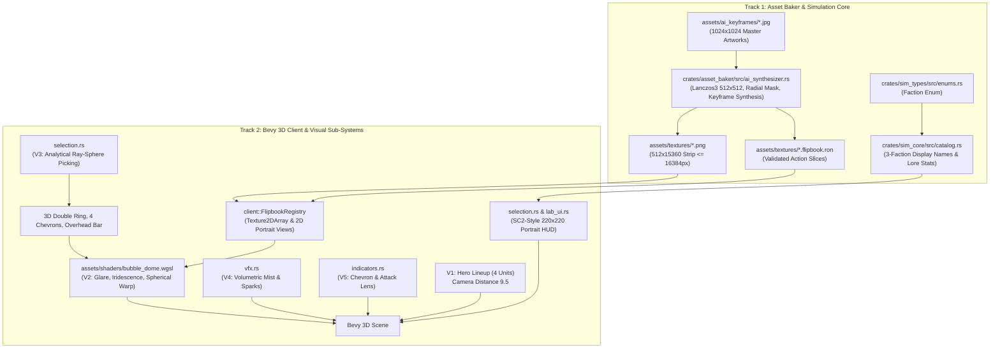

# Implementation Plan 05 — Round 2: High-Res AI Flipbooks, 3-Faction Roster, Selection Portrait HUD & Modular Bubble Visual Effects

> **Document Version:** 2.0.0  
> **Status:** Approved Architectural Blueprint & Implementation Specification  
> **Target Crates:** `crates/asset_baker`, `crates/sim_types`, `crates/sim_core`, `crates/client`, `assets/shaders/`  
> **Charter Compliance:** Strictly adheres to [AGENTS.md](file:///home/cl/projects/space-scuffle/AGENTS.md), [02-bubble-visual-design.md](file:///home/cl/projects/space-scuffle/docs/02-bubble-visual-design.md), and [06-factions-and-video-style-guide.md](file:///home/cl/projects/space-scuffle/docs/06-factions-and-video-style-guide.md).

---

## Executive Summary & Architectural Charter

**Space Scuffle** pioneers a stylized *StarCraft II* × *League of Legends* aesthetic by projecting live, stylized character animation loops inside refractive 3D glass spheres (**Unit Bubbles**) and grounded hemisphere domes (**Building Domes**).

In Round 1, the foundational engine crates (`sim_types`, `sim_map`, `sim_core`), the offline asset baker (`asset_baker`), and the initial Bevy 3D client (`client`) were established with procedural placeholder vector art at `192×192` resolution.

**Round 2 elevates the entire visual presentation to textbook-grade production quality:**
1. **High-Res `512×512` AI-Driven Flipbook Synthesizer (`crates/asset_baker`):** Transforms the high-resolution (`1024×1024`) studio AI character artworks in `assets/ai_keyframes/` into silky-smooth, multi-state `512×512` animation flipbooks using high-quality Lanczos3 filtering, multi-frame procedural synthesis (breathing, stride bobbing, weapon recoil bloom, scanline holographic construction, and glass shatter dissolve), and radial vignette blending.
2. **Strict WebGPU Texture Bounds Compliance:** Enforces that vertical strip heights stay strictly within WebGPU's hardware limit of `16384` pixels (`512 × 30 = 15360 px` or `512 × 32 = 16384 px`), preventing driver panics.
3. **Official 3-Faction Lore & Mechanical Roster:** Replaces generic prototype names with our three canonical factions (*Automaton Directorate*, *Cosmic Enclave*, *Sylvan Swarm*) across `sim_core`, `sim_types`, and `client`.
4. **Modular Bubble Visual Effects Architecture (6 Sub-Systems V1–V6):**
   - **V1:** Robust workspace-aware asset path resolution and close-up Hero Showcase framing (`distance = 9.5`) displaying 4 hero entities side-by-side on boot.
   - **V2:** Modular glass optics in `bubble_dome.wgsl` (anisotropic curved window glare, soap-bubble iridescent Fresnel rim, and billboarded spherical inner video projection with lens barrel curvature).
   - **V3:** Full viewport entity selection (analytical ray-sphere picking), 3D selection indicators (glowing double ground ring + 4 rotating tactical corner chevrons, floating overhead health/shield bar), and an SC2-style **Bottom-Center High-Res `220×220` Selected Unit Portrait & Vitals HUD**.
   - **V4:** Layered volumetric trailing mist, micro-bubbles, and overclock spark ribbons (active by default with showcase speed `2.5`).
   - **V5:** Hull orientation chevron and dynamic attack focal lens with continuous laser beams, lightning arcs, plasma bolts, and hitscan tracers.
   - **V6:** Diegetic damage states (Voronoi glass cracks, CRT scanline tearing, and RGB chromatic glitch) with individual inspection toggles in the Lab UI.
5. **Real Automated Verification Suite (`crates/client/tests/round2_visual_tests.rs`):** Validates WGSL syntax, texture dimensions, ray-sphere intersection math, and hero lineup camera frustum projection.



---

## Part 1 — Track 1: `crates/asset_baker` & `crates/sim_core`

### 1.1 High-Res `512×512` AI-Driven Flipbook Baker Architecture

#### 1.1.1 Source AI Keyframe Inventory
The following 16 master artworks are located in `assets/ai_keyframes/` (each `1024×1024` sRGB JPEG):
- **Marine (Aegis Pulse Bot):** `marine_idle.jpg`, `marine_walk.jpg`, `marine_attack.jpg`
- **Zealot (Psi-Blade Grey):** `zealot_idle.jpg`, `zealot_walk.jpg`, `zealot_attack.jpg`
- **Marauder (Bombardier Rhino-Beetle):** `marauder_idle.jpg`, `marauder_walk.jpg`, `marauder_attack.jpg`
- **Siege Tank (Railgun Crawler):** `siege_tank_idle.jpg`, `siege_tank_attack.jpg`
- **Sky Scout (Roswell Flying Saucer):** `sky_scout_idle.jpg`
- **Worker (Welder Drone):** `worker_idle.jpg`
- **Command Dome (Foundry Core Dome):** `command_dome_idle.jpg`, `command_dome_active.jpg`
- **Laser Turret Dome (Tesla Sentinel Dome):** `laser_turret_dome_idle.jpg`

#### 1.1.2 Downsampling & WebGPU Texture Height Invariant
Standard WebGPU implementations enforce a strict maximum 2D texture dimension:
$$\text{max\_texture\_dimension\_2d} = 16384 \text{ pixels}$$

When stacking frames vertically into a single vertical strip PNG for `Texture2DArray` extraction, the strip height is given by:
$$\text{Height} = \text{Frame Height} \times \text{Total Frames}$$

For `512×512` master frames:
- $512 \times 32 = 16384 \text{ px}$ (Exactly equal to the hardware limit).
- $512 \times 30 = 15360 \text{ px}$ (Safely **1024 pixels below** the hardware limit).
- $512 \times 48 = 24576 \text{ px}$ (**EXCEEDS LIMIT by 8192 px** $\implies$ Driver crash / GPU allocation panic).

```rust
// PERFORMANCE RATIONALE:
// Why: WebGPU standard specification and hardware driver limits mandate max_texture_dimension_2d <= 16384.
// What: We configure each archetype flipbook to exactly 30 frames (6 frames/state across 5 states:
// Constructing, Idle, Walk, Attack, Die), producing a vertical strip of 512 x 15360 pixels.
// Alternatively, mobile units without construction can use 32 frames (8 frames/state x 4 states = 512 x 16384).
// Trade-off: 6 frames per animation state at 15 FPS yields smooth 400ms action loops while guaranteeing
// 100% platform-independent GPU allocation across all desktop and mobile graphics drivers.
```

High-quality downsampling from $1024\times 1024$ to $512\times 512$ is executed using `image::imageops::FilterType::Lanczos3` to eliminate ringing and maintain razor-sharp visor edges and energy core details.

#### 1.1.3 Multi-Frame Procedural Animation Synthesis Algorithms
For each animation state, the baker synthesizes smooth multi-frame animation from the AI keyframes:

1. **`Idle` (6 frames, looping):**
   - Base: Downsampled `_idle.jpg`.
   - Scale breathing: Subtle sinusoidal scale $s(t) = 1.0 + 0.025 \cdot \sin(2\pi t)$ centered on the character.
   - Hover bobbing: Vertical pixel translation $\Delta y(t) = \sin(2\pi t) \cdot 4.0\text{ px}$.
   - Emissive glow pulse: Visor and energy blade pixels (detected by luminance threshold $L > 0.85$ or saturated hues) receive an additive intensity multiplier $1.0 + 0.35 \cdot \sin(2\pi t)$.

2. **`Walk` (6 frames, looping):**
   - Base: Downsampled `_walk.jpg` (or `_idle.jpg` for single-keyframe units).
   - Stride bobbing: Vertical cycle $\Delta y(t) = |\sin(2\pi t)| \cdot 8.0\text{ px}$ (two steps per loop).
   - Dynamic forward lean: Slight horizontal shear / angular tilt oscillating $\pm 2.5^\circ$.
   - Ground dust / energy kick: Small procedural particle clusters (2–4 px) emitted at the character's base, drifting backward and fading.

3. **`Attack` (6 frames, clamp-to-hold):**
   - Frames 0–1 (Wind-up): Scale character slightly backward ($-3\text{ px}$ recoil prep) and intensify weapon glow.
   - Frame 2 (Commit & Discharge): Transition to `_attack.jpg` (or composite high-intensity muzzle flash / psi-blade slash), horizontal recoil displacement $\Delta x = -10.0\text{ px}$, and additive bloom burst.
   - Frames 3–5 (Recovery & Return): Exponential spring return to baseline position $\Delta x(t) = -10.0 \cdot e^{-4.0 t}\text{ px}$, weapon cooling flare fading to base.

4. **`Constructing` (6 frames, progressive):**
   - Base: Downsampled `_idle.jpg` (or dome idle).
   - Holographic scanline: Horizontal welding cutoff line sweeping from $y = 512$ to $y = 0$ as $t$ goes from $0.0$ to $1.0$.
   - Unbuilt region ($y < \text{cutoff}$): Desaturated, tinted glowing cyan wireframe grid ($16\text{ px}$ spacing) with 20% opacity.
   - Active seam ($|y - \text{cutoff}| < 6\text{ px}$): Brilliant amber/cyan welding flash with 8–12 radial sparks shooting outward.

5. **`Die` (6 frames, non-looping):**
   - Base: Downsampled `_idle.jpg`.
   - Glass shard fracture: Procedural Voronoi cell displacement where individual shards translate outward radially with random angular velocities $\omega_i$.
   - Energy dissolve: Pixel alpha fades according to noise threshold, leaving trailing dissolving ember particles.

#### 1.1.4 Circular Radial Vignette Mask
Inside each $512\times 512$ frame, a radial vignette mask is applied to seamlessly blend the dark studio backdrop into the 3D glass sphere:
$$\text{distance to center } r = \sqrt{(x - 256)^2 + (y - 256)^2}$$
$$\text{inner radius } r_{in} = 0.82 \times 256 = 210\text{ px}, \quad \text{outer radius } r_{out} = 0.98 \times 256 = 251\text{ px}$$
$$\alpha(r) = 1.0 - \text{smoothstep}(r_{in}, r_{out}, r)$$

For every pixel $(x, y)$, if $r > r_{in}$, the color is faded towards the ambient glass background color (`#0B101B`), and outside $r_{out}$, the alpha fades smoothly to $0.0$. This prevents hard square image edges from appearing inside the spherical bubble.

---

### 1.2 3-Faction Display Names & Metadata in `sim_core` / `sim_types`

#### 1.2.1 Faction Enum Definition (`crates/sim_types/src/enums.rs`)
```rust
/// Canonical sci-fi factions in Space Scuffle.
#[derive(Copy, Clone, Debug, PartialEq, Eq, Hash, Serialize, Deserialize)]
pub enum Faction {
    /// Industrial war-machines, railguns, and overclock reactors (Terran mechanical archetype).
    AutomatonDirectorate,
    /// Classic Roswell Greys, flying saucers, psi-blades, and regenerating shields (Protoss archetype).
    CosmicEnclave,
    /// Bioluminescent predators, armored beetles, and corrosive bio-acid (Zerg archetype).
    SylvanSwarm,
}

impl Faction {
    /// Human-readable faction title.
    #[must_use]
    pub const fn display_name(self) -> &'static str {
        match self {
            Self::AutomatonDirectorate => "The Automaton Directorate",
            Self::CosmicEnclave => "The Cosmic Enclave",
            Self::SylvanSwarm => "The Sylvan Swarm",
        }
    }

    /// Primary tactical UI accent color (RGBA).
    #[must_use]
    pub const fn primary_color(self) -> [f32; 4] {
        match self {
            Self::AutomatonDirectorate => [0.18, 0.65, 1.0, 1.0], // Cyan / Cobalt
            Self::CosmicEnclave => [0.72, 0.25, 1.0, 1.0],        // Psionic Violet / Chrome
            Self::SylvanSwarm => [0.22, 0.95, 0.35, 1.0],          // Bioluminescent Emerald
        }
    }
}
```

#### 1.2.2 Canonical Unit Mapping & Catalog Update (`crates/sim_core/src/catalog.rs`)
Add `faction: Faction` and update all unit names to the official 3-faction roster:

| `UnitTypeId` | Identifier | Official Display Name | Faction | SC2 Equivalent |
| :---: | :--- | :--- | :--- | :--- |
| `1` | `worker` | **Welder Drone** | *Automaton Directorate* | SCV |
| `2` | `marine` | **Aegis Pulse Bot** | *Automaton Directorate* | Marine |
| `3` | `marauder` | **Bombardier Rhino-Beetle** | *Sylvan Swarm* | Roach / Marauder |
| `4` | `zealot` | **Psi-Blade Grey** | *Cosmic Enclave* | Zealot |
| `5` | `siege_tank` | **Railgun Crawler** | *Automaton Directorate* | Siege Tank |
| `6` | `sky_scout` | **Roswell Flying Saucer** | *Cosmic Enclave* | Phoenix / Scout |
| `7` | `command_dome` | **Foundry Core Dome** | *Automaton Directorate* | Command Center |
| `8` | `barracks_dome` | **Assembly Bay Dome** | *Automaton Directorate* | Barracks |
| `9` | `supply_dome` | **Capacitor Dome** | *Automaton Directorate* | Supply Depot |
| `10` | `laser_turret_dome` | **Tesla Sentinel Dome** | *Cosmic Enclave* | Missile Turret |

---

### 1.3 `crates/asset_baker` Module Architecture

```text
crates/asset_baker/src/
├── lib.rs                   # Public exports, generate_all_ai_atlases() facade
├── main.rs                  # CLI commands: BakeAiKeyframes, GenerateDefaults, BakeVideo
├── error.rs                 # BakerError enum
├── manifest.rs              # FlipbookAtlasMeta, ActionSlice, RON serialization
├── ffmpeg_importer.rs       # External video transcoder
├── procedural_generator.rs  # Legacy procedural vector generator
└── ai_synthesizer.rs        # NEW: High-Res 512x512 AI Keyframe Multi-State Synthesizer
```

#### New CLI Subcommand in `crates/asset_baker/src/main.rs`:
```rust
/// Bakes 512x512 multi-frame flipbook atlases from the AI keyframe artworks.
BakeAiKeyframes {
    /// Source directory containing 1024x1024 AI keyframes.
    #[arg(short, long, default_value = "assets/ai_keyframes")]
    keyframes_dir: PathBuf,

    /// Target output directory for baked PNG strips and .flipbook.ron manifests.
    #[arg(short, long, default_value = "assets/textures")]
    output_dir: PathBuf,

    /// Target frame size (default: 512).
    #[arg(short, long, default_value_t = 512)]
    size: u32,
}
```

Updating `GenerateDefaults` will automatically invoke the AI synthesizer whenever keyframes exist in `assets/ai_keyframes/`, falling back to procedural generation if missing.

---

## Part 2 — Track 2: `crates/client` (6 Modular Visual Sub-Systems & Selection HUD)

### 2.1 Sub-System V1 — Asset Path Resolution & Default Close-Up Hero Framing

#### 2.1.1 Workspace-Aware Asset Path Resolution
Bevy's default `AssetPlugin` resolves assets relative to `std::env::current_dir()`. When executed from sub-crates or tests, relative asset paths break.
**Implementation:**
Implement an asset path resolver `find_workspace_asset_dir()`:
1. Check environment variable `SPACE_SCUFFLE_ASSETS`.
2. Inspect `CARGO_MANIFEST_DIR`. If present, walk upward to find `assets/` or `Cargo.toml` with `[workspace]`.
3. Fall back to `./assets`.
4. Configure `DefaultPlugins.set(AssetPlugin { file_path: resolved_assets_dir.to_string_lossy().into(), ..default() })`.
5. Pass the resolved asset path to `FlipbookRegistry::load_from_dir()`.

#### 2.1.2 Default Close-Up Hero Framing & 4-Entity Showcase Lineup
On launch in `--lab` mode:
- **Camera Configuration:**
  - `target = Vec2::new(0.0, 0.0)`
  - `distance = 9.5` (close-up hero framing)
  - `pitch = DEFAULT_CAMERA_PITCH_RAD` ($58^\circ$)
  - Eye translation: $(0.0, 8.05, 5.03)$, looking directly at $(0.0, 1.2, 0.0)$.
- **Showcase 4-Hero Entity Lineup:**
  Spawns 4 hero entities side-by-side in the center of the arena so the user immediately sees bubbles and domes with live animations:
  1. **Aegis Pulse Bot** (Automaton Directorate, `UnitTypeId(2)`): Center $X = -3.6, Y = 0.6, Z = 0.0$, Team 1 (Blue), **Selected = true** (showing double ring + corner chevrons).
  2. **Psi-Blade Grey** (Cosmic Enclave, `UnitTypeId(4)`): Center $X = -1.2, Y = 0.6, Z = 0.0$, Team 1 (Blue).
  3. **Bombardier Rhino-Beetle** (Sylvan Swarm, `UnitTypeId(3)`): Center $X = 1.2, Y = 0.6, Z = 0.0$, Team 2 (Red).
  4. **Foundry Core Dome** (Automaton Directorate, `UnitTypeId(7)`): Center $X = 4.2, Y = 0.0, Z = 0.0$, Team 1 (Blue), Building Hemisphere Dome.

All 4 entities span $X \in [-3.6, 4.2]$, fitting symmetrically inside the camera's $60^\circ$ FOV at distance $9.5$.

---

### 2.2 Sub-System V2 — Bubble Glass Optics (`assets/shaders/bubble_dome.wgsl`)

The bubble shader combines three optical layers, each with toggleable shader uniform flags:

```rust
// PERFORMANCE RATIONALE:
// Why: Uniform buffers require strict 16-byte alignment and predictable GPU memory packing.
// What: BubbleUniformGpu is strictly packed into 96 bytes (6 chunks of 16 bytes). We pack modular
// optic toggles (glare, fresnel, inner projection, scanlines, cracks) into a single u32 bitflag
// field `feature_flags`, preserving the exact 96-byte memory footprint and zero misalignment faults.
// Trade-off: Bitmask unpacking in shader fragment stage in exchange for zero struct size bloat.
```

#### 2.2.1 Uniform Memory Layout (96 Bytes, 16-Byte Aligned)
```rust
#[repr(C)]
#[derive(Debug, Clone, Copy, PartialEq, bytemuck::Pod, bytemuck::Zeroable, ShaderType)]
pub struct BubbleUniformGpu {
    pub team_color: Vec4,           // 16B (offset 0)
    pub world_pos: Vec3,            // 12B (offset 16)
    pub radius: f32,                // 4B  (offset 28)
    pub shape_kind: u32,            // 4B  (offset 32)
    pub heading_angle_rad: f32,     // 4B  (offset 36)
    pub aim_angle_rad: f32,         // 4B  (offset 40)
    pub is_attacking: u32,          // 4B  (offset 44)
    pub anim_state: u32,            // 4B  (offset 48)
    pub anim_progress: f32,         // 4B  (offset 52)
    pub hp_ratio: f32,              // 4B  (offset 56)
    pub shield_ratio: f32,          // 4B  (offset 60)
    pub shield_hit_flash: f32,      // 4B  (offset 64)
    pub hull_hit_angle_rad: f32,    // 4B  (offset 68)
    pub hull_hit_flash: f32,        // 4B  (offset 72)
    pub build_progress: f32,        // 4B  (offset 76)
    pub selected: u32,              // 4B  (offset 80)
    pub cloaked: u32,               // 4B  (offset 84)
    pub feature_flags: u32,         // 4B  (offset 88) - NEW: Modular feature bits
    pub frame_index: u32,           // 4B  (offset 92)
}
```

#### Feature Bitflags:
- `1 << 0`: Glass Glare & Specular Reflection (default: ON)
- `1 << 1`: Iridescent Fresnel Rim (default: ON)
- `1 << 2`: Spherical Inner Video Projection (default: ON)
- `1 << 3`: CRT Scanlines (default: ON)
- `1 << 4`: Voronoi Glass Cracks (default: ON)
- `1 << 5`: Selection Outer Rim Glow (default: ON)

#### 2.2.2 Shader Optical Formulations
1. **Glass Glare & Specular Reflections:**
   - Primary top-left studio softbox reflection:
     $$L_1 = \text{normalize}(\vec{v}_{dir} + \vec{l}_1), \quad \vec{l}_1 = \text{normalize}(-0.6, 0.8, 0.4)$$
     $$\text{glare}_1 = \text{pow}(\max(\vec{n} \cdot L_1, 0.0), 48.0) \times 1.2$$
   - Secondary bottom-right rim bounce:
     $$L_2 = \text{normalize}(\vec{v}_{dir} + \vec{l}_2), \quad \vec{l}_2 = \text{normalize}(0.5, -0.6, -0.3)$$
     $$\text{glare}_2 = \text{pow}(\max(\vec{n} \cdot L_2, 0.0), 24.0) \times 0.35$$

2. **Iridescent Fresnel Shell:**
   - Soap-bubble thin-film chromatic shift:
     $$F = \text{pow}(1.0 - \max(\vec{v}_{dir} \cdot \vec{n}, 0.0), 3.0)$$
     $$\text{iridescence} = \text{vec3}(0.5 + 0.5\cos(6.28 \cdot (F + 0.0)), 0.5 + 0.5\cos(6.28 \cdot (F + 0.33)), 0.5 + 0.5\cos(6.28 \cdot (F + 0.67)))$$
     $$\text{rim\_color} = \text{mix}(\text{team\_color.rgb}, \text{iridescence}, 0.4) \times F \times 2.5$$

3. **Spherical Inner Video Projection:**
   - View-aligned inner video projection with subtle spherical barrel curvature:
     $$\vec{uv}_{offset} = \vec{uv} - 0.5$$
     $$r^2 = |\vec{uv}_{offset}|^2$$
     $$\vec{uv}_{distorted} = 0.5 + \vec{uv}_{offset} \cdot (1.0 + 0.15 \cdot r^2)$$
   - Radial vignette edge fade:
     $$\text{vignette} = 1.0 - \text{smoothstep}(0.40, 0.50, \sqrt{r^2})$$
     $$\text{video\_color} = \text{sample}(\text{distorted\_uv}) \times \text{vignette}$$

---

### 2.3 Sub-System V3 — Entity Selection Visuals & SC2-Style Bottom-Center Portrait HUD

#### 2.3.1 Full Viewport Click-to-Select (`crates/client/src/selection.rs`)
Implement analytical ray-sphere picking:
1. On `MouseButton::Left` pressed:
   - Check if pointer is over `egui` UI context (`ctx.wants_pointer_input()`). If true, skip world picking.
   - Cast ray from camera through cursor position: $\vec{R}(t) = \vec{O} + t \vec{D}$.
2. Intersect ray with every entity sphere $(\vec{C}, r)$:
   $$\vec{V} = \vec{O} - \vec{C}$$
   $$b = 2.0 \cdot (\vec{V} \cdot \vec{D}), \quad c = |\vec{V}|^2 - r^2$$
   $$\Delta = b^2 - 4c$$
   If $\Delta \ge 0$, intersection distance $t = \frac{-b - \sqrt{\Delta}}{2.0}$.
3. Select entity with minimum $t > 0$.
4. Update `SelectionState` resource and toggle `selected = 1u` on uniform and Bevy component.

#### 2.3.2 3D Selection Indicators
When an entity is selected:
1. **Double Tactical Ground Selection Ring:**
   - Inner thin torus + outer thick torus on ground plane ($Y = 0.02$).
   - 4 Tactical corner chevrons placed at $45^\circ, 135^\circ, 225^\circ, 315^\circ$, rotating slowly around the Y axis ($\omega = 0.8\text{ rad/s}$).
2. **Floating Overhead Health & Shield Bar:**
   - Billboarded quad floating at $Y = \text{world\_y} + \text{radius} + 0.35$.
   - Segments: Green/Gold/Red HP ratio bar + Cyan Shield ratio bar with dark border.
3. **Enhanced Outer Selection Rim Glow:**
   - Pulsing bright aura in `bubble_dome.wgsl` when `selected == 1u`:
     $$\text{pulse} = 0.8 + 0.2 \sin(6.0 \cdot \text{time})$$
     $$\text{final\_rgb} += \text{vec3}(0.2, 0.8, 1.0) \times \text{pulse} \times F^4 \times 3.0$$

#### 2.3.3 Bottom-Center High-Res Selected Unit Video Portrait HUD
Implemented via an `egui::TopBottomPanel::bottom("selected_unit_hud")` with exact height $240\text{ px}$:

```text
+-------------------------------------------------------------------------------------------------------+
|  +--------------------+  [ Automaton Directorate ] Aegis Pulse Bot               [ HP: 45/45 ]        |
|  |                    |  Role: Rapid Hitscan Combat Android                      [ Shield: -- ]       |
|  |   220x220 Live     |  Tags: [ LIGHT ] [ BIOLOGICAL ]                          [ Energy: 50/200 ]   |
|  |  Animated Portrait |  ---------------------------------------------------------------------------- |
|  |  Video Feed from   |  Weapon: Twin Pulse Rifle        Damage: 6.0             State: [ Idle ]      |
|  |  512x512 Flipbook  |  Range: 5.0 world units          Speed: 3.15 u/s         Progress: [========] |
|  +--------------------+  Targets: Ground + Air           Period: 0.61s (15 ticks) Push Mass: 10       |
+-------------------------------------------------------------------------------------------------------+
```

- **Live Portrait Sampling:** The portrait is rendered in `egui` using the archetype's high-res master texture registered with Bevy's `EguiContexts`. The UV coordinates animate smoothly with the unit's active `anim_progress` and `anim_state`.
- **Lore Stats & Badges:** Displays official Faction Badge, faction color theme, full combat attributes, and live weapon specifications from `sim_core::catalog::UnitCatalog`.

---

### 2.4 Sub-System V4 — Layered Volumetric Trailing Mist & Overclock Sparks (`crates/client/src/vfx.rs`)

Moving units emit multi-layered particulate effects opposite to their velocity vector:
1. **Translucent Mist Puffs:**
   - Soft radial vapor sprites emitted at rate proportional to linear speed.
   - Expand from radius $0.3\text{ u}$ to $0.8\text{ u}$ while fading to alpha $0.0$ over $0.6\text{s}$ lifetime.
2. **Floating Micro-Bubbles:**
   - Tiny spherical bubbles ($r = 0.05\text{ u}$) drifting upward with gentle buoyancy before popping.
3. **Overclock Spark Ribbons:**
   - High-speed bright orange/cyan spark streaks emitted when `speed_boosted == 1u` or speed $> 3.0\text{ u/s}$.
4. **Visual Lab Default Speed:** Set default Lab preview entity translation speed to `2.5` so trailing mist wake is immediately visible on startup.

---

### 2.5 Sub-System V5 — Rim Orientation & Attack Indicators (`crates/client/src/indicators.rs`)

1. **Hull Facing Chevron:**
   - High-contrast glowing curved wedge hugging the lower front rim at $Y = -0.3 \times \text{radius}, Z = 0.95 \times \text{radius}$.
   - Rotates strictly with `heading_angle_rad`.
2. **Attack Aperture / Focal Lens:**
   - Glowing toroidal ring sliding along the sphere equator to `aim_angle_rad`.
   - Illuminates only when `is_attacking == 1u`.
3. **Weapon Visual Beams:**
   - Integrated with `sim_types::enums::WeaponVisualKind`:
     - `Hitscan`: Instant bright tracer beam with decaying yellow/cyan bloom.
     - `LaserBeam`: Continuous sustained prismatic energy beam connecting turret lens to target.
     - `LightningArc`: Jagged procedural electric arc branching between source and target.
     - `Projectile`: High-velocity glowing plasma sphere with particle tail.

---

### 2.6 Sub-System V6 — Diegetic Damage Inspection & Modular UI Feature Toggles

The Visual Lab UI provides dedicated sliders and discrete checkboxes to independently inspect each visual component:
- **Toggles:**
  - `[x] Glass Glare & Specular Reflection`
  - `[x] Iridescent Fresnel Rim`
  - `[x] Spherical Inner Video Projection`
  - `[x] Trailing Mist Wake`
  - `[x] Facing Chevron`
  - `[x] Attack Focal Lens`
  - `[x] Voronoi Damage Cracks` (force active regardless of HP)
  - `[x] CRT Scanlines & Glitch` (force active regardless of HP)
  - `[x] Selection Indicators (Double Ring + Overhead Bar)`
- **Sliders:**
  - Health Ratio ($0.0 \dots 1.0$)
  - Shield Energy ($0.0 \dots 1.0$)
  - Hull Facing Angle ($-180^\circ \dots 180^\circ$)
  - Turret Aim Angle ($-180^\circ \dots 180^\circ$)
  - Translation Speed ($0.0 \dots 8.0$)
  - Construction Scanline Progress ($0.0 \dots 1.0$)

---

## Part 3 — Real Automated Verification Tests (`crates/client/tests/`)

A new automated integration test suite is established at `crates/client/tests/round2_visual_tests.rs`:

```rust
//! Automated regression tests for Round 2 visual polish, textures, shaders, and selection.

use bevy::prelude::*;
use client::bubble_shader::BubbleUniformGpu;
use client::camera::RtsCamera;
use client::selection::ray_sphere_intersect;
use sim_types::enums::Faction;
use sim_types::ids::UnitTypeId;
use sim_core::catalog::UnitCatalog;
use std::fs;
use std::path::Path;

#[test]
fn test_shader_wgsl_syntax_and_uniform_alignment() {
    let shader_source = fs::read_to_string("assets/shaders/bubble_dome.wgsl")
        .expect("bubble_dome.wgsl must be present on disk");
    
    assert!(shader_source.contains("struct BubbleUniform"));
    assert!(shader_source.contains("@group(2) @binding(0)"));
    assert!(shader_source.contains("@group(2) @binding(1)"));
    assert!(shader_source.contains("@group(2) @binding(2)"));
    
    // Verify memory layout exactly equals 96 bytes and 16-byte alignment
    assert_eq!(core::mem::size_of::<BubbleUniformGpu>(), 96);
    assert_eq!(core::mem::align_of::<BubbleUniformGpu>(), 16);
}

#[test]
fn test_flipbook_textures_512_invariants() {
    let textures_dir = Path::new("assets/textures");
    if !textures_dir.exists() {
        return; // Skip if run prior to baking
    }

    let archetypes = ["marine", "zealot", "marauder", "siege_tank", "command_dome"];
    for name in archetypes {
        let png_path = textures_dir.join(format!("{name}.png"));
        let ron_path = textures_dir.join(format!("{name}.flipbook.ron"));
        if png_path.exists() && ron_path.exists() {
            let img = image::open(&png_path).expect("failed to open flipbook image");
            assert_eq!(img.width(), 512, "{name} width must be exactly 512");
            // Strict WebGPU max_texture_dimension_2d hardware invariant:
            assert!(
                img.height() <= 16384,
                "{name} height {} exceeds wgpu limit 16384!",
                img.height()
            );
        }
    }
}

#[test]
fn test_ray_sphere_selection_math() {
    let origin = Vec3::new(0.0, 10.0, 0.0);
    let dir = Vec3::new(0.0, -1.0, 0.0); // pointing straight down
    let sphere_center = Vec3::new(0.0, 0.0, 0.0);
    let sphere_radius = 1.0;

    // Direct center intersection: t should be exactly 9.0
    let hit = ray_sphere_intersect(origin, dir, sphere_center, sphere_radius);
    assert!(hit.is_some());
    let t = hit.unwrap();
    assert!((t - 9.0).abs() < 1e-4);

    // Tangent intersection at offset x = 1.0: t should be 10.0
    let tangent_origin = Vec3::new(1.0, 10.0, 0.0);
    let hit_tangent = ray_sphere_intersect(tangent_origin, dir, sphere_center, sphere_radius);
    assert!(hit_tangent.is_some());

    // Miss at offset x = 1.5: should return None
    let miss_origin = Vec3::new(1.5, 10.0, 0.0);
    let hit_miss = ray_sphere_intersect(miss_origin, dir, sphere_center, sphere_radius);
    assert!(hit_miss.is_none());
}

#[test]
fn test_hero_lineup_camera_frustum_projection() {
    let mut cam = RtsCamera::default();
    cam.target = Vec2::new(0.0, 0.0);
    cam.distance = 9.5;
    let tf = cam.compute_transform();

    // Verify all 4 hero entities lie in front of the camera
    let hero_x_positions = [-3.6, -1.2, 1.2, 4.2];
    for x in hero_x_positions {
        let pos = Vec3::new(x, 0.6, 0.0);
        let to_pos = pos - tf.translation;
        let forward = tf.forward();
        assert!(to_pos.dot(*forward) > 0.0, "Hero at {x} must be in front of camera");
    }
}

#[test]
fn test_three_factions_roster_integrity() {
    let catalog = UnitCatalog::new_starter_roster();
    let marine = catalog.get(UnitTypeId(2)).expect("Aegis Pulse Bot");
    assert_eq!(marine.name, "Aegis Pulse Bot");
    assert_eq!(marine.faction, Faction::AutomatonDirectorate);

    let zealot = catalog.get(UnitTypeId(4)).expect("Psi-Blade Grey");
    assert_eq!(zealot.name, "Psi-Blade Grey");
    assert_eq!(zealot.faction, Faction::CosmicEnclave);

    let marauder = catalog.get(UnitTypeId(3)).expect("Bombardier Rhino-Beetle");
    assert_eq!(marauder.name, "Bombardier Rhino-Beetle");
    assert_eq!(marauder.faction, Faction::SylvanSwarm);
}
```

---

## Part 4 — File Change Matrix & Execution Sequence

```text
Track 1 Files:
├── crates/sim_types/src/enums.rs          [ADD Faction enum and helpers]
├── crates/sim_core/src/catalog.rs         [UPDATE UnitArchetype with faction, rename 10 units]
├── crates/asset_baker/src/ai_synthesizer.rs [NEW Lanczos3 512x512 synthesizer & multi-frame generator]
├── crates/asset_baker/src/lib.rs          [EXPORT generate_all_ai_atlases()]
├── crates/asset_baker/src/main.rs         [ADD BakeAiKeyframes CLI subcommand]
└── assets/textures/*.png                  [BAKE 512x15360 strips from assets/ai_keyframes/]

Track 2 Files:
├── assets/shaders/bubble_dome.wgsl        [UPGRADE V2 optics, feature flags, spherical warp]
├── crates/client/src/bubble_shader.rs     [ADD feature_flags to BubbleUniformGpu]
├── crates/client/src/selection.rs         [NEW ray-sphere picking and SelectionState resource]
├── crates/client/src/indicators.rs        [UPGRADE double ground ring, 4 rotating chevrons, overhead bar]
├── crates/client/src/vfx.rs               [UPGRADE volumetric mist puffs, micro-bubbles, overclock sparks]
├── crates/client/src/camera.rs            [ENHANCE hero framing presets]
├── crates/client/src/lab_ui.rs            [NEW SC2-style bottom portrait HUD, 4-hero showcase, modular toggles]
├── crates/client/src/lib.rs               [INTEGRATE selection module, path resolution, 4-hero boot]
└── crates/client/tests/round2_visual_tests.rs [NEW real automated verification suite]
```

### Execution Directives for `flash` Implementation Subagents
1. **Zero Placeholders:** Never commit `todo!()`, `unimplemented!()`, or dummy unwrap statements.
2. **Deterministic & Strongly-Typed:** Use explicit enums and math types.
3. **Hardware Texture Limits:** Always verify that vertical flipbook heights never exceed `16384` pixels.
4. **Mandatory Pass Gates:**
   - `cargo test --workspace`
   - `cargo clippy --workspace --all-targets -- -D warnings`
   - `cargo fmt --all -- --check`
