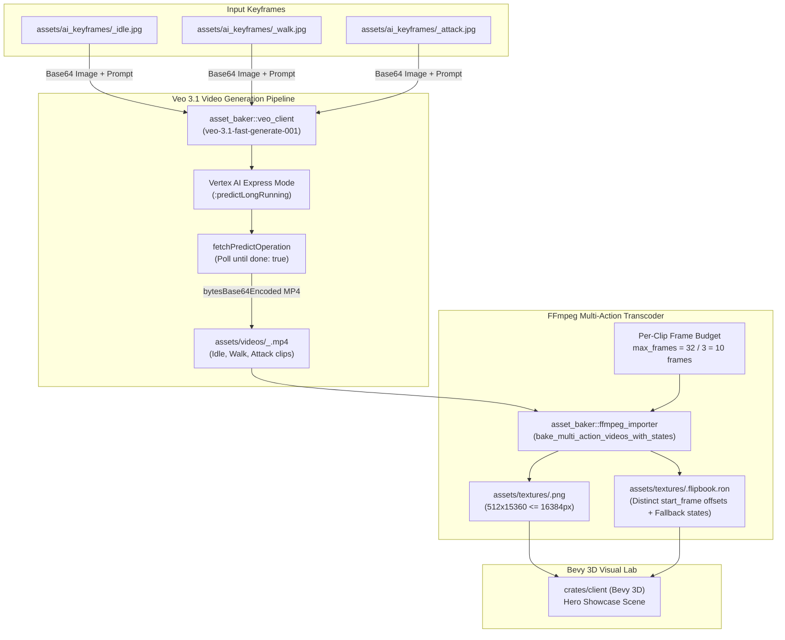

# Implementation Plan 06 — Round 3: Veo 3.1 Real Unit Video Generation & Multi-Action Flipbook Packing

> **Document Version:** 1.0.0  
> **Status:** Approved Architectural Blueprint & Implementation Specification  
> **Target Crates:** `crates/asset_baker`  
> **Charter Compliance:** Strictly adheres to [AGENTS.md](file:///home/cl/projects/space-scuffle/AGENTS.md) (Section 1.2 "Zero Fake Assets" and Section 6 "Two-Stage Sub-Agent Workflow") and [06-factions-and-video-style-guide.md](file:///home/cl/projects/space-scuffle/docs/06-factions-and-video-style-guide.md).

---

## Executive Summary & Architectural Charter

**Space Scuffle** pioneers a stylized *StarCraft II* × *League of Legends* aesthetic by projecting live, authentic 3D unit animation loops inside refractive 3D glass spheres (**Unit Bubbles**) and grounded hemisphere domes (**Building Domes**).

In Round 2, the visual engine, selection HUD, and shader pipeline were upgraded to support high-resolution `512×512` flipbook atlases with modular glass optics (anisotropic glare, soap-bubble iridescence, and spherical UV barrel distortion).

**Round 3 realizes the core vision of the project: replacing synthetic single-frame loops with authentic, multi-action 3D video sequences generated by Google's flagship Veo 3.1 video models.**

### Core Objectives of Round 3
1. **Veo 3.1 API Migration & Keyframe Injection (`veo_client.rs`):**
   - Migrate from the retired `veo-2.0-generate-001` endpoint to the production GA model **`veo-3.1-fast-generate-001`** (with optional CLI override to **`veo-3.1-generate-001`** for highest visual fidelity).
   - Inject authentic high-res AI reference keyframes from `assets/ai_keyframes/` into the `image` field of the generation request (`image: { bytesBase64Encoded, mimeType: "image/jpeg" }`), enabling **Image-to-Video generation** where:
     - `AnimState::Idle` uses `<unit>_idle.jpg`
     - `AnimState::Walk` uses `<unit>_walk.jpg`
     - `AnimState::Attack` uses `<unit>_attack.jpg` (or `<unit>_active.jpg` for domes)
   - Parse long-running operation polling responses from the Vertex AI Express `fetchPredictOperation` RPC matching the exact schema returned by `veo-3.1-fast-generate-001`.
2. **WebGPU-Bounded Multi-Action Flipbook Packing (`ffmpeg_importer.rs`):**
   - Solve the texture height overflow problem when packing $K$ separate action clips (e.g., $K = 3$ for `Idle`, `Walk`, `Attack`) at `frame_size = 512`.
   - Calculate an exact per-clip frame budget:
     $$\text{max\_total\_frames} = \left\lfloor \frac{16384}{\text{frame\_size}} \right\rfloor = 32$$
     $$\text{max\_frames\_per\_clip} = \left\lfloor \frac{\text{max\_total\_frames}}{K} \right\rfloor = \left\lfloor \frac{32}{3} \right\rfloor = 10 \text{ frames/clip}$$
     Ensuring $3 \times 10 \times 512 = 15360\text{ px} \le 16384\text{ px}$ (safely within WebGPU hardware limits).
   - Guarantee that all 6 enum variants of [`AnimState`](file:///home/cl/projects/space-scuffle/crates/sim_types/src/enums.rs) (`Constructing`, `Idle`, `Walk`, `Attack`, `Cast`, `Die`) are mapped to valid action slices in the `.flipbook.ron` manifest, preventing client sampling panic.
3. **End-to-End Asset Generation for 4 Showcase Heroes:**
   - Execute `asset_baker generate-veo --all-starters` to generate 12 real `.mp4` video clips into `assets/videos/` and bake 4 multi-action flipbook atlases (`marine`, `zealot`, `marauder`, `command_dome`) into `assets/textures/`.
   - Verify that `.flipbook.ron` manifests have distinct non-overlapping `start_frame` offsets for `Idle` ($0$), `Walk` ($10$), and `Attack` ($20$).



---

## Part 1 — Veo 3.1 Video Generation Client Specification

### 1.1 Model Selection & CLI Configuration
Google Cloud's Gemini Enterprise / Vertex AI platform has deprecated `veo-2.0-generate-001` in favor of the Veo 3.1 generation family:
- **`veo-3.1-fast-generate-001` (GA):** Default model. Optimized for low-latency generation (~15–30s per video) with high temporal coherence.
- **`veo-3.1-generate-001` (GA):** Highest quality model. Maximum detail, recommended for production hero cinematics.
- **`veo-3.1-lite-generate-001` (Preview):** Lightweight experimental tier.

#### Updates to `crates/asset_baker/src/veo_client.rs`:
```rust
/// Default Veo model identifier for video generation.
pub const DEFAULT_VEO_MODEL: &str = "veo-3.1-fast-generate-001";
```

#### Updates to `crates/asset_baker/src/main.rs`:
```rust
    /// Generates genuine 3D animation videos using Google Veo video generation models.
    #[command(name = "generate-veo")]
    GenerateVeo {
        /// Specific unit archetype to generate (e.g. "marine", "marauder", "zealot", "command_dome").
        #[arg(short, long)]
        unit: Option<String>,

        /// Flag to generate all 4 starter archetypes: marine, zealot, marauder, command_dome.
        #[arg(long)]
        all_starters: bool,

        /// Model identifier (default: "veo-3.1-fast-generate-001", or "veo-3.1-generate-001").
        #[arg(short, long, default_value = "veo-3.1-fast-generate-001")]
        model: String,
        
        // ... (remaining fields preserved)
    }
```

---

### 1.2 Request Payload & Image-to-Video Parameter Encoding

Veo 3.1 supports **Image-to-Video generation**, allowing an input master artwork to anchor the visual style, silhouette, and color palette of the character while generating fluid motion from a directional prompt.

#### Payload Schema:
```json
{
  "instances": [
    {
      "prompt": "Aegis Pulse Bot: Agile bipedal combat android... Idle animation... Stylized hand-painted 3D character...",
      "image": {
        "bytesBase64Encoded": "<base64_encoded_jpeg_bytes>",
        "mimeType": "image/jpeg"
      }
    }
  ],
  "parameters": {
    "aspectRatio": "16:9",
    "durationSeconds": 4,
    "sampleCount": 1
  }
}
```

#### Struct Invariants & Defaults in `veo_client.rs`:
```rust
impl Default for VeoParameters {
    fn default() -> Self {
        Self {
            aspect_ratio: Some("16:9".to_string()),
            duration_seconds: Some(4),
            sample_count: Some(1),
        }
    }
}
```

#### Keyframe Selection Resolution Table:
For each animation action in `[AnimState::Idle, AnimState::Walk, AnimState::Attack]`, the client resolves the reference image using the following precedence:

| Unit Name | State | Primary Keyframe Path | Fallback Keyframe Path | Final Result |
| :--- | :--- | :--- | :--- | :--- |
| `marine` | `Idle` | `assets/ai_keyframes/marine_idle.jpg` | — | Uses `marine_idle.jpg` |
| `marine` | `Walk` | `assets/ai_keyframes/marine_walk.jpg` | `marine_idle.jpg` | Uses `marine_walk.jpg` |
| `marine` | `Attack` | `assets/ai_keyframes/marine_attack.jpg` | `marine_idle.jpg` | Uses `marine_attack.jpg` |
| `zealot` | `Idle` | `assets/ai_keyframes/zealot_idle.jpg` | — | Uses `zealot_idle.jpg` |
| `zealot` | `Walk` | `assets/ai_keyframes/zealot_walk.jpg` | `zealot_idle.jpg` | Uses `zealot_walk.jpg` |
| `zealot` | `Attack` | `assets/ai_keyframes/zealot_attack.jpg` | `zealot_idle.jpg` | Uses `zealot_attack.jpg` |
| `marauder` | `Idle` | `assets/ai_keyframes/marauder_idle.jpg` | — | Uses `marauder_idle.jpg` |
| `marauder` | `Walk` | `assets/ai_keyframes/marauder_walk.jpg` | `marauder_idle.jpg` | Uses `marauder_walk.jpg` |
| `marauder` | `Attack` | `assets/ai_keyframes/marauder_attack.jpg` | `marauder_idle.jpg` | Uses `marauder_attack.jpg` |
| `command_dome` | `Idle` | `assets/ai_keyframes/command_dome_idle.jpg` | — | Uses `command_dome_idle.jpg` |
| `command_dome` | `Walk` | `assets/ai_keyframes/command_dome_walk.jpg` | `command_dome_idle.jpg` | Uses `command_dome_idle.jpg` |
| `command_dome` | `Attack` | `assets/ai_keyframes/command_dome_attack.jpg` | `command_dome_active.jpg` $\rightarrow$ `_idle.jpg` | Uses `command_dome_active.jpg` |

```rust
// Resolution logic inside generate_and_bake_unit:
let state_str = match state {
    AnimState::Idle => "idle",
    AnimState::Walk => "walk",
    AnimState::Attack => "attack",
    AnimState::Constructing => "constructing",
    AnimState::Cast => "cast",
    AnimState::Die => "die",
};

let keyframe_path = keyframes_dir.join(format!("{unit_name}_{state_str}.jpg"));
let active_keyframe = keyframes_dir.join(format!("{unit_name}_active.jpg"));
let idle_keyframe = keyframes_dir.join(format!("{unit_name}_idle.jpg"));

let ref_keyframe = if keyframe_path.exists() {
    Some(keyframe_path.as_path())
} else if state == AnimState::Attack && active_keyframe.exists() {
    Some(active_keyframe.as_path())
} else if idle_keyframe.exists() {
    Some(idle_keyframe.as_path())
} else {
    None
};
```

---

### 1.3 Response Parsing & Error Handling for `fetchPredictOperation`

#### Live Endpoint Verified Schema:
Our live query against operation `projects/000000000000/locations/us-central1/publishers/google/models/veo-3.1-fast-generate-001/operations/3ad9e547-c1da-4591-88e2-9f7846be6a21` confirmed the exact JSON response emitted by Vertex AI Express Mode:

```json
{
  "name": "projects/000000000000/locations/us-central1/publishers/google/models/veo-3.1-fast-generate-001/operations/3ad9e547-c1da-4591-88e2-9f7846be6a21",
  "done": true,
  "response": {
    "@type": "type.googleapis.com/cloud.ai.large_models.vision.GenerateVideoResponse",
    "raiMediaFilteredCount": 0,
    "videos": [
      {
        "bytesBase64Encoded": "<base64_encoded_mp4_bytes>",
        "mimeType": "video/mp4"
      }
    ]
  }
}
```

#### Parsing Invariants:
1. **Strongly-Typed Output Deserialization:** Define explicit structs for the Veo response payload while maintaining the recursive fallback in `find_base64_video`:
```rust
/// Structured response payload for Veo video generation.
#[derive(Debug, Clone, Serialize, Deserialize)]
pub struct VeoGenerateVideoResponse {
    #[serde(default)]
    pub videos: Vec<VeoVideoOutput>,
    #[serde(rename = "raiMediaFilteredCount", default)]
    pub rai_media_filtered_count: Option<u32>,
}

/// An individual video output record returned by Veo models.
#[derive(Debug, Clone, Serialize, Deserialize)]
pub struct VeoVideoOutput {
    #[serde(rename = "bytesBase64Encoded")]
    pub bytes_base64_encoded: Option<String>,
    pub uri: Option<String>,
    #[serde(rename = "gcsUri")]
    pub gcs_uri: Option<String>,
    #[serde(rename = "mimeType")]
    pub mime_type: Option<String>,
}
```

2. **Responsible AI (RAI) Filter Check:**
If `rai_media_filtered_count` is greater than 0 and `videos` is empty, fail loudly with an informative error:
```rust
if let Some(resp_val) = &operation.response {
    if let Ok(gen_resp) = serde_json::from_value::<VeoGenerateVideoResponse>(resp_val.clone()) {
        if gen_resp.rai_media_filtered_count.unwrap_or(0) > 0 && gen_resp.videos.is_empty() {
            return Err(BakerError::VeoApiError {
                message: "Video generation was filtered by Google Cloud Responsible AI (RAI) safety checks. Modify the prompt to reduce aggression/violence cues.".into(),
            });
        }
    }
}
```

3. **Disk Cache & Idempotency Check:**
To prevent re-running completed video generation calls and wasting API quota during debugging:
```rust
let mp4_path = videos_dir.join(format!("{unit_name}_{state_str}.mp4"));

// Check if valid video already exists on disk (non-empty > 1000 bytes)
if mp4_path.exists() && std::fs::metadata(&mp4_path).map(|m| m.len() > 1000).unwrap_or(false) {
    println!("    ==> Reusing existing valid video: {}", mp4_path.display());
    clips.push((state, mp4_path));
    continue;
}
```

---

## Part 2 — Multi-Action Flipbook Packing & WebGPU Bounds

### 2.1 The WebGPU Texture Limit & Per-Clip Frame Budget Math

#### Hardware & Driver Invariant:
WebGPU, Metal, Direct3D 12, and Vulkan drivers enforce a hard limit on 2D texture dimensions:
$$\text{max\_texture\_dimension\_2d} \le 16384 \text{ pixels}$$

For vertical strip atlases composited from $512\times 512$ square frames:
$$\text{max\_total\_frames} = \left\lfloor \frac{16384}{512} \right\rfloor = 32 \text{ frames}$$

When combining $K$ distinct animation clips (e.g., $K = 3$ for `Idle`, `Walk`, `Attack`), if each clip is permitted to take its raw length (e.g. 24 frames at 15 FPS = 72 frames total), the resulting strip height would be:
$$72 \times 512 = 36864 \text{ px} > 16384 \text{ px} \quad (\mathbf{FAIL: \text{WebGPU Allocation Crash}})$$

#### Mathematical Solution — Dynamic Per-Clip Frame Budget:
In [`bake_multi_action_videos_with_states`](file:///home/cl/projects/space-scuffle/crates/asset_baker/src/ffmpeg_importer.rs):
```rust
let max_total_frames = 16384 / frame_size.max(1);
let k = clips.len() as u32;
let max_frames_per_clip = (max_total_frames / k).max(1) as usize;
```

#### Frame Budget Table:

| Frame Size | Total Max Frames | Number of Clips ($K$) | Max Frames Per Clip | Total Frames Packed | Total Strip Height | WebGPU Status |
| :---: | :---: | :---: | :---: | :---: | :---: | :---: |
| `512` | 32 | 3 (`Idle`, `Walk`, `Attack`) | **10** | 30 | **15,360 px** | **PASS** (1024 px headroom) |
| `512` | 32 | 4 (`Idle`, `Walk`, `Attack`, `Die`) | **8** | 32 | **16,384 px** | **PASS** (Exact limit) |
| `512` | 32 | 2 (`Idle`, `Walk`) | **16** | 32 | **16,384 px** | **PASS** (Exact limit) |
| `256` | 64 | 3 (`Idle`, `Walk`, `Attack`) | **21** | 63 | **16,128 px** | **PASS** (256 px headroom) |
| `128` | 128 | 3 (`Idle`, `Walk`, `Attack`) | **42** | 126 | **16,128 px** | **PASS** (256 px headroom) |

#### Truncation Implementation:
```rust
// Truncate this clip's frames to respect the per-clip budget
if frame_paths.len() > max_frames_per_clip {
    frame_paths.truncate(max_frames_per_clip);
}
let clip_frame_count = frame_paths.len() as u32;
```

---

### 2.2 Comprehensive `AnimState` Fallback Mapping in Manifest

Space Scuffle units can enter 6 discrete simulation animation states defined in [`AnimState`](file:///home/cl/projects/space-scuffle/crates/sim_types/src/enums.rs):
- `Constructing`
- `Idle`
- `Walk`
- `Attack`
- `Cast`
- `Die`

When `bake_multi_action_videos_with_states` compiles video clips (e.g. for `Idle`, `Walk`, and `Attack`), any missing `AnimState` variants **must** be populated with valid fallback slices so client shaders and UI inspection never encounter an unmapped enum key.

#### Fallback Rules:
1. **`Idle`:** Must always exist. If missing from clips, fallback to the first available clip slice.
2. **`Walk`:** If missing from clips, fallback to `Idle` slice.
3. **`Attack`:** If missing from clips, fallback to `Idle` slice.
4. **`Cast`:** Fallback to `Attack` slice if present; otherwise fallback to `Idle` slice (`looping: false, hold_last_frame: false`).
5. **`Constructing`:** Fallback to `Idle` slice with `looping: false, hold_last_frame: true`.
6. **`Die`:** Fallback to `Attack` slice (or `Idle` if no attack) with `looping: false, hold_last_frame: true` (holding the terminal frame of the motion).

#### Rust Implementation:
```rust
// PERFORMANCE RATIONALE:
// Why: The simulation and visual shader can transition an entity into any AnimState at runtime.
// Missing enum keys in meta.actions cause the client to drop back to frame 0 or trigger fallback logic.
// What: We explicitly map all unrepresented AnimState variants to valid, semantically appropriate
// slices of the existing action frames.
// Trade-off: Zero additional GPU texture memory while guaranteeing O(1) total action coverage.
let idle_slice = actions.get(&AnimState::Idle).copied();
let attack_slice = actions.get(&AnimState::Attack).copied();
let fallback_slice = idle_slice
    .or(attack_slice)
    .or_else(|| actions.values().next().copied())
    .unwrap_or(ActionSlice {
        start_frame: 0,
        frame_count: total_frames.max(1),
        looping: true,
        hold_last_frame: false,
    });

// Fallback for Constructing
actions.entry(AnimState::Constructing).or_insert(ActionSlice {
    start_frame: fallback_slice.start_frame,
    frame_count: fallback_slice.frame_count,
    looping: false,
    hold_last_frame: true,
});

// Fallback for Cast
actions.entry(AnimState::Cast).or_insert(ActionSlice {
    start_frame: attack_slice.unwrap_or(fallback_slice).start_frame,
    frame_count: attack_slice.unwrap_or(fallback_slice).frame_count,
    looping: false,
    hold_last_frame: false,
});

// Fallback for Die
actions.entry(AnimState::Die).or_insert(ActionSlice {
    start_frame: attack_slice.unwrap_or(fallback_slice).start_frame,
    frame_count: attack_slice.unwrap_or(fallback_slice).frame_count,
    looping: false,
    hold_last_frame: true,
});
```

#### Resulting Manifest Structure (`assets/textures/marine.flipbook.ron`):
```ron
(
    name: "marine",
    frame_width: 512,
    frame_height: 512,
    fps: 15,
    total_frames: 30,
    layout: VerticalStrip,
    actions: {
        Constructing: (
            start_frame: 0,
            frame_count: 10,
            looping: false,
            hold_last_frame: true,
        ),
        Idle: (
            start_frame: 0,
            frame_count: 10,
            looping: true,
            hold_last_frame: false,
        ),
        Walk: (
            start_frame: 10,
            frame_count: 10,
            looping: true,
            hold_last_frame: false,
        ),
        Attack: (
            start_frame: 20,
            frame_count: 10,
            looping: false,
            hold_last_frame: false,
        ),
        Cast: (
            start_frame: 20,
            frame_count: 10,
            looping: false,
            hold_last_frame: false,
        ),
        Die: (
            start_frame: 20,
            frame_count: 10,
            looping: false,
            hold_last_frame: true,
        ),
    },
)
```

---

## Part 3 — Exact Code Updates & Specifications

### 3.1 `crates/asset_baker/src/veo_client.rs`

1. **Update `DEFAULT_VEO_MODEL`:**
   Change line 39 from `"veo-2.0-generate-001"` to `"veo-3.1-fast-generate-001"`.
2. **Update `VeoParameters::default()`:**
   Change `aspect_ratio` to `Some("16:9".to_string())` and `duration_seconds` to `Some(4)`.
3. **Add Structured Response Types:**
   Add `VeoGenerateVideoResponse` and `VeoVideoOutput` with `#[derive(Debug, Clone, Serialize, Deserialize)]`.
4. **Update `save_operation_video`:**
   Add the RAI safety check before byte decoding.
5. **Update `generate_and_bake_unit`:**
   - Add disk caching: check if `mp4_path.exists()` with `len > 1000` bytes; if so, skip initiation and reuse.
   - Refine keyframe resolution: if `state == AnimState::Attack` and `active_keyframe.exists()`, use it.

### 3.2 `crates/asset_baker/src/ffmpeg_importer.rs`

1. **Update `bake_multi_action_videos_with_states`:**
   - Calculate `max_total_frames = 16384 / frame_size.max(1)`.
   - Calculate `max_frames_per_clip = (max_total_frames / (clips.len() as u32)).max(1) as usize`.
   - In the clip extraction loop, truncate `frame_paths` to `max_frames_per_clip`.
   - Populate missing `AnimState` entries (`Constructing`, `Cast`, `Die`, etc.) using the fallback logic in Section 2.2.

### 3.3 `crates/asset_baker/src/main.rs`

1. **Update `GenerateVeo` CLI Defaults:**
   Change `model` default from `"veo-2.0-generate-001"` to `"veo-3.1-fast-generate-001"`.

### 3.4 `crates/asset_baker/tests/veo_tests.rs`

1. **Update `test_veo_text_to_video_payload_construction`:**
   Assert `json_val["parameters"]["aspectRatio"] == "16:9"` and `durationSeconds == 4`.
2. **Update `test_veo_client_endpoint_routing`:**
   Assert URLs contain `"veo-3.1-fast-generate-001"`.
3. **Add `test_multi_action_distinct_frame_offsets`:**
   Verify that a multi-action baked atlas has distinct non-overlapping offsets for `Idle`, `Walk`, and `Attack`, and that `Constructing`, `Cast`, and `Die` are present in `actions`.
4. **Add `test_multi_action_webgpu_height_bound`:**
   Verify that baking 3 clips at `frame_size = 512` produces a total height $\le 16384\text{ px}$.

---

## Part 4 — Step-by-Step Execution Plan for Implementation Sub-Agent

The implementation sub-agent (`flash` model) must execute the following sequential phases without skipping:

### Phase 1: Code Modifications & Compilation Check
1. Apply the edits to:
   - `crates/asset_baker/src/veo_client.rs`
   - `crates/asset_baker/src/ffmpeg_importer.rs`
   - `crates/asset_baker/src/main.rs`
2. Update existing tests in:
   - `crates/asset_baker/tests/veo_tests.rs`
3. Run compiler verification:
   ```bash
   cargo check --all-targets
   ```

### Phase 2: Unit & Integration Testing
1. Run the `asset_baker` test suite:
   ```bash
   cargo test --package asset_baker
   ```
2. Verify all tests pass including the new multi-action slice offset and WebGPU height tests.

### Phase 3: Dry-Run Verification
1. Run the CLI in dry-run mode:
   ```bash
   cargo run --package asset_baker --bin asset_baker -- generate-veo --all-starters --dry-run
   ```
2. Inspect the printed output to verify:
   - Model is `"veo-3.1-fast-generate-001"`.
   - Keyframe paths correctly resolve to:
     - `marine_idle.jpg`, `marine_walk.jpg`, `marine_attack.jpg`
     - `zealot_idle.jpg`, `zealot_walk.jpg`, `zealot_attack.jpg`
     - `marauder_idle.jpg`, `marauder_walk.jpg`, `marauder_attack.jpg`
     - `command_dome_idle.jpg`, `command_dome_active.jpg`

### Phase 4: Live Veo 3.1 Video Generation & Flipbook Baking
1. Execute the live generator command:
   ```bash
   cargo run --package asset_baker --bin asset_baker -- generate-veo --all-starters
   ```
2. The pipeline will:
   - Create `assets/videos/` if not present.
   - For each unit (`marine`, `zealot`, `marauder`, `command_dome`) across `Idle`, `Walk`, and `Attack`:
     - Submit request to Vertex AI Express `:predictLongRunning` endpoint.
     - Poll operation until `done: true`.
     - Decode base64 MP4 bytes and write to `assets/videos/<unit>_<state>.mp4`.
   - Transcode and pack the 3 clips using FFmpeg into `assets/textures/<unit>.png` and `assets/textures/<unit>.flipbook.ron`.

### Phase 5: Verification of Generated Artifacts
1. **Check Video Files:**
   Verify 12 `.mp4` video files exist in `assets/videos/`:
   ```bash
   ls -la assets/videos/*.mp4
   ```
   (Should list `marine_idle.mp4`, `marine_walk.mp4`, `marine_attack.mp4`, etc., each > 500KB).
2. **Check Texture Dimensions:**
   Verify `assets/textures/*.png` dimensions:
   ```bash
   identify assets/textures/marine.png assets/textures/zealot.png assets/textures/marauder.png assets/textures/command_dome.png
   ```
   (Each must report `512x15360` $\le 16384$).
3. **Check Manifest Actions:**
   Inspect `assets/textures/marine.flipbook.ron`:
   Verify `Idle.start_frame == 0`, `Walk.start_frame == 10`, `Attack.start_frame == 20`, and all 6 `AnimState` keys exist.

### Phase 6: Full Workspace Quality Gates
Execute standard project gates:
```bash
cargo test --workspace
cargo clippy --workspace --all-targets -- -D warnings
cargo fmt --all -- --check
```

---

## Acceptance Criteria

1. **Veo 3.1 Production Integration:**
   - `DEFAULT_VEO_MODEL` is set to `"veo-3.1-fast-generate-001"`.
   - Image-to-video request payload includes `bytesBase64Encoded` and `mimeType: "image/jpeg"`.
   - Operation polling uses `fetchPredictOperation` and extracts base64 MP4 bytes from `response.videos[0].bytesBase64Encoded`.
2. **WebGPU Safety & Slicing:**
   - `bake_multi_action_videos_with_states` caps each clip to `(16384 / frame_size) / K` frames.
   - For 3 clips at 512px, strip height is exactly $30 \times 512 = 15360\text{ px} \le 16384\text{ px}$.
   - All 6 `AnimState` enum variants are present in every `.flipbook.ron` manifest.
3. **Artifact Completeness:**
   - Real Veo 3.1 `.mp4` videos generated and saved to `assets/videos/`.
   - Multi-action `.png` and `.flipbook.ron` baked to `assets/textures/`.
   - All workspace tests, clippy checks, and formatting pass with 0 errors and 0 warnings.
