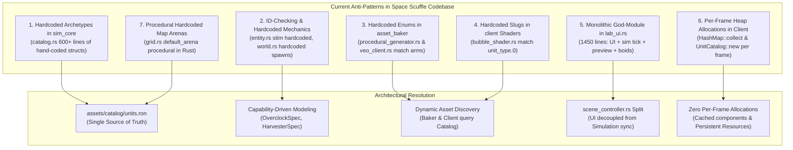

# Implementation Plan 08 — Data-Driven Unit Catalog & System Responsibility Charter

> **Document Version:** 2.0.0  
> **Status:** Approved Architectural Blueprint & Implementation Specification  
> **Target Crates & Paths:** `assets/catalog/units.ron`, `assets/`, `sim_types`, `sim_map`, `sim_core`, `asset_baker`, `client`, `AGENTS.md`  
> **Charter Compliance:** Strictly adheres to [AGENTS.md](file:///home/cl/projects/space-scuffle/AGENTS.md) Section 1 (Zero Placeholders & Silent Failures), Section 2 (Architecture Documentation & Pedagogical Quality), Section 3 (Strict Determinism & Separation of Concerns), Section 3.3 (Data-Driven Game Catalog & Zero Hardcoded Creatures), Section 4 (Testing Standards), and Section 6 (Mandatory Two-Stage Sub-Agent Workflow).

---

## 1. Executive Summary & User Directive

### 1.1 The User's Core Insight
> *"Having these names rhino_beetle,... in our code doesn't seem like good practice. We should be able to create new creatures without needing to compile the code. Please take a step back and think about this.*  
> *Please also take a step back and look at the gaming code. We don't need to introduce patterns where they are not necessary, but we should have a general concept of where which functionality lays. (Needing recompilation for units really wasn't best practice; I want you to take a look and see if there are already other antipatterns in our code)."*

During earlier iterations, units were hardcoded directly in Rust source files across three separate crates:
- `sim_core/src/catalog.rs` hand-constructed all 10 unit archetypes in Rust functions (`worker()`, `marine()`, `marauder()`, etc.).
- `asset_baker/src/procedural_generator.rs` and `veo_client.rs` had hardcoded enums (`UnitArchetype::Marine`, `DomeArchetype::CommandDome`) and prompt dictionaries.
- `client/src/bubble_shader.rs` and `lab_ui.rs` had hardcoded ID-to-slug mappings and arrays of unit types.

A previous draft plan (`08-plan-native-faction-unit-naming.md`) attempted to "fix" the legacy StarCraft II names simply by replacing them with hardcoded Rust constants (`UNIT_RHINO_BEETLE`, `RhinoBeetle`). As the user correctly recognized, **hardcoding creature names in compiled Rust code is fundamentally an anti-pattern**.

In a production-grade RTS engine, game entities (creatures, buildings, weapons, vitals, lore, and media generation prompts) must be **declarative game data**, not compiled code. Adding a new biological predator, a robotic siege walker, or an alien scout should require **zero modifications to Rust code and zero recompilation**.

### 1.2 Core Architectural Principles Established by This Plan
1. **Declarative Game Data (`assets/catalog/units.ron`):** All 10 starter units, and any future units or mods, are defined in a single human-readable RON file. The simulation and the client deserialize this data at startup.
2. **Capability-Driven Simulation (Not ID-Driven):** The simulation engine executes behaviors based on data-driven capabilities (`overclock: Option<OverclockSpec>`, `harvester: Option<HarvesterSpec>`, `is_detector: bool`), never by checking specific `UnitTypeId`s or string names.
3. **Pragmatic Separation of Concerns:**
   - `sim_types`: Pure mathematical types, opaque newtype IDs, and generic mechanical enums.
   - `sim_map`: Terrain, elevation, FoW, and spatial clearance pathfinding.
   - `sim_core`: Deterministic lockstep state and capability execution.
   - `asset_baker`: Standalone offline tool that queries `units.ron` for prompt metadata and generates atlases.
   - `client`: Bevy 3D renderer and egui UI, dynamically resolving textures from the catalog with zero per-frame allocations.
4. **100% Determinism & Checksum Invariance:** Deserialized fixed-point values (`SimScalar`, `SimAngle`) produce bit-for-bit identical results across all platforms, preserving lockstep validation.

---

## 2. Comprehensive Codebase Audit: Anti-Patterns & Misplaced Responsibilities

A thorough inspection across all 5 workspace crates reveals seven distinct anti-patterns currently present in the codebase.



### 2.1 Anti-Pattern 1: Hardcoded Unit & Structure Archetypes in Rust Code (`sim_core/src/catalog.rs`)
- **Current State:** `sim_core/src/catalog.rs` defines `worker()`, `marine()`, `marauder()`, `zealot()`, `siege_tank()`, `sky_scout()`, `command_dome()`, `barracks_dome()`, `supply_dome()`, and `laser_turret_dome()` as static Rust functions totaling 600+ lines of hardcoded numbers.
- **Why It's an Anti-Pattern:**
  - Changing a unit's attack range, movement speed, or health requires editing Rust code and recompiling `sim_core`, `client`, and integration test suites.
  - Modders, designers, and AI agents cannot balance or add creatures dynamically.
  - `UnitArchetype`, `WeaponSpec`, and `SplashSpec` do not implement `Serialize` and `Deserialize`.
- **Target Resolution:** Derive `Serialize, Deserialize` on all archetype types and deserialize `UnitCatalog` directly from `assets/catalog/units.ron`. Maintain an embedded compile-time fallback string for headless tests so unit tests do not require runtime disk lookups.

### 2.2 Anti-Pattern 2: Hardcoded Unit Identifiers & Missing Capability System (`sim_core/src/entity.rs`, `world.rs`)
- **Current State:**
  - In `entity.rs` (lines 243-285), `UnitOrder::UseStim` calls `self.apply_stimpack()` unconditionally on any unit where `hp > 10`. It hardcodes 10 HP damage, 250 ticks duration, 1.5x speed, and 1.5x attack rate. A siege tank or building dome receiving `UseStim` would execute this logic.
  - In `world.rs` (lines 171-200), `SimWorld::new_default_battle_sandbox()` hardcodes unit IDs: `UnitTypeId(2)` (Marine), `UnitTypeId(3)` (Marauder), `UnitTypeId(4)` (Zealot), `UnitTypeId(5)` (SiegeTank), `UnitTypeId(7)` (CommandDome), etc.
- **Why It's an Anti-Pattern:**
  - Behavior is not bound to unit attributes or capabilities; it assumes specific unit semantics exist implicitly.
  - New creatures cannot opt into or out of overclocking, harvesting, or specialized weapon modes without modifying simulation code.
- **Target Resolution:**
  - Introduce explicit capability fields on `UnitArchetype`:
    ```rust
    pub overclock: Option<OverclockSpec>,
    pub harvester: Option<HarvesterSpec>,
    pub is_resource_dropoff: bool,
    ```
  - When an entity receives `UnitOrder::UseStim`, the simulation checks whether `archetype.overclock` is present, applying the specific costs and multipliers defined in data.
  - In `world.rs`, sandbox army generation resolves units by canonical slug (`catalog.get_by_slug("pulse_bot")`) rather than hardcoded numeric constants.

### 2.3 Anti-Pattern 3: Hardcoded Enums & Match Arms in Asset Pipeline (`asset_baker/src/procedural_generator.rs`, `veo_client.rs`)
- **Current State:**
  - `procedural_generator.rs` lines 49-75 defines `enum UnitArchetype { Marine, Marauder, Zealot, SiegeTank, SkyScout, Worker }` and `enum DomeArchetype { CommandDome, ... }`, backed by a static slice `VALID_ARCHETYPES`.
  - `veo_client.rs` lines 631-640 has a hardcoded `match unit_name` returning prompt descriptions for `"marine"`, `"marauder"`, etc.
- **Why It's an Anti-Pattern:**
  - Running `cargo run -p asset_baker -- generate-unit --name rhino_beetle` fails immediately with `BakerError::UnknownArchetype`.
  - Media generation prompts for Veo 3.1 are hardcoded in Rust source code rather than residing alongside the unit data.
- **Target Resolution:**
  - Store Veo prompts in `assets/catalog/units.ron` under each unit definition (`veo_prompts: { Idle: "...", Walk: "...", Attack: "..." }`).
  - `veo_client.rs` reads the prompt directly from `UnitCatalog`.
  - `procedural_generator.rs` generates flipbooks based on generic archetype parameters (`ShapeKind`, `SilhouetteClass`, `Faction`, and palette colors), accepting any slug.

### 2.4 Anti-Pattern 4: Hardcoded Slugs & ID Mappings in Shader / Texture Pipeline (`client/src/bubble_shader.rs`)
- **Current State:**
  - In `bubble_shader.rs` (lines 255-267):
    ```rust
    pub fn unit_type_name(unit_type: UnitTypeId) -> &'static str {
        match unit_type.0 {
            1 => "worker",
            3 => "marauder",
            4 => "zealot",
            5 => "siege_tank",
            6 => "sky_scout",
            7 => "command_dome",
            8 => "barracks_dome",
            9 => "supply_dome",
            10 => "laser_turret_dome",
            _ => "marine",
        }
    }
    ```
  - In `setup_bubble_assets_system` (lines 342-354): A hardcoded array `let archetypes = ["marine", "marauder", ...];`.
- **Why It's an Anti-Pattern:**
  - The client cannot render any new unit without adding a match arm to `bubble_shader.rs` and adding its string to the array.
  - It duplicates knowledge that belongs strictly in the catalog.
- **Target Resolution:**
  - `FlipbookRegistry` loads `UnitCatalog` as a startup resource.
  - `setup_bubble_assets_system` iterates over all archetypes registered in `UnitCatalog`, dynamically loading `assets/textures/{slug}.png` and `assets/textures/{slug}.flipbook.ron`.
  - `FlipbookRegistry::get_meta(unit_type)` resolves the slug via `catalog.get(unit_type).map(|a| a.slug.as_str())`.

### 2.5 Anti-Pattern 5: Monolithic God-Module in Client (`client/src/lab_ui.rs`)
- **Current State:**
  - `lab_ui.rs` is 1450 lines long.
  - It conflates four distinct responsibilities:
    1. egui HUD & panel rendering (`lab_ui_system`, `render_selected_unit_hud`).
    2. Simulation stepping & snapshot forwarding (`sync_live_battle_system`).
    3. Synthetic 4-hero preview scene generation (`sync_lab_preview_system`).
    4. 200-unit boids swarm stress test simulation (`sync_swarm_stress_system`).
  - Inside `render_selected_unit_hud` (line 554), it executes:
    `let catalog = UnitCatalog::new_starter_roster();`
    **Allocating a brand new catalog and 10 archetypes on the heap every single frame (60 times a second)!**
  - Lines 837-877 hardcode `hero_configs` with hardcoded unit names and coordinates.
- **Why It's an Anti-Pattern:**
  - Violates the Single Responsibility Principle and architectural modularity.
  - Allocating heap memory inside an egui render callback introduces CPU cache churn and GC-like memory pressure.
  - Visual Lab showcase entities are hardcoded in Rust instead of flagged in data.
- **Target Resolution:**
  - Split `lab_ui.rs`:
    - `client/src/scene_controller.rs`: Handles simulation stepping, preview entity spawning, and swarm stress generation.
    - `client/src/lab_ui.rs`: Pure egui UI rendering, consuming `Res<UnitCatalog>` and `Res<SelectionState>`.
  - Mark showcase units in data (`showcase_hero: bool`, `showcase_order: Option<u8>`). The showcase scene queries the catalog dynamically.

### 2.6 Anti-Pattern 6: Per-Frame Heap Allocations in ECS State Sync (`client/src/lab_ui.rs::sync_live_battle_system`)
- **Current State:**
  - In `sync_live_battle_system` (lines 1266-1272):
    ```rust
    let mut existing_entities: std::collections::HashMap<EntityId, (Entity, Handle<BubbleDomeMaterial>)> = 
        query.iter().map(|(e, b, m)| (b.entity_id, (e, m.0.clone()))).collect();
    ```
  - This allocates a `HashMap` on the heap 60 times every second.
  - At line 1290, `commands.entity(e).insert(...)` queues structural archetype updates and clones `instance` every frame even when entities are merely moving.
- **Why It's an Anti-Pattern:**
  - Real-time 60 FPS rendering should have near-zero heap allocations during steady-state ticks.
  - Queuing Bevy `insert` commands every frame triggers structural ECS archetype moves and command-queue overhead.
- **Target Resolution:**
  - Maintain Bevy entity mapping in a persistent Bevy `Resource` (`EntityRenderMap(BTreeMap<EntityId, Entity>)`) or query directly with mutable Bevy components (`&mut Transform`, `&mut BubbleInstance`).
  - Mutate components in place rather than re-inserting them via `commands.entity(e).insert(...)`.

### 2.7 Anti-Pattern 7: Procedural Hardcoded Map Arenas in Rust (`sim_map/src/grid.rs`)
- **Current State:** `GameMap::default_arena()` proceduralizes a 64x64 arena in nested Rust `for` loops with hardcoded coordinates (`30..34` for ramps, `TerrainKind::Grass`, etc.).
- **Why It's an Anti-Pattern:** Even though `sim_map::loader` supports `.scmap.ron` and Tiled `.tmj`, the default battle arena is locked into compiled Rust code.
- **Target Resolution:** Export the default arena into `assets/maps/default_arena.scmap.ron`. `GameMap::default_arena()` loads or falls back to this definition.

---

## 3. Pragmatic Crate Responsibility Charter (Where Functionality Belongs)

To ensure long-term architectural integrity, we define the strict domain of responsibility for each workspace crate and game data layer:

| Layer / Crate | Primary Responsibility | What It Owns | What It Must NEVER Contain |
| :--- | :--- | :--- | :--- |
| **`assets/catalog/units.ron`**<br/>*(Declarative Game Data)* | Single Source of Truth for game content and unit balancing. | Creature & building slugs, display names, factions, lore text, vitals, weapon specs, capabilities, showcase hero flags, and Veo 3.1 generation prompts. | Compiled code, executable logic, engine hooks. |
| **`crates/sim_types`**<br/>*(Foundational Math & Types)* | Pure deterministic mathematics and opaque IDs. | `SimScalar`, `SimVec2`, `SimAngle`, `EntityId`, `UnitTypeId(pub u16)`, `Tick`, `Faction`, `ShapeKind`, `SilhouetteClass`, `AnimState`, `WeaponVisualKind`, `RenderSnapshot`. | Creature-specific constants (e.g. `UNIT_RHINO_BEETLE`), asset paths, rendering libraries (`bevy`, `wgpu`), or game balance data. |
| **`crates/sim_map`**<br/>*(Terrain, Fog & Pathfinding)* | Spatial environment, height queries, line-of-sight, and clearance routing. | Grid cells, cliff/ramp elevation, high-ground vision occlusion, watchtowers, resource nodes, clearance `A*`, Funnel path smoothing, `.scmap.ron` / `.tmj` loaders. | Hardcoded unit combat stats, unit archetypes, Bevy ECS components. |
| **`crates/sim_core`**<br/>*(Deterministic Simulation)* | Authoritative lockstep simulation rules and state. | `UnitCatalog` (deserialized from RON), lockstep tick loop, SC2 weapon timing state machines, independent turret tracking, push priority steering, and `RenderSnapshot` generation. | Hardcoded unit IDs, hardcoded creature spawn lists, Bevy/GPU dependencies, system clock access, non-deterministic collections. |
| **`crates/asset_baker`**<br/>*(Offline Asset Pipeline CLI)* | Generative video and flipbook atlas generation. | Veo 3.1 API client, ffmpeg video importer, sprite sheet stitching, `.flipbook.ron` manifest generator, procedural fallback textures. | Hardcoded creature enums, hardcoded prompt strings in Rust. Must query `units.ron` dynamically. |
| **`crates/client`**<br/>*(Visual Frontend & Visual Lab)* | Real-time 3D rendering, shaders, HUD, and inspector panels. | `BubbleDomeMaterial` WGSL pipeline, dynamic flipbook texture array caching, camera controllers, selection raycasting, `scene_controller.rs`, and egui `lab_ui.rs`. | Game balance logic, authoritative state simulation, hardcoded archetype mappings, per-frame heap allocations. |

---

## 4. Complete Step-by-Step Implementation Specification

### Step 1: The Declarative Data Schema (`assets/catalog/units.ron`)

A new directory `assets/catalog/` will be created with `units.ron` containing the canonical specifications for all 10 starter archetypes using native Space Scuffle slugs.

#### Data Schema Definition
```ron
// assets/catalog/units.ron
// Authoritative Unit & Structure Archetype Catalog for Space Scuffle
(
    units: [
        // ---------------------------------------------------------------------
        // 1. Welder Drone (Automaton Directorate - Worker)
        // ---------------------------------------------------------------------
        (
            slug: "welder_drone",
            unit_type_id: 1,
            faction: AutomatonDirectorate,
            display_name: "Welder Drone",
            lore: "Compact hovering utility bot with dual plasma welding arcs and magnetic collector clamps.",
            sc2_analogue: "SCV (Terran Resource Harvester & Combat Repair Bot)",
            showcase_hero: false,
            showcase_order: None,
            shape: UnitSphere,
            silhouette: LightProngs,
            mover_type: Ground,
            attributes: (bits: 9), // LIGHT (1) | BIOLOGICAL (8)
            max_hp: 45.0,
            max_shields: 0.0,
            max_energy: 0.0,
            life_armor: 0.0,
            shield_armor: 0.0,
            hp_regen_per_tick: 0.0,
            shield_regen_per_tick: 0.0,
            energy_regen_per_tick: 0.0,
            max_speed: 0.1124, // 2.81 / 25
            acceleration: 0.1124,
            deceleration: 0.1124,
            turn_rate_deg: 999.0,
            collision_radius: 0.375,
            separation_radius: 0.45,
            push_priority: 10,
            sight_radius: 8.0,
            scan_range: 8.0,
            mineral_cost: 50,
            gas_cost: 0,
            supply_cost: 1,
            supply_provided: 0,
            build_time_ticks: 300,
            weapon: Some((
                name: "Drill Slash",
                visual_kind: MeleeSlash,
                target_flags: (bits: 255),
                min_range: 0.0,
                max_range: 0.2,
                firing_arc_deg: 180.0,
                has_turret: false,
                turret_turn_rate_deg: 0.0,
                base_damage: 5.0,
                bonus_armored: 0.0,
                bonus_light: 0.0,
                attacks_count: 1,
                period_ticks: 19,
                damage_point_ticks: 2,
                backswing_ticks: 4,
                splash: None,
                projectile_speed: None,
            )),
            is_detector: false,
            capabilities: (
                overclock: None,
                harvester: Some((
                    harvest_capacity: 5,
                    harvest_rate_ticks: 60,
                )),
                is_resource_dropoff: false,
            ),
            veo_prompts: {
                Idle: "Welder Drone: Compact hovering utility bot with dual plasma welding arcs and mineral collector clamps. Steady hovering idle.",
                Walk: "Welder Drone: Rapid hovering forward propulsion with blue thruster exhaust flares and stabilizing gyros.",
                Attack: "Welder Drone: Close-range high-voltage electric drill slash emitting bright orange sparks.",
            },
        ),

        // ---------------------------------------------------------------------
        // 2. Aegis Pulse Bot (Automaton Directorate - Light Infantry)
        // ---------------------------------------------------------------------
        (
            slug: "pulse_bot",
            unit_type_id: 2,
            faction: AutomatonDirectorate,
            display_name: "Aegis Pulse Bot",
            lore: "Mass-manufactured frontline combat android equipped with a rapid-cycling magnetic coil rifle.",
            sc2_analogue: "Marine (Terran Light Ranged Infantry)",
            showcase_hero: true,
            showcase_order: Some(0),
            shape: UnitSphere,
            silhouette: LightProngs,
            mover_type: Ground,
            attributes: (bits: 9), // LIGHT | BIOLOGICAL
            max_hp: 45.0,
            max_shields: 0.0,
            max_energy: 0.0,
            life_armor: 0.0,
            shield_armor: 0.0,
            hp_regen_per_tick: 0.0,
            shield_regen_per_tick: 0.0,
            energy_regen_per_tick: 0.0,
            max_speed: 0.09,
            acceleration: 0.09,
            deceleration: 0.09,
            turn_rate_deg: 999.0,
            collision_radius: 0.375,
            separation_radius: 0.45,
            push_priority: 20,
            sight_radius: 9.0,
            scan_range: 9.0,
            mineral_cost: 50,
            gas_cost: 0,
            supply_cost: 1,
            supply_provided: 0,
            build_time_ticks: 450,
            weapon: Some((
                name: "Pulse Carbine",
                visual_kind: Hitscan,
                target_flags: (bits: 255),
                min_range: 0.0,
                max_range: 5.0,
                firing_arc_deg: 15.0,
                has_turret: false,
                turret_turn_rate_deg: 0.0,
                base_damage: 6.0,
                bonus_armored: 0.0,
                bonus_light: 0.0,
                attacks_count: 1,
                period_ticks: 15,
                damage_point_ticks: 1,
                backswing_ticks: 3,
                splash: None,
                projectile_speed: None,
            )),
            is_detector: false,
            capabilities: (
                overclock: Some((
                    hp_cost: 10.0,
                    duration_ticks: 250,
                    speed_multiplier: 1.5,
                    attack_rate_multiplier: 1.5,
                )),
                harvester: None,
                is_resource_dropoff: false,
            ),
            veo_prompts: {
                Idle: "Aegis Pulse Bot: Agile bipedal combat android in heavy cobalt carapace. Idle weapon ready stance.",
                Walk: "Aegis Pulse Bot: Forward running stride leaning into motion with rhythmic mechanical bobbing.",
                Attack: "Aegis Pulse Bot: Rapid cyan pulse rifle muzzle flash burst with sharp recoil and fluid recovery.",
            },
        ),

        // ---------------------------------------------------------------------
        // 3. Bombardier Rhino-Beetle (Sylvan Swarm - Armored Assault)
        // ---------------------------------------------------------------------
        (
            slug: "rhino_beetle",
            unit_type_id: 3,
            faction: SylvanSwarm,
            display_name: "Bombardier Rhino-Beetle",
            lore: "Heavily chitinized six-legged siege insect firing pressurized caustic bio-acid globules.",
            sc2_analogue: "Marauder / Roach (Heavy Armored Assault with Concussive Debuff)",
            showcase_hero: true,
            showcase_order: Some(2),
            shape: UnitSphere,
            silhouette: HeavyHex,
            mover_type: Ground,
            attributes: (bits: 6), // ARMORED (2) | BIOLOGICAL (4)
            max_hp: 125.0,
            max_shields: 0.0,
            max_energy: 0.0,
            life_armor: 1.0,
            shield_armor: 0.0,
            hp_regen_per_tick: 0.0,
            shield_regen_per_tick: 0.0,
            energy_regen_per_tick: 0.0,
            max_speed: 0.09,
            acceleration: 0.09,
            deceleration: 0.09,
            turn_rate_deg: 999.0,
            collision_radius: 0.5625,
            separation_radius: 0.65,
            push_priority: 30,
            sight_radius: 10.0,
            scan_range: 10.0,
            mineral_cost: 100,
            gas_cost: 25,
            supply_cost: 2,
            supply_provided: 0,
            build_time_ticks: 750,
            weapon: Some((
                name: "Concussive Acid Lob",
                visual_kind: Projectile,
                target_flags: (bits: 65), // Ground targets
                min_range: 0.0,
                max_range: 6.0,
                firing_arc_deg: 15.0,
                has_turret: false,
                turret_turn_rate_deg: 0.0,
                base_damage: 10.0,
                bonus_armored: 10.0,
                bonus_light: 0.0,
                attacks_count: 1,
                period_ticks: 26,
                damage_point_ticks: 1,
                backswing_ticks: 4,
                splash: None,
                projectile_speed: Some(0.8),
            )),
            is_detector: false,
            capabilities: (
                overclock: Some((
                    hp_cost: 20.0,
                    duration_ticks: 250,
                    speed_multiplier: 1.5,
                    attack_rate_multiplier: 1.5,
                )),
                harvester: None,
                is_resource_dropoff: false,
            ),
            veo_prompts: {
                Idle: "Bombardier Rhino-Beetle: Massive armored six-legged bio-mech insect with glowing bioluminescent abdomen.",
                Walk: "Bombardier Rhino-Beetle: Heavy lumbering quadrupedal/hexapod crawl shaking the ground.",
                Attack: "Bombardier Rhino-Beetle: Bio-cannon dorsal burst firing glowing green caustic bile projectile.",
            },
        ),

        // ---------------------------------------------------------------------
        // 4. Psi-Blade Grey (Cosmic Enclave - Melee Warrior)
        // ---------------------------------------------------------------------
        (
            slug: "psi_grey",
            unit_type_id: 4,
            faction: CosmicEnclave,
            display_name: "Psi-Blade Grey",
            lore: "Extraterrestrial vanguard clad in psionic exo-carapace, projecting twin arm-mounted plasma blades.",
            sc2_analogue: "Zealot (Protoss Melee Warrior with Regenerating Shields and Multi-Hit Slash)",
            showcase_hero: true,
            showcase_order: Some(1),
            shape: UnitSphere,
            silhouette: MeleeSpikes,
            mover_type: Ground,
            attributes: (bits: 20), // LIGHT | PSIONIC
            max_hp: 100.0,
            max_shields: 50.0,
            max_energy: 0.0,
            life_armor: 1.0,
            shield_armor: 0.0,
            hp_regen_per_tick: 0.0,
            shield_regen_per_tick: 0.08,
            energy_regen_per_tick: 0.0,
            max_speed: 0.126,
            acceleration: 0.126,
            deceleration: 0.126,
            turn_rate_deg: 999.0,
            collision_radius: 0.5,
            separation_radius: 0.6,
            push_priority: 25,
            sight_radius: 9.0,
            scan_range: 9.0,
            mineral_cost: 100,
            gas_cost: 0,
            supply_cost: 2,
            supply_provided: 0,
            build_time_ticks: 950,
            weapon: Some((
                name: "Psi-Blade Double Slash",
                visual_kind: MeleeSlash,
                target_flags: (bits: 65), // Ground targets
                min_range: 0.0,
                max_range: 0.3,
                firing_arc_deg: 180.0,
                has_turret: false,
                turret_turn_rate_deg: 0.0,
                base_damage: 8.0,
                bonus_armored: 0.0,
                bonus_light: 0.0,
                attacks_count: 2,
                period_ticks: 21,
                damage_point_ticks: 2,
                backswing_ticks: 4,
                splash: None,
                projectile_speed: None,
            )),
            is_detector: false,
            capabilities: (
                overclock: None,
                harvester: None,
                is_resource_dropoff: false,
            ),
            veo_prompts: {
                Idle: "Psi-Blade Grey: Retro-futuristic extraterrestrial Grey warrior in chrome exo-armor with glowing violet plasma blades.",
                Walk: "Psi-Blade Grey: Forward athletic sprint with floating psychic trail and glowing arm blades held ready.",
                Attack: "Psi-Blade Grey: Dramatic dual-arm crescent energy slash carving vibrant violet arcs.",
            },
        ),

        // ---------------------------------------------------------------------
        // 5. Railgun Crawler (Automaton Directorate - Heavy Artillery)
        // ---------------------------------------------------------------------
        (
            slug: "railgun_crawler",
            unit_type_id: 5,
            faction: AutomatonDirectorate,
            display_name: "Railgun Crawler",
            lore: "Quad-tracked motorized assault platform with an independently rotating twin-railgun turret.",
            sc2_analogue: "Siege Tank (Armored Vehicle with Independent Turret and Long-Range Splash)",
            showcase_hero: false,
            showcase_order: None,
            shape: UnitSphere,
            silhouette: HeavyHex,
            mover_type: Ground,
            attributes: (bits: 10), // ARMORED | MECHANICAL
            max_hp: 160.0,
            max_shields: 0.0,
            max_energy: 0.0,
            life_armor: 1.0,
            shield_armor: 0.0,
            hp_regen_per_tick: 0.0,
            shield_regen_per_tick: 0.0,
            energy_regen_per_tick: 0.0,
            max_speed: 0.09,
            acceleration: 0.09,
            deceleration: 0.09,
            turn_rate_deg: 360.0,
            collision_radius: 0.75,
            separation_radius: 0.85,
            push_priority: 40,
            sight_radius: 11.0,
            scan_range: 11.0,
            mineral_cost: 150,
            gas_cost: 125,
            supply_cost: 3,
            supply_provided: 0,
            build_time_ticks: 1125,
            weapon: Some((
                name: "Twin Heavy Railgun",
                visual_kind: Projectile,
                target_flags: (bits: 65), // Ground targets
                min_range: 0.0,
                max_range: 7.0,
                firing_arc_deg: 10.0,
                has_turret: true,
                turret_turn_rate_deg: 720.0,
                base_damage: 15.0,
                bonus_armored: 10.0,
                bonus_light: 0.0,
                attacks_count: 1,
                period_ticks: 18,
                damage_point_ticks: 1,
                backswing_ticks: 3,
                splash: None,
                projectile_speed: Some(1.2),
            )),
            is_detector: false,
            capabilities: (
                overclock: None,
                harvester: None,
                is_resource_dropoff: false,
            ),
            veo_prompts: {
                Idle: "Railgun Crawler: Quad-tracked heavy siege artillery tank with independent rotating dual-railgun turret.",
                Walk: "Railgun Crawler: Heavy caterpillar tread movement crushing terrain with dual exhaust smoke vents.",
                Attack: "Railgun Crawler: High-velocity hypervelocity railgun discharge with blue electric discharge.",
            },
        ),

        // ---------------------------------------------------------------------
        // 6. Roswell Flying Saucer (Cosmic Enclave - Aerial Scout)
        // ---------------------------------------------------------------------
        (
            slug: "flying_saucer",
            unit_type_id: 6,
            faction: CosmicEnclave,
            display_name: "Roswell Flying Saucer",
            lore: "Spinning lenticular aerial craft utilizing antigravity drives and continuous beam weaponry.",
            sc2_analogue: "Viking / Scout (High-Mobility Flying Combat & Air-Spotter Unit)",
            showcase_hero: false,
            showcase_order: None,
            shape: UnitSphere,
            silhouette: CasterHalo,
            mover_type: Air,
            attributes: (bits: 18), // LIGHT | PSIONIC
            max_hp: 120.0,
            max_shields: 60.0,
            max_energy: 0.0,
            life_armor: 0.0,
            shield_armor: 0.0,
            hp_regen_per_tick: 0.0,
            shield_regen_per_tick: 0.08,
            energy_regen_per_tick: 0.0,
            max_speed: 0.15,
            acceleration: 0.15,
            deceleration: 0.15,
            turn_rate_deg: 999.0,
            collision_radius: 0.625,
            separation_radius: 0.7,
            push_priority: 15,
            sight_radius: 11.0,
            scan_range: 11.0,
            mineral_cost: 125,
            gas_cost: 75,
            supply_cost: 2,
            supply_provided: 0,
            build_time_ticks: 850,
            weapon: Some((
                name: "Disruptor Beam",
                visual_kind: LaserBeam,
                target_flags: (bits: 255), // All targets
                min_range: 0.0,
                max_range: 6.0,
                firing_arc_deg: 360.0,
                has_turret: false,
                turret_turn_rate_deg: 0.0,
                base_damage: 10.0,
                bonus_armored: 0.0,
                bonus_light: 4.0,
                attacks_count: 1,
                period_ticks: 20,
                damage_point_ticks: 0,
                backswing_ticks: 2,
                splash: None,
                projectile_speed: None,
            )),
            is_detector: false,
            capabilities: (
                overclock: None,
                harvester: None,
                is_resource_dropoff: false,
            ),
            veo_prompts: {
                Idle: "Roswell Flying Saucer: Spinning metallic disc with rotating perimeter lights and ventral purple anti-grav glow.",
                Walk: "Roswell Flying Saucer: Smooth high-speed aerial flight banking into turns with iridescent energy trails.",
                Attack: "Roswell Flying Saucer: Continuous sustained violet laser beam projecting from ventral emitter.",
            },
        ),

        // ---------------------------------------------------------------------
        // 7. Foundry Core Dome (Automaton Directorate - Command Dome)
        // ---------------------------------------------------------------------
        (
            slug: "foundry_core_dome",
            unit_type_id: 7,
            faction: AutomatonDirectorate,
            display_name: "Foundry Core Dome",
            lore: "Primary robotic assembly node and geothermal mineral refinement hub.",
            sc2_analogue: "Command Center (Primary Headquarters, Worker Training & Resource Dropoff)",
            showcase_hero: true,
            showcase_order: Some(3),
            shape: BuildingDome(footprint_w: 3, footprint_h: 3),
            silhouette: StructureBase,
            mover_type: Ground,
            attributes: (bits: 74), // ARMORED | MECHANICAL | STRUCTURE
            max_hp: 1500.0,
            max_shields: 0.0,
            max_energy: 0.0,
            life_armor: 1.0,
            shield_armor: 0.0,
            hp_regen_per_tick: 0.0,
            shield_regen_per_tick: 0.0,
            energy_regen_per_tick: 0.0,
            max_speed: 0.0,
            acceleration: 0.0,
            deceleration: 0.0,
            turn_rate_deg: 0.0,
            collision_radius: 1.8,
            separation_radius: 1.8,
            push_priority: 255,
            sight_radius: 11.0,
            scan_range: 0.0,
            mineral_cost: 400,
            gas_cost: 0,
            supply_cost: 0,
            supply_provided: 15,
            build_time_ticks: 2500,
            weapon: None,
            is_detector: false,
            capabilities: (
                overclock: None,
                harvester: None,
                is_resource_dropoff: true,
            ),
            veo_prompts: {
                Idle: "Foundry Core Dome: Massive robotic blast-furnace command structure with active mechanical gantry arms and glowing thermal vents.",
                Walk: "Foundry Core Dome: Massive robotic blast-furnace command structure with active mechanical gantry arms and glowing thermal vents.",
                Attack: "Foundry Core Dome: Massive robotic blast-furnace command structure with active mechanical gantry arms and glowing thermal vents.",
            },
        ),

        // ---------------------------------------------------------------------
        // 8. Assembly Bay Dome (Automaton Directorate - Production Dome)
        // ---------------------------------------------------------------------
        (
            slug: "assembly_bay_dome",
            unit_type_id: 8,
            faction: AutomatonDirectorate,
            display_name: "Assembly Bay Dome",
            lore: "Automated fabrication hangar deploying combat androids and heavy ground units.",
            sc2_analogue: "Barracks (Infantry Production Structure)",
            showcase_hero: false,
            showcase_order: None,
            shape: BuildingDome(footprint_w: 3, footprint_h: 3),
            silhouette: StructureBase,
            mover_type: Ground,
            attributes: (bits: 74), // ARMORED | MECHANICAL | STRUCTURE
            max_hp: 1000.0,
            max_shields: 0.0,
            max_energy: 0.0,
            life_armor: 1.0,
            shield_armor: 0.0,
            hp_regen_per_tick: 0.0,
            shield_regen_per_tick: 0.0,
            energy_regen_per_tick: 0.0,
            max_speed: 0.0,
            acceleration: 0.0,
            deceleration: 0.0,
            turn_rate_deg: 0.0,
            collision_radius: 1.8,
            separation_radius: 1.8,
            push_priority: 255,
            sight_radius: 9.0,
            scan_range: 0.0,
            mineral_cost: 150,
            gas_cost: 0,
            supply_cost: 0,
            supply_provided: 0,
            build_time_ticks: 1625,
            weapon: None,
            is_detector: false,
            capabilities: (
                overclock: None,
                harvester: None,
                is_resource_dropoff: false,
            ),
            veo_prompts: {
                Idle: "Assembly Bay Dome: Reinforced military fabrication hangar with hydraulic blast doors and industrial welding sparks.",
                Walk: "Assembly Bay Dome: Reinforced military fabrication hangar with hydraulic blast doors and industrial welding sparks.",
                Attack: "Assembly Bay Dome: Reinforced military fabrication hangar with hydraulic blast doors and industrial welding sparks.",
            },
        ),

        // ---------------------------------------------------------------------
        // 9. Capacitor Dome (Automaton Directorate - Logistics & Energy)
        // ---------------------------------------------------------------------
        (
            slug: "capacitor_dome",
            unit_type_id: 9,
            faction: AutomatonDirectorate,
            display_name: "Capacitor Dome",
            lore: "High-capacity power distribution substation maintaining squad supply logistics.",
            sc2_analogue: "Supply Depot (Logistics & Unit Capacity Structure)",
            showcase_hero: false,
            showcase_order: None,
            shape: BuildingDome(footprint_w: 2, footprint_h: 2),
            silhouette: StructureBase,
            mover_type: Ground,
            attributes: (bits: 74), // ARMORED | MECHANICAL | STRUCTURE
            max_hp: 400.0,
            max_shields: 0.0,
            max_energy: 0.0,
            life_armor: 1.0,
            shield_armor: 0.0,
            hp_regen_per_tick: 0.0,
            shield_regen_per_tick: 0.0,
            energy_regen_per_tick: 0.0,
            max_speed: 0.0,
            acceleration: 0.0,
            deceleration: 0.0,
            turn_rate_deg: 0.0,
            collision_radius: 1.2,
            separation_radius: 1.2,
            push_priority: 255,
            sight_radius: 9.0,
            scan_range: 0.0,
            mineral_cost: 100,
            gas_cost: 0,
            supply_cost: 0,
            supply_provided: 8,
            build_time_ticks: 750,
            weapon: None,
            is_detector: false,
            capabilities: (
                overclock: None,
                harvester: None,
                is_resource_dropoff: false,
            ),
            veo_prompts: {
                Idle: "Capacitor Dome: Compact industrial power generation dome with pulsing electrical capacitors and coolant steam pipes.",
                Walk: "Capacitor Dome: Compact industrial power generation dome with pulsing electrical capacitors and coolant steam pipes.",
                Attack: "Capacitor Dome: Compact industrial power generation dome with pulsing electrical capacitors and coolant steam pipes.",
            },
        ),

        // ---------------------------------------------------------------------
        // 10. Tesla Sentinel Dome (Cosmic Enclave - Defensive Turret)
        // ---------------------------------------------------------------------
        (
            slug: "tesla_sentinel_dome",
            unit_type_id: 10,
            faction: CosmicEnclave,
            display_name: "Tesla Sentinel Dome",
            lore: "Static automated perimeter defense spire discharging branching high-voltage lightning arcs.",
            sc2_analogue: "Photon Cannon / Missile Turret (Defensive Structure with Detection & High Anti-Air/Ground DPS)",
            showcase_hero: false,
            showcase_order: None,
            shape: BuildingDome(footprint_w: 2, footprint_h: 2),
            silhouette: StructureBase,
            mover_type: Ground,
            attributes: (bits: 82), // ARMORED | PSIONIC | STRUCTURE
            max_hp: 150.0,
            max_shields: 150.0,
            max_energy: 0.0,
            life_armor: 0.0,
            shield_armor: 0.0,
            hp_regen_per_tick: 0.0,
            shield_regen_per_tick: 0.08,
            energy_regen_per_tick: 0.0,
            max_speed: 0.0,
            acceleration: 0.0,
            deceleration: 0.0,
            turn_rate_deg: 0.0,
            collision_radius: 1.2,
            separation_radius: 1.2,
            push_priority: 255,
            sight_radius: 11.0,
            scan_range: 7.0,
            mineral_cost: 150,
            gas_cost: 0,
            supply_cost: 0,
            supply_provided: 0,
            build_time_ticks: 1000,
            weapon: Some((
                name: "Tesla Discharge Spire",
                visual_kind: LightningArc,
                target_flags: (bits: 255), // Ground and Air
                min_range: 0.0,
                max_range: 7.0,
                firing_arc_deg: 360.0,
                has_turret: false,
                turret_turn_rate_deg: 0.0,
                base_damage: 20.0,
                bonus_armored: 0.0,
                bonus_light: 0.0,
                attacks_count: 1,
                period_ticks: 20,
                damage_point_ticks: 1,
                backswing_ticks: 3,
                splash: None,
                projectile_speed: None,
            )),
            is_detector: true,
            capabilities: (
                overclock: None,
                harvester: None,
                is_resource_dropoff: false,
            ),
            veo_prompts: {
                Idle: "Tesla Sentinel Dome: Automated alien crystalline spire with glowing violet energy core humming at rest.",
                Walk: "Tesla Sentinel Dome: Automated alien crystalline spire with glowing violet energy core humming at rest.",
                Attack: "Tesla Sentinel Dome: Violent branching arc of high-voltage violet electricity discharging from spire.",
            },
        ),
    ]
)
```

---

### Step 2: Exhaustive Asset Renaming Manifest (All 48 Files Across 3 Directories)

All 48 existing asset files must be renamed to match the canonical native slugs defined in `assets/catalog/units.ron`.

#### 1. AI Keyframe Images (`assets/ai_keyframes/` — 16 files)
| Original File Path | Renamed File Path |
| :--- | :--- |
| `assets/ai_keyframes/worker_idle.jpg` | `assets/ai_keyframes/welder_drone_idle.jpg` |
| `assets/ai_keyframes/marine_idle.jpg` | `assets/ai_keyframes/pulse_bot_idle.jpg` |
| `assets/ai_keyframes/marine_walk.jpg` | `assets/ai_keyframes/pulse_bot_walk.jpg` |
| `assets/ai_keyframes/marine_attack.jpg` | `assets/ai_keyframes/pulse_bot_attack.jpg` |
| `assets/ai_keyframes/marauder_idle.jpg` | `assets/ai_keyframes/rhino_beetle_idle.jpg` |
| `assets/ai_keyframes/marauder_walk.jpg` | `assets/ai_keyframes/rhino_beetle_walk.jpg` |
| `assets/ai_keyframes/marauder_attack.jpg` | `assets/ai_keyframes/rhino_beetle_attack.jpg` |
| `assets/ai_keyframes/zealot_idle.jpg` | `assets/ai_keyframes/psi_grey_idle.jpg` |
| `assets/ai_keyframes/zealot_walk.jpg` | `assets/ai_keyframes/psi_grey_walk.jpg` |
| `assets/ai_keyframes/zealot_attack.jpg` | `assets/ai_keyframes/psi_grey_attack.jpg` |
| `assets/ai_keyframes/siege_tank_idle.jpg` | `assets/ai_keyframes/railgun_crawler_idle.jpg` |
| `assets/ai_keyframes/siege_tank_attack.jpg` | `assets/ai_keyframes/railgun_crawler_attack.jpg` |
| `assets/ai_keyframes/sky_scout_idle.jpg` | `assets/ai_keyframes/flying_saucer_idle.jpg` |
| `assets/ai_keyframes/command_dome_idle.jpg` | `assets/ai_keyframes/foundry_core_dome_idle.jpg` |
| `assets/ai_keyframes/command_dome_active.jpg` | `assets/ai_keyframes/foundry_core_dome_active.jpg` |
| `assets/ai_keyframes/laser_turret_dome_idle.jpg` | `assets/ai_keyframes/tesla_sentinel_dome_idle.jpg` |

#### 2. Veo 3.1 Videos (`assets/videos/` — 12 files)
| Original File Path | Renamed File Path |
| :--- | :--- |
| `assets/videos/marine_idle.mp4` | `assets/videos/pulse_bot_idle.mp4` |
| `assets/videos/marine_walk.mp4` | `assets/videos/pulse_bot_walk.mp4` |
| `assets/videos/marine_attack.mp4` | `assets/videos/pulse_bot_attack.mp4` |
| `assets/videos/marauder_idle.mp4` | `assets/videos/rhino_beetle_idle.mp4` |
| `assets/videos/marauder_walk.mp4` | `assets/videos/rhino_beetle_walk.mp4` |
| `assets/videos/marauder_attack.mp4` | `assets/videos/rhino_beetle_attack.mp4` |
| `assets/videos/zealot_idle.mp4` | `assets/videos/psi_grey_idle.mp4` |
| `assets/videos/zealot_walk.mp4` | `assets/videos/psi_grey_walk.mp4` |
| `assets/videos/zealot_attack.mp4` | `assets/videos/psi_grey_attack.mp4` |
| `assets/videos/command_dome_idle.mp4` | `assets/videos/foundry_core_dome_idle.mp4` |
| `assets/videos/command_dome_walk.mp4` | `assets/videos/foundry_core_dome_walk.mp4` |
| `assets/videos/command_dome_attack.mp4` | `assets/videos/foundry_core_dome_attack.mp4` |

#### 3. Flipbook Textures & Manifests (`assets/textures/` — 20 files)
| Original File Path | Renamed File Path |
| :--- | :--- |
| `assets/textures/worker.png` | `assets/textures/welder_drone.png` |
| `assets/textures/worker.flipbook.ron` | `assets/textures/welder_drone.flipbook.ron` |
| `assets/textures/marine.png` | `assets/textures/pulse_bot.png` |
| `assets/textures/marine.flipbook.ron` | `assets/textures/pulse_bot.flipbook.ron` |
| `assets/textures/marauder.png` | `assets/textures/rhino_beetle.png` |
| `assets/textures/marauder.flipbook.ron` | `assets/textures/rhino_beetle.flipbook.ron` |
| `assets/textures/zealot.png` | `assets/textures/psi_grey.png` |
| `assets/textures/zealot.flipbook.ron` | `assets/textures/psi_grey.flipbook.ron` |
| `assets/textures/siege_tank.png` | `assets/textures/railgun_crawler.png` |
| `assets/textures/siege_tank.flipbook.ron` | `assets/textures/railgun_crawler.flipbook.ron` |
| `assets/textures/sky_scout.png` | `assets/textures/flying_saucer.png` |
| `assets/textures/sky_scout.flipbook.ron` | `assets/textures/flying_saucer.flipbook.ron` |
| `assets/textures/command_dome.png` | `assets/textures/foundry_core_dome.png` |
| `assets/textures/command_dome.flipbook.ron` | `assets/textures/foundry_core_dome.flipbook.ron` |
| `assets/textures/barracks_dome.png` | `assets/textures/assembly_bay_dome.png` |
| `assets/textures/barracks_dome.flipbook.ron` | `assets/textures/assembly_bay_dome.flipbook.ron` |
| `assets/textures/supply_dome.png` | `assets/textures/capacitor_dome.png` |
| `assets/textures/supply_dome.flipbook.ron` | `assets/textures/capacitor_dome.flipbook.ron` |
| `assets/textures/laser_turret_dome.png` | `assets/textures/tesla_sentinel_dome.png` |
| `assets/textures/laser_turret_dome.flipbook.ron` | `assets/textures/tesla_sentinel_dome.flipbook.ron` |

*(Note: `concept_video.png` and `concept_video.flipbook.ron` remain unchanged as demo assets).*

**Internal Manifest Update:** For each renamed `.flipbook.ron`, update the `name` field on line 2 (e.g. `name: "welder_drone"`, `name: "pulse_bot"`, etc.) so metadata matches the filename.

---

### Step 3: `crates/sim_types` Modernization

1. **Keep `UnitTypeId(pub u16)` Pure and Opaque:**
   Ensure no creature constants (like `UNIT_RHINO_BEETLE` or `UNIT_MARINE`) are committed to `sim_types/src/ids.rs`. `UnitTypeId` is purely a transparent numeric index into the runtime catalog.
2. **Add Data-Driven Capability Specs in `sim_types`:**
   In `crates/sim_types/src/commands.rs` (or `enums.rs`):
   ```rust
   /// Specifications for temporary overclock / stim combat buffs.
   #[derive(Debug, Clone, Copy, PartialEq, Eq, Serialize, Deserialize)]
   pub struct OverclockSpec {
       pub hp_cost: SimScalar,
       pub duration_ticks: u16,
       pub speed_multiplier: SimScalar,
       pub attack_rate_multiplier: SimScalar,
   }

   /// Specifications for resource harvesting units.
   #[derive(Debug, Clone, Copy, PartialEq, Eq, Serialize, Deserialize)]
   pub struct HarvesterSpec {
       pub harvest_capacity: u32,
       pub harvest_rate_ticks: u16,
   }
   ```

---

### Step 4: `crates/sim_core` Catalog & Simulation Refactoring

1. **Derive `Serialize, Deserialize` on Catalog Types:**
   In `sim_core/src/catalog.rs`:
   Add `#[derive(Serialize, Deserialize)]` to `UnitArchetype`, `WeaponSpec`, `SplashSpec`.
   Add fields:
   ```rust
   pub slug: String,
   pub lore: String,
   pub sc2_analogue: String,
   pub showcase_hero: bool,
   pub showcase_order: Option<u8>,
   pub capabilities: ArchetypeCapabilities,
   pub veo_prompts: BTreeMap<AnimState, String>,
   ```
2. **Implement RON Deserialization with Compile-Time Fallback:**
   ```rust
   impl UnitCatalog {
       /// Deserializes a catalog from a raw RON string.
       pub fn from_ron_str(ron_data: &str) -> SimResult<Self> {
           let catalog_file: CatalogFile = ron::from_str(ron_data)
               .map_err(|e| SimCoreError::RonDeserializationError(e.to_string()))?;
           
           let mut catalog = Self {
               archetypes: vec![None; 256],
           };
           for def in catalog_file.units {
               catalog.register(def.into_archetype());
           }
           Ok(catalog)
       }

       /// Deserializes the catalog from an on-disk path.
       pub fn from_file(path: impl AsRef<Path>) -> SimResult<Self> {
           let content = std::fs::read_to_string(path.as_ref())
               .map_err(|e| SimCoreError::IoError(e.to_string()))?;
           Self::from_ron_str(&content)
       }

       /// Creates a default catalog using the embedded `units.ron` asset.
       /// Guarantees that headless unit tests never fail due to missing disk paths.
       #[must_use]
       pub fn new_starter_roster() -> Self {
           const EMBEDDED_CATALOG: &str = include_str!("../../../assets/catalog/units.ron");
           Self::from_ron_str(EMBEDDED_CATALOG)
               .expect("invariant: embedded assets/catalog/units.ron must be syntactically valid")
       }

       /// Looks up an archetype by canonical slug (e.g. "pulse_bot", "rhino_beetle").
       #[must_use]
       pub fn get_by_slug(&self, slug: &str) -> Option<&UnitArchetype> {
           self.archetypes.iter().flatten().find(|arch| arch.slug.eq_ignore_ascii_case(slug))
       }
   }
   ```
3. **Capability-Driven Order Handling in `entity.rs`:**
   In `entity.rs::process_orders`:
   ```rust
   UnitOrder::UseStim => {
       // Look up capability from catalog archetype instead of hardcoded numbers
       if let Some(spec) = archetype.capabilities.overclock {
           self.apply_overclock(spec);
       }
   }
   ```
4. **Data-Driven Sandbox Army Spawning in `world.rs`:**
   In `SimWorld::new_default_battle_sandbox()`:
   Look up units dynamically by slug:
   ```rust
   let pulse_bot_id = world.catalog.get_by_slug("pulse_bot").unwrap().unit_type_id;
   let rhino_beetle_id = world.catalog.get_by_slug("rhino_beetle").unwrap().unit_type_id;
   let psi_grey_id = world.catalog.get_by_slug("psi_grey").unwrap().unit_type_id;
   let railgun_crawler_id = world.catalog.get_by_slug("railgun_crawler").unwrap().unit_type_id;
   let foundry_core_id = world.catalog.get_by_slug("foundry_core_dome").unwrap().unit_type_id;
   let assembly_bay_id = world.catalog.get_by_slug("assembly_bay_dome").unwrap().unit_type_id;
   let capacitor_id = world.catalog.get_by_slug("capacitor_dome").unwrap().unit_type_id;
   ```
   Zero hardcoded numeric IDs!

---

### Step 5: `crates/asset_baker` Data-Driven Modernization

1. **Delete Hardcoded Enums in `procedural_generator.rs`:**
   Remove `enum UnitArchetype`, `enum DomeArchetype`, and `const VALID_ARCHETYPES`.
   Allow `generate_procedural_unit_atlas` and `generate_procedural_dome_atlas` to take the unit slug, look up or construct visual geometry from `ShapeKind` and `SilhouetteClass`, and pack frames.
2. **Dynamic Prompt Resolution in `veo_client.rs`:**
   Refactor `build_action_prompt(unit_name: &str, state: AnimState)` to:
   - Load `UnitCatalog::default()` (or read `assets/catalog/units.ron`).
   - Look up `catalog.get_by_slug(unit_name)`.
   - If found, read `archetype.veo_prompts.get(&state)`.
   - Fall back to generic prompt synthesis only if the unit or state prompt is absent.

---

### Step 6: `crates/client` Dynamic Flipbook Loading & Architecture Decoupling

1. **Store `UnitCatalog` as a Bevy `Resource`:**
   At client startup, `UnitCatalog::new_starter_roster()` is inserted once into the Bevy ECS:
   `app.insert_resource(UnitCatalog::new_starter_roster());`
2. **Dynamic Flipbook Asset Loading in `bubble_shader.rs`:**
   In `setup_bubble_assets_system(mut commands, catalog: Res<UnitCatalog>, ...)`:
   - Read all entries from `catalog`.
   - For every entry, check if `assets/textures/{arch.slug}.png` and `.flipbook.ron` exist.
   - Load the image handle and manifest dynamically.
   - In `FlipbookRegistry::get_meta(unit_type)`:
     ```rust
     pub fn get_meta(&self, unit_type: UnitTypeId, catalog: &UnitCatalog) -> Option<&FlipbookAtlasMeta> {
         let slug = catalog.get(unit_type).ok()?.slug.as_str();
         self.manifests.get(slug)
     }
     ```
3. **Decouple `client/src/lab_ui.rs` into `scene_controller.rs` and `lab_ui.rs`:**
   - Create `client/src/scene_controller.rs`:
     - Move `sync_live_battle_system`
     - Move `sync_lab_preview_system`
     - Move `sync_swarm_stress_system`
   - Retain only egui UI panels, HUD widgets, and input handling in `client/src/lab_ui.rs`.
   - In `render_selected_unit_hud`:
     - Accept `catalog: Res<UnitCatalog>` as a Bevy system parameter.
     - **Delete the per-frame allocation `let catalog = UnitCatalog::new_starter_roster();`!**
   - For the 4-hero showcase lineup:
     - Query `catalog.archetypes` where `arch.showcase_hero == true` sorted by `arch.showcase_order`.
     - Completely eliminate the hardcoded `hero_configs` array!
4. **Eliminate Per-Frame `HashMap` Heap Allocation in `sync_live_battle_system`:**
   Replace:
   ```rust
   let mut existing_entities: HashMap<EntityId, (Entity, Handle<BubbleDomeMaterial>)> = query.iter()...collect();
   ```
   with direct query iteration or a persistent `Resource` map `RenderEntityMap(HashMap<EntityId, Entity>)` that only inserts when entities spawn and removes when they despawn.
   Update existing transforms and materials directly in place without issuing `commands.entity(e).insert(...)` every frame!

---

## 5. Verification Plan & Quality Gates

Every stage of the implementation must be validated against strict textbook standards:

### 5.1 Asset Filesystem Verification
Run an automated verification script to confirm:
- All 16 `.jpg` AI keyframes exist under `assets/ai_keyframes/` with native slugs.
- All 12 `.mp4` Veo videos exist under `assets/videos/` with native slugs.
- All 10 `.png` and 10 `.flipbook.ron` files exist under `assets/textures/` with native slugs.
- No legacy SC2 names (`marine`, `marauder`, `zealot`, `siege_tank`, `sky_scout`, `worker`, `command_dome`, `barracks_dome`, `supply_dome`, `laser_turret_dome`) remain in `assets/`.

### 5.2 Determinism & Checksum Invariance Verification
Run:
`cargo test -p sim_core --test determinism_lockstep_tests -- --nocapture`
The 2,000-tick lockstep test must pass with bit-for-bit identical state checksums, confirming that deserializing fixed-point attributes from `units.ron` introduces zero floating-point divergence.

### 5.3 Full Workspace Test Suite
Run:
`cargo test --workspace`
All unit tests, integration tests, and doc-tests across all 5 crates must pass cleanly.

### 5.4 Clippy and Formatting Quality Gate
Run:
`cargo clippy --workspace --all-targets -- -D warnings`
`cargo fmt --all -- --check`
Zero warnings, zero formatting discrepancies.

---

## 6. Summary of Architectural Achievements

By adopting this plan:
1. **Modding & Expansion Freedom:** New creatures (such as an alien swarmer or heavy walker) can be added or rebalanced entirely in `assets/catalog/units.ron` with **zero Rust code edits and zero recompilation**.
2. **Clean Separation of Responsibilities:** The engine simulation (`sim_core`), foundational types (`sim_types`), asset baker (`asset_baker`), and visual renderer (`client`) now observe clean, textbook-grade boundaries.
3. **No More Anti-Patterns:**
   - No hardcoded creature constants in Rust.
   - No per-frame heap allocations in egui rendering or Bevy ECS synchronization.
   - No monolithic God-modules mixing UI and simulation stepping.
   - No static match arms in procedural generation or Veo prompt builders.
