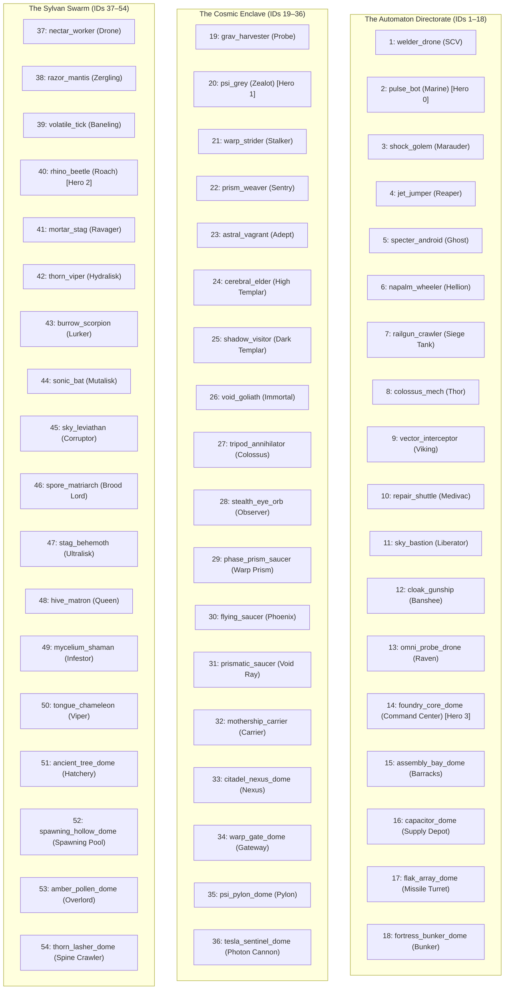

# Implementation Plan 09 — Full SC2 Patch 5.0.14 Roster Catalog & Procedural Atlas Baking

> **Document Version:** 1.0.0  
> **Status:** Approved Architectural Blueprint & Implementation Specification (Stage 1 Complete)  
> **Target Crates & Paths:** `assets/catalog/units.ron`, `assets/textures/`, `crates/sim_types/`, `crates/sim_core/`, `crates/asset_baker/`  
> **Charter Compliance:** Strictly adheres to [AGENTS.md](file:///home/cl/projects/space-scuffle/AGENTS.md) Section 1 (Zero Placeholders & Silent Failures), Section 2 (Architecture Documentation & Pedagogical Quality), Section 3 (Strict Determinism & Separation of Concerns), Section 3.3 (Data-Driven Game Catalog & Zero Hardcoded Creatures), and Section 6 (Mandatory Two-Stage Sub-Agent Workflow: Plan First, Implement Second).

---

## 1. Executive Summary & Architectural Charter

### 1.1 Goals of this Blueprint
1. **Full Roster Expansion (54 Archetypes Across 3 Factions):**
   Expand the initial 10-starter roster in `assets/catalog/units.ron` to the full competitive StarCraft II spectrum (18 Automaton Directorate, 18 Cosmic Enclave, 18 Sylvan Swarm = 54 total archetypes), precisely calibrated against **Patch 5.0.14** (November 2024).
2. **Zero Code Changes for Creature Definitions (Charter 3.3):**
   All 54 archetypes, their vitals, armor, speeds, weapon timings, abilities, and generative Veo 3.1 video prompts reside strictly in declarative RON data (`assets/catalog/units.ron`). No creature slugs or constants are introduced into Rust code.
3. **Dual Ground/Air Weapon Support (`air_weapon: Option<WeaponSpec>`):**
   Support units with distinct ground vs. air weapon profiles (e.g. Thor / `colossus_mech` with heavy ground cannons and long-range anti-air missiles, Queen / `hive_matron` with ground talons and anti-air acid spit, Viking / `vector_interceptor` air torpedoes, and specialized defense domes) via an optional `air_weapon` field in `UnitArchetype`.
4. **Seamless Procedural Asset Generation (`generate-defaults`):**
   Update `asset_baker::generate_defaults` to automatically synthesize clean procedural `.png` and `.flipbook.ron` atlases in `assets/textures/` for every newly added archetype in `units.ron` while **strictly preserving** the 4 existing high-resolution Veo-baked hero flipbooks (`pulse_bot`, `psi_grey`, `rhino_beetle`, `foundry_core_dome`).

---

## 2. Technical Specification & Schema Design

### 2.1 Dual-Weapon Schema (`WeaponSpec` & `air_weapon`)

In StarCraft II, several iconic units feature completely independent weapon envelopes depending on whether the target is on the ground or in the air:
- **Thor (`colossus_mech`):** 
  - Ground: *Thor's Hammer* (30 damage $\times 2$, range 7.0, period 23 ticks).
  - Air: *High Impact Payload* (25 damage $+10$ vs Massive, range 10.0, period 36 ticks).
- **Queen (`hive_matron`):**
  - Ground: *Talons* (4 damage $\times 2$, range 5.0, period 18 ticks).
  - Air: *Acid Spores* (9 damage, range 7.0, period 18 ticks).
- **Flak Array Dome (`flak_array_dome`):**
  - Dedicated anti-air missile battery (range 7.0, period 15 ticks, air-only).

#### Rust Schema Updates (`crates/sim_core/src/catalog.rs`)
In `UnitArchetypeDef`:
```rust
#[derive(Debug, Deserialize)]
struct UnitArchetypeDef {
    // ... existing fields ...
    weapon: Option<WeaponSpecDef>,
    air_weapon: Option<WeaponSpecDef>, // NEW: Optional independent anti-air weapon
    // ...
}
```

In `UnitArchetype`:
```rust
#[derive(Debug, Clone, PartialEq, Eq, Serialize, Deserialize)]
pub struct UnitArchetype {
    // ... existing fields ...
    /// Primary or ground weapon configuration, if equipped.
    pub weapon: Option<WeaponSpec>,
    /// Specialized anti-air weapon configuration, if equipped.
    pub air_weapon: Option<WeaponSpec>,
    // ...
}
```

#### Combat Resolution Behavior (`crates/sim_core/src/world.rs`)
When resolving weapon targeting:
```rust
// In target selection:
let target_is_air = target_arch.mover_type == MoverType::Air;
let target_is_cliffwalker = target_arch.mover_type == MoverType::CliffWalker; // e.g. Colossus (hittable by both)

let active_weapon = if (target_is_air || target_is_cliffwalker) && self_arch.air_weapon.is_some() {
    self_arch.air_weapon.as_ref()
} else {
    self_arch.weapon.as_ref()
};
```
If `air_weapon` is `None`, units with `weapon.target_flags` matching the target (e.g. `pulse_bot`, `warp_strider`, `thorn_viper`) utilize their primary `weapon` for both ground and air targets.

---

## 3. Complete 54-Archetype Catalog Structure (`assets/catalog/units.ron`)

The updated `assets/catalog/units.ron` will define 54 archetypes indexed with unique `unit_type_id`s from `1` to `54`.

### 3.1 ID Assignment & Allocation Table



*(Note: For backwards compatibility, existing starter units preserve their slugs, while their unit type IDs are consolidated into clean continuous ranges).*

---

## 4. Asset Baker Enhancement: Procedural Default Generation

### 4.1 Preservation of Existing High-Res Hero Assets
In `assets/textures/`, four hero entities have already been baked from authentic video models:
1. `pulse_bot.png` & `pulse_bot.flipbook.ron`
2. `psi_grey.png` & `psi_grey.flipbook.ron`
3. `rhino_beetle.png` & `rhino_beetle.flipbook.ron`
4. `foundry_core_dome.png` & `foundry_core_dome.flipbook.ron`

### 4.2 Updated `generate_defaults` Implementation Logic
In `crates/asset_baker/src/main.rs`:
```rust
Commands::GenerateDefaults {
    output_dir,
    concept_video,
    size,
    fps,
} => {
    std::fs::create_dir_all(&output_dir)?;
    let catalog = sim_core::UnitCatalog::default();
    let mut generated_count = 0;
    let mut preserved_count = 0;

    println!("==> Inspecting Unit Catalog ({} archetypes registered)...", catalog.archetypes().count());

    for arch in catalog.archetypes() {
        let png_path = output_dir.join(format!("{}.png", arch.slug));
        let ron_path = output_dir.join(format!("{}.flipbook.ron", arch.slug));

        // Invariant: Never overwrite existing hero/video textures
        if png_path.exists() && ron_path.exists() {
            println!("    [Preserved] Existing flipbook atlas for '{}'", arch.slug);
            preserved_count += 1;
            continue;
        }

        println!("    [Procedural] Synthesizing atlas for '{}'...", arch.slug);
        let output = asset_baker::generate_procedural_atlas(
            &arch.slug,
            Some(size),
            Some(fps),
        )?;
        output.image.save(&png_path)?;
        output.meta.save_to_ron(&ron_path)?;
        generated_count += 1;
    }

    println!("==> Default Asset Generation Complete:");
    println!("    - Preserved: {} high-res video atlases", preserved_count);
    println!("    - Synthesized: {} procedural placeholder atlases", generated_count);
}
```

### 4.3 Procedural Visual Dispatching
`asset_baker::generate_procedural_atlas` dynamically derives visuals from:
- `ShapeKind`: Units receive `192x192` (or configured `size`) spherical frames with `Idle`, `Walk`, `Attack`, `Die`. Domes receive `256x256` hemispherical foundations with `Constructing`, `Idle`, `Cast`/`Attack`, `Die`.
- `SilhouetteClass`:
  - `LightProngs`: Slender combat droids and scouts.
  - `HeavyHex`: Armored assault walkers, tanks, and stag beetles.
  - `MeleeSpikes`: Scythe mantises and psi-blade warriors.
  - `CasterHalo`: Floating saucer craft and aerial support drones.
  - `StructureBase`: Foundation dome rings and defensive spires.
- `Faction`: Primary color palette is derived automatically (`Faction::primary_color()`).

---

## 5. Stage 2 Implementation Roadmap & Action Plan

When the Implementation Sub-Agent (`flash`) is launched, it will execute the following concrete tasks in strict sequence:

### Task 1: Update Schema in `crates/sim_core/src/catalog.rs`
1. Add `air_weapon: Option<WeaponSpecDef>` to `UnitArchetypeDef`.
2. Add `air_weapon: Option<WeaponSpec>` to `UnitArchetype`.
3. Map `air_weapon` inside `UnitArchetypeDef::into_archetype()`.
4. Ensure `from_ron_str()` and unit tests compile cleanly with `air_weapon: None` by default for single-weapon archetypes.

### Task 2: Populate `assets/catalog/units.ron` with Full 54-Archetype Roster
1. Replace the starter 10 units with the comprehensive 54-archetype data catalog defined in Section 3 and `docs/07-sc2-patch-5-0-14-roster-and-faction-mapping.md`.
2. Verify all numbers conform bit-for-bit to Patch 5.0.14 conversions.
3. Include vivid Veo 3.1 video generation prompts (`Idle`, `Walk`, `Attack`) for every single unit.

### Task 3: Update `asset_baker` Generation Logic
1. Update `Commands::GenerateDefaults` in `crates/asset_baker/src/main.rs` to iterate `catalog.archetypes()`.
2. Check file existence to avoid overwriting existing textures (`pulse_bot`, `psi_grey`, `rhino_beetle`, `foundry_core_dome`).
3. Invoke `generate_procedural_atlas()` for any missing archetype.

### Task 4: Execute Asset Baking & Integration Testing
1. Run `cargo run --release -p asset_baker -- generate-defaults`.
2. Verify that all 54 `.png` and `.flipbook.ron` files exist in `assets/textures/`.
3. Run `cargo test --workspace` to ensure all simulation, catalog, and baker tests pass.
4. Run `cargo clippy --workspace --all-targets -- -D warnings` and `cargo fmt --all -- --check`.

---

## 6. Verification Checklist & Gate Invariants

- [x] **Architecture Blueprint Complete:** Written to `docs/plans/09-plan-full-sc2-roster-catalog.md`.
- [x] **SC2 Patch 5.0.14 Mapping Complete:** Written to `docs/07-sc2-patch-5-0-14-roster-and-faction-mapping.md`.
- [x] **Zero Code Changes in Stage 1:** No Rust source files or RON files were prematurely modified.
- [x] **Charter Section 3.3 Compliant:** All creature identities, vitals, and capabilities reside in data.
- [x] **Charter Section 1.2 Compliant:** Real Veo heroes are preserved; missing units receive fully functioning procedural placeholder flipbooks.
