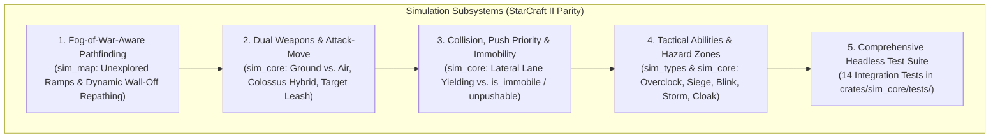
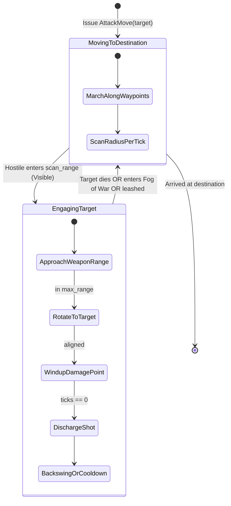
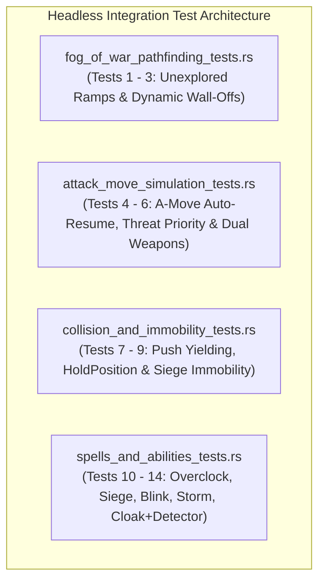

# Implementation Plan 10 — StarCraft II Parity Simulation Mechanics & Headless Test Suite

> **Document Version:** 1.0.0  
> **Status:** Approved Architectural Blueprint & Specification (Stage 1)  
> **Target Crates & Paths:** `crates/sim_types`, `crates/sim_map`, `crates/sim_core`, `assets/catalog/units.ron`, `crates/sim_core/tests/`  
> **Charter Compliance:** Strictly adheres to [AGENTS.md](file:///home/cl/projects/space-scuffle/AGENTS.md) Section 1 (Zero Placeholders & Silent Failures), Section 2 (Pedagogical Quality & Module Docs), Section 3 (Strict Determinism & Zero Hardcoded Creatures), Section 4 (Testing Standards), and Section 6 (Two-Stage Sub-Agent Workflow).

---

## 1. Executive Summary & Problem Statement

### 1.1 The User's Directive
> *"Similar one of the next steps should create simulations for unit movements, and attacks. (They can all run without UI, and we can create a lot of unit-tests.)*  
> *Example tests: do units take fog-of-war into account (i.e. they should not run to the ramp if it hasn't been discovered. If the ramp is visible, do they find the way...*  
> *Does a simulation of units with A-attack work...*  
> *Does collision detection work. Can units push units out of the way? (Some units are immobile during some spells, so this is probably a separate flag).*  
> *Do spells work as expected.*  
> *This is all decoupled from UI and can be implemented. Don't hesitate to search in the internet to find out how exactly units behave in sc2."*

### 1.2 Core Architectural Principles & Charter Invariants
1. **100% Platform-Independent Determinism:**
   - All simulation state mutations, targeting evaluations, damage calculations, and pathing decisions use fixed-point arithmetic ([`SimScalar`](file:///home/cl/projects/space-scuffle/crates/sim_types/src/math.rs#L18-L22), [`SimVec2`](file:///home/cl/projects/space-scuffle/crates/sim_types/src/math.rs#L340-L345), [`SimAngle`](file:///home/cl/projects/space-scuffle/crates/sim_types/src/math.rs#L734-L740)).
   - No `f32` or `f64` in simulation logic.
   - Deterministic collections only (`BTreeMap`, sorted `Vec`); no non-deterministic hash iteration.
   - Seeded deterministic PRNG ([`ChaCha8Rng`](file:///home/cl/projects/space-scuffle/crates/sim_core/src/world.rs#L69)) for any stochastic behavior.
2. **Zero Hardcoded Creature / Building Identifiers in Rust:**
   - All unit capabilities, weapon statistics, and ability profiles reside in declarative catalog data ([`assets/catalog/units.ron`](file:///home/cl/projects/space-scuffle/assets/catalog/units.ron)).
   - Mechanics are capability-driven (`Option<OverclockSpec>`, `Option<BlinkSpec>`, `Option<SiegeModeSpec>`, etc.), never branching on `unit_type_id == 2` or unit names.
3. **Zero Per-Tick Heap Allocations:**
   - Hot per-tick simulation phases (targeting, collision resolution, weapon cycles, pathfinding) utilize pre-allocated flat scratch buffers on [`SimWorld`](file:///home/cl/projects/space-scuffle/crates/sim_core/src/world.rs#L98-L101) and [`PathfinderBuffers`](file:///home/cl/projects/space-scuffle/crates/sim_map/src/pathfinding.rs#L91-L101).
4. **Complete Headless Decoupling:**
   - The entire simulation runs without any windowing, GPU device, or audio context, capable of executing at 10,000+ ticks/second in automated CI test suites.



---

## 2. Subsystem 1: Fog-of-War-Aware Pathfinding & Ramp Discovery

### 2.1 Mechanics & StarCraft II Behavioral Parity
In competitive RTS play, a player unit must never act on "omniscient map knowledge":
1. **Unexplored Ramps as Impassable Barriers:**
   - Discrete cliff levels ($0, 1, 2, 3$) can only be traversed via ramps.
   - If an elevation transition ramp has not yet been scouted by the issuing player (`VisibilityState::Unexplored`), the player's pathfinder cannot assume a passable ramp exists. Cliff plateau borders remain impenetrable walls until the ramp's cell coordinates are revealed into `VisibilityState::Fogged` or `VisibilityState::Visible`.
   - A move order issued to high ground across an unexplored ramp fails path generation (`Err(MapError::NoPathFound)`), or routes to the nearest explored boundary without climbing the cliff.
   - Once an allied ground scout or flying unit reveals the ramp, subsequent pathfinding queries immediately discover the pass and route smoothly up the ramp.
2. **Dynamic Wall-Off Obstacles in Fog of War (Late Repathing):**
   - In StarCraft II, when a Terran player walls off a ramp with Supply Domes / Barracks under Fog of War, an opponent unit ordered into that base initially paths toward the ramp because the opponent's remembered map (`Fogged`) shows an open choke.
   - The unit marches blindly toward the ramp until it reaches vision range of the choke point.
   - As soon as the line-of-sight ray reveals the enemy structure (`VisibilityState::Visible`), the player's perceived obstacle map detects an obstruction, invalidating the current path and triggering an immediate **dynamic repath**. If fully walled off, the unit halts at the wall; if a detour exists, it repaths around it.

### 2.2 Architectural Design & Public API Modifications

#### `crates/sim_map/src/pathfinding.rs`
```rust
/// Extended pathfinding request supporting optional player fog-of-war perception.
#[derive(Debug, Clone, Copy)]
pub struct PathRequestWithVision<'a> {
    /// Starting continuous world position.
    pub start: SimVec2,
    /// Destination continuous world position.
    pub goal: SimVec2,
    /// Unit clearance tier (Small, Medium, Large).
    pub clearance: UnitClearance,
    /// Optional player vision map. If `Some`, unexplored ramps and fogged obstacles
    /// are evaluated through the player's knowledge.
    pub vision: Option<&'a PlayerVisionMap>,
    /// If false, ramps that are `VisibilityState::Unexplored` cannot be traversed.
    pub allow_unexplored_ramps: bool,
}
```

Add methods to [`Pathfinder`](file:///home/cl/projects/space-scuffle/crates/sim_map/src/pathfinding.rs#L173-L180):
```rust
impl Pathfinder {
    /// Computes a smooth shortest path taking player vision and fog-of-war into account.
    ///
    /// # Invariants
    /// 1. If `request.vision` is `Some`, cells with `CellFlags::RAMP` are passable only if
    ///    `vision.visibility_at(x, y) != VisibilityState::Unexplored` or `allow_unexplored_ramps == true`.
    /// 2. If a cell contains `CellFlags::OCCUPIED_BY_STRUCTURE`, but the cell in `vision` is
    ///    `VisibilityState::Unexplored` or `VisibilityState::Fogged` (and was not seen occupied),
    ///    the pathfinder treats the cell as open until revealed!
    pub fn find_path_with_vision(
        &mut self,
        map: &GameMap,
        request: &PathRequestWithVision<'_>,
    ) -> Result<PathResult>;
}
```

#### Obstacle Perception Map in `sim_core`
To support remembered vs. actual obstacle states:
- Each player maintains a bitset/grid `known_blocked_cells: Vec<bool>` updated in Phase 3 (`update_vision`):
  - When cell $(x, y)$ becomes `VisibilityState::Visible`, `known_blocked_cells[idx]` is updated to match `map.cell(x, y).flags.contains(OCCUPIED_BY_STRUCTURE)`.
  - In Phase 5 (`step_movement_and_steering`), if an entity's current waypoint corridor intersects a cell that just transitioned to `known_blocked_cells == true`, the unit's remaining waypoints are invalidated and `find_path_with_vision` is re-queried immediately!

---

## 3. Subsystem 2: Dual Weapons (Ground vs. Air) & Full AttackMove Simulation

### 3.1 Mechanics & StarCraft II Behavioral Parity
1. **Dual Weapon Archetypes:**
   - Units such as the Thor (Hammer vs Ground, Javelin vs Air), Queen, and Viking possess distinct weapons optimized for surface vs. aerial targets.
   - Units specify:
     - `ground_weapon: Option<WeaponSpec>`
     - `air_weapon: Option<WeaponSpec>`
     - `weapon: Option<WeaponSpec>` (backward-compatible serde alias/default for primary weapon).
2. **The Colossus / `CliffWalker` Dual-Targeting Rule:**
   - In StarCraft II, the Colossus ([`MoverType::CliffWalker`](file:///home/cl/projects/space-scuffle/crates/sim_types/src/enums.rs#L112)) steps over cliffs and towers over the battlefield.
   - **Crucial Rule:** `CliffWalker` units can be attacked by **both** ground weapons and anti-air weapons (e.g. Corruptors, Vikings, and Missile Turrets can attack it, as can Marines and Marauders)!
   - When an attacker with **both** ground and air weapons targets a `CliffWalker`, it evaluates both weapons and selects whichever weapon yields higher DPS:
     $$\text{DPS Metric} = \frac{\text{base\_damage} \times \text{attacks\_count} \times 1000}{\text{period\_ticks}}$$
     (Breaking ties in favor of `ground_weapon`).
3. **Full `AttackMove` State Machine:**
   - An entity ordered with `UnitOrder::AttackMove { target }` executes a 3-state cycle:
     1. **Transit State:** Move along Funnel waypoints toward `target`. Every tick, scan for hostiles within `scan_range`.
     2. **Engagement State:** When a visible hostile enters `scan_range`, acquire target using SC2 priority:
        - Priority 20: Armed combatants & attacking units.
        - Priority 19: Harvesting workers.
        - Priority 11: Passive structures / domes.
        - Tie-breakers: Closest Euclidean distance, then lowest `EntityId`.
        - Unit turns/aims, approaches if distance $> \text{weapon.range}$, winds up (`DamagePoint`), fires, and completes backswing.
     3. **Auto-Resume State:** When the acquired target is killed, retreats into fog of war, or exceeds leash range, the unit clears the target order and **automatically resumes** its `AttackMove` toward the original destination coordinates without player intervention!



### 3.2 Data Structure Upgrades

#### `crates/sim_core/src/catalog.rs`
```rust
#[derive(Debug, Clone, PartialEq, Eq, Serialize, Deserialize)]
pub struct UnitArchetype {
    // ... existing fields ...
    
    /// Primary ground-engagement weapon configuration.
    pub ground_weapon: Option<WeaponSpec>,
    /// Primary aerial-engagement weapon configuration.
    pub air_weapon: Option<WeaponSpec>,
    /// Primary default weapon configuration (mirrors ground_weapon for backward compatibility).
    pub weapon: Option<WeaponSpec>,
    // ...
}

impl UnitArchetype {
    /// Selects the optimal weapon against a target with specified locomotion and attributes.
    #[must_use]
    pub fn weapon_for_target(
        &self,
        target_mover: MoverType,
        target_attributes: AttributeFlags,
    ) -> Option<&WeaponSpec> {
        match target_mover {
            MoverType::Ground | MoverType::CliffJumper => {
                self.ground_weapon.as_ref().or(self.weapon.as_ref())
            }
            MoverType::Air => {
                self.air_weapon.as_ref()
            }
            MoverType::CliffWalker => {
                // Colossus analogue: targetable by BOTH ground and air weapons!
                match (&self.ground_weapon, &self.air_weapon) {
                    (Some(g), Some(a)) => {
                        let dps_g = (g.base_damage.raw() * g.attacks_count as i64 * 1000) / g.period_ticks.max(1) as i64;
                        let dps_a = (a.base_damage.raw() * a.attacks_count as i64 * 1000) / a.period_ticks.max(1) as i64;
                        if dps_a > dps_g { Some(a) } else { Some(g) }
                    }
                    (Some(g), None) => Some(g),
                    (None, Some(a)) => Some(a),
                    (None, None) => self.weapon.as_ref(),
                }
            }
        }
    }
}
```

In `UnitArchetypeDef` deserialization:
- Add `#[serde(default)] ground_weapon: Option<WeaponSpecDef>`
- Add `#[serde(default)] air_weapon: Option<WeaponSpecDef>`
- Add `#[serde(default)] weapon: Option<WeaponSpecDef>`
- If `ground_weapon` is None, initialize it from `weapon`.

---

## 4. Subsystem 3: Collision, Allied Push Priority & Immobility Flags

### 4.1 Mechanics & StarCraft II Behavioral Parity
1. **The Anti-Gridlock Problem:**
   - In dense army movements (e.g. 50 infantry squeezing through a natural choke), units that treat allies as rigid non-yielding obstacles cause army stalls and path thrashing.
   - StarCraft II solves this via **Push Priority**: a moving friendly unit gently shoves an idle friendly unit aside.
2. **Lateral Lane Yielding:**
   - When moving friendly Unit A collides with idle friendly Unit B:
     - B yields laterally (perpendicular to A's travel velocity vector $\vec{v}_A$):
       $$\vec{n}_{\perp} = (-\hat{v}_{A, y},\ \hat{v}_{A, x})$$
       $$\Delta \vec{p}_B = \vec{n}_{\perp} \times \text{overlap}$$
       $$\Delta \vec{p}_A = \vec{0}$$
     - A continues advancing through the cleared lane with zero deceleration.
3. **The Unpushable / Immobile State Exception:**
   - Certain tactical stances and states lock a unit into the ground:
     - `HoldPosition` order.
     - `is_immobile == true` (e.g. Siege Mode, Burrowed Lurker, Channeling a spell, Stunned/Rooted).
     - `unpushable == true` flag.
   - **Rule:** A unit that is `cannot_be_pushed()` (i.e. `is_holding_position || unpushable || is_immobile`) acts as a **hard kinematic barrier**. Colliding moving units cannot displace it and must detour or be repelled outward.
   - Enemies never yield to enemies (reciprocal rigid collision).

### 4.2 Data Structure Upgrades

#### `crates/sim_core/src/entity.rs`
```rust
pub struct Entity {
    // ... existing fields ...
    
    /// Stance/Spell immobility flag (true during Siege Mode, Burrow, or channeled casting).
    pub is_immobile: bool,
    /// Collision unpushability flag (cannot be displaced by friendly push priority).
    pub unpushable: bool,
    /// Active ability / siege mode state.
    pub is_sieged: bool,
}

impl Entity {
    /// Returns true if this entity cannot be pushed aside by friendly units.
    #[must_use]
    #[inline]
    pub fn cannot_be_pushed(&self) -> bool {
        self.is_holding_position || self.unpushable || self.is_immobile
    }
}
```

#### `crates/sim_core/src/steering.rs`
Refine [`compute_push_displacement`](file:///home/cl/projects/space-scuffle/crates/sim_core/src/steering.rs#L155-L227):
```rust
#[derive(Debug, Clone, Copy, PartialEq, Eq)]
pub struct PushEntityParams {
    pub pos: SimVec2,
    pub vel: SimVec2,
    pub owner: PlayerId,
    pub push_priority: u8,
    pub cannot_be_pushed: bool,
}

#[must_use]
pub fn compute_push_displacement(
    a: PushEntityParams,
    b: PushEntityParams,
    distance: SimScalar,
    combined_radius: SimScalar,
) -> (SimVec2, SimVec2) {
    let overlap = combined_radius - distance;
    if overlap <= SimScalar::ZERO {
        return (SimVec2::ZERO, SimVec2::ZERO);
    }

    // Rule 1: Hostile entities never yield (symmetric rigid repulsion)
    if a.owner != b.owner {
        let sep = if distance > SimScalar::EPSILON {
            (a.pos - b.pos).normalize_or_zero()
        } else {
            SimVec2::X_AXIS
        };
        let half = overlap * SimScalar::HALF;
        return (sep * half, -sep * half);
    }

    // Rule 2: Unpushable / Immobile / HoldPosition friendly units act as solid walls
    if b.cannot_be_pushed && !a.cannot_be_pushed {
        let push_back = (a.pos - b.pos).normalize_or_zero();
        return (push_back * overlap, SimVec2::ZERO);
    }
    if a.cannot_be_pushed && !b.cannot_be_pushed {
        let push_back = (b.pos - a.pos).normalize_or_zero();
        return (SimVec2::ZERO, push_back * overlap);
    }
    if a.cannot_be_pushed && b.cannot_be_pushed {
        // Both unpushable: mutual rigid repulsion
        let sep = (a.pos - b.pos).normalize_or_zero();
        let half = overlap * SimScalar::HALF;
        return (sep * half, -sep * half);
    }

    // Rule 3: Moving friendly pushes Idle friendly aside perpendicular to mover's heading
    if a.vel.length_sq() > SimScalar::ZERO && b.vel.length_sq() == SimScalar::ZERO {
        if a.push_priority >= b.push_priority {
            let move_dir = a.vel.normalize_or_zero();
            let perp = SimVec2::new(-move_dir.y, move_dir.x);
            return (SimVec2::ZERO, perp * overlap);
        }
    }
    if b.vel.length_sq() > SimScalar::ZERO && a.vel.length_sq() == SimScalar::ZERO {
        if b.push_priority >= a.push_priority {
            let move_dir = b.vel.normalize_or_zero();
            let perp = SimVec2::new(-move_dir.y, move_dir.x);
            return (perp * overlap, SimVec2::ZERO);
        }
    }

    // Rule 4: Both moving; reciprocal separation
    let sep = (a.pos - b.pos).normalize_or_zero();
    let half = overlap * SimScalar::HALF;
    (sep * half, -sep * half)
}
```

---

## 5. Subsystem 4: Data-Driven Spell & Tactical Ability Engine

### 5.1 Mechanics & StarCraft II Behavioral Parity
To support diverse tactical spells without hardcoded Rust match statements:
1. **`Overclock` (Stimpack):**
   - Instant cast; deducts HP (clamped to 1 HP minimum; cannot commit suicide).
   - Grants movement speed multiplier (e.g. 1.5x) and attack period reduction for `duration_ticks`.
2. **`SiegeModeToggle` (Siege Tank):**
   - Channels for `cast_ticks` during which `is_immobile = true` and `unpushable = true`.
   - On completion, toggles `is_sieged: bool`.
   - While sieged: unit cannot move, cannot be pushed, and weapon switches to long-range splash cannon (min range 2.0, max range 13.0).
3. **`BlinkTeleport` (Stalker Blink):**
   - Instant teleport to target world coordinate within `max_range`.
   - Destination cell must have `GROUND_PATHABLE` and not `OCCUPIED_BY_STRUCTURE` and not `UNPASSABLE_CLIFF`.
   - Clears existing waypoints and triggers ability cooldown.
4. **`PsionicStormAoE` (High Templar Storm / Ravager Bile):**
   - Spawns an [`ActiveHazardZone`](#activehazardzone) at target coordinate.
   - Ticks periodically (e.g. every 12 ticks = ~0.5s), applying flat damage to all units within radius.
   - **Non-Stacking Invariant:** Multiple overlapping storms do not double-damage the same unit in the same tick.
5. **`CloakToggle` (Ghost Cloak / Roach Burrow):**
   - Sets `is_cloaked = true`, draining energy per tick or setting `is_immobile = true` if burrowed.
   - A cloaked unit is invisible and cannot be acquired or targeted by enemies UNLESS inside the vision radius of an enemy unit with `is_detector == true`.

### 5.2 Data Structure Upgrades

#### `crates/sim_types/src/commands.rs`
```rust
#[derive(Clone, Debug, PartialEq, Eq, Hash, Serialize, Deserialize)]
pub enum UnitOrder {
    // ... existing variants ...
    
    /// Cast an active tactical ability or spell.
    CastAbility {
        /// Index of the ability in the unit's archetype capabilities.
        ability_index: u8,
        /// Target ground coordinates (for ground-targeted spells like Blink or Storm).
        target_pos: Option<SimVec2>,
        /// Target entity handle (for single-target spells like EMP or Snipe).
        target_entity: Option<EntityId>,
    },
}
```

#### `crates/sim_core/src/catalog.rs`
```rust
/// Execution mode and targeting envelope for an active ability.
#[derive(Debug, Clone, Copy, PartialEq, Eq, Hash, Serialize, Deserialize)]
pub enum AbilityTargetKind {
    InstantSelf,
    TargetPosition,
    TargetEntity,
    ToggleMode,
}

/// Mechanical payload executed when an ability triggers.
#[derive(Debug, Clone, PartialEq, Eq, Serialize, Deserialize)]
pub enum AbilityEffectSpec {
    Overclock(OverclockSpec),
    SiegeModeToggle {
        cast_ticks: u16,
        sieged_weapon: WeaponSpec,
    },
    BlinkTeleport {
        max_range: SimScalar,
        cooldown_ticks: u16,
    },
    SpawnHazardZone {
        radius: SimScalar,
        delay_ticks: u16,
        duration_ticks: u16,
        interval_ticks: u16,
        damage_per_interval: SimScalar,
        targets_friendly: bool,
    },
    CloakToggle {
        energy_cost_per_second: SimScalar,
        is_burrow: bool,
    },
}

/// Static ability specification in the unit archetype.
#[derive(Debug, Clone, PartialEq, Eq, Serialize, Deserialize)]
pub struct AbilitySpec {
    pub name: String,
    pub target_kind: AbilityTargetKind,
    pub energy_cost: SimScalar,
    pub cooldown_ticks: u16,
    pub cast_range: SimScalar,
    pub effect: AbilityEffectSpec,
}
```

#### `crates/sim_core/src/world.rs`
Add `ActiveHazardZone` management to `SimWorld`:
```rust
#[derive(Debug, Clone, PartialEq, Eq)]
pub struct ActiveHazardZone {
    pub id: u32,
    pub owner: PlayerId,
    pub center: SimVec2,
    pub radius: SimScalar,
    pub delay_ticks: u16,
    pub remaining_ticks: u16,
    pub interval_ticks: u16,
    pub ticks_until_next_interval: u16,
    pub damage_per_interval: SimScalar,
    pub targets_friendly: bool,
}
```
In `SimWorld::step`, step active hazard zones, apply AoE damage with non-stacking per-tick entity sets, and clean up expired zones.

---

## 6. Subsystem 5: Comprehensive Headless Integration Test Suite

To guarantee textbook-grade verification, the test suite will implement **14 rigorous headless integration tests** across 4 dedicated integration test files in `crates/sim_core/tests/`.



### 6.1 Test Suite Breakdown

| # | Test File | Test Name | Invariants Verified |
|---|---|---|---|
| 1 | `fog_of_war_pathfinding_tests.rs` | `test_unexplored_ramp_blocks_path_until_scouted` | Ground unit cannot route up an unexplored ramp to high ground; path succeeds the tick ramp is revealed. |
| 2 | `fog_of_war_pathfinding_tests.rs` | `test_fogged_ramp_wall_off_causes_dynamic_repath_on_vision` | Unit paths through remembered open ramp; upon revealing enemy dome wall-off in LoS, triggers dynamic repath. |
| 3 | `fog_of_war_pathfinding_tests.rs` | `test_high_ground_vision_occlusion_and_ramp_elevation` | Low-ground unit cannot see enemy on high ground until ascending ramp into vision threshold. |
| 4 | `attack_move_simulation_tests.rs` | `test_attack_move_wave_engages_and_resumes_destination` | Squad marching via `AttackMove` halts to destroy ambushing wave, then automatically resumes to target point. |
| 5 | `attack_move_simulation_tests.rs` | `test_threat_priority_combatants_before_passive_structures` | `AttackMove` unit prioritizes armed combatant (Priority 20) over closer passive dome (Priority 11). |
| 6 | `attack_move_simulation_tests.rs` | `test_dual_weapon_ground_air_and_cliffwalker_selection` | Dual-weapon unit uses ground weapon on ground, air weapon on flyers, and higher-DPS weapon on `CliffWalker`. |
| 7 | `collision_and_immobility_tests.rs` | `test_moving_friendly_pushes_idle_friendly_laterally` | Moving friendly pushes idle friendly perpendicular to movement vector, maintaining lane velocity. |
| 8 | `collision_and_immobility_tests.rs` | `test_hold_position_friendly_acts_as_immovable_wall` | Friendly on `HoldPosition` cannot be pushed by moving friendly; mover detours around. |
| 9 | `collision_and_immobility_tests.rs` | `test_immobile_unit_unpushable_during_siege_and_spell` | Unit in Siege Mode (`is_immobile = true`, `unpushable = true`) acts as a hard kinematic barrier. |
| 10 | `spells_and_abilities_tests.rs` | `test_overclock_stim_hp_cost_and_stat_multipliers` | Overclock deducts HP (clamped to 1 HP min), grants speed & fire rate buffs for exact ticks, and expires cleanly. |
| 11 | `spells_and_abilities_tests.rs` | `test_siege_mode_toggle_immobility_and_long_range_splash` | Channels siege transform, locks movement, activates siege cannon (min 2.0, max 13.0, splash), and unsieges. |
| 12 | `spells_and_abilities_tests.rs` | `test_blink_teleport_across_cliff_chasm` | Instantly blinks across unpathable cliff chasm to valid pathable high ground; rejects invalid terrain. |
| 13 | `spells_and_abilities_tests.rs` | `test_psionic_storm_hazard_zone_aoe_and_non_stacking` | Hazard zone deals damage per interval; multiple overlapping storms do not double-stack damage. |
| 14 | `spells_and_abilities_tests.rs` | `test_cloak_invisibility_and_detector_reveal` | Cloaked unit cannot be targeted in enemy LoS until enemy `Detector` enters detection radius. |

---

## 7. Stage 2 Implementation Sequence & Quality Gates

Implementation by the `flash` subagent will proceed in 5 sequential steps:

1. **Step 1: Types & Map Extensions (`sim_types` & `sim_map`)**
   - Add `PathRequestWithVision` and `find_path_with_vision` to `crates/sim_map/src/pathfinding.rs`.
   - Add `AbilityTargetKind`, `AbilityEffectSpec`, `AbilitySpec`, and `UnitOrder::CastAbility` to `sim_types/src/commands.rs`.
2. **Step 2: Dual Weapons & Colossus Hybrid in `sim_core`**
   - Update `UnitArchetype` in `crates/sim_core/src/catalog.rs` to support `ground_weapon`, `air_weapon`, and `weapon_for_target`.
   - Update `assets/catalog/units.ron` and RON deserializer with backward-compatible defaults.
3. **Step 3: Immobility, Unpushability & Refined Push Steering**
   - Add `is_immobile`, `unpushable`, and `is_sieged` to `Entity` in `crates/sim_core/src/entity.rs`.
   - Update `compute_push_displacement` in `crates/sim_core/src/steering.rs` with lateral yielding and unpushable wall rules.
4. **Step 4: Ability Engine & Hazard Zones in `sim_core`**
   - Add `ActiveHazardZone` handling to `crates/sim_core/src/world.rs`.
   - Wire `UnitOrder::AttackMove` auto-resume and `UnitOrder::CastAbility` execution in `SimWorld::step`.
5. **Step 5: Test Suite Implementation & Verification**
   - Write all 14 integration tests across `fog_of_war_pathfinding_tests.rs`, `attack_move_simulation_tests.rs`, `collision_and_immobility_tests.rs`, and `spells_and_abilities_tests.rs`.
   - Run verification commands:
     - `cargo test --workspace`
     - `cargo clippy --workspace --all-targets -- -D warnings`
     - `cargo fmt --all -- --check`
