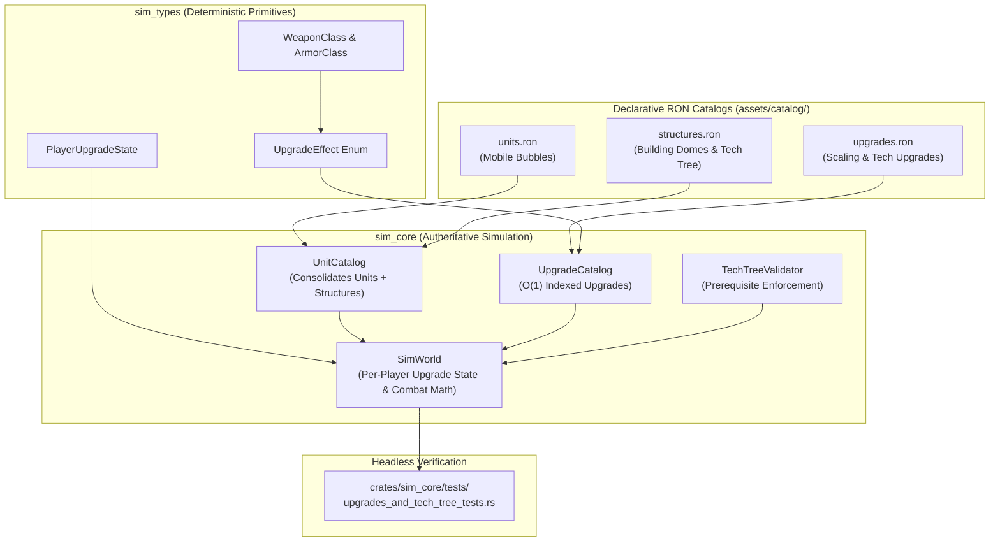

# Implementation Plan 11 — Data-Driven Structures, Tech-Tree Dependencies & Upgrades Catalog

> **Document Version:** 1.0.0  
> **Status:** Approved Architectural Blueprint & Specification (Stage 1 Complete)  
> **Target Crates & Paths:** `assets/catalog/`, `crates/sim_types/`, `crates/sim_core/`, `crates/sim_core/tests/upgrades_and_tech_tree_tests.rs`  
> **Charter Compliance:** Strictly adheres to [AGENTS.md](file:///home/cl/projects/space-scuffle/AGENTS.md) Section 1 (Zero Placeholders & Silent Failures), Section 2 (Pedagogical Quality & Architecture Docs), Section 3 (Strict Determinism & Separation of Concerns), Section 3.3 (Data-Driven Game Catalog & Zero Hardcoded Creatures), Section 4 (Testing Standards), and Section 6 (Mandatory Two-Stage Sub-Agent Workflow: Plan First, Implement Second).

---

## 1. Executive Summary & Architectural Motivation

### 1.1 Problem Statement
In previous iterations:
1. `assets/catalog/units.ron` mixed a preliminary set of 15 starter structures into the unit definitions, without tracking tech-tree prerequisites (`requires_structures`), production lists (`trains_units`), research lists (`researches_upgrades`), or specialized structure classifications (gas extractors, supply nodes, radar detectors).
2. The remaining 34 StarCraft II structures (advanced tech domes, add-on modules, specialized defensive towers, Tier 2/3 town halls) were not yet cataloged.
3. Upgrades did not exist anywhere in the engine: neither scaling `+1/+2/+3` weapon/armor/shield upgrades nor unit-specific qualitative tech upgrades (e.g., Combat Shield, Stimpack, Concussive Shells, Blink, Psionic Storm, Extended Thermal Lance, Metabolic Boost, Adrenal Glands, Anabolic Synthesis).
4. No deterministic player-level upgrade tracking (`PlayerUpgradeState`) or combat damage scaling calculations were implemented.

### 1.2 Architectural Solution
This blueprint establishes a modular, decoupled, 100% data-driven catalog architecture:
- **Modular Multi-File Catalog in `assets/catalog/`:**
  - `assets/catalog/units.ron`: Authoritative mobile combat units and harvesters (`ShapeKind::UnitBubble`).
  - `assets/catalog/structures.ron`: Authoritative hemispherical building domes (`ShapeKind::BuildingDome`), including footprint dimensions, tech prerequisites, training capabilities, and research capabilities.
  - `assets/catalog/upgrades.ron`: Authoritative scaling upgrades and unit-specific tech upgrades with composable `UpgradeEffect` definitions.
- **Unified Entity Simulation in `sim_core`:**
  - `UnitCatalog` seamlessly parses and consolidates both `units.ron` and `structures.ron` into contiguous lookup slabs. Structures exist as first-class deterministic entities in `SimWorld` (with stationary speed, building dome geometry, high push priority, and structure attribute flags), avoiding any duplicated simulation physics or targeting code.
- **Deterministic Player Upgrade System:**
  - `UpgradeCatalog` loads `upgrades.ron`.
  - `PlayerUpgradeState` maintains bit-for-bit deterministic upgrade progress per player in `SimWorld`.
  - Combat damage resolution, unit stat calculations, and ability activations automatically query the player's active upgrade state without per-frame allocations or string lookups.



---

## 2. Technical Specification & Schema Design

### 2.1 Strong Types & Enums (`crates/sim_types/src/`)

To support data-driven weapon scaling and armor mitigation without hardcoded unit branches, we define weapon classes and armor classes as explicit serializable enums:

```rust
//! In crates/sim_types/src/catalog_types.rs

use serde::{Deserialize, Serialize};

/// High-level weapon classification determining which scaling upgrade applies.
#[derive(Debug, Clone, Copy, PartialEq, Eq, PartialOrd, Ord, Hash, Serialize, Deserialize)]
pub enum WeaponClass {
    /// Directorate infantry ballistic weapons (Marine, Marauder, Reaper, Ghost).
    DirectorateInfantry,
    /// Directorate ground vehicle cannons and railguns (Hellion, Tank, Thor).
    DirectorateVehicle,
    /// Directorate aerial ordnance and missiles (Viking, Banshee, Liberator).
    DirectorateShip,
    /// Cosmic Enclave ground psionic blades and particle beams (Zealot, Stalker, Immortal, Colossus).
    EnclaveGround,
    /// Cosmic Enclave aerial ray projectors and interceptors (Phoenix, Void Ray, Carrier).
    EnclaveAir,
    /// Sylvan Swarm melee claws, scythes, and cleaving horns (Zergling, Ultralisk).
    SwarmMelee,
    /// Sylvan Swarm projectile acid, spines, and bile (Roach, Ravager, Hydralisk, Lurker).
    SwarmMissile,
    /// Sylvan Swarm aerial flyers and parasites (Mutalisk, Corruptor, Brood Lord).
    SwarmFlyer,
}

/// High-level life armor classification determining which armor plating upgrade applies.
#[derive(Debug, Clone, Copy, PartialEq, Eq, PartialOrd, Ord, Hash, Serialize, Deserialize)]
pub enum ArmorClass {
    /// Directorate infantry composite armor.
    DirectorateInfantry,
    /// Directorate vehicle and ship reinforced plating.
    DirectoratePlating,
    /// Cosmic Enclave ground exosuits and strider hulls.
    EnclaveGround,
    /// Cosmic Enclave starship chassis.
    EnclaveAir,
    /// Sylvan Swarm ground chitinous carapace.
    SwarmGroundCarapace,
    /// Sylvan Swarm aerial flyer carapace.
    SwarmFlyerCarapace,
}

/// Composable upgrade effect modifying weapon scaling, armor, unit stats, or abilities.
#[derive(Debug, Clone, PartialEq, Eq, Serialize, Deserialize)]
pub enum UpgradeEffect {
    /// Advances scaling weapon level for an entire weapon class.
    WeaponDamageLevel {
        weapon_class: WeaponClass,
        level: u8,
    },
    /// Advances life armor level for an entire armor class.
    ArmorLevel {
        armor_class: ArmorClass,
        level: u8,
    },
    /// Advances global plasma shield armor level (+1 per level).
    ShieldLevel {
        level: u8,
    },
    /// Modifies baseline statistics for a specific unit archetype slug.
    ModifyUnitStat {
        target_slug: String,
        #[serde(default)]
        max_hp_delta: SimScalar,
        #[serde(default)]
        move_speed_delta: SimScalar,
        #[serde(default)]
        sight_delta: SimScalar,
        #[serde(default)]
        weapon_range_delta: SimScalar,
        #[serde(default)]
        armor_delta: SimScalar,
        #[serde(default)]
        attack_cooldown_delta: i32,
        #[serde(default)]
        bonus_damage_delta: SimScalar,
    },
    /// Unlocks an active or passive ability for a specific unit archetype slug.
    UnlockAbility {
        target_slug: String,
        ability_slug: String,
    },
}
```

### 2.2 Structure Archetype Definition (`assets/catalog/structures.ron`)

Structures are declared in `assets/catalog/structures.ron` using `StructureCatalogFile`:

```rust
//! In crates/sim_core/src/catalog.rs (structures module)

/// Deserializable format for assets/catalog/structures.ron.
#[derive(Debug, Deserialize)]
pub struct StructureCatalogFile {
    pub structures: Vec<StructureArchetypeDef>,
}

#[derive(Debug, Deserialize)]
pub struct StructureArchetypeDef {
    pub structure_type_id: u32,
    pub slug: String,
    pub name: String,
    pub faction: Faction,
    pub display_name: String,
    pub lore_description: String,
    pub sc2_inspiration: Option<String>,
    /// Tile footprint dimensions (e.g. (3, 3) for production, (5, 5) for town hall, (2, 2) for pylons).
    pub footprint: (u32, u32),
    pub mineral_cost: u32,
    pub gas_cost: u32,
    pub build_time_ticks: u32,
    pub max_hp: f64,
    pub max_shields: f64,
    pub max_energy: f64,
    pub life_armor: f64,
    pub shield_armor: f64,
    pub sight_radius: f64,
    pub supply_provided: u32,
    pub is_resource_dropoff: bool,
    pub is_gas_extractor: bool,
    pub is_detector: bool,
    /// Prerequisite structure slugs that must exist and be completed before construction can start.
    #[serde(default)]
    pub requires_structures: Vec<String>,
    /// Unit slugs that can be trained/constructed at this dome.
    #[serde(default)]
    pub trains_units: Vec<String>,
    /// Upgrade slugs that can be researched at this dome.
    #[serde(default)]
    pub researches_upgrades: Vec<String>,
    /// Dedicated ground defense weapon (if armed).
    pub ground_weapon: Option<WeaponSpecDef>,
    /// Dedicated anti-air defense weapon (if armed).
    pub air_weapon: Option<WeaponSpecDef>,
    /// Tactical abilities (e.g. Energy Recharge, Lift-Off, Scanner Sweep).
    #[serde(default)]
    pub abilities: Vec<AbilitySpecDef>,
    /// Generative Veo 3.1 video prompts for Idle, Constructing, Firing, Destroyed.
    #[serde(default)]
    pub veo_prompts: BTreeMap<String, String>,
}
```

#### Seamless Conversion into `UnitArchetype`
In `sim_core::catalog`, when `UnitCatalog::load_bundle(units_path, structures_path)` is invoked:
1. Each `StructureArchetypeDef` is converted to a `UnitArchetype` where:
   - `shape = ShapeKind::BuildingDome`
   - `mover_type = MoverType::Ground`
   - `max_speed = SimScalar::ZERO` (immobile stationary structure)
   - `push_priority = 255` (unpushable static mass)
   - `attributes = AttributeFlags::STRUCTURE | AttributeFlags::ARMORED | ...`
   - `collision_radius = SimScalar::from_f64(footprint.0 as f64 * 0.5)`
   - `separation_radius = collision_radius`
2. Structure IDs are partitioned cleanly:
   - Unit IDs: `1..=99`
   - Structure IDs: `101..=199`
3. Result: **Zero duplicate simulation logic.** Targeting, attack-move, damage calculations, line-of-sight fog-of-war reveal, and client rendering work symmetrically for both mobile unit bubbles and stationary building domes.

### 2.3 Upgrade Definition & Catalog (`assets/catalog/upgrades.ron`)

Upgrades are declared in `assets/catalog/upgrades.ron`:

```rust
//! In crates/sim_core/src/upgrades.rs

pub type UpgradeId = u32;

#[derive(Debug, Deserialize)]
pub struct UpgradeCatalogFile {
    pub upgrades: Vec<UpgradeDef>,
}

#[derive(Debug, Clone, PartialEq, Eq, Serialize, Deserialize)]
pub struct UpgradeDef {
    pub upgrade_id: UpgradeId,
    pub slug: String,
    pub name: String,
    pub display_name: String,
    pub faction: Faction,
    pub level: u8,
    pub mineral_cost: u32,
    pub gas_cost: u32,
    pub research_ticks: u32,
    /// Slug of the structure where this upgrade is researched.
    pub researched_at: String,
    /// Prerequisite structures required before research can be initiated.
    #[serde(default)]
    pub requires_structures: Vec<String>,
    /// Immediate effects applied to player state upon completion.
    pub effects: Vec<UpgradeEffect>,
}

/// Read-only indexed catalog of all registered game upgrades.
#[derive(Debug, Clone, Default)]
pub struct UpgradeCatalog {
    upgrades_by_id: Vec<Option<UpgradeDef>>,
    upgrades_by_slug: BTreeMap<String, UpgradeId>,
}

impl UpgradeCatalog {
    pub fn from_ron_str(ron_data: &str) -> SimResult<Self> {
        let catalog_file: UpgradeCatalogFile = ron::from_str(ron_data)
            .map_err(|e| SimCoreError::RonDeserializationError(e.to_string()))?;

        let mut catalog = Self {
            upgrades_by_id: vec![None; 128],
            upgrades_by_slug: BTreeMap::new(),
        };

        for def in catalog_file.upgrades {
            let id = def.upgrade_id;
            catalog.upgrades_by_slug.insert(def.slug.clone(), id);
            if id as usize >= catalog.upgrades_by_id.len() {
                catalog.upgrades_by_id.resize(id as usize + 32, None);
            }
            catalog.upgrades_by_id[id as usize] = Some(def);
        }

        Ok(catalog)
    }

    pub fn get_by_id(&self, id: UpgradeId) -> Option<&UpgradeDef> {
        self.upgrades_by_id.get(id as usize).and_then(|u| u.as_ref())
    }

    pub fn get_by_slug(&self, slug: &str) -> Option<&UpgradeDef> {
        self.upgrades_by_slug.get(slug).and_then(|&id| self.get_by_id(id))
    }
}
```

### 2.4 Deterministic Player Upgrade State (`crates/sim_types/src/`)

```rust
//! In crates/sim_types/src/player_state.rs

use crate::catalog_types::{ArmorClass, UpgradeEffect, WeaponClass};
use crate::math::SimScalar;
use std::collections::{BTreeMap, BTreeSet};

/// Authoritative upgrade state tracked per player inside `SimWorld`.
#[derive(Debug, Clone, PartialEq, Eq, Default, Serialize, Deserialize)]
pub struct PlayerUpgradeState {
    /// Researched weapon level (0..=3) per weapon classification.
    pub weapon_levels: BTreeMap<WeaponClass, u8>,
    /// Researched armor level (0..=3) per armor classification.
    pub armor_levels: BTreeMap<ArmorClass, u8>,
    /// Researched global shield armor level (0..=3).
    pub shield_level: u8,
    /// Set of completed upgrade slugs (e.g. "combat_shield", "phase_blink").
    pub completed_upgrade_slugs: BTreeSet<String>,
    /// Accumulated stat deltas keyed by unit slug.
    pub unit_stat_modifiers: BTreeMap<String, UnitStatDeltas>,
    /// Unlocked abilities keyed by unit slug.
    pub unlocked_abilities: BTreeMap<String, BTreeSet<String>>,
}

/// Cumulative stat modifications applied to a specific unit type for this player.
#[derive(Debug, Clone, Copy, PartialEq, Eq, Default, Serialize, Deserialize)]
pub struct UnitStatDeltas {
    pub max_hp_delta: SimScalar,
    pub move_speed_delta: SimScalar,
    pub sight_delta: SimScalar,
    pub weapon_range_delta: SimScalar,
    pub armor_delta: SimScalar,
    pub attack_cooldown_delta: i32,
    pub bonus_damage_delta: SimScalar,
}

impl PlayerUpgradeState {
    /// Applies an upgrade definition's effects to the player's active state.
    pub fn apply_upgrade(&mut self, upgrade_slug: &str, effects: &[UpgradeEffect]) {
        self.completed_upgrade_slugs.insert(upgrade_slug.to_string());
        for effect in effects {
            match effect {
                UpgradeEffect::WeaponDamageLevel { weapon_class, level } => {
                    self.weapon_levels.insert(*weapon_class, *level);
                }
                UpgradeEffect::ArmorLevel { armor_class, level } => {
                    self.armor_levels.insert(*armor_class, *level);
                }
                UpgradeEffect::ShieldLevel { level } => {
                    self.shield_level = *level;
                }
                UpgradeEffect::ModifyUnitStat {
                    target_slug,
                    max_hp_delta,
                    move_speed_delta,
                    sight_delta,
                    weapon_range_delta,
                    armor_delta,
                    attack_cooldown_delta,
                    bonus_damage_delta,
                } => {
                    let entry = self.unit_stat_modifiers.entry(target_slug.clone()).or_default();
                    entry.max_hp_delta += *max_hp_delta;
                    entry.move_speed_delta += *move_speed_delta;
                    entry.sight_delta += *sight_delta;
                    entry.weapon_range_delta += *weapon_range_delta;
                    entry.armor_delta += *armor_delta;
                    entry.attack_cooldown_delta += *attack_cooldown_delta;
                    entry.bonus_damage_delta += *bonus_damage_delta;
                }
                UpgradeEffect::UnlockAbility { target_slug, ability_slug } => {
                    self.unlocked_abilities
                        .entry(target_slug.clone())
                        .or_default()
                        .insert(ability_slug.clone());
                }
            }
        }
    }
}
```

---

## 3. Combat Resolution with Scaling Upgrades

### 3.1 Weapon Damage Formula Update
When `WeaponSpec` evaluates damage against a target in `crates/sim_core/src/world.rs`:
```rust
// 1. Resolve firing unit's weapon upgrade bonus
let weapon_lvl = firing_player_upgrades
    .weapon_levels
    .get(&weapon.weapon_class)
    .copied()
    .unwrap_or(0);

let upgrade_bonus = weapon.upgrade_bonus_per_level * SimScalar::from_u32(weapon_lvl as u32);
let stat_bonus_dmg = firing_player_upgrades
    .unit_stat_modifiers
    .get(&firing_unit_slug)
    .map(|m| m.bonus_damage_delta)
    .unwrap_or(SimScalar::ZERO);

let mut hit_damage = weapon.base_damage + upgrade_bonus + stat_bonus_dmg;

// 2. Add attribute bonus damage (e.g. +10 vs Armored)
if target.attributes.contains(weapon.bonus_target_flags) {
    hit_damage += weapon.bonus_damage;
    // Add per-level scaling to attribute bonus if defined
    hit_damage += weapon.bonus_upgrade_per_level * SimScalar::from_u32(weapon_lvl as u32);
}

// 3. Shield mitigation
if target.shields > SimScalar::ZERO {
    let effective_shield_armor = target.base_shield_armor + SimScalar::from_u32(target_player_upgrades.shield_level as u32);
    let mitigated = (hit_damage - effective_shield_armor).max(SimScalar::from_f64(0.5));
    // Apply damage to shield and compute spillover...
}

// 4. Life Armor mitigation
let armor_lvl = target_player_upgrades
    .armor_levels
    .get(&target.armor_class)
    .copied()
    .unwrap_or(0);

let stat_armor = target_player_upgrades
    .unit_stat_modifiers
    .get(&target_unit_slug)
    .map(|m| m.armor_delta)
    .unwrap_or(SimScalar::ZERO);

let effective_life_armor = target.base_life_armor + SimScalar::from_u32(armor_lvl as u32) + stat_armor;
let hull_mitigated = (spillover_damage - effective_life_armor).max(SimScalar::from_f64(0.5));
```

---

## 4. Tech-Tree Prerequisite Verification Subsystem

```rust
//! In crates/sim_core/src/tech_tree.rs

use crate::catalog::{UnitCatalog, UpgradeCatalog};
use crate::error::{SimCoreError, SimResult};
use crate::world::SimWorld;
use sim_types::PlayerId;
use std::collections::BTreeSet;

/// Authoritative validator for building placement, unit production, and upgrade research.
pub struct TechTreeValidator;

impl TechTreeValidator {
    /// Validates whether a player possesses all prerequisite structures to construct a building.
    pub fn can_construct_structure(
        world: &SimWorld,
        player_id: PlayerId,
        structure_slug: &str,
    ) -> SimResult<()> {
        let structure_arch = world.catalog.get_by_slug(structure_slug)
            .ok_or_else(|| SimCoreError::InvalidUnitType(structure_slug.to_string()))?;

        let existing_completed_structures: BTreeSet<&str> = world.entities()
            .filter(|e| e.player_id == player_id && e.is_structure && e.is_completed)
            .map(|e| e.slug.as_str())
            .collect();

        for req in &structure_arch.requires_structures {
            if !existing_completed_structures.contains(req.as_str()) {
                return Err(SimCoreError::MissingPrerequisiteStructure {
                    target: structure_slug.to_string(),
                    required: req.clone(),
                });
            }
        }
        Ok(())
    }

    /// Validates whether a player possesses prerequisites to research an upgrade.
    pub fn can_research_upgrade(
        world: &SimWorld,
        player_id: PlayerId,
        upgrade_slug: &str,
    ) -> SimResult<()> {
        let upgrade = world.upgrade_catalog.get_by_slug(upgrade_slug)
            .ok_or_else(|| SimCoreError::UnknownUpgrade(upgrade_slug.to_string()))?;

        let player_state = world.player_upgrade_state(player_id);
        if player_state.completed_upgrade_slugs.contains(upgrade_slug) {
            return Err(SimCoreError::UpgradeAlreadyResearched(upgrade_slug.to_string()));
        }

        let existing_completed_structures: BTreeSet<&str> = world.entities()
            .filter(|e| e.player_id == player_id && e.is_structure && e.is_completed)
            .map(|e| e.slug.as_str())
            .collect();

        for req in &upgrade.requires_structures {
            if !existing_completed_structures.contains(req.as_str()) {
                return Err(SimCoreError::MissingPrerequisiteStructure {
                    target: upgrade_slug.to_string(),
                    required: req.clone(),
                });
            }
        }
        Ok(())
    }
}
```

---

## 5. Declarative Data Files Organization

```
assets/catalog/
├── units.ron        # 54 Mobile combat units (pulse_bot, psi_grey, rhino_beetle...)
├── structures.ron   # 49 Tech-tree building domes (foundry_core_dome, warp_gate_dome...)
└── upgrades.ron     # 54 Scaling weapon/armor & unit tech upgrades
```

### 5.1 Sample Structure Entry (`assets/catalog/structures.ron`)
```ron
(
    structures: [
        (
            structure_type_id: 101,
            slug: "foundry_core_dome",
            name: "foundry_core_dome",
            faction: Automaton,
            display_name: "Foundry Core Dome",
            lore_description: "Automaton Directorate command hub and heavy smelter.",
            sc2_inspiration: Some("Command Center"),
            footprint: (5, 5),
            mineral_cost: 400,
            gas_cost: 0,
            build_time_ticks: 1775,
            max_hp: 1500.0,
            max_shields: 0.0,
            max_energy: 0.0,
            life_armor: 1.0,
            shield_armor: 0.0,
            sight_radius: 11.0,
            supply_provided: 15,
            is_resource_dropoff: true,
            is_gas_extractor: false,
            is_detector: false,
            requires_structures: [],
            trains_units: ["welder_drone"],
            researches_upgrades: [],
            ground_weapon: None,
            air_weapon: None,
            abilities: [],
            veo_prompts: {},
        ),
        (
            structure_type_id: 111,
            slug: "machining_plant_dome",
            name: "machining_plant_dome",
            faction: Automaton,
            display_name: "Machining Plant Dome",
            lore_description: "Heavy vehicular foundry assembling tanks and combat mechs.",
            sc2_inspiration: Some("Factory"),
            footprint: (3, 3),
            mineral_cost: 150,
            gas_cost: 100,
            build_time_ticks: 1075,
            max_hp: 1250.0,
            max_shields: 0.0,
            max_energy: 0.0,
            life_armor: 1.0,
            shield_armor: 0.0,
            sight_radius: 10.0,
            supply_provided: 0,
            is_resource_dropoff: false,
            is_gas_extractor: false,
            is_detector: false,
            requires_structures: ["assembly_bay_dome"],
            trains_units: ["napalm_wheeler", "railgun_crawler", "colossus_mech"],
            researches_upgrades: [],
            ground_weapon: None,
            air_weapon: None,
            abilities: [],
            veo_prompts: {},
        ),
    ]
)
```

### 5.2 Sample Upgrade Entry (`assets/catalog/upgrades.ron`)
```ron
(
    upgrades: [
        // SCALING UPGRADE
        (
            upgrade_id: 1,
            slug: "infantry_weapons_1",
            name: "Infantry Weapons Level 1",
            display_name: "Infantry Weapons Level 1",
            faction: Automaton,
            level: 1,
            mineral_cost: 100,
            gas_cost: 100,
            research_ticks: 2850,
            researched_at: "mechanics_lab_dome",
            requires_structures: [],
            effects: [
                WeaponDamageLevel(
                    weapon_class: DirectorateInfantry,
                    level: 1,
                ),
            ],
        ),
        // UNIT-SPECIFIC TECH UPGRADE: COMBAT SHIELD
        (
            upgrade_id: 20,
            slug: "combat_shield",
            name: "Combat Shield",
            display_name: "Reinforced Combat Shield",
            faction: Automaton,
            level: 1,
            mineral_cost: 100,
            gas_cost: 100,
            research_ticks: 1975,
            researched_at: "assembly_bay_dome",
            requires_structures: ["tech_module_pod"],
            effects: [
                ModifyUnitStat(
                    target_slug: "pulse_bot",
                    max_hp_delta: 10.0,
                    move_speed_delta: 0.0,
                    sight_delta: 0.0,
                    weapon_range_delta: 0.0,
                    armor_delta: 0.0,
                    attack_cooldown_delta: 0,
                    bonus_damage_delta: 0.0,
                ),
            ],
        ),
        // UNIT-SPECIFIC TECH UPGRADE: EXTENDED THERMAL LANCE
        (
            upgrade_id: 35,
            slug: "extended_thermal_lance",
            name: "Extended Thermal Lance",
            display_name: "Extended Thermal Lance",
            faction: Enclave,
            level: 1,
            mineral_cost: 150,
            gas_cost: 150,
            research_ticks: 2500,
            researched_at: "robotic_assembly_bay_dome",
            requires_structures: [],
            effects: [
                ModifyUnitStat(
                    target_slug: "tripod_annihilator",
                    max_hp_delta: 0.0,
                    move_speed_delta: 0.0,
                    sight_delta: 0.0,
                    weapon_range_delta: 2.0,
                    armor_delta: 0.0,
                    attack_cooldown_delta: 0,
                    bonus_damage_delta: 0.0,
                ),
            ],
        ),
        // UNIT-SPECIFIC TECH UPGRADE: METABOLIC BOOST
        (
            upgrade_id: 45,
            slug: "metabolic_boost",
            name: "Metabolic Boost",
            display_name: "Metabolic Boost",
            faction: Swarm,
            level: 1,
            mineral_cost: 100,
            gas_cost: 100,
            research_ticks: 1500,
            researched_at: "spawning_hollow_dome",
            requires_structures: [],
            effects: [
                ModifyUnitStat(
                    target_slug: "razor_mantis",
                    max_hp_delta: 0.0,
                    move_speed_delta: 0.0826, // 0.1652 * 0.5 = 0.0826 -> total 0.2478
                    sight_delta: 0.0,
                    weapon_range_delta: 0.0,
                    armor_delta: 0.0,
                    attack_cooldown_delta: 0,
                    bonus_damage_delta: 0.0,
                ),
            ],
        ),
    ]
)
```

---

## 6. Comprehensive Headless Integration Test Specification

A dedicated headless integration test suite will be implemented at:
`crates/sim_core/tests/upgrades_and_tech_tree_tests.rs`

### Test 1: `test_weapon_vs_armor_and_shield_upgrade_scaling`
- **Setup:**
  - Player 1 (Automaton) researches `infantry_weapons_1` (+1 damage to `pulse_bot`).
  - Player 2 (Cosmic Enclave) has base `psi_grey` (100 HP, 50 Shields, 1 Armor, 0 Shield Armor).
  - Combat hit: Base pulse bot does 6 damage. With +1 weapon, effective damage is 7.
  - When hitting shields (0 shield armor): Damage to shields is $7 - 0 = 7$.
  - Next, Player 2 researches `plasma_shields_1` (+1 shield armor) and `ground_armor_1` (+1 armor).
  - Second hit: $7 - 1 = 6$ damage to shields.
  - When shields deplete and hit strikes hull: $7 - 2 = 5$ damage to HP.
- **Verification:** Bit-for-bit assertion of shield and HP deltas matching exact math.

### Test 2: `test_combat_shield_hp_bonus`
- **Setup:**
  - Player 1 spawns `pulse_bot` (base Max HP = 45).
  - Player 1 completes `combat_shield` upgrade.
  - Newly spawned `pulse_bot` and existing `pulse_bot` gain +10 Max HP.
- **Verification:** `bot.max_hp == SimScalar::from_u32(55)`.

### Test 3: `test_extended_thermal_lance_range`
- **Setup:**
  - Player 2 spawns `tripod_annihilator` (Colossus analogue, base weapon range 7.0).
  - Target enemy placed at continuous distance $d = 8.5$ world units.
  - Before upgrade: Target is out of range, unit cannot acquire or fire.
  - Player 2 completes `extended_thermal_lance` (+2.0 range).
  - Effective range becomes $7.0 + 2.0 = 9.0$.
- **Verification:** Unit immediately acquires and fires upon target at $d = 8.5$.

### Test 4: `test_metabolic_boost_speed`
- **Setup:**
  - Player 3 (Sylvan Swarm) spawns `razor_mantis` (Zergling analogue, base speed $0.1652$ world units/tick).
  - Completes `metabolic_boost`.
- **Verification:** Effective speed equals $0.2478$ world units/tick (+50%). Over 100 ticks, distance traveled is exactly $24.78$ world units.

### Test 5: `test_tech_tree_prerequisite_validation`
- **Setup:**
  - Player 1 attempts to build `machining_plant_dome` (Factory) when only `foundry_core_dome` exists.
  - Returns `Err(SimCoreError::MissingPrerequisiteStructure { target: "machining_plant_dome", required: "assembly_bay_dome" })`.
  - Player 1 builds `assembly_bay_dome`.
  - Now `can_construct_structure("machining_plant_dome")` returns `Ok(())`.
  - Player 1 attempts to research `infantry_weapons_2` without `weapons_arsenal_dome` (Armory). Returns `Err(MissingPrerequisiteStructure)`.
  - Player 1 constructs `weapons_arsenal_dome`. Research now succeeds.
- **Verification:** Strict validation of prerequisites for structures and upgrades.

### Test 6: `test_multi_level_upgrade_stacking_3_plus_3`
- **Setup:**
  - Player 1 maxes out `vehicle_weapons_3` on `railgun_crawler` (Siege Tank analogue: $+4 \times 3 = +12$ base damage, $+5 \times 3 = +15$ vs Armored).
  - Player 3 maxes out `ground_carapace_3` (+3 armor) + `chitinous_plating` (+2 armor) on `stag_behemoth` (Ultralisk analogue: base 2 armor -> total 7 armor).
  - Siege strike calculation: $(40 + 12) + (30 + 15) = 97$ raw damage.
  - Mitigated by 7 armor: $97 - 7 = 90$ damage.
- **Verification:** Exact fixed-point subtraction verifies end-to-end combat integrity.

---

## 7. Implementation Roadmap (Stage 2 Tasks)

| Task | Description | Target Files |
| :--- | :--- | :--- |
| **1. Enums & Primitives** | Add `WeaponClass`, `ArmorClass`, `UpgradeEffect`, and `PlayerUpgradeState` to `sim_types`. | `crates/sim_types/src/` |
| **2. Catalog Schemas** | Implement `StructureCatalogFile`, `UpgradeCatalogFile`, and multi-file loading in `sim_core`. | `crates/sim_core/src/catalog.rs`, `crates/sim_core/src/upgrades.rs` |
| **3. Declarative RON Files** | Create `assets/catalog/structures.ron` (49 domes) and `assets/catalog/upgrades.ron` (54 upgrades). | `assets/catalog/structures.ron`, `assets/catalog/upgrades.ron` |
| **4. Combat & Stat Upgrades** | Hook `PlayerUpgradeState` into `SimWorld` weapon damage evaluation and unit stat calculations. | `crates/sim_core/src/world.rs` |
| **5. Tech-Tree Validator** | Implement `TechTreeValidator` checking prerequisites for structures, units, and upgrades. | `crates/sim_core/src/tech_tree.rs` |
| **6. Integration Test Suite** | Implement `crates/sim_core/tests/upgrades_and_tech_tree_tests.rs` covering all 6 test scenarios. | `crates/sim_core/tests/upgrades_and_tech_tree_tests.rs` |
| **7. Quality Gate** | Run and pass `cargo test --workspace`, `cargo clippy`, and `cargo fmt`. | Workspace |
