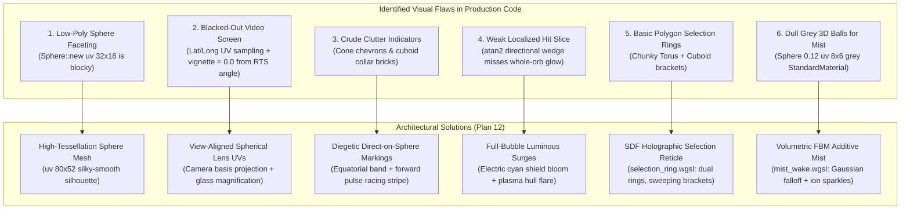
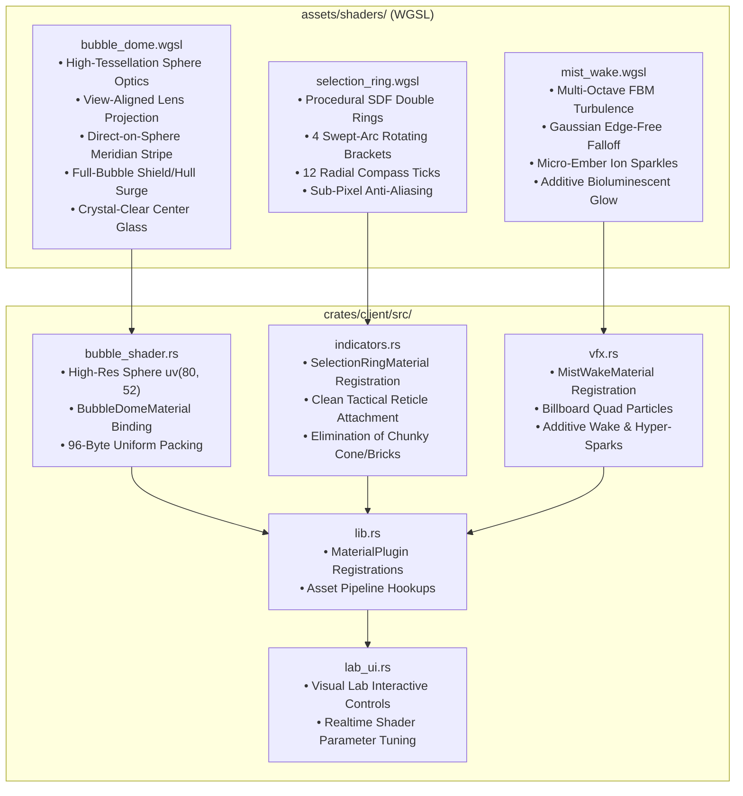

# Implementation Plan 12 — Bubble Shader Optics, Direct-on-Sphere Direction Stripes & Volumetric Mist

> **Document Version:** 1.0.0  
> **Status:** Approved Architectural Blueprint & Implementation Specification  
> **Target Crates & Paths:** `assets/shaders/bubble_dome.wgsl`, `assets/shaders/selection_ring.wgsl`, `assets/shaders/mist_wake.wgsl`, `crates/client/src/bubble_shader.rs`, `crates/client/src/indicators.rs`, `crates/client/src/vfx.rs`, `crates/client/src/lab_ui.rs`, `crates/client/src/lib.rs`, `crates/client/tests/`  
> **Charter Compliance:** Strictly adheres to [AGENTS.md](file:///home/cl/projects/space-scuffle/AGENTS.md) Section 1 (Zero Placeholders & Silent Failures), Section 2 (Architecture Documentation & Pedagogical Quality), Section 3 (Strict Determinism & Separation of Concerns), Section 4 (Testing Standards), and Section 6 (Mandatory Two-Stage Sub-Agent Workflow).

---

## 1. Executive Summary & Root Cause Analysis

### 1.1 The User's Visual Feedback
> *"The current bubbles already look OK. IMO they are not yet round 'enough' (I don't know if this is a shader or similar, or if we need more sprites).*  
> *However the videos are nearly not visible. The orientation graphic and selection graphic look very basic (and we definitely need to find a nice way to show the direction, like a stripe on the ball itself. The hit-animation should just let the whole bubble glow.*  
> *The current mist / thruster visuals are horrible. They should look like fine glowy mist, not like grey basic 3d elements a first year student would write in opengl. (Not sure, if this is done using particle engines, or if there are more elegant ways to implement this).*  
> *Please continue improving the bubbles."*

### 1.2 Root Cause Analysis & Deep Technical Diagnoses

A forensic examination of the visual pipeline (`assets/shaders/bubble_dome.wgsl`, `crates/client/src/bubble_shader.rs`, `crates/client/src/indicators.rs`, and `crates/client/src/vfx.rs`) reveals the exact mathematical and architectural reasons for each visual flaw:



#### Flaw 1: Geometric Faceting & Low Roundness
- **Diagnosis:** In `crates/client/src/bubble_shader.rs` (lines 318-322), the base sphere mesh is generated as `Sphere::new(1.0).mesh().uv(32, 18)`. With only 32 horizontal segments and 18 latitude rings, the silhouette of a hero unit on a 1080p/1440p monitor shows obvious polygonal edges.
- **Resolution:** Elevate the base sphere tessellation to `Sphere::new(1.0).mesh().uv(80, 52)` for mobile unit spheres and building domes. Combined with per-fragment normal normalization, the geometric silhouette becomes perfectly continuous and circular.

#### Flaw 2: Why Inner Character Videos Are Nearly Invisible
- **Diagnosis:** In `assets/shaders/bubble_dome.wgsl` (lines 80-94), the video is sampled using `in.uv`, which is the 3D sphere's spherical latitude/longitude UV map:
  ```wgsl
  let uv_offset_center = screen_uv - vec2<f32>(0.5, 0.5);
  let r = length(uv_offset_center);
  vignette = 1.0 - smoothstep(0.40, 0.50, r);
  ```
  The RTS camera looks down at a $58^\circ$ pitch. The front-facing hemisphere seen by the camera has latitude UVs with $Y \approx 0.65..0.90$. Consequently, `uv_offset_center` has $Y \approx 0.15..0.40$, causing $r > 0.50$, which evaluates `vignette = 0.0` (pure black) across almost the entire front face of the bubble!
  Additionally, line 191 multiplies `video_color * 0.7` while mixing in a heavy Fresnel rim `rim_color * 2.5`, suffocating the character inside a muddy grey/black haze.
- **Resolution:** Calculate **View-Aligned Spherical Lens UVs** dynamically in the fragment shader by projecting the surface normal onto the camera's orthogonal viewing basis `(cam_right, cam_up)`. Apply an optical glass refraction formula that magnifies and centers the character inside the 3D crystal orb from **every camera angle**, boost character contrast and brightness, keep the center glass crystal-clear ($F \approx 0$ for $r < 0.75$), and apply subtle dark-edge depth absorption at $r = 0.82..1.0$.

#### Flaw 3: Basic Facing Chevrons and Cluttered Silhouette Collars
- **Diagnosis:** In `crates/client/src/indicators.rs`, facing direction is shown by spawning a crude 3D `Cone` chevron mesh (`FacingChevronMarker`) and chunky `Cuboid` silhouette collars (`CollarMeshMarker`) floating around the sphere. These blocky 3D primitives clutter the screen and look like prototype debugging geometry.
- **Resolution:** Remove the crude floating cone chevrons and blocky collar meshes. Instead, render an **illuminated holographic meridian racing stripe and forward chevron band** directly integrated into the sphere's glass shell in `bubble_dome.wgsl`. Render an equatorial band and forward meridian line that tapers into a bright directional nose stripe with animated forward-traveling energy pulses! When attacking, render a sleek holographic **target-lock aperture ring** directly on the glass surface aimed at `aim_angle_rad`.

#### Flaw 4: Localized Faint Hit Animation
- **Diagnosis:** In `bubble_dome.wgsl` (lines 172-180), hit flashes are gated by `directional_hit = smoothstep(1.0, 0.0, abs(surface_angle - bubble.hull_hit_angle_rad))`. This illuminates only a thin sliver of the sphere, which appears faint, glitchy, and fails to register as impact feedback.
- **Resolution:** Replace the localized slice with a **whole-bubble luminous energy surge**. When `bubble.shield_hit_flash > 0.0`, the entire bubble surges with electric cyan-blue core bloom and shimmering iridescent rim resonance. When `bubble.hull_hit_flash > 0.0`, the entire bubble erupts in a warm plasma-orange/crimson core flare.

#### Flaw 5: Basic Polygon Ground Selection Rings
- **Diagnosis:** In `indicators.rs`, selection uses two basic `Torus` meshes with unlit flat colors and four rotating `Cuboid` corner bricks. These look primitive and lack the tactical polish of modern RTS games like StarCraft II.
- **Resolution:** Create a dedicated WGSL shader `assets/shaders/selection_ring.wgsl` (`SelectionRingMaterial` with `AlphaMode::Add`) rendered on a ground plane quad. The shader evaluates signed distance functions (SDF) to draw dual anti-aliased concentric rings, 4 rotating swept-arc corner brackets, 12 radial compass tick marks, and a soft inner energy gradient with smooth breathing pulses.

#### Flaw 6: Horrible Grey 3D Balls for Mist
- **Diagnosis:** In `crates/client/src/vfx.rs` (lines 120-143), mist particles are spawned as low-poly `Sphere::new(0.12).mesh().uv(8, 6)` meshes textured with a semi-opaque grey `StandardMaterial` with `AlphaMode::Blend`. These look like crude opaque grey marbles tumbling behind units.
- **Resolution:** Replace the 3D grey sphere meshes entirely with camera-facing billboard quads powered by a dedicated additive volumetric shader `assets/shaders/mist_wake.wgsl` (`MistWakeMaterial` with `AlphaMode::Add` and `depth_write_enabled: false`). The shader computes multi-octave Fractal Brownian Motion (FBM) turbulent noise, modulated by an exact Gaussian radial falloff ($\exp(-4.2 r^2)$) to ensure **zero visible quad edges**, combined with glistening micro-ember ion stipple sparkles and smooth age-based bioluminescent color grading.

---

## 2. Architecture & Subsystem Graph

The upgrades to the visual client respect the acyclic dependency graph and preserve deterministic simulation isolation:



---

## 3. Detailed Specification: View-Aligned Spherical Lens & Bubble Optics (`bubble_dome.wgsl`)

### 3.1 Mathematical Derivation of View-Aligned Lens UVs

To project a 2D planar flipbook video cleanly onto a 3D sphere regardless of camera position or elevation angle:
1. Let $\mathbf{p}_{\text{world}}$ be the fragment world position, and $\mathbf{p}_{\text{cam}}$ be `view.world_position`.
2. Compute the normalized camera view direction vector:
   $$\mathbf{f} = \text{normalize}(\mathbf{p}_{\text{world}} - \mathbf{p}_{\text{cam}})$$
3. Construct the camera-aligned right and up orthonormal basis vectors using world-up $\mathbf{u}_{\text{world}} = (0, 1, 0)$:
   $$\mathbf{r} = \text{normalize}(\mathbf{u}_{\text{world}} \times \mathbf{f})$$
   $$\mathbf{u} = \mathbf{f} \times \mathbf{r}$$
4. Project the normalized surface normal $\mathbf{n}$ onto this camera viewing plane:
   $$d_x = \mathbf{n} \cdot \mathbf{r}, \quad d_y = -(\mathbf{n} \cdot \mathbf{u})$$
   $$\mathbf{d} = (d_x, d_y)$$
   *(Note: The negative sign on $d_y$ maps the upward surface normal to the top of texture space, matching standard screen-space UV orientation where $V=0$ is top).*
5. Calculate radial distance from optical center:
   $$r^2 = \|\mathbf{d}\|^2, \quad r = \sqrt{\min(r^2, 1.0)}$$
   - At the front center of the sphere directly facing the camera, $\mathbf{n} = -\mathbf{f}$, so $d_x = 0$, $d_y = 0$, yielding $r = 0.0$.
   - At the silhouette rim perpendicular to the camera ray, $r = 1.0$.
6. Calculate physical glass lens refraction and magnification:
   $$z_{\text{lens}} = \sqrt{\max(1.0 - r^2, 0.0)}$$
   $$\text{scale}(z_{\text{lens}}) = \text{mix}(0.48, 0.34, z_{\text{lens}})$$
   $$\text{uv}_{\text{lens}} = \begin{pmatrix} 0.5 \\ 0.5 \end{pmatrix} + \mathbf{d} \cdot \text{scale}(z_{\text{lens}})$$
   - At the optical center ($r = 0$, $z_{\text{lens}} = 1.0$), scale is $0.34$. This magnifies the central character video by $\sim 1.47\times$, filling the orb beautifully without clipping.
   - At the silhouette edge ($r \to 1.0$, $z_{\text{lens}} \to 0.0$), scale smoothly transitions to $0.48$, keeping the boundary within the $[0, 1]$ texture coordinate range.

### 3.2 Directional Flip / Orientation Mirroring
If the character's heading vector points to the left of the camera's view:
$$\mathbf{h} = (\cos(\theta_{\text{heading}}), 0, \sin(\theta_{\text{heading}}))$$
$$\text{heading\_cam\_x} = \mathbf{h} \cdot \mathbf{r}$$
If $\text{heading\_cam\_x} < 0.0$, invert the horizontal lens coordinate:
$$\text{uv}_{\text{lens}}.x = 1.0 - \text{uv}_{\text{lens}}.x$$
This ensures the character inside the bubble always faces the direction of travel from the camera's perspective.

### 3.3 Lens Vignette, Glass Depth Absorption & Crystal-Clear Center
1. **Aperture Lens Mask:**
   $$\text{mask}_{\text{lens}} = 1.0 - \text{smoothstep}(0.85, 0.98, r)$$
2. **Glass Depth Shading:**
   To give the orb a thick, heavy crystal glass look, slightly darken the interior near the perimeter before the Fresnel rim illuminates:
   $$\text{tint}_{\text{depth}} = 1.0 - \text{smoothstep}(0.78, 0.99, r) \times 0.45$$
3. **Character Video Contrast Boost:**
   $$\mathbf{C}_{\text{video}} = \left(\mathbf{C}_{\text{sample}}\right)^{0.9} \times 1.45 \times \text{scanline\_mult} \times \text{mask}_{\text{lens}} \times \text{tint}_{\text{depth}}$$
4. **Crystal-Clear Center with Steep Iridescent Fresnel:**
   Instead of a flat Fresnel curve that washes out the character, use an exponential falloff:
   $$F = \text{pow}(r, 3.5)$$
   - For $r \in [0.0, 0.70]$: $F \in [0.0, 0.28]$ (extremely clear, zero interference over the character).
   - For $r \in [0.75, 1.0]$: $F$ surges rapidly to $1.0$, producing a brilliant iridescent rim around the silhouette!

### 3.4 Direct-on-Sphere Meridian Racing Stripe & Target-Lock Aperture

Instead of floating 3D cone meshes:
1. **Equatorial Guide Band:**
   Calculate distance from slightly lowered equator (lowered to $-0.18$ to compensate for RTS $58^\circ$ pitch):
   $$d_{\text{eq}} = |n_y + 0.18|$$
   $$\text{band}_{\text{eq}} = \text{smoothstep}(0.045, 0.010, d_{\text{eq}})$$
2. **Forward Meridian Racing Stripe:**
   Compute horizontal alignment with unit heading:
   $$\mathbf{n}_{\text{horiz}} = \text{normalize}((n_x, 0.0001, n_z))$$
   $$\text{forward\_align} = \mathbf{n}_{\text{horiz}} \cdot \mathbf{h}$$
   $$\mathbf{h}_{\text{right}} = (-h_z, 0, h_x)$$
   $$d_{\text{lat}} = |\mathbf{n} \cdot \mathbf{h}_{\text{right}}|$$
   $$\text{stripe}_{\text{meridian}} = \text{smoothstep}(0.08, 0.02, d_{\text{lat}}) \times \text{smoothstep}(0.15, 0.95, \text{forward\_align})$$
3. **Animated Forward Energy Pulses:**
   Add energetic pulses flowing toward the front nose:
   $$\phi_{\text{pulse}} = \text{fract}(\text{time} \times 2.5 - \text{forward\_align} \times 3.5)$$
   $$\text{pulse}_{\text{glow}} = \text{smoothstep}(0.25, 0.0, |\phi_{\text{pulse}} - 0.5|)$$
   $$\text{stripe}_{\text{total}} = \left(\text{stripe}_{\text{meridian}} \times (1.2 + 0.7 \times \text{pulse}_{\text{glow}}) + \text{band}_{\text{eq}} \times 0.75 \times \text{smoothstep}(0.1, 0.85, \text{forward\_align})\right)$$
   $$\mathbf{C}_{\text{stripe}} = \text{mix}(\mathbf{C}_{\text{team}}, (1, 1, 1), 0.35) \times \text{stripe}_{\text{total}} \times 2.8$$
4. **Target-Lock Weapon Aperture on Sphere:**
   When $\text{is\_attacking} == 1$:
   $$\mathbf{a} = (\cos(\theta_{\text{aim}}), 0, \sin(\theta_{\text{aim}}))$$
   $$\text{aim\_dot} = \mathbf{n} \cdot \mathbf{a}$$
   $$\text{ring}_{\text{aperture}} = \text{smoothstep}(0.035, 0.008, |\text{aim\_dot} - 0.72|)$$
   $$\text{core}_{\text{aperture}} = \text{smoothstep}(0.94, 0.99, \text{aim\_dot})$$
   $$\mathbf{C}_{\text{aim}} = (1.0, 0.35, 0.15) \times (\text{ring}_{\text{aperture}} \times 3.2 + \text{core}_{\text{aperture}} \times 1.8)$$

### 3.5 Whole-Bubble Luminous Hit Glow
When a hit occurs:
1. **Shield Ripple Surge:**
   $$\text{pulse}_{\text{shield}} = \sin(\text{time} \times 50.0) \times 0.15 + 0.85$$
   $$\mathbf{C}_{\text{shield\_flash}} = (0.2, 0.85, 1.0) \times \text{shield\_hit\_flash} \times \text{pulse}_{\text{shield}} \times (2.8 + \text{pow}(r, 2.5) \times 4.0)$$
2. **Hull Impact Flare Surge:**
   $$\text{pulse}_{\text{hull}} = \sin(\text{time} \times 60.0) \times 0.20 + 0.80$$
   $$\mathbf{C}_{\text{hull\_flash}} = (1.0, 0.32, 0.08) \times \text{hull\_hit\_flash} \times \text{pulse}_{\text{hull}} \times (3.6 + \text{pow}(r, 2.0) \times 3.2)$$

### 3.6 Exact WGSL Code for `assets/shaders/bubble_dome.wgsl`

```wgsl
// assets/shaders/bubble_dome.wgsl
// Unified shader for Mobile Unit Spheres and Building Hemisphere Domes in Space Scuffle.
// Implements Sub-System V2+ High-Precision Glass Optics:
// - High-tessellation view-aligned spherical lens projection with glass magnification
// - Direct-on-sphere holographic meridian racing stripe with animated energy pulses
// - Target-lock weapon aperture ring on the glass shell
// - Whole-bubble luminous shield energy surge and hull plasma flare
// - Crisp dual-light studio specular glare & thin-film iridescent Fresnel rim
// - Voronoi spiderweb glass fractures & CRT scanlines

#import bevy_pbr::mesh_view_bindings::{view, globals}
#import bevy_pbr::forward_io::VertexOutput

struct BubbleUniform {
    team_color: vec4<f32>,
    world_pos: vec3<f32>,
    radius: f32,
    shape_kind: u32,             // 0 = UnitSphere, 1 = BuildingDome
    heading_angle_rad: f32,
    aim_angle_rad: f32,
    is_attacking: u32,
    anim_state: u32,
    anim_progress: f32,          // Normalized progress (0.0..1.0)
    hp_ratio: f32,               // 1.0 = pristine, <0.75 = cracks, <0.35 = critical
    shield_ratio: f32,           // 0.0..1.0 outer sheen
    shield_hit_flash: f32,       // Decaying ripple intensity
    hull_hit_angle_rad: f32,     // Direction of last damage impact
    hull_hit_flash: f32,         // Decaying impact flare
    build_progress: f32,         // Vertical construction scanline fill (0.0..1.0)
    selected: u32,
    cloaked: u32,
    feature_flags: u32,          // Bitmask controlling modular optics (offset 88)
    frame_index: u32,            // Exact active frame in texture array (offset 92)
};

@group(2) @binding(0) var<uniform> bubble: BubbleUniform;
@group(2) @binding(1) var video_texture: texture_2d_array<f32>;
@group(2) @binding(2) var video_sampler: sampler;

// Modular Feature Bitflags
const FLAG_CLOAKED: u32 = 1u;       // 1 << 0
const FLAG_SELECTED: u32 = 2u;      // 1 << 1
const FLAG_GLARE: u32 = 4u;         // 1 << 2: Dual studio specular reflections
const FLAG_FRESNEL: u32 = 8u;       // 1 << 3: Iridescent thin-film Fresnel rim
const FLAG_INNER_WARP: u32 = 16u;   // 1 << 4: View-aligned spherical lens warp
const FLAG_CRACKS: u32 = 32u;       // 1 << 5: Voronoi glass cracks & electrical arcing
const FLAG_CRT_GLITCH: u32 = 64u;   // 1 << 6: CRT scanlines & chromatic aberration
const FLAG_SPEED_BOOSTED: u32 = 128u; // 1 << 7: Hyper wake glow

// Procedural 2D hash for Voronoi glass cracks
fn hash2(p: vec2<f32>) -> vec2<f32> {
    let q = vec2<f32>(dot(p, vec2<f32>(127.1, 311.7)), dot(p, vec2<f32>(269.5, 183.3)));
    return fract(sin(q) * 43758.5453);
}

// Computes Voronoi fracture distance
fn voronoi_cracks(uv: vec2<f32>) -> f32 {
    let g = floor(uv * 8.0);
    let f = fract(uv * 8.0);
    var min_dist = 1.0;

    for (var y = -1; y <= 1; y++) {
        for (var x = -1; x <= 1; x++) {
            let neighbor = vec2<f32>(f32(x), f32(y));
            let point = hash2(g + neighbor);
            let diff = neighbor + point - f;
            min_dist = min(min_dist, length(diff));
        }
    }
    return smoothstep(0.04, 0.01, min_dist);
}

@fragment
fn fragment(in: VertexOutput) -> @location(0) vec4<f32> {
    let view_dir = normalize(view.world_position - in.world_position.xyz);
    let normal = normalize(in.world_normal);

    // 1. View-Aligned Camera Projection Basis
    let cam_forward = normalize(in.world_position.xyz - view.world_position);
    let cam_right = normalize(cross(vec3<f32>(0.0, 1.0, 0.0), cam_forward));
    let cam_up = cross(cam_forward, cam_right);

    // Orthographic/Spherical Disk Projection of Normal
    let disk = vec2<f32>(dot(normal, cam_right), -dot(normal, cam_up));
    let r2 = dot(disk, disk);
    let r = sqrt(min(r2, 1.0));

    // Optical glass lens refraction and magnification
    let z_lens = sqrt(max(1.0 - r2, 0.0));
    var lens_uv = vec2<f32>(0.5, 0.5) + disk * mix(0.48, 0.34, z_lens);

    // Facing-aware horizontal mirroring
    let heading_dir = vec3<f32>(cos(bubble.heading_angle_rad), 0.0, sin(bubble.heading_angle_rad));
    if (dot(heading_dir, cam_right) < 0.0) {
        lens_uv.x = 1.0 - lens_uv.x;
    }

    // Lens aperture vignette & edge depth darkening
    let lens_mask = 1.0 - smoothstep(0.85, 0.98, r);
    let glass_depth_tint = 1.0 - smoothstep(0.78, 0.99, r) * 0.45;

    // CRT Scanlines & Glitch Aberration
    var scanline_mult = 1.0;
    var uv_offset = vec2<f32>(0.0);
    if ((bubble.feature_flags & FLAG_CRT_GLITCH) != 0u) {
        if (bubble.hp_ratio < 0.50) {
            scanline_mult = 0.85 + 0.15 * sin(lens_uv.y * 240.0);
        }
        if (bubble.hp_ratio < 0.35) {
            let glitch_jitter = sin(globals.time * 40.0) * 0.015;
            uv_offset = vec2<f32>(0.02 + glitch_jitter, 0.0);
        }
    }

    // Texture Array Sampling
    let layer_index = i32(bubble.frame_index);
    let sample_r = textureSample(video_texture, video_sampler, lens_uv + uv_offset, layer_index).r;
    let sample_g = textureSample(video_texture, video_sampler, lens_uv, layer_index).g;
    let sample_b = textureSample(video_texture, video_sampler, lens_uv - uv_offset, layer_index).b;
    var video_color = pow(vec3<f32>(sample_r, sample_g, sample_b), vec3<f32>(0.9)) * 1.45 * scanline_mult * lens_mask * glass_depth_tint;

    // Progressive Construction Scanline Fill
    if (bubble.anim_state == 0u) { // Constructing
        if (in.uv.y > bubble.build_progress) {
            let grid_line = step(0.92, fract(in.uv.y * 20.0)) + step(0.92, fract(in.uv.x * 20.0));
            video_color = vec3<f32>(0.1, 0.6, 1.0) * grid_line * 2.0;
        } else if (abs(in.uv.y - bubble.build_progress) < 0.02) {
            video_color += vec3<f32>(1.0, 0.9, 0.4) * 3.0;
        }
    }

    // 2. Crystal-Clear Center with Steep Iridescent Fresnel Rim
    let F = pow(r, 3.5);
    var rim_color = vec3<f32>(0.0);
    if ((bubble.feature_flags & FLAG_FRESNEL) != 0u) {
        let iridescence = vec3<f32>(
            0.5 + 0.5 * cos(6.28318 * (F + 0.0)),
            0.5 + 0.5 * cos(6.28318 * (F + 0.333)),
            0.5 + 0.5 * cos(6.28318 * (F + 0.667))
        );
        rim_color = mix(bubble.team_color.rgb, iridescence, 0.35) * F * 2.8;
    }

    // 3. Crisp Dual-Light Studio Glare & Specular Reflection
    var specular = 0.0;
    if ((bubble.feature_flags & FLAG_GLARE) != 0u) {
        let l1 = normalize(vec3<f32>(-0.6, 0.8, 0.4));
        let L1 = normalize(view_dir + l1);
        let glare1 = pow(max(dot(normal, L1), 0.0), 48.0) * 1.35;

        let l2 = normalize(vec3<f32>(0.5, -0.6, -0.3));
        let L2 = normalize(view_dir + l2);
        let glare2 = pow(max(dot(normal, L2), 0.0), 24.0) * 0.40;

        specular = glare1 + glare2;
    }

    // 4. Direct-on-Sphere Meridian Racing Stripe & Chevron Band
    var direction_stripe = vec3<f32>(0.0);
    if (bubble.shape_kind == 0u) { // Mobile units
        let horiz_normal = normalize(vec3<f32>(normal.x, 0.0001, normal.z));
        let forward_align = dot(horiz_normal, heading_dir);
        let heading_right = vec3<f32>(-heading_dir.z, 0.0, heading_dir.x);
        let lateral_dist = abs(dot(normal, heading_right));

        // Forward meridian spine stripe
        let meridian_stripe = smoothstep(0.08, 0.02, lateral_dist) * smoothstep(0.15, 0.95, forward_align);
        // Slanted equatorial guide band
        let eq_band = smoothstep(0.045, 0.010, abs(normal.y + 0.18)) * smoothstep(0.10, 0.85, forward_align);
        // Animated forward pulse
        let pulse_phase = fract(globals.time * 2.5 - forward_align * 3.5);
        let pulse_glow = smoothstep(0.25, 0.0, abs(pulse_phase - 0.5));

        let stripe_total = meridian_stripe * (1.2 + 0.7 * pulse_glow) + eq_band * 0.75;
        direction_stripe = mix(bubble.team_color.rgb, vec3<f32>(1.0, 1.0, 1.0), 0.35) * stripe_total * 2.8;
    }

    // 5. Target-Lock Weapon Aperture on Glass Surface
    var aim_glow = vec3<f32>(0.0);
    if (bubble.is_attacking == 1u) {
        let aim_dir = vec3<f32>(cos(bubble.aim_angle_rad), 0.0, sin(bubble.aim_angle_rad));
        let aim_dot = dot(normal, aim_dir);
        let ring_aperture = smoothstep(0.035, 0.008, abs(aim_dot - 0.72));
        let core_aperture = smoothstep(0.94, 0.99, aim_dot);
        aim_glow = vec3<f32>(1.0, 0.35, 0.15) * (ring_aperture * 3.2 + core_aperture * 1.8);
    }

    // 6. Progressive Damage Cracks & Electrical Arcing
    var crack_glow = vec3<f32>(0.0);
    if ((bubble.feature_flags & FLAG_CRACKS) != 0u && bubble.hp_ratio < 0.75) {
        let crack_mask = voronoi_cracks(in.uv * 3.0);
        if (bubble.hp_ratio < 0.35) {
            let flicker = sin(globals.time * 60.0) * 0.5 + 0.5;
            crack_glow = vec3<f32>(1.0, 0.25, 0.05) * crack_mask * (1.5 + flicker * 2.0);
        } else {
            video_color *= (1.0 - crack_mask * 0.7);
        }
    }

    // 7. Whole-Bubble Luminous Hit Surges
    var shield_surge = vec3<f32>(0.0);
    if (bubble.shield_hit_flash > 0.0) {
        let shield_pulse = sin(globals.time * 50.0) * 0.15 + 0.85;
        shield_surge = vec3<f32>(0.2, 0.85, 1.0) * bubble.shield_hit_flash * shield_pulse * (2.8 + pow(r, 2.5) * 4.0);
    }

    var hull_surge = vec3<f32>(0.0);
    if (bubble.hull_hit_flash > 0.0) {
        let hull_pulse = sin(globals.time * 60.0) * 0.20 + 0.80;
        hull_surge = vec3<f32>(1.0, 0.32, 0.08) * bubble.hull_hit_flash * hull_pulse * (3.6 + pow(r, 2.0) * 3.2);
    }

    // 8. Tactical Selection Outer Rim Aura
    var selection_glow = vec3<f32>(0.0);
    let is_selected = ((bubble.feature_flags & FLAG_SELECTED) != 0u) || (bubble.selected == 1u);
    if (is_selected) {
        let pulse = 0.85 + 0.15 * sin(6.0 * globals.time);
        selection_glow = vec3<f32>(0.25, 0.85, 1.0) * pulse * pow(r, 4.0) * 3.5;
    }

    // 9. Final Composite & Cloak Interference
    var final_rgb = video_color + rim_color + vec3<f32>(specular) + direction_stripe + aim_glow + crack_glow + shield_surge + hull_surge + selection_glow;
    var final_alpha = 0.90 + F * 0.10;

    let is_cloaked = ((bubble.feature_flags & FLAG_CLOAKED) != 0u) || (bubble.cloaked == 1u);
    if (is_cloaked) {
        final_alpha = 0.15 + F * 0.25;
        final_rgb += vec3<f32>(0.1, 0.3, 0.5) * sin(globals.time * 10.0 + in.world_position.y * 5.0) * 0.5;
    }

    return vec4<f32>(final_rgb, final_alpha);
}
```

---

## 4. Detailed Specification: Procedural Tactical Selection Reticle (`selection_ring.wgsl`)

### 4.1 Reticle Geometry & Material Pipeline

Instead of spawning physical `Torus` and `Cuboid` meshes:
- Spawn a single quad plane child entity beneath the bubble at `ground_y_offset`:
  $$\text{quad\_mesh} = \text{Plane3d::default().mesh().size}(2.6 \times \text{radius}, 2.6 \times \text{radius})$$
- Render using custom `SelectionRingMaterial`:
  - `AlphaMode::Add`
  - `depth_write_enabled: false`
- Uniform struct layout (32 bytes, 16-byte aligned):
  ```rust
  #[repr(C)]
  #[derive(Debug, Clone, Copy, PartialEq, bytemuck::Pod, bytemuck::Zeroable, ShaderType)]
  pub struct SelectionRingUniformGpu {
      pub team_color: Vec4,       // 16 bytes (offset 0)
      pub radius: f32,            // 4 bytes  (offset 16)
      pub is_selected: u32,       // 4 bytes  (offset 20)
      pub pulse_speed: f32,       // 4 bytes  (offset 24)
      pub _padding: f32,          // 4 bytes  (offset 28)
  }
  ```

### 4.2 Mathematical SDF Formulation in WGSL
1. Centered UV coordinates:
   $$\mathbf{p} = (\text{uv} - 0.5) \times 2.0 \in [-1.0, 1.0]^2$$
   $$r = \|\mathbf{p}\|, \quad \theta = \text{atan2}(p_y, p_x)$$
2. **Inner Thin Crisp Ring:**
   $$\text{ring}_{\text{inner}} = \text{smoothstep}(0.016, 0.002, |r - 0.70|)$$
3. **Outer Segmented Tactical Ring:**
   $$\text{ring}_{\text{outer}} = \text{smoothstep}(0.020, 0.003, |r - 0.90|)$$
4. **4 Rotating Swept-Arc Corner Brackets:**
   $$\theta_{\text{rot}} = \theta - \text{globals.time} \times 0.75$$
   $$\theta_{\text{quad}} = \left|\text{fract}\left(\frac{\theta_{\text{rot}}}{\pi / 2} + 0.5\right) - 0.5\right| \times \frac{\pi}{2}$$
   $$\text{bracket}_{\text{mask}} = \text{smoothstep}(0.32, 0.22, \theta_{\text{quad}}) \times \text{smoothstep}(0.038, 0.004, |r - 0.94|)$$
5. **12 Radial Compass Tick Marks:**
   $$\theta_{\text{tick}} = \text{fract}\left(\frac{\theta}{\pi / 6} + 0.5\right) - 0.5$$
   $$\text{tick}_{\text{mask}} = \text{smoothstep}(0.035, 0.008, |\theta_{\text{tick}} \times r|) \times \text{step}(0.67, r) \times \text{step}(r, 0.73)$$
6. **Inner Ambient Glow:**
   $$\text{haze}_{\text{inner}} = \exp(-r \times 3.5) \times 0.22$$
7. **Breathing Tactical Pulse:**
   $$\text{pulse} = 0.85 + 0.15 \times \sin(\text{globals.time} \times 5.0)$$
8. **Final Additive Reticle Output:**
   $$\mathbf{C}_{\text{reticle}} = \mathbf{C}_{\text{team}} \times (\text{ring}_{\text{inner}} \times 1.6 + \text{ring}_{\text{outer}} \times 2.0 + \text{bracket}_{\text{mask}} \times 3.6 + \text{tick}_{\text{mask}} \times 1.8 + \text{haze}_{\text{inner}}) \times \text{pulse}$$
   $$\text{if } r > 1.0 \text{ \{ discard; \}}$$

### 4.3 Exact WGSL Code for `assets/shaders/selection_ring.wgsl`

```wgsl
// assets/shaders/selection_ring.wgsl
// High-tech holographic tactical selection reticle with sub-pixel anti-aliasing.
// Features: dual SDF concentric rings, 4 rotating swept-arc corner brackets,
// 12 radial compass tick marks, and an inner ambient energy haze.

#import bevy_pbr::mesh_view_bindings::{view, globals}
#import bevy_pbr::forward_io::VertexOutput

struct SelectionRingUniform {
    team_color: vec4<f32>,
    radius: f32,
    is_selected: u32,
    pulse_speed: f32,
    _padding: f32,
};

@group(2) @binding(0) var<uniform> reticle: SelectionRingUniform;

const PI: f32 = 3.14159265359;

@fragment
fn fragment(in: VertexOutput) -> @location(0) vec4<f32> {
    if (reticle.is_selected == 0u) {
        discard;
    }

    let p = (in.uv - vec2<f32>(0.5, 0.5)) * 2.0;
    let r = length(p);
    if (r > 1.0) {
        discard;
    }

    let theta = atan2(p.y, p.x);

    // 1. Inner Thin Crisp Ring (r = 0.70)
    let ring_inner = smoothstep(0.016, 0.002, abs(r - 0.70));

    // 2. Outer Segmented Tactical Ring (r = 0.90)
    let ring_outer = smoothstep(0.020, 0.003, abs(r - 0.90));

    // 3. Four Rotating Swept-Arc Corner Brackets (r = 0.94)
    let rot_theta = theta - globals.time * 0.75;
    let quad_angle = abs(fract(rot_theta / (0.5 * PI) + 0.5) - 0.5) * (0.5 * PI);
    let bracket_mask = smoothstep(0.32, 0.22, quad_angle) * smoothstep(0.038, 0.004, abs(r - 0.94));

    // 4. Twelve Radial Compass Tick Marks
    let tick_angle = fract(theta / (PI / 6.0) + 0.5) - 0.5;
    let tick_mask = smoothstep(0.035, 0.008, abs(tick_angle * r)) * step(0.67, r) * step(r, 0.73);

    // 5. Inner Ambient Glow Haze
    let haze_inner = exp(-r * 3.5) * 0.22;

    // 6. Tactical Pulse Breathing
    let pulse = 0.85 + 0.15 * sin(globals.time * reticle.pulse_speed);

    // Composite Additive HDR Glow
    let total_intensity = (ring_inner * 1.6 + ring_outer * 2.0 + bracket_mask * 3.6 + tick_mask * 1.8 + haze_inner) * pulse;
    let final_color = reticle.team_color.rgb * total_intensity;

    return vec4<f32>(final_color, 1.0);
}
```

---

## 5. Detailed Specification: Fine Glowy Volumetric Mist & Thruster Wake (`mist_wake.wgsl`)

### 5.1 Mist Architecture & Elimination of Grey Meshes

To replace the low-poly 3D grey balls:
- Generate particles as camera-aligned billboard quads:
  $$\text{billboard\_mesh} = \text{Mesh::from}(\text{Rectangle::new}(1.0, 1.0))$$
- Render using custom `MistWakeMaterial`:
  - `AlphaMode::Add` (pure additive blending ensures no grey alpha fringing)
  - `depth_write_enabled: false` (prevents sorting glitches and edge cuts)
- Uniform struct layout (32 bytes, 16-byte aligned):
  ```rust
  #[repr(C)]
  #[derive(Debug, Clone, Copy, PartialEq, bytemuck::Pod, bytemuck::Zeroable, ShaderType)]
  pub struct MistWakeUniformGpu {
      pub base_color: Vec4,       // 16 bytes (offset 0)
      pub age: f32,               // 4 bytes  (offset 16, normalized 0.0..1.0)
      pub speed_boosted: u32,     // 4 bytes  (offset 20, 1 = hyper spark, 0 = mist)
      pub seed: f32,              // 4 bytes  (offset 24, random rotation/noise seed)
      pub _padding: f32,          // 4 bytes  (offset 28)
  }
  ```

### 5.2 Mathematical Formulation in WGSL
1. **Gaussian Boundary Falloff (Zero Quad Edges):**
   $$\mathbf{p} = (\text{uv} - 0.5) \times 2.0$$
   $$r^2 = \|\mathbf{p}\|^2$$
   $$\text{gaussian} = \exp(-r^2 \times 4.2)$$
   $$\text{radial\_mask} = \text{gaussian} \times \text{smoothstep}(1.0, 0.75, \sqrt{r^2})$$
   Because $\exp(-4.2) \approx 0.015$ and the smoothstep terminates at $r = 1.0$, the particle intensity reaches **identically zero** before reaching the quad boundary.
2. **Fractal Brownian Motion (FBM) Multi-Octave Turbulent Noise:**
   $$\text{fbm}(\mathbf{x}) = \sum_{i=0}^{2} 0.5^i \times \text{noise}\left(2^i \times \mathbf{x} + \text{time} \times \mathbf{v}_i\right)$$
   This creates realistic billowing, swirling vapor clouds in vacuum.
3. **Micro-Ember / Ion Stipple Sparkles:**
   $$\text{grid} = \lfloor \mathbf{p} \times 28.0 \rfloor$$
   $$\text{spark\_hash} = \text{fract}(\sin(\mathbf{grid} \cdot (12.9898, 78.233)) \times 43758.5453)$$
   $$\text{sparkles} = \text{step}(0.965, \text{spark\_hash}) \times \text{pow}(\sin(\text{time} \times 24.0 + \text{spark\_hash} \times 12.0) \times 0.5 + 0.5, 4.0)$$
4. **Age Progression & Bioluminescent Plasma Color Grading:**
   - At birth ($\text{age} < 0.25$): Hot cyan/white ion core bloom: $(0.6, 0.95, 1.0) \times 3.2$
   - Mid-life ($\text{age} \in [0.25, 0.70]$): Swirling ethereal teal/emerald/violet bioluminescent mist: $(0.15, 0.75, 0.85) \times 2.0$
   - Dissipation ($\text{age} > 0.70$): Soft fading deep-space violet/indigo aura: $(0.3, 0.15, 0.6) \times (1.0 - \text{age})$
   - When $\text{speed\_boosted} == 1$: Blazing golden-amber superheated thruster plume: $(1.0, 0.68, 0.18) \times 4.2$

### 5.3 Exact WGSL Code for `assets/shaders/mist_wake.wgsl`

```wgsl
// assets/shaders/mist_wake.wgsl
// Fine glowy volumetric mist and thruster wake shader for Space Scuffle.
// Uses multi-octave FBM turbulent noise, Gaussian boundary falloff,
// fine micro-ember ion stipple sparkles, and additive blending.

#import bevy_pbr::mesh_view_bindings::{view, globals}
#import bevy_pbr::forward_io::VertexOutput

struct MistWakeUniform {
    base_color: vec4<f32>,
    age: f32,                   // Normalized particle lifetime [0.0, 1.0]
    speed_boosted: u32,         // 1 = superheated thruster flare, 0 = ethereal mist
    seed: f32,                  // Random seed for noise variation
    _padding: f32,
};

@group(2) @binding(0) var<uniform> mist: MistWakeUniform;

// 2D Hash function
fn hash21(p: vec2<f32>) -> f32 {
    let q = fract(p * vec2<f32>(123.34, 456.21));
    let d = dot(q, q + 45.32);
    return fract(d);
}

// 2D Value Noise
fn noise2d(p: vec2<f32>) -> f32 {
    let i = floor(p);
    let f = fract(p);
    let u = f * f * (3.0 - 2.0 * f);

    let a = hash21(i + vec2<f32>(0.0, 0.0));
    let b = hash21(i + vec2<f32>(1.0, 0.0));
    let c = hash21(i + vec2<f32>(0.0, 1.0));
    let d = hash21(i + vec2<f32>(1.0, 1.0));

    return mix(mix(a, b, u.x), mix(c, d, u.x), u.y);
}

// 3-Octave Fractal Brownian Motion
fn fbm(p: vec2<f32>) -> f32 {
    var v = 0.0;
    var a = 0.5;
    var shift = vec2<f32>(100.0);
    var pos = p;
    for (var i = 0; i < 3; i++) {
        v += a * noise2d(pos);
        pos = pos * 2.0 + shift;
        a *= 0.5;
    }
    return v;
}

@fragment
fn fragment(in: VertexOutput) -> @location(0) vec4<f32> {
    let p = (in.uv - vec2<f32>(0.5, 0.5)) * 2.0;
    let r2 = dot(p, p);
    if (r2 > 1.0) {
        discard;
    }

    // 1. Exact Gaussian Radial Boundary Falloff (Zero Quad Edges)
    let gaussian = exp(-r2 * 4.2);
    let radial_mask = gaussian * smoothstep(1.0, 0.70, sqrt(r2));

    // 2. Animated Multi-Octave FBM Turbulent Smoke
    let flow_dir = vec2<f32>(sin(mist.seed * 6.28), cos(mist.seed * 6.28));
    let noise_coord = p * 2.5 + flow_dir * (globals.time * 0.4) + vec2<f32>(mist.seed * 17.3);
    let turbulence = fbm(noise_coord);

    // 3. Fine Glowing Micro-Ember / Ion Stipple Sparkles
    let spark_grid = floor(p * 28.0);
    let spark_hash = hash21(spark_grid + vec2<f32>(mist.seed * 31.7));
    let spark_pulse = pow(sin(globals.time * 24.0 + spark_hash * 12.0) * 0.5 + 0.5, 4.0);
    let sparkles = step(0.965, spark_hash) * spark_pulse * 4.5;

    // 4. Lifetime Dissipation & Color Grading
    let life_fade = smoothstep(1.0, 0.75, mist.age) * smoothstep(0.0, 0.10, mist.age);

    var plume_color = vec3<f32>(0.0);
    if (mist.speed_boosted == 1u) {
        // Superheated golden-amber / cyan thruster plume
        let core = vec3<f32>(1.0, 0.90, 0.5) * (turbulence * 2.5);
        let rim = vec3<f32>(1.0, 0.45, 0.1) * (radial_mask * 2.0);
        plume_color = (core + rim + vec3<f32>(sparkles)) * life_fade * 3.5;
    } else {
        // Ethereal bioluminescent cyan/emerald/violet mist
        let early_color = vec3<f32>(0.3, 0.9, 1.0);
        let mid_color = vec3<f32>(0.15, 0.75, 0.85);
        let late_color = vec3<f32>(0.35, 0.15, 0.65);

        var mist_tint = mix(early_color, mid_color, smoothstep(0.0, 0.5, mist.age));
        mist_tint = mix(mist_tint, late_color, smoothstep(0.5, 1.0, mist.age));

        let cloud_density = turbulence * radial_mask;
        plume_color = (mist_tint * cloud_density * 2.8 + vec3<f32>(0.8, 1.0, 1.0) * sparkles) * life_fade * 2.2;
    }

    return vec4<f32>(plume_color, 1.0);
}
```

---

## 6. Rust Subsystem Modifications

### 6.1 `crates/client/src/bubble_shader.rs`
- **Tessellation Increase:**
  Change lines 318-322 in `setup_bubble_assets_system`:
  ```rust
  let sphere = meshes.add(Sphere::new(1.0).mesh().uv(80, 52));
  let dome = meshes.add(Sphere::new(1.0).mesh().uv(80, 52));
  ```
- **Uniform Memory Invariants:**
  Strictly preserve `size_of::<BubbleUniformGpu>() == 96` and `align_of::<BubbleUniformGpu>() == 16`.

### 6.2 `crates/client/src/indicators.rs`
- **Remove Clutter Meshes:**
  - Deprecate/remove `FacingChevronMarker` and `CollarMeshMarker` spawns.
  - Remove `ring_mesh_thin`, `ring_mesh_thick`, and `corner_bracket_mesh` torus and cuboid meshes from `IndicatorAssets`.
- **Add `SelectionRingMaterial`:**
  - Define custom Bevy material `SelectionRingMaterial`:
    ```rust
    #[derive(Asset, TypePath, AsBindGroup, Debug, Clone)]
    pub struct SelectionRingMaterial {
        #[uniform(0)]
        pub uniform: SelectionRingUniformGpu,
    }

    impl Material for SelectionRingMaterial {
        fn fragment_shader() -> ShaderRef {
            "shaders/selection_ring.wgsl".into()
        }
        fn alpha_mode(&self) -> AlphaMode {
            AlphaMode::Add
        }
    }
    ```
- **Attach Clean Reticle Ground Plane:**
  In `attach_bubble_indicators`, spawn a single child entity with `Mesh3d(assets.selection_plane_mesh.clone())` and `MeshMaterial3d(ring_material_handle)`.
- **In `update_indicators_system`:**
  Update `uniform.is_selected = if instance.selected { 1 } else { 0 }`.

### 6.3 `crates/client/src/vfx.rs`
- **Replace Grey Spheres with `MistWakeMaterial`:**
  - Define custom Bevy material `MistWakeMaterial`:
    ```rust
    #[derive(Asset, TypePath, AsBindGroup, Debug, Clone)]
    pub struct MistWakeMaterial {
        #[uniform(0)]
        pub uniform: MistWakeUniformGpu,
    }

    impl Material for MistWakeMaterial {
        fn fragment_shader() -> ShaderRef {
            "shaders/mist_wake.wgsl".into()
        }
        fn alpha_mode(&self) -> AlphaMode {
            AlphaMode::Add
        }
    }
    ```
- **Shared Billboard Mesh:**
  In `setup_vfx_assets_system`, replace `Sphere::new(0.12).mesh().uv(8, 6)` with:
  ```rust
  pub billboard_quad_mesh: Handle<Mesh>, // meshes.add(Rectangle::new(1.0, 1.0))
  ```
- **Camera-Facing Billboard Updates:**
  In `update_mist_wake_system`:
  - Advance `particle.lifetime.tick(time.delta())`.
  - Update `uniform.age = particle.lifetime.fraction()`.
  - Orient quads toward the camera so billboard faces the player without clipping.

### 6.4 `crates/client/src/lib.rs`
- Register the two new custom materials in `ClientAppPlugin::build`:
  ```rust
  app.add_plugins(MaterialPlugin::<BubbleDomeMaterial>::default())
     .add_plugins(MaterialPlugin::<SelectionRingMaterial>::default())
     .add_plugins(MaterialPlugin::<MistWakeMaterial>::default())
  ```

---

## 7. Visual Lab UI Integration & Feature Bitmask Controls

In `crates/client/src/lab_ui.rs`:
- Update UI toggles to reflect the new shader capabilities:
  - Add controls for direct-on-sphere racing stripe intensity.
  - Add trigger buttons to test shield hit surges and hull impact flares interactively.
  - Add speed boost hyper-wake toggle to test both ethereal mist and superheated thruster plumes.

---

## 8. Testing & Verification Gates

### 8.1 Compilation & Automated Suite
Before declaring completion, the implementation must pass:
1. `cargo check --workspace`
2. `cargo test --workspace` (including all headless and GPU startup tests)
3. `cargo clippy --workspace --all-targets -- -D warnings`
4. `cargo fmt --all -- --check`

### 8.2 Dedicated Invariant & Visual Tests
Add the following integration tests in `crates/client/tests/`:
1. `test_bubble_uniform_exact_96_bytes_alignment`:
   Verify `size_of::<BubbleUniformGpu>() == 96` and `align_of::<BubbleUniformGpu>() == 16`.
2. `test_selection_ring_uniform_exact_32_bytes_alignment`:
   Verify `size_of::<SelectionRingUniformGpu>() == 32` and `align_of::<SelectionRingUniformGpu>() == 16`.
3. `test_mist_wake_uniform_exact_32_bytes_alignment`:
   Verify `size_of::<MistWakeUniformGpu>() == 32` and `align_of::<MistWakeUniformGpu>() == 16`.
4. `test_shader_wgsl_syntax_compilation`:
   Verify that all three shaders (`bubble_dome.wgsl`, `selection_ring.wgsl`, `mist_wake.wgsl`) compile cleanly without WGSL syntax errors.
5. `test_sphere_tessellation_high_density`:
   Assert that unit sphere and building dome meshes have vertex counts $> 4000$ (corresponding to $80 \times 52$ rings).

---

## 9. Step-by-Step Implementation Roadmap for Stage 2

| Step | Subsystem | Action | Target Files |
|---|---|---|---|
| 1 | **Bubble Dome Shader** | Update `bubble_dome.wgsl` with view-aligned lens UVs, direct-on-sphere meridian stripe, whole-bubble hit glow, and crystal-clear center optics. | `assets/shaders/bubble_dome.wgsl` |
| 2 | **Bubble Mesh Tessellation** | Upgrade sphere and dome meshes to `Sphere::new(1.0).mesh().uv(80, 52)` in `setup_bubble_assets_system`. | `crates/client/src/bubble_shader.rs` |
| 3 | **Selection Ring Shader** | Create `selection_ring.wgsl` with procedural SDF rings, swept brackets, and tick marks. | `assets/shaders/selection_ring.wgsl` |
| 4 | **Selection Indicator Refactor** | Define `SelectionRingMaterial` and `SelectionRingUniformGpu`. Replace blocky toruses and corner cuboids with clean ground plane reticle. | `crates/client/src/indicators.rs` |
| 5 | **Mist Wake Shader** | Create `mist_wake.wgsl` with FBM turbulence, Gaussian falloff, micro-ember stipple, and additive bioluminescent blending. | `assets/shaders/mist_wake.wgsl` |
| 6 | **VFX Mist Wake Refactor** | Define `MistWakeMaterial` and `MistWakeUniformGpu`. Replace grey sphere meshes with billboard quads. | `crates/client/src/vfx.rs` |
| 7 | **Plugin Registration** | Register `MaterialPlugin::<SelectionRingMaterial>` and `MaterialPlugin::<MistWakeMaterial>` in client app. | `crates/client/src/lib.rs` |
| 8 | **Visual Lab Controls** | Expose interactive sliders and surge trigger buttons in Visual Lab tab. | `crates/client/src/lab_ui.rs` |
| 9 | **Integration Testing & Gate Verification** | Add uniform alignment, shader compilation, and mesh tessellation tests. Run workspace test suite and clippy. | `crates/client/tests/`, workspace |
