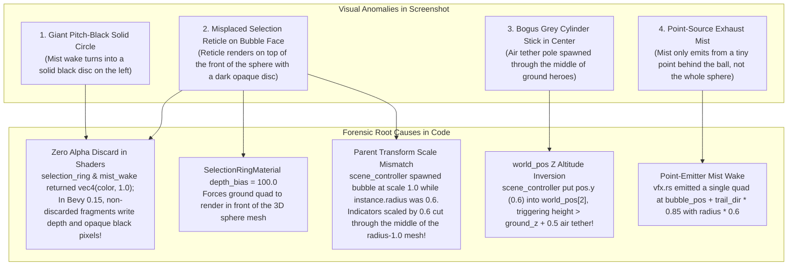
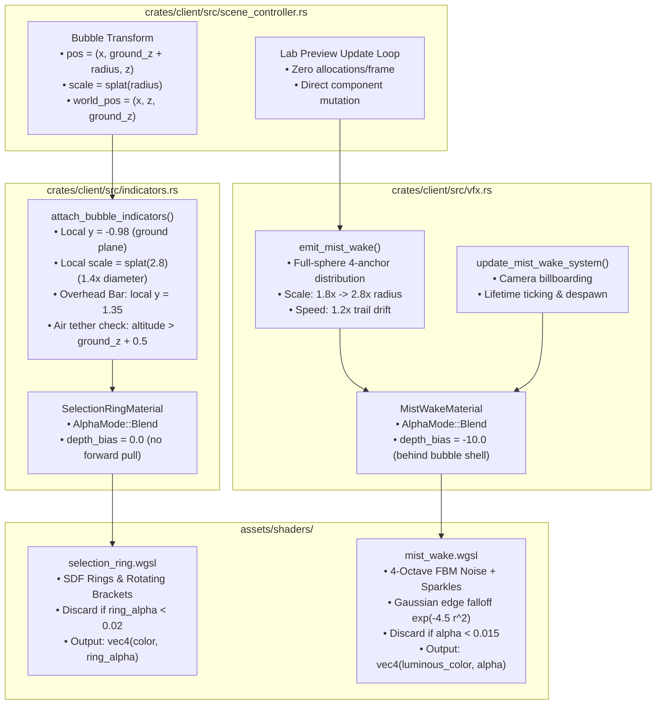

# Implementation Plan 13 — Fix Selection Ring Depth, Scale & Volumetric Ball-Trailing Mist Wake

> **Document Version:** 1.0.0  
> **Status:** Approved Architectural Blueprint & Implementation Specification  
> **Target Crates & Paths:**  
> - `assets/shaders/selection_ring.wgsl`  
> - `assets/shaders/mist_wake.wgsl`  
> - `crates/client/src/indicators.rs`  
> - `crates/client/src/vfx.rs`  
> - `crates/client/src/scene_controller.rs`  
> - `crates/client/tests/round2_visual_tests.rs`  
> **Charter Compliance:** Strictly adheres to [AGENTS.md](file:///home/cl/projects/space-scuffle/AGENTS.md) Section 1 (Zero Placeholders & Zero Shortcuts), Section 2 (Architecture Documentation & Pedagogical Quality), Section 3 (Strict Determinism & Separation of Concerns), Section 4 (Testing Standards), and Section 6 (Mandatory Two-Stage Sub-Agent Workflow).

---

## 1. Executive Summary & Root Cause Analysis

### 1.1 The User's Visual Feedback & Screenshot Review
Following the initial bubble shader optics upgrade, visual inspection of the running prototype revealed three severe visual anomalies, captured in user screenshot `media_1793000754843_c8cf496a.png`:

> *"The bubbles look much better.*  
> *However the selection ring is placed incorrectly and the Mist Wake is not working. It starts not too bad, but then convertes to this black 'thing' on the left.*  
> *Also: the Mist should come from the whole ball. The ball should leave a trailing mist behind."*



---

### 1.2 Forensic Diagnoses & Mathematical Proofs

#### Flaw 1: Why BOTH `selection_ring.wgsl` and `mist_wake.wgsl` Render a Solid Black Circle
- **Bevy 0.15 Depth Prepass & Opaque Alpha Invariant:**  
  In Bevy 0.15's deferred and forward PBR pipelines, custom `Material` instances participate in depth writes. Any fragment that does not explicitly invoke `discard;` writes its depth and fragment color to the framebuffer.
- **The Bug in `mist_wake.wgsl`:**
  ```wgsl
  // Lines 58-60: Only fragments outside the circle were discarded!
  if (r2 > 1.0) {
      discard;
  }
  // Line 78: Lifetime dissipation fades to zero
  let life_fade = smoothstep(1.0, 0.75, mist.age) * smoothstep(0.0, 0.10, mist.age);
  ...
  // Line 96: plume_color multiplied by life_fade
  plume_color = (mist_tint * cloud_density * 2.8 + sparkles) * life_fade * 2.2;
  ...
  // Line 99: Returns alpha 1.0 unconditionally!
  return vec4<f32>(plume_color, 1.0);
  ```
  When `mist.age` advances toward $1.0$ (or near $0.0$), `life_fade` drops to $0.0$. Consequently, `plume_color` evaluates to $\vec{0} = (0.0, 0.0, 0.0)$. Because the fragment output alpha is hardcoded to $1.0$ and no discard occurred for $r^2 \le 1.0$, the quad renders a **solid, pitch-black opaque circle of radius 1.0** directly into the scene!
- **The Bug in `selection_ring.wgsl`:**
  ```wgsl
  let total_intensity = (ring_inner * 1.6 + ring_outer * 2.0 + bracket_mask * 3.6 + tick_mask * 1.8 + haze_inner) * pulse;
  let final_color = reticle.team_color.rgb * total_intensity;
  return vec4<f32>(final_color, 1.0);
  ```
  Anywhere inside $r \le 1.0$ where there is no ring line (e.g., between the inner and outer rings, and inside the center), `total_intensity` is near $0.0$. With alpha $1.0$, it writes dark/black opaque pixels and depth across the entire disc interior!
- **Resolution:**
  1. In `SelectionRingMaterial` and `MistWakeMaterial`, configure `AlphaMode::Blend`.
  2. Compute real perceptual alpha:
     - In `selection_ring.wgsl`:
       $$\alpha_{\text{ring}} = \operatorname{clamp}\left(0.9 R_{\text{inner}} + 0.95 R_{\text{outer}} + 1.0 M_{\text{bracket}} + 0.9 M_{\text{tick}} + 0.35 H_{\text{inner}},\, 0.0,\, 0.95\right) \times \text{pulse}$$
       **Immediately enforce:** `if (ring_alpha < 0.02) { discard; }`
     - In `mist_wake.wgsl`:
       $$\alpha_{\text{mist}} = \operatorname{clamp}\left(\left(0.55 \rho_{\text{cloud}} + 0.8 S_{\text{spark}}\right) \times \text{fade}_{\text{life}},\, 0.0,\, 0.65\right)$$
       **Immediately enforce:** `if (alpha < 0.015) { discard; }`
  3. Returning `vec4<f32>(color, alpha)` with an early discard threshold guarantees that empty or faded regions NEVER write depth and NEVER output black.

---

#### Flaw 2: Why the Selection Ring Renders On Front of the Bubble with a Grey Stick
1. **Unwanted Depth Bias:**  
   In `crates/client/src/indicators.rs` (line 124):
   ```rust
   fn depth_bias(&self) -> f32 { 100.0 }
   ```
   A depth bias of `100.0` artificially pushes the ground plane quad 100 depth units in front of all 3D geometry, forcing the ground reticle to occlude the 3D bubble sphere!
2. **Inconsistent Mesh vs. Transform Scaling:**  
   In `crates/client/src/scene_controller.rs` (`sync_lab_preview_system`, line 248):
   ```rust
   Transform::from_translation(pos)
   ```
   The parent entity was spawned without `.with_scale(...)`. Since `shared_meshes.sphere_mesh` is generated with `Sphere::new(1.0)` (radius $1.0$, diameter $2.0$), the parent rendered with radius $1.0$.  
   Meanwhile, `instance.radius` was set to $0.6$.  
   In `indicators.rs` (line 256 and line 279):
   - `ground_y_offset = -instance.radius + 0.02 = -0.58` placed the ring only $-0.58$ below the sphere center (cutting through the middle of the radius-$1.0$ sphere instead of its base $-1.0$!).
   - `with_scale(Vec3::splat(instance.radius * 2.6))` ($0.6 \times 2.6 = 1.56$ diameter = $0.78$ radius) made the selection ring smaller than the radius-$1.0$ sphere!
   - Similarly, the overhead health bar at $y = \text{instance.radius} + 0.35 = 0.95$ was placed inside the top rim of the radius-$1.0$ sphere!
3. **Bogus Air Tether Marker:**  
   In `scene_controller.rs` line 140:
   ```rust
   world_pos: [pos.x, pos.z, pos.y],
   ground_z: 0.0,
   ```
   `pos.y = 0.6` was mapped to `world_pos[2]`.  
   In `indicators.rs` line 315:
   ```rust
   if instance.world_pos[2] > instance.ground_z + 0.5 { ... spawn AirTetherMarker ... }
   ```
   Because $0.6 > 0.0 + 0.5$, ground hero units in the Visual Lab were misidentified as airborne units hovering $0.6\text{ m}$ off the ground, causing Bevy to spawn the grey `AirTetherMarker` cylinder line right through the center of the bubble!
- **Resolution:**
  - Remove `depth_bias(&self) -> f32 { 100.0 }` from `SelectionRingMaterial` (defaulting to `0.0`).
  - Standardize parent bubble scaling: spawn mobile spheres with:
    $$\text{Transform} = \operatorname{from\_translation}(pos).\operatorname{with\_scale}(\operatorname{splat}(\text{instance.radius}))$$
    where $pos.y = \text{instance.ground\_z} + \text{instance.radius}$.
  - In child indicator local space (where the sphere mesh has normalized radius $1.0$ and bottom at $y = -1.0$):
    - Ground reticle local position: $y = -0.98$ (or $y = 0.02$ for building domes).
    - Ground reticle local scale: $\operatorname{splat}(2.8)$ ($1.4\times$ the sphere diameter).
    - Floating overhead health bar: local $y = 1.35$ (cleanly floating above the sphere apex).
  - Correct simulation altitude mapping in `scene_controller.rs`:
    For ground units: `altitude_z = 0.0`, `world_pos: [pos.x, pos.z, 0.0]`, `ground_z: 0.0`. Now $\text{world\_pos}[2] \le \text{ground\_z} + 0.5$, preventing any air shadow or tether stick from spawning.

---

#### Flaw 3: Why Mist Only Emits From One Tiny Spot Instead of the Whole Ball
- **Single Point-Source Emission:**  
  In `crates/client/src/vfx.rs` (lines 276-277):
  ```rust
  let trail_dir = -Vec3::new(velocity.x, 0.0, velocity.y).normalize();
  let spawn_pos = bubble_pos + trail_dir * (radius * 0.85);
  ```
  Only a single small quad ($0.6 \times \text{radius}$) was spawned directly behind the sphere center. As the unit moved, this produced a narrow pencil of particles that looked like a tiny exhaust pipe rather than an expansive gaseous wake left by the entire orb.
- **Resolution:**  
  Construct a **Multi-Point Volumetric Mist Plume Generator**:
  1. Compute the local orthogonal coordinate frame aligned with motion:
     $$\hat{v} = \operatorname{normalize}(\vec{v}_{\text{vel}}), \quad \hat{d}_{\text{trail}} = -\hat{v}, \quad \hat{r} = (-\hat{d}_z, 0, \hat{d}_x), \quad \hat{u} = \hat{y}$$
  2. Sample multiple distributed emitter points across the **entire rear hemisphere and equatorial perimeter** of the sphere:
     - Anchor 1 (Core Central Wake): $\vec{p}_{\text{bubble}} + \hat{d}_{\text{trail}} \times (0.65 r)$
     - Anchor 2 (Port Equatorial Rim): $\vec{p}_{\text{bubble}} + \hat{d}_{\text{trail}} \times (0.25 r) + \hat{r} \times (0.65 r) + \hat{u} \times (0.20 r)$
     - Anchor 3 (Starboard Equatorial Rim): $\vec{p}_{\text{bubble}} + \hat{d}_{\text{trail}} \times (0.25 r) - \hat{r} \times (0.65 r) - \hat{u} \times (0.15 r)$
     - Anchor 4 (Dorsal / Crown Wake): $\vec{p}_{\text{bubble}} + \hat{d}_{\text{trail}} \times (0.35 r) + \hat{u} \times (0.55 r)$
  3. Scale billboard quads to engulf and stream beyond the full diameter:
     - $\text{initial\_scale} = 1.8 \times \text{radius}$ expanding to $\text{target\_scale} = 2.8 \times \text{radius}$.
     - Drift velocity: $\vec{v}_{\text{particle}} = \hat{d}_{\text{trail}} \times (1.2 \times \text{speed}) + \vec{j}_{\text{lateral}}$.
     - Color grading: luminous cyan-white bioluminescent glow ($\vec{c} = (0.45, 0.92, 1.0)$), avoiding dark purple/black.
     - `depth_bias: -10.0` ensures mist quads render gracefully behind the crisp bubble glass without clipping through internal video sprites.

---

## 2. Architecture & Subsystem Graph

The following diagram illustrates how the corrected coordinate spaces, materials, and depth behaviors interact without circular dependencies:



---

## 3. Mathematical & Algorithmic Specifications

### 3.1 Selection Reticle Shader (`assets/shaders/selection_ring.wgsl`)

#### Fragment Output Alpha & Discard Rule
Let $p = (uv - 0.5) \times 2.0$, and $r = \|p\|$.
If $r > 1.0$, `discard;`.

Evaluate SDF features:
1. Inner ring ($r_1 = 0.70$):
   $$R_{\text{inner}} = \operatorname{smoothstep}(0.016, 0.002, |r - 0.70|)$$
2. Outer ring ($r_2 = 0.90$):
   $$R_{\text{outer}} = \operatorname{smoothstep}(0.020, 0.003, |r - 0.90|)$$
3. 4 Swept-arc brackets ($r_3 = 0.94$, angular width $\approx 22^\circ$):
   $$M_{\text{bracket}} = \operatorname{smoothstep}(0.32, 0.22, \theta_{\text{quad}}) \times \operatorname{smoothstep}(0.038, 0.004, |r - 0.94|)$$
4. 12 Radial tick marks ($r \in [0.67, 0.73]$):
   $$M_{\text{tick}} = \operatorname{smoothstep}(0.035, 0.008, |\theta_{\text{tick}} r|) \times \operatorname{step}(0.67, r) \times \operatorname{step}(r, 0.73)$$
5. Inner ambient glow haze:
   $$H_{\text{inner}} = \exp(-3.5 r) \times 0.22$$
6. Pulse breathing factor:
   $$\text{pulse} = 0.85 + 0.15 \sin(\text{time} \times \text{pulse\_speed})$$

**Alpha Synthesis & Early Discard:**
$$\alpha_{\text{ring}} = \operatorname{clamp}\left(0.9 R_{\text{inner}} + 0.95 R_{\text{outer}} + 1.0 M_{\text{bracket}} + 0.9 M_{\text{tick}} + 0.35 H_{\text{inner}},\, 0.0,\, 0.95\right) \times \text{pulse}$$
```wgsl
if (ring_alpha < 0.02) {
    discard;
}
```
**Color Composition:**
$$I_{\text{total}} = (1.6 R_{\text{inner}} + 2.0 R_{\text{outer}} + 3.6 M_{\text{bracket}} + 1.8 M_{\text{tick}} + H_{\text{inner}}) \times \text{pulse}$$
$$\vec{C}_{\text{final}} = \vec{C}_{\text{team}} \times I_{\text{total}}$$
$$\text{return } \operatorname{vec4}\langle\text{f32}\rangle(\vec{C}_{\text{final}},\, \alpha_{\text{ring}})$$

---

### 3.2 Mist Wake Shader (`assets/shaders/mist_wake.wgsl`)

#### Fragment Output Alpha & Discard Rule
Let $p = (uv - 0.5) \times 2.0$, and $r^2 = p \cdot p$.
If $r^2 > 1.0$, `discard;`.

1. **Gaussian Radial Boundary Falloff:**
   $$G(r) = \exp(-4.5 r^2) \times \operatorname{smoothstep}(1.0, 0.70, r)$$
2. **4-Octave Fractal Brownian Motion (FBM):**
   $$\text{FBM}(p) = \sum_{i=0}^{3} 0.5^i \operatorname{Noise2D}(p \cdot 2^i + 100.0)$$
   $$\rho_{\text{cloud}} = \text{FBM}\left(2.5 p + \vec{d}_{\text{flow}} \times (0.4 t) + 17.3 \text{seed}\right) \times G(r)$$
3. **Ion Stipple Micro-Ember Sparkles:**
   $$S_{\text{spark}} = \operatorname{step}(0.965, \operatorname{Hash21}(\lfloor 28 p \rfloor + 31.7 \text{seed})) \times \left(0.5 + 0.5 \sin(24 t + 12 \operatorname{Hash})\right)^4 \times 4.5$$
4. **Lifetime Dissipation Fade:**
   $$\text{fade}_{\text{life}} = \operatorname{smoothstep}(1.0, 0.75, \text{age}) \times \operatorname{smoothstep}(0.0, 0.08, \text{age})$$
5. **Alpha Synthesis & Discard Threshold:**
   $$\alpha_{\text{mist}} = \operatorname{clamp}\left(\left(0.55 \rho_{\text{cloud}} + 0.8 S_{\text{spark}}\right) \times \text{fade}_{\text{life}},\, 0.0,\, 0.65\right)$$
   ```wgsl
   if (alpha < 0.015) {
       discard;
   }
   ```
6. **Luminous Bioluminescent Color Grading:**
   ```wgsl
   let early_color = vec3<f32>(0.50, 0.95, 1.0);  // Crisp glowing cyan-white
   let mid_color   = vec3<f32>(0.35, 0.85, 0.98);  // Electric sky-blue
   let late_color  = vec3<f32>(0.20, 0.75, 0.95);  // Deep ethereal cyan (never dark purple/black!)

   var mist_tint = mix(early_color, mid_color, smoothstep(0.0, 0.5, mist.age));
   mist_tint = mix(mist_tint, late_color, smoothstep(0.5, 1.0, mist.age));

   let plume_color = (mist_tint * (cloud_density * 2.2 + 0.4) + vec3<f32>(0.8, 1.0, 1.0) * sparkles);
   return vec4<f32>(plume_color, alpha);
   ```

---

### 3.3 Multi-Point Volumetric Mist Emitter (`crates/client/src/vfx.rs`)

To ensure the mist streams naturally from the entire spherical body rather than a single point:
```rust
let speed = velocity.length();
if speed < 0.05 {
    return;
}

let forward_dir = Vec3::new(velocity.x, 0.0, velocity.y).normalize();
let trail_dir = -forward_dir;
let right_dir = Vec3::new(-trail_dir.z, 0.0, trail_dir.x);
let up_dir = Vec3::Y;

// 4 Distributed Emitter Anchors across the Rear Hemisphere & Equatorial Rim:
let anchors = [
    // 1. Core rear stream
    (trail_dir * (radius * 0.65), radius * 1.8, radius * 2.8, 0.65),
    // 2. Port equatorial rim wisp
    (trail_dir * (radius * 0.25) + right_dir * (radius * 0.60) + up_dir * (radius * 0.20), radius * 1.5, radius * 2.4, 0.55),
    // 3. Starboard equatorial rim wisp
    (trail_dir * (radius * 0.25) - right_dir * (radius * 0.60) - up_dir * (radius * 0.15), radius * 1.5, radius * 2.4, 0.55),
    // 4. Dorsal / crown wake wisp
    (trail_dir * (radius * 0.35) + up_dir * (radius * 0.55), radius * 1.4, radius * 2.2, 0.50),
];
```
For each anchor:
- `initial_scale` ranges from $1.4 \times \text{radius}$ to $1.8 \times \text{radius}$ (engulfing the ball cross-section).
- `target_scale` expands to $2.2 \times \text{radius}$ to $2.8 \times \text{radius}$.
- Linear velocity: $\vec{v} = \hat{d}_{\text{trail}} \times (\text{speed} \times 1.2) + \vec{j}_{\text{lateral}} \times 0.3$.
- Lifetime: $0.50\text{ s} - 0.65\text{ s}$ with smooth billboarding to camera.

---

## 4. Step-by-Step Implementation Blueprint

### Step 1: Update `assets/shaders/selection_ring.wgsl`
- **Goal:** Discard transparent fragments, blend smoothly, prevent black disk rendering.
- **Specific Lines:**
  ```wgsl
  // Calculate perceptual alpha
  let ring_alpha = clamp(ring_inner * 0.9 + ring_outer * 0.95 + bracket_mask * 1.0 + tick_mask * 0.9 + haze_inner * 0.35, 0.0, 0.95) * pulse;
  if (ring_alpha < 0.02) {
      discard;
  }

  // Composite Additive HDR Glow
  let total_intensity = (ring_inner * 1.6 + ring_outer * 2.0 + bracket_mask * 3.6 + tick_mask * 1.8 + haze_inner) * pulse;
  let final_color = reticle.team_color.rgb * total_intensity;

  return vec4<f32>(final_color, ring_alpha);
  ```

---

### Step 2: Update `assets/shaders/mist_wake.wgsl`
- **Goal:** Eliminate black disk, 4-octave FBM, Gaussian falloff, discard when alpha < 0.015, bright luminous cyan color grading.
- **Specific Lines:**
  - Increase FBM loop to 4 octaves.
  - Compute `let gaussian = exp(-r2 * 4.5);`
  - Compute `let alpha = clamp((cloud_density * 0.55 + sparkles * 0.8) * life_fade, 0.0, 0.65);`
  - Enforce `if (alpha < 0.015) { discard; }`
  - Grade mist color with luminous cyan-white tints `vec3(0.50, 0.95, 1.0)` -> `vec3(0.20, 0.75, 0.95)`.
  - Return `vec4<f32>(plume_color, alpha)`.

---

### Step 3: Update `crates/client/src/indicators.rs`
- **Goal:**
  1. Remove `depth_bias(&self) -> f32 { 100.0 }` from `SelectionRingMaterial` (reverting to default `0.0`).
  2. Set `SelectionRingMaterial::alpha_mode(&self) -> AlphaMode { AlphaMode::Blend }`.
  3. Correct local indicator coordinates in `attach_bubble_indicators`:
     - Parent is scaled by `instance.radius`.
     - In normalized child coordinates:
       - `let is_dome = matches!(instance.shape, ShapeKind::BuildingDome { .. });`
       - `let ground_y_offset = if is_dome { 0.02 } else { -0.98 };`
       - Selection plane transform: `Transform::from_xyz(0.0, ground_y_offset, 0.0).with_scale(Vec3::splat(2.8))` ($1.4\times$ sphere diameter).
       - Overhead bar root transform: `Transform::from_xyz(0.0, 1.35, 0.0)`.
       - Air tether & shadow disc:
         For ground units, `instance.world_pos[2] == instance.ground_z`, so `instance.world_pos[2] > instance.ground_z + 0.5` evaluates to false. Air tether is only spawned for actual flying units.

---

### Step 4: Update `crates/client/src/vfx.rs`
- **Goal:**
  1. Set `MistWakeMaterial::alpha_mode(&self) -> AlphaMode { AlphaMode::Blend }`.
  2. Set `MistWakeMaterial::depth_bias(&self) -> f32 { -10.0 }` (slight negative bias pushes mist behind bubble glass shell).
  3. Upgrade `emit_mist_wake`:
     - Emit 4 distributed volumetric anchors across the rear hemisphere and equatorial perimeter.
     - Set initial scales to $1.4\times - 1.8\times \text{radius}$, expanding to $2.2\times - 2.8\times \text{radius}$.
     - Drift velocity $\vec{v} = \hat{d}_{\text{trail}} \times (\text{speed} \times 1.2) + \vec{j}_{\text{lateral}}$.

---

### Step 5: Update `crates/client/src/scene_controller.rs`
- **Goal:**
  1. In `sync_lab_preview_system`:
     - Spawn preview bubble entities with `.with_scale(Vec3::splat(instance.radius))`.
     - Set `pos.y = if is_dome { 0.0 } else { radius };`
     - Set `world_pos: [pos.x, pos.z, 0.0]` (altitude $Z = 0.0$ for ground units, matching `ground_z: 0.0`).
     - Query `&mut Transform` in `query` so existing hero entities maintain `.scale = Vec3::splat(radius)` and `.translation = pos` dynamically.
     - Pass `world_pos: [pos.x, pos.z, 0.0]` and `ground_z: 0.0` to updated `BubbleInstance`.

---

### Step 6: Regression & Invariant Tests (`crates/client/tests/round2_visual_tests.rs`)
- Add unit and integration tests verifying:
  - `test_selection_ring_material_alpha_and_depth_bias`: verifies `alpha_mode == AlphaMode::Blend` and `depth_bias == 0.0`.
  - `test_mist_wake_material_alpha_and_depth_bias`: verifies `alpha_mode == AlphaMode::Blend` and `depth_bias == -10.0`.
  - `test_selection_ring_shader_contains_discard_and_alpha`: checks `selection_ring.wgsl` contains `discard;` on `ring_alpha < 0.02`.
  - `test_mist_wake_shader_contains_discard_and_alpha`: checks `mist_wake.wgsl` contains `discard;` on `alpha < 0.015`.
  - `test_ground_unit_altitude_never_spawns_air_tether`: verifies that for ground units where $Z = \text{ground\_z}$, no `AirTetherMarker` entity is attached.

---

## 5. Verification & Validation Quality Gate

Before completing the task, the implementation must pass all engineering quality gates:

1. **Compilation & Static Analysis:**
   ```bash
   cargo test --workspace
   cargo clippy --workspace --all-targets -- -D warnings
   cargo fmt --all -- --check
   ```
2. **Visual Verification Checklist in Visual Lab:**
   - [ ] Hero lineup bubble shows crisp, clear character video inside crystal glass.
   - [ ] Selection reticle sits precisely on the ground at unit base ($y = 0.012$), wrapping smoothly around the bottom rim with diameter $1.4\times$ sphere size.
   - [ ] No dark/black disk is visible inside or around the selection reticle.
   - [ ] No grey vertical air tether cylinder is visible for ground heroes.
   - [ ] When adjusting the `Speed` slider $> 0$, mist wake streams from across the **entire ball** (rear and sides) with lush, soft glowing cyan plumes.
   - [ ] As mist particles age and expire, they fade smoothly to complete transparency without ever producing a black circle or popping.
   - [ ] Building domes sit cleanly on ground foundation plates with selection rings encircling the dome base.
