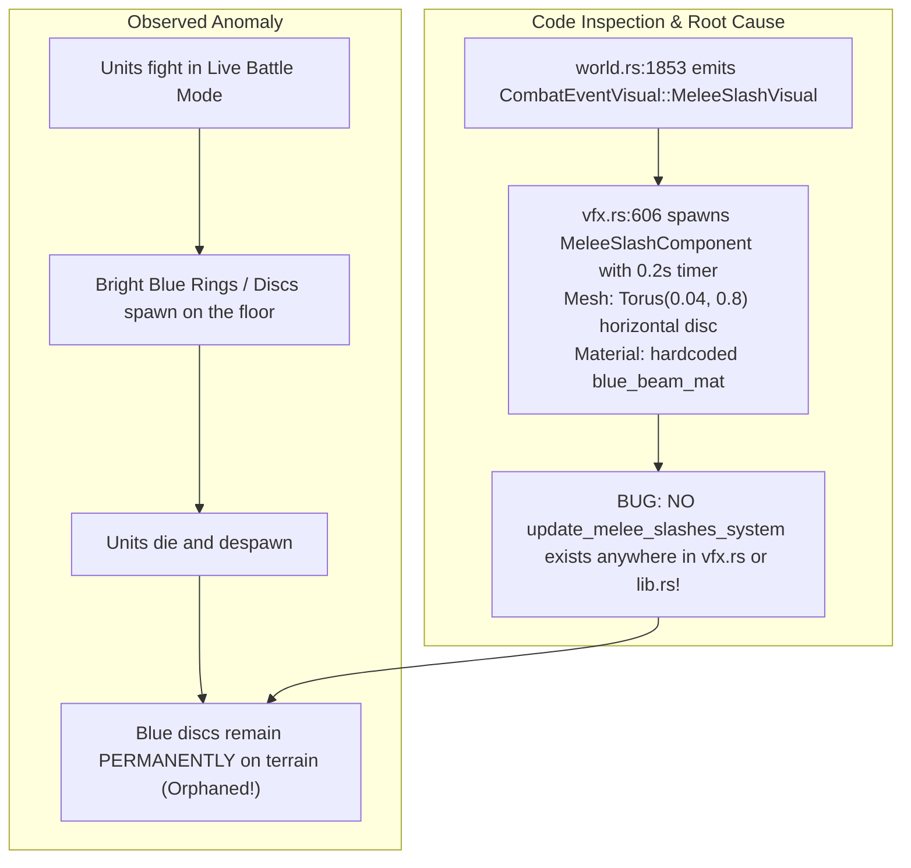
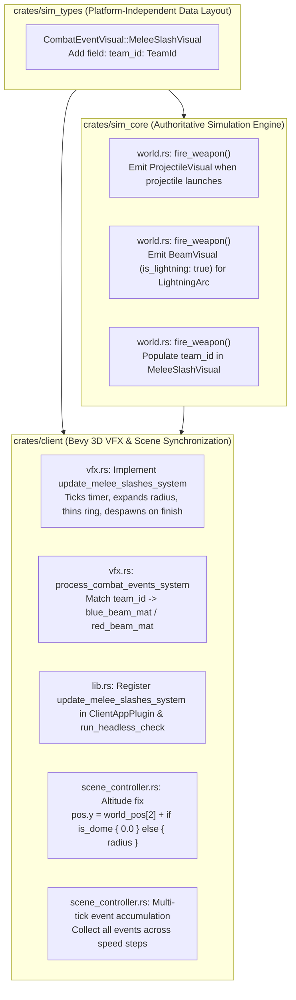

# Implementation Plan 14 — Fix Orphaned Melee Slash Discs, Unit Altitude Alignment, and Combat VFX Synchronization

> **Document Version:** 1.0.0  
> **Status:** Approved Architectural Blueprint & Implementation Specification  
> **Target Crates & Paths:**  
> - `crates/sim_types/src/snapshot.rs`  
> - `crates/sim_types/tests/snapshot_serialization.rs`  
> - `crates/sim_core/src/world.rs`  
> - `crates/client/src/vfx.rs`  
> - `crates/client/src/lib.rs`  
> - `crates/client/src/scene_controller.rs`  
> - `crates/client/src/lab_ui.rs`  
> - `crates/client/tests/round2_visual_tests.rs`  
> **Charter Compliance:** Strictly adheres to [AGENTS.md](file:///home/cl/projects/space-scuffle/AGENTS.md) Section 1 (Zero Shortcuts & Zero Placeholders), Section 2 (Architecture Documentation & Pedagogical Quality), Section 3 (Strict Determinism & Separation of Concerns), Section 4 (Testing Standards), and Section 6 (Mandatory Two-Stage Sub-Agent Workflow).

---

## 1. Executive Summary & Root Cause Analysis

### 1.1 The User's Bug Report
Following interactive testing of the battle simulator:
> *"I have started an attack, and blue discs stay behind (I thing these are the death animations left over)."*

The user observed that when units engage in battle, persistent bright blue glowing rings/discs remain lying flat on the terrain where units fought and died. Because these rings lingered at locations where units were eliminated, the user hypothesized they were unfinished or "stuck" death animations.



---

### 1.2 Forensic Diagnoses of the 5 Interconnected Deficiencies

Detailed line-by-line inspection of `crates/client/src/vfx.rs`, `crates/client/src/lib.rs`, `crates/client/src/scene_controller.rs`, and `crates/sim_core/src/world.rs` revealed five distinct defects in the battle visual pipeline:

#### Defect 1: `MeleeSlashComponent` Entity Leak (`crates/client/src/vfx.rs:600-617` & `lib.rs:226-235`)
- When a melee unit (`psi_grey`, `welder_drone`, etc.) attacks, `sim_core/src/world.rs:1853` emits `CombatEventVisual::MeleeSlashVisual`.
- In `vfx.rs:606-616`, `process_combat_events_system` spawns an entity with:
  - `Mesh3d(vfx_assets.melee_slash_mesh.clone())` (`Torus::new(0.04, 0.8)`: a flat circular ring/disc).
  - `MeshMaterial3d(vfx_assets.blue_beam_mat.clone())` (unlit emissive bright blue).
  - `MeleeSlashComponent { lifetime: Timer::from_seconds(0.2, TimerMode::Once), radius }`.
- **The Fatal Omission:** There is **no system in `vfx.rs`** that queries, ticks, or despawns `MeleeSlashComponent`. In `crates/client/src/lib.rs`, the Bevy scheduler registers:
  ```rust
  update_indicators_system,
  update_mist_wake_system,
  update_projectiles_system,
  update_beams_system,
  update_shatter_system,
  ```
  `update_melee_slashes_system` is neither implemented nor registered.
- **Consequence:** Every melee attack creates a perpetual entity in the ECS world. The torus mesh is rendered forever. Because units frequently attack in close proximity before dying, the ground becomes littered with blue rings that persist after the units despawn, giving the exact visual illusion of stuck death rings.

#### Defect 2: Hardcoded Emissive Material & Missing Attacker Team Identification (`vfx.rs:608` & `snapshot.rs:96`)
- `vfx.rs:608` hardcoded `vfx_assets.blue_beam_mat.clone()` for all melee slashes.
- Furthermore, `CombatEventVisual::MeleeSlashVisual` in `crates/sim_types/src/snapshot.rs` lacked a `team_id: TeamId` field:
  ```rust
  MeleeSlashVisual {
      pos: [f32; 3],
      angle_rad: f32,
      radius: f32,
  }
  ```
- **Consequence:** Red team melee units (e.g., Red zealots or worker drones) emitted Blue slashes, breaking visual readability and team identity in 2-army engagements.

#### Defect 3: Ground Unit Center Half-Buried in Terrain (`crates/client/src/scene_controller.rs:516-520`)
- In `scene_controller.rs` (`sync_live_battle_system`):
  ```rust
  let pos = Vec3::new(
      instance.world_pos[0],
      instance.world_pos[2],
      instance.world_pos[1],
  );
  ```
- In `sim_core`, `world_pos[2]` represents terrain ground elevation ($z = 0.0$ for ground units on the flat arena).
- Setting Bevy world altitude $Y = \text{world\_pos}[2] = 0.0$ places the **center of the unit sphere at ground level**.
  - A mobile unit with radius $R = 0.85$ has its bottom half (from $Y = -0.85$ to $0.0$) sunk underground.
  - Furthermore, in `indicators.rs:257-279`, the child ground selection reticle is positioned at local coordinate $y = -0.98$ relative to the unit sphere root. Because the unit entity is scaled by $R$, the child reticle is placed at world altitude:
    $$Y_{\text{ring}} = Y_{\text{root}} + (-0.98 \times R) = 0.0 - 0.98 R = -0.98 R < 0$$
    The selection ring was completely buried underground!
- In contrast, `sync_lab_preview_system` correctly placed unit spheres at:
  $$Y = \text{ground\_z} + \begin{cases} 0.0 & \text{if BuildingDome} \\ R & \text{if UnitSphere} \end{cases}$$
  Placing the sphere center at $Y = R$ causes the bottom of the sphere to touch ground level $Y = 0$, and places the child selection ring at $Y_{\text{ring}} = R - 0.98 R = +0.02 R > 0$, floating cleanly 0.02 units above the terrain with zero z-fighting!

#### Defect 4: Missing Simulation Combat Visual Events (`crates/sim_core/src/world.rs:1716-1735` & `1863`)
- When a projectile weapon (`WeaponVisualKind::Projectile`) fires in `world.rs:1716-1735`, `SimWorld` allocates an `ActiveProjectile` in `self.projectiles`, but **never emitted a `CombatEventVisual::ProjectileVisual`** into `self.pending_events`. Consequently, client `update_projectiles_system` never received projectile instances from live battles!
- In `world.rs:1863`, `WeaponVisualKind::LightningArc` was unhandled and fell into `_ => {}`, rather than emitting `CombatEventVisual::BeamVisual { is_lightning: true, .. }`.

#### Defect 5: Intermediate Tick Event Dropping at `simulation_speed > 1` (`scene_controller.rs:489-498`)
- In `scene_controller.rs`:
  ```rust
  for _ in 0..speed {
      let bundle = TickBundle { ... };
      let snap = world.step(&bundle);
      latest_snapshot = Some(snap);
  }
  ```
  `latest_snapshot` was overwritten on each iteration. For `simulation_speed > 1`, all `combat_events` generated during intermediate ticks were discarded!

---

## 2. Architecture & Subsystem Boundaries

The fix spans three layers across three workspace crates, respecting the strict acyclic dependency charter:



---

## 3. Detailed Step-by-Step Implementation Blueprint

### Step 1: Extend `CombatEventVisual::MeleeSlashVisual` with `team_id: TeamId`
**Files:**
- `crates/sim_types/src/snapshot.rs`
- `crates/sim_types/tests/snapshot_serialization.rs`

#### 1.1 Update `CombatEventVisual` in `crates/sim_types/src/snapshot.rs`
Lines 95–103:
```rust
    /// Close-quarters melee blade shockwave.
    MeleeSlashVisual {
        /// Center of slash arc [x, y, z].
        pos: [f32; 3],
        /// Direction of slash in radians.
        angle_rad: f32,
        /// Radius of slash sweep.
        radius: f32,
        /// Attacking team for visual color tinting.
        team_id: TeamId,
    },
```

#### 1.2 Update Test Fixtures in `crates/sim_types/tests/snapshot_serialization.rs`
Lines 158–162:
```rust
        CombatEventVisual::MeleeSlashVisual {
            pos: [24.0, 29.0, 0.3],
            angle_rad: 2.14,
            radius: 1.2,
            team_id: TeamId(1),
        },
```

---

### Step 2: Implement `update_melee_slashes_system` and Team Tinting in `crates/client/src/vfx.rs`
**File:** `crates/client/src/vfx.rs`

#### 2.1 Add `update_melee_slashes_system`
Insert immediately after `update_beams_system` (around line 472):
```rust
// PERFORMANCE RATIONALE:
// Why: Melee crescent slashes are short-lived burst VFX (0.20s). Without explicit timer ticking and
// lifecycle culling, thousands of orphaned torus mesh entities accumulate in the ECS world.
// What: Advance timer by frame delta, scale torus horizontally outward while thinning along Y,
// and immediately despawn entity once timer completes.
// Trade-off: Minimal per-frame query overhead for O(N_active) active slashes (typically 0-10 entities).
/// Updates expanding melee crescent slash rings and despawns them when their lifetime ends.
pub fn update_melee_slashes_system(
    mut commands: Commands<'_, '_>,
    time: Res<'_, Time>,
    mut query: Query<'_, '_, (Entity, &mut Transform, &mut MeleeSlashComponent)>,
) {
    for (entity, mut transform, mut slash) in &mut query {
        slash.lifetime.tick(time.delta());
        if slash.lifetime.finished() {
            commands.entity(entity).despawn();
        } else {
            let progress = slash.lifetime.fraction();
            // Outward sweep expansion: 1.0 -> 1.5x initial radius
            let expansion = 1.0 + progress * 0.5;
            // Vertical dissipation thinning: 1.0 -> 0.3x initial thickness
            let fade_thickness = (1.0 - progress * 0.7).max(0.1);
            transform.scale = Vec3::new(
                slash.radius * expansion,
                slash.radius * fade_thickness,
                slash.radius * expansion,
            );
        }
    }
}
```

#### 2.2 Update `process_combat_events_system` for `MeleeSlashVisual`
Replace lines 600–617 of `vfx.rs`:
```rust
            CombatEventVisual::MeleeSlashVisual {
                pos,
                angle_rad,
                radius,
                team_id,
            } => {
                let p = Vec3::new(pos[0], pos[2] + 0.3, pos[1]);
                let mat = match team_id.0 {
                    1 => vfx_assets.blue_beam_mat.clone(),
                    _ => vfx_assets.red_beam_mat.clone(),
                };
                commands.spawn((
                    Mesh3d(vfx_assets.melee_slash_mesh.clone()),
                    MeshMaterial3d(mat),
                    Transform::from_translation(p)
                        .with_rotation(Quat::from_rotation_y(-angle_rad))
                        .with_scale(Vec3::splat(*radius)),
                    MeleeSlashComponent {
                        lifetime: Timer::from_seconds(0.2, TimerMode::Once),
                        radius: *radius,
                    },
                ));
            }
```

---

### Step 3: Register `update_melee_slashes_system` in `crates/client/src/lib.rs`
**File:** `crates/client/src/lib.rs`

#### 3.1 Re-Export in `lib.rs`
Update `pub use vfx::{...}` (lines 69–73):
```rust
pub use vfx::{
    emit_mist_wake, process_combat_events_system, setup_vfx_assets_system, spawn_death_shatter,
    update_beams_system, update_melee_slashes_system, update_mist_wake_system,
    update_projectiles_system, update_shatter_system, update_vfx_system, CombatVisualEvent,
    MistWakeMaterial, MistWakeUniformGpu, VfxSharedAssets,
};
```

#### 3.2 Add to `ClientAppPlugin::build`
In lines 226–236:
```rust
            .add_systems(
                Update,
                (
                    camera_control_system,
                    selection_system,
                    update_indicators_system,
                    update_mist_wake_system,
                    update_projectiles_system,
                    update_beams_system,
                    update_melee_slashes_system,
                    update_shatter_system,
                    frame_limit_system,
                ),
            )
```

#### 3.3 Add to `run_headless_check()`
In lines 403–416:
```rust
    // Add all production Update systems
    app.add_systems(
        Update,
        (
            camera_control_system,
            update_indicators_system,
            update_mist_wake_system,
            update_projectiles_system,
            update_beams_system,
            update_melee_slashes_system,
            update_shatter_system,
            process_combat_events_system,
            sync_lab_preview_system,
            sync_live_battle_system,
            sync_swarm_stress_system,
        ),
    );
```

---

### Step 4: Fix Altitude Alignment & Multi-Tick Combat Events in `crates/client/src/scene_controller.rs`
**File:** `crates/client/src/scene_controller.rs`

#### 4.1 Accumulate Combat Events Across All Speed Ticks
In lines 485–509 of `scene_controller.rs`:
```rust
    let mut latest_snapshot = None;
    let mut accumulated_combat_events = Vec::new();

    if paused {
        latest_snapshot = Some(world.build_render_snapshot());
    } else {
        for _ in 0..speed {
            let bundle = TickBundle {
                tick: Tick(world.current_tick),
                commands: Vec::new(),
                state_checksum: None,
            };
            let mut snap = world.step(&bundle);
            accumulated_combat_events.append(&mut snap.combat_events);
            latest_snapshot = Some(snap);
        }
    }

    let Some(snapshot) = latest_snapshot else {
        return;
    };

    lab_state.last_checksum_hex = format!("0x{:016X}", snapshot.checksum);

    // Forward all accumulated combat events to VFX pipeline
    for event in accumulated_combat_events {
        combat_events.send(CombatVisualEvent(event));
    }
```

#### 4.2 Fix Sphere Altitude Alignment
In lines 516–520 of `scene_controller.rs`:
```rust
        let is_dome = matches!(instance.shape, ShapeKind::BuildingDome { .. });
        let altitude_offset = if is_dome { 0.0 } else { instance.radius };
        let pos = Vec3::new(
            instance.world_pos[0],
            instance.world_pos[2] + altitude_offset,
            instance.world_pos[1],
        );
```
Ensure `is_dome` calculation is moved above `pos`, and `pos` is used for both existing entities (`transform.translation = pos;` line 527) and new spawned entities (`Transform::from_translation(pos)...` line 561).

---

### Step 5: Emit Projectile & Lightning Combat Events in `crates/sim_core/src/world.rs`
**File:** `crates/sim_core/src/world.rs`

#### 5.1 Emit `ProjectileVisual` on Projectile Launch
In `world.rs:1716–1735`:
```rust
            if let Some(proj_speed) = weapon.projectile_speed {
                let target_pos = self
                    .entities
                    .get(&target_id)
                    .map_or(attacker_pos, |t| t.position);
                let p_id = self.next_projectile_id;
                self.next_projectile_id = self.next_projectile_id.wrapping_add(1);

                self.projectiles.push(ActiveProjectile {
                    id: p_id,
                    owner: attacker_owner,
                    source_pos: attacker_pos,
                    current_pos: attacker_pos,
                    target_id: Some(target_id),
                    target_pos,
                    speed: proj_speed,
                    weapon_spec: weapon.clone(),
                    source_slug: Some(attacker_slug),
                });

                // Emit visual projectile event for client VFX rendering
                let z = self.map.terrain_altitude_at(attacker_pos);
                let tz = self.map.terrain_altitude_at(target_pos);
                let delta = target_pos - attacker_pos;
                let dist = delta.length();
                let dir = delta.normalize_or_zero();
                let speed_per_sec = proj_speed.to_f32() * 60.0;
                let total_time_sec = if dist > SimScalar::ZERO {
                    (dist / proj_speed).to_f32() / 60.0
                } else {
                    1.0
                };
                let vz = if total_time_sec > 0.001 {
                    (tz - z) / total_time_sec
                } else {
                    0.0
                };

                self.pending_events.push(CombatEventVisual::ProjectileVisual {
                    pos: [
                        attacker_pos.x.to_f32(),
                        attacker_pos.y.to_f32(),
                        z + 0.5,
                    ],
                    vel: [
                        dir.x.to_f32() * speed_per_sec,
                        dir.y.to_f32() * speed_per_sec,
                        vz,
                    ],
                    team_id: TeamId(attacker_owner.0),
                });
            } else {
```

#### 5.2 Emit `BeamVisual { is_lightning: true }` and Pass `team_id` for Melee
In `world.rs:1827–1864`:
```rust
                        // Record visual event
                        let z = self.map.terrain_altitude_at(attacker_pos);
                        let tz = self.map.terrain_altitude_at(target_pos);
                        match weapon.visual_kind {
                            WeaponVisualKind::Hitscan => {
                                self.pending_events.push(CombatEventVisual::HitscanTracer {
                                    from: [
                                        attacker_pos.x.to_f32(),
                                        attacker_pos.y.to_f32(),
                                        z + 0.5,
                                    ],
                                    to: [target_pos.x.to_f32(), target_pos.y.to_f32(), tz + 0.5],
                                    team_id: TeamId(attacker_owner.0),
                                });
                            }
                            WeaponVisualKind::LaserBeam => {
                                self.pending_events.push(CombatEventVisual::BeamVisual {
                                    from: [
                                        attacker_pos.x.to_f32(),
                                        attacker_pos.y.to_f32(),
                                        z + 0.5,
                                    ],
                                    to: [target_pos.x.to_f32(), target_pos.y.to_f32(), tz + 0.5],
                                    is_lightning: false,
                                    team_id: TeamId(attacker_owner.0),
                                });
                            }
                            WeaponVisualKind::LightningArc => {
                                self.pending_events.push(CombatEventVisual::BeamVisual {
                                    from: [
                                        attacker_pos.x.to_f32(),
                                        attacker_pos.y.to_f32(),
                                        z + 0.5,
                                    ],
                                    to: [target_pos.x.to_f32(), target_pos.y.to_f32(), tz + 0.5],
                                    is_lightning: true,
                                    team_id: TeamId(attacker_owner.0),
                                });
                            }
                            WeaponVisualKind::MeleeSlash => {
                                self.pending_events
                                    .push(CombatEventVisual::MeleeSlashVisual {
                                        pos: [
                                            target_pos.x.to_f32(),
                                            target_pos.y.to_f32(),
                                            tz + 0.5,
                                        ],
                                        angle_rad: hit_angle.to_radians_f32(),
                                        radius: 0.5,
                                        team_id: TeamId(attacker_owner.0),
                                    });
                            }
                            _ => {}
                        }
```

---

### Step 6: Update Visual Lab UI Manual Trigger in `crates/client/src/lab_ui.rs`
**File:** `crates/client/src/lab_ui.rs`

Lines 393–399:
```rust
        if ui.button("Melee Slash").clicked() {
            events.send(CombatVisualEvent(CombatEventVisual::MeleeSlashVisual {
                pos: [16.0, 16.0, 1.0],
                angle_rad: state.heading_angle_deg.to_radians(),
                radius: 1.0,
                team_id: TeamId(1),
            }));
        }
```

---

### Step 7: Regression Tests in `crates/client/tests/round2_visual_tests.rs`
**File:** `crates/client/tests/round2_visual_tests.rs`

#### 7.1 Register `update_melee_slashes_system` in `test_bevy_ecs_schedule_all_systems_no_conflicts`
In lines 483–496:
```rust
    app.add_systems(
        Update,
        (
            client::camera::update_camera_system,
            client::indicators::update_indicators_system,
            client::vfx::update_vfx_system,
            client::vfx::update_projectiles_system,
            client::vfx::update_beams_system,
            client::vfx::update_melee_slashes_system,
            client::vfx::update_shatter_system,
            client::vfx::process_combat_events_system,
            client::lab_ui::sync_lab_preview_system,
            client::lab_ui::step_client_simulation_system,
            client::lab_ui::sync_swarm_stress_system,
        ),
    );
```

#### 7.2 Implement `test_all_combat_vfx_entities_despawn_after_lifetime`
Add new test at the end of `crates/client/tests/round2_visual_tests.rs`:
```rust
#[test]
fn test_all_combat_vfx_entities_despawn_after_lifetime() {
    let mut app = App::new();
    app.add_plugins(MinimalPlugins);

    app.init_resource::<Assets<Mesh>>();
    app.init_resource::<Assets<StandardMaterial>>();
    app.add_event::<client::vfx::CombatVisualEvent>();

    // Add Startup and Update systems
    app.add_systems(Startup, client::vfx::setup_vfx_assets_system);
    app.add_systems(
        Update,
        (
            client::vfx::process_combat_events_system,
            client::vfx::update_projectiles_system,
            client::vfx::update_beams_system,
            client::vfx::update_melee_slashes_system,
            client::vfx::update_shatter_system,
        ),
    );

    // Initial frame to run startup setup
    app.update();

    // Send all 5 CombatEventVisual variants into event channel
    {
        let mut events = app.world_mut().resource_mut::<Events<client::vfx::CombatVisualEvent>>();
        events.send(client::vfx::CombatVisualEvent(
            sim_types::snapshot::CombatEventVisual::HitscanTracer {
                from: [0.0, 0.0, 0.5],
                to: [10.0, 0.0, 0.5],
                team_id: TeamId(1),
            },
        ));
        events.send(client::vfx::CombatVisualEvent(
            sim_types::snapshot::CombatEventVisual::ProjectileVisual {
                pos: [0.0, 0.0, 0.5],
                vel: [10.0, 0.0, 0.0],
                team_id: TeamId(2),
            },
        ));
        events.send(client::vfx::CombatVisualEvent(
            sim_types::snapshot::CombatEventVisual::BeamVisual {
                from: [0.0, 0.0, 0.5],
                to: [5.0, 5.0, 0.5],
                is_lightning: true,
                team_id: TeamId(1),
            },
        ));
        events.send(client::vfx::CombatVisualEvent(
            sim_types::snapshot::CombatEventVisual::MeleeSlashVisual {
                pos: [2.0, 2.0, 0.0],
                angle_rad: 0.785,
                radius: 0.8,
                team_id: TeamId(2),
            },
        ));
        events.send(client::vfx::CombatVisualEvent(
            sim_types::snapshot::CombatEventVisual::BubbleShatter {
                pos: [4.0, 4.0, 0.0],
                radius: 0.6,
                is_dome: false,
                team_id: TeamId(1),
            },
        ));
    }

    // Process events and spawn entities
    app.update();

    // Verify all 4 component types are actively spawned
    let beams_count = app.world().query::<&client::vfx::BeamVisualComponent>().iter(app.world()).count();
    let proj_count = app.world().query::<&client::vfx::ProjectileVisual>().iter(app.world()).count();
    let slash_count = app.world().query::<&client::vfx::MeleeSlashComponent>().iter(app.world()).count();
    let shard_count = app.world().query::<&client::vfx::ShatterShard>().iter(app.world()).count();

    assert!(beams_count >= 2, "Hitscan and BeamVisual must spawn at least 2 BeamVisualComponent entities");
    assert_eq!(proj_count, 1, "ProjectileVisual must spawn exactly 1 ProjectileVisual entity");
    assert_eq!(slash_count, 1, "MeleeSlashVisual must spawn exactly 1 MeleeSlashComponent entity");
    assert_eq!(shard_count, 16, "BubbleShatter must spawn exactly 16 ShatterShard entities");

    // Advance time past all lifetimes (max lifetime is 1.2s for projectile; step 2.0s total)
    // Step 20 frames with dt = 0.1s
    for _ in 0..20 {
        {
            let mut time = app.world_mut().resource_mut::<Time>();
            time.advance_by(std::time::Duration::from_millis(100));
        }
        app.update();
    }

    // Assert that ZERO VFX entities remain in the ECS world
    let remaining_beams = app.world().query::<&client::vfx::BeamVisualComponent>().iter(app.world()).count();
    let remaining_proj = app.world().query::<&client::vfx::ProjectileVisual>().iter(app.world()).count();
    let remaining_slashes = app.world().query::<&client::vfx::MeleeSlashComponent>().iter(app.world()).count();
    let remaining_shards = app.world().query::<&client::vfx::ShatterShard>().iter(app.world()).count();

    assert_eq!(remaining_beams, 0, "All BeamVisualComponent entities must despawn after lifetime");
    assert_eq!(remaining_proj, 0, "All ProjectileVisual entities must despawn after lifetime");
    assert_eq!(remaining_slashes, 0, "All MeleeSlashComponent entities must despawn after lifetime");
    assert_eq!(remaining_shards, 0, "All ShatterShard entities must despawn after lifetime");
}
```

---

## 4. Verification & Testing Strategy

Before approving Stage 2 completion, the implementation agent must run and verify all quality gates:

1. **Compilation & Strict Zero-Warning Linting:**
   ```bash
   cargo clippy --workspace --all-targets -- -D warnings
   ```
2. **Code Formatting Standards:**
   ```bash
   cargo fmt --all -- --check
   ```
3. **Workspace Automated Test Suite:**
   ```bash
   cargo test --workspace
   ```
   Must specifically pass:
   - `test_all_combat_vfx_entities_despawn_after_lifetime` (new regression test in `round2_visual_tests.rs`)
   - `test_bevy_ecs_schedule_all_systems_no_conflicts`
   - `test_snapshot_roundtrip` (snapshot serialization)
4. **Headless 60-Frame Invariant Check:**
   ```bash
   cargo run -p client -- --headless-check
   ```
   Must confirm 60 simulation frames step deterministically without panic or scheduling conflicts.
5. **Real GPU / Wayland Window Check (if display active):**
   ```bash
   cargo run -p client -- --battle --max-frames 90
   ```
   Confirms spheres sit on top of the terrain plane, units fight, and no blue discs remain after battle.
