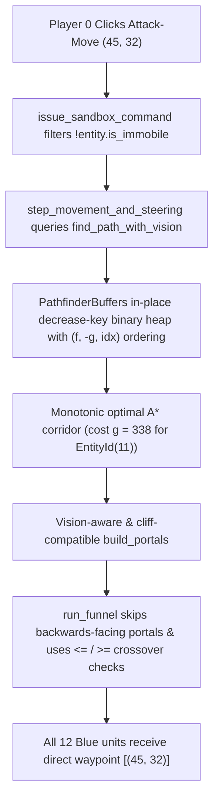

# Plan 15: Fix Errant Unit Pathfinding in Live Battle Sandbox

## 1. Executive Summary & Forensic Root Cause Analysis

### 1.1 User-Reported Symptom
When starting the **Live Battle** tab in the Visual Lab and clicking **"Attack-Move (High Ground)"** (which issues `UnitOrder::AttackMove { target: SimVec2(45, 32) }` to Player 0's forces), **11 of the 12 Blue mobile units** march directly East toward `(45, 32)`, while **one—and only one—unit (`EntityId(11)`, the Bombardier Rhino-Beetle spawned at `(12, 30)`)** immediately turns North-East ($\approx 35^\circ$) and marches off alone to `(45.48, 53.52)` at the southern corner of the Red Barracks (`(42..45, 54..57)`) in the northern Red Base before turning South toward `(45, 32)`.

### 1.2 Exact Tick-by-Tick Forensic Reproduction
In `SimWorld::new_default_battle_sandbox()` (`crates/sim_core/src/world.rs:224-353`):
- **Blue Mobile Units (`PlayerId(0)`):**
  - `EntityId(1)..=EntityId(10)`: 10 Light Ranged units (`pulse_bot`) at `x = 15, y in {23, 25, 27, 29, 31, 33, 35, 37, 39, 41}`.
  - `EntityId(11)`: Heavy Armored unit (`rhino_beetle`) at **`(12, 30)`** (`UnitClearance::Medium`, `collision_radius = 0.5625`).
  - `EntityId(12)`: Heavy Armored unit (`rhino_beetle`) at **`(12, 34)`** (`UnitClearance::Medium`, `collision_radius = 0.5625`).
- **Blue Structures (`PlayerId(0)`):**
  - `EntityId(23)` at `(5..10, 5..10)`, `EntityId(24)` at `(12..14, 5..7)`, `EntityId(25)` at `(16..19, 5..8)`.
- **Red Structures (`PlayerId(1)`):**
  - `EntityId(26)` at `(54..59, 54..59)`, `EntityId(27)` at `(48..50, 54..56)`, `EntityId(28)` at **`(42..45, 54..57)`**.

When `UnitOrder::AttackMove { target: (45, 32) }` is processed for **`EntityId(11)` at `(12, 30)`**, a 3-stage chain of bugs in `crates/sim_map/src/pathfinding.rs` produces the errant waypoint `(45.477, 53.523)`:

#### Stage 1 — Binary Min-Heap Key-Decrease Corruption in `PathfinderBuffers` (`crates/sim_map/src/pathfinding.rs:150-204, 594-601`)
1. `PathfinderBuffers` stores raw cell indices `u32` in `open_heap: Vec<u32>` and orders heap nodes by dynamically reading `self.f_score[node_idx]`.
2. During A* search from `(12, 30)` to `(45, 32)` ($\Delta x = 33, \Delta y = 2$, optimal octile cost $g^* = 31 \times 10 + 2 \times 14 = 338$), when a shorter path (`tentative_g < self.buffers.g_score[n_idx]`) is found to a cell `n_idx` that is **already in `open_heap`** (specifically cell `(16, 31)` at heap index `15`, whose parent at heap index `7` is `(13, 29)` with `f = 346`), line 598 mutates `self.buffers.f_score[n_idx]` in-place from `346` to `338` and line 600 calls `self.buffers.push_open(n_idx)`.
3. `push_open` appends a **duplicate** copy of `n_idx` at the end of `open_heap` and sifts the new copy up, **leaving the original copy at heap index `15` with `f_score = 338` sitting directly beneath parent index `7` (`f_score = 346`)**.
4. This violates the binary min-heap invariant (`f_score[open_heap[15]] = 338 < f_score[open_heap[7]] = 346`).
5. Worse yet, when `(41, 32)` (`g = 298, f = 338`) later expands to the optimal cell **`(42, 32)` (`g = 308, f = 338`)**, `push_open` sifts `(42, 32)` up the tree until its parent is heap index `15` (`(16, 31)`, `f = 338`). Because `338 < 338` is `false`, `push_open` **terminates the sift-up early at index `15`**, trapping `(42, 32)` (`f = 338`) underneath the `f = 346` ancestor at index `7`!
6. Because `(42, 32)` is trapped below `f = 346` nodes, `pop_open()` pops the suboptimal `f = 346` branch `(41, 33) -> (42, 33) -> (43, 33) -> (44, 33) -> (45, 32)` (`g = 346`) first, terminating A* with a **non-monotonic corridor that overshoots North to $y = 33$ and then steps South from `(44, 33)` to `(45, 32)`**!

#### Stage 2 — Omniscient Portal Raycasting Across Fog of War (`crates/sim_map/src/pathfinding.rs:692-778, 895-907`)
1. While `find_path_with_vision` respects `request.known_structures` and `request.vision` during A* expansion, `build_portals` / `add_orthogonal_portal` and `offset_corner_waypoint` call `is_passable(map, x, y)`, which checks `CellFlags::OCCUPIED_BY_STRUCTURE` on the **omniscient** `GameMap` (and ignores cliff level transitions unless `UNPASSABLE_CLIFF` is set).
2. When `build_portals` processes the diagonal step `(44, 33) -> (45, 32)` (`dx = +1, dy = -1`) at the end of `EntityId(11)`'s corridor, it decomposes the step into two orthogonal portals:
   - **Portal 35 (`East (44, 33) -> (45, 33)`):** Raycasts North along $x_1 = 44, x_2 = 45$ until `x1 = 44` hits the **unexplored Red Barracks at `(42..45, 54..57)`**, setting `left = (45, 54), right = (45, 0)`.
   - **Portal 36 (`South (45, 33) -> (45, 32)`):** Raycasts West and East along $y = 33$, setting `left = (64, 33), right = (0, 33)` (all the way to the West edge of the map at $x = 0$, 12 cells **behind** `apex = (12, 30)`).

#### Stage 3 — Inverted-Portal Funnel Crossover (`crates/sim_map/src/pathfinding.rs:780-855`)
1. At Portal 35, `run_funnel` has `apex = (12, 30)`, `portal_left = (45, 54)` (on the Red Barracks 22 cells North), and `portal_right = (64, 33)` (from the earlier North step `(42, 32) -> (42, 33)`).
2. At Portal 36 (`South (45, 33) -> (45, 32)`), because the horizontal portal line $y = 33$ lies **North** of `apex = (12, 30)` ($y_{\text{apex}} = 30 < 33$) while the step direction is **South** (`dy < 0`), the portal `[left = (64, 33), right = (0, 33)]` faces **away** from `apex`:
   $$\text{tri\_area}\bigl((12, 30),\; (64, 33),\; (0, 33)\bigr) = 52 \times 3 - 3 \times (-12) = +192 > 0.$$
   As viewed from `apex = (12, 30)`, `p_right = (0, 33)` (angle $+166^\circ$ North-West) is **counter-clockwise (left)** of `portal_right = (64, 33)` (angle $+3.3^\circ$) AND counter-clockwise of `portal_left = (45, 54)` (angle $+36^\circ$):
   $$\text{tri\_area}\bigl((12, 30),\; (45, 54),\; (0, 33)\bigr) = 33 \times 3 - 24 \times (-12) = +387 > 0.$$
3. `run_funnel` concludes that the right leg crossed over the left leg, snaps `apex` to `offset_corner_waypoint((45, 54), Medium, map) = (45.477, 53.523)`, and emits `(45.477, 53.523)` as `EntityId(11)`'s first waypoint!
4. Additionally, at lines 809 and 829 of `run_funnel`, the inner crossover checks use strict `< SimScalar::ZERO` and `> SimScalar::ZERO` instead of `<= SimScalar::ZERO` and `>= SimScalar::ZERO`. Consequently, at the final goal portal `PortalEdge { left: goal, right: goal }`, after the right leg updates `portal_right = goal`, the left leg check evaluates `tri_area(apex, portal_right, goal) == 0`, fails `> SimScalar::ZERO`, and falsely triggers `offset_corner_waypoint(goal)` on the destination point of every path.

#### Secondary Issue — Immobile Structure Flags & Sandbox Command Filtering (`crates/sim_core/src/entity.rs`, `crates/client/src/lab_ui.rs`)
- `Entity::from_archetype` (`crates/sim_core/src/entity.rs:179-222`) initializes `is_immobile: false` and `unpushable: false` even for `ShapeKind::BuildingDome { .. }` and `max_speed == 0` archetypes.
- `issue_sandbox_command` (`crates/client/src/lab_ui.rs:474-498`) sends `AttackMove` to all entities owned by `PlayerId(0)`, including the 3 Blue `BuildingDome` structures (`EntityId(23), EntityId(24), EntityId(25)`), causing them to enter `step_movement_and_steering`, fail `find_path_with_vision` (`InvalidStart`), and switch `current_anim` to `AnimState::Walk`.

---

## 2. Architectural Blueprint



### 2.1 File-by-File Modifications

#### 1. `crates/sim_map/src/pathfinding.rs`
1. **In-Place Decrease-Key Min-Heap with Deterministic Tie-Breaking (`PathfinderBuffers`):**
   - Add `heap_pos: Vec<u32>` (initialized to `vec![u32::MAX; size]`) to `PathfinderBuffers`.
   - Implement `heap_less(&self, a: usize, b: usize) -> bool`:
     ```rust
     #[inline]
     fn heap_less(&self, a: usize, b: usize) -> bool {
         let fa = self.f_score[a];
         let fb = self.f_score[b];
         if fa != fb {
             return fa < fb;
         }
         let ga = self.g_score[a];
         let gb = self.g_score[b];
         if ga != gb {
             return ga > gb;
         }
         a < b
     }
     ```
   - Implement `sift_up(&mut self, mut i: usize)` updating `self.heap_pos` on every swap.
   - Update `push_open(&mut self, idx: u32)`:
     - If `self.heap_pos[idx as usize] != u32::MAX`, call `self.sift_up(self.heap_pos[idx as usize] as usize)` in-place without pushing a duplicate entry.
     - Otherwise, push `idx` to `self.open_heap`, set `self.heap_pos[idx as usize] = i as u32`, and call `self.sift_up(i)`.
   - Update `pop_open(&mut self) -> Option<u32>` to clear `self.heap_pos[root as usize] = u32::MAX`, update `self.heap_pos` on swaps, and compare children with `self.heap_less(...)`.
   - Implement `clear_open(&mut self)` to reset `self.heap_pos[idx as usize] = u32::MAX` for all remaining `idx` in `self.open_heap` before calling `self.open_heap.clear()`, and call `self.buffers.clear_open()` in `find_path_with_vision`.

2. **Vision-Aware & Cliff-Compatible Portal Construction (`build_portals`, `add_orthogonal_portal`, `offset_corner_waypoint`):**
   - Define a helper method or closure `is_cell_passable_for_request(map: &GameMap, request: &PathRequestWithVision<'_>, x: i32, y: i32) -> bool` that checks:
     - `map.in_bounds(x, y)`
     - `c.flags.contains(CellFlags::GROUND_PATHABLE) && !c.flags.contains(CellFlags::UNPASSABLE_CLIFF)`
     - If `c.flags.contains(CellFlags::OCCUPIED_BY_STRUCTURE)`: blocked only if `known_structures` (or `vision == Visible`, or omniscient when both are `None`) marks `(x, y)` as known.
   - Define `is_portal_pair_compatible(map: &GameMap, request: &PathRequestWithVision<'_>, x1: i32, y1: i32, x2: i32, y2: i32, base_cliff: CliffLevel) -> bool` checking that both `(x1, y1)` and `(x2, y2)` satisfy `is_cell_passable_for_request`, are cliff-compatible with each other (`c1.cliff_level == c2.cliff_level || c1.flags.contains(CellFlags::RAMP) || c2.flags.contains(CellFlags::RAMP)`), and maintain cliff compatibility with the step's `base_cliff`.
   - Pass `request` into `build_portals`, `add_orthogonal_portal`, `run_funnel`, and `offset_corner_waypoint` so fogged/unexplored structures never leak into portal edges or corner offsets.

3. **Simple Stupid Funnel Orientation & Collinear Crossover Fix (`run_funnel`):**
   - Start the funnel loop with `portal_left = apex; portal_right = apex; left_idx = 0; right_idx = 0; let mut i = 0;`.
   - At the start of each iteration `i`, if `tri_area(apex, p_left, p_right) > SimScalar::ZERO` (the expanded portal faces backwards relative to `apex`), skip it (`i += 1; continue;`).
   - Change the inner right-leg crossover check (line 809) from `< SimScalar::ZERO` to `<= SimScalar::ZERO`:
     ```rust
     if portal_left == apex || tri_area(apex, portal_left, p_right) <= SimScalar::ZERO
     ```
   - Change the inner left-leg crossover check (line 829) from `> SimScalar::ZERO` to `>= SimScalar::ZERO`:
     ```rust
     if portal_right == apex || tri_area(apex, portal_right, p_left) >= SimScalar::ZERO
     ```
   - In `offset_corner_waypoint`, only offset if `vertex != goal` and use `is_cell_passable_for_request(map, request, cx, cy)`.

#### 2. `crates/sim_map/tests/determinism_tests.rs`
- Update `EXPECTED_CHECKSUM` in `test_cross_platform_determinism_checksum` to the new deterministic xxHash64 reference digest produced by the fixed min-heap and funnel algorithm.

#### 3. `crates/sim_core/src/entity.rs`
- In `Entity::from_archetype`, initialize `is_immobile` and `unpushable` to `true` when `matches!(archetype.shape, sim_types::ShapeKind::BuildingDome { .. }) || archetype.max_speed <= SimScalar::ZERO`:
  ```rust
  let is_immobile_archetype = matches!(archetype.shape, sim_types::ShapeKind::BuildingDome { .. })
      || archetype.max_speed <= SimScalar::ZERO;
  ```
  setting `is_immobile: is_immobile_archetype` and `unpushable: is_immobile_archetype`.

#### 4. `crates/client/src/lab_ui.rs`
- In `issue_sandbox_command` (`crates/client/src/lab_ui.rs:476-481`), filter out immobile entities (`!e.is_immobile`) so army micro commands (`Attack-Move`, `Kite Retreat`, `Hold Position`, `Stimpack`) only target mobile units:
  ```rust
  let entities: Vec<EntityId> = world
      .entities
      .values()
      .filter(|e| e.owner == player_id && !e.is_immobile)
      .map(|e| e.id)
      .collect();
  ```

---

## 3. Verification & Regression Test Suite

1. **Unit & Integration Tests in `crates/sim_map/tests/funnel_tests.rs`:**
   - Add `test_sandbox_all_blue_units_direct_path_no_errant_detour`: reconstructs the exact 64x64 sandbox structure layout and verifies that all 12 Blue unit starting coordinates `[(15, 23..=41), (12, 30), (12, 34)]` produce a direct 2-waypoint path `[start, (45, 32)]` with zero detours toward `(45, 54)`.
   - Verify existing `test_straight_line_optimization`, `test_l_shaped_obstacle_euclidean_shortcut`, and `test_corner_clearance_radius_offset_scaling` pass.

2. **Integration Test in `crates/sim_core/tests/attack_move_simulation_tests.rs`:**
   - Add `test_default_battle_sandbox_attack_move_no_errant_unit_path`: initializes `SimWorld::new_default_battle_sandbox()`, issues `UnitOrder::AttackMove { target: (45, 32) }` to all Player 0 entities (mirroring `lab_ui.rs`), steps the simulation for 120 ticks, and asserts that:
     - On tick 1, every mobile Blue unit (`EntityId(1)..=EntityId(12)`) has `current_funnel_waypoints == [SimVec2(45, 32)]` and positive $x$-velocity (`velocity.x > 0`).
     - Across ticks `1..=120`, no Blue unit ever strays North of $y = 43$ or South of $y = 21$ (specifically verifying `EntityId(11)` stays within $y \in [29, 35]$ as it marches East and engages the Red army).
     - All Blue structures (`EntityId(23)..=EntityId(25)`) remain `is_immobile == true`, `velocity == SimVec2::ZERO`, and `current_anim == AnimState::Idle`.

3. **Workspace Quality Gates:**
   - `cargo test --workspace`
   - `cargo clippy --workspace --all-targets -- -D warnings`
   - `cargo fmt --all -- --check`
