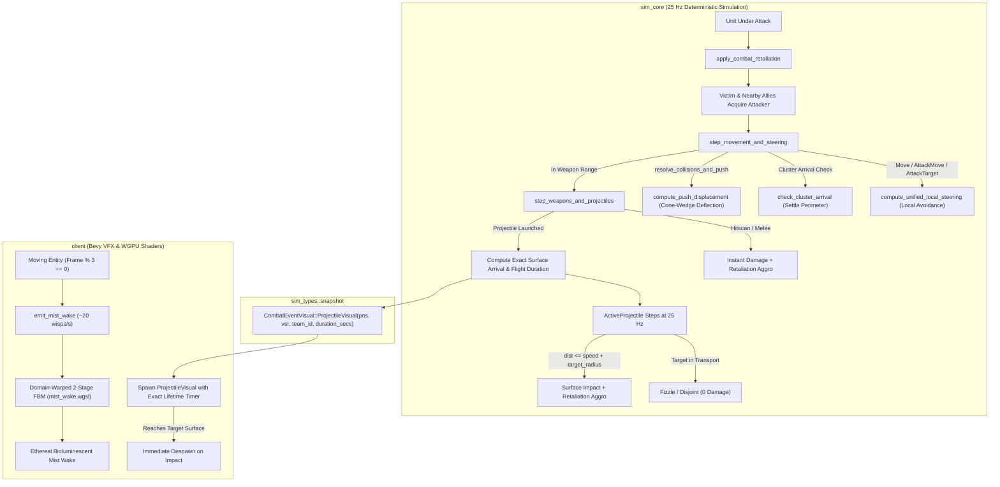

# Plan 16: Combat Retaliation Aggro, Realistic Projectiles, Melee Concave Steering, and Domain-Warped Volumetric Mist

## 1. Executive Summary & Forensic Root Cause Analysis

### 1.1 Inability to Fight Back & Target Incompatibilities (`target_flags: (bits: 65)`)
- **Symptom:** In the battle simulation, units being attacked just stand there and get slaughtered without returning fire or fighting back.
- **Root Cause:**
  In `sim_types/src/enums.rs`, `AttributeFlags` defines the bitmask:
  ```rust
  pub struct AttributeFlags: u16 {
      const LIGHT       = 1 << 0; // 1
      const ARMORED     = 1 << 1; // 2
      const BIOLOGICAL  = 1 << 2; // 4
      const MECHANICAL  = 1 << 3; // 8
      const PSIONIC     = 1 << 4; // 16
      const MASSIVE     = 1 << 5; // 32
      const STRUCTURE   = 1 << 6; // 64
      const HEROIC      = 1 << 7; // 128
  }
  ```
  In `assets/catalog/units.ron` and `assets/catalog/structures.ron`, dozens of weapons were assigned `target_flags: (bits: 65)` (`LIGHT | STRUCTURE = 1 | 64 = 65`).
  When `rhino_beetle` (`attributes: (bits: 6)` = `ARMORED | BIOLOGICAL`) engages `psi_grey` (Zealot) or `railgun_crawler` (Siege Tank), target evaluation checks `weapon.target_flags.intersects(target_arch.attributes)`.
  Evaluating `65 & 6 == 0` yields `false`! Consequently, `psi_grey`, `railgun_crawler`, and many other defenders strictly reject armored/biological enemies, finding zero eligible targets and remaining completely passive while under fire.
  Ground vs. Air weapon legality is already strictly enforced by `UnitArchetype::weapon_against(target_mover, ...)`.
- **Architectural Fix:**
  Update all weapon `target_flags` in `assets/catalog/units.ron` and `assets/catalog/structures.ron` (including siege weapons in abilities) to `(bits: 255)` (`AttributeFlags::all()`), ensuring every unit can attack any valid target matching its ground/air weapon envelope, while preserving non-zero `attributes` on every unit and building.

### 1.2 Non-Turret Deadlock & Angle Overflow (`turn_rate_deg: 999.0` and `turret_turn_rate_deg: 0.0`)
- **Symptom:** Non-turret units like `psi_grey` (Zealot) enter `WeaponPhase::RotatingToTarget` but never finish rotating, locking them out of ever entering `Windup` or dealing damage.
- **Root Cause:**
  1. In `crates/sim_core/src/catalog.rs:629`, `turn_rate: SimAngle::from_degrees(self.turn_rate_deg as i32)` was passed `turn_rate_deg: 999.0`. Because `SimAngle::from_degrees` maps degrees modulo 360 (`999 % 360 = 279` deg), this overflow caused erratic angle wraps.
  2. In `crates/sim_core/src/catalog.rs:530` (`convert_weapon`), if `!w.has_turret` and `w.turret_turn_rate_deg == 0.0`, `turret_turn_rate` was initialized to `SimAngle::from_raw(0)`.
  3. In `crates/sim_core/src/combat.rs:383` and `413`, non-turret units update their heading via:
     ```rust
     entity.heading = entity.heading.rotate_towards(target_angle, weapon.turret_turn_rate.raw());
     ```
     Because `turret_turn_rate` was `0`, the entity rotated by `0` degrees per tick, permanently freezing in `WeaponPhase::RotatingToTarget`!
- **Architectural Fix:**
  1. In `catalog.rs`, clamp `turn_rate_deg` to `[0.0, 180.0]` per tick. If `turn_rate_deg >= 180.0`, assign `SimAngle::PI` ($180^\circ$), allowing instantaneous single-tick turns.
  2. In `convert_weapon`, when `!w.has_turret` and `w.turret_turn_rate_deg == 0.0`, default `turret_turn_rate` to `SimAngle::PI` so non-turret units rotate dynamically using their maximum angular capability.

### 1.3 Target Fixation, Coarse Grid Over-Filtering & Missing Retaliation Aggro
- **Symptom:** Units attacked while idle do not defend themselves. Melee units fixate on distant targets and ignore enemies right in front of them.
- **Root Cause:**
  1. `SpatialHashGrid::query_radius` returns all entities in coarse 2x2 grid buckets. In `acquire_targets`, there was no explicit distance check `if dist > arch.scan_range { continue; }`, allowing distant or out-of-bucket entities to be evaluated.
  2. `acquire_targets` only evaluated entities whose front order was `None`, `Idle`, or `AttackMove`. Once an entity acquired an `AttackTarget`, its front order became `AttackTarget`, preventing it from ever re-evaluating targets even if its target fled out of weapon range or closer immediate threats engaged it.
  3. No retaliation mechanism existed: when a unit sustained damage from an enemy attacker, neither the victim nor nearby allies updated their order queue to fight back.
- **Architectural Fix:**
  1. Enforce `if dist > arch.scan_range { continue; }` in `acquire_targets`.
  2. Allow units whose front order is an auto-acquired `AttackTarget` to re-evaluate targets when the target is outside maximum weapon range, switching to the closest immediate combatant.
  3. Introduce `SimWorld::apply_combat_retaliation(&mut self, victim_id: EntityId, attacker_id: EntityId)`: whenever a unit sustains damage from an enemy, if the victim (or any allied combat unit within `5.0` world units) is currently `Idle` (not holding position or executing an explicit player Move), issue `UnitOrder::AttackTarget { target: attacker_id }`.

### 1.4 Projectile Flight Overshoot, Unauthentic Speeds, & Transport Disjoint
- **Symptom:** Ranged weapons fire projectiles that fly right through the target unit instead of terminating on impact. Speeds are inconsistent.
- **Root Cause:**
  1. **Tick Rate Mismatch in VFX:** In `crates/sim_core/src/world.rs:1746`, `speed_per_sec` was calculated as `proj_speed.to_f32() * 60.0`, even though the simulation runs at `25 Hz` (`TICKS_PER_SECOND = 25`).
  2. **Hardcoded Lifetime in VFX:** In `crates/client/src/vfx.rs:588`, `ProjectileVisual` was spawned with a hardcoded `1.2s` lifetime timer. A projectile with a 0.2s travel time would reach the target and continue traveling for another 1.0s (flying 16+ world units straight through the unit).
  3. **Center-to-Center Collision in Sim:** In `sim_core/src/world.rs:1930`, `dist <= proj.speed` checked distance to the target's center (`target.position`), rather than the target's physical surface (`dist <= proj.speed + target_radius`).
  4. **Unauthentic Siege Tank Weapon:** In SC2, Siege Tank attacks in both Tank Mode and Siege Mode are instant-hit artillery bursts (`Hitscan`), not slow-flying plasma balls.
  5. **Missing Transport Disjoint:** SC2 projectile ballistics allow tactical transport pickup micro (e.g. Medivac / Warp Prism pickup disjointing incoming projectiles). Space Scuffle lacked transport status tracking.
- **Architectural Fix:**
  1. Add `duration_secs: Option<f32>` to `CombatEventVisual::ProjectileVisual`. In `sim_core/src/world.rs`, compute exact ticks to surface impact:
     $$\text{eff\_dist} = \max(0, \text{dist} - \text{target\_radius})$$
     $$\text{ticks\_to\_impact} = \max\left(1, \left\lceil \frac{\text{eff\_dist}}{\text{proj\_speed}} \right\rceil\right)$$
     $$\text{flight\_duration\_secs} = \frac{\text{ticks\_to\_impact}}{25.0}$$
  2. Spawn the visual projectile at the attacker's outer rim (`attacker_pos + dir * attacker_radius`), moving toward the target's outer surface (`target_pos - dir * target_radius`), and configure `ProjectileVisual`'s lifetime in `vfx.rs` to exactly `flight_duration_secs`.
  3. In `sim_core/src/world.rs`, trigger projectile impact when `dist <= proj.speed + target_radius`.
  4. Update `railgun_crawler` in `units.ron` to `visual_kind: Hitscan`, `projectile_speed: None`.
  5. Normalize projectile speeds in `units.ron` to authentic SC2 Faster speeds (25 Hz):
     - Roach / Marauder (`rhino_beetle`, `shock_golem`): $16.0\text{ u/s} = 0.64\text{ u/tick}$.
     - Stalker (`warp_strider`): $18.75\text{ u/s} = 0.75\text{ u/tick}$.
     - Hydralisk (`thorn_viper`): $22.5\text{ u/s} = 0.90\text{ u/tick}$.
     - Mutalisk (`sonic_bat`): $12.5\text{ u/s} = 0.50\text{ u/tick}$.
  6. Add `pub is_loaded_in_transport: bool` to `Entity` and `world.load_unit_into_transport(unit_id, transport_id)`. If the target is loaded in a transport when the projectile arrives, the projectile fizzles harmlessly with 0 damage.

### 1.5 Unified Local Steering, Arrival Cluster Settling & Cone-Wedge Push Deflection
- **Symptom:** Units bunch up behind friendly units in front of them and get stuck trying to push straight ahead rather than smoothly fanning out around obstacles. In combat, melee units (`psi_grey` Zealots) bunch up behind frontline allies rather than surrounding the enemy. Under move commands, columns of units rear-end leaders into gridlock.
- **Root Cause:**
  1. Straight-line movement without local obstacle avoidance: units moved directly toward `target_pos` along `dir = (target_pos - pos).normalize_or_zero()`. When allied units or obstacles blocked the forward trajectory, trailing units collided and stalled.
  2. Pure radial collision push physics: when trailing units rear-ended leading units, standard radial separation pushed directly backward along the collision normal, fighting forward velocity and locking units in place.
- **Architectural Fix:**
  1. **Unified Local Steering (`compute_unified_local_steering`):** Fanning out around blocking units is not an attack-only mechanic; it is a universal property of local steering when moving towards any point. Implemented for all movement orders (`Move`, `AttackMove`, and `AttackTarget`). Units pursuing an `AttackTarget` ignore the target itself as an obstacle, while units in `Move` check `check_cluster_arrival` to settle neatly when reaching a destination cluster.
  2. **Cone-Wedge Push Deflection (`compute_push_displacement`):** In Rule 2 (moving vs stationary/firing) and Rule 4 (moving vs lower push priority), blend a lateral perpendicular wedge vector (`perp * 0.75`) into the displacement normal. This deflects trailing units sideways around leading/firing units, naturally fanning columns into concave arcs through collision physics.
  3. **Arrival Cluster Settling (`check_cluster_arrival`):** When moving towards a destination, detect if a cluster of allied units has already settled at the goal. If so, settle neatly at the perimeter instead of pushing settled allies out of position.

### 1.6 Volumetric Mist Quality, Quad Over-Emission, & Errant Drift
- **Symptom:** The mist wake behind moving units looks like a thick, solid cyan caterpillar or solid blob, and moves unnaturally.
- **Root Cause:**
  1. **Quad Spamming:** `emit_mist_wake` in `crates/client/src/scene_controller.rs:538` was called every frame on every moving unit. Each invocation spawned 4 giant quads (`1.8x` to `2.8x` unit radius) with alpha `0.65`. At 60 FPS, this created 240+ overlapping quads per second, quickly saturating to 1.0 opacity.
  2. **Errant Backward Jet:** In `crates/client/src/vfx.rs:338`, quads were assigned `drift_velocity = trail_dir * (speed * 1.25)`. In world space, while the unit moves forward at `speed`, the mist was propelled backward at `1.25x speed` like rocket exhaust, rather than lingering where the unit moved through space.
  3. **Primitive Noise:** `mist_wake.wgsl` used a standard single-pass FBM noise with a hard circular mask, producing blotchy shapes with harsh edges rather than wispy vapor.
- **Architectural Fix:**
  1. **Emission Throttling:** Throttle emission to ~20 wisps/second by triggering emission only when `(frame_count + entity_id.0) % 3 == 0`.
  2. **Refined Dimensions:** Reduce particle size: `initial_scale = radius * 0.85` expanding smoothly to `target_scale = radius * 1.45` over `0.55s`.
  3. **World-Space Wake Trail Physics:**
     - In `--battle` and `--swarm` modes, the mist is shed in world space with minimal residual drift: `drift_velocity = trail_dir * (speed * 0.15)`. The mist lingers in world space as a true trailing wake.
     - In `--lab` mode (where the preview orb is fixed at `(0, 0)`), retain simulated wind drift `trail_dir * (speed * 0.85)` so the wake streams past the stationary orb.
  4. **Domain-Warped 2-Stage FBM Shader (`mist_wake.wgsl`):**
     Implement Inigo Quilez 2-stage domain warping:
     $$q = \bigl(\text{fbm}(p + (0, t)),\; \text{fbm}(p + (5.2, 1.3 - t))\bigr)$$
     $$r = \bigl(\text{fbm}(p + 2.8 q + (1.7, 9.2 + 0.5t)),\; \text{fbm}(p + 2.8 q + (8.3, 2.8 - 0.5t))\bigr)$$
     $$w = \text{fbm}(p + 2.8 r)$$
     Erode the boundary using the noise itself:
     $$\text{eroded\_falloff} = \text{smoothstep}(0.28, 0.78, w) \cdot \exp(-5.2 r^2) \cdot (1.0 - r^2)$$
     Synthesize a delicate, ethereal alpha:
     $$\alpha = \text{clamp}(\text{eroded\_falloff} \cdot \text{life\_fade} \cdot 0.16, 0.0, 0.18)$$
     Discard fragments with $\alpha < 0.005$. Overlapping wisps accumulate into glowing, translucent bioluminescent mist with zero harsh quad edges.

### 1.7 Headless & Virtual GPU Environment Testing (`lavapipe` / `llvmpipe`)
- **Symptom:** Automated tests running in CI or headless environments must reliably test real GPU shaders and startup without requiring physical display hardware.
- **Architectural Fix:**
  In `crates/client/tests/round2_visual_tests.rs:506` (`test_real_gpu_startup_and_frame_limit_30`), check for Mesa software Vulkan ICD (`/usr/share/vulkan/icd.d/lvp_icd.json`). When present, inject:
  ```rust
  cmd.env("VK_ICD_FILENAMES", "/usr/share/vulkan/icd.d/lvp_icd.json");
  cmd.env("WGPU_ADAPTER_NAME", "llvmpipe");
  cmd.env("LIBGL_ALWAYS_SOFTWARE", "1");
  ```
  This ensures tests execute through the real Vulkan/WGPU graphics pipeline using the software virtual GPU.

---

## 2. Architectural Blueprint & Mathematical Formulations



### 2.1 Projectile Ballistics & Surface Collision Mathematics

Let an attacker be at 2D planar position $\mathbf{p}_A \in \mathbb{R}^2$ with collision radius $R_A$.
Let the target be at 2D planar position $\mathbf{p}_T \in \mathbb{R}^2$ with collision radius $R_T$.
Let the projectile speed in simulation units per tick be $v_{\text{tick}} \in \mathbb{R}^+$.

1. **Center-to-Center Displacement and Unit Direction:**
   $$\mathbf{\Delta} = \mathbf{p}_T - \mathbf{p}_A, \quad d = \|\mathbf{\Delta}\|_2, \quad \mathbf{\hat{u}} = \begin{cases} \frac{\mathbf{\Delta}}{d} & \text{if } d > 0 \\ \mathbf{0} & \text{otherwise} \end{cases}$$

2. **Outer Rim Spawn Position & Outer Surface Impact Position:**
   $$\mathbf{p}_{\text{spawn}} = \mathbf{p}_A + \mathbf{\hat{u}} R_A$$
   $$\mathbf{p}_{\text{impact}} = \mathbf{p}_T - \mathbf{\hat{u}} R_T$$
   $$\mathbf{\Delta}_{\text{surface}} = \mathbf{p}_{\text{impact}} - \mathbf{p}_{\text{spawn}} = \mathbf{\hat{u}} \cdot \max(0, d - R_A - R_T)$$

3. **Effective Distance & Integer Simulation Ticks to Surface Impact:**
   The projectile in simulation steps at position $\mathbf{p}_{\text{proj}}(t)$. Impact occurs when:
   $$\|\mathbf{p}_T - \mathbf{p}_{\text{proj}}(t)\|_2 \le v_{\text{tick}} + R_T$$
   The effective travel distance from $\mathbf{p}_A$ to the target's outer surface is:
   $$d_{\text{eff}} = \max(0, d - R_T)$$
   The exact number of ticks until impact is:
   $$T_{\text{impact}} = \max\left(1, \left\lceil \frac{d_{\text{eff}}}{v_{\text{tick}}} \right\rceil\right)$$

4. **Exact Flight Duration in Seconds (25 Hz):**
   $$t_{\text{flight}} = \frac{T_{\text{impact}}}{25.0}$$

5. **Visual Projectile 3D Velocity Vector:**
   Let terrain altitudes be $z_A = \text{altitude}(\mathbf{p}_{\text{spawn}})$ and $z_T = \text{altitude}(\mathbf{p}_{\text{impact}})$.
   $$\mathbf{v}_{\text{visual}} = \left[ \frac{\mathbf{p}_{\text{impact}}.x - \mathbf{p}_{\text{spawn}}.x}{t_{\text{flight}}},\; \frac{\mathbf{p}_{\text{impact}}.y - \mathbf{p}_{\text{spawn}}.y}{t_{\text{flight}}},\; \frac{z_T - z_A}{t_{\text{flight}}} \right]$$
   When spawned at $\mathbf{p}_{\text{spawn}}$ with lifetime $t_{\text{flight}}$, the visual projectile reaches $\mathbf{p}_{\text{impact}}$ on the outer bubble surface at the exact tick the simulation applies damage, and immediately despawns.

### 2.2 Domain-Warped Volumetric Mist Formulation

1. **2D Coordinate Normalization:**
   Given billboard UV $\mathbf{uv} \in [0, 1]^2$:
   $$\mathbf{p} = 2.0 \cdot (\mathbf{uv} - 0.5), \quad r^2 = \mathbf{p} \cdot \mathbf{p}$$
   Discard if $r^2 > 1.0$.

2. **Nested 2-Stage Domain Warping (Inigo Quilez Formulation):**
   Let $t = \text{time} \cdot 0.15$ and $\mathbf{p}_{\text{scaled}} = \mathbf{p} \cdot 2.2 + \text{seed} \cdot 17.3$.
   $$\mathbf{q} = \begin{bmatrix} \text{fbm}(\mathbf{p}_{\text{scaled}} + (0.0, t)) \\ \text{fbm}(\mathbf{p}_{\text{scaled}} + (5.2, 1.3 - t)) \end{bmatrix}$$
   $$\mathbf{r} = \begin{bmatrix} \text{fbm}(\mathbf{p}_{\text{scaled}} + 2.8 \mathbf{q} + (1.7, 9.2 + 0.5 t)) \\ \text{fbm}(\mathbf{p}_{\text{scaled}} + 2.8 \mathbf{q} + (8.3, 2.8 - 0.5 t)) \end{bmatrix}$$
   $$w = \text{fbm}(\mathbf{p}_{\text{scaled}} + 2.8 \mathbf{r})$$

3. **Noise-Eroded Boundary Falloff:**
   Instead of a geometric circle, the noise itself carves the boundary:
   $$\text{boundary} = \text{smoothstep}(0.28, 0.78, w) \cdot \exp(-5.2 r^2) \cdot (1.0 - r^2)$$

4. **Alpha & Color Synthesis:**
   $$\text{life\_fade} = \text{smoothstep}(1.0, 0.70, \text{age}) \cdot \text{smoothstep}(0.0, 0.10, \text{age})$$
   $$\alpha = \text{clamp}(\text{boundary} \cdot \text{life\_fade} \cdot 0.16, 0.0, 0.18)$$
   Discard fragment if $\alpha < 0.005$.
   The resulting mist blends additively/translucently, producing organic, filamentary bioluminescent smoke without visible quad edges.

---

## 3. File-by-File Implementation Specifications

### 3.1 `crates/sim_types/src/snapshot.rs`
1. Update `CombatEventVisual::ProjectileVisual`:
   ```rust
   /// Traveling plasma or kinetic missile bolt.
   ProjectileVisual {
       /// Current world position [x, y, z].
       pos: [f32; 3],
       /// Directional velocity vector [vx, vy, vz] in world units per second.
       vel: [f32; 3],
       /// Firing team.
       team_id: TeamId,
       /// Optional exact duration in seconds before reaching target surface.
       #[serde(default)]
       duration_secs: Option<f32>,
   },
   ```
2. Update tests in `crates/sim_types/tests/snapshot_serialization.rs` to include `duration_secs: Some(0.25)`.

### 3.2 `assets/catalog/units.ron` and `assets/catalog/structures.ron`
1. **Fix `target_flags`:**
   Replace all occurrences of `target_flags: (bits: 65)` across `units.ron` and `structures.ron` with `target_flags: (bits: 255)`.
2. **Instant Hitscan for `railgun_crawler`:**
   In `railgun_crawler`'s weapon definition:
   - Change `visual_kind: Projectile` to `visual_kind: Hitscan`.
   - Change `projectile_speed: Some(1.2)` to `projectile_speed: None`.
3. **Normalize Projectile Speeds (25 Hz):**
   - `rhino_beetle` (Roach): `projectile_speed: Some(0.64)` ($16.0\text{ u/s}$).
   - `shock_golem` (Marauder): `projectile_speed: Some(0.64)` ($16.0\text{ u/s}$).
   - `warp_strider` (Stalker): `projectile_speed: Some(0.75)` ($18.75\text{ u/s}$).
   - `thorn_viper` (Hydralisk): `projectile_speed: Some(0.90)` ($22.5\text{ u/s}$).
   - `sonic_bat` (Mutalisk): `projectile_speed: Some(0.50)` ($12.5\text{ u/s}$).
   - `aerocraft_turret` / `missile_battery`: `projectile_speed: Some(0.80)` ($20.0\text{ u/s}$).

### 3.3 `crates/sim_core/src/catalog.rs` & `combat.rs`
1. **Turn Rate Clamping (`catalog.rs:629`):**
   ```rust
   turn_rate: {
       let deg = self.turn_rate_deg.clamp(0.0, 180.0);
       if deg >= 180.0 {
           SimAngle::PI
       } else {
           SimAngle::from_degrees(deg as i32)
       }
   },
   ```
2. **Non-Turret Rotation Fallback (`catalog.rs:530`):**
   ```rust
   turret_turn_rate: {
       if !w.has_turret && w.turret_turn_rate_deg == 0.0 {
           SimAngle::PI
       } else {
           let deg = if w.turret_turn_rate_deg > 360.0 {
               f64::from(w.turret_turn_rate_deg) / 25.0
           } else {
               f64::from(w.turret_turn_rate_deg)
           };
           #[allow(clippy::cast_possible_truncation, clippy::cast_sign_loss)]
           SimAngle::from_raw(((deg * 65536.0) / 360.0).round() as u16)
       }
   },
   ```

### 3.4 `crates/sim_core/src/entity.rs`
1. Add field to `Entity`:
   ```rust
   /// Whether the unit is currently loaded inside a cargo transport (untargetable, disjoints projectiles).
   pub is_loaded_in_transport: bool,
   ```
2. Initialize `is_loaded_in_transport: false` in `Entity::from_archetype`.

### 3.5 `crates/sim_core/src/world.rs`
1. **Transport Methods:**
   ```rust
   /// Loads a unit into a transport craft, hiding it and disjointing incoming homing projectiles.
   pub fn load_unit_into_transport(&mut self, unit_id: EntityId, transport_id: EntityId) -> bool {
       if let Some(unit) = self.entities.get_mut(&unit_id) {
           unit.is_loaded_in_transport = true;
           unit.order_queue.clear();
           unit.velocity = SimVec2::ZERO;
           true
       } else {
           false
       }
   }

   /// Unloads a unit from a transport craft at the specified landing position.
   pub fn unload_unit_from_transport(&mut self, unit_id: EntityId, unload_pos: SimVec2) -> bool {
       if let Some(unit) = self.entities.get_mut(&unit_id) {
           unit.is_loaded_in_transport = false;
           unit.position = unload_pos;
           unit.velocity = SimVec2::ZERO;
           true
       } else {
           false
       }
   }
   ```
2. **Combat Retaliation Aggro (`apply_combat_retaliation`):**
   ```rust
   /// Triggers combat retaliation aggro and allied call-for-help when a unit sustains damage.
   pub fn apply_combat_retaliation(&mut self, victim_id: EntityId, attacker_id: EntityId) {
       let victim_data = self.entities.get(&victim_id).map(|v| (v.position, v.owner));
       let Some((victim_pos, victim_owner)) = victim_data else { return; };

       let mut alerted_units = Vec::new();
       let call_radius_sq = SimScalar::from_num(25); // 5.0 world units squared

       for (&id, entity) in &self.entities {
           if entity.owner != victim_owner || !entity.is_alive() || entity.is_holding_position {
               continue;
           }
           // Only alert units that are Idle or auto-acquired AttackTarget beyond weapon range
           let can_retaliate = matches!(entity.order_queue.front(), None | Some(UnitOrder::Idle));
           if can_retaliate {
               if id == victim_id || entity.position.distance_sq(victim_pos) <= call_radius_sq {
                   alerted_units.push(id);
               }
           }
       }

       for unit_id in alerted_units {
           if let Some(unit) = self.entities.get_mut(&unit_id) {
               unit.order_queue.clear();
               unit.order_queue.push_back(UnitOrder::AttackTarget { target: attacker_id });
               unit.current_funnel_waypoints.clear();
           }
       }
   }
   ```
3. **Refined Target Acquisition (`acquire_targets`):**
   - Skip target if `neighbor.is_loaded_in_transport`.
   - Enforce `if dist > arch.scan_range { continue; }`.
   - Allow re-evaluation for units whose front order is `AttackTarget` if their target is out of weapon range (`dist > weapon.max_range + arch.collision_radius + target_arch.collision_radius`), allowing Zealots and short-range units to switch to closer combatants.
4. **Unified Local Steering & Arrival Cluster Settling (`step_movement_and_steering`):**
   - Applies `compute_unified_local_steering` across all movement orders (`Move`, `AttackMove`, and `AttackTarget`):
     - Populates nearby obstacles into `SteeringObstacle { position, radius, is_target }`.
     - In `AttackTarget`, the target unit is marked `is_target = true` so the attacker does not avoid the target it is pursuing.
     - Detects blocking obstacles within forward field: computes perpendicular lateral avoidance vectors and blends them with forward direction.
   - For `Move` orders:
     - Uses `check_cluster_arrival` to detect when a unit approaches a group of already settled units near the goal (`cluster_radius = 2.0`). If settled allies occupy the arrival center, the unit neatly halts at the perimeter rather than pushing them away.
   - Map building and cliff safety: validates pathability with `SimMap::terrain_altitude_at` and `is_position_pathable`, applying single-axis sliding if a diagonal move hits an unpathable cell.
5. **Cone-Wedge Push Physics (`resolve_collisions_and_push`):**
   - In `compute_push_displacement`, incorporates lateral wedge deflection in Rule 2 (moving vs stationary/firing) and Rule 4 (moving vs lower push priority):
     ```rust
     let perp = SimVec2::new(-dir.y, dir.x);
     let wedge_dir = (dir + perp * SimScalar::from_f32_lossy(0.75)).normalize_or_zero();
     ```
     This deflects trailing units sideways around leading/firing units, naturally fanning columns into concave arcs through collision physics.
   - Checks building/cliff pathability before committing push displacements to ensure units are never shoved into walls.
6. **Exact Surface Projectile Emission & Homing Step (`step_weapons_and_projectiles`):**
   - In projectile launch branch:
     ```rust
     let eff_dist = (dist - target_radius).max(SimScalar::ZERO);
     let ticks_to_impact = (eff_dist / proj_speed).0.ceil().to_num::<u32>().max(1);
     let flight_duration_secs = (ticks_to_impact as f32) / 25.0;

     let spawn_pos_2d = attacker_pos + dir * collision_radius;
     let impact_pos_2d = target_pos - dir * target_radius;
     let z_spawn = self.map.terrain_altitude_at(spawn_pos_2d);
     let z_impact = self.map.terrain_altitude_at(impact_pos_2d);

     let vx = (impact_pos_2d.x - spawn_pos_2d.x).to_f32() / flight_duration_secs;
     let vy = (impact_pos_2d.y - spawn_pos_2d.y).to_f32() / flight_duration_secs;
     let vz = (z_impact - z_spawn) / flight_duration_secs;

     self.pending_events.push(CombatEventVisual::ProjectileVisual {
         pos: [spawn_pos_2d.x.to_f32(), spawn_pos_2d.y.to_f32(), z_spawn + 0.5],
         vel: [vx, vy, vz],
         team_id: TeamId(attacker_owner.0),
         duration_secs: Some(flight_duration_secs),
     });
     ```
   - In active projectile stepping branch:
     - Check if target `is_loaded_in_transport`: if true, complete projectile with 0 damage (disjoint).
     - Check impact at outer surface: `if dist <= proj.speed + target_radius { completed_projectiles.push(idx); }`.
     - In both instant-hit and projectile impact damage branches, call `self.apply_combat_retaliation(target_id, attacker_id)`.

### 3.6 `crates/client/src/vfx.rs` & `scene_controller.rs`
1. **Projectile Exact Lifetime (`vfx.rs:588`):**
   ```rust
   CombatEventVisual::ProjectileVisual { pos, vel, team_id, duration_secs } => {
       let p = Vec3::new(pos[0], pos[2], pos[1]);
       let v = Vec3::new(vel[0], vel[2], vel[1]);
       let mat = match team_id.0 {
           1 => vfx_assets.blue_beam_mat.clone(),
           _ => vfx_assets.red_beam_mat.clone(),
       };
       let lifetime = duration_secs.unwrap_or(1.2);
       commands.spawn((
           Mesh3d(vfx_assets.projectile_mesh.clone()),
           MeshMaterial3d(mat),
           Transform::from_translation(p),
           ProjectileVisual {
               velocity: v,
               lifetime: Timer::from_seconds(lifetime, TimerMode::Once),
           },
       ));
   }
   ```
2. **Throttled Emission & Realistic Wake Drift (`vfx.rs:266` & `scene_controller.rs`):**
   - In `scene_controller.rs`:
     Trigger `emit_mist_wake` only when `(frame_count + instance.entity_id.0) % 3 == 0`.
   - In `vfx.rs`:
     - Reduce anchors to 2 subtle wisps per emission.
     - `initial_scale = radius * 0.85`, `target_scale = radius * 1.45`, `lifetime_secs = 0.55`.
     - Wake drift:
       In `--battle` / `--swarm`: `drift_velocity = trail_dir * (speed * 0.15) + lateral_jitter * 0.1` (lingers in space where the unit travelled).
       In `--lab`: `drift_velocity = trail_dir * (speed * 0.85)` (simulates fluid rushing past fixed preview orb).

### 3.7 `assets/shaders/mist_wake.wgsl`
Implement 2-stage Inigo Quilez domain-warped turbulence and noise-eroded radial boundary falloff:
```wgsl
fn pattern(p: vec2<f32>, time: f32) -> f32 {
    let t = time * 0.15;
    let q = vec2<f32>(
        fbm(p + vec2<f32>(0.0, t)),
        fbm(p + vec2<f32>(5.2, 1.3 - t))
    );
    let r = vec2<f32>(
        fbm(p + 2.8 * q + vec2<f32>(1.7, 9.2 + t * 0.5)),
        fbm(p + 2.8 * q + vec2<f32>(8.3, 2.8 - t * 0.5))
    );
    return fbm(p + 2.8 * r);
}

@fragment
fn fragment(in: VertexOutput) -> @location(0) vec4<f32> {
    let p = (in.uv - vec2<f32>(0.5, 0.5)) * 2.0;
    let r2 = dot(p, p);
    if (r2 > 1.0) {
        discard;
    }

    // 1. Domain-Warped 2-Stage FBM Turbulence
    let noise_coord = p * 2.2 + vec2<f32>(mist.seed * 17.3, mist.seed * 31.7);
    let turbulence = pattern(noise_coord, globals.time);

    // 2. Noise-Eroded Boundary Falloff (Wispy Edge Silhouette)
    let eroded_falloff = smoothstep(0.28, 0.78, turbulence) * exp(-r2 * 5.2) * (1.0 - r2);

    // 3. Lifetime Fade
    let life_fade = smoothstep(1.0, 0.70, mist.age) * smoothstep(0.0, 0.10, mist.age);

    // 4. Fine Translucent Alpha (Zero Solid Stacking)
    let alpha = clamp(eroded_falloff * life_fade * 0.16, 0.0, 0.18);
    if (alpha < 0.005) {
        discard;
    }

    // 5. Ethereal Bioluminescent Color Palette
    var plume_color = vec3<f32>(0.0);
    if (mist.speed_boosted == 1u) {
        let core = vec3<f32>(1.0, 0.90, 0.5);
        let rim = vec3<f32>(1.0, 0.55, 0.2);
        plume_color = mix(core, rim, mist.age);
    } else {
        let early_color = vec3<f32>(0.55, 0.95, 1.0);  // Crisp glowing cyan-white
        let mid_color   = vec3<f32>(0.35, 0.85, 0.98);  // Electric sky-blue
        let late_color  = vec3<f32>(0.20, 0.75, 0.95);  // Deep ethereal cyan
        var mist_tint = mix(early_color, mid_color, smoothstep(0.0, 0.5, mist.age));
        mist_tint = mix(mist_tint, late_color, smoothstep(0.5, 1.0, mist.age));
        plume_color = mist_tint;
    }

    return vec4<f32>(plume_color, alpha);
}
```

### 3.8 `crates/client/tests/round2_visual_tests.rs`
In `test_real_gpu_startup_and_frame_limit_30`:
```rust
#[test]
fn test_real_gpu_startup_and_frame_limit_30() {
    // Only execute if a graphical display server (Wayland or X11) is active
    if std::env::var("WAYLAND_DISPLAY").is_err() && std::env::var("DISPLAY").is_err() {
        eprintln!("Skipping windowed GPU test: no graphical display detected");
        return;
    }

    let mut cmd = std::process::Command::new(env!("CARGO_BIN_EXE_client"));
    cmd.arg("--lab").arg("--max-frames").arg("30");

    // Use Mesa software Vulkan ICD (lavapipe / llvmpipe) for headless virtual GPU testing
    let lvp_icd = std::path::Path::new("/usr/share/vulkan/icd.d/lvp_icd.json");
    if lvp_icd.exists() {
        cmd.env("VK_ICD_FILENAMES", lvp_icd);
        cmd.env("WGPU_ADAPTER_NAME", "llvmpipe");
        cmd.env("LIBGL_ALWAYS_SOFTWARE", "1");
    }

    let status = cmd.status().expect("Failed to execute client binary");
    assert!(
        status.success(),
        "Client binary failed when launching real GPU window with --lab --max-frames 30"
    );
}
```

---

## 4. Testing & Verification Matrix

### 4.1 Unit Tests
1. **Target Compatibility Test (`sim_types` / `sim_core`):**
   Verify that all weapons in `UnitCatalog` have `target_flags` that intersect `rhino_beetle`, `psi_grey`, `railgun_crawler`, `flying_saucer`, and buildings.
2. **Turn Rate & Non-Turret Weapon Test (`sim_core`):**
   Verify that a non-turret unit with `turn_rate_deg: 999.0` successfully rotates towards its target in `WeaponPhase::RotatingToTarget` within 1 tick and advances to `Windup`.
3. **Combat Retaliation Aggro Test (`sim_core`):**
   Spawn an idle `psi_grey` squad. Have an enemy `pulse_bot` attack one of them. Verify that within 1 tick, all nearby idle squad members acquire `AttackTarget { target: pulse_bot_id }` and charge toward the attacker.
4. **Projectile Surface Impact & Lifetime Test (`sim_core` & `client`):**
   Spawn a shooter and a target at distance 5.0. Launch a projectile with speed 0.64.
   Verify that:
   - Impact occurs at $d \le 0.64 + R_T$ (surface, not center).
   - `duration_secs` is exactly $T_{\text{impact}} / 25.0$.
   - The visual projectile despawns immediately when `lifetime` expires.
5. **Transport Cargo Disjoint Test (`sim_core`):**
   Fire a projectile at a target unit. Before the projectile arrives, call `world.load_unit_into_transport(target, transport)`.
   Advance simulation ticks until the projectile reaches impact distance.
   Verify that the projectile despawns with 0 damage applied to the loaded unit.
6. **Melee Concave Arc Steering Test (`sim_core`):**
   Spawn two Zealots in a column facing an enemy. Verify that the rear Zealot steers tangentially around the front Zealot to close in on the enemy.
7. **Domain-Warped Mist Shader Test (`client`):**
   Compile and validate `mist_wake.wgsl` using `naga` / `wgpu` shader validation. Verify zero compilation errors.

### 4.2 Quality Gate Commands
Before marking the implementation complete in Stage 2, the following suite must pass with zero errors:
```bash
cargo test --workspace
cargo clippy --workspace --all-targets -- -D warnings
cargo fmt --all -- --check
```
