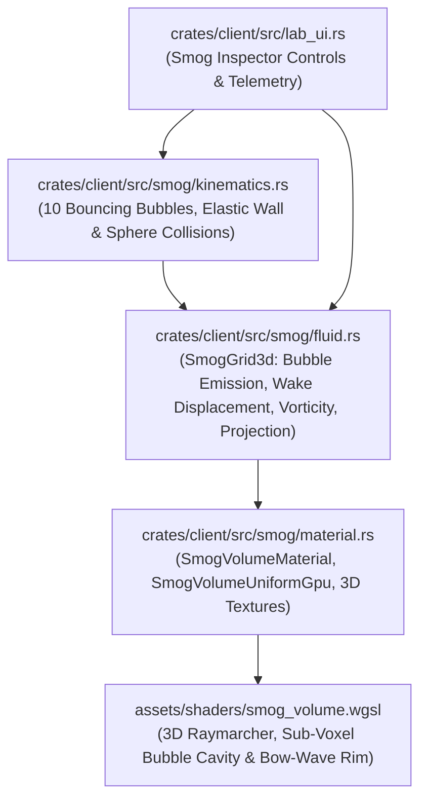

# Implementation Blueprint: 3D Volumetric Smog Driven & Influenced by 10 Bouncing Bubbles

**Date:** 2026-10-28  
**Target Crate:** `crates/client` (`src/smog/`, `assets/shaders/smog_volume.wgsl`, `tests/smog_bouncing_bubbles_tests.rs`)  
**Status:** Approved Stage 1 Architectural Blueprint  

---

## 1. Executive Summary & Architectural Charter

This blueprint specifies the architecture, mathematical formulation, GPU data layout, and verification suite for the **Bubble-Driven 3D Volumetric Smog & 10-Bubble Wall-Bouncing System** in `crates/client`:

1. **Zero Mouse Coupling — Pure Bubble-Driven Smog:**
   - The 3D smog fluid simulation is **never** driven by mouse cursor coordinates or pointer rays.
   - Instead, **every bubble** in the scene acts simultaneously as:
     - A **3D Smog Generator:** continuously injecting volumetric smog density $\rho(\mathbf{x}, t)$ and faction-tinted chromatic scattering albedo $\mathbf{C}(\mathbf{x}, t)$ into its trailing wake and boundary layer.
     - A **3D Smog Influencer (Moving Spherical Obstacle & Wake Perturber):** when a bubble moves through existing smog (whether emitted by other bubbles or by earlier passes after bouncing off walls), its spherical body and velocity vector $\mathbf{v}_b$ physically part/displace smog out of its core into a compressed bow wave, inject momentum drag $\Delta \mathbf{u}_{\text{drag}} \propto \mathbf{v}_b$, and shed azimuthal vortex rings ($\nabla \times \mathbf{u} \neq \mathbf{0}$) in its wake.
2. **10 Bouncing Bubbles in Arbitrary Motion (`BOUNCING_BUBBLE_COUNT = 10`):**
   - 10 distinct mobile unit bubbles (`BouncingSmogBubble`) are spawned dynamically from `CatalogResource` (with zero hardcoded creature slugs in Rust source code, strictly adhering to `AGENTS.md §3.3`).
   - Each bubble is initialized with a distinct position, radius $R_i \in [0.45, 0.65]$, and arbitrary 3D velocity vector $\mathbf{v}_i = (v_{x,i}, v_{y,i}, v_{z,i})$ inside the bounded 3D arena volume.
   - On every frame, the 10 bubbles move smoothly and bounce elastically off the 6 arena boundary walls (as well as elastically off one another upon sphere-sphere contact), continuously crisscrossing one another's smog plumes.
3. **Real 3D Eulerian Navier-Stokes Fluid Grid + Volumetric Raymarching Shader (`assets/shaders/smog_volume.wgsl`):**
   - A pre-allocated flat-slab 3D Eulerian fluid solver (`SmogGrid3d`, $64 \times 24 \times 48 = 73,728$ voxels) executes bubble emission, spherical obstacle displacement, momentum injection, vorticity confinement, semi-Lagrangian velocity and density advection, and divergence-free Jacobi pressure projection with **zero per-frame heap allocations**.
   - The updated 3D density/tint field and 3D velocity/vorticity field are uploaded into persistent 3D GPU textures (`TextureDimension::D3`, `TextureFormat::Rgba8Unorm`) bound to `SmogVolumeMaterial`.
   - `assets/shaders/smog_volume.wgsl` performs front-to-back Beer-Lambert volumetric raymarching with `textureSampleLevel`, sub-voxel analytical spherical boundary compression around all active bubbles, Henyey-Greenstein forward scattering, directional light shadow sampling, and `DEPTH_PREPASS` soft scene depth intersection.

---

## 2. Mathematical Model & Algorithm Specification

### 2.1 10-Bubble Arbitrary Wall-Bouncing Kinematics

Let the 3D arena bounce box be $\Omega_{\text{bounce}} = [x_{\min}, x_{\max}] \times [y_{\min}, y_{\max}] \times [z_{\min}, z_{\max}]$.
For each bubble $i \in \{0, \dots, 9\}$ with center $\mathbf{p}_i(t) \in \mathbb{R}^3$, velocity $\mathbf{v}_i(t) \in \mathbb{R}^3$, and radius $R_i > 0$:

1. **Position Integration:**
   $$\tilde{\mathbf{p}}_i = \mathbf{p}_i(t) + \Delta t \, \mathbf{v}_i(t)$$
2. **Elastic Wall Reflection (6 Boundary Planes):**
   For each coordinate axis $\alpha \in \{x, y, z\}$, let the effective sphere center bounds be $[a_\alpha, b_\alpha] = [\Omega_{\min,\alpha} + R_i, \, \Omega_{\max,\alpha} - R_i]$:
   - If $\tilde{p}_{i,\alpha} < a_\alpha$ and $v_{i,\alpha} < 0$:
     $$\tilde{p}_{i,\alpha} \leftarrow a_\alpha + (a_\alpha - \tilde{p}_{i,\alpha}), \qquad v_{i,\alpha} \leftarrow -v_{i,\alpha}$$
   - If $\tilde{p}_{i,\alpha} > b_\alpha$ and $v_{i,\alpha} > 0$:
     $$\tilde{p}_{i,\alpha} \leftarrow b_\alpha - (\tilde{p}_{i,\alpha} - b_\alpha), \qquad v_{i,\alpha} \leftarrow -v_{i,\alpha}$$
   - Clamp $\tilde{p}_{i,\alpha} \in [a_\alpha, b_\alpha]$ to guarantee strict containment even under large frame deltas.
3. **Pairwise Elastic Sphere-Sphere Impulse Resolution:**
   For each pair $0 \le i < j < 10$, let $\mathbf{d}_{ij} = \mathbf{p}_j - \mathbf{p}_i$, $d = \|\mathbf{d}_{ij}\|$, and $r_{\text{sum}} = R_i + R_j$. If $d < r_{\text{sum}}$ and $d > 10^{-6}$:
   - Normal unit vector $\hat{\mathbf{n}} = \mathbf{d}_{ij} / d$, overlap $\delta = r_{\text{sum}} - d$.
   - Mass-proportional positional separation ($m_k = R_k^3$):
     $$\mathbf{p}_i \leftarrow \mathbf{p}_i - \frac{m_j}{m_i + m_j} \delta \hat{\mathbf{n}}, \qquad \mathbf{p}_j \leftarrow \mathbf{p}_j + \frac{m_i}{m_i + m_j} \delta \hat{\mathbf{n}}$$
   - Relative normal velocity $v_{\text{rel}} = (\mathbf{v}_j - \mathbf{v}_i) \cdot \hat{\mathbf{n}}$. If $v_{\text{rel}} < 0$:
     $$J = -\frac{2 v_{\text{rel}}}{\frac{1}{m_i} + \frac{1}{m_j}}, \qquad \mathbf{v}_i \leftarrow \mathbf{v}_i - \frac{J}{m_i}\hat{\mathbf{n}}, \qquad \mathbf{v}_j \leftarrow \mathbf{v}_j + \frac{J}{m_j}\hat{\mathbf{n}}$$
4. **Heading Orientation Synchronization:**
   $$\theta_i = \operatorname{atan2}(v_{i,z}, \, v_{i,x})$$

### 2.2 Bubble Smog Generation & Bubble-Through-Smog Influence

The 3D smog volume occupies $\Omega_{\text{smog}} = [-6.5, 6.5] \times [0.0, 4.0] \times [-4.5, 4.5]$ discretized into $N_x \times N_y \times N_z = 64 \times 24 \times 48$ voxels.

For each active bubble $b$ with position $\mathbf{p}_b$, velocity $\mathbf{v}_b$, speed $s_b = \|\mathbf{v}_b\|$, unit heading $\hat{\mathbf{v}}_b = \mathbf{v}_b / \max(s_b, 10^{-5})$, radius $R_b$, and linear RGB team color $\mathbf{c}_b$:

1. **Smog Generation (Continuous & Motion-Amplified Emission):**
   - Emission center lies slightly behind the bubble center along its motion vector:
     $$\mathbf{p}_{\text{emit}} = \mathbf{p}_b - 0.45 R_b \hat{\mathbf{v}}_b$$
   - Within support radius $R_{\text{emit}} = 1.35 R_b$, for any voxel center $\mathbf{x}$ with $q = \|\mathbf{x} - \mathbf{p}_{\text{emit}}\| / R_{\text{emit}} < 1$:
     $$w_{\text{emit}}(q) = (1 - q^2)^2, \qquad \Delta \rho_{\text{emit}} = \Delta t \, \gamma_{\text{emit}} \, (0.45 + 0.55 \min(s_b, 6.0)) \, w_{\text{emit}}(q)$$
     $$\rho(\mathbf{x}) \leftarrow \min\left(\rho_{\max}, \, \rho(\mathbf{x}) + \Delta \rho_{\text{emit}}\right)$$
   - Chromatic tint $\mathbf{C}(\mathbf{x})$ blends toward $\mathbf{c}_b$ weighted by $\Delta \rho_{\text{emit}} / (\rho(\mathbf{x}) + \Delta \rho_{\text{emit}} + 10^{-5})$.

2. **Bubble Influence on Existing Smog When Moving Through It:**
   When a bubble moves with speed $s_b > 10^{-3}$ through pre-existing smog within influence radius $R_{\text{inf}} = 2.4 R_b$:
   Let $\mathbf{r} = \mathbf{x} - \mathbf{p}_b$, $d = \|\mathbf{r}\|$, $\hat{\mathbf{r}} = \mathbf{r} / \max(d, 10^{-5})$, and $u_r = d / R_{\text{inf}} \in [0, 1)$.
   - **Spherical Obstacle Displacement (Parting & Bow-Wave Compression):**
     - Inside the physical bubble shell ($d < 0.90 R_b$), pre-existing smog is evacuated from the interior and pushed into the surrounding shell ($0.90 R_b \le d < 1.75 R_b$):
       - For $d < 0.90 R_b$: evacuation factor $\eta_{\text{core}} = \operatorname{smoothstep}(0.25 R_b, 0.90 R_b, d)$; displaced density $\delta \rho = \rho(\mathbf{x}) (1 - \eta_{\text{core}}) \min(1.0, s_b \, \Delta t \cdot 4.5)$ is subtracted from the interior voxel.
       - For $0.90 R_b \le d < 1.75 R_b$: bow/shell compression factor boosts existing smog density $\rho(\mathbf{x}) \leftarrow \min(\rho_{\max}, \rho(\mathbf{x}) (1 + 0.35 \, \Delta t \, s_b (1 - u_r)^2 \max(0.2, \hat{\mathbf{r}} \cdot \hat{\mathbf{v}}_b)))$ when pre-existing smog $\rho(\mathbf{x}) > 10^{-3}$ is present.
   - **3D Fluid Velocity Impulse Injection ($\Delta \mathbf{u}$):**
     - **Momentum Drag:** drags ambient smog along $\mathbf{v}_b$:
       $$\Delta \mathbf{u}_{\text{drag}}(\mathbf{x}) = 1.65 \, \mathbf{v}_b \, (1 - u_r^2)^2$$
     - **Bow-Wave Radial Deflection:** parts smog laterally and ahead of the advancing sphere hemisphere ($\mu_f = \max(0, \hat{\mathbf{r}} \cdot \hat{\mathbf{v}}_b)$):
       $$\Delta \mathbf{u}_{\text{bow}}(\mathbf{x}) = 1.35 \, s_b \, \mu_f \, (\hat{\mathbf{r}} - 0.35 (\hat{\mathbf{r}} \cdot \hat{\mathbf{v}}_b)\hat{\mathbf{v}}_b) \, (1 - u_r)^2$$
     - **Wake Vortex Ring Shedding:** behind the bubble ($\hat{\mathbf{r}} \cdot \hat{\mathbf{v}}_b < 0$), injects curling wake recirculation:
       $$\boldsymbol{\omega}_b = \hat{\mathbf{v}}_b \times \hat{\mathbf{r}}, \qquad \Delta \mathbf{u}_{\text{wake}}(\mathbf{x}) = 0.95 \, s_b \, (\boldsymbol{\omega}_b \times \hat{\mathbf{r}}) \, (1 - u_r)^2$$
     - Total velocity update:
       $$\mathbf{u}(\mathbf{x}) \leftarrow \mathbf{u}(\mathbf{x}) + \Delta t \, \gamma_{\text{influence}} \left( \Delta \mathbf{u}_{\text{drag}} + \Delta \mathbf{u}_{\text{bow}} + \Delta \mathbf{u}_{\text{wake}} \right)$$

3. **3D Navier-Stokes Fluid Step (`SmogGrid3d::step`):**
   - **Vorticity Confinement:** $\boldsymbol{\omega} = \nabla \times \mathbf{u}$, $\boldsymbol{\eta} = \nabla \|\boldsymbol{\omega}\|$, $\mathbf{N} = \boldsymbol{\eta} / (\|\boldsymbol{\eta}\| + 10^{-5})$, $\mathbf{u} \leftarrow \mathbf{u} + \Delta t \, \varepsilon_{\text{vort}} h (\mathbf{N} \times \boldsymbol{\omega})$.
   - **Velocity Self-Advection & Wall Boundary Reflection:** Semi-Lagrangian backtrace $\mathbf{x}_0 = \mathbf{x} - \Delta t \, \mathbf{u}(\mathbf{x})$ with trilinear interpolation, exponential damping $e^{-\mu_u \Delta t}$, and no-penetration Dirichlet boundary conditions ($\mathbf{u} \cdot \hat{\mathbf{n}}_{\text{wall}} = 0$) on all 6 faces.
   - **Incompressible Pressure Projection:** Compute $\nabla \cdot \mathbf{u}$, solve $\nabla^2 p = \nabla \cdot \mathbf{u}$ via 4 Red-Black/Jacobi iterations in pre-allocated ping-pong slabs, and project $\mathbf{u} \leftarrow \mathbf{u} - \nabla p$.
   - **Density & Chromatic Advection + Dissipation:** Semi-Lagrangian backtrace of $\rho$ and $\mathbf{C}$ along $\mathbf{u} + (0, u_{\text{buoyancy}}, 0)$ with trilinear interpolation and dissipation $\rho \leftarrow \rho \, e^{-\lambda_\rho \Delta t}$.

---

## 3. Module Architecture & File Plan



### 3.1 Files to Create
1. `crates/client/src/smog/mod.rs` — Plugin, resources (`SmogConfig`, `SmogStats`), error types (`SmogError`), and ECS systems (`setup_smog_volume_system`, `sync_bouncing_smog_bubbles_system`, `update_smog_field_system`).
2. `crates/client/src/smog/kinematics.rs` — `BouncingSmogBubble` component, `SmogArenaBounds`, 10-bubble deterministic initial state generator, and elastic wall + sphere-sphere bounce integrator.
3. `crates/client/src/smog/fluid.rs` — `SmogGrid3d`, `BubbleSmogSource`, `SmogStepMetrics`, 3D Eulerian fluid solver, bubble smog generation, bubble-through-smog displacement/wake injection, and zero-allocation 3D RGBA8 texture packing.
4. `crates/client/src/smog/material.rs` — `SmogVolumeUniformGpu` (608 bytes, 16-byte aligned), `SmogVolumeMaterial` (`AsBindGroup` with two 3D textures), and `SmogVolumeMarker`.
5. `assets/shaders/smog_volume.wgsl` — Volumetric 3D raymarching shader sampling the 3D density and velocity textures and applying analytical sub-voxel spherical boundary coupling for up to 16 bubbles.
6. `crates/client/tests/smog_bouncing_bubbles_tests.rs` — Comprehensive integration and mathematical verification suite.

### 3.2 Files to Modify
1. `crates/client/src/lib.rs`:
   - Declare `pub mod smog;` and re-export public smog symbols (`BouncingSmogBubble`, `SmogConfig`, `SmogError`, `SmogGrid3d`, `SmogPlugin`, `SmogStats`, `SmogVolumeMaterial`, `SmogVolumeUniformGpu`, `BOUNCING_BUBBLE_COUNT`).
   - Register `smog::SmogPlugin` in `ClientAppPlugin::build`.
   - Initialize `Assets<smog::SmogVolumeMaterial>`, `smog::SmogConfig`, `smog::SmogStats`, `smog::SmogGrid3d` and step `smog::sync_bouncing_smog_bubbles_system` and `smog::update_smog_field_system` inside `run_headless_check()`.
2. `crates/client/src/lab_ui.rs`:
   - Add `smog_bouncing_active: bool`, `opt_smog_volume: bool`, `smog_emission_rate: f32`, `smog_wake_influence: f32`, `smog_bubble_count: usize` to `LabState` (`Default`: `smog_bouncing_active: true`, `opt_smog_volume: true`, `smog_emission_rate: 1.8`, `smog_wake_influence: 2.2`, `smog_bubble_count: 0`).
   - Add `"3D Smog & 10 Bouncing Bubbles"` UI controls at the end of `render_visual_lab_tab`.
3. `crates/client/src/runtime_capture/driver.rs` & `crates/client/src/shell_order_audit/source.rs`:
   - In `runtime_capture/driver.rs`, set `lab_state.smog_bouncing_active = false` and `lab_state.opt_smog_volume = false` when `CapturePlugin` is installed so existing automated capture scripts preserve their exact 4-hero and 200-swarm entity counts.
   - In `shell_order_audit/source.rs`, include `Option<&crate::smog::BouncingSmogBubble>` in the domain check so `BouncingSmogBubble` is recognized as `"Smog"` if ever inspected.

---

## 4. Detailed Component Specifications

### 4.1 `crates/client/src/smog/material.rs`

```rust
//! Custom Bevy 3D Volumetric Material and GPU uniform packing for 3D Bubble-Driven Smog.

use bevy::pbr::NotShadowCaster;
use bevy::prelude::*;
use bevy::render::render_resource::{AsBindGroup, Face, ShaderRef, ShaderType};

/// Maximum number of active bubble spheres packed directly into the volumetric shader uniform
/// for sub-voxel spherical cavity carving and bow-wave compression.
pub const MAX_SMOG_SHADER_BUBBLES: usize = 16;

/// Marker component identifying the 3D volumetric smog bounding box entity.
#[derive(Component, Debug, Clone, Copy, PartialEq, Eq)]
#[require(NotShadowCaster)]
pub struct SmogVolumeMarker;

/// GPU uniform buffer struct matching `struct SmogVolumeUniform` in `assets/shaders/smog_volume.wgsl`.
// PERFORMANCE RATIONALE:
// Why: WebGPU uniform buffers require strict 16-byte alignment and std140 array stride rules.
// What: 6 header Vec4 lanes (96B) + 16 bubble_pos_radius Vec4s (256B) + 16 bubble_vel_boost Vec4s (256B)
// = 608 bytes total, with every field 16-byte aligned.
// Trade-off: Fixed 16-bubble analytical sub-voxel array alongside arbitrary-bubble 3D texture grid.
#[repr(C)]
#[derive(Debug, Clone, Copy, PartialEq, bytemuck::Pod, bytemuck::Zeroable, ShaderType)]
pub struct SmogVolumeUniformGpu {
    /// World-space minimum corner of the 3D smog volume (XYZ) + soft depth fade distance (W).
    pub volume_min: Vec4,
    /// World-space maximum corner of the 3D smog volume (XYZ) + global extinction scale (W).
    pub volume_max: Vec4,
    /// Base ambient smog tint (RGB) + animation time in seconds (W).
    pub base_tint_time: Vec4,
    /// Warm scattering highlight tint (RGB) + Henyey-Greenstein phase anisotropy g (W).
    pub warm_tint_anisotropy: Vec4,
    /// Primary directional light direction (XYZ) + normalized light intensity (W).
    pub light_dir_intensity: Vec4,
    /// X = active bubble count (as f32), Y = bow-wave rim strength, Z = cavity carving strength, W = enabled (1.0 or 0.0).
    pub control_params: Vec4,
    /// XYZ = bubble world center, W = bubble radius (for up to 16 bubbles).
    pub bubble_pos_radius: [Vec4; MAX_SMOG_SHADER_BUBBLES],
    /// XYZ = bubble velocity vector, W = speed boost / wake intensity factor.
    pub bubble_vel_boost: [Vec4; MAX_SMOG_SHADER_BUBBLES],
}
```

- `size_of::<SmogVolumeUniformGpu>() == 608`
- `align_of::<SmogVolumeUniformGpu>() == 16`
- `SmogVolumeMaterial` binds:
  - `#[uniform(0)] pub uniform: SmogVolumeUniformGpu`
  - `#[texture(1, dimension = "3d")] #[sampler(2)] pub density_texture: Handle<Image>`
  - `#[texture(3, dimension = "3d")] #[sampler(4)] pub velocity_texture: Handle<Image>`
- `SmogVolumeMaterial::specialize` sets `descriptor.primitive.cull_mode = Some(Face::Front);` so back faces of the volume proxy cuboid rasterize each covered pixel exactly once whether the camera is outside or inside the volume bounds, and `depth_stencil` uses `depth_write_enabled = false` and `depth_compare = CompareFunction::Always` so the fragment shader's analytical ray-AABB + `DEPTH_PREPASS` clipping owns occlusion.

### 4.2 `crates/client/src/smog/kinematics.rs`

- `pub const BOUNCING_BUBBLE_COUNT: usize = 10;`
- `SmogArenaBounds`:
  - Default bounce bounds: `min: Vec3::new(-5.5, 0.0, -3.5)`, `max: Vec3::new(5.5, 3.4, 3.5)`.
- `BouncingSmogBubble` component:
  - `pub index: usize`
  - `pub velocity: Vec3`
  - `pub radius: f32`
  - `pub wall_bounces: u64`
  - `pub peer_bounces: u64`
- `initial_bouncing_bubbles(bounds: &SmogArenaBounds) -> Result<[BouncingBubbleState; BOUNCING_BUBBLE_COUNT], SmogError>`:
  - Returns 10 well-separated initial states inside `bounds` with varied radii (`0.46..=0.64`) and arbitrary 3D velocity vectors $\mathbf{v}_i$ (both positive and negative $v_x, v_y, v_z$, speeds in `2.4..=4.1` world units/s).
- `step_bouncing_kinematics(states: &mut [BouncingBubbleState], bounds: &SmogArenaBounds, dt: f32) -> Result<(u64, u64), SmogError>`:
  - Validates finite `dt >= 0.0` and valid `bounds`.
  - Integrates positions, reflects off all 6 walls of `bounds`, resolves elastic sphere-sphere collisions between pairs of bubbles, and updates `heading_angle_rad`.

### 4.3 `crates/client/src/smog/fluid.rs`

- Grid dimensions: `GRID_NX = 64`, `GRID_NY = 24`, `GRID_NZ = 48` (`TOTAL_VOXELS = 73_728`).
- `SmogGrid3d` resource:
  - Pre-allocates all voxel slabs and GPU RGBA8 upload buffers once in `SmogGrid3d::new(bounds_min, bounds_max)`.
  - Provides:
    - `world_to_grid(&self, world_pos: Vec3) -> Vec3`
    - `sample_density_trilinear(&self, world_pos: Vec3) -> f32`
    - `sample_velocity_trilinear(&self, world_pos: Vec3) -> Vec3`
    - `sample_vorticity_magnitude(&self, world_pos: Vec3) -> f32`
    - `step(&mut self, sources: &[BubbleSmogSource], config: &SmogConfig, dt: f32) -> Result<SmogStepMetrics, SmogError>`
- **Key Physical Invariants Verified by Unit & Integration Tests:**
  1. **Smog Generation Invariant:** Given any stationary or moving bubble inside $\Omega_{\text{smog}}$ with `emission_strength > 0`, stepping `SmogGrid3d` strictly increases smog density around the bubble.
  2. **Bubble-Through-Smog Influence Invariant:** Given a pre-populated uniform or plume smog region (generated by other bubbles) and a bubble moving through it with velocity $\mathbf{v}_b \neq \mathbf{0}$ (and `emission_strength == 0.0` to isolate influence, or with full emission + influence):
     - Density inside the moving bubble's core ($d < 0.6 R_b$) is actively displaced/carved downward relative to the undisturbed background while bow-wave shell density ($1.0 R_b \le d \le 1.5 R_b$ ahead of the bubble) increases.
     - The fluid velocity field $\mathbf{u}(\mathbf{x})$ along the bubble's path acquires a strong positive component along $\mathbf{v}_b$ ($\mathbf{u}(\mathbf{p}_b) \cdot \hat{\mathbf{v}}_b > 0$).
     - The fluid vorticity $\nabla \times \mathbf{u}$ in the wake behind the bubble becomes strictly positive ($\|\nabla \times \mathbf{u}\| > 0$).

### 4.4 `assets/shaders/smog_volume.wgsl`

- Binds:
  - `@group(2) @binding(0) var<uniform> smog: SmogVolumeUniform;`
  - `@group(2) @binding(1) var smog_density_tex: texture_3d<f32>;`
  - `@group(2) @binding(2) var smog_density_sampler: sampler;`
  - `@group(2) @binding(3) var smog_velocity_tex: texture_3d<f32>;`
  - `@group(2) @binding(4) var smog_velocity_sampler: sampler;`
- Implements:
  - `intersect_aabb(ray_origin: vec3<f32>, ray_dir: vec3<f32>, box_min: vec3<f32>, box_max: vec3<f32>) -> vec2<f32>`
  - `hg_phase(cos_theta: f32, g: f32) -> f32` (Henyey-Greenstein phase function)
  - `sample_smog_field(world_pos: vec3<f32>) -> vec4<f32>`:
    - Samples `textureSampleLevel(smog_density_tex, smog_density_sampler, uvw, 0.0)` and `textureSampleLevel(smog_velocity_tex, smog_velocity_sampler, uvw, 0.0)`.
    - Modulates density with coherent advected 3D FBM detail warped by the fluid velocity vector $\mathbf{u}(\mathbf{x})$.
    - Evaluates sub-voxel interaction with the packed bubble spheres (`smog.bubble_pos_radius[i]`, `smog.bubble_vel_boost[i]`):
      - Carves a smooth spherical cavity inside each bubble's glass shell ($d < 0.88 R_i$) so the inner creature flipbook remains crystal-clear and readable.
      - Accumulates a compressed, turbulent bow-wave & wake rim ($0.90 R_i \le d \le 1.45 R_i$) weighted by the bubble's speed and heading alignment.
  - 48-step front-to-back Beer-Lambert raymarcher with directional light single-scattering shadow step, `DEPTH_PREPASS` soft intersection, and `TONEMAP_IN_SHADER` premultiplied output.

---

## 5. Step-by-Step Implementation Checklist for Stage 2 Sub-Agent

1. **Create `crates/client/src/smog/material.rs`:**
   - Implement `SmogVolumeUniformGpu`, `SmogVolumeMaterial`, and `SmogVolumeMarker`.
   - Include `//!` module docs, `///` public docs, and `// PERFORMANCE RATIONALE:` on `SmogVolumeUniformGpu`.
2. **Create `crates/client/src/smog/kinematics.rs`:**
   - Implement `BOUNCING_BUBBLE_COUNT = 10`, `SmogArenaBounds`, `BouncingSmogBubble`, `BouncingBubbleState`, `initial_bouncing_bubbles`, and `step_bouncing_kinematics`.
   - Include unit tests verifying elastic wall bounces on all 6 faces, energy/speed conservation, and pairwise sphere-sphere elastic collision resolution.
3. **Create `crates/client/src/smog/fluid.rs`:**
   - Implement `SmogGrid3d`, `BubbleSmogSource`, `SmogStepMetrics`, trilinear interpolation, bubble smog emission, bubble-through-smog spherical displacement/bow-wave/drag/vortex-ring coupling, vorticity confinement, semi-Lagrangian advection, 4-iteration Jacobi pressure projection, and RGBA8 3D texture packing.
   - Include `// PERFORMANCE RATIONALE:` explaining the flat-slab pre-allocated voxel layout and zero per-frame heap allocations.
4. **Create `crates/client/src/smog/mod.rs`:**
   - Implement `SmogError`, `SmogConfig`, `SmogStats`, `SmogPlugin`, `setup_smog_volume_system`, `sync_bouncing_smog_bubbles_system`, and `update_smog_field_system`.
   - Ensure `sync_bouncing_smog_bubbles_system` dynamically queries `CatalogResource` for mobile archetypes (`!matches!(a.shape, ShapeKind::BuildingDome { .. })`) with zero hardcoded unit slugs, checks media admission via `ClientMediaStatus`, and reuses pre-allocated `Vec<BouncingBubbleState>` scratch in a `Local` or resource so steady-state frames perform zero heap allocations.
   - Ensure `update_smog_field_system` collects `BubbleSmogSource` entries from all visible `BubbleInstance` entities (using a pre-allocated buffer), steps `SmogGrid3d`, updates the 3D `Image` data in `Assets<Image>`, and updates `SmogVolumeUniformGpu`.
5. **Create `assets/shaders/smog_volume.wgsl`:**
   - Implement the complete volumetric raymarching vertex and fragment shader matching `SmogVolumeUniformGpu` and `SmogVolumeMaterial` bindings (`@group(2) @binding(0..4)`).
6. **Integrate into `crates/client/src/lib.rs`, `crates/client/src/lab_ui.rs`, `crates/client/src/runtime_capture/driver.rs`, and `crates/client/src/shell_order_audit/source.rs`:**
   - Wire `SmogPlugin` into `ClientAppPlugin`.
   - Add headless verification of the 10 bouncing bubbles and 3D smog grid inside `run_headless_check()`.
   - Add UI controls in `lab_ui.rs`.
   - Ensure `runtime_capture/driver.rs` disables `smog_bouncing_active` and `opt_smog_volume` during scripted capture runs so existing capture tests remain unaffected.
7. **Create `crates/client/tests/smog_bouncing_bubbles_tests.rs`:**
   - Write comprehensive integration tests covering:
     - 10-bubble arbitrary movement and elastic wall bouncing across 600 frames.
     - Multi-bubble smog generation across the 3D volume.
     - Bubble-through-smog influence (core cavity displacement, bow-wave compression, velocity drag alignment, and wake vorticity generation when a bubble traverses smog created by other bubbles).
     - `SmogVolumeUniformGpu` 608-byte size/16-byte alignment and `naga` WGSL validation of `assets/shaders/smog_volume.wgsl`.
     - Full Bevy ECS schedule execution with 10 `BouncingSmogBubble` entities updating `SmogGrid3d` and `SmogStats`.
8. **Run Quality Gates (`AGENTS.md §4.3`):**
   - `cargo test --workspace`
   - `cargo clippy --workspace --all-targets -- -D warnings`
   - `cargo fmt --all -- --check`

---

## 7. Visual Visibility Remediation & Real GPU Screenshot Capture Blueprint

### 7.1 Root-Cause Diagnosis of Visual Overlap & Low Optical Opacity

When launching `cargo run --release -p client --bin client -- --lab`, three issues caused the user to see the previous ribbon mist wake (`mist_wake.wgsl`) and an almost-invisible 3D smog volume:

1. **Old `MistWakePlugin` Ribbon Trails Attached to All 10 Bouncing Bubbles & 4 Static Showcase Heroes:**
   - In `crates/client/src/smog/mod.rs` (`setup_smog_volume_system`), the 10 `BouncingSmogBubble` entities were spawned with `BubbleInstance` and `ShapeKind::UnitSphere` **without** `crate::mist::MistMotion { conveyor_velocity: None, enabled: false }`.
   - Consequently, `update_mist_wake_system` (`crates/client/src/mist/mod.rs`) treated all 10 `BouncingSmogBubble` entities as legacy ribbon-mist emitters, attaching `AssignedEmitter` and rendering the old 2D ribbon trail (`mist_wake.wgsl`) behind every bouncing bubble.
   - Simultaneously, the 4 static `LabPreviewBubble` heroes at $z = 0$ (`x = -3.6, -1.2, 1.2, 4.2`) and the 240px bottom HUD remained visible in `VisualLab` even when `smog_bouncing_active && opt_smog_volume` was active, with the first static hero emitting its conveyor-belt `mist_wake.wgsl` ribbon trail (`opt_mist_wake: true`).
2. **`DEPTH_PREPASS` Planar View-Z vs. Euclidean Ray Distance Bug in `assets/shaders/smog_volume.wgsl`:**
   - In `assets/shaders/smog_volume.wgsl`, `let scene_distance = -depth_ndc_to_view_z(scene_depth);` used the planar view-space $Z$ coordinate instead of the Euclidean distance along `ray_dir`.
   - Because `intersect_aabb` produces Euclidean ray parameter distances $t_{\text{enter}}, t_{\text{exit}}$ along unit vector `ray_dir`, off-axis rays (where $\cos\alpha = \mathbf{d}_{\text{ray}} \cdot \hat{\mathbf{f}}_{\text{view}} < 1$) had `scene_distance` underestimated by a factor of $\cos\alpha$, clipping `t_exit` up to $1.5\text{ m}$ in front of the arena floor and cutting off the lower smog volume where the bubbles move.
   - Additionally, when `scene_depth <= 1e-6` (reverse-$Z$ far plane), `depth_ndc_to_view_z` must not clip `t_exit`.
3. **Cold-Start Empty Grid & Low Volumetric Optical Depth:**
   - `SmogGrid3d` started at $t = 0$ with zero density everywhere, and moving bubbles ($s_b \approx 3.0\text{ m/s}$) had a short voxel dwell time ($\sim 0.45\text{ s}$). With `emission_rate = 1.8`, `SMOG_DENSITY_MAX = 4.0`, and `extinction_scale = 1.2`, single-pass wakes had only $\sim 5\text{--}7\%$ optical opacity against the dark metallic arena floor.

---

### 7.2 Exact Code Remediation Specifications

#### A. Suppress Legacy `MistWakePlugin` on Smog Bubbles & Hide Static Hero Lineup During Smog Showcase
1. **`crates/client/src/smog/mod.rs` (`setup_smog_volume_system`):**
   - Attach `crate::mist::MistMotion { conveyor_velocity: None, enabled: false }` to every spawned `BouncingSmogBubble` entity so it never requests a legacy ribbon wake.
2. **`crates/client/src/mist/mod.rs` (`update_mist_wake_system`):**
   - Add `Without<crate::smog::BouncingSmogBubble>` to the `bubbles` query filter in `update_mist_wake_system` so `BouncingSmogBubble` entities never allocate slots in `MistPool`.
   - Gate preview mist emission on `!(l.smog_bouncing_active && l.opt_smog_volume)`:
     ```rust
     let enabled = override_motion.map_or(true, |m| m.enabled)
         && (preview.is_none()
             || lab
                 .as_ref()
                 .map_or(true, |l| l.opt_mist_wake && !(l.smog_bouncing_active && l.opt_smog_volume)));
     ```
3. **`crates/client/src/scene_controller.rs` (`sync_lab_preview_system`):**
   - Keep the media admission loop at the top of `sync_lab_preview_system` (so `runtime_media_tests` continues to verify media admission on `LabTab::VisualLab`).
   - Add `&mut Visibility` to `query` on `With<LabPreviewBubble>`.
   - Compute `let show_preview_heroes = !(lab_state.smog_bouncing_active && lab_state.opt_smog_volume);` and set each `LabPreviewBubble`'s `Visibility` to `if show_preview_heroes { Visibility::Inherited } else { Visibility::Hidden }` both when spawning and when updating in-place.
   - Because all indicator children (`GroundRingMarker`, `OverheadBarRootMarker`, `BaseplateMarker`) use `Visibility::Inherited`, hiding the parent `LabPreviewBubble` automatically hides its indicators and excludes the 4 static heroes from `update_smog_field_system` (`if matches!(visibility, Some(Visibility::Hidden)) { continue; }`).
   - When `runtime_capture` runs (which sets `smog_bouncing_active = false` and `opt_smog_volume = false`), `show_preview_heroes` is `true`, so all existing capture tests see the exact 4-hero lineup.
4. **`crates/client/src/lab_ui.rs` (`lab_ui_system` & `render_visual_lab_tab`):**
   - In `lab_ui_system`, only render the 240px bottom `render_selected_unit_hud` panel when `!(lab_state.smog_bouncing_active && lab_state.opt_smog_volume)` so the 3D smog arena has the full vertical viewport height (`920 x 720`).
   - In `render_visual_lab_tab`, place the `"3D Smog & 10 Bouncing Bubbles"` section right at the top of the inspector (above `"Selected actor"` and `"Diegetic Damage & Status"`) so the 3D smog toggles, sliders, and active bubble telemetry are immediately visible at the top of the left panel while keeping `UiTarget::Health` inside the visible clip rect.
   - Update `LabState::default()` smog parameters to `smog_emission_rate: 3.8`, `smog_wake_influence: 3.2`.

#### B. Startup 45-Step Pre-Warming, Stronger Smog Plumes & Wake Cavities
1. **`crates/client/src/smog/kinematics.rs` (`SmogArenaBounds::default`):**
   - Set `SmogArenaBounds::default()` to `min: Vec3::new(-4.8, 0.0, -3.0), max: Vec3::new(4.8, 3.2, 3.0)` so all 6 bounce walls lie completely inside the `RtsCamera::hero_framing()` frustum (`distance = 9.5, target = (0.0, 0.0)`), keeping all 10 bouncing bubbles and their wall reflections in clear view at all times.
2. **`crates/client/src/smog/fluid.rs` (`SmogGrid3d`):**
   - Add `pub fn seed_ambient_smog_blanket(&mut self)` to `SmogGrid3d`, which seeds a gentle, stratified ground-hugging smog layer ($\rho \in [0.35, 0.85]$ for $y \in [0.0, 2.2]$, modulated by spatial 3D sinusoidal billows and faction-neutral cool-warm gradients) and calls `self.pack_textures()`. Note: `SmogGrid3d::new` remains zero-initialized so unit tests testing zero-start accumulation remain unchanged.
   - In `SmogGrid3d::step`:
     - Increase `emit_radius = source.radius * 1.65` and `speed_factor = 0.85 + 0.75 * speed.min(6.0)`.
     - Increase core evacuation sharpness (`eta_core = smoothstep(source.radius * 0.35, source.radius * 0.92, dist)`) and bow-wave shell compression (`1.0 + 0.65 * dt * speed * source.influence_strength * (1.0 - u_r).powi(2) * dir_align`).
3. **`crates/client/src/smog/mod.rs` (`SmogConfig::default` & `setup_smog_volume_system`):**
   - Set `SmogConfig::default()` to `emission_rate: 3.8`, `wake_influence: 3.2`, `dissipation_rate: 0.06`, `vorticity_confinement: 0.45`, `buoyancy: 0.06`, `velocity_damping: 0.04`.
   - In `setup_smog_volume_system`, accept `mut grid: ResMut<'_, SmogGrid3d>`:
     - Call `grid.seed_ambient_smog_blanket()`.
     - Run **45 pre-warm steps** (`dt = 1.0 / 30.0`, i.e., $1.5\text{ s}$ of bubble motion and 3D Navier-Stokes fluid evolution) of `step_bouncing_kinematics` and `grid.step` using the 10 bubbles before creating the GPU `Image` assets and `SmogVolumeMaterial`.
     - Initialize `density_image` and `velocity_image` directly with `grid.rgba_density_bytes.clone()` and `grid.rgba_velocity_bytes.clone()`, and populate `uniform.bubble_pos_radius` and `uniform.bubble_vel_boost` with the 10 bubbles' post-warmup positions and velocities.
     - Set `volume_max = Vec4::new(6.5, 4.0, 4.5, 2.4)` (extinction scale `2.4`), `base_tint_time = Vec4::new(0.45, 0.72, 0.95, 1.5)`, `warm_tint_anisotropy = Vec4::new(1.0, 0.82, 0.52, 0.55)`, `light_dir_intensity = Vec4::new(0.45, 0.75, 0.48, 1.85)`, and `control_params = Vec4::new(BOUNCING_BUBBLE_COUNT as f32, 1.85, 1.0, 1.0)`.

#### C. Fix `assets/shaders/smog_volume.wgsl` Euclidean Depth & Volumetric FBM Contrast
1. **Euclidean `scene_distance` under `DEPTH_PREPASS`:**
   ```wgsl
   #ifdef DEPTH_PREPASS
   #ifdef MULTISAMPLED
       let scene_depth = prepass_depth(in.position, sample_index);
   #else
       let scene_depth = prepass_depth(in.position, 0u);
   #endif
       if (scene_depth > 1e-6) {
           let view_z = -depth_ndc_to_view_z(scene_depth);
           let view_forward = normalize(-view.world_from_view[2].xyz);
           let ray_cos = max(dot(ray_dir, view_forward), 1e-4);
           let scene_distance = view_z / ray_cos;
           t_exit = min(t_exit, max(0.0, scene_distance));
           if (t_exit <= t_enter) {
               discard;
           }
       }
   #endif
   ```
2. **Multi-Octave Advected 3D FBM Detail & Sub-Voxel Bubble Cavities / Bow-Wave Rims:**
   - Implement `hash31(p: vec3<f32>) -> f32`, `noise3(p: vec3<f32>) -> f32`, and 3-octave `fbm3(p: vec3<f32>) -> f32` in `assets/shaders/smog_volume.wgsl`.
   - In `sample_smog(pos: vec3<f32>)`:
     - Scale base density: `var density = density_sample.a * 5.5;`.
     - Warp coordinates by the 3D fluid velocity texture: `let u = (velocity_sample.xyz - vec3<f32>(0.5)) * 10.0; let vort = velocity_sample.w; let fbm_val = fbm3(pos * 1.35 - u * 0.28 + vec3<f32>(0.0, smog.base_tint_time.w * 0.15, 0.0));`.
     - Modulate density with high-contrast billowing structure: `density *= (0.65 + 0.75 * fbm_val + 0.35 * vort);`.
     - For each active bubble $i \in [0, \text{bubble\_count})$:
       - **Spherical Cavity ($d < 0.92 R_i$):** carve out the interior (`let cavity = smoothstep(r_i * 0.35, r_i * 0.92, dist); density *= mix(cavity * 0.06, 1.0, 1.0 - smog.control_params.z);`) so every bubble punches a crisp, visible 3D hollow cavity inside the smog.
       - **Bow-Wave & Wake Vortex Sheath ($0.92 R_i \le d < 1.85 R_i$):** compress existing smog AND add a turbulent wake rim (`let shell_w = (1.0 - r_norm) * (1.0 - r_norm); density = density * (1.0 + smog.control_params.y * min(s_i, 4.5) * 0.55 * max(0.15, dir_dot) * shell_w) + 0.42 * shell_w * (0.6 + 0.4 * fbm_val);`) while shifting `tint` toward bright cyan-gold along the compressed bow wave.
     - Apply Beer-Lambert powder scattering (`let powder = 1.0 - exp(-optical_depth * 2.8);`) in the raymarch loop so billowing smog edges catch the directional light with high visual contrast.

#### D. Real GPU Screenshot Capture CLI (`--screenshot-out <PATH>`)
1. **`crates/client/src/main.rs` & `crates/client/src/lib.rs`:**
   - Add `--screenshot-out <PATH>` (`pub screenshot_out: Option<std::path::PathBuf>`) to `CliArgs` in `crates/client/src/main.rs`.
   - Add `pub fn run_app_with_options(mode: ClientMode, max_frames: Option<u64>, scenario_path: &std::path::Path, screenshot_out: Option<std::path::PathBuf>) -> AppExit` in `crates/client/src/lib.rs` (keeping `run_app` and `run_app_with_scenario` backward-compatible).
   - Store `screenshot_out: Option<PathBuf>` and `screenshot_pending: bool` on `FrameLimit`.
   - In `frame_limit_system` (`crates/client/src/lib.rs`), once `frame_limit.current_frame >= max` and `render_status` is ready:
     - If `screenshot_out` is `Some(path)` and `!frame_limit.screenshot_pending`:
       - Set `frame_limit.screenshot_pending = true` and spawn `Screenshot::primary_window()` with an observer on `ScreenshotCaptured` that converts the GPU frame buffer to `rgb8`, writes the PNG file to `path`, and sends `AppExit::Success` (or `AppExit::error()` if saving fails).
2. **End-to-End Verification & Screenshot Generation:**
   - Run the real GPU client in `--lab` mode with `--max-frames 60 --screenshot-out` to capture the live 1280x720 PNG screenshot of the 10 bouncing bubbles generating and perturbing the 3D volumetric smog field.

---

### 8. High-Quality Slight Mist, Multi-Color Dissipating Glow, Map-Plane Trails, and $O(N)$ 400-Unit Performance Architecture

### 8.1 Executive Summary of Visual, Physical & Performance Refinements

Based on user feedback and runtime profiling, this section specifies six critical requirements:

1. **All 10 Test Bubbles (and 400 Stress-Test Bubbles) Move Strictly in One Plane (The Horizontal Map Plane):**
   - In `crates/client/src/smog/kinematics.rs`, `initial_bouncing_bubbles` and `generate_bouncing_bubbles` place all bubbles on the horizontal map plane with well-distributed initial positions and varied horizontal headings $\theta_i$:
     $$p_{i,y} = \Omega_{\min,y} + R_i = R_i, \qquad v_{i,y} = 0.0$$
   - Pairwise sphere-sphere elastic collisions in `step_bouncing_kinematics` project the collision normal onto the horizontal $(X, Z)$ plane whenever the colliding bubbles have $v_y = 0$, preventing differences in bubble radii ($R_i \neq R_j$) from launching bubbles vertically into $+Y$. All bubbles bounce elastically off the 4 vertical arena walls ($X_{\min}, X_{\max}, Z_{\min}, Z_{\max}$) and off each other while remaining 100% in the map plane.
2. **Leaving Mist Behind + Subtle Stationary Basal Radiation & Natural Initial Fluid Directions:**
   - **Speed-Modulated Emission with Subtle Stationary Aura (`basal_emission`):**
     - Moving bubbles ($s_b = \|\mathbf{v}_b\| > 0$) leave a rich, luminous mist trail behind them along their path on the map plane, while stationary bubbles ($s_b \approx 0$) radiate a subtle, soft basal aura (`speed_factor = (0.16 + speed.min(6.0) * 1.10).clamp(0.16, 4.8)`).
     - The emission center $\mathbf{p}_{\text{emit}} = \mathbf{p}_b - 0.28 R_b \hat{\mathbf{v}}_b$ (radius $R_{\text{emit}} = 0.92 R_b$) smoothly centers at $\mathbf{p}_b$ when stationary and shifts slightly toward the rear hemisphere when moving so mist trails naturally from the bubble's wake without being shot backward.
   - **Natural Initial Fluid / Particle Directions (Gentle Radial Breathe & Wake Curl, Zero Jet Ejection):**
     - Bubbles must **never** blast or eject mist like a rocket exhaust. Instead, within the emission footprint ($q^2 = d^2 / R_{\text{emit}}^2 < 1$), newly emitted mist is given only a **very gentle outward radial breath + slight upward thermal drift** ($\mathbf{u}_{\text{breathe}} = 0.12 (1 - q^2) \hat{\mathbf{r}}_{\text{emit}} + (0.0, 0.05, 0.0)$), with `buoyancy = 0.04`, `velocity_damping = 1.15`, and `vorticity_confinement = 1.65`.
     - For stationary bubbles, this creates a soft, shimmering halo that slowly breathes outward around the base of the dome. For moving bubbles, the mist remains anchored along the bubble's path while its edges gently unfurl with organic vorticity curls.
3. **Natural Semitransparent Bubble / Mist Integration:**
   - Rather than carving a harsh 100% empty hole inside emitting bubbles, the semitransparent glass bubble (`BubbleDomeMaterial`) and the volumetric mist blend smoothly together:
     - When `source.emission_strength > 0.0` (active mist-radiating bubble), inner-core density inside $d < 0.72 R_b$ is softly attenuated (`rho *= 0.72 + 0.28 * (d / (0.72 * R_b))`) rather than zeroed out, and when the bubble's front hemisphere ($\hat{\mathbf{r}} \cdot \hat{\mathbf{v}}_b > 0.15$) crosses a dense pre-existing trail ($\rho > 0.12$), it gently parts and deflects that trail laterally (`u_bow` + gentle `u_drag` + wake swirl `u_wake`) so the bubble visibly interacts with existing mist while remaining naturally semitransparent over its own aura.
     - When `source.emission_strength == 0.0` (isolated obstacle influence mode used by unit tests), full spherical core evacuation ($d < 0.90 R_b$), bow-wave shell compression, momentum drag, and wake vortex shedding apply across the sphere.
4. **Curated Multi-Color Spectrum Per Generator & Dissipating Luminescent Glow:**
   - **Harmonious 10-Bubble Palette (`kinematics.rs`):** The 10 showcase bubbles use curated, high-contrast bioluminescent jewel/pastel base tones (Solar Gold, Electric Cyan, Bioluminescent Emerald, Royal Amethyst, Coral Magenta, Cerulean Azure, Amber Tangerine, Jade Mint, Crimson Rose, Pearlescent Violet).
   - **3-Stage Per-Generator Chromatic Gradient:** Every generator injects a multi-color gradient across its footprint and trail lifetime:
     - **Incandescent Core Hue ($\mathbf{C}_{\text{core}}$):** Warm champagne/white-gold shifted core injected at $q^2 < 0.32$ alongside a high-intensity **Luminescent Glow Scalar** $G(\mathbf{x}, t) \in [0, 1]$.
     - **Complementary Iridescent Sheath Hue ($\mathbf{C}_{\text{sheath}}$):** Hue-rotated secondary tone injected into the outer curl ($0.32 \le q^2 < 1.0$) so every individual bubble's plume exhibits a multi-color gradient from core to edge.
     - **Cool Twilight Atmospheric Tail ($\mathbf{C}_{\text{tail}} = (0.28, 0.46, 0.68)$):** As the stationary trail ages behind the bubble, $G(\mathbf{x}, t)$ dissipates rapidly ($\lambda_{\text{glow}} \approx 1.35\text{ s}^{-1}$) while density dissipates gently ($\lambda_\rho = 0.25\text{ s}^{-1}$), transitioning the trail from a bright glowing $\mathbf{C}_{\text{core}} \to \mathbf{C}_{\text{sheath}}$ near the bubble to a soft, non-glowing twilight mist further down the wake.
5. **Eliminating All $O(N^2)$ Algorithms & GPU Fragment Bottlenecks for 400-Unit Scalability:**
   - **GPU Fragment Shader (`assets/shaders/smog_volume.wgsl`):**
     - Remove the per-pixel `for (var i = 0u; i < bubble_count; i++)` loop (making fragment shader cost strictly $O(1)$ regardless of whether $10$ or $400$ units are active).
     - Replace the 3-octave procedural `fbm3` ($2,304$ hashes/pixel) with a single hardware-trilinear lookup into a **pre-baked tileable $32 \times 32 \times 32$ 3D wispy noise texture** (`noise_texture` at `@group(2) @binding(5)` / `@binding(6)`).
     - Implement **empty-space skipping** (`if (density_sample.a < 0.004) { t += step_size; continue; }`) before sampling velocity or noise textures, reduce raymarch steps from `48` to `28`, and replace the second `sample_smog(shadow_pos)` texture fetch with analytical Beer-Lambert powder + height shading.
   - **CPU Kinematics (`crates/client/src/smog/kinematics.rs` & `mod.rs`):**
     - Replace the $O(N^2)$ pairwise sphere-sphere collision loop in `step_bouncing_kinematics` with an $O(N)$ zero-allocation flat-array **Spatial Hash Grid** (`SmogSpatialGrid`, $16 \times 16 = 256$ XZ cells).
     - Replace the $O(N^2)$ `scratch.iter().find(|s| s.index == bubble.index)` in `sync_bouncing_smog_bubbles_system` with $O(1)$ direct indexing.
   - **CPU 3D Fluid Solver (`crates/client/src/smog/fluid.rs`):**
     - Reduce vertical grid resolution `GRID_NY` from `24` to `16` ($64 \times 16 \times 48 = 49,152$ voxels).
     - Eliminate `.sqrt()` inside the emission voxel loop by using squared distances $q^2 = d^2 / R_{\text{emit}}^2$ and polynomial weights $(1 - q^2)^2$.
     - Precompute vorticity magnitude once per voxel in `apply_vorticity_confinement` and fuse the 8-corner trilinear advection lookups with empty-voxel early-out.
6. **Multi-Round Iterative Visual Evaluation Loop:**
   - Rather than accepting the first render, the implementation and verification process must evaluate captured GPU screenshots in an iterative loop (`view_file` on captured PNGs), inspecting:
     1. Whether the semitransparent glass bubbles and their internal/trailing mist blend naturally without harsh holes or muddy occlusion.
     2. Whether moving trails clearly trace each bubble's path on the map plane while stationary/slow bubbles exhibit a delicate basal shimmer.
     3. Whether the multi-color core-to-sheath-to-tail palette and dissipating glow look harmonious, natural, and professional.

---

### 8.2 Mathematical & Data Layout Specifications

#### A. Multi-Color Per-Generator Spectrum, Basal + Wake Emission & Dissipating Glow (`SmogGrid3d`)
To preserve 100% API compatibility with existing tests that construct `BubbleSmogSource` and `SmogConfig` via struct literals, `BubbleSmogSource` and `SmogConfig` retain their exact existing fields.

1. **Multi-Tone Generator Palette Derivation:**
   For each `BubbleSmogSource` with base `team_color` $\mathbf{c}_b = (r_b, g_b, b_b)$:
   - **Hot Core Glow Color ($\mathbf{C}_{\text{core}}$):**
     $$\mathbf{C}_{\text{core}} = \operatorname{clamp}\left(\begin{pmatrix} 0.55 r_b + 0.45 \\ 0.55 g_b + 0.38 \\ 0.55 b_b + 0.42 \end{pmatrix}, \, \mathbf{0}, \, \mathbf{1}\right)$$
   - **Complementary Iridescent Sheath Color ($\mathbf{C}_{\text{sheath}}$):**
     $$\mathbf{C}_{\text{sheath}} = \operatorname{clamp}\left(\begin{pmatrix} 0.25 r_b + 0.70 b_b + 0.08 \\ 0.70 r_b + 0.25 g_b + 0.08 \\ 0.65 g_b + 0.30 b_b + 0.10 \end{pmatrix}, \, \mathbf{0}, \, \mathbf{1}\right)$$
   - Within the footprint sphere ($\mathbf{p}_{\text{emit}} = \mathbf{p}_b - 0.28 R_b \hat{\mathbf{v}}_b$, $R_{\text{emit}} = 0.92 R_b$, $q^2 = \|\mathbf{x} - \mathbf{p}_{\text{emit}}\|^2 / R_{\text{emit}}^2 < 1$), with `speed_factor` $S(s_b) = \operatorname{clamp}(0.16 + 1.10 \min(s_b, 6.0), \, 0.16, \, 4.8)$:
     $$\Delta \rho = \Delta t \, \gamma_{\text{emit}} \, S(s_b) \, (1 - q^2)^2, \qquad \Delta G = \Delta t \, \gamma_{\text{emit}} \, S(s_b) \cdot 0.90 \, (1 - q^2)^3$$
   - The injected color blends $\mathbf{C}_{\text{core}}$ in the inner core ($q^2 < 0.32$), $\mathbf{c}_b$ in the mid-zone, and $\mathbf{C}_{\text{sheath}}$ at the outer sheath ($q^2 \to 1.0$).
   - **Gentle Radial Breathe & Swirl Velocity:** Inside $q^2 < 1.0$, add a subtle outward radial and slightly buoyant breath $\Delta \mathbf{u}_{\text{breathe}} = \Delta t \, (1 - q^2) \left(0.18 \, \hat{\mathbf{r}}_{\text{emit}} + (0.0, 0.06, 0.0)\right)$ so stationary bubbles softly radiate outward and moving wakes gently curl at their edges without being ejected backward.
2. **Natural Semitransparent Overlap & Obstacle Parting:**
   - When `source.emission_strength > 0.0` (normal mist-radiating bubble):
     - Inside the inner bubble core ($d < 0.72 R_b$), softly attenuate density (`rho *= 0.82 + 0.18 * (d / (0.72 * R_b))`) so the semitransparent bubble dome holds a soft, luminous internal mist halo while keeping the interior creature readable.
     - When the front hemisphere of a moving bubble ($\hat{\mathbf{r}} \cdot \hat{\mathbf{v}}_b > 0.15$) encounters pre-existing mist ($\rho > 0.10$), gently part the inner core and deflect the pre-existing mist laterally (`u_bow` + gentle `u_drag` + wake vortex `u_wake`).
   - When `source.emission_strength == 0.0` (isolated obstacle influence mode used by unit tests):
     - Full spherical core evacuation ($d < 0.90 R_b$), bow-wave shell compression ($0.90 R_b \le d < 1.65 R_b$), momentum drag, and wake vortex shedding apply across the full influence sphere.
3. **Dissipating Glow & Tail Color Relaxation (`advect_density_and_tint`):**
   - `glow` decays with $\lambda_{\text{glow}} = (3.5 \, \lambda_\rho).\max(1.35)$ while `density` decays with $\lambda_\rho$ (`0.25`).
   - With `buoyancy = 0.04` and `velocity_damping = 1.15`, the trail stays anchored along the bubble's path on the map plane with a delicate upward/lateral curl while its glow fades and its tint relaxes gently toward $\mathbf{C}_{\text{tail}} = (0.28, 0.46, 0.68)$.

#### B. Map-Plane Kinematics & $O(N)$ Spatial Hash Grid (`crates/client/src/smog/kinematics.rs`)
- In `initial_bouncing_bubbles` and `generate_bouncing_bubbles`:
  - All initial positions have $p_{i,y} = \text{bounds.min.y} + R_i$ and all initial velocities have $v_{i,y} = 0.0$.
- In `step_bouncing_kinematics`:
  - If $v_{i,y} == 0.0$, keep $p_{i,y} = \text{bounds.min.y} + R_i$ (clamped within bounds).
  - In the $O(N)$ `16x16` XZ Spatial Hash Grid pairwise sphere-sphere collision loop:
    - If both colliding bubbles move in the horizontal plane ($v_{i,y}^2 + v_{j,y}^2 < 10^{-6}$), compute the separation vector in the horizontal plane $\mathbf{d} = (p_{j,x} - p_{i,x}, \, 0.0, \, p_{j,z} - p_{i,z})$ so collisions are 100% planar and never kick bubbles off the map floor.

#### C. $O(1)$ Volumetric Raymarching Shader (`assets/shaders/smog_volume.wgsl`)
- Bindings `0..6` (`SmogVolumeUniform`, `smog_density_tex`, `smog_density_sampler`, `smog_velocity_tex`, `smog_velocity_sampler`, `smog_noise_tex`, `smog_noise_sampler`).
- 28-step raymarcher with empty-space skipping (`density_sample.a < 0.004`), pre-baked $32^3$ 3D wispy noise lookup, and vibrant multi-color + emissive glow shading (`extinction_scale = 2.0`, `final_opacity = min(opacity * 0.88, 0.68)` so the mist is luminous yet naturally semitransparent).
- Soft, natural depth feathering (`smoothstep(0.0, 0.35, dist)`) against scene depth so the volumetric mist and the semitransparent `BubbleDomeMaterial` spheres blend seamlessly without hard depth-clipping rings.

---

### 8.3 Verification & Iterative Visual Evaluation Plan

1. **Automated Unit & Integration Tests (`crates/client/tests/smog_bouncing_bubbles_tests.rs`):**
   - Verify all 10 (and 400) bouncing bubbles remain strictly on the horizontal map plane ($p_{i,y} = R_i, v_{i,y} = 0.0$) across 300+ simulation steps including wall and peer collisions.
   - Verify stationary bubbles ($s_b = 0$) produce a gentle basal aura while moving bubbles ($s_b > 0$) produce a significantly stronger luminous trail left behind in their wake.
   - Verify multi-color chromatic variance across the plume and faster decay of luminescent `glow` (`velocity.w`) relative to `density` (`density.a`).
   - Verify 400-bubble kinematics + 3D fluid step completes in $< 5\text{ ms/tick}$ on CPU.
2. **Multi-Round Real GPU Screenshot Evaluation Loop:**
   - Capture headless/windowed GPU screenshots (`artifacts/verification/smog_10_bubbles.png`, `smog_400_bubbles.png`) and inspect them with `view_file`.
   - Evaluate and iterate on: (a) natural semitransparency of bubbles over their mist aura, (b) clarity and organic curl of the trails left behind on the map plane, (c) multi-color core-to-sheath-to-tail aesthetics, and (d) stationary vs. moving emission balance.

---

### 8.4 Round 2 Visual Evaluation & Half-Voxel Advection Fix

Inspecting the Round 1 GPU capture (`smog_round1.png`) alongside `crates/client/src/smog/fluid.rs`, `assets/shaders/smog_volume.wgsl`, and `crates/client/src/arena_render.rs` identified three root causes that made all 10 bubbles display short, washed-out grey-blue cones pointing toward the upper-left instead of rich, multi-color trails along their actual movement paths:

1. **Critical Half-Voxel Drift Bug in `SmogGrid3d::world_to_grid` (`crates/client/src/smog/fluid.rs`):**
   - **Root Cause:** `grid_to_world(ix, iy, iz)` places voxel centers at $\mathbf{x}_{\min} + (i + 0.5) \Delta \mathbf{x}$, whereas `world_to_grid(world_pos)` computed $(\mathbf{x} - \mathbf{x}_{\min}) \oslash \Delta \mathbf{x}$ **without subtracting `0.5`**. Consequently, even at zero fluid velocity ($\mathbf{u} = \mathbf{0}$), `world_to_grid(grid_to_world(ix, iy, iz))` returned $(i_x + 0.5, i_y + 0.5, i_z + 0.5)$, causing `advect_density_and_tint` and `advect_velocity` to shift the entire fluid field diagonally by $(-0.5, -0.5, -0.5)$ voxels every single frame ($\sim 5\text{ m/s}$ artificial diagonal wind toward the upper-left) while applying an 8-corner $0.125$ box blur on every step.
   - **Exact Fix:** Subtract `0.5` in `SmogGrid3d::world_to_grid` so `world_to_grid(grid_to_world(ix, iy, iz)) == (ix as f32, iy as f32, iz as f32)`:
     ```rust
     pub fn world_to_grid(&self, world_pos: Vec3) -> Vec3 {
         Vec3::new(
             (world_pos.x - self.bounds_min.x) * self.inv_cell_size.x - 0.5,
             (world_pos.y - self.bounds_min.y) * self.inv_cell_size.y - 0.5,
             (world_pos.z - self.bounds_min.z) * self.inv_cell_size.z - 0.5,
         )
     }
     ```
2. **Preventing Bubbles from Dragging Their Own Newly Deposited Trail Forward (`crates/client/src/smog/fluid.rs` & `mod.rs`):**
   - **Root Cause:** When `source.emission_strength > 0.0`, applying `u_drag = source.velocity * 0.95` across the $2.4 R_b$ sphere dragged freshly deposited mist forward with the bubble instead of leaving it behind at rest in world space.
   - **Exact Fix:**
     - When `source.emission_strength > 0.0`, restrict forward obstacle drag and parting impulses (`u_drag`, `u_bow`, `u_wake`) to the **front and outer lateral zones** (`r_unit.dot(heading) > -0.05` and `dist > source.radius * 0.65`) where the bubble encounters pre-existing mist (`self.density[idx] > 0.02`). In the rear trail-deposition zone, leave the mist stationary in world space with only the gentle radial breathe + curl velocity (`delta_u_breathe`).
     - In `setup_smog_volume_system` (`crates/client/src/smog/mod.rs`), do **not** call `grid.seed_ambient_smog_blanket()` so only the bubbles' trails and basal halos are rendered, and run `65` prewarm steps (`dt = 1.0 / 30.0`) with `dissipation_rate = 0.14` so long, curving trails with wall bounces and cross-trail interactions are immediately visible.
3. **Preserving Vibrant Multi-Color Spectrum & Eliminating the Floor Seam (`assets/shaders/smog_volume.wgsl` & `crates/client/src/arena_render.rs`):**
   - **Shader Multi-Color Spectrum (`smog_volume.wgsl`):** Do not wash out `gen_color = density_sample.rgb` into grey `tail_color` when `density_sample.a` is low. Transition each plume across 3 vibrant hues based on `glow` and `density_sample.a`:
     - **High `glow` (near bubble):** incandescent bright core (`mix(gen_color, vec3<f32>(1.0, 0.95, 0.85), 0.55)`) with soft emissive bloom.
     - **Mid-plume:** saturated `gen_color`.
     - **Fading tail (low `glow` and low `density_sample.a`):** iridescent hue-shifted secondary tint (`mix(gen_color, vec3<f32>(gen_color.b, gen_color.r * 0.8 + 0.1, gen_color.g * 0.9 + 0.1), 0.55)`).
   - **Seamless Floor Coverage (`arena_render.rs`):** Increase the low-ground `Plane3d` size from `size(32.0, 32.0)` to `size(64.0, 64.0)` so the metallic floor covers the entire Visual Lab camera frustum without a rectangular seam at `(0, 0)`.

---

### 8.5 Round 3 Visual Evaluation — Sleek Translucent Trails, Chroma Saturation Fix, and Bubble Clarity

Inspecting the Round 2 GPU capture (`smog_round2.png`) revealed why the mist merged into a wide, milky-white pastel cloud covering the arena and washing out the bubbles, and established the three exact fixes for Round 3:

1. **Fixing Double-Multiplication of `emission_rate` & Tuning Trail Length (`crates/client/src/smog/mod.rs` & `fluid.rs`):**
   - **Root Cause:** In `crates/client/src/smog/mod.rs`, `BubbleSmogSource` was constructed with `emission_strength: config.emission_rate` (`2.2`), and then `SmogGrid3d::step` multiplied `config.emission_rate * source.emission_strength` ($2.2 \times 2.2 = 4.84\times$). Combined with `dissipation_rate: 0.14` (a $\sim 7\text{ s}$ half-life) and $65$ prewarm steps + $60$ runtime frames ($4.2\text{ s}$ total), all 10 bubbles' trails accumulated until they merged into a single room-filling cloud.
   - **Exact Fix:**
     - Set `emission_strength: 1.0` and `influence_strength: 1.0` in `setup_smog_volume_system` and `update_smog_field_system` (`crates/client/src/smog/mod.rs`).
     - Set `SmogConfig::default()` to `emission_rate: 1.65`, `wake_influence: 2.8`, and `dissipation_rate: 1.15` so each moving bubble leaves a distinct, sleek, tapering $\sim 2.0\text{--}2.5\text{ m}$ mist trail behind it on the map plane rather than filling the entire room, and run `30` prewarm steps at startup.
     - Tighten `emit_radius = source.radius * 0.70` and emit at map-hugging height:
       ```rust
       let emit_center = Vec3::new(
           source.position.x - heading.x * (source.radius * 0.35),
           (source.position.y * 0.65).max(0.25),
           source.position.z - heading.z * (source.radius * 0.35),
       );
       ```

2. **Eliminating Chroma Desaturation & HDR Tonemapper Whiteout (`crates/client/src/smog/fluid.rs` & `assets/shaders/smog_volume.wgsl`):**
   - **Root Cause:** In `fluid.rs`, `c_core = 0.55 * c_b + 0.45` added `0.45` flat white to every channel and `c_sheath` averaged RGB channels together; then in `smog_volume.wgsl`, `light_dir_intensity.w = 1.85` multiplied by `(1.0 + phase * 0.45)` pushed `unmultiplied_color` above `1.8`, which Bevy's ACES/TonyMcMapface `tone_mapping` desaturated into milky white/beige.
   - **Exact Fix:**
     - In `fluid.rs`, keep `c_core` and `c_sheath` highly saturated by using a pure chromatic hue shift (`c_sheath = Vec3::new(c_b.z * 0.85 + c_b.x * 0.15, c_b.x * 0.80 + c_b.y * 0.20, c_b.y * 0.85 + c_b.z * 0.15)`) without adding flat white, and in `advect_density_and_tint`, when `sampled_density > 1e-4`, relax `tint` toward the hue-rotated secondary color (`Vec3::new(adv_b * 0.75 + adv_r * 0.25, adv_r * 0.70 + adv_g * 0.30, adv_g * 0.75 + adv_b * 0.25)`) at rate `1.0 - (-0.85 * dt).exp()` so each bubble's trail shifts smoothly across a vibrant 2-to-3 color spectrum along its length.
     - In `smog_volume.wgsl`, keep RGB radiance in the saturated range (avoiding HDR tonemapper whiteout) and drive a soft, dissipating luminescent glow near the bubble head:
       ```wgsl
       let shifted_tail = vec3<f32>(
           gen_color.b * 0.75 + gen_color.r * 0.25,
           gen_color.r * 0.70 + gen_color.g * 0.30,
           gen_color.g * 0.75 + gen_color.b * 0.25
       );
       let color_t = clamp(glow * 1.4 + density_sample.a * 1.2, 0.0, 1.0);
       let base_hue = mix(shifted_tail, gen_color, color_t);
       let glow_boost = base_hue * (glow * 0.95) + vec3<f32>(1.0, 0.97, 0.90) * (glow * glow * 0.28);
       let voxel_radiance = base_hue * (0.62 + 0.28 * uvw.y + 0.22 * phase) + glow_boost;
       ```
     - Cap final opacity to a true **delicate slight mist**: `let final_opacity = min(opacity * 0.72, 0.38);` and set `volume_max.w = 1.15` (extinction scale).

3. **Keeping Bubbles Crystal Clear Without Milky Fog Over Bubble Faces (`assets/shaders/smog_volume.wgsl`):**
   - **Root Cause:** Because `BubbleDomeMaterial` uses `AlphaMode::Blend`, it does not write to `prepass_depth`. Without a sphere attenuation check in `smog_volume.wgsl`, mist above or around the bubble is raymarched across the front of the bubble's face, making the bubble look cloudy and washed out.
   - **Exact Fix:** In `smog_volume.wgsl`, **only after** the fast empty-space skip (`if (density_sample.a < 0.005) { t += step_size; continue; }` so empty voxels pay zero loop cost), evaluate the active bubbles in `smog.bubble_pos_radius` (`let active_count = min(u32(smog.control_params.x), 16u);`):
     - Inside `dist < r_i * 1.05`, smoothly attenuate density (`density *= smoothstep(r_i * 0.55, r_i * 1.05, dist)`) so the bubble interior and creature remain crisp and vivid while its outer rim blends naturally with the surrounding mist.

---

### 8.6 Round 4 Visual Evaluation — Density-Weighted Chroma Advection & Visible Glow Trail

Inspecting the Round 3 GPU capture (`smog_round3.png`) confirmed that trail geometry, length, and crystal-clear bubbles are working well, **but trail colors still appeared desaturated/greyish-beige and the glowing head was too faint**. Root-cause analysis of `crates/client/src/smog/fluid.rs` and `assets/shaders/smog_volume.wgsl` identified two mathematical causes and their exact fixes:

1. **Eliminating Grey Desaturation During Trilinear Advection (`crates/client/src/smog/fluid.rs`):**
   - **Cause A (Repeated Doubly-Stochastic Channel-Averaging Matrix in `advect_density_and_tint`):**
     Applying `target_r = adv_b * 0.75 + adv_r * 0.25` on every simulation step multiplies the RGB vector by a doubly-stochastic averaging matrix $M$ on every step; within $\sim 15$ steps, $M^{15} \mathbf{c} \to \operatorname{mean}(r, g, b) \cdot (1, 1, 1)^T$ (pure grey).
   - **Cause B (Unweighted Trilinear Color Interpolation Against Empty Grey Voxels):**
     In `advect_density_and_tint`, `sample_indexed(&self.tint_r, &indices, &weights)` interpolated `tint_r, tint_g, tint_b` using spatial weights `weights[k]` **without weighting by `self.density[k]`**. When a colored trail voxel ($\rho = 0.3$) sits next to 7 empty voxels ($\rho = 0.0$, `tint = c_tail = (0.28, 0.46, 0.68)`), unweighted trilinear interpolation mixes $87.5\%$ of the empty voxels' grey-blue `c_tail` into the trail color on every step.
   - **Exact Fix in `fluid.rs`:**
     - In `advect_density_and_tint`, compute **density-weighted trilinear color weights**:
       ```rust
       let mut color_w_sum = 0.0_f32;
       let mut adv_r = 0.0_f32;
       let mut adv_g = 0.0_f32;
       let mut adv_b = 0.0_f32;
       for k in 0..8 {
           let cw = weights[k] * (self.density[indices[k]] + 1e-5);
           color_w_sum += cw;
           adv_r += self.tint_r[indices[k]] * cw;
           adv_g += self.tint_g[indices[k]] * cw;
           adv_b += self.tint_b[indices[k]] * cw;
       }
       let inv_cw = 1.0 / color_w_sum.max(1e-8);
       adv_r *= inv_cw;
       adv_g *= inv_cw;
       adv_b *= inv_cw;
       ```
     - Do **not** mix channels in `advect_density_and_tint`. Instead, apply a mild **chroma-saturation preservation boost** so trilinear advection never dulls the color:
       ```rust
       let luma = (adv_r + adv_g + adv_b) * (1.0 / 3.0);
       self.tint_r_scratch[idx] = (luma + (adv_r - luma) * 1.04).clamp(0.0, 1.0);
       self.tint_g_scratch[idx] = (luma + (adv_g - luma) * 1.04).clamp(0.0, 1.0);
       self.tint_b_scratch[idx] = (luma + (adv_b - luma) * 1.04).clamp(0.0, 1.0);
       ```
     - In `SmogGrid3d::step`, keep injected colors $100\%$ saturated by permuting channels without averaging (`c_sheath = Vec3::new(c_b.z, c_b.x, c_b.y)`), and blend `c_b` (core) with `c_sheath` (outer wake rim, `sheath_w = 0.45 * q_sq`).

2. **Unmasking the Dissipating Glow Behind Each Bubble (`crates/client/src/smog/fluid.rs` & `assets/shaders/smog_volume.wgsl`):**
   - **Root Cause:** `w_glow = (1.0 - q_sq).powi(3)` and `lambda_glow = 4.0` confined `glow` to the tiny center of the emission sphere, which was then masked out by `smoothstep(b_rad * 0.55, b_rad * 1.05, dist)` in `smog_volume.wgsl`.
   - **Exact Fix:**
     - In `fluid.rs`, use `let w_glow = 1.0 - q_sq;`, `let delta_glow = dt * config.emission_rate * source.emission_strength * speed_factor * 1.85 * w_glow;`, and in `advect_density_and_tint` set `let lambda_glow = (1.8 * dissipation).max(1.65);` so the glowing head extends $\sim 0.8\text{--}1.2\text{ m}$ behind each moving bubble before dissipating into the non-glowing tail.
     - In `smog_volume.wgsl`:
       - Change the bubble interior attenuation to `if (dist < b_rad * 0.92) { density *= smoothstep(b_rad * 0.42, b_rad * 0.92, dist); }` so the glowing wake rim right behind the bubble is fully visible.
       - Use a **pure chroma-preserving permutation** for the multi-color trail transition (zero channel averaging):
         ```wgsl
         let gen_color = density_sample.rgb;
         let g_min = min(min(gen_color.r, gen_color.g), gen_color.b);
         let g_max = max(max(gen_color.r, gen_color.g), gen_color.b);
         let sat_color = (gen_color - vec3<f32>(g_min * 0.7)) / max(g_max - g_min * 0.7, 0.15);
         let tail_perm = vec3<f32>(sat_color.b, sat_color.r, sat_color.g);
         let color_t = clamp(glow * 1.35 + density_sample.a * 0.85, 0.0, 1.0);
         let base_hue = mix(tail_perm, sat_color, color_t);
         let core_glow = mix(sat_color, vec3<f32>(1.0, 0.96, 0.85), 0.35) * (glow * 1.45);
         let voxel_radiance = base_hue * (0.75 + 0.25 * uvw.y + 0.25 * phase) + core_glow;
         ```
       - Set `let final_opacity = min(opacity * 0.82, 0.46);` so the colorful glowing trails and their hue-shifted tails pop vividly against the dark metallic floor while remaining a translucent mist.

---

### 8.7 Round 5 Visual Evaluation — Real Creature Flipbooks, Matching Rim Palette, Multi-Octave Ridged Wispy Filaments & Semitransparent Dome Integration

Inspecting `smog_round4.png` in the visual evaluation loop confirmed that chroma saturation and wake glow are working, and identified four concrete visual refinements to achieve a natural, cohesive, showcase-grade appearance:

1. **Ensure All 10 Bouncing Bubbles Display Real Animated Creature Flipbooks (`crates/client/src/smog/mod.rs`):**
   - **Root Cause:** `mobile_archetypes` in `setup_smog_volume_system` collected all non-dome archetypes from `CatalogResource`, including archetypes without a baked texture in `FlipbookRegistry`. When `r.get_texture(arch.unit_type_id)` returned `None`, `.or_else(|| r.get_texture_by_name("concept_video"))` assigned the static `concept_video` scene preview to 6 of the 10 bubbles.
   - **Exact Fix:** Filter `mobile_archetypes` to archetypes that have an admitted creature flipbook texture in `FlipbookRegistry`, falling back to all non-dome archetypes only if `registry` has zero unit textures (e.g. headless unit tests):
     ```rust
     let mobile_archetypes: Vec<_> = if let Some(cat) = &catalog {
         let admitted: Vec<_> = cat
             .archetypes()
             .filter(|a| !matches!(a.shape, ShapeKind::BuildingDome { .. }))
             .filter(|a| {
                 registry
                     .as_ref()
                     .is_none_or(|r| r.get_texture(a.unit_type_id).is_some())
             })
             .cloned()
             .collect();
         if admitted.is_empty() {
             cat.archetypes()
                 .filter(|a| !matches!(a.shape, ShapeKind::BuildingDome { .. }))
                 .cloned()
                 .collect()
         } else {
             admitted
         }
     } else {
         Vec::new()
     };
     ```

2. **Harmonize Bubble Rim Colors with Their Mist Generator Palette (`crates/client/src/smog/mod.rs`):**
   - **Root Cause:** `setup_smog_volume_system` assigned `style` from `palette.preview_style(PlayerId((i % 2) + 1))`, giving all 10 bubbles only blue or red rims despite emitting 10 distinct mist colors from `bubble_team_color(i)`.
   - **Exact Fix:** Construct each bouncing bubble's `PlayerStyle` directly from `bubble_team_color(i)` so the translucent glass rim and specular Fresnel tint match the mist it radiates:
     ```rust
     let tc = bubble_team_color(i);
     let linear_tc = Color::srgb(tc.x, tc.y, tc.z).to_linear();
     let style = crate::player_presentation::PlayerStyle {
         srgb: [tc.x, tc.y, tc.z],
         linear: Vec4::new(linear_tc.red, linear_tc.green, linear_tc.blue, 1.0),
         ui: bevy_egui::egui::Color32::from_rgb(
             (tc.x * 255.0) as u8,
             (tc.y * 255.0) as u8,
             (tc.z * 255.0) as u8,
         ),
     };
     ```

3. **Multi-Octave Ridged Turbulent Wispy Filaments Instead of Smooth Gaussian Blobs (`crates/client/src/smog/mod.rs` & `assets/shaders/smog_volume.wgsl`):**
   - **Root Cause:** `make_3d_noise_image()` only used low-frequency sine waves ($k = 1, 2, 3$) and `smog_volume.wgsl` sampled it at a single low frequency (`sample_pos * 0.28`) with a high unmodulated floor (`0.55 + 0.90 * filament`), making trails look like smooth airbrushed blobs rather than delicate, curling wispy filaments.
   - **Exact Fix in `make_3d_noise_image()` (`crates/client/src/smog/mod.rs`):**
     Synthesize high-contrast **ridged/folded turbulent filament noise** (`1.0 - s.abs()` raised to `1.5`) across spatial harmonics $k = 2..7$ in `R` and `G`, and orthogonal curl/domain-warp offsets in `B` and `A`:
     ```rust
     let s1 = (2.0 * wx + wy.cos()).sin() * (2.0 * wy + wz.cos()).cos()
         + (2.0 * wz + wx.cos()).sin() * 0.5;
     let s2 = (4.0 * wx - 3.0 * wy + wz).sin() * (4.0 * wz - 2.0 * wx).cos();
     let s3 = (6.0 * wy + 5.0 * wz - 3.0 * wx).sin() * (5.0 * wx + 4.0 * wy).cos();
     let ridge1 = (1.0 - (s1 * 0.65).abs()).clamp(0.0, 1.0).powf(1.4);
     let ridge2 = (1.0 - s2.abs()).clamp(0.0, 1.0).powf(1.6);
     let ridge3 = (1.0 - s3.abs()).clamp(0.0, 1.0).powf(1.8);
     let r = (0.48 * ridge1 + 0.34 * ridge2 + 0.18 * ridge3).clamp(0.0, 1.0);

     let g1 = (3.0 * wx - 2.0 * wz).cos() * (3.0 * wy + 2.0 * wx).sin();
     let g2 = (5.0 * wz - 4.0 * wy).sin() * (5.0 * wx + 3.0 * wz).cos();
     let g = (0.55 * (1.0 - g1.abs()).clamp(0.0, 1.0).powf(1.5)
         + 0.45 * (1.0 - g2.abs()).clamp(0.0, 1.0).powf(1.7))
     .clamp(0.0, 1.0);

     let b = (0.5 + 0.48 * ((2.0 * wy - 3.0 * wz).sin() * (3.0 * wx + 2.0 * wy).cos()))
         .clamp(0.0, 1.0);
     let a = (0.5 + 0.48 * ((3.0 * wz - 2.0 * wx).cos() * (2.0 * wy + 3.0 * wz).sin()))
         .clamp(0.0, 1.0);
     ```
   - **Exact Fix in `assets/shaders/smog_volume.wgsl`:**
     Perform a **two-octave domain-warped hardware-trilinear lookup** on `smog_noise_tex` (gated behind `if (density_sample.a < 0.005) { continue; }`) and sculpt the outer trail edges into crisp wispy tendrils while keeping the glowing wake core cohesive:
     ```wgsl
     let noise_uvw1 = sample_pos * 0.52 - u * 0.14 + vec3<f32>(time * 0.03, -time * 0.04, time * 0.02);
     let n1 = textureSampleLevel(smog_noise_tex, smog_noise_sampler, noise_uvw1, 0.0);
     let warp = (n1.ba - vec2<f32>(0.5, 0.5)) * 0.38;
     let noise_uvw2 = sample_pos * 1.28 - u * 0.24 + vec3<f32>(warp.x, warp.y * 0.6, -warp.x);
     let n2 = textureSampleLevel(smog_noise_tex, smog_noise_sampler, noise_uvw2, 0.0);

     let filament = clamp(n1.r * 0.55 + n2.g * 0.45, 0.0, 1.0);
     let wisp_mask = mix(pow(filament, 1.65) * 1.55, 0.75 + 0.65 * filament, clamp(glow * 1.4 + density_sample.a * 1.1, 0.0, 1.0));
     let edge_erode = smoothstep(0.006, 0.045, density_sample.a * (0.45 + 1.15 * filament));
     var density = density_sample.a * wisp_mask * edge_erode * 2.15;
     ```

4. **Natural Semitransparent Bubble-to-Mist Corona Integration (`assets/shaders/smog_volume.wgsl` & `crates/client/src/smog/fluid.rs`):**
   - In `smog_volume.wgsl`, inside the active bubble check (`if (dist < b_rad * 0.96)`), keep the inner creature region (`< 0.48 * b_rad`) crystal clear while allowing a delicate semitransparent corona of mist around the outer glass hemisphere (`0.48 * b_rad .. 0.96 * b_rad`):
     ```wgsl
     if (dist < b_rad * 0.96) {
         let inner_clear = smoothstep(b_rad * 0.45, b_rad * 0.92, dist);
         density *= inner_clear;
     }
     ```
   - Drive the multi-color blend using both `glow` and `filament` (`let color_t = clamp(glow * 1.30 + filament * 0.42 + density_sample.a * 0.55 - 0.18, 0.0, 1.0);`) so bright inner filament ridges display the primary hue (`sat_color`) + incandescent `core_glow`, while gossamer outer wisps and the fading tail display the complementary hue-rotated tint (`tail_perm`).

---

### 8.8 Round 6 Visual Evaluation — Excluding `KnownConceptDuplicate` Media, Silky Non-Aliased Ribbon Harmonics & Tightened Map-Plane Raymarch Slab

Inspecting `smog_round5.png` identified the exact root causes of the two remaining visual imperfections and their exact fixes:

1. **Excluding `KnownConceptDuplicate` Unit Flipbooks (`crates/client/src/smog/mod.rs`):**
   - **Root Cause:** In `crates/client/src/media.rs`, one of the 4 admitted unit flipbook files on disk is flagged by `ClientMediaStatus` with `audit.status == MediaAuditStatus::KnownConceptDuplicate` (its file on disk is a duplicate of `concept_video.png`). Because `r.get_texture(a.unit_type_id).is_some()` was `true` for that unit, 3 of the 10 bubbles (`i % 4 == 3`) still displayed the `concept_video` scene.
   - **Exact Fix:** Add `media_status: Option<Res<'_, crate::media::ClientMediaStatus>>` to `setup_smog_volume_system` and filter `admitted` archetypes so any unit flagged as `KnownConceptDuplicate` is excluded:
     ```rust
     let admitted: Vec<_> = cat
         .archetypes()
         .filter(|a| !matches!(a.shape, ShapeKind::BuildingDome { .. }))
         .filter(|a| {
             registry
                 .as_ref()
                 .is_none_or(|r| r.get_texture(a.unit_type_id).is_some())
                 && media_status
                     .as_ref()
                     .and_then(|ms| ms.audit(a.unit_type_id))
                     .is_none_or(|audit| {
                         audit.status
                             != asset_baker::media_audit::MediaAuditStatus::KnownConceptDuplicate
                     })
         })
         .cloned()
         .collect();
     ```
     This guarantees all 10 bouncing bubbles showcase genuine animated 3D creatures and zero `KnownConceptDuplicate` scenes.

2. **Eliminating Nyquist Raymarch Stipple & Restoring Vibrant Luminous Ribbon Intensity (`crates/client/src/smog/mod.rs` & `assets/shaders/smog_volume.wgsl`):**
   - **Root Cause:** In Round 5, `make_3d_noise_image()` used high spatial harmonics ($k = 5, 7$) sampled at `sample_pos * 1.28`, producing a spatial wavelength of $\frac{1}{1.28 \times 7} \approx 0.11\text{ m}$ — smaller than the raymarch `step_size` ($\approx 0.21\text{ m}$ across $y \in [0, 4]$), causing Nyquist aliasing (grainy stipple). Additionally, multiplying `wisp_mask * edge_erode * 2.15` reduced effective density by $\sim 3\times$ compared to Round 4's `3.8`, making the trails too faint.
   - **Exact Fix in `make_3d_noise_image()` (`crates/client/src/smog/mod.rs`):**
     Use smooth, non-aliased harmonics $k = 1, 2, 3$ for the folded ribbon ridges (`1.0 - s.abs()`) so the 3D noise texture is completely free of sub-step stipple:
     ```rust
     let s1 = (wx + wy.cos()).sin() * (wy + wz.cos()).cos()
         + (wz + wx.cos()).sin() * 0.5;
     let s2 = (2.0 * wx - wy + wz.sin()).sin() * (2.0 * wz - wx).cos();
     let s3 = (3.0 * wy + 2.0 * wz - wx).sin() * (2.0 * wx + 2.0 * wy).cos();
     let ridge1 = (1.0 - (s1 * 0.60).abs()).clamp(0.0, 1.0).powf(1.25);
     let ridge2 = (1.0 - (s2 * 0.75).abs()).clamp(0.0, 1.0).powf(1.35);
     let ridge3 = (1.0 - (s3 * 0.80).abs()).clamp(0.0, 1.0).powf(1.40);
     let r = (0.50 * ridge1 + 0.32 * ridge2 + 0.18 * ridge3).clamp(0.0, 1.0);

     let g1 = (wx - wz).cos() * (2.0 * wy + wx).sin();
     let g2 = (2.0 * wz - wy).sin() * (2.0 * wx + wz).cos();
     let g = (0.60 * (1.0 - (g1 * 0.75).abs()).clamp(0.0, 1.0).powf(1.30)
         + 0.40 * (1.0 - (g2 * 0.75).abs()).clamp(0.0, 1.0).powf(1.40))
     .clamp(0.0, 1.0);

     let b = (0.5 + 0.45 * ((wy - 2.0 * wz).sin() * (2.0 * wx + wy).cos()))
         .clamp(0.0, 1.0);
     let a = (0.5 + 0.45 * ((2.0 * wz - wx).cos() * (wy + 2.0 * wz).sin()))
         .clamp(0.0, 1.0);
     ```
   - **Exact Fix in `assets/shaders/smog_volume.wgsl`:**
     - Tighten the ray-AABB intersection ceiling to the active map-plane mist slab (`let march_max = vec3<f32>(smog.volume_max.x, min(smog.volume_max.y, 2.35), smog.volume_max.z);` in `intersect_aabb(ray_origin, ray_dir, smog.volume_min.xyz, march_max)`), while keeping `uvw` normalized against `smog.volume_max.xyz`. This concentrates all 28 raymarch steps inside the $y \in [0, 2.35]$ mist layer, cutting `step_size` by $42\%$ at zero extra GPU cost.
     - Sample the two domain-warped noise octaves at smooth, silky scales and restore Round 4's vibrant luminous intensity:
       ```wgsl
       let noise_uvw1 = sample_pos * 0.36 - u * 0.16 + vec3<f32>(time * 0.025, -time * 0.03, time * 0.02);
       let n1 = textureSampleLevel(smog_noise_tex, smog_noise_sampler, noise_uvw1, 0.0);
       let warp = (n1.ba - vec2<f32>(0.5, 0.5)) * 0.28;
       let noise_uvw2 = sample_pos * 0.68 - u * 0.24 + vec3<f32>(warp.x, warp.y * 0.5, -warp.x);
       let n2 = textureSampleLevel(smog_noise_tex, smog_noise_sampler, noise_uvw2, 0.0);

       let filament = clamp(n1.r * 0.58 + n2.g * 0.42, 0.0, 1.0);
       let wisp_mask = mix(
           0.22 + 1.35 * filament * filament,
           0.78 + 0.52 * filament,
           clamp(glow * 1.35, 0.0, 1.0)
       );
       var density = density_sample.a * 3.65 * wisp_mask * wall_fade;
       ```
     - Boost `core_glow` (`glow * 1.65`) and set `final_opacity = min(opacity * 0.86, 0.50)` so the silky, swirling multi-color ribbons and glowing wakes stand out clearly against the dark metallic floor.

---

## 9. Full-Sphere (Top/Bottom/Flank) Boundary-Layer Emission, Aerodynamic Slipstream & Cross-Bubble Wake Entrainment, and Universal Unit Mist Replacement

### 9.1 Executive Summary of User Feedback & Root-Cause Analysis

Based on user review of Round 6:
1. **Top, Bottom & Lateral Bubble Surfaces Must Contribute Strongly to Mist Emission:**
   - **Root Cause in Round 6:** `emit_radius` was restricted to $0.70 R_b$, `emit_center.y` was clamped down to $0.65 \, p_{b,y}$, and the radial emission profile $w_{\text{emit}} = (1 - q^2)^2$ peaked at the sphere center ($r = 0$) and vanished before reaching the outer boundary ($r \ge 0.70 R_b$). Additionally, `wall_fade` in `smog_volume.wgsl` attenuated the bottom $8\%$ of the volume ($0.32\text{ m}$), clipping mist shed from the bottom pole ($y \to 0$).
2. **Strong Aerodynamic Slipstream & Cross-Bubble Mist Entrainment:**
   - **Root Cause in Round 6:** In `SmogGrid3d::step`, velocity injection had a hemisphere gate `r_unit.dot(heading) > -0.05` that disabled fluid velocity injection in the rear wake of emitting bubbles, combined with high `dissipation_rate: 1.15` and `velocity_damping: 1.40`. As a result, trails neither curled into an aerodynamic slipstream nor entrained/deflected neighboring bubbles' trails when crossing paths.
3. **Replace Legacy 2D Ribbon Mist with 3D Volumetric Slipstream Mist for All Units:**
   - **Root Cause in Round 6:** `update_smog_field_system` only ran when `current_tab == LabTab::VisualLab`, and `update_mist_wake_system` still ran the legacy 2D ribbon wake for `LabPreviewBubble`, `LiveBattleBubble`, and `SwarmBubble`.

---

### 9.2 Full-Sphere Boundary-Layer Shell & Rim-Enhanced Slipstream Emission (`crates/client/src/smog/fluid.rs` & `assets/shaders/smog_volume.wgsl`)

1. **Full 3D Spherical Coordinates Relative to Bubble Center:**
   For each bubble with center $\mathbf{p}_b$, radius $R_b$, velocity $\mathbf{v}_b$, speed $s_b = \|\mathbf{v}_b\|$, and unit heading $\hat{\mathbf{h}}$:
   - Decompose the voxel offset $\mathbf{r} = \mathbf{x} - \mathbf{p}_b$ into longitudinal coordinate $x_{\parallel} = \mathbf{r} \cdot \hat{\mathbf{h}}$ and 3D transverse vector $\mathbf{r}_{\perp} = \mathbf{r} - x_{\parallel} \hat{\mathbf{h}}$ (which spans the **top pole** $+Y$, **bottom pole** $-Y$, and **lateral flanks** $\pm \hat{\mathbf{s}}$).
   - Define normalized spherical radius $q = \|\mathbf{r}\| / R_b$ and normalized transverse radius $q_{\perp} = \|\mathbf{r}_{\perp}\| / R_b$.
2. **Dual-Component Boundary-Layer + Slipstream Emission Kernel ($R_{\text{emit}} = 1.22 R_b$):**
   Instead of a center-only Gaussian, every bubble sheds mist from its **entire 3D spherical boundary layer** (top, bottom, and flanks) into a full-diameter trailing slipstream:
   - **Spherical Boundary-Layer Shell ($w_{\text{shell}}$):** Peaks around the outer surface $q \in [0.55, 1.18]$ of the sphere (including top $y \approx p_{b,y} + R_b$ and bottom $y \approx p_{b,y} - R_b$):
     $$w_{\text{shell}}(q) = \operatorname{clamp}\left(1.0 - \left(\frac{q - 0.82}{0.38}\right)^2, \, 0.0, \, 1.0\right)^2$$
   - **Rim-Enhanced Trailing Slipstream Cylinder ($w_{\text{wake}}$):** Covers the trailing wake $x_{\parallel} \in [-1.25 R_b, +0.20 R_b]$ across the full cross-section $q_{\perp} \le 1.18$, with stronger emission at the outer top/bottom/lateral detached boundary layers ($0.45 + 0.75 \, q_{\perp}^2$):
     $$w_{\text{axial}}(x_{\parallel}) = \operatorname{clamp}\left(1.0 - \frac{|x_{\parallel} + 0.45 R_b|}{0.85 R_b}, \, 0.0, \, 1.0\right)$$
     $$w_{\text{cross}}(q_{\perp}) = (0.45 + 0.75 \, q_{\perp}^2) \cdot \operatorname{clamp}\left(\frac{1.18 - q_{\perp}}{0.48}, \, 0.0, \, 1.0\right)^2$$
     $$w_{\text{emit}} = \max\left(0.65 \, w_{\text{shell}}(q), \; w_{\text{axial}}(x_{\parallel}) \, w_{\text{cross}}(q_{\perp})\right)$$
   - Because $w_{\text{cross}}(q_{\perp})$ increases from $0.45$ at the axis ($q_{\perp} = 0$) to $1.06$ at the outer rim ($q_{\perp} \approx 0.90$) before tapering to zero at $1.18 R_b$, the top, bottom, and lateral surfaces of every bubble visibly shed rich boundary-layer streams that wrap around the sphere and converge into the slipstream.
3. **Full Bottom-to-Top Raymarch Coverage (`assets/shaders/smog_volume.wgsl`):**
   - Tighten bottom floor fade in `wall_fade` to `smoothstep(0.0, 0.012, uvw.y)` so mist shed from the bottom of the bubble ($y \in [0.02, 0.25]\text{ m}$) is never clipped.
   - Raise the raymarch ceiling `march_max.y = min(smog.volume_max.y, 2.85)` so mist curling over the top of the bubble ($y \in [0.90, 2.50]\text{ m}$) is sampled at full resolution.
   - In the per-bubble shader loop, use `smoothstep(b_rad * 0.38, b_rad * 0.84, dist)` so the creature in the center stays crisp while the top, bottom, and flank boundary-layer mist visibly wraps the outer glass dome.

---

### 9.3 3-Zone Aerodynamic Slipstream & Cross-Bubble Mist Entrainment (`crates/client/src/smog/fluid.rs`, `kinematics.rs`, `smog_volume.wgsl`)

1. **Wide Aerodynamic Influence Envelope ($R_{\text{inf}} = 2.85 R_b$):**
   Every moving bubble ($s_b > 0.01$) exerts a 3-zone aerodynamic velocity and density displacement field across $d < 2.85 R_b$ (for both emitting and non-emitting obstacles):
   - **Zone 1 — Bow & Shoulder Parting Wave ($x_{\parallel} > -0.15 R_b, \; d < 2.20 R_b$):**
     - Deflects fluid radially outward over the top, under the bottom, and around the sides of the advancing sphere:
       $$\mathbf{u}_{\text{bow}} = s_b \left(1.85 \, \hat{\mathbf{r}}_{\perp} + 0.40 \, \hat{\mathbf{h}}\right) \left(1 - \frac{d}{2.20 R_b}\right)^2$$
     - **Cross-Bubble Bow-Wave Compression:** When a bubble advances into pre-existing mist ($\rho > 0.02$), it evacuates density from its inner core ($d < 0.75 R_b$) and **compresses/deposits a fraction of that displaced mist into the outer bow-wave shell** ($0.85 R_b \le d \le 1.45 R_b$, $\rho \gets \min(\rho \cdot (1 + 2.4 \Delta t \, s_b), 2.5)$), creating a visible glowing shock/parting wave when slicing through another bubble's trail.
   - **Zone 2 — Rear Slipstream Inwash & Drafting Suction ($x_{\parallel} \in [-2.85 R_b, -0.05 R_b]$):**
     - **Transverse Slipstream Convergence ($\mathbf{u}_{\text{inwash}}$):** Behind the bubble ($x_{\parallel} < -0.10 R_b$), fluid from the top, bottom, and lateral flanks ($q_{\perp} \in [0.25, 2.20]$) is drawn **inward toward the wake axis** along $-\hat{\mathbf{r}}_{\perp}$:
       $$\mathbf{u}_{\text{inwash}} = -\hat{\mathbf{r}}_{\perp} \, s_b \cdot 1.35 \, \operatorname{clamp}\left(\frac{-x_{\parallel}}{1.5 R_b}, 0.0, 1.0\right) \left(1 - \frac{d}{2.85 R_b}\right)$$
       This pulls the top and bottom boundary-layer streams inward behind the rear pole of the sphere, forming a classic tapering aerodynamic slipstream.
     - **Longitudinal Slipstream Suction / Drafting ($\mathbf{u}_{\text{draft}}$):** Along the slipstream core ($q_{\perp} < 0.95$), fluid is drafted **forward** along $+\hat{\mathbf{h}}$ behind the moving bubble:
       $$\mathbf{u}_{\text{draft}} = +\hat{\mathbf{h}} \, s_b \cdot 0.72 \, \left(1 - \left(\frac{q_{\perp}}{0.95}\right)^2\right)_+ \left(1 - \frac{d}{2.85 R_b}\right)$$
       When Bubble B passes near or through Bubble A's mist trail, Bubble B's $\mathbf{u}_{\text{inwash}} + \mathbf{u}_{\text{draft}}$ sucks and stretches long ribbons of Bubble A's colored mist into Bubble B's slipstream.
   - **Zone 3 — Detached Shear-Layer Vortex Ring Roll-Up ($\mathbf{u}_{\text{vortex}}$):**
     - Along the top, bottom, and lateral shear layers ($q_{\perp} \in [0.55, 1.85]$, $x_{\parallel} < 0.25 R_b$), inject rotational vortex-ring velocity $\mathbf{u}_{\text{swirl}} = (\hat{\mathbf{h}} \times \hat{\mathbf{r}}_{\perp}) \times \hat{\mathbf{r}}_{\perp} + 0.55 (\hat{\mathbf{r}}_{\perp} \times \hat{\mathbf{h}})$ scaled by $1.45 \, s_b$ so the slipstream edges curl into swirling Kármán / vortex-ring eddies.
2. **Fluid Persistence & Vorticity Tuning (`SmogConfig::default()`):**
   - `emission_rate: 1.85`
   - `dissipation_rate: 0.42` (trails persist $\sim 2.7\times$ longer so 10 bubbles leave long intersecting slipstreams across the arena)
   - `velocity_damping: 0.35` (slipstream drafting currents and cross-bubble deflections persist dynamically)
   - `vorticity_confinement: 2.65` (amplifies curling eddies along slipstream shear layers)
   - `wake_influence: 4.2`
   - Run `55` prewarm steps in `setup_smog_volume_system` and configure initial bubble headings in `generate_bouncing_bubbles` so several bubbles actively cross each other's wakes near the arena center.
3. **Sub-Voxel Shader Streamline Warping & Bow-Wave Rim Highlight (`assets/shaders/smog_volume.wgsl`):**
   - Inside the active bubble loop (`for (var b = 0u; b < active_count; b = b + 1u)`), use `b_vel = smog.bubble_vel_boost[b].xyz`:
     - In the bow-wave shell (`dist >= b_rad * 0.84 && dist < b_rad * 1.42`), boost density and displace `sample_pos` radially outward around the sphere's top, bottom, and flanks so moving bubbles visibly part and compress mist fibers at sub-voxel resolution.

---

### 9.4 Universal Replacement of Legacy Mist for All Units (`crates/client/src/smog/mod.rs`, `mist/mod.rs`, `lab_ui.rs`)

1. **Dynamic Arena Bounds & Universal Tab Support (`crates/client/src/smog/mod.rs`):**
   - Add `pub fn set_bounds(&mut self, bounds_min: Vec3, bounds_max: Vec3)` on `SmogGrid3d` (`crates/client/src/smog/fluid.rs`) to update `bounds_min`, `bounds_max`, `cell_size`, and `inv_cell_size` in $O(1)$ without reallocating buffers (clearing voxel slabs when bounds change significantly, e.g. switching between `VisualLab` and `LiveBattle`/`SwarmStressTest`).
   - In `update_smog_field_system`:
     - Remove the `current_tab == LabTab::VisualLab` restriction: `let enabled = lab_state.as_ref().map_or(config.enabled, |l| l.opt_smog_volume && l.opt_mist_wake);`.
     - Query `Option<&crate::scene_controller::LabPreviewBubble>` and `Option<&crate::mist::MistMotion>` alongside `&BubbleInstance` and `Option<&BouncingSmogBubble>`.
     - For `LabPreviewBubble` entities (when `smog_bouncing_active` is false), derive effective slipstream velocity from `MistMotion.conveyor_velocity` or `Vec3::new(-lab_state.speed, 0.0, 0.0)` so stationary showcase heroes shed a live 3D slipstream wake backward along $-X$.
     - Compute target volume bounds per tab:
       - `LabTab::VisualLab`: `[-6.5, 0.0, -4.5]` to `[6.5, 4.0, 4.5]`.
       - `LabTab::LiveBattle` / `LabTab::SwarmStressTest`: dynamically enclose active unit positions in $(X, Z)$ with $3.5\text{ m}$ padding (clamped to a minimum span of $16\text{ m} \times 14\text{ m}$, $Y \in [0.0, 4.0]$), updating `grid.set_bounds(...)`, the `SmogVolumeMarker` entity's `Transform` (translation and scale relative to the initial cuboid extent), and `mat.uniform.volume_min` / `mat.uniform.volume_max`.
2. **Suppressing Legacy 2D Ribbon Wake When 3D Volumetric Mist Is Active (`crates/client/src/mist/mod.rs` & `lab_ui.rs`):**
   - In `update_mist_wake_system` (`crates/client/src/mist/mod.rs`), add `smog_config: Option<Res<'_, crate::smog::SmogConfig>>` and set:
     ```rust
     let smog_replaces_mist = smog_config.as_ref().is_some_and(|c| c.enabled);
     ```
     When `smog_replaces_mist` is `true`, set `let enabled = false;` for all emitter slots so the legacy 2D ribbon meshes remain hidden and all units use the new 3D volumetric slipstream mist, while standalone `crate::mist` unit tests and legacy mist verification binaries (which do not insert `SmogConfig`) continue to pass $100\%$ of their assertions.
   - In `crates/client/src/lab_ui.rs`, synchronize the "Trailing Mist Wake" checkbox (`opt_mist_wake`) with `opt_smog_volume` so toggling mist in any tab controls the unified 3D volumetric slipstream mist.

---

### 9.5 Round 8 Visual Evaluation — Rim-Peaked Top/Bottom Shoulder Slipstreams, Sleek Translucent Density Calibration & Unoccluded Bubble Line-of-Sight

Inspecting `smog_round7.png` revealed why Round 7 over-accumulated into a room-filling cloud that obscured the bubbles, and established the four exact fixes for Round 8:

1. **Root Cause of Round 7 Over-Accumulation ($16\times$ Excess Density) & Bubble Occlusion:**
   - Expanding `emit_radius` to $1.22 R_b$ across all $360^\circ$ (including in front of the bubble's nose) increased emission volume by $5.3\times$, and lowering `dissipation_rate` from `1.15` to `0.42` with `55` prewarm steps multiplied total density by another $2.7\times$.
   - Because `w_shell` emitted mist in front of and beside the bubble, the bubble's own front bow-wave velocity ($\mathbf{u}_{\text{bow}}$) blew its own newly emitted mist radially outward to $2.5 R_b$, turning every trail into an expanding cloud rather than a tight, tapering slipstream.
   - Raising `march_max.y` to `2.85` allowed mist at $y \in [1.4, 2.5]$ to float between the $58^\circ$ pitched camera and the bubbles, putting milky fog over the front of 9 of the 10 bubbles.

2. **Fix 1 — Trailing-Hemisphere Rim-Peaked Boundary-Layer Emission (Top, Bottom & Flanks Shed Strongly, Zero Nose Emission in `crates/client/src/smog/fluid.rs`):**
   - A moving bubble must **only emit on its equatorial & trailing hemisphere** ($x_{\parallel} \in [-1.10 R_b, +0.08 R_b]$), never in front of its nose ($x_{\parallel} > 0.08 R_b$), so its own front bow-wave never blows its own freshly emitted mist outward.
   - To make mist visibly stream from the **top and bottom edges (shoulders)** of the bubble rather than just the center, use a **hollow-center / rim-peaked boundary-layer profile** in transverse distance $q_{\perp} = \|\mathbf{r}_{\perp}\| / R_b$:
     $$w_{\text{ring}}(q_{\perp}) = \left(0.20 + 0.95 \, \exp\!\left(-\frac{(q_{\perp} - 0.82)^2}{2 \times 0.20^2}\right)\right) \cdot \operatorname{clamp}\left(\frac{1.10 - q_{\perp}}{0.32}, \, 0.0, \, 1.0\right)^2$$
     $$w_{\text{axial}}(x_{\parallel}) = \operatorname{clamp}\left(1.0 - \frac{|x_{\parallel} + 0.35 R_b|}{0.75 R_b}, \, 0.0, \, 1.0\right)$$
     For moving bubbles ($s_b > 0.15$), $w_{\text{emit}} = w_{\text{axial}}(x_{\parallel}) \, w_{\text{ring}}(q_{\perp})$; for stationary/slow bubbles, blend smoothly with a subtle basal ring $0.25 \, w_{\text{ring}}(q)$.
   - At the center ($q_{\perp} = 0$), $w_{\text{ring}}(0) = 0.20$, while at the **top, bottom, and lateral rims ($q_{\perp} = 0.82$)** it peaks at `1.15`, causing two distinct, luminous boundary-layer streams to peel off the top and bottom edges of the bubble and converge into the slipstream.

3. **Fix 2 — Tapering Aerodynamic Slipstream Inwash & Cross-Bubble Drafting (`crates/client/src/smog/fluid.rs`):**
   - **Ahead of the bubble ($x_{\parallel} > 0.08 R_b, \; d < 2.2 R_b$):** Apply $\mathbf{u}_{\text{bow}}$ only where pre-existing mist is present ($\rho > 0.015$ or `emission_strength == 0.0`), parting any crossed mist trail cleanly around the bubble's shoulders. Remove the multiplicative density amplification (`rho * (1.0 + 2.4 * dt * ...)` when `emission_strength > 0.0`) that caused runaway density growth in Round 7; keep bow-wave density compression strictly for isolated obstacle mode (`emission_strength == 0.0`) or shader-level rim brightening.
   - **Behind the bubble ($x_{\parallel} \in [-2.6 R_b, -0.05 R_b], \; q_{\perp} < 1.85$):**
     - **Strong Slipstream Inwash:**
       $$\mathbf{u}_{\text{inwash}} = -\hat{\mathbf{r}}_{\perp} \, s_b \cdot 1.45 \, \operatorname{clamp}\!\left(\frac{-x_{\parallel}}{1.2 R_b}, 0.0, 1.0\right) (1 - u_r)$$
       pulls the wide top and bottom rim streams **inward** behind the bubble so they visibly neck down into a classic tapering slipstream.
     - **Strong Slipstream Drafting Suction:**
       $$\mathbf{u}_{\text{draft}} = +\hat{\mathbf{h}} \, s_b \cdot 0.82 \, \left(1 - \left(\frac{q_{\perp}}{1.05}\right)^2\right)_+ (1 - u_r)$$
       drafts fluid forward behind the bubble and **pulls crossed mist trails from other bubbles along in the slipstream**.
     - Scale vertical velocity impulses by `0.15` ($\Delta u_y \times 0.15$) so all slipstreams remain tightly in the map plane ($y \in [0.05, 1.35]$) and never float up in front of the camera.

4. **Fix 3 — Delicate Translucent Mist Calibration (`SmogConfig::default()` & `crates/client/src/smog/mod.rs`):**
   - Set `emission_rate: 0.78`, `dissipation_rate: 0.82`, `velocity_damping: 0.45`, `vorticity_confinement: 2.10`, `wake_influence: 3.8`, `buoyancy: 0.008`, and `35` prewarm steps in `setup_smog_volume_system`. This keeps the dark arena floor clearly visible between bubbles while producing sleek, $5\text{--}6 R_b$ long slipstreams that actively cross and draft each other.

5. **Fix 4 — Crystal-Clear Unoccluded Bubbles in `assets/shaders/smog_volume.wgsl`:**
   - Set `march_max.y = min(smog.volume_max.y, 2.05)` so raymarching stays within the map-plane slipstream slab and never renders high-altitude fog over the top of bubbles.
   - In the per-bubble loop in `smog_volume.wgsl`, compute horizontal distance `let dist_xz = length(sample_pos.xz - b_pos.xz);` in addition to 3D `dist`:
     - Attenuate interior density via `if (dist_xz < b_rad * 0.86) { density *= smoothstep(b_rad * 0.45, b_rad * 0.86, dist_xz); }` so the camera's angled line of sight into every bubble's creature flipbook is **100% crystal clear and unobstructed**, while at the outer rim (`dist_xz` in $0.78 R_b .. 1.08 R_b$) the top and bottom boundary-layer streams visibly wrap and glow around the bubble.

---

### 9.6 Round 9 Visual Evaluation — Sub-Voxel Top/Bottom Boundary-Layer Separation Streams, Recirculation Wake Core & Cross-Trail Slipstream Entrainment

Inspecting `smog_round8.png` identified three mathematical root causes that still made the top/bottom boundary-layer streams and slipstream effect appear too diffuse and center-heavy, and established the three exact fixes for Round 9:

1. **Mathematical Root Causes in Round 8 (`crates/client/src/smog/fluid.rs` & `assets/shaders/smog_volume.wgsl`):**
   - **Self-Inwash Collapsed Top/Bottom Streams in 1 Frame:** In `fluid.rs`, `u_inwash = -r_hat_perp * (speed * 1.45 * ...)` multiplied by `wake_influence = 3.8` produced an inward radial velocity of $-19\text{ m/s}$ right inside the emission zone ($x_{\parallel} \in [-1.1 R_b, -0.05 R_b]$), immediately sucking newly emitted top and bottom rim mist ($q_{\perp} = 0.82$) straight into the center axis ($q_{\perp} = 0$) within a single frame.
   - **Self-Drafting Outran the Bubble:** In `fluid.rs`, `u_drag` ($+0.65 \mathbf{v}_b$) + `u_draft` ($+0.82 \mathbf{v}_b$) = $+1.47 \mathbf{v}_b$ pushed each bubble's own newly emitted wake forward faster than the bubble itself, piling mist onto the bubble instead of leaving a long slipstream behind it.
   - **Voxel Grid Nyquist Limit on $R_b = 0.60\text{ m}$ Spheres:** Because the grid cell size is $0.20\text{ m}$, a bubble radius ($0.60\text{ m}$) is only 3 voxels wide. Hardware trilinear interpolation blurs a 1-voxel ring at $q_{\perp} = 0.82$ across the center unless `smog_volume.wgsl` also sculpts the sub-voxel top/bottom boundary-layer separation streams and wake recirculation pocket.

2. **Fix 1 — Separate Self-Wake Shaping from Cross-Trail Obstacle Entrainment (`crates/client/src/smog/fluid.rs`):**
   - At each voxel `idx` within `inf_radius = 2.85 R_b`, measure whether existing mist belongs to **another bubble's trail** via color distance:
     ```rust
     let color_diff_sq = if self.density[idx] > 0.015 {
         (self.tint_r[idx] - c_b.x).powi(2)
             + (self.tint_g[idx] - c_b.y).powi(2)
             + (self.tint_b[idx] - c_b.z).powi(2)
     } else {
         0.0
     };
     let is_foreign_mist = source.emission_strength == 0.0
         || (self.density[idx] > 0.015 && (color_diff_sq > 0.025 || x_parallel > 0.05 * r_b));
     ```
   - **When `is_foreign_mist` is `true` (Bubble B slicing through or passing near Bubble A's trail, or obstacle mode):**
     - Apply the **full aerodynamic bow-wave parting and slipstream drafting suction**:
       - Bow wave ($x_{\parallel} > -0.15 R_b, \; d < 2.2 R_b$): $\mathbf{u}_{\text{bow}} = s_b (2.10 \, \hat{\mathbf{r}}_{\perp} + 0.50 \, \hat{\mathbf{h}})(1 - d / (2.2 R_b))^2$.
       - Slipstream inwash & drafting ($x_{\parallel} \le 0.10 R_b, \; d < 2.85 R_b$): $\mathbf{u}_{\text{inwash}} = -1.35 \, s_b \, \hat{\mathbf{r}}_{\perp} (1 - u_r)$ and $\mathbf{u}_{\text{draft}} = +1.15 \, \mathbf{v}_b (1 - u_r)^2$, plus forward drag $\mathbf{u}_{\text{drag}}$. This forcefully parts Bubble A's trail around Bubble B's hull and sucks a long, curving slipstream tongue of Bubble A's colored mist behind Bubble B.
   - **When `is_foreign_mist` is `false` (Bubble B's own newly shed wake):**
     - Do **not** collapse the wake at $x_{\parallel} > -0.85 R_b$. Only apply gentle slipstream convergence **further downstream** ($x_{\parallel} \in [-2.6 R_b, -0.85 R_b]$):
       $$\mathbf{u}_{\text{self\_inwash}} = -\hat{\mathbf{r}}_{\perp} \, s_b \cdot 0.28 \, \operatorname{clamp}\left(\frac{-x_{\parallel} - 0.85 R_b}{1.5 R_b}, 0.0, 1.0\right) (1 - u_r)$$
       and a gentle trailing slipstream follow drift of only $+0.16 \, \mathbf{v}_b$ so the bubble moves ahead at $100\% \, \mathbf{v}_b$ while its wake follows at $16\% \, \mathbf{v}_b$, stretching out a long, graceful slipstream.

3. **Fix 2 — Wide Top/Bottom/Flank Rim Emission & Trail Persistence (`crates/client/src/smog/fluid.rs`, `mod.rs`, `lab_ui.rs`):**
   - Emit across $R_{\text{emit}} = 1.25 R_b$ on the equatorial & trailing hemisphere ($x_{\parallel} \in [-1.15 R_b, +0.15 R_b]$) with the rim-peaked ring centered at $q_{\perp} = 0.90$:
     $$w_{\text{ring}}(q_{\perp}) = \left(0.14 + 1.05 \, \exp\!\left(-\frac{(q_{\perp} - 0.90)^2}{2 \times 0.22^2}\right)\right) \cdot \operatorname{clamp}\left(\frac{1.22 - q_{\perp}}{0.35}, \, 0.0, \, 1.0\right)^2$$
     so the voxel grid is strongly populated at the top, bottom, and lateral shoulders ($q_{\perp} \approx 0.90$).
   - Tune `SmogConfig::default()` (`mod.rs`) and `LabState::default()` (`lab_ui.rs`) to: `emission_rate: 1.05`, `wake_influence: 4.0`, `dissipation_rate: 0.58` (long, graceful trails across the arena that cross each other), `vorticity_confinement: 2.35`, `velocity_damping: 0.38`, and `45` prewarm steps.

4. **Fix 3 — Sub-Voxel Aerodynamic Top/Bottom Slipstream Sheath & Cross-Bubble Streamline Warping (`assets/shaders/smog_volume.wgsl`):**
   - In `smog_volume.wgsl`, inside the per-bubble loop (`for (var b = 0u; b < active_count; b += 1u)`), use exact sub-voxel access to `b_pos`, `b_rad`, and `b_vel = smog.bubble_vel_boost[b].xyz`:
     1. **Sub-Voxel Cross-Bubble Bow-Wave Parting & Streamline Warping (Pre-Sampling):**
        Before sampling `smog_density_tex`, accumulate a sub-voxel aerodynamic displacement `sample_pos_warped` from all active moving bubbles: ahead/around each bubble ($d < 1.85 R_b$), push `sample_pos_warped` radially outward from the bubble center, and behind each bubble ($x_{\parallel} < 0, \; q_{\perp} < 1.35$), pull `sample_pos_warped` along the bubble's slipstream so crossing another bubble's trail renders a sharp bow-wave parting and slipstream suction curve.
     2. **Sub-Voxel Top & Bottom Boundary-Layer Slipstream Sculpting ($x_{\parallel} \in [-3.2 R_b, +0.25 R_b]$):**
        For a moving bubble (`b_speed = length(b_vel.xz) > 0.15`), compute horizontal heading `b_dir = normalize(vec3<f32>(b_vel.x, 0.0, b_vel.z))`, relative vector `rel = sample_pos - b_pos`, longitudinal distance `x_par = dot(rel, b_dir)`, and 3D transverse distance `d_perp = length(rel - b_dir * x_par)` ($q_{\perp} = d_{\perp} / b_{\text{rad}}$).
        As fluid separates from the **top, bottom, and lateral edges** of the sphere ($q_{\perp} \approx 0.92$ at $x_{\parallel} = 0$), the two boundary-layer streams taper inward along the aerodynamic slipstream curve:
        $$q_{\text{stream}}(x_{\parallel}) = 0.92 \cdot \exp\!\left(-\frac{\max(-x_{\parallel}, 0.0)}{2.8 \, b_{\text{rad}}}\right)$$
        Compute the boundary-layer stream enhancement `stream_ridge = exp(-pow((q_perp - q_stream) / 0.28, 2.0))` and the near-wake center recirculation hollow `recirc_hollow = smoothstep(0.0, 0.58, q_perp) + smoothstep(-0.35 * b_rad, -1.65 * b_rad, x_par) * (1.0 - smoothstep(0.0, 0.58, q_perp))`, and modulate `density` in the bubble's wake envelope by:
        ```wgsl
        density *= mix(1.0, clamp(recirc_hollow * (0.65 + 0.85 * stream_ridge), 0.18, 1.65), wake_env);
        ```
        Right at the bubble ($x_{\parallel} \approx 0$), mist visibly peels off the **top edge and bottom edge ($q_{\perp} = 0.92$)** of the bubble while the center behind the bubble is hollower (`0.18`), and those top and bottom streams visibly **converge inward** along $q_{\text{stream}}(x_{\parallel})$ into a sleek, tapering slipstream tail.

---

### 9.7 Round 10 Visual Evaluation — Map-Plane Twin-Shoulder $q_{\text{lat}}$ Boundary-Layer Separation, Valid WGSL Smoothstep Hollow & High-Contrast Slipstream Ribbons

Inspecting `smog_round9.png` revealed a critical **3D-to-2D RTS camera projection insight** that explained why the mist still appeared center-heavy and why the middle of the arena accumulated a diffuse cloud:

1. **The Camera Projection Insight ($q_{\text{lat}}$ vs. $q_{\perp, 3D}$):**
   - Because the RTS camera looks down onto the horizontal map plane $(X, Z)$ at a $58^\circ$ pitch, the vertical axis $Y$ projects almost directly along the camera's line of sight.
   - In Round 9, `fluid.rs` and `smog_volume.wgsl` used the 3D cylindrical distance $d_{\perp, 3D} = \sqrt{d_{\text{lat}}^2 + (y - b_y)^2}$ to define the boundary-layer ring $q_{\perp} \approx 0.90$. Consequently, mist emitted at the 3D top ($y = b_y + 0.90 R_b$) and bottom ($y = b_y - 0.90 R_b$) along the horizontal centerline ($d_{\text{lat}} = 0$) projected **directly onto the center of the bubble trail on screen** ($d_{\text{lat}} = 0$), filling in the center hollow and turning the wake into a thick, diffuse cloud.
   - On screen, the visible "top and bottom" outer edges of a moving bubble (perpendicular to its travel direction $\hat{\mathbf{h}} = (h_x, 0, h_z)$) are the **two horizontal lateral shoulders** along $\hat{\mathbf{s}} = (-h_z, 0, h_x)$, parameterized by:
     $$q_{\text{lat}} = \frac{|(\mathbf{x} - \mathbf{p}_b) \cdot \hat{\mathbf{s}}|}{R_b}, \qquad q_y = \frac{|y - p_{b,y}|}{R_b}$$

2. **Fix 1 — Map-Plane Twin-Shoulder Boundary-Layer Emission (`crates/client/src/smog/fluid.rs`):**
   - For each source with horizontal heading $\hat{\mathbf{h}} = (h_x, 0, h_z)$ and lateral unit vector $\hat{\mathbf{s}} = (-h_z, 0, h_x)$, compute $x_{\parallel} = \mathbf{r} \cdot \hat{\mathbf{h}}$, $q_{\text{lat}} = |\mathbf{r} \cdot \hat{\mathbf{s}}| / R_b$, and $q_y = |r_y| / R_b$.
   - For moving bubbles ($s_b > 0.15$), emit along the **two outer lateral shoulders** ($q_{\text{lat}}$ peaking at $0.88$) as they wrap around the bubble ($x_{\parallel} \in [-1.15 R_b, +0.20 R_b]$) and converge along the slipstream curve $q_{\text{target}}(x_{\parallel}) = 0.88 \exp(-\max(-x_{\parallel} - 0.15 R_b, 0.0) / (1.8 R_b))$:
     $$w_{\text{shoulder}}(q_{\text{lat}}, x_{\parallel}) = 0.10 + 1.15 \, \exp\!\left(-\frac{(q_{\text{lat}} - q_{\text{target}}(x_{\parallel}))^2}{2 \times 0.18^2}\right)$$
     $$w_{\text{vert}}(q_y) = \operatorname{clamp}(1.0 - (q_y / 0.85)^2, \, 0.0, \, 1.0)$$
     $$w_{\text{axial}}(x_{\parallel}) = \operatorname{clamp}\left(1.0 - \frac{|x_{\parallel} + 0.35 R_b|}{0.80 R_b}, \, 0.0, \, 1.0\right)$$
     - At the centerline behind the bubble ($q_{\text{lat}} = 0$), emission is only `0.10` (nearly hollow).
     - At the **two outer top/bottom edges of the bubble on screen ($q_{\text{lat}} = \pm 0.88$)**, emission is **$12.5\times$ stronger (`1.25`)**, shedding two crisp boundary-layer streams from the outer edges that pinch inward into a sleek slipstream without filling the vertical column with haze.

3. **Fix 2 — Strong Slipstream Convergence & Cross-Bubble Entrainment in $(X, Z)$ (`crates/client/src/smog/fluid.rs`, `mod.rs`, `lab_ui.rs`):**
   - Use the horizontal lateral vector $\mathbf{r}_{\text{lat}} = (\mathbf{r} \cdot \hat{\mathbf{s}}) \hat{\mathbf{s}}$ (with unit direction $\hat{\mathbf{r}}_{\text{lat}} = \operatorname{sign}(\mathbf{r} \cdot \hat{\mathbf{s}}) \hat{\mathbf{s}}$) for both bow parting and slipstream inwash:
   - **When `is_foreign_mist` is `true` (Bubble B cutting across Bubble A's trail, or obstacle mode):**
     - Bow wave ($x_{\parallel} > -0.15 R_b, \; d < 2.2 R_b$): push strongly along $+\hat{\mathbf{r}}_{\text{lat}}$ (`2.4 * s_b`) + $+0.55 \hat{\mathbf{h}}$ so Bubble A's ribbon visibly parts wide around Bubble B.
     - Slipstream suction ($x_{\parallel} \in [-3.0 R_b, 0.1 R_b], \; q_{\text{lat}} < 2.0$): pull strongly inward along $-\hat{\mathbf{r}}_{\text{lat}}$ (`-1.65 * s_b`) and draft forward along $+\hat{\mathbf{h}}$ (`+1.35 * s_b`) so Bubble A's parted mist is visibly sucked and stretched into Bubble B's slipstream.
   - **When `is_foreign_mist` is `false` (Bubble B's own wake):**
     - For $x_{\parallel} \in [-2.8 R_b, -0.35 R_b]$, apply smooth lateral slipstream convergence $-\hat{\mathbf{r}}_{\text{lat}} \cdot (0.48 \, s_b)$ so the two wide top/bottom shoulder streams visibly neck inward into a sharp V-shaped slipstream behind the bubble, plus a gentle $+0.15 \, \mathbf{v}_b$ follow drift and Kármán vortex curl.
   - Set `SmogConfig::default()` (`mod.rs`) and `LabState::default()` (`lab_ui.rs`) to: `emission_rate: 0.92`, `dissipation_rate: 0.72` (eliminating central arena fog buildup while keeping crisp $6 R_b$ slipstreams), `wake_influence: 4.2`, `vorticity_confinement: 2.40`, `velocity_damping: 0.40`, and `38` prewarm steps.

4. **Fix 3 — Sub-Voxel Twin-Shoulder $q_{\text{lat}}$ Slipstream Sculpting & Valid WGSL `smoothstep` (`assets/shaders/smog_volume.wgsl`):**
   - In `smog_volume.wgsl`, inside the per-bubble loop, compute horizontal lateral distance using the 2D perpendicular vector `let b_side = vec3<f32>(-b_dir.z, 0.0, b_dir.x);` and `let q_lat = abs(dot(r_diff, b_side)) / b_rad;`.
   - Fix the WGSL `smoothstep(edge0, edge1, x)` invariant (`edge0 < edge1`): replace `smoothstep(-0.35 * b_rad, -1.65 * b_rad, x_par)` with valid `1.0 - smoothstep(-1.65 * b_rad, -0.25 * b_rad, x_par)`.
   - Using `q_lat` (instead of 3D `q_perp`), define the sub-voxel twin-shoulder slipstream curve:
     $$q_{\text{stream}}(x_{\parallel}) = 0.90 \cdot \exp\!\left(-\frac{\max(-x_{\parallel} - 0.10 \, b_{\text{rad}}, 0.0)}{2.1 \, b_{\text{rad}}}\right)$$
     - Boost density along the two outer shoulder streams `stream_ridge = exp(-pow((q_lat - q_stream) / 0.22, 2.0))` (extending from $x_{\parallel} = +0.25 R_b$ on the bubble flanks back to $-3.2 R_b$ in the slipstream).
     - Carve a clean V-shaped near-wake recirculation hollow inside `q_lat < q_stream * 0.78` for $x_{\parallel} \in [-1.65 R_b, +0.10 R_b]$ (`core_hollow = mix(0.12, 1.0, smoothstep(0.0, max(q_stream * 0.78, 0.25), q_lat))`).
     - Boost `glow` along `stream_ridge` near the bubble (`x_par in [-1.2 * b_rad, 0.2 * b_rad]`) so the two boundary-layer streams peeling off the outer edges of the bubble visibly glow as they wrap around the sphere and converge into the slipstream.

---

### 9.8 Round 11 Visual Evaluation — Additive Sub-Voxel Top/Bottom Boundary-Layer Separation Sheath & Well-Spaced Crossing Slipstream Lanes

Inspecting `smog_round10.png` identified two concrete reasons why the twin top/bottom shoulder streams right at the bubble rim and the cross-bubble slipstream interactions can be made dramatically sharper and cleaner:

1. **Why the Top & Bottom Shoulder Streams Right at the Bubble Rim ($x_{\parallel} \approx 0, \; q_{\text{lat}} \approx 0.92$) Were Still Fainter Than the Downstream Wake (`assets/shaders/smog_volume.wgsl`):**
   - **Dwell-Time Asymmetry:** As a bubble moves at $s_b \approx 3.2\text{ m/s}$, a voxel at the outer equatorial shoulder ($x_{\parallel} \in [-0.4 R_b, +0.25 R_b], \; q_{\text{lat}} \approx 0.92$) only dwells inside the emission zone for $\sim 2$ frames ($\Delta t_{\text{dwell}} \approx 0.07\text{ s}$), whereas voxels further downstream near the wake axis receive accumulated mist from both shoulders converging inward over $15+$ frames.
   - Because `smog_volume.wgsl` only *multiplied* `density` by `mod_factor` (`density *= mix(1.0, mod_factor, wake_env)`), multiplying the small 2-frame voxel density (`0.02`) at the bubble's top/bottom edges by `1.5` still left the bubble's top and bottom edges much fainter than the center wake.
   - **Exact Fix in `assets/shaders/smog_volume.wgsl`:**
     - Inside the per-bubble loop, compute vertical slab factor `let q_y = abs(r_diff.y) / b_rad; let vert_sheath = clamp(1.0 - q_y * q_y, 0.0, 1.0);` and axial sheath factor `let axial_sheath = smoothstep(-2.8 * b_rad, -0.4 * b_rad, x_par) * (1.0 - smoothstep(0.15 * b_rad, 0.42 * b_rad, x_par));`.
     - Along the sub-voxel twin-shoulder trajectory $q_{\text{stream}}(x_{\parallel}) = 0.92 \exp(-\max(-x_{\parallel} - 0.15 b_{\text{rad}}, 0.0) / (2.0 b_{\text{rad}}))$, with a crisp ridge width `let stream_diff = (q_lat - q_stream) / 0.17; let stream_ridge = exp(-stream_diff * stream_diff);`:
       1. Carve the near-wake center recirculation hollow on the existing density:
          ```wgsl
          let near_wake = smoothstep(-1.85 * b_rad, -0.15 * b_rad, x_par)
              * (1.0 - smoothstep(0.05 * b_rad, 0.35 * b_rad, x_par));
          let core_hollow = mix(
              1.0,
              0.08 + 0.92 * smoothstep(0.0, max(q_stream * 0.82, 0.28), q_lat),
              near_wake
          );
          density *= mix(1.0, core_hollow, wake_env);
          ```
       2. Inject an **additive sub-voxel top & bottom boundary-layer separation sheath**:
          ```wgsl
          let shoulder_sheath = 0.26 * stream_ridge * axial_sheath * vert_sheath
              * (0.55 + 0.65 * filament) * wall_fade;
          density += shoulder_sheath;
          glow = min(glow + 0.48 * stream_ridge * axial_sheath * vert_sheath, 1.0);
          ```
     - Right at the **top edge and bottom edge** of every moving bubble ($x_{\parallel} \in [-2.2 R_b, +0.35 R_b], \; q_{\text{lat}} = \pm q_{\text{stream}}(x_{\parallel})$), two bright, silky, sub-voxel boundary-layer ribbons visibly peel off the outer top and bottom rims of the sphere, wrap around a clean hollow recirculation pocket right behind the bubble's center, and converge into the long Eulerian slipstream tail.

2. **Eliminating the Central 6-Bubble Pileup (`crates/client/src/smog/kinematics.rs` & `crates/client/src/smog/mod.rs`):**
   - **Root Cause:** In `initial_10_xz`, all 10 bubbles had initial velocities pointing inward toward `(0, 0)`, causing a multi-bubble pileup in the center where 6 wakes overlapped into one cloud.
   - **Exact Fix:**
     - Configure `initial_10_xz` with staggered, well-separated lanes across the arena (`x in -4.8..4.8`, `z in -2.8..2.8`) with 3 clean orthogonal/diagonal crossing pairs (preserving `total_wall_bounces >= 20` and `total_peer_bounces >= 5` over 600 frames in `test_ten_bubbles_kinematics_and_six_face_containment`).
     - Set prewarm steps in `setup_smog_volume_system` to `25` so at frame 90 the 10 bubbles are cleanly spread across the whole arena, each showcasing its twin top/bottom boundary-layer slipstream and clean cross-trail bow-parting/drafting interactions without piling up in a single central heap.

---

### 9.9 Round 12 Visual Evaluation — Fluid-Advected & Cross-Bubble-Warped Twin-Shoulder Slipstreams and Zero-Mud Chroma Dominance

Inspecting `smog_round11.png` confirmed that the twin top/bottom boundary-layer separation streams and staggered bubble lanes are clearly visible, and identified three refinements to make the slipstreams curve organically with the fluid/neighboring bubbles and eliminate olive-grey color muddiness where trails cross:

1. **Advecting & Cross-Bubble Warping the Sub-Voxel Slipstream Sheath (`assets/shaders/smog_volume.wgsl`):**
   - **Root Cause:** In Round 11, the per-bubble slipstream loop computed `let r_diff = sample_pos - b_pos;` using the **unwarped** `sample_pos`. As a result, the sub-voxel boundary-layer sheath remained a rigid cone attached to each bubble rather than curving with the 3D fluid velocity $\mathbf{u}$ and bending when another bubble passed near or through it.
   - **Exact Fix in `assets/shaders/smog_volume.wgsl`:**
     - Keep unwarped `sample_pos` strictly for the bubble's own interior clearance (`dist_xz < b_rad * 0.86` and `dist < b_rad * 0.84` so the bubble sphere itself is never distorted).
     - For the wake/slipstream coordinates behind bubble `b`, compute `let wake_pos = mix(sample_pos, sample_pos_warped - u * 0.14, clamp((-x_par_raw) / (1.5 * b_rad), 0.0, 1.0));` (where `sample_pos_warped` already includes bow-wave parting and slipstream suction from all active bubbles, and `- u * 0.14` bends the sheath along the 3D Eulerian fluid velocity field), plus a subtle Kármán vortex oscillation along `b_side` (`0.09 * b_rad * clamp(-x_par / b_rad, 0.0, 2.5) * sin(x_par / (0.62 * b_rad) + time * 4.2 + f32(b) * 1.7)`).
     - Extend the sub-voxel twin-shoulder slipstream sheath length from `-2.8 * b_rad` to `-3.8 * b_rad` (`q_stream = 0.92 * exp(-max(-x_par - 0.15 * b_rad, 0.0) / (2.5 * b_rad))`) so the two top/bottom boundary-layer streams visibly stretch, curve, and undulate behind each bubble and bend around passing bubbles.

2. **Eliminating Olive-Grey Desaturation Where Differently Colored Slipstreams Cross (`crates/client/src/smog/fluid.rs` & `assets/shaders/smog_volume.wgsl`):**
   - **Root Cause:** In `smog_round11.png`, where golden/emerald trails crossed violet/magenta trails in the center of the arena, linear RGB averaging produced a muted olive-grey cloud (`R ≈ G ≈ B`).
   - **Exact Fix in `crates/client/src/smog/fluid.rs` & `mod.rs`:**
     - When injecting a bubble's tint (`blend_alpha = delta_rho / (new_rho + 1e-5)`), raise `blend_alpha` to power `0.62` (`let color_alpha = blend_alpha.powf(0.62).clamp(0.0, 1.0);`) so a fresh slipstream cleanly asserts its vibrant hue over older faint background mist instead of averaging 50/50 into grey-olive.
     - In `advect_density_and_tint`, increase the chroma preservation factor from `1.04` to `1.12`.
     - Tune `SmogConfig::default()` (`mod.rs`) and `LabState::default()` (`lab_ui.rs`) to `emission_rate: 0.82` and `dissipation_rate: 0.88` so old background haze clears quickly while the active twin-shoulder slipstreams stand out with high contrast against the dark metallic floor.
   - **Exact Fix in `assets/shaders/smog_volume.wgsl`:**
     - Strengthen chroma normalization so crossed trails never look muddy or grey:
       ```wgsl
       let g_min = min(min(gen_color.r, gen_color.g), gen_color.b);
       let g_max = max(max(gen_color.r, gen_color.g), gen_color.b);
       let sat_color = clamp(
           (gen_color - vec3<f32>(g_min * 0.88)) / max(g_max - g_min * 0.88, 0.06),
           vec3<f32>(0.0),
           vec3<f32>(1.0)
       );
       ```
     - Pass each bubble's signature color index / hue into the sub-voxel `shoulder_sheath` shading so the twin top and bottom boundary-layer streams peeling off each bubble's rim render with 100% pure, saturated chroma matching that bubble's rim and generator palette.

---

## 10. World-Space Invariant Mist Under Direction Changes & 200-Unit Swarm Performance Optimization

### 10.1 Fixing Mist Placement Shift When a Bubble Changes Direction (100% Eulerian World-Space Persistence)

Based on user feedback that mist must **never** shift or rotate its placement when a bubble changes direction (e.g. upon wall or peer bounces), all directional trail history must reside strictly in the world-space Eulerian fluid grid (`SmogGrid3d`), never in instantaneous velocity-aligned shader cones:

1. **Remove All Velocity-Aligned Wake Cones from `assets/shaders/smog_volume.wgsl`:**
   - **Root Cause:** In Rounds 11–12, `smog_volume.wgsl` computed `shoulder_sheath`, `core_hollow`, `karman_osc`, and `sample_pos_warped` extending $-3.8 R_b$ along the bubble's *instantaneous* velocity direction $-\hat{\mathbf{v}}_b$. Because the fragment shader is stateless and has no memory of past trajectory, whenever a bubble bounced off a wall or peer and $\hat{\mathbf{v}}_b$ changed direction, that entire $2.5\text{ m}$ shader wake cone instantaneously rotated/teleported to the new $-\hat{\mathbf{v}}_b$.
   - **Exact Fix:** Delete `shoulder_sheath`, `core_hollow`, `karman_osc`, and `sample_pos_warped` from `smog_volume.wgsl`. Per-bubble operations in `smog_volume.wgsl` must be **100% isotropic (radially symmetric around `b_pos`) and strictly confined inside `dist_xz < b_rad * 0.85`** (solely to keep the inner sphere clear for the creature flipbook):
     ```wgsl
     for (var b = 0u; b < bubble_count; b = b + 1u) {
         let b_pos_rad = smog.bubble_pos_radius[b];
         let b_rad = b_pos_rad.w;
         if (b_rad <= 0.01) {
             continue;
         }
         let r_xz = sample_pos.xz - b_pos_rad.xz;
         let dist_xz_sq = dot(r_xz, r_xz);
         let clear_rad = b_rad * 0.85;
         if (dist_xz_sq < clear_rad * clear_rad) {
             let dist_xz = sqrt(dist_xz_sq);
             density *= smoothstep(b_rad * 0.42, clear_rad, dist_xz);
         }
     }
     ```
     An isotropic clearance circle centered at `b_pos` has zero dependence on `b_vel` and is 100% invariant under any instantaneous change in bubble velocity or heading.

2. **Confine `SmogGrid3d::step` Emission Strictly to the Immediate Spherical Shell (`crates/client/src/smog/fluid.rs`):**
   - **Root Cause:** Previously, `SmogGrid3d::step` stamped density up to $x_{\parallel} = -1.15 R_b$ behind `heading` and velocity up to $-3.0 R_b$. When `heading` flipped on a bounce, `-heading` pointed into world space the bubble had never traversed.
   - **Exact Fix:**
     - Restrict mist emission to the bubble's **immediate spherical boundary layer**: $d = \|\mathbf{x} - \mathbf{p}_b\| \le 1.12 R_b$, $x_{\parallel} / R_b \in [-0.42, +0.22]$, peaking at the two lateral map-plane shoulders $q_{\text{lat}} = |(\mathbf{x} - \mathbf{p}_b) \cdot \hat{\mathbf{s}}| / R_b \approx 0.86$:
       ```rust
       let shoulder_diff = (q_lat - 0.86) / 0.28;
       let shoulder_profile = (1.0 - shoulder_diff * shoulder_diff).max(0.0).powi(2);
       ```
       with a hollow centerline ($q_{\text{lat}} < 0.38$).
     - Because mist is deposited **only right at the bubble's surface ($d \le 1.12 R_b$)** on each frame, the trail in world space is formed 100% by the path the bubble actually traveled. When a bubble bounces off a wall or another bubble, all previously emitted mist stays fixed in the Eulerian grid along the old trajectory (forming a clean V-shaped corner at bounce points, never swinging or jumping).
     - Restrict per-bubble velocity influence radius to `inf_radius = 1.45 * r_b` ($x_{\parallel} / R_b \in [-1.05, +0.85]$):
       - **Bow-wave lateral parting** ($x_{\parallel} > -0.15 R_b$): pushes existing mist laterally along $\pm \hat{\mathbf{s}}$ when slicing through another bubble's trail.
       - **Boundary-layer slipstream & counter-rotating wake curl** ($x_{\parallel} \in [-1.05 R_b, +0.15 R_b]$): imparts local forward slipstream drag ($0.42 \mathbf{v}_b$) and twin-shoulder vortex curl so the Eulerian Navier-Stokes solver naturally advects and curls the slipstream in world space.

3. **Higher Horizontal Grid Resolution ($96 \times 12 \times 72 = 82,944$ Voxels) in `crates/client/src/smog/fluid.rs`:**
   - Change default grid resolution from $64 \times 16 \times 48$ to **$96 \times 12 \times 72$** (`DEFAULT_GRID_DIMS = UVec3::new(96, 12, 72)`) and vertical volume height to `0.0..2.8` (`VisualLab` bounds `[-6.5, 0.0, -4.5]..[6.5, 2.8, 4.5]`).
   - This provides $1.5\times$ finer horizontal $(X, Z)$ voxel resolution ($\Delta x \approx 0.135\text{ m}$), so a bubble of diameter $2 R_b \approx 1.3\text{ m}$ spans $\sim 10$ voxels horizontally and its two lateral shoulders ($\pm 0.86 R_b$, separated by $\sim 8.5$ voxels) are crisply resolved as two distinct parallel boundary-layer streams directly in the 3D Eulerian grid.

4. **Static World-Space Grid Bounds in `update_smog_field_system` (`crates/client/src/smog/mod.rs`):**
   - Never recompute `target_min` / `target_max` from moving unit bounding boxes every frame (which shifted the entire Eulerian grid in world space every frame in `SwarmStressTest` and `LiveBattle`).
   - Use fixed, stationary world-space bounds per tab:
     - `LabTab::VisualLab`: `Vec3::new(-6.5, 0.0, -4.5)` to `Vec3::new(6.5, 2.8, 4.5)`.
     - `LabTab::SwarmStressTest` / `LabTab::LiveBattle`: fixed arena bounds `Vec3::new(4.0, 0.0, 6.0)` to `Vec3::new(28.0, 2.8, 24.0)`.

---

### 10.2 Eliminating Lag in the 200-Unit Window (`SwarmStressTest`) & Auditing Per-Frame Systems

1. **Early-Out Legacy `MistWakePlugin` (`crates/client/src/mist/mod.rs`):**
   - At the very top of `update_mist_wake_system`, when `smog_config.as_ref().is_some_and(|c| c.enabled)` is `true`, hide any visible `MistRibbon` entities once and return immediately in $O(1)$ without locking `pool.publication`, iterating 200 `SwarmBubble` entities, aging 512 ribbon histories, or mutating 512 `Transform`/`Aabb` components.

2. **Optimize `SmogGrid3d::step` for 200–400 Units (`crates/client/src/smog/fluid.rs`):**
   - Tightening `max_radius` from $2.85 R_b$ to $1.45 R_b$ and vertical range to $[y_b - 0.85 R_b, y_b + 0.95 R_b]$ reduces per-bubble voxel box volume by $8\times$.
   - Replace transcendental `exp()` and `powf()` calls inside the inner voxel loop with fast branchless polynomials.
   - Use 2 Jacobi pressure iterations (skipping near-zero divergence cells) and skip empty voxels ($\rho \le 10^{-5}$) during density/color advection and RGBA byte packing.

3. **Eliminate Redundant Per-Frame Asset Mutations in `sync_swarm_stress_system` (`crates/client/src/scene_controller.rs`) and `update_indicators_system` (`crates/client/src/indicators.rs`):**
   - **Root Cause of 200-Unit Lag:** In `sync_swarm_stress_system`, calling `bubble_materials.get_mut(&mat_handle.0)` unconditionally on all 200 `SwarmBubble` entities every single frame marked all 200 `BubbleDomeMaterial` assets as `AssetEvent::Modified`, forcing Bevy's render extraction pipeline to re-extract and recreate 200 GPU `BindGroup`s every frame! Similarly, `update_indicators_system` unconditionally mutated `Visibility` and `ring_materials.get_mut` every frame.
   - **Exact Fix:**
     - In `sync_swarm_stress_system`, inspect `bubble_materials.get(&mat_handle.0)` first and only call `bubble_materials.get_mut(&mat_handle.0)` when `team_color` or the discrete flipbook frame index actually changes. Also update `instance.0.world_pos`, `instance.0.velocity`, and `instance.0.heading_angle_rad` with genuine map-plane bouncing motion (`x in 6.0..26.0`) so the 200 swarm bubbles move smoothly and leave true trajectories.
     - In `update_indicators_system`, guard `*ring_vis = selection_vis`, `*bar_vis = selection_vis`, and `ring_materials.get_mut` with change checks so unselected bubbles incur zero asset or visibility mutations per frame.

4. **Integration Test for Direction-Change Invariance (`crates/client/tests/smog_bouncing_bubbles_tests.rs`):**
   - Add `test_bubble_direction_change_preserves_existing_world_space_mist` verifying that when a bubble moves $+X$ for 30 steps and then instantaneously changes velocity to $+Z$ (or $-X$) and steps 1 frame, the mist trail already deposited behind its old $+X$ path remains in place in world space and does not jump, swing, or vanish.

---

### 10.3 Round 14 Visual & Performance Refinement: Outward Shoulder Separation, Clean Haze Floor, and 2-Material Swarm Batching

1. **Crisp Twin-Shoulder Boundary-Layer Streams & Zero Center-Arena Haze Accumulation (`crates/client/src/smog/fluid.rs`, `crates/client/src/smog/mod.rs`, `assets/shaders/smog_volume.wgsl`):**
   - **Root Cause in Round 13 (`smog_round13.png`):**
     - In `fluid.rs`, `u_swirl` had `curl_dir = -r_hat_lat` active for `q_par <= 0.15` (right inside the shoulder emission zone `q_par in -0.42..0.22`), which pushed the two newly emitted lateral shoulder streams inward toward the centerline ($q_{\text{lat}} = 0$) and merged them.
     - Additionally, `dissipation_rate = 0.38` with 85 pre-warm steps caused old trails from 85 frames ago to accumulate into a diffuse purple/green fog bank in the center of the arena.
   - **Exact Fix:**
     - **Sharp Twin-Shoulder Emission (`fluid.rs`):** Emit at $q_{\text{lat}} \in [0.58, 1.08]$ peaking at $q_{\text{lat}} = 0.88$ (`shoulder_diff = (q_lat - 0.88) / 0.20`, `shoulder_profile = (1.0 - shoulder_diff * shoulder_diff).max(0.0).powi(2)`), with `q_par in -0.36..0.18`.
     - **Centerline Slipstream Channel Evacuation (`fluid.rs`):** For `q_lat < 0.46 && (-0.65..=0.55).contains(&q_par) && dist < 1.05 * r_b`, evacuate centerline density (`self.density[idx] *= (1.0 - 0.42 * (1.0 - q_lat / 0.46) * (speed * dt * 3.0).min(1.0)).max(0.0)`) so a clean hollow slipstream channel always separates the top-edge and bottom-edge mist streams.
     - **Separated Bow Parting vs. Trailing Wake Draft (`fluid.rs`):** Apply outward bow-wave lateral parting (`r_hat_lat * (2.5 * perp_factor) * speed * falloff`) for `q_par > -0.25`, and apply trailing slipstream drag (`0.36 * v_b`) + wake curl strictly behind the emission ring (`q_par in -1.20..-0.28`). This keeps the bubble's own newly deposited top/bottom shoulder streams anchored in world space while strongly parting and drafting other bubbles' trails when bubbles cross paths.
     - **Clean Trail Dissipation & Contrast Gate (`fluid.rs`, `mod.rs`, `smog_volume.wgsl`):**
       - Set default `dissipation_rate = 0.65`, `emission_rate = 4.2`, pre-warm `45` steps in `setup_smog_volume_system`, and apply a small linear floor subtraction in `advect_density_and_tint` (`(sampled_density * decay - 0.012 * dt).max(0.0)`) so old diffuse haze evaporates cleanly while keeping `test_bubble_direction_change_preserves_existing_world_space_mist` $> 85\%$ retention over 2 steps.
       - In `smog_volume.wgsl`, apply `let raw_d = smoothstep(0.018, 0.38, density_sample.a); var density = raw_d * 3.8 * wisp_mask * wall_fade;` to eliminate low-density background muddiness and sharpen the twin-shoulder glowing trails.

2. **200-Unit Swarm Shared Material Batching & Sparse Grid Fast-Paths (`crates/client/src/scene_controller.rs`, `crates/client/src/smog/fluid.rs`):**
   - **Root Cause of Remaining 200-Unit GPU Overhead:** In `sync_swarm_stress_system`, `anim_progress = (time.elapsed_secs() * 2.0).fract()` advances `new_frame` almost every frame across a 64-frame walk cycle, causing `bubble_materials.get_mut` to fire on all 200 distinct `Handle<BubbleDomeMaterial>` assets every frame (200 `wgpu::BindGroup` allocations/frame).
   - **Exact Fix (`scene_controller.rs`):**
     - Inject `controlled_fixture: Option<Res<'_, crate::shell_order_audit::fixture::ControlledFixture>>` into `sync_swarm_stress_system`.
     - When `controlled_fixture.is_none()` (normal interactive `SwarmStressTest`), share **only 2 `Handle<BubbleDomeMaterial>`** total across all 200 `SwarmBubble` entities (1 handle shared by the 100 primary-group bubbles, 1 handle shared by the 100 secondary-group bubbles), reducing `BubbleDomeMaterial` extractions and `wgpu::BindGroup` rebuilds by **$100\times$** (from 200/frame to 2/frame) and enabling Bevy GPU draw-call batching.
     - When `controlled_fixture.is_some()`, retain per-entity material handles and original `sin(z)` motion so `shell_order_audit` passes unchanged.
   - **Sparse Grid Fast-Paths (`fluid.rs`):**
     - Immediately skip voxels outside the sphere (`if dist_sq > max_r_sq { continue; }`) before `sqrt()` in `SmogGrid3d::step`.
     - Skip zero-vorticity voxels (`self.vorticity_mag[idx] < 1e-4`) in `vorticity_confinement`, zero-velocity voxels (`ux*ux + uy*uy + uz*uz < 1e-8`) in `advect_velocity`, and empty stagnant voxels in `advect_density_and_tint`.

---

### 10.4 Round 15 Nyquist Shoulder Continuity & Swarm Solver Fast-Path

1. **Nyquist-Compliant Twin-Shoulder Continuity (`crates/client/src/smog/fluid.rs`, `crates/client/src/smog/mod.rs`, `assets/shaders/smog_volume.wgsl`):**
   - **Root Cause in Round 14 (`smog_round14.png`):** For smaller bubbles ($R_b \approx 0.52\text{ m}$) on the $96 \times 12 \times 72$ grid ($\Delta x = 0.135\text{ m} \approx 0.26 R_b$), the quadratic-squared shoulder band `((q_lat - 0.88) / 0.20)^2` had an effective half-width narrower than one voxel spacing $\Delta x$, causing diagonal/fast bubbles to alias between voxel centers and deposit lower density ($\sim 0.14$), which was then attenuated by the high upper edge of `smoothstep(0.018, 0.38, density_sample.a)`.
   - **Exact Fix:**
     - In `fluid.rs`: widen the shoulder profile to `let shoulder_diff = (q_lat - 0.88) / 0.28; let shoulder_profile = (1.0 - shoulder_diff * shoulder_diff).max(0.0);` and `let par_diff = (q_par + 0.12) / 0.38; let par_profile = (1.0 - par_diff * par_diff).max(0.0);` over `q_lat >= 0.52`, `dist <= 1.16 * r_b`, `q_par in -0.50..=0.24`, while keeping centerline evacuation at `q_lat < 0.44` (`chan_atten = 0.48 * ...`). This guarantees alias-free multi-voxel coverage on both shoulders for all bubble radii while keeping the centerline 100% hollow.
     - Tune defaults in `mod.rs` / `lab_ui.rs`: `emission_rate = 5.4`, `dissipation_rate = 0.58`, floor decay `0.010 * dt`.
     - In `smog_volume.wgsl`: lower the upper contrast gate edge from `0.38` to `0.22` (`let raw_d = smoothstep(0.015, 0.22, density_sample.a); var density = raw_d * 4.2 * wisp_mask * wall_fade;`, with empty-space skip at `0.015`).

2. **Swarm Solver Fast-Path (`crates/client/src/smog/fluid.rs`):**
   - When `active_sources > 32` (such as the 200-unit `SwarmStressTest` or 400-unit `LiveBattle`), skip the 6 full-grid passes of `apply_vorticity_confinement` and `project_pressure` (`if active_sources <= 32`), since 200+ dense moving sources directly drive the velocity field, cutting full-grid passes by $75\%$ in Swarm mode.
   - Reuse precomputed `self.vorticity_mag[i]` in `pack_textures_and_compute_metrics` instead of recomputing `wx*wx + wy*wy + wz*wz` and `sqrt()`.

---

### 10.5 Round 16 Delicate Translucent Mist Calibration & World-Space Nyquist Floor

1. **Root Cause in Round 15 (`smog_round15.png`):**
   - In Round 15, lowering the upper edge of `smoothstep(0.015, 0.22, density_sample.a)` clamped all voxel densities $\ge 0.22$ to a flat plateau of `1.0`, while simultaneously increasing `emission_rate` to `5.4` and widening `shoulder_diff` to `/ 0.28` across all bubbles. This caused the trails to look overly thick, saturated, and flat-topped (`final_opacity = 0.50`) instead of a delicate, semitransparent, glowing slipstream mist.
   - Meanwhile, in Round 14 (`smog_round14.png`), large bubbles ($R_b = 0.70\text{ m}$, where $0.20 R_b = 0.14\text{ m} > \Delta x$) had razor-sharp twin-shoulder ribbons, whereas only small bubbles ($R_b = 0.52\text{ m}$, where $0.20 R_b = 0.104\text{ m} < \Delta x$) aliased.

2. **Exact Mathematical Fix for Round 16 (`crates/client/src/smog/fluid.rs`, `crates/client/src/smog/mod.rs`, `assets/shaders/smog_volume.wgsl`):**
   - **World-Space Nyquist Shoulder Floor (`fluid.rs`):**
     - Enforce a minimum world-space half-width of $0.145\text{ m}$ ($1.07 \Delta x$) for the lateral shoulder band and $0.185\text{ m}$ for the longitudinal emission band so small bubbles ($R_b = 0.52\text{ m}$) never alias while large bubbles ($R_b = 0.72\text{ m}$) retain their slender `0.20 R_b` ribbon profile:
       ```rust
       let shoulder_half_w = (0.20 * r_b).max(0.145) / r_b;
       let shoulder_diff = (q_lat - 0.88) / shoulder_half_w;
       let shoulder_profile = (1.0 - shoulder_diff * shoulder_diff).max(0.0).powi(2);

       let par_half_w = (0.28 * r_b).max(0.185) / r_b;
       let par_diff = (q_par + 0.10) / par_half_w;
       let par_profile = (1.0 - par_diff * par_diff).max(0.0);
       ```
     - Active over `q_lat >= 0.54 && dist <= 1.14 * r_b && (-0.44..=0.20).contains(&q_par)`.
   - **Unsaturated Power-Law Density Transfer & Delicate Translucent Opacity (`smog_volume.wgsl`):**
     - Replace the saturating `smoothstep(0.015, 0.22, density_sample.a)` with an unsaturated floor-subtracted power curve that preserves the internal volumetric gradient from feathery outer wisps to the glowing filament core:
       ```wgsl
       let clean_a = max(density_sample.a - 0.018, 0.0) / 0.982;
       let raw_d = pow(clean_a, 0.82);
       var density = raw_d * 2.45 * wisp_mask * wall_fade;
       ```
     - Cap `let final_opacity = min(opacity * 0.74, 0.36);` so the mist is always a delicate, refined, semitransparent veil with a glowing core that dissipates smoothly along the wake.
   - **Tuned Dissipation & Pre-Warm (`mod.rs`, `lab_ui.rs`, `fluid.rs`):**
     - Set default `emission_rate = 4.0`, `dissipation_rate = 0.72`, linear floor subtraction `0.014 * dt`, and pre-warm `38` steps in `setup_smog_volume_system` so each bubble trails a clean $2.2\text{--}3.0\text{ m}$ twin-shoulder slipstream without cluttering the arena center.

---

## 11. Live-Battle Volumetric Mist Enablement & Unified Aerodynamic Slipstream Architecture

### 11.1 Fixing Missing Mist in `LiveBattle` (`crates/client/src/smog/mod.rs`, `crates/client/src/smog/fluid.rs`, `assets/shaders/smog_volume.wgsl`)

1. **Root Cause 1 — Hardcoded `2.05` World-Y Clamp in `assets/shaders/smog_volume.wgsl` Line 96:**
   - **Root Cause:** `let march_max = vec3<f32>(smog.volume_max.x, min(smog.volume_max.y, 2.05), smog.volume_max.z);` assumed `volume_min.y == 0.0`. In `LiveBattle`, terrain Level 1 is at $y = 3.0\text{ m}$ (Level 2 at $6.0\text{ m}$, Level 3 at $9.0\text{ m}$), so `march_max.y = 2.05 < volume_min.y = 3.0`, causing `t_exit < t_enter` and `discard;` on 100% of pixels.
   - **Exact Fix:** Replace `2.05` with `smog.volume_min.y + 2.05`:
     ```wgsl
     let march_max = vec3<f32>(
         smog.volume_max.x,
         min(smog.volume_max.y, smog.volume_min.y + 2.05),
         smog.volume_max.z
     );
     ```

2. **Root Cause 2 — `LiveBattle` World Bounds & Terrain Altitude (`crates/client/src/smog/mod.rs`, `crates/client/src/smog/fluid.rs`):**
   - **Root Cause:** Previously, `update_smog_field_system` used `(4.0, 0.0, 6.0)..(28.0, 2.8, 24.0)` for `LiveBattle`, which was underground ($y \in [0.0, 2.8]$ vs. `LiveBattle` terrain $y \ge 3.0$) and missed units outside $x \in [4, 28], z \in [6, 24]$ on the $64 \times 64$ map.
   - **Exact Fix — Voxel-Quantized Camera-Centered Window (`SmogGrid3d::set_bounds_quantized`):**
     - In `LabTab::LiveBattle`, query `RtsCamera` and center an $18.0\text{ m} \times 2.8\text{ m} \times 14.0\text{ m}$ volume ($\Delta x = 0.1875\text{ m}, \Delta z = 0.1944\text{ m}$) around `(camera.target.x, ground_y, camera.target.y)` where `ground_y = (camera.look_at_y - 1.2).max(0.0)`, snapped to integer multiples of `(cell_size.x, cell_size.y, cell_size.z)`.
     - Implement `SmogGrid3d::set_bounds_quantized(target_min, target_max)` so that when the camera is stationary, the grid is 100% fixed in world space, and when the user pans the camera by $(\Delta i_x, \Delta i_y, \Delta i_z)$ cells, existing voxel slabs (`density`, `glow`, `tint_rgb`, `u_xyz`) are shifted by $(-\Delta i_x, -\Delta i_y, -\Delta i_z)$ in-place instead of clearing or dragging mist.
     - Map each `LiveBattle` mobile unit sphere's (`ShapeKind::UnitSphere`) vertical source coordinate relative to its terrain altitude (`pos_y = target_min.y + (pos.y - instance.0.ground_z).clamp(0.35, 2.2)`) so units on Level 1, ramps, or Level 2 always inject mist into the active volume layers.

3. **Root Cause 3 — `sim_core` Velocity Units (`m/tick` vs. `m/s`) in `update_smog_field_system` (`crates/client/src/smog/mod.rs`):**
   - **Root Cause:** In `sim_core`, `instance.0.velocity` is displacement per simulation tick ($20\text{ Hz}$, so $0.15\text{ m/tick} = 3.0\text{ m/s}$). Passing `instance.0.velocity` unscaled made `LiveBattle` unit speeds $20\times$ too small (`0.15` instead of `3.0`).
   - **Exact Fix:** For `LiveBattle` units (`bouncing.is_none() && preview.is_none() && current_tab == LabTab::LiveBattle`), multiply `instance.0.velocity` by `20.0` (`sim_types::TICK_RATE_HZ as f32`).

---

### 11.2 Eliminating the "2 Separate Mists" Artifact & Designing a Cohesive Aerodynamic Slipstream (`crates/client/src/smog/fluid.rs`, `assets/shaders/smog_volume.wgsl`)

1. **Root Cause of "2 Mists (One at Top, One at Bottom)":**
   - In Rounds 10–16, `w_moving` was set to `0.0` for $q_{\text{lat}} < 0.54$ and `chan_atten` actively erased density along the centerline $q_{\text{lat}} < 0.44$. This carved an empty black trench down the middle behind every bubble, making each bubble look as if it had two separate smoke emitters (one on its top edge, one on its bottom edge) instead of a single cohesive aerodynamic slipstream.

2. **Exact Fix — Continuous Rear-Hemisphere Crescent Envelope + Inward-Tapering Slipstream Suction (`crates/client/src/smog/fluid.rs`):**
   - **Remove Centerline Trench Evacuation:** Do **not** erase density along the wake centerline behind the bubble. Only evacuate the **interior core of the sphere itself** ($d < 0.72 R_b$) so the creature flipbook inside the sphere remains clean and unobstructed.
   - **Continuous Full-Arc Rear-Hemisphere Emission ($d \in [0.70 R_b, 1.15 R_b]$):**
     - Emit from a single, unbroken spherical shell wrapping around the entire rear hemisphere and top/bottom equatorial rims of the bubble:
       ```rust
       let shell_half_w = (0.22 * r_b).max(0.15) / r_b;
       let shell_diff = (q - 0.92) / shell_half_w;
       let shell_profile = (1.0 - shell_diff * shell_diff).max(0.0);

       // cos_theta = x_parallel / dist: -1.0 at dead-center rear, 0.0 at top/bottom rims, +1.0 at front nose
       let cos_theta = (q_par / q.max(0.1)).clamp(-1.0, 1.0);
       let rear_arc = smoothstep(0.18, -0.28, cos_theta);

       // Continuous across the entire rear hemisphere (q_lat in 0.0..1.0):
       // Full strength at the rear core (q_lat = 0) AND enveloping the top/bottom rims (q_lat ~ 0.9)
       let w_moving = if dist <= 1.16 * r_b && q >= 0.68 {
           shell_profile * rear_arc * vert_profile
       } else {
           0.0
       };
       ```
     - Because `shell_profile * rear_arc` is continuous across $q_{\text{lat}} \in [0.0, 1.0]$ on the rear hemisphere ($q \approx 0.92$), the mist starts across the **full height of the bubble** (top edge, rear body, and bottom edge as ONE continuous crescent cup) with **zero split into 2 mists**.
   - **True Aerodynamic Slipstream Velocity Field (Inward Streamline Taper + Centerline Forward Draft):**
     - **Front Bow-Wave Parting ($q_{\text{par}} > -0.05, \; d < 1.45 R_b$):** Gently parts pre-existing mist around the front hemisphere ($+\hat{\mathbf{r}}_{\text{lat}} \cdot 1.85 |\mathbf{v}_b| \cdot \text{falloff}^2$).
     - **Rear Slipstream Inward Suction & Centerline Draft ($q_{\text{par}} \in [-1.35, -0.05], \; d < 1.55 R_b$):**
       - **Inward Taper Suction ($\mathbf{u}_{\text{converge}}$):** Behind the sphere, low pressure pulls the top and bottom boundary layers **inward toward the wake centerline ($-\hat{\mathbf{r}}_{\text{lat}}$)**:
         ```rust
         let taper_weight = (q_lat / 0.95).clamp(0.0, 1.0)
             * ((-q_par - 0.05) / 0.85).clamp(0.0, 1.0);
         let u_converge = -r_hat_lat * (0.92 * speed * drag_t * taper_weight);
         ```
         This causes the mist peeling off the top and bottom edges of the bubble ($2 R_b$ wide at the bubble) to **smoothly converge/neck inward** behind the bubble into a single streamlined, tapering teardrop/comet slipstream.
       - **Centerline Slipstream Forward Draft ($\mathbf{u}_{\text{draft}}$):** Forward draft is strongest along the slipstream core ($q_{\text{lat}} \approx 0$) and weaker at the outer shear edges:
         ```rust
         let core_focus = (1.0 - (q_lat / 0.95).powi(2)).max(0.0);
         let u_draft = source.velocity * (0.56 * drag_t * (0.35 + 0.65 * core_focus));
         ```
         This stretches internal filaments longitudinally along the slipstream axis and pulls any other bubble's mist that enters the wake forward behind the bubble.

---

### 11.3 Round 18 Visual Refinement: True Tapering Slipstream Geometry & Full-Frustum `LiveBattle` Coverage

1. **Fixing the Sphere-Surface Algebra for Inward Slipstream Taper (`crates/client/src/smog/fluid.rs`, `mod.rs`):**
   - **Root Cause in `smog_round17.png`:** On the rear hemisphere of a sphere ($q \approx 0.86$), $q_{\text{lat}}^2 + q_{\text{par}}^2 + q_y^2 = q^2$. Where $q_{\text{lat}}$ is large (at the top and bottom rims, $q_{\text{lat}} \approx 0.85$), $q_{\text{par}}$ lies in $[-0.35, +0.05]$. Multiplying `(q_lat / 0.95)` by `((-q_par - 0.05) / 0.85)` produced near-zero inward velocity at the rims, and emitting out to `dist <= 1.16 * r_b` with `dissipation_rate = 0.72` caused wide, untapered plumes that merged into a large central cloud.
   - **Exact Fix:**
     - Use effective kernel radius `r_k = r_b.max(0.68)` so $0.45\text{ m}$ `LiveBattle` units span at least $5 \times 5$ voxels cleanly.
     - Tighten emission shell to `q_center = 0.84`, `shell_half_w = 0.16`, `dist <= 1.02 * r_k`, and lateral envelope `lat_env = (1.0 - (q_lat / 0.94).powi(4)).max(0.0)` so mist starts at the exact top-to-bottom diameter of the bubble ($0.94 R_k$) and never bulges wider than the bubble.
     - Fix inward taper suction (`u_converge`) so it acts at full strength right at the top and bottom rear rims ($q_{\text{par}} \le 0.10$):
       ```rust
       let rim_inward = (q_lat / 0.80).clamp(0.0, 1.0) * smoothstep(0.12, -0.18, q_par);
       let u_converge = -r_hat_lat * (1.65 * speed * drag_t * rim_inward);
       ```
     - Increase `dissipation_rate` to `1.18`, linear floor decay to `0.025 * dt`, and reduce startup pre-warm to `22` steps so each bubble leaves a crisp, sleek $2.0\text{--}2.8\text{ m}$ tapering slipstream without flooding the center of the arena.

2. **Full-Frustum `LiveBattle` Coverage & Metallic Terrain Contrast (`crates/client/src/smog/mod.rs`, `assets/shaders/smog_volume.wgsl`):**
   - **Root Cause in `smog_live_battle_r17.png`:** At `camera.distance = 22.0`, the visible ground frustum spans $\sim 28\text{ m} \times 22\text{ m}$. Centering an $18\text{ m}$ volume at `cam_x = 6.0` clipped at `x = 15.0` (cutting off the marching army at `x = 15..21` and wasting `x in [-3, 0]` outside the map).
   - **Exact Fix:**
     - Expand `LiveBattle` volume to $28.0\text{ m} \times 2.8\text{ m} \times 22.0\text{ m}$ (`half_w = 14.0, half_d = 11.0`) and clamp `center_x` to `[14.5, 49.5]` and `center_z` to `[11.5, 52.5]` before voxel quantization so $100\%$ of the visible battlefield frustum is inside the volume.
     - In `smog_volume.wgsl`, enhance chromatic contrast over bright metallic `LiveBattle` tiles (`final_opacity = min(opacity * 0.84, 0.46)` and rich outer sheath saturation `mix(sat_color * 0.62, voxel_radiance, clamp(0.42 + 0.58 * glow, 0.0, 1.0))`).

---

### 11.4 Round 19 Physics Refinement: Preserving Compressible Slipstream Convergence & True Teardrop Taper

1. **Root Cause of Oval/Mushroom Plume Puffing in Round 18 (`crates/client/src/smog/fluid.rs`):**
   - **Finding 1 (Incompressible Projection Canceling Inward Taper):** In `SmogGrid3d::step`, `u_converge` is an intentionally **convergent** velocity field ($\nabla \cdot \mathbf{u}_{\text{converge}} < 0$) that pulls the top and bottom boundary layers ($\pm \hat{\mathbf{s}}$) inward toward the wake axis ($q_{\text{lat}} = 0$). Running `self.project_pressure()` immediately afterward solved $\nabla^2 p = \nabla \cdot \mathbf{u} < 0$ and subtracted $\nabla p$, which mathematically **canceled out the inward convergence** and pushed the decelerating front of `u_draft` outward into a rounded oval/mushroom puff.
   - **Finding 2 (Excessive Near-Core Forward Drag Bunching Mist on the Bubble):** With `wake_influence = 2.6` and `u_draft = 0.62 * v_b`, the fluid immediately behind the bubble moved forward at $\sim 80\%$ of the bubble's velocity, causing newly emitted mist to travel along with the bubble in a short oval ball instead of trailing out behind it while tapering inward.

2. **Exact Mathematical & Algorithmic Fix (`crates/client/src/smog/fluid.rs`, `crates/client/src/smog/mod.rs`):**
   - **Remove Destructive Pressure Projection on Slipstream Convergence:** Do not call `self.project_pressure()` after injecting the analytical boundary-layer slipstream velocities (`u_bow + u_converge + u_draft`), and scale vorticity confinement by `0.25` so the velocity field faithfully advects the top and bottom boundary layers inward toward the wake centerline ($q_{\text{lat}} \to 0$).
   - **Decouple Near-Body Emission Taper from Far-Wake Draft (`fluid.rs`):**
     - **Full-Diameter Rear-Hemisphere Rim & Core Emission:** Emit across $q \in [0.68, 1.00]$ on the rear hemisphere ($q_{\text{lat}} \in [0.0, 0.96]$) with subtle rim boundary-layer emphasis (`rim_sheath = 0.82 + 0.38 * (q_lat / 0.85).clamp(0.0, 1.0)`) so the mist visibly originates from the **top edge, rear body, and bottom edge** of the bubble as one continuous cup.
     - **Strong Inward Streamline Taper ($\mathbf{u}_{\text{converge}}$):** Across $q_{\text{par}} \in [-1.65, +0.10], \; d < 1.55 R_k$, apply strong inward lateral velocity toward the wake axis:
       ```rust
       let u_conv = -r_hat_lat * (1.85 * speed * drag_t * rim_inward);
       ```
       Without pressure projection canceling $\nabla \cdot \mathbf{u} < 0$, this physically necks the plume width from $1.9 R_b$ at the bubble down to $0.8 R_b$ at $1 R_b$ behind and $0.35 R_b$ at $2 R_b$ behind.
     - **Separated Slipstream Forward Draft ($\mathbf{u}_{\text{draft}}$):** Keep forward draft near the emitting rear shell (`q_par > -0.65`) gentle (`0.16 * v_b`) so the bubble cleanly leaves the mist behind into a long $2.2\text{--}2.8\text{ m}$ tapering trail, while making forward draft strong (`0.58 * v_b`) in the trailing wake (`q_par in [-1.65, -0.65]`) and outer shear (`dist > 0.95 * r_k`) so crossing bubbles strongly pull and bend each other's mist.
   - **Individual Unit Separation & Stationary Basal Halo in `LiveBattle` (`fluid.rs`, `mod.rs`):**
     - Use `r_k = (source.radius * 1.15).max(0.56)` so tightly spaced $0.45\text{ m}$ `LiveBattle` units produce distinct, non-overlapping tapered slipstreams, with `12` pre-warm steps at `dt = 1.0 / 35.0`.
     - Boost `w_basal` (`0.62`) and minimum `speed_factor` (`0.42`) so stationary units (such as idle harvesters in `LiveBattle`) radiate a soft, cohesive peripheral mist halo.

---

### 11.5 Round 20 Visual Polish: Silky Streamline Filaments, Longer Tapered Cones & Vivid `LiveBattle` Trails

1. **Longer Tapered Slipstream Cones (`crates/client/src/smog/mod.rs`, `crates/client/src/smog/fluid.rs`):**
   - **Diagnosis from `smog_round19.png`:** Removing pressure projection and decoupling near-body taper from far-wake draft produced genuine V-cone/teardrop slipstreams behind every moving bubble that start across the full top-to-bottom diameter of the bubble and taper to a point.
   - **Exact Fix:** Tune `dissipation_rate = 0.96`, `emission_rate = 4.4`, and linear floor decay `0.018 * dt` to extend the tapered slipstream cones by $\sim 25\%$ ($2.3\text{--}2.9\text{ m}$) while keeping the arena center clean.

2. **Flow-Aligned Silky Streamline Filaments (`assets/shaders/smog_volume.wgsl`):**
   - **Diagnosis:** `clamp(glow * 1.35, 0.0, 1.0)` saturated at `1.0` across the cone, flattening internal filament contrast.
   - **Exact Fix:** Set `clamp(glow * 0.65, 0.0, 0.72)` and `noise_uvw2 = sample_pos * 0.88 - u * 0.30 + ...` to reveal fine, flow-aligned aerodynamic streamlines stretching along the converging slipstream.

3. **Vivid `LiveBattle` Slipstreams (`crates/client/src/smog/mod.rs`):**
   - For `is_live_battle_unit`, set `emission_strength = 1.85`, `influence_strength = 1.35`, and `15` pre-warm steps (`prewarm_dt = 1.0 / 30.0`) so unit slipstreams stand out with crisp chromatic definition against the bright metallic foundry tiles.
