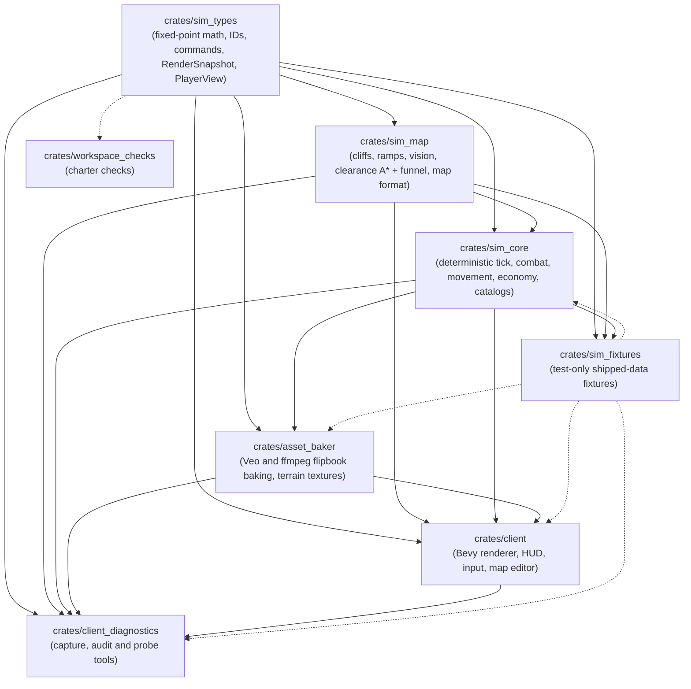

# Phase 9 Blueprint: Structure and Documentation

> Evidence under /tmp in this document was on the development notebook and was not retained (Q-10, 2026-11-03).

Finishes Phase 9 of `docs/plans/2026-11-01-codebase-remediation.md` (steps 9.1 to 9.6).

**Exit criterion:** the charter describes the code as it is, and every claim in it is checked by CI.

**Implementation status (2026-11-03):** all fourteen packages are implemented (WP13 in `0336642`); the status
per step is in the remediation plan's Phase 9 table, and deviations are recorded in each package's commit.

**Status of this document:** Stage 1 blueprint under charter §6. It was written by static reading only, on `main` at
`7c947ad`: nothing was compiled or run, because a full gate was running in the checkout. Every `file:line` was read at
that commit and will drift; search for the quoted symbol if it does. A claim about runtime behaviour that could not be
confirmed by reading is marked **verify**, and the implementer confirms it with the first test of that package.

**Rules for every package**

- Phase 9 is a structure phase. It changes no game behaviour. **No golden fixture may change**
  (`crates/sim_core/tests/fixtures/golden_replay.ron`, `EXPECTED_CHECKSUM` in `crates/sim_map/tests/determinism_tests.rs`,
  and any recorded checksum in `checksum_state_tests.rs`). The one possible exception is named in WP2 and must be
  explained in its commit if it occurs.
- A pure refactor cannot fail a test first. For those, the "red run" is a **mutation run**: make the stated deliberate
  mutation in the moved code, show that the named characterisation test fails, then revert. Paste the failing output
  into the agent report.
- Behaviour or rule changes (WP10 to WP13) write the failing test first, as in every earlier phase.
- The gate passes before each commit: `cargo fmt --all -- --check`,
  `cargo clippy --workspace --all-targets --locked -- -D warnings`, `cargo test --workspace --locked`.
- Each commit names its step (9.x) and finding, and may be merged alone.
- Every new file starts with a `//!` block stating responsibility, fit and invariants.
- No unit, structure, faction or class identifier in non-test Rust (charter §3.3). Tests may read slugs from data.
- Charter §6 is not edited (Q0003). Other charter edits are exactly the text in §6 of this blueprint.

---

## 1. Summary

Phase 9 is larger than the remediation plan's "M". Measured at `7c947ad`:

- `crates/sim_core/src/world.rs` is **2,033 lines** (down from 3,205 when S-20 was written; Phase 3 moved combat out
  and collision already lives in `movement/collision.rs`). Four functions in it still carry
  `#[expect(clippy::too_many_lines)]` citing step 9.1.
- `clippy::too_many_lines` is **already on**: the workspace enables `clippy::pedantic`, and the default threshold is
  100. It is defeated by **42 function-level suppressions and 4 module-level allows in production code**. 47
  production functions are over 100 counted lines (§2.2).
- Faction, weapon class and armour class are Rust enums (`sim_types::Faction`, `WeaponClass`, `ArmorClass`) that
  appear 173, 54 and 54 times in the catalog RON. The client hardcodes faction names and colours that disagree with
  the unused `Faction::primary_color`.
- All four 2026-10-26 items still exist (§2.4). The embedded "compatibility" catalogs are also used by the
  **production** asset baker, so adding a unit today does require recompiling `asset_baker`.
- `DESIGN.md` describes a system that was never built (22.4/30 Hz, CDT NavMesh, RVO, `bot_api` and `server` crates,
  trailing mist) and links to `/home/cl/...`. The charter has six claims that are false or unverifiable (§2.5).
- `docs/plans/` has 70 files with four colliding numbers and no status index; tracked text has **556** `/tmp`
  references and **204** `file:///` links, including 24 in `crates/`.

The plan has fourteen packages. WP0 lands first and alone. Group A (WP1 to WP9) runs in parallel worktrees, in three
waves for disk and CPU. Group B (WP10, WP11) follows, then WP12, then WP13 closes the phase.

---

## 2. Current state

### 2.1 `world.rs` (9.1, S-20)

Layout at `7c947ad`, by symbol. "Lines" include doc comments.

| Lines | Items | Disposition |
|---|---|---|
| 1-49 | module doc, imports, `PERFORMANCE RATIONALE`, `FLEE_COINCIDENCE_SQUARED` | header stays; constant moves with flee |
| 51-77 | `PlayerResources`, `impl Default` | stays |
| 79-85 | `AppliedSight` (private) | → `world/vision.rs` |
| 87-110 | `ActiveHazardZone` | → `world/abilities.rs`, re-exported from `world` |
| 112-183 | `SimWorld` struct | stays; six vision scratch fields move into `VisionWorkspace` |
| 186-285 | `new`, `with_catalogs` | stay (WP10 removes `new`) |
| 287-434 | `new_default_battle_sandbox` (112 counted lines, ten `let _ =`) | → `world/sandbox.rs` verbatim (WP10 deletes it) |
| 436-509 | `spawn_unit`, `spawn_structure` | stay |
| 510-760 | `player_upgrade_state(_mut)`, `research_upgrade`, `can_construct_structure`, `can_research_upgrade`, `effective_*` and their `*_from_upgrades` helpers, `sight_radius_from_upgrades`, `is_ability_unlocked`, `effective_max_hp` | → `world/upgrade_stats.rs` |
| 762-823 | `step`, `step_into`, `diagnostics`, `drain_diagnostics`, `last_checksum` | stay |
| 825-1127 | `execute_ability`, `execute_ability_prevalidated`, `apply_world_overclock`, `try_execute_ability_prevalidated` (194 counted lines) | → `world/abilities.rs`, split |
| 1129-1311 | `process_commands`, `process_commands_prevalidated` (162) | → `world/commands.rs`, split |
| 1313-1480 | `update_production_and_buffs` (129): per-entity upkeep, then hazard zones | upkeep → `world/upkeep.rs`; hazards → `world/abilities.rs` |
| 1482-1700 | `update_watchtower_control`, `collect_sights`, `sees_the_same`, `update_vision`, `recast_changed_sights`, `update_known_structures` | → `world/vision.rs` |
| 1703-1714 | `load_unit_into_transport`, `unload_unit_from_transport` | → `transport/mod.rs` (already an `impl SimWorld` block) |
| 1716-1846 | `compute_flee_destination`, `compute_entity_flee_destination(_prevalidated)`, `flee_destination` | → `movement/flee.rs` |
| 1849-1855 | `step_movement_and_steering` | stays (one-line phase wrapper) |
| 1857-1876 | `is_position_pathable_from`, `is_position_pathable` | → `movement/flee.rs` |
| 1878-1891 | `reap_dead_and_emit_shatter`, `compute_checksum` | stay |
| 1893-2032 | `build_render_snapshot`, `published_progress`, `write_render_snapshot` (100, at the limit) | → `world/snapshot.rs`, split |

**Collision** (named in step 9.1) is no longer in `world.rs`: `resolve_collisions_and_push` is
`movement/collision.rs:266`. The nearest remainder is the flee and pathability geometry above, which moves to
`movement/`.

The pattern is already established: `combat_resolution.rs`, `economy/`, `movement/`, `production/`, `transport/`,
`match_state.rs`, `player_view.rs` and `target_acquisition.rs` each hold an `impl SimWorld` block.

Public paths used outside the crate: `sim_core::world::SimWorld` (5 sites) and the crate-root re-exports
`ActiveHazardZone`, `PlayerResources`, `SimWorld` (`lib.rs:63`). The checksum (`checksum.rs:82-113`) reads
`next_hazard_id`, `player_resources`, `player_upgrades`, `match_state`, `active_hazards`, `vision_maps` and
`known_blocked_cells`, and none of the vision scratch fields, so moving those is checksum-neutral.

### 2.2 Function length (9.2)

**Method.** Clippy's `too_many_lines` counts non-blank, non-comment lines strictly between a function body's braces
and fires above the threshold. The counts below come from a static scanner with that rule, calibrated against three
unsuppressed functions that clippy accepts at exactly 100 (`write_render_snapshot`, `validate_job_source`,
`catalog/validation.rs::validate`). **verify:** the implementer confirms the list by deleting every suppression and
reading clippy's output.

**Configuration today.** `pedantic = warn` in `[workspace.lints.clippy]` enables the lint at the default threshold
of 100. There is no `clippy.toml`. Suppressions in production code:

- Function-level `#[expect(clippy::too_many_lines, ...)]`: 42 sites across `sim_core` (8), `sim_map` (5), `client`
  (21), `client_diagnostics` (8).
- Module-level `#![allow(..., clippy::too_many_lines, ...)]`: `asset_baker/src/main.rs:11`,
  `procedural_generator.rs:35`, `veo_client.rs:47`, `ffmpeg_importer.rs:19`. The last two allows in
  `procedural_generator.rs` and `veo_client.rs` suppress nothing (no function there is over 100).

**Production functions over 100**, with the package that owns each:

| # | Count | Function | File:line | WP |
|---|---|---|---|---|
| 1 | 507 | `validate_map` | `sim_map/src/validation.rs:430` | WP2 |
| 2 | 506 | `build_chunk_mesh` | `client/src/terrain/mesher.rs:860` | WP4 |
| 3 | 393 | `verify_frame` | `client_diagnostics/src/runtime_capture/driver.rs:984` | WP8 |
| 4 | 260 | `capture` | `client_diagnostics/src/shell_order_audit/source.rs:17` | WP8 |
| 5 | 243 | `prepare_actor_motion` | `sim_core/src/movement/locomotion.rs:713` | WP3 |
| 6 | 223 | `setup_smog_volume_system` | `client/src/smog/mod.rs:266` | WP7 |
| 7 | 218 | `FluidField::step` | `client/src/smog/fluid.rs:512` | WP7 |
| 8 | 215 | `main` | `asset_baker/src/main.rs:201` | WP10 |
| 9 | 201 | `update_smog_field_system` | `client/src/smog/mod.rs:738` | WP7 |
| 10 | 199 | `gather` | `client_diagnostics/src/shell_order_audit/phase.rs:108` | WP8 |
| 11 | 198 | `process_combat_events_system` | `client/src/vfx.rs:462` | WP5 |
| 12 | 198 | `prepare_pursuit` | `sim_core/src/movement/locomotion.rs:967` | WP3 |
| 13 | 196 | `step_bouncing_kinematics` | `client/src/smog/kinematics.rs:329` | WP7 |
| 14 | 194 | `try_execute_ability_prevalidated` | `sim_core/src/world.rs:913` | WP1 |
| 15 | 184 | `sync_lab_preview_system` | `client/src/scene_controller.rs:274` | WP5 |
| 16 | 182 | `observe_inner` | `client_diagnostics/src/runtime_capture/driver.rs:518` | WP8 |
| 17 | 171 | `pick_terrain` | `client/src/terrain/picking.rs:48` | WP4 |
| 18 | 170 | `manage_battle_scene` | `client/src/runtime_battle/scene.rs:135` | WP5 |
| 19 | 169 | `render_selected_unit_hud` | `client/src/lab_ui.rs:811` | WP6 |
| 20 | 162 | `process_commands_prevalidated` | `sim_core/src/world.rs:1147` | WP1 |
| 21 | 160 | `place_entity_command` | `client/src/editor/tools.rs:641` | WP6 |
| 22 | 156 | `production_exit` | `sim_core/src/production/exits.rs:42` | WP3 |
| 23 | 155 | `EditorPlugin::build` | `client/src/editor/app.rs:154` | WP6 |
| 24 | 154 | `sync_swarm_stress_system` | `client/src/scene_controller.rs:742` | WP5 |
| 25 | 152 | `run_headless_check` | `client/src/lib.rs:625` | WP10 |
| 26 | 147 | `MapFile::decode` | `sim_map/src/map_format.rs:428` | WP2 |
| 27 | 146 | `build_world_with_catalogs` | `sim_core/src/scenario.rs:287` | WP3 |
| 28 | 144 | `render_live_battle_tab` | `client/src/lab_ui.rs:603` | WP6 |
| 29 | 142 | `control_inner` | `client_diagnostics/src/runtime_capture/driver.rs:317` | WP8 |
| 30 | 141 | `CaptureConfig::validate` | `client_diagnostics/src/runtime_capture/config.rs:279` | WP8 |
| 31 | 140 | `ClientPlugin::build` | `client/src/lib.rs:296` | WP6 |
| 32 | 129 | `update_production_and_buffs` | `sim_core/src/world.rs:1324` | WP1 |
| 33 | 129 | `add_orthogonal_portal` | `sim_map/src/pathfinding.rs:1185` | WP2 |
| 34 | 127 | `FileBrowser::render` | `client/src/editor/file_browser.rs:122` | WP6 |
| 35 | 122 | `lab_ui_system` | `client/src/lab_ui.rs:275` | WP6 |
| 36 | 121 | `GameMap::default_arena` | `sim_map/src/grid.rs:755` | WP2 (deleted) |
| 37 | 116 | `load_theme_texture_arrays` | `client/src/terrain/theme_gpu.rs:258` | WP4 |
| 38 | 113 | `render_visual_lab_tab` | `client/src/lab_ui.rs:466` | WP6 |
| 39 | 113 | `find_path_with_vision` | `sim_map/src/pathfinding.rs:633` | WP2 |
| 40 | 112 | `new_default_battle_sandbox` | `sim_core/src/world.rs:304` | WP1 moves, WP10 deletes |
| 41 | 111 | `into_archetype` | `sim_core/src/catalog.rs:934` | WP12 |
| 42 | 108 | `TransportVerifier::verify` | `client_diagnostics/src/runtime_capture/transport.rs:339` | WP8 |
| 43 | 105 | `bake_multi_action_videos_with_states` | `asset_baker/src/ffmpeg_importer.rs:465` | WP8 |
| 44 | 105 | `sync_live_battle_system` | `client/src/scene_controller.rs:554` | WP5 |
| 45 | 104 | `refresh_battle_presentation` | `client/src/battle_presentation.rs:85` | WP5 |
| 46 | 104 | `OwnershipObserver::observe` | `client_diagnostics/src/runtime_capture/ownership/mod.rs:76` | WP8 |
| 47 | 103 | `render_paint_options` | `client/src/editor/ui/panels.rs:278` | WP6 |

Three more sit at exactly 100 and will trip on any growth: `write_render_snapshot` (split in WP1),
`validate_job_source` (`sim_core/src/production/lifecycle.rs:284`) and `UnitCatalog::validate`
(`sim_core/src/catalog/validation.rs:259`). WP12 touches the last; it splits it if it grows.

**Test code over 100** (exempt, D-1): 23 functions, among them `full_match_tests.rs::commands` (190),
`snapshot_serialization.rs::test_render_snapshot_full_serialization` (173), `skirmish_pilot.rs::plan` (155),
`shell_order_audit/gpu_tests.rs::verify_loaded_proxy_frames` (142) and `transport/tests.rs::malformed_links_*` (123).

### 2.3 Faction and armour identity (9.3, F-13)

| Where | What Rust names |
|---|---|
| `sim_types/src/enums.rs:8-37` | `enum Faction { AutomatonDirectorate, CosmicEnclave, SylvanSwarm }`, `display_name()`, `primary_color()`. Both methods have no caller outside their own test |
| `sim_types/src/upgrades.rs:47-82` | `enum WeaponClass` (8 variants), `enum ArmorClass` (6), each named after a faction |
| `sim_types/src/upgrades.rs:88-99, 163-165` | `UpgradeEffect::{WeaponDamageLevel, ArmorLevel}` and `PlayerUpgradeState::{weapon_levels, armor_levels}` keyed by those enums |
| `sim_types/src/weapon.rs:93` | `WeaponSpec::weapon_class: Option<WeaponClass>` |
| `sim_core/src/catalog.rs:47,145,792,809,861,1070` | `UnitArchetype::faction`, `armor_class`, and the authored definitions |
| `sim_core/src/upgrades.rs:41` | `UpgradeDef::faction` (read by nothing) |
| `sim_core/src/checksum/encoding.rs:493-500` | `tags!` assigns `WeaponClass` 0..=7 and `ArmorClass` 0..=5 in declaration order |
| `client/src/lab_ui.rs:887-898` | `match arch.faction` with three hardcoded names and colours (`(60,150,255)`, `(50,230,230)`, `(255,120,40)`) |
| `client/src/editor/ui.rs:209` | the loadout slug `"standard_automaton"` as the editor's default for all eight slots |
| tests | `Faction::` in 5 test files, `WeaponClass::`/`ArmorClass::` in 2 |

Faction equality drives real rules: `UnitArchetype::can_raise` (`catalog.rs:156`), builder lookup
(`production/construction.rs:325-334`) and the card and context orders (`battle_hud/card.rs:712`,
`battle_input/context_order.rs:280`). Those compare values and do not name a faction, so they keep working with an ID.

Abilities (also named by F-13): `AbilityEffectSpec` variants are mechanic kinds, which charter §3.3 allows
("capability-driven"). The only identity leak is the variant name `PsionicStormAoE` (`sim_types/src/commands.rs:187`),
which already carries `#[serde(alias = "SpawnHazardZone")]`. No shipped RON uses either name. `OVERCLOCK_ABILITY_SLUG`
names a capability, not a unit, and stays.

### 2.4 The open 2026-10-26 items (9.4)

The step's "F-5 legacy, F-7 legacy" are F-05, F-07 and F-08 of `docs/reviews/2026-10-26-codebase-findings.md`.
All four still exist.

| Item | Review ID | Location at `7c947ad` |
|---|---|---|
| Sandbox `let _` | F-05 | `world.rs:401,406,414,419` (`spawn_unit`) and `:423-430` (`spawn_structure`) in `new_default_battle_sandbox`; also `let _ = target_entity;` at `world.rs:920`. The sandbox's only production caller is `client::run_headless_check` (`client/src/lib.rs:627`); 20 test sites call it |
| `.min(7)` | F-07 | `world.rs:513,519` (`player_upgrade_state(_mut)`), `:655` (`effective_range_from_upgrades`), `:669` (`effective_period_from_upgrades`), `:723` (`sight_radius_from_upgrades`), `combat_resolution.rs:119` (`upgrades_of`). Player 9 reads and writes player 7's upgrades |
| Compatibility `include_str!` | F-08 | `catalog.rs:342-347` (`new_starter_roster`), `:256` (`impl Default for UnitCatalog`), `:351` (`default_catalog`), `upgrades.rs:123-127` (`UpgradeCatalog::default_catalog`). Reached from `SimWorld::new` (`world.rs:190`), `scenario::build_world` (`scenario.rs:258`), the sandbox, and **production** `asset_baker`: `lib.rs:68,78`, `main.rs:241`, `procedural_generator.rs:150,218,295`, `veo_client.rs:1181,1201`. 157 call sites in all, most in tests |
| Typed `PlayerId` | F-07 | `sim_types/src/ids.rs:54` `pub struct PlayerId(pub u8)`, documented "0..=15, 255 = Neutral", while every per-player array has 8 slots. 46 production sites index with `usize::from(x.0)` or `x.0 as usize`, some with `.get()`, some with `[]`, five with `.min(7)`. `sim_map/src/validation.rs:32` has its own `MAX_PLAYER_SLOTS: u8 = 8` |

Related loose ends found while locating these, closed in WP10: `asset_baker::find_concept_video`
(`asset_baker/src/lib.rs:87-95`) probes `tmp/`, the directory that holds real keys, and has no caller;
`client/src/bin/terrain_preview.rs:128,196,209` has three `expect`s without an invariant and hardcodes the theme slug
`"orbital_foundry"`.

### 2.5 Charter and `DESIGN.md` against the code (9.5, Q-9, Q-12)

| Charter text | Reality | Action |
|---|---|---|
| §3.1 "run at 10,000+ ticks/second" | 11,114 only on an empty 64×64 map; 2,706 at 100 units, 639 at 400 (handover, 2026-11-02). Nothing asserts it | reword; CI floor at real time (D-9) |
| §3.2 "`client` consumes immutable `RenderSnapshot` values"; f32 conversion "only at the `RenderSnapshot` boundary" | `BattleSession` owns the `SimWorld`; the card, context orders and admission read `world.entities` and the catalog (19 sites); the mesher, picking, camera and editor convert `GameMap` and `SimScalar` to f32 (14 files) | reword to what is true and checkable |
| §3.3 crate list `(sim_types, sim_core, asset_baker, client)` and "reside strictly in `assets/catalog/units.ron`" | also `sim_map`, `client_diagnostics`; data spans `units.ron`, `structures.ron`, `upgrades.ron`, `start_loadouts.ron`, scenarios | reword |
| §3.3 "zero recompilation" | false for `asset_baker` and every embedded default (§2.4) | made true by WP10, checked by C6 |
| §4.2 `sim_map`: "dynamic NavMesh carving" | grid clearance field, A* corridor and funnel (`pathfinding.rs:1-17`); structures carve grid cells | reword |
| §4.2 `asset_baker`: "Procedural flipbook generation" | allowed for test fixtures only (remediation D6, Q0002 item 3) | reword |
| §5 graph | misses `asset_baker → sim_core` (Q-12) and the whole `client_diagnostics` crate; labels say NavMesh | redraw, checked by C1 |
| §1.2, §2.3, parts of §1.1 | principles a machine cannot judge | mark as review rules |

`sim_map`'s `serde_json` (the second half of Q-12) is already gone: `crates/sim_map/Cargo.toml` has no such dependency.

`DESIGN.md` (177 lines): 5 `file:///home/cl/...` links; §3 "22.4 ticks/sec or 30 ticks/sec" (code: 25 Hz, but no
named constant; `25` appears 29 times in `crates/*/src`); §4 "CDT NavMesh" and "RVO / ORCA"; §2.2 "Trailing Mist"
(runtime mist deleted in `0f31027`, D2); §7 roadmap names crates `bot_api` and `server` that do not exist; §5 and
§6.2 describe a relay server and Bot API with no implementation.

### 2.6 Plans and evidence (9.6, Q-10)

- 70 files in `docs/plans/`, no index. Colliding numeric prefixes: **21** (`21-plan-comprehensive-sc2-who-wins-matchup-benchmarks.md`,
  added 2026-10-28; `21-plan-map-editor.md`, added 2026-11-01), **40**, **44** (four files), **53**. Five of the
  colliding files are reviews, not plans: `40-foreground-lifecycle-independent-review.md`, `44-field-oracle-review.md`,
  `44-post-corpus-architecture-review.md`, `44-stage3-independent-review.md`, `53-transparent-shell-independent-review.md`.
- `/tmp` references: 556 in tracked text, 372 of them in `docs/reviews/`, 67 in `docs/plans/`. None of the notebook
  paths (`/tmp/space-scuffle-r*`, `/tmp/verification`, ...) exists on this server, so that evidence is gone.
  `docs/evidence/` (added in Phase 5) holds two files and is the right home for kept evidence.
- `file:///` links: 204, of which 24 are in `crates/` doc comments (`client/src/lib.rs:4-5`, `client/src/editor/*.rs:4`,
  `client/src/bin/{map_editor,terrain_preview}.rs:4`, three test files).

### 2.7 Owner questions that constrain this phase

- **Q0003:** §6 is untouched. The new §9 lists §6 as owner-governed and does not reinterpret it.
- **Q0001 / Q0002 item 3 / D6:** procedural atlases stay test-only; the charter text in §6 below says so.
- **Q0005:** CI is not a required check. "Checked by CI" here means the job runs on every push to `main` and agents
  fix failures.
- **Q0007, Q0008:** rules stay as committed; `DESIGN.md` lists them as "awaiting owner review".
- **Q0009:** the terrain anisotropy override stays; `DESIGN.md` states it.

---

## 3. Design decisions

**D-1. `too_many_lines` at 100, for production code only.** The threshold is clippy's default and is set explicitly
in a new root `clippy.toml` (`too-many-lines-threshold = 100`) so it is visible and reviewable. Clippy reads only the
nearest `clippy.toml`, so the three simulation crates' own `clippy.toml` files (D-8) repeat the line, and check C8
asserts every `clippy.toml` in the repository states the same value. Test code (`crates/*/tests/**`, `benches/**`,
`#[cfg(test)]` modules, files named `tests.rs` or `*_tests.rs`) is exempt: a scenario table read top to bottom is
clearer whole. C8 rejects any `too_many_lines` suppression outside test code. A lower threshold (for example 60)
would roughly triple the work; it can be a later ratchet by editing one number.

**D-2. Behaviour-preserving phase.** See the rules above. Every refactor package names a characterisation test that
must pass unchanged, and a mutation that must make it fail.

**D-3. `world.rs` becomes a module root with private children.** `world.rs` keeps the struct, construction, spawning
and the tick, and declares `mod abilities; mod commands; mod sandbox; mod snapshot; mod upgrade_stats; mod upkeep;
mod vision;` as files under `crates/sim_core/src/world/`. Child modules see the struct's private fields, so no field
widens its visibility. Flee and pathability move to `movement/flee.rs`, next to `collision.rs`. The six vision
scratch fields become one `pub(crate) vision: VisionWorkspace`, like `movement`, `production` and `economy`.
`ActiveHazardZone` keeps its paths through `pub use abilities::ActiveHazardZone;` in `world.rs`.

**D-4. Typed player slots, not a closed `PlayerId`.** `PlayerId(pub u8)` stays the open wire identity: it is in
`TickBundle`, snapshots, serde formats, `PlayerId::NEUTRAL = 255`, and 418 constructions. Indexing gets its own type:

```rust
// crates/sim_types/src/ids.rs
/// Number of player slots the simulation stores state for.
pub const MAX_PLAYERS: usize = 8;

/// A player identity proven to address per-player storage: `0..MAX_PLAYERS`.
#[derive(Copy, Clone, Debug, PartialEq, Eq, PartialOrd, Ord, Hash)]
pub struct PlayerSlot(u8); // private field: constructed only through `new`/`TryFrom`

impl PlayerSlot {
    /// Every slot in ascending order.
    pub const ALL: [Self; MAX_PLAYERS] = [/* Self(0) ..= Self(7) */];
    /// `Some` for `0..MAX_PLAYERS`, `None` otherwise (including `PlayerId::NEUTRAL`).
    pub const fn new(raw: u8) -> Option<Self>;
    /// Array index of this slot.
    pub const fn index(self) -> usize;
    /// The wire identity of this slot.
    pub const fn id(self) -> PlayerId;
}
impl PlayerId {
    /// The storage slot of this player, or `None` for neutral and out-of-range identities.
    pub const fn slot(self) -> Option<PlayerSlot>;
}

/// One value per player slot, indexable only by [`PlayerSlot`].
#[derive(Clone, Debug, PartialEq, Eq, Default, Serialize, Deserialize)]
#[serde(transparent)]
pub struct PerPlayer<T>([T; MAX_PLAYERS]);
// from_fn, Index/IndexMut<PlayerSlot>, get(PlayerId) -> Option<&T>, get_mut, iter(), iter_mut(),
// enumerate() -> (PlayerSlot, &T), as_slice() (the checksum keeps encoding a slice, so bytes are unchanged)
```

`SimWorld::{vision_maps, player_upgrades, player_resources, known_blocked_cells}` become `PerPlayer<_>`. There is
no `Index<usize>` and no `Deref` to the array, so `.min(7)` and raw indexing cannot come back. A neutral or
out-of-range owner has no upgrades: lookups read `static NO_UPGRADES: PlayerUpgradeState` (all fields are
`const`-constructible: `BTreeMap::new`, `BTreeSet::new`). `player_upgrade_state` and `player_upgrade_state_mut`
return `Option`. Snapshot and `PlayerView` arrays keep their serialized layout as `[T; MAX_PLAYERS]`.

**D-5. Embedded catalogs leave production.** `UnitCatalog::{new_starter_roster, default_catalog}`,
`impl Default for UnitCatalog`, `UpgradeCatalog::default_catalog`, `SimWorld::new`, `scenario::build_world` and
`SimWorld::new_default_battle_sandbox` are deleted from `sim_core`. Production loads from disk only
(`RuntimeCatalogs::load_from_directory`, `scenario::load_scenario_world`). Tests get a new dev-only crate
`crates/sim_fixtures` (`publish = false`) that embeds the shipped catalogs with `include_str!`, which keeps the golden
replay runnable under wasmtime with no preopened directory. `sim_core`'s own `#[cfg(test)]` modules cannot use
`sim_fixtures` (it would link a second copy of `sim_core`), so they get a 20-line `#[cfg(test)] mod test_support` in
`sim_core/src/lib.rs` with the same embedding. This is an intentional public API break, recorded in the API surface
test (WP0).

**D-6. Factions and classes become data with explicit numeric IDs equal to today's checksum tags.** A new
`assets/catalog/factions.ron` holds factions, weapon classes and armour classes. Units, structures and upgrades name
them by slug. At load they resolve to `FactionId(u8)`, `WeaponClassId(u8)` and `ArmorClassId(u8)` in `sim_types`.
Because each `class_id` equals the old `tags!` value and the IDs sort in the old declaration order, every
`BTreeMap<WeaponClassId, u8>` encodes to the same bytes, **so no checksum changes**. That is a strong, testable
invariant: the golden replay must pass without re-recording. The faction badge colour comes from `lab_ui.rs` (what
players have seen), stored as sRGB bytes so no float enters a simulation crate.

**D-7. Ability kinds stay engine mechanics.** Only `PsionicStormAoE` is renamed, to `SpawnHazardZone` (its existing
alias), dropping the alias.

**D-8. Charter claims become executable in a new crate `crates/workspace_checks`** (`publish = false`, no
dependency on other workspace crates, dev-dependencies `serde_json` and `ron`, both already in `Cargo.lock`). Its
tests read files and `cargo metadata` and run inside `cargo test --workspace`, so CI's existing job runs them. The
simulation crates' determinism bans become clippy configuration, which is cheaper and more precise than scanning:
`crates/{sim_types,sim_map,sim_core}/clippy.toml` with `disallowed-types` (`std::collections::HashMap`,
`std::collections::HashSet`) and `disallowed-methods` (`std::time::Instant::now`, `std::time::SystemTime::now`).
The edge `asset_baker → sim_core` is accepted and documented rather than removed: the baker needs `UnitCatalog` to
discover archetypes, and moving the catalog into `sim_types` would be a large change for no behavioural gain.

**D-9. Throughput claim becomes a real-time floor.** `benches/throughput.rs` gains `--floor <ticks per second>`. A
new CI job runs it in release with `--floor 25`, the simulation's own tick rate, and appends the table to the job
summary. Below real time the game cannot run, so the floor is principled, and at today's slowest scenario (639 ticks/s)
it leaves a 25× margin for slow runners. The charter states the measured figures and the floor, not 10,000.

**D-10. Plans: unique IDs by renaming collisions, dated names from now on.** The five review files move to
`docs/reviews/` with a `planNN-` prefix. `21-plan-comprehensive-...` becomes `21a-...` and `21-plan-map-editor.md`
becomes `21b-...`, with every in-repo reference updated. New plans use `YYYY-MM-DD-slug.md`, as since 2026-10-28.
Lost `/tmp` evidence is not reconstructed: each affected document gets one retention line, and C19 enforces it.

**D-11. `GameMap::default_arena()` is deleted.** It duplicates `assets/maps/default_arena.scmap.ron`
(`map_format_tests.rs:84` proves the two equal apart from the watchtower's entity ID). Tests load the file.

**D-12. The editor's default loadout comes from data.** `start_loadouts.ron` gains `editor_default: bool` (default
`false`); the loader requires exactly one `true`.

**D-13. `sim_types::TICKS_PER_SECOND: u32 = 25`.** It replaces the literal 25 in the simulation crates and makes the
`DESIGN.md` tick-rate statement checkable (C17). Client sites are out of scope.

**D-14. Only WP13 edits `docs/plans/2026-11-01-codebase-remediation.md`.** Other packages report their status in
their commit messages, so the shared table has no merge conflicts.

### Module map after Phase 9

```
crates/
  sim_types/src/ids.rs            + MAX_PLAYERS, PlayerSlot, PerPlayer, FactionId, WeaponClassId, ArmorClassId
  sim_types/src/lib.rs            + TICKS_PER_SECOND; - Faction, WeaponClass, ArmorClass
  sim_types/clippy.toml           new (D-1, D-8)
  sim_map/clippy.toml             new
  sim_core/clippy.toml            new
  sim_core/src/world.rs           ~450 lines: struct, construction, spawn, step, phase wrappers
  sim_core/src/world/abilities.rs   ActiveHazardZone, casting, hazard zones
  sim_core/src/world/commands.rs    phase 1 dispatch
  sim_core/src/world/upkeep.rs      phase 2 per-entity timers and regeneration
  sim_core/src/world/upgrade_stats.rs  research and effective stats
  sim_core/src/world/vision.rs      phase 3, VisionWorkspace
  sim_core/src/world/snapshot.rs    phase 10
  sim_core/src/world/sandbox.rs     (WP1 only; deleted by WP10)
  sim_core/src/movement/flee.rs     flee goals and segment pathability
  sim_core/src/catalog/factions.rs  FactionCatalog (WP12)
  sim_fixtures/                   new, dev-only (WP10)
  workspace_checks/               new, dev-only (WP0)
assets/catalog/factions.ron       new (WP12)
clippy.toml                       new
docs/plans/README.md              new: plan status index (WP9)
```

---

## 4. Work packages

| WP | Title | Steps | Size | Depends on | Group |
|---|---|---|---|---|---|
| WP0 | Guard rails: `workspace_checks`, `clippy.toml`, API surface test | 9.2, 9.5 | S (½ day) | none | 0 |
| WP1 | Split `world.rs` | 9.1, 9.2 | M (1-2 days) | WP0 | A1 |
| WP2 | `sim_map` splits; delete `default_arena` | 9.2 | M (1-2 days) | WP0 | A1 |
| WP3 | `sim_core` movement, exits, scenario splits | 9.2 | M (1-2 days) | WP0 | A2 |
| WP4 | Client terrain splits | 9.2 | M (1-2 days) | WP0 | A1 |
| WP5 | Client scene and `sync_*` splits, allocation proof | 9.2 | M (2 days) | WP0 | A2 |
| WP6 | Client UI and editor splits | 9.2 | M (1-2 days) | WP0 | A2 |
| WP7 | Client smog splits | 9.2 | M (1-2 days) | WP0 | A3 |
| WP8 | `client_diagnostics` and baker importer splits | 9.2 | M (1-2 days) | WP0 | A3 |
| WP9 | Plan index, numbering, `/tmp` and `file:///` | 9.6 | S-M (1 day) | WP0 | A1 |
| WP10 | Embedded catalogs out of production; sandbox; `sim_fixtures` | 9.4 | L (2-3 days) | WP1, WP3, WP6 | B |
| WP11 | `PlayerSlot` and `PerPlayer` | 9.4 | M (1-2 days) | WP1, WP2 | B |
| WP12 | Factions and classes into data | 9.3 | L (2-3 days) | WP6, WP10, WP11 | C |
| WP13 | Charter, `DESIGN.md`, final checks, throughput job | 9.5, 9.2 | M (1-2 days) | all | D |

Total: about 18 to 25 agent-days of work, roughly one to two weeks of wall time with three parallel worktrees.
This is L, not the remediation plan's M.

**Parallelism and conflicts.** Each package works in its own worktree on branch `p9/wpN-<slug>` with
`CARGO_TARGET_DIR=/home/spacescuffle/scratch/cargo-target/p9-wpN` (charter §7). Check `df -h /` first. Run at most
three gates at once: each holds 2 to 56 GB of target and saturates the CPU. Hence the waves:

- **Group 0:** WP0 alone, merged first. Everyone branches from it.
- **Wave A1:** WP1, WP2, WP4, WP9. **A2:** WP3, WP5, WP6. **A3:** WP7, WP8. File ownership is disjoint by
  construction (each WP's "Files" list). Expected trivial conflicts: `Cargo.toml` `members` (none in group A),
  `movement/mod.rs` (WP1 adds `mod flee;`, WP3 touches only `locomotion.rs`), and WP9's doc-comment edits on line 4 of
  `client/src/lib.rs` and `client/src/editor/*.rs` against WP6's body edits (different hunks).
- **Group B:** WP10 and WP11 in parallel. Both touch `world.rs`: WP10 deletes `new` and the `sandbox` module line,
  WP11 changes four field types and `with_catalogs`. Different hunks; merge WP10 first.
- **Group C:** WP12 alone (it touches the catalog loaders WP10 rewrote and the badge WP6 extracted).
- **Group D:** WP13 alone, last.

Common gate for every package:

```bash
export CARGO_TARGET_DIR=/home/spacescuffle/scratch/cargo-target/p9-wpN
cargo fmt --all -- --check
cargo clippy --workspace --all-targets --locked -- -D warnings
cargo test --workspace --locked
```

GPU tests pin themselves to lavapipe (`crates/client/tests/support/gpu_run.rs`), so the gate needs no GPU lock.

---

### WP0: Guard rails

**Goal.** Make the checks that are already true executable, before anyone moves code.

**Files (owned):** new `crates/workspace_checks/**`; new `clippy.toml`; new `crates/{sim_types,sim_map,sim_core}/clippy.toml`;
`Cargo.toml` (`members`, explicit `too_many_lines = "warn"` under `[workspace.lints.clippy]` with a comment pointing at
`clippy.toml`); new `crates/sim_core/tests/world_api_surface_tests.rs`.

**`workspace_checks` layout**

```
crates/workspace_checks/
  Cargo.toml        publish = false; [lints] workspace = true; dev-deps serde_json, ron (workspace)
  src/lib.rs        //! scanning helpers shared by the checks, with unit tests
  tests/charter.rs  //! one #[test] per charter check, named c02_..., c03_...
```

`src/lib.rs` API, each with `///` docs and unit tests on temporary trees (`tempfile` is already locked):

```rust
/// Repository root, from CARGO_MANIFEST_DIR.
pub fn repo_root() -> PathBuf;
/// Which sources a check reads.
pub enum Scope { Production, All }
/// Rust files under crates/, in path order. `Production` drops crates/*/tests, benches,
/// files named tests.rs or *_tests.rs, and the sim_fixtures and workspace_checks crates.
pub fn rust_files(scope: Scope) -> io::Result<Vec<PathBuf>>;
/// Text with comments blanked and, for `Production`, everything from the first top-level
/// `#[cfg(test)]` item onward removed. Line numbers are preserved.
pub fn code_text(path: &Path, scope: Scope) -> io::Result<String>;
/// `cargo metadata --format-version 1 --locked --offline`, parsed.
pub fn cargo_metadata(no_deps: bool) -> Result<serde_json::Value, CheckError>;
/// A violation, printed as `path:line: message`.
pub struct Finding { pub path: PathBuf, pub line: usize, pub message: String }
```

`CheckError` is a `thiserror` enum. Every check collects all findings and fails with the full list.

**Checks added in WP0** (the IDs are used throughout this blueprint and in the charter's new §9):

| ID | Check |
|---|---|
| C2 | The normal-dependency closure of `sim_types`, `sim_map` and `sim_core` (from `cargo metadata` `resolve`, `dep_kinds.kind == null`) contains no package whose name starts with `bevy`, `wgpu`, `winit`, `egui`, `naga`, `ash`, `gilrs`, `cpal`, `rodio`, `alsa`, `x11`, `wayland` |
| C3 | No `TODO`, `FIXME` or `XXX` token in `crates/**` or `assets/shaders/**` (scope `All`) |
| C4 | Every tracked `.rs` file under `crates/` starts with `//!` (all 309 do today) |
| C7 | Float ratchet: in production code of the three simulation crates, `f32`/`f64` tokens appear only in an allowlist of `(file, max count)` pairs recorded from today (`sim_types/src/{math,snapshot,enums}.rs`, `sim_map/src/grid.rs`, `sim_core/src/{catalog,catalog/validation,combat_resolution,world}.rs`; `world.rs`' 3 move to `world/snapshot.rs` in WP1, which updates the list). A new file or a higher count fails with "authoritative state must be fixed-point (charter §3.1); a presentation or authoring boundary must be added to the allowlist with a reason" |
| C9 | Each simulation crate has a `clippy.toml` naming the two disallowed types and two disallowed methods |
| C13 | No `static` whose type contains `Mutex`, `RwLock`, `RefCell`, `Cell` or `Atomic` in production code. `OnceLock` (write-once, e.g. `sim_map/src/vision.rs:117`) is allowed |
| C14 | No `pub fn` in production code of `sim_types`, `sim_map`, `sim_core`, `asset_baker` returns `Result<_, String>` or `Result<_, Box<dyn ...>>` (none today) |

**API surface test.** `crates/sim_core/tests/world_api_surface_tests.rs` coerces every `pub` method of `SimWorld`
defined in `world.rs` to a function pointer with its full signature, for example
`let _: for<'a> fn(&'a mut SimWorld) -> std::vec::Drain<'a, SimulationDiagnostic> = SimWorld::drain_diagnostics;`,
and names `sim_core::world::{SimWorld, PlayerResources, ActiveHazardZone}` and the crate-root re-exports. It is a
compile-time guard: WP1 must not change it; WP10 and WP11 change it deliberately and the diff shows exactly how.

**Red runs (positive controls).** For each check, a unit test in `src/lib.rs` plants a violation in a temporary tree
and asserts the finding is reported with the right path and line. For C9, add
`let _m: std::collections::HashMap<u8, u8> = Default::default();` to a `sim_core` function, run clippy, see
`disallowed_types` fire, revert. **verify:** clippy accepts `std::time::Instant::now` as a `disallowed-methods` path
in `sim_core` (the crate does not import it); if clippy warns that a path does not resolve, keep only the paths it
accepts and say so in the report.

**Gate.** Common gate. `cargo test -p workspace_checks` passes on `main` unchanged.

---

### WP1: Split `world.rs` (9.1, S-20)

**Goal.** `world.rs` under 500 lines; no function in the moved code over 100; public API and checksums unchanged.

**Files (owned):** `crates/sim_core/src/world.rs`, new `crates/sim_core/src/world/*.rs`, new
`crates/sim_core/src/movement/flee.rs`, `movement/mod.rs` (one `mod` line), `transport/mod.rs` (two wrappers),
`crates/workspace_checks/tests/charter.rs` (C7 allowlist line only).

**Steps**

1. Moves only, one commit: create the seven `world/` files and `movement/flee.rs` per §2.1, each with a `//!`
   block naming its tick phase and invariants. Doc comments travel with their items. `pub(crate)` stays
   `pub(crate)`; private helpers called across files become `pub(super)` (within `world`) or `pub(crate)` (flee).
   No body edits. The gate passes and the API surface test is untouched.
2. `VisionWorkspace` in `world/vision.rs`:
   ```rust
   /// Derived vision bookkeeping; excluded from the checksum and rebuilt by a full recount.
   #[derive(Debug, Default)]
   pub(crate) struct VisionWorkspace {
       watchtower_units: Vec<(PlayerId, SimVec2)>,
       sights: Vec<AppliedSight>,
       counted: Vec<AppliedSight>,
       counted_cell_revision: Option<u64>,
       counted_recounts: [u64; 8],
       known_blocked_lists: [Vec<usize>; 8],
   }
   ```
   Initialise it in `with_catalogs` in place of the six fields.
3. Split `try_execute_ability_prevalidated` into admission and commit, keeping the current check order exactly:
   ```rust
   /// Everything a validated cast will write, computed without mutation.
   struct PreparedCast { ability_index: u8, energy: SimScalar, cooldown_ticks: u16,
                         overclock: Option<PreparedOverclock>, effect: AbilityEffectSpec, owner: PlayerId }
   fn admit_cast(&self, entity_id: EntityId, ability_index: u8, target_pos: Option<SimVec2>)
       -> Result<Option<PreparedCast>, MovementInvariant>;   // lines 919-1035 today
   fn admit_effect(&self, ...) -> Result<Option<Option<PreparedOverclock>>, MovementInvariant>; // the effect match
   fn commit_cast(&mut self, entity_id: EntityId, cast: PreparedCast,
                  target_pos: Option<SimVec2>, target_entity: Option<EntityId>);           // lines 1037-1124
   fn spawn_hazard_zone(&mut self, owner: PlayerId, center: SimVec2, spec: &HazardSpec);   // the storm arm
   ```
   Delete `let _ = target_entity;` (`world.rs:920`): the parameter is used by `begin_mode_channel`.
   Pass `&self.catalog` and `&mut self.entities` as disjoint borrows where needed, as the current code does.
4. Split `process_commands_prevalidated` into a loop over `dispatch_command(index, cmd)`, which calls, in today's order:
   `closed_command_error`, `admit_game_command` family, `issue_movement_prevalidated` family, production and
   research, then the player-index guard (`player_idx >= self.player_resources.len()`, kept verbatim until WP11),
   then `apply_stim(cmd)`, `dispatch_cast(cmd)`, `issue_plain_order(cmd)`. Each outcome is pushed exactly where it
   is pushed today.
5. Split `update_production_and_buffs` (phase 2) into
   `advance_production(); for entity { upkeep_entity(entity, catalog) } step_hazards(); complete_production();`.
   `upkeep_entity` (in `upkeep.rs`) is a free function over `&mut Entity` and `&UnitCatalog` with the channel,
   cooldown, buff, regeneration, mode-drain, shield-delay and flash steps in today's order. `step_hazards` (in
   `abilities.rs`) keeps both local `Vec`s and the flee loop unchanged.
6. Split `write_render_snapshot` into `write_player_views`, `write_resource_nodes` and
   `fn bubble_instance(entity: &Entity, arch: &UnitArchetype, map: &SimMap) -> BubbleRenderInstance`.
7. Remove the three `#[expect(clippy::too_many_lines)]` that cite 9.1 on the split functions. The sandbox keeps
   its `#[expect]` (moved verbatim; WP10 deletes the file).

**Characterisation.** `golden_replay_tests.rs`, `determinism_lockstep_tests.rs`, `checksum_state_tests.rs`,
`spells_and_abilities_tests.rs` (9 direct ability calls), `production_transactions_tests.rs` (17 direct phase calls),
`watchtower_tick_tests.rs`, `snapshot_output_tests.rs`, `world_api_surface_tests.rs`. All unchanged.

**Mutation red runs.** (a) In `step_into`, swap `update_vision` and `acquire_targets`: the golden replay fails at its
first checkpoint. (b) In `upkeep_entity`, move shield regeneration before the `ticks_since_last_damage` increment:
`damage_and_shields_tests.rs` or the golden replay fails. (c) In `recast_changed_sights`, skip the removal arm:
a vision test fails. Revert each.

**Gate.** Common gate; `wc -l crates/sim_core/src/world.rs` under 500; `rg too_many_lines crates/sim_core/src/world`
finds only `sandbox.rs`.

---

### WP2: `sim_map` splits; delete `default_arena` (9.2)

**Files (owned):** `crates/sim_map/src/{validation,map_format,pathfinding,grid}.rs`, `crates/sim_map/tests/*`,
`crates/sim_core/tests/watchtower_tick_tests.rs` (one call site).

**Steps**

1. Characterisation first: `crates/sim_map/tests/validation_golden_tests.rs` runs `validate_map` over both shipped
   maps plus 200 documents generated from `default_arena.scmap.ron` by a `ChaCha8Rng` seeded mutator (flip terrain,
   ramps, cliff levels, start slots and footprints, entity positions, zero amounts, duplicate IDs), and compares an
   `xxh64` of `format!("{report:?}")` per document with constants recorded before any edit. Do the same for
   `MapFile::decode` over the same corpus serialised back to RON, and for `find_path_with_vision` over 500 seeded
   requests on both maps (hash waypoints by raw bits).
2. Split `validate_map` into the documented check groups, preserving order and the final sort:
   `check_grid_shape` (check 0; early return as today), `check_cells` (1), `collect_ramp_runs` and `check_ramps`
   (2-9), `check_start_slots` (10-12), `check_start_placement` (13-14, with the temporary `GameMap`),
   `check_entities` (15-21), `check_reachability` (22, still gated on the earlier errors), `collect_warnings`
   (W1-W4). Shared state (`width`, `height`, ramp runs, the temporary map) travels in one private
   `ValidationContext<'d>` struct.
3. Split `decode` into one function per layer in the documented error order.
4. `add_orthogonal_portal`: replace the four symmetric arms with one arm driven by a `const` table of
   `(dx, dy, edge)` per direction.
5. `find_path_with_vision`: extract `expand_neighbours` and `reconstruct_corridor`.
6. Delete `GameMap::default_arena` (D-11). Add `crates/sim_map/tests/support/arena.rs` that loads
   `assets/maps/default_arena.scmap.ron` with `MapFile::load(..)?.decode()?.to_game_map()` (**verify** the exact
   conversion call used by `map_format_tests.rs:84`), and use it at the 13 test call sites. Delete
   `default_arena_file_equals_code_arena`. **verify:** `EXPECTED_CHECKSUM` in `determinism_tests.rs:110` is
   unchanged; the only known difference is the watchtower's `EntityId` (100 versus `WATCHTOWER_ENTITY_ID_BASE + 21`).
   If the checksum changes for that reason alone, re-record it in its own commit that says so; any other change is a
   bug.

**Mutation red runs.** Swap checks 13 and 14: the validation golden fails. Reverse two direction rows in the portal
table: the path golden fails.

**Gate.** Common gate; no `too_many_lines` in `crates/sim_map/src`.

---

### WP3: `sim_core` movement, exits and scenario splits (9.2)

**Files (owned):** `crates/sim_core/src/movement/locomotion.rs`, `production/exits.rs`, `scenario.rs`.

**Steps**

1. `prepare_actor_motion` (243) and `prepare_pursuit` (198): the existing `#[expect]` reasons say the parts "share one
   prepared proposal". Make that proposal a named struct (`MotionDraft`) and split along the stages the code already
   comments: route upkeep, arrival decision, step proposal, and for pursuit the range check. Each stage takes
   `&mut MotionDraft` and returns `Result<(), MovementInvariant>`. Keep every arithmetic expression byte for byte:
   reordering a checked operation changes which error wins.
2. `production_exit` (156): extract the ring search into `exit_ring_candidates` and the per-cell predicate into
   `exit_cell_is_free`.
3. `build_world_with_catalogs` (146): extract the numbered algorithm steps already in its doc comment
   (`scenario.rs:236-253`): `resolve_loadout`, `place_town_hall`, `place_ring_units`, `apply_starting_bank`.

**Characterisation and red runs.** Golden replay, `full_match_tests.rs`, `scenario_tests.rs`, `ramp_movement_tests.rs`,
`movement_contact_tests.rs`, `cluster_arrival_tests.rs`, `production_transactions_tests.rs`. Mutations: swap the
arrival and route-upkeep stages (golden replay fails); visit ring perimeter edges in a different order
(`scenario_tests.rs` placement assertions fail).

**Gate.** Common gate; no `too_many_lines` in these three files.

---

### WP4: Client terrain splits (9.2)

**Files (owned):** `crates/client/src/terrain/{mesher,picking,theme_gpu}.rs`, new `crates/client/tests/mesher_golden_tests.rs`.

**Steps**

1. Characterisation first, CPU only (no window): for both shipped maps and the default arena, build every chunk and
   hash positions, normals, UVs and indices by `to_bits`; cast a 64×64 grid of rays per map through `pick_terrain`
   and hash the hits. Record the constants before editing.
2. `build_chunk_mesh` (506): split along its two numbered sections into `emit_dual_cell` (section 1; with
   `dual_cell_corners`, `emit_cliff_walls`, `emit_floor_polygon`) and `emit_ramp_cell` (section 2; with
   `emit_ramp_surface`, `emit_ramp_side_walls`, `emit_guard_rails`), all writing into `MesherScratch` and
   `MeshStats`. **Do not reorder float arithmetic**: a changed operation order changes bits and fails the golden.
3. `pick_terrain` (171): `traverse_cells` driving `intersect_floor`, `intersect_ramp`, `intersect_cliff_wall`.
4. `load_theme_texture_arrays` (116): one `load_layer` per texture array.

**Mutation red runs.** Emit section 2 before section 1: index order changes and the mesh golden fails. Swap the ramp
and cliff tests in the traversal: the picking golden fails.

**Gate.** Common gate; `terrain_tests.rs` (GPU, lavapipe) passes.

---

### WP5: Client scene and `sync_*` splits, with an allocation proof (9.2)

**Files (owned):** `crates/client/src/{scene_controller,battle_presentation,vfx}.rs`,
`crates/client/src/runtime_battle/scene.rs`, new `crates/client/tests/sync_allocation_tests.rs`.

**Steps**

1. `sync_live_battle_system` (105): `reconcile_selection`, `update_live_instance`, `spawn_live_instance`,
   `despawn_departed` (the sorted merge with its existing `PERFORMANCE RATIONALE`).
2. `sync_lab_preview_system` (184) and `sync_swarm_stress_system` (154): extract the per-instance update, spawn
   and despawn the same way; `preview_instance` and `swarm_instance` already exist as models.
3. `manage_battle_scene` (170): one function per scene transition.
4. `refresh_battle_presentation` (104) and `process_combat_events_system` (198): one function per event kind or
   panel section.
5. New test, which closes the charter §3.3 allocation claim for the battle path. A counting `#[global_allocator]`
   counts only while a thread-local flag is armed. The test app uses the single-threaded executor and adds marker
   systems that arm immediately before and disarm immediately after `sync_live_battle_system` (and, in a second
   test, `sync_lab_preview_system`). After warm-up, 64 frames with no membership change must count zero. A third
   test is the positive control: a planted `vec![0u8; 64]` inside the armed window is counted. **verify:** if Bevy's
   system runner allocates inside the window, arm around the extracted pure helper (`update_live_instance` over a
   prepared batch) instead, and narrow the charter text in WP13 to what is proven.

**Characterisation.** `pipeline_presentation_tests.rs`, `lab_scene_tests.rs`, `runtime_battle_tests.rs`,
`round2_visual_tests.rs`, `battle_presentation_tests.rs`, `player_presentation_tests.rs`.

**Mutation red runs.** Insert a `Vec::with_capacity(1)` in `update_live_instance`: the allocation test fails.
Despawn before the merge in `despawn_departed`: a membership test fails.

**Gate.** Common gate.

---

### WP6: Client UI and editor splits (9.2)

**Files (owned):** `crates/client/src/lab_ui.rs`, `crates/client/src/lib.rs` (only `ClientPlugin::build`),
`crates/client/src/editor/{app,file_browser,tools}.rs`, `crates/client/src/editor/ui/panels.rs`.

**Steps**

1. `lab_ui_system`, `render_visual_lab_tab`, `render_live_battle_tab`, `render_selected_unit_hud`: one function per
   panel section. Extract the faction badge into `fn faction_badge(arch: &UnitArchetype) -> (&'static str, egui::Color32)`
   with today's body, so WP12 changes one small function.
2. `ClientPlugin::build` and `EditorPlugin::build`: group registration by concern (`add_battle_systems`,
   `add_presentation_systems`, ...) keeping every `.before/.after/.in_set` exactly. Order matters (Phase 5 G-13).
3. `FileBrowser::render`, `place_entity_command`, `render_paint_options`: one function per section or entity kind.

**Characterisation.** `editor_app_tests.rs`, `editor_core_tests.rs`, `lab_scene_tests.rs`, `input_policy_tests.rs`,
`battle_input_tests.rs`, `skirmish_match_tests.rs` (system order is exercised end to end).

**Mutation red run.** Move `sample_input_ownership` after `collect_pointer_intent` in the regrouped build:
`input_policy_tests.rs` or `battle_input_tests.rs` fails.

**Gate.** Common gate.

---

### WP7: Client smog splits (9.2)

**Files (owned):** `crates/client/src/smog/{mod,fluid,kinematics}.rs`, new `crates/client/tests/smog_golden_tests.rs`.

**Steps.** Characterisation first: seed sources, run `FluidField::step` and `step_bouncing_kinematics` for 120 steps on
the CPU, hash the fields and particle states by bits. Then split `step` by solver stage (advect, diffuse, project,
dissipate, as its comments name them), the kinematics by integration, collision and respawn, and the two systems by
setup resource. Keep float operation order.

**Mutation red run.** Swap two solver stages: the fluid golden fails.

**Gate.** Common gate; `smog_bouncing_bubbles_tests.rs` passes.

---

### WP8: `client_diagnostics` and baker importer splits (9.2)

**Files (owned):** `crates/client_diagnostics/src/runtime_capture/{driver,config,transport}.rs`,
`runtime_capture/ownership/mod.rs`, `shell_order_audit/{source,phase}.rs`,
`crates/asset_baker/src/ffmpeg_importer.rs` (function and its module allow only).

**Steps.** `verify_frame` (393) splits by verification stage, `observe_inner`/`control_inner` by capture phase,
`CaptureConfig::validate` by config section, `capture` and `gather` by evidence kind, `TransportVerifier::verify`
and `OwnershipObserver::observe` by check. `bake_multi_action_videos_with_states`: `probe_clip`, `sample_frames`,
`pack_action`. Remove `clippy::too_many_lines` from `ffmpeg_importer.rs`'s module allow.
`shell_order_audit/gpu_tests.rs` is test code and keeps its `#[expect]`.

**Characterisation and red run.** `runtime_capture_tests.rs`, the diagnostics unit tests, `ffmpeg_tests.rs` (CI
installs ffmpeg). Mutation: drop one stage call from `verify_frame`: a capture test fails.

**Gate.** Common gate.

---

### WP9: Plan index, numbering, `/tmp` and `file:///` (9.6, Q-10)

**Files (owned):** `docs/**` except `docs/questions/**` and the remediation plan; doc-comment lines only in the 24
`crates/` files listed in §2.6 and the 4 files citing `21-plan-map-editor.md`; `workspace_checks/tests/charter.rs`
(C18, C19).

**Steps**

1. Moves (D-10), with `git mv` and every in-repo reference updated:
   `docs/plans/40-foreground-lifecycle-independent-review.md` → `docs/reviews/plan40-foreground-lifecycle-independent-review.md`;
   the three `44-*-review.md` and `53-transparent-shell-independent-review.md` likewise;
   `21-plan-comprehensive-sc2-who-wins-matchup-benchmarks.md` → `21a-...`; `21-plan-map-editor.md` → `21b-plan-map-editor.md`.
2. `docs/plans/README.md`: one table row per plan file, in ID order.

   | ID | File | Title | Status | Evidence |
   |---|---|---|---|---|

   Status is one of `Done`, `Partly done`, `Superseded`, `Rejected`, `Active`, `Proposed`. Evidence is a commit, the
   superseding plan's ID, or a remediation decision. Classification sources, in order: the remediation plan
   (§3 D2 retired runtime mist and so supersedes the mist and reducer plans; §6 lists the out-of-scope rounds),
   `git log --follow` on the code the plan names, and the plan's own status line. Where these disagree, mark
   `Partly done` and say what is missing. The remediation plan and this blueprint are listed as `Active`.
3. Rule for new plans, stated at the top of the index: `YYYY-MM-DD-slug.md`, one row added in the same commit.
4. Evidence. Search `~/scratch/handover/` and this server's `/tmp` for each referenced `/tmp` path (none were found
   while writing this blueprint). Anything found that a still-relevant document relies on is copied to
   `docs/evidence/` if under 1 MB, else to `~/scratch/evidence/` with its path and `b3sum` in
   `docs/evidence/README.md`. Every other document that names a `/tmp/` path gets, under its title:
   `> Evidence under /tmp in this document was on the development notebook and was not retained (Q-10, 2026-11-03).`
5. Replace every `file:///home/cl/projects/space-scuffle/` link: in Markdown with a relative link; in Rust doc
   comments with a backticked repository path (rustdoc cannot resolve relative repository links).
6. Checks: **C18** every `docs/plans/*.md` except `README.md` has exactly one index row, statuses are from the set,
   IDs are unique, and files after 2026-10-28 match the dated pattern. **C19** no tracked text file contains
   `file:///`; every tracked Markdown file containing `/tmp/` contains the retention line or links only into
   `docs/evidence/`.

**Red run.** Add both checks before steps 1 to 5: they fail and list the 70 unindexed plans, the 204 links and the
affected documents. Then they pass.

**Gate.** Common gate (doc-comment edits still compile).

---

### WP10: Embedded catalogs out of production; sandbox; `sim_fixtures` (9.4, F-05, F-08)

**Files (owned):** new `crates/sim_fixtures/**`; `crates/sim_core/src/{catalog,upgrades,scenario,lib}.rs`,
`world.rs` (delete `new` and `mod sandbox;`), delete `world/sandbox.rs`; `crates/sim_core/benches/throughput.rs`;
`crates/client/src/lib.rs` (`run_headless_check`); `crates/client/src/bin/terrain_preview.rs`;
`crates/asset_baker/src/{lib,main,procedural_generator,veo_client}.rs`; `Cargo.toml`; dev-dependencies in
`crates/{sim_core,client,client_diagnostics,asset_baker}/Cargo.toml`; every test call site listed in §2.4;
`world_api_surface_tests.rs`; `workspace_checks/tests/charter.rs` (C6, C10, C12).

**`sim_fixtures` API**

```rust
//! Test-only fixtures built from the shipped data. Embedded with include_str! so the golden replay runs under
//! wasmtime without filesystem access. Never a dependency of production code (C1 checks the graph).
#![expect(clippy::expect_used, reason = "test support: a broken shipped catalog must fail the calling test loudly")]

/// The shipped unit, structure and upgrade catalogs.
pub fn shipped_catalogs() -> RuntimeCatalogs;
/// A world on `map` with the shipped catalogs. Replaces `SimWorld::new`.
pub fn world(map: SimMap, seed: u64) -> SimWorld;
/// The shipped start loadouts.
pub fn shipped_loadouts() -> StartLoadoutCatalog;
/// Replaces `scenario::build_world`: `build_world_with_catalogs` with the shipped catalogs.
pub fn scenario_world(doc: &MapDocument, players: &[PlayerSetup], seed: u64) -> Result<SimWorld, ScenarioError>;
/// The former `SimWorld::new_default_battle_sandbox`, layout unchanged, every spawn propagated.
pub fn default_battle_sandbox() -> Result<SimWorld, SandboxError>;
/// Same, on a caller's map; exists so the failure path can be tested.
pub fn default_battle_sandbox_on(map: SimMap) -> Result<SimWorld, SandboxError>;
```

`SandboxError` is a `thiserror` enum wrapping `SimCoreError` and naming the role that could not be resolved
(today's `.expect("invariant: ... exists in catalog")`).

**Steps**

1. Red runs first: (a) add C6 (no `include_str!`/`include_bytes!` of a path containing `assets/` in production code):
   it fails at `catalog.rs:343-344` and `upgrades.rs:124`. (b) Extract the sandbox body verbatim into
   `default_battle_sandbox_on(map)` and test it on a 32×32 map: today's code returns a world silently missing the
   three red structures at x ≥ 42; the test asserts `Err(SandboxError::Spawn { .. })` and fails. (c) Add C10
   (production `.expect("` messages start with `invariant:`): it fails at `terrain_preview.rs:128,196,209`.
   (d) Add C12 (no `let _ =` in production code of the three simulation crates): it fails on the sandbox.
2. Create `sim_fixtures`; replace `?`/`let _` in the sandbox body with `?`.
3. Delete the embedded constructors (D-5). Add `#[cfg(test)] pub(crate) mod test_support` to `sim_core/src/lib.rs`
   for `sim_core`'s own unit tests.
4. Rewrite the call sites mechanically: `SimWorld::new(` → `sim_fixtures::world(`;
   `UnitCatalog::default()`/`new_starter_roster()` → `sim_fixtures::shipped_catalogs().units`; and so on. The golden
   replay builds its world with `sim_fixtures::world` (still embedded, still wasm-safe). **verify:** the wasm32
   determinism job passes.
5. Production:
   - `client::run_headless_check` loads `scenarios/default_battle.ron` through `scenario::load_scenario_world` under
     the resolved assets root, and is split below 100 lines by stage.
   - `asset_baker`: `default_unit_archetypes(catalog: &UnitCatalog)` and `default_dome_archetypes(catalog)` take the
     catalog; `main` gains `--assets <dir>` (default: the same resolution the client uses) and loads
     `RuntimeCatalogs::load_from_directory(<assets>/catalog)` once; `veo_client` and `procedural_generator` take it as
     a parameter. Split `main` into one function per subcommand and drop `too_many_lines` from its module allow.
     Delete `find_concept_video` (no caller; it probes the secrets directory).
   - `throughput.rs` loads the catalogs from disk like the game.
   - `terrain_preview.rs`: `--theme <slug>` defaulting to the first entry of `terrain_themes.ron`; the three
     `expect`s become typed errors returned from `main`.
6. Update `world_api_surface_tests.rs`: `new` and `new_default_battle_sandbox` are gone.

**Tests.** The four red runs pass. `runtime_catalog_tests.rs` already proves a restart observes edited files; add one
asset-baker test that discovers a unit added to a temporary catalog directory without recompiling.

**Gate.** Common gate; golden replay unchanged on all targets (CI).

---

### WP11: `PlayerSlot` and `PerPlayer` (9.4, F-07)

**Files (owned):** `crates/sim_types/src/{ids,lib,snapshot,player_view}.rs`; `crates/sim_core/src/world.rs` (four
field types, `with_catalogs`), `world/{upgrade_stats,vision,commands,snapshot}.rs`, and the files in §2.4's index
list (`combat_resolution.rs`, `economy/*.rs`, `movement/{mod,locomotion}.rs`, `player_view.rs`, `production/*.rs`,
`target_acquisition.rs`, `transport/*.rs`, `tech_tree.rs`, `checksum.rs`); `sim_map/src/validation.rs` (constant
only); `client/src/{battle_hud/result,battle_pipeline/commands,player_presentation/mod}.rs`;
`world_api_surface_tests.rs`; tests calling `player_upgrade_state(_mut)`.

**Steps**

1. Red runs: in `upgrades_and_tech_tree_tests.rs`, research a range upgrade for `PlayerId(7)`, then assert
   `effective_weapon_range(.., PlayerId(9))` equals the base range. Today it returns the upgraded range (the
   `.min(7)` alias) and fails. A second test asserts `player_upgrade_state_mut(PlayerId(9))` is `None` (does not
   compile today; write it with the old signature as `assert_ne!(ptr of slot 9, ptr of slot 7)` first, which fails).
2. Add D-4's types with unit tests: `PlayerSlot::new(8) == None`, `NEUTRAL.slot() == None`, `ALL` ascending,
   `PerPlayer` serde round-trip equals the array form.
3. Replace the four `SimWorld` arrays, the 46 index sites and the five `.min(7)` with `PerPlayer` and
   `PlayerId::slot()`. Loops `0..8` become `PlayerSlot::ALL`. The `player_idx >= len` guard in `commands.rs`
   becomes `let Some(slot) = cmd.player_id.slot() else { continue };`, the same effect.
4. `sim_map`'s `MAX_PLAYER_SLOTS` becomes `pub use sim_types::MAX_PLAYERS` semantics (keep the public name as a
   `const` alias with a deprecation note only if the editor uses it; **verify** callers).
5. Fix `PlayerId`'s doc: "slots `0..MAX_PLAYERS`, 255 neutral".

**Characterisation.** The checksum encodes `PerPlayer::as_slice()`, so bytes are unchanged: golden replay,
`checksum_state_tests.rs`, `player_view_tests.rs`, `match_result_tests.rs`.

**Gate.** Common gate; `rg "\.min\(7\)" crates` is empty; `rg "as usize\]|usize::from\([a-z_.]*\.0\)" crates/sim_core/src`
returns nothing that indexes per-player state.

---

### WP12: Factions and classes into data (9.3, F-13)

**Files (owned):** new `assets/catalog/factions.ron`; `assets/catalog/{units,structures,upgrades,start_loadouts}.ron`;
`crates/sim_types/src/{enums,upgrades,weapon,ids,commands,lib}.rs`; `crates/sim_core/src/{catalog,upgrades,
checksum/encoding,production/construction,scenario}.rs`, new `catalog/factions.rs`, `catalog/{runtime,validation}.rs`;
`crates/sim_fixtures/src/lib.rs`; `crates/client/src/lab_ui.rs` (`faction_badge` only), `client/src/editor/ui.rs`
(default loadout), `client/src/battle_hud/card.rs`, `battle_input/context_order.rs` (types only); the 7 test files of
§2.3; `workspace_checks/tests/charter.rs` (C5).

**Data form**

```ron
// assets/catalog/factions.ron
// Faction and upgrade-class identities. IDs are stable: they are hashed into the simulation checksum,
// so changing one is a checksum-schema event. Slugs are what other catalogs refer to.
(
    factions: [
        (
            faction_id: 0,
            slug: "automaton_directorate",
            display_name: "Automaton Directorate",
            accent_srgb: (60, 150, 255),
            lore: "Industrial war-machines, railguns and overclock reactors.",
        ),
        (faction_id: 1, slug: "cosmic_enclave", display_name: "Cosmic Enclave", accent_srgb: (50, 230, 230), lore: "..."),
        (faction_id: 2, slug: "sylvan_swarm", display_name: "Sylvan Swarm", accent_srgb: (255, 120, 40), lore: "..."),
    ],
    weapon_classes: [
        // class_id equals the former checksum tag, in the former declaration order.
        (class_id: 0, slug: "directorate_infantry_weapons", faction: "automaton_directorate", display_name: "Infantry Weapons"),
        (class_id: 1, slug: "directorate_vehicle_weapons", faction: "automaton_directorate", display_name: "Vehicle Weapons"),
        (class_id: 2, slug: "directorate_ship_weapons", faction: "automaton_directorate", display_name: "Ship Weapons"),
        (class_id: 3, slug: "enclave_ground_weapons", faction: "cosmic_enclave", display_name: "Ground Weapons"),
        (class_id: 4, slug: "enclave_air_weapons", faction: "cosmic_enclave", display_name: "Air Weapons"),
        (class_id: 5, slug: "swarm_melee_attacks", faction: "sylvan_swarm", display_name: "Melee Attacks"),
        (class_id: 6, slug: "swarm_missile_attacks", faction: "sylvan_swarm", display_name: "Missile Attacks"),
        (class_id: 7, slug: "swarm_flyer_attacks", faction: "sylvan_swarm", display_name: "Flyer Attacks"),
    ],
    armor_classes: [
        (class_id: 0, slug: "directorate_infantry_armor", faction: "automaton_directorate", display_name: "Infantry Armor"),
        (class_id: 1, slug: "directorate_vehicle_plating", faction: "automaton_directorate", display_name: "Vehicle Plating"),
        (class_id: 2, slug: "enclave_ground_armor", faction: "cosmic_enclave", display_name: "Ground Armor"),
        (class_id: 3, slug: "enclave_air_armor", faction: "cosmic_enclave", display_name: "Air Armor"),
        (class_id: 4, slug: "swarm_ground_carapace", faction: "sylvan_swarm", display_name: "Ground Carapace"),
        (class_id: 5, slug: "swarm_flyer_carapace", faction: "sylvan_swarm", display_name: "Flyer Carapace"),
    ],
)
```

In the other catalogs: `faction: AutomatonDirectorate` → `faction: "automaton_directorate"`;
`armor_class: Some(DirectorateInfantry)` → `armor_class: Some("directorate_infantry_armor")`; weapon
`weapon_class: Some(DirectorateVehicle)` → `Some("directorate_vehicle_weapons")`; upgrade effects
`WeaponDamageLevel(weapon_class: DirectorateInfantry, ..)` → `WeaponDamageLevel(weapon_class: "directorate_infantry_weapons", ..)`.
Do the rewrite with a script that maps each old variant to its slug; commit the script's output only.
`start_loadouts.ron`: `editor_default: true` on `standard_automaton` (D-12).

**Code**

- `sim_types`: `FactionId(pub u8)`, `WeaponClassId(pub u8)`, `ArmorClassId(pub u8)` (derive `Ord`, serde).
  Delete `Faction`, `WeaponClass`, `ArmorClass`. `UpgradeEffect` and `PlayerUpgradeState` use the IDs.
  Rename `PsionicStormAoE` to `SpawnHazardZone` (D-7).
- `sim_core/src/catalog/factions.rs`: `FactionCatalog` with `from_ron_str`, lookups by ID and slug, validation
  (unique IDs and slugs, non-blank slugs, every class names a known faction), typed
  `SimCoreError::{UnknownFaction, UnknownWeaponClass, UnknownArmorClass, DuplicateFactionId, ...}` naming the
  referring unit or upgrade.
- Authored definitions keep slugs (`String`); `into_archetype(self, factions: &FactionCatalog)` resolves them and
  returns `Result`; split it below 100 (§2.2 #41). Upgrades gain an authored `UpgradeEffectDef` resolved into
  `UpgradeEffect`. `UnitCatalog` owns its `FactionCatalog` (`catalog.factions()`).
- `RuntimeCatalogs::load_from_directory` reads `factions.ron` first. `sim_fixtures` and `sim_core::test_support`
  embed it too.
- Checksum: delete the two `tags!` lines; `impl Canonical` for the three IDs encodes the `u8`.
- Client: `faction_badge` reads `catalog.factions()`; the editor default comes from the loadout flag. Card and
  context orders compile unchanged apart from the type.

**Red runs.** (a) A temporary catalog directory with a fourth faction, its own builder and structure, loads and the
builder can raise its structure: fails today with a RON "unknown variant" error. (b) Add C5: in production code, no
string literal or identifier equals (case-insensitively, also in CamelCase) a slug from `units.ron`,
`structures.ron`, `upgrades.ron`, `start_loadouts.ron` or `factions.ron`, and no identifier equals a former enum
variant name. It fails at `lab_ui.rs:888-896`, `editor/ui.rs:209` and the deleted enums. (c) A unit naming an
unknown armour class is rejected with `UnknownArmorClass` naming the unit.

**Characterisation.** The golden replay and every recorded checksum pass **without re-recording** (D-6). If one
changes, an ID was assigned out of order: fix the data, not the fixture.

**Gate.** Common gate.

---

### WP13: Charter, `DESIGN.md`, final checks, throughput job (9.5, 9.2 exit)

**Files (owned):** `AGENTS.md` (§1 to §5 and new §9, exactly as §6 of this blueprint; §6 untouched), `DESIGN.md`,
`.github/workflows/ci.yml`, `crates/sim_core/benches/throughput.rs`, `crates/sim_types/src/lib.rs`
(`TICKS_PER_SECOND`) and the simulation-crate sites of the literal 25, the six `PERFORMANCE RATIONALE` outliers
(`asset_baker/src/terrain_texture.rs:56,218`, `client/src/bubble_shader.rs:27`, `smog/mod.rs:715`,
`terrain/mesher.rs:1183`, `terrain/mod.rs:168`; **verify** each, some may be prose), `docs/plans/2026-11-01-codebase-remediation.md`,
new `docs/questions/closed/0010-phase-9-charter-claims.md`, `workspace_checks/tests/charter.rs`.

**Steps**

1. Measure: `cargo bench -p sim_core --bench throughput` in release on this server, three runs, median. Record the
   table in `DESIGN.md` §5 with the date and commit.
2. `throughput.rs`: `--floor <n>` makes the binary exit non-zero naming any scenario below `n` ticks per second.
   Update its `//!` invariant ("wall-clock time is never asserted") to describe the floor.
3. CI: add job `throughput` (ubuntu-latest, 30 minutes):
   `cargo bench -p sim_core --bench throughput --locked -- --floor 25 | tee -a "$GITHUB_STEP_SUMMARY"`.
4. Remaining checks:
   - **C1** `cargo metadata --no-deps`: the set of workspace-internal edges (normal as `-->`, dev as `-.->`) equals the
     edges of the mermaid block in `AGENTS.md` §5; node labels map to crates by their `crates/<name>` text.
   - **C8** no `too_many_lines` suppression in production code; every `clippy.toml` states
     `too-many-lines-threshold = 100`.
   - **C10, C12** already added in WP10; **C5** in WP12.
   - **C11** every `PERFORMANCE RATIONALE:` is followed within 8 comment lines by `Why:`, `What:` and `Trade-off:`.
   - **C15** every test file named in the charter's §4 table exists and contains `#[test]`; every workspace crate has a
     `#[cfg(test)]` module in `src` and a `tests/*.rs` file; `sim_types` and `sim_map` use `proptest!`.
   - **C16** the three gate commands of charter §4.3 appear verbatim (modulo `--locked`) in `ci.yml`.
   - **C17** `DESIGN.md` has no `file://` link; every relative link resolves; every evidence path in its status table
     exists; its stated tick rate equals `sim_types::TICKS_PER_SECOND` (the test depends on `sim_types` for this one
     constant; add it to C1's expected graph as a dev edge).
   - **C20** every backticked repository path in `AGENTS.md` exists.
5. Rewrite `DESIGN.md` per §7 below.
6. Apply the charter text of §6 below. Create `docs/questions/closed/0010-phase-9-charter-claims.md` (Blocking: no; Default:
   the text as committed) listing D-1, D-4, D-5, D-6, D-9 and the §3.2 rewording, so the owner can object.
7. Update the remediation plan: Phase 9 table gets a Status column like Phase 5's, with commits; mark S-20, F-13,
   Q-9, Q-10, Q-12 fixed; add an "Exit status" paragraph; mark the 2026-10-26 F-05, F-07 and F-08 closed in
   `docs/reviews/2026-10-26-codebase-findings.md`.

**Red runs.** C1 against today's §5 fails (missing `asset_baker → sim_core`, `client_diagnostics`, `sim_fixtures`,
`workspace_checks`). C17 against today's `DESIGN.md` fails (5 links, "22.4"). C16 fails if a gate command is removed
from `ci.yml`. The throughput floor fails with `--floor 100000`.

**Gate.** Common gate, then push and read CI: the `throughput` and determinism jobs must be green. Phase 9 exits when
CI on `main` is green with WP13 merged.

---

## 5. Claim-by-claim: how CI checks the charter

Every rule in the proposed charter carries one of three tags. "CI" names the job or check; "Review" means a person
or agent judges it during review and CI cannot; "Procedure" governs how agents work, not what the code is.

| § | Claim (proposed wording) | Tag | Check |
|---|---|---|---|
| 1.1 | No `todo!()`, `unimplemented!()` | CI | clippy `todo`, `unimplemented` = deny (workspace lints), CI clippy step |
| 1.1 | No `TODO`/`FIXME`/`XXX` comments | CI | C3 |
| 1.1 | No `.unwrap()` | CI | clippy `unwrap_used` = deny |
| 1.1 | `expect` only for stated invariants, message starts `invariant:` | CI | clippy `expect_used` = warn under `-D warnings`; C10 for the message |
| 1.1 | Library crates return typed `thiserror` errors | CI | C14; `missing_errors_doc` (pedantic) |
| 1.1 | No global mutable state | CI | `unsafe_code = forbid` (no `static mut`); C13 |
| 1.1 | Choose the sound design, no magic numbers, no leaky abstraction | Review | |
| 1.2 | No fabricated media at runtime paths; missing media fails loudly | CI (partial) | `runtime_media_tests.rs`, `runtime_assets_tests.rs`; the strict media audit joins when step 8.5 does (Q0001) |
| 1.2 | Procedural atlases only in test fixtures | CI | `procedural_tests.rs` (B-8, step 8.4: output never under `assets/`) **verify** the test name |
| 1.2 | Tests do not skip real work silently | CI | `gpu_run.rs` opt-out panics in CI (Phase 1.1) |
| 1.2 | Stop and ask when a tool, key or asset is blocked | Procedure | `docs/questions/` (§8) |
| 2.1 | Every file begins with `//!` | CI | C4 |
| 2.1 | ... explaining responsibility, fit and invariants | Review | |
| 2.2 | Public items documented | CI | `missing_docs` = warn under `-D warnings` |
| 2.2 | ... with parameters, units, coordinate spaces | Review | |
| 2.3 | Performance divergence carries a `PERFORMANCE RATIONALE` block | CI (format) / Review (when) | C11 |
| 2.4 | No production function over 100 lines | CI | clippy `too_many_lines` + `clippy.toml`; C8 |
| 3.1 | Bit-identical on Linux x86_64, Windows x86_64, macOS ARM64, wasm32 | CI | jobs `determinism-native` (3 OS, debug and release) and `determinism-wasm` (golden replay under wasmtime) |
| 3.1 | No float in authoritative state | CI | C7 ratchet; checksum covers persistent state (`checksum_state_tests.rs`) |
| 3.1 | No `HashMap`/`HashSet`, clock or thread RNG in simulation crates | CI | per-crate `clippy.toml` (C9); `rand` without `std` has no thread RNG |
| 3.1 | Seeded `ChaCha8Rng` in `SimWorld` | CI | `checksum_state_tests.rs` (RNG position is hashed) |
| 3.1 | No engine, GPU, window or audio dependency in simulation crates | CI | C2; `determinism-wasm` builds them for `wasm32-unknown-unknown` |
| 3.1 | Throughput: real time or better in every benchmark scenario; figures published | CI | job `throughput` (`--floor 25`) |
| 3.2 | Simulation crates produce floats only in presentation output | CI | C7 |
| 3.2 | The client reads the simulation through `RenderSnapshot`, `PlayerView`, the catalog and the map, and writes only through `PlayerCommand` | Review (partial CI) | `client_source_holds_no_audit_hooks`-style scan is possible later; not claimed |
| 3.3 | No unit, structure, faction or class identifier in Rust | CI | C5 |
| 3.3 | Data changes need no recompilation | CI | C6; `runtime_catalog_tests.rs` (restart observes edits); WP10's baker test |
| 3.3 | Mechanics via capability fields, not type IDs | CI (partial) / Review | C5 catches named IDs; branching on numeric IDs is review |
| 3.3 | Battle sync systems allocate nothing in steady state | CI | `sync_allocation_tests.rs` (WP5), `battle_hud_tests.rs:863`, `battle_result_tests.rs:342` |
| 3.3 | No O(N²) per-frame search | Review | |
| 4 | Every crate has unit and integration tests; named subjects have named test files; property tests in `sim_types`, `sim_map` | CI | C15 |
| 4.3 | The gate is these three commands | CI | C16; job `check-and-test` runs them |
| 5 | The dependency graph | CI | C1; Cargo itself rejects cycles |
| 6 | Two-stage workflow | Procedure | owner-governed (Q0003); not machine-checked |
| 7 | GPU lock, disk use | Procedure | C20 checks the paths it names exist |
| 8 | Owner questions | Procedure | |

Claims that **cannot** be checked and are therefore reworded as review rules or procedures, not facts: "do it right",
documentation quality, when a performance divergence is justified, O(N²) avoidance, the client's read discipline
(§3.2), and everything in §6 to §8. The two that were false as facts ("10,000+ ticks/second", "conversion only at the
`RenderSnapshot` boundary") are replaced, not tagged.

---

## 6. Proposed charter text (`AGENTS.md`, applied by WP13)

Only the passages below change. §6 is not touched. Tags use the form `[CI: C3]`, `[Review]`, `[Procedure]`, keyed to
the new §9.

**§1.1, replace the three bullets with:**

```markdown
### 1.1 Zero Shortcuts, Zero `TODO`s, Zero Placeholders
- **No `todo!()`, `unimplemented!()` or `TODO`/`FIXME`/`XXX` comments.** Every feature, function and match arm on
  `main` is complete, handled and tested. [CI: clippy, C3]
- **Do it right, not what is easiest.** No quick hacks, magic numbers or leaky abstractions; choose the sound data
  structure and algorithm from the start. [Review] No global mutable state. [CI: C13]
- **No silent failures:**
  - No `.unwrap()`. [CI: clippy]
  - Library crates (`sim_types`, `sim_map`, `sim_core`, `asset_baker`) return typed `thiserror` enums, never
    `String` or boxed errors. [CI: C14]
  - `expect` is permitted only when the immediately preceding code guarantees the invariant, and its message starts
    with `invariant:` and states it. [CI: clippy, C10]
  - A fallible result is never discarded with `let _ =` in the simulation crates. [CI: C12]
```

**§1.2:** keep the text; append `[Review]` to "Never Fake High-Quality Media", `[Procedure]` to "Stop and Escalate",
and replace the last bullet with:

```markdown
- **Real End-to-End Verification Only:** tests compile the real shaders, load real assets from the runtime paths the
  binary uses, and never pass by skipping work; a local GPU opt-out panics in CI. Procedural flipbooks exist only as
  temporary test fixtures, never under `assets/`. [CI: C15 subjects, `runtime_assets_tests.rs`,
  `runtime_media_tests.rs`, `procedural_tests.rs`]
```

**§2:** append `[CI: C4]` to item 1, `[CI: missing_docs]` to item 2's first sentence and `[Review]` to its
second, `[CI: C11 format; Review]` to item 3, and add:

```markdown
4. **Short Functions:**
   - No production function exceeds 100 lines, as counted by `clippy::too_many_lines` with the threshold in
     `clippy.toml`. Tests are exempt. A suppression outside test code is not allowed. [CI: clippy, C8]
```

**§3.1, replace the last two bullets of "100% Platform-Independent Determinism" and the whole "Zero Engine" bullet with:**

```markdown
  - **No Floats in Authoritative State:** positions, velocities, angles, health and cooldowns use `SimScalar`,
    `SimVec2` and `SimAngle`. Floats appear in the simulation crates only where they produce presentation output or
    read authored data. [CI: C7]
  - **Forbidden Non-Deterministic Collections and Clocks:** `std::collections::HashMap`, `HashSet`,
    `Instant::now` and `SystemTime::now` are disallowed in the simulation crates by their `clippy.toml`. All
    randomness comes from the seeded `ChaCha8Rng` in `SimWorld`. [CI: C9, clippy]
  - **Verified on every target:** a golden replay produces the same checksum at every checkpoint on Linux x86_64,
    Windows x86_64, macOS ARM64 and `wasm32-wasip1`, in debug and release. [CI: determinism jobs]
- **Zero Engine / GPU Dependencies in Simulation:**
  - `sim_types`, `sim_map` and `sim_core` never depend, even transitively, on `bevy`, `wgpu`, `winit`, `egui`,
    `naga` or windowing and audio libraries, and they build for `wasm32-unknown-unknown`. [CI: C2, determinism-wasm]
  - **Throughput:** every scenario of the release benchmark (`cargo bench -p sim_core --bench throughput`) runs at
    least in real time (25 ticks per second). Current figures are in `DESIGN.md` §5. [CI: throughput job]
```

**§3.2, replace both bullets with:**

```markdown
- `client` owns the authoritative `SimWorld` of a match (`BattleSession`) and changes it only by submitting
  `PlayerCommand`s through the tick. It presents the world from `RenderSnapshot` and `PlayerView`, and reads the
  catalog and map for admission, placement and terrain. [Review]
- Fixed-point values become `f32` only on the way to presentation: in `RenderSnapshot` and `PlayerView` output, and
  in client code that meshes, picks or draws. No float flows back into simulation state except through
  `SimScalar`'s checked conversions of player input. [CI: C7 for the simulation side; Review for the client]
```

**§3.3, replace the first and third bullets with:**

```markdown
- **Zero Hardcoded Identities in Rust:**
  - No crate defines unit-, structure-, faction-, weapon-class- or armour-class-specific constants, enums or string
    matches (e.g. `rhino_beetle`, `pulse_bot`, `marine`, `RhinoBeetle`). [CI: C5]
  - Adding, removing or rebalancing these requires zero code changes and zero recompilation: production code reads
    them at run time and embeds no catalog. [CI: C6, `runtime_catalog_tests.rs`]
  - They live in `assets/catalog/` (`units.ron`, `structures.ron`, `upgrades.ron`, `factions.ron`,
    `start_loadouts.ron`) and `assets/scenarios/`.
- **Dynamic Asset Loading & Zero Per-Frame Allocations:**
  - The client and asset baker discover flipbooks and catalog entries at run time.
  - Battle and preview synchronization systems allocate nothing in steady state [CI: `sync_allocation_tests.rs`]
    and use no O(N²) search. [Review]
```

Keep the "Capability-Driven Mechanics" bullet, tagged `[CI: C5 partial; Review]`.

**§4, replace item 2's per-crate list with a table and tag items 1 to 3:**

```markdown
Every crate has `#[cfg(test)]` unit tests and `tests/*.rs` integration tests. [CI: C15]

| Crate | Subject | Test files |
|---|---|---|
| `sim_types` | Fixed-point identities, overflow policy, trig, angle wrap, serialization; property tests | `math_identities.rs`, `overflow_policy_tests.rs`, `trig_determinism.rs`, `angle_extremes_tests.rs`, `scalar_serialization.rs`, `snapshot_serialization.rs`, `math_properties.rs` |
| `sim_map` | High-ground line of sight, air reveal, ramps, structure wall-offs, clearance field, A* corridor and funnel; property tests | `vision_tests.rs`, `ramp_vision_tests.rs`, `wall_off_tests.rs`, `clearance_field_tests.rs`, `funnel_tests.rs`, `reachability_tests.rs`, `pathfinding_properties.rs`, `validation_tests.rs` |
| `sim_core` | Weapon timing with cancelable backswing, turrets, shield and armour spillover, push priority versus Hold Position, a whole match through `PlayerCommand`, cross-target golden replay | `stutter_step_tests.rs`, `turret_tracking_tests.rs`, `damage_and_shields_tests.rs`, `push_priority_tests.rs`, `full_match_tests.rs`, `golden_replay_tests.rs` |
| `asset_baker` | Fixture flipbooks, frame validation, manifest round trip, media integrity | `procedural_tests.rs`, `bake_integrity_tests.rs`, `manifest_tests.rs`, `media_tests.rs` |
| `client` | Shader validation, uniform packing, camera, scene transitions, a skirmish won through input alone | `gpu_validation_tests.rs`, `round2_visual_tests.rs`, `camera_drag_tests.rs`, `lab_scene_tests.rs`, `skirmish_match_tests.rs` |
| `client_diagnostics` | Capture pipeline and one-way dependency on `client` | `runtime_capture_tests.rs`, `dependency_direction_tests.rs` |
| `workspace_checks` | The charter checks of §9 | `charter.rs` |
```

(**verify** every file name against the tree at WP13 time; C15 will.) Item 3 keeps the three commands and gains
`[CI: C16]`.

**§5, replace the diagram and its sentence with:**

````markdown
The dependency graph is acyclic. An arrow points from a dependency to its dependent; a dashed arrow is a
dev-dependency. [CI: C1]


````

(**verify** the dev edges against what WP10 actually needed; C1 will.)

**New §9, appended after §8:**

```markdown
## 9. How This Charter Is Checked

Each rule above carries a tag. **[CI: …]** names a check that runs on every push to `main`: a clippy lint, a CI job
in `.github/workflows/ci.yml`, a named test, or a check `Cn` in `crates/workspace_checks/tests/charter.rs`.
**[Review]** marks a judgement CI cannot make; reviewers apply it. **[Procedure]** governs how agents work.
Sections 6 to 8 are procedures; §6 is governed by the owner (`docs/questions/`).

A statement of fact about the code that no check covers does not belong in this charter. Add the check, or reword
the statement as a rule for reviewers.

| Check | Verifies |
|---|---|
| C1 | §5 graph equals the Cargo graph |
| C2 | Simulation crates have no engine, GPU, window or audio dependency |
| C3 | No `TODO`, `FIXME`, `XXX` |
| C4 | Every Rust file begins with `//!` |
| C5 | No catalog identity in production Rust |
| C6 | No embedded `assets/` data in production code |
| C7 | Floats in the simulation crates only at listed boundaries |
| C8 | No `too_many_lines` suppression outside tests; one threshold everywhere |
| C9 | Simulation crates' `clippy.toml` disallow `HashMap`, `HashSet` and clocks |
| C10 | `expect` messages state an invariant |
| C11 | `PERFORMANCE RATIONALE` blocks have Why, What, Trade-off |
| C12 | No discarded results in the simulation crates |
| C13 | No mutable statics |
| C14 | Library crates return typed errors |
| C15 | §4 test subjects exist; every crate has unit and integration tests |
| C16 | CI runs the §4.3 gate |
| C17 | `DESIGN.md` links and evidence resolve; its tick rate matches the code |
| C18 | `docs/plans/README.md` indexes every plan once |
| C19 | No `file:///` links; lost `/tmp` evidence is marked |
| C20 | Paths named in this charter exist |
```

---

## 7. `DESIGN.md` outline (WP13)

Relative links only. It states what exists, not what was once hoped for; intent is labelled as intent.

1. **What Space Scuffle is.** The bubble-and-dome RTS, its pillars, trimmed. Bot API, lockstep networking and replays
   are labelled "intent, not built".
2. **Architecture.** One paragraph per crate pointing at charter §5; the data flow `PlayerCommand → TickBundle →
   SimWorld::step_into → RenderSnapshot / PlayerView → client`; catalogs and scenarios read at run time.
3. **Simulation.** 25 Hz (`sim_types::TICKS_PER_SECOND`); the phases of `step_into` in their real order (transport
   link validation, commands, production and upkeep, unit tasks, vision, target acquisition, movement, collision and
   push, weapons and projectiles, reap and match state, checksum, snapshot); fixed-point model; checksum and golden
   replay.
4. **Subsystem status.** One table, the part C17 checks:

   | Subsystem | Status | What exists | Evidence | Known gaps |
   |---|---|---|---|---|

   Status is `Working`, `Partial`, `Not built` or `Removed`. Rows at least: fixed-point math; tick and checksum;
   cross-platform determinism; combat; movement and pathfinding (grid clearance, A*, funnel, steering, push; Q0006
   r09); terrain, cliffs, ramps; simulation vision and watchtowers; economy and gas; construction; production and
   research; transport; abilities and hazard zones; match result (Q0008); `PlayerView`; catalog data (factions, units,
   structures, upgrades, loadouts, scenarios; Q0007); bubble and dome rendering; smog fog presentation; runtime mist
   (`Removed`, D2, `0f31027`); HUD and command card; selection and input; result screen; map editor; asset baker;
   media coverage (`Partial`, Q0001); terrain anisotropy on old lavapipe (Q0009); networking (`Not built`); replays
   (golden fixture only); Bot API (`Not built`). Evidence is a test file path.
5. **Performance.** WP13's throughput table, the CI floor, and the frame-budget status (not yet measured at 200 and
   400 units; remediation Phase 6 exit).
6. **Documentation map.** `AGENTS.md`; `docs/01` to `08` as background research, not status; `docs/plans/README.md`;
   `docs/reviews/`; `docs/questions/`; `docs/evidence/`.

---

## 8. Risks

| Risk | Mitigation |
|---|---|
| A refactor reorders float or checked arithmetic and changes results | Bit-level characterisation goldens (WP2, WP4, WP7) and the golden replay; "keep expressions byte for byte" in each WP |
| Splitting Bevy system registration changes order | WP6 keeps every ordering constraint; `skirmish_match_tests.rs` exercises the whole pipeline |
| Nine parallel worktrees exhaust disk or CPU | Waves of at most three; `df -h /` before each; remove worktrees after merge (charter §7) |
| The counting allocator sees Bevy's own allocations | WP5's fallback narrows the window and the claim |
| `cargo metadata --offline` fails on a cold CI cache | It reads only `Cargo.lock` and the vendored registry index already fetched by the build step; **verify** on the first CI run, and drop `--offline` if needed (`--locked` stays) |
| Clippy count differs from the scanner by one or two | §2.2 is a plan, not a contract; WP13's C8 and clippy are the arbiters |
| WP12 assigns a class ID out of order | Golden replay fails; fix the data |

## 9. Out of scope

- Splitting test functions (D-1 exempts them).
- Client uses of the literal 25 (D-13 covers the simulation crates).
- The 197 `#[expect]` cast attributes noted in the handover; a later lint ratchet.
- Frame-budget measurement (remediation Phase 6 exit), media generation (step 8.5, Q0001), r09 (Q0006).
- Any change to charter §6.
- **Found by WP4, a behaviour change for a later bugfix plan:** `crates/client/src/terrain/mod.rs` builds
  `width.div_ceil(CHUNK_DUAL_CELLS)` chunk columns (and rows from `height`), but the dual grid is `(width+1)×(height+1)`.
  When a side is a multiple of 16, its last dual column or row is never meshed. `mesher_golden_tests.rs` covers all
  `(w+1).div_ceil(16)` chunks, so the fix will show up as a deliberate change to the spawn layout, not to the goldens.
- **Found by WP2, a library panic for a later bugfix plan:** `MapDocument::encode` (`crates/sim_map/src/map_format.rs`)
  indexes out of bounds when `cells.len() != width * height`, instead of returning a typed error (charter §1.1). The
  decode corpus in `validation_golden_tests.rs` skips such documents, so the fix needs its own failing test first.
- **Found by WP1, a test gap:** swapping `update_vision` and `acquire_targets` in `step_into` leaves the golden replay
  (`crates/sim_core/tests/fixtures/golden_replay.ron`) passing; three behaviour tests catch it instead. The replay's
  scenario never acquires a target whose visibility changes on the same tick, so it does not pin the phase order.
  WP3 found a second case: swapping route upkeep and the arrival decision in `MotionDraft::walk` also leaves the
  replay passing (three movement tests catch it). A replay scenario with mid-route arrivals and same-tick reveals
  would pin both.
- **Found by WP6, a test gap that constrains WP13:** no test pins client system order where reversing it makes no
  schedule cycle. `sample_input_ownership.before(lab_ui_system)` and the editor's
  `apply_document_load_system.before(editor_ui_system)` both pass every client test. WP13 must not claim CI checks
  system ordering unless an ordering test is added first.
- **Found by WP7, a behaviour quirk for a later bugfix plan:** above 512 bubbles, the all-pairs fallback in
  `step_bouncing_kinematics` (`crates/client/src/smog/kinematics.rs`) never adds its contacts to the returned
  `peer_bounces` count, so it reports 0 every step; each bubble's own counter is correct.
  `kinematics_all_pairs_fallback_golden` pins today's value, so the fix changes that golden deliberately.
- **Found after WP7, a host dependence in the goldens:** the WP7 smog goldens hashed `f32` results of the host's
  `libm`, so glibc 2.39 on CI failed five of them on `atan2f` alone. Fixed by
  [`2026-11-03-host-independent-smog-goldens.md`](2026-11-03-host-independent-smog-goldens.md): the kinematics
  goldens no longer hash any `libm` result, and the fluid, startup, noise and system goldens name the `libm`
  functions they depend on, with a canary. Making those host-independent changes smog output, so it is
  [Q0014](../questions/open/0014-host-independent-smog-math.md), after Phase 9.

## 10. Decisions for the owner

All are recorded in `docs/questions/closed/0010-phase-9-charter-claims.md` by WP13, with "as committed" as the default. The ones
most likely to draw an objection:

1. **D-1:** threshold 100 and tests exempt. A stricter threshold is one number in `clippy.toml`, but triples the work.
2. **D-4:** `PlayerId` stays an open `u8`; a separate `PlayerSlot` carries the bound.
3. **D-5:** `SimWorld::new` and the other embedded constructors are removed from the public API in favour of a
   test-only `sim_fixtures` crate.
4. **D-6:** faction and class slugs in quotes in every catalog file, with numeric IDs fixed to today's checksum tags.
5. **D-8:** `asset_baker → sim_core` is kept and documented, and two new tooling crates appear in §5.
6. **D-9:** the charter's throughput claim becomes "at least real time in every benchmark scenario".
7. **§3.2:** the charter admits that the client owns the `SimWorld` and reads it directly for admission and placement.
