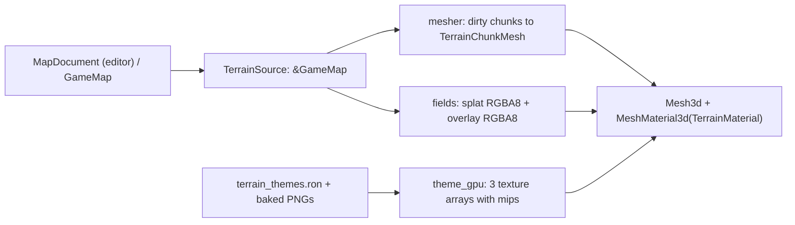

# Plan 21 — Map Editor (MVP), Declarative Map Format & Shared Terrain Renderer

> **Version:** 3.0 (rewritten by the orchestrator after three rejected planner drafts)
> **Status:** Approved for implementation.
> **Implementers:** Gemini Pro sub-agents, one phase group at a time, each reviewed by the orchestrator.
> **Binding rules:** [AGENTS.md](../../AGENTS.md). Everything below is normative; "must" means
> the reviewer will reject the work if it is missing. If something in this plan turns out to be
> impossible or wrong against the real code, **stop and report** — never improvise a workaround,
> never stub, never fake an asset.
> **Related:** [Codebase findings](../reviews/2026-10-26-codebase-findings.md) (F-xx references).

---

## 0. Decisions already made with the user

| Topic | Decision |
| :--- | :--- |
| Playtest vs. LiveBattle | Playtest runs **inside the editor binary** in its own `EditorPhase::Playtesting` state with the new terrain renderer. LiveBattle code (`arena_render.rs`, `scene_controller.rs`, `lab_ui.rs`, LiveBattle registration in `lib.rs`) stays **untouched**. Migrating LiveBattle to the new renderer is a deferred follow-up (F-01). |
| File dialog | In-editor `egui` file browser over `assets/maps/` (no new dependency). |
| Lighting | Lighting comes from the terrain theme data; **no** override sliders in the MVP. |
| Parallel session | Another session edits the repo concurrently (not the editor). Keep edits to existing files minimal, additive, and listed in §10. |

---

## 1. Scope

### 1.1 Goals (all must be complete — no TODOs)
1. **Versioned, deterministic, human-readable map format** `*.scmap.ron` (`MapFile` v1) owned by
   `sim_map`, with lossless decode/encode, strict validation, and conversion to `GameMap`.
2. **Multi-cell ramp altitude fix** in `sim_map` (F-02) and a single shared `RampProfile` used by the
   simulation *and* the renderer.
3. **Map validation engine** with one typed error per defect, each carrying a cell location.
4. **Deterministic scenario builder** in `sim_core` that turns a validated map + data-driven start
   loadouts into a `SimWorld` (used by playtest, reusable by future match setup).
5. **Shared terrain renderer** (`crates/client/src/terrain/`): dual-grid marching-squares cliffs with
   bevel/foot profile, ramps with guard rails, abyss walls into a void backdrop, splat-blended
   texture layers with hex-tiling, triplanar cliffs, world-space normal mapping, baked AO, GPU
   overlays (grid, pathability, buildability, LOS preview, validation highlights, brush), all lit by
   Bevy's PBR pipeline with cascaded shadows.
6. **AI-generated, baked texture assets** (tileable, normal + ORM derived, verified seams).
7. **Map editor binary** `map_editor`: paint levels/terrain/flags, ramp tool, entity placement,
   select/move/delete, box fill, eraser, symmetry painting, undo/redo, new/open/save/save-as,
   unsaved-changes guard, live validation panel with jump-to-error, LOS preview, playtest (F5)
   with unit selection and move/attack-move orders, Esc back to editing with the document intact.
8. **Real end-to-end render verification**: a `--verify-render` mode that fails on any pipeline
   error and writes reference screenshots, driven by an integration test under `xvfb` + lavapipe.

### 1.2 Non-goals (explicitly deferred)
- Diagonal ramps (`RampDir::NorthEast` …). The v1 file format and editor support **cardinal ramps
  only**; `MapDocument::from_game_map` returns a typed error for diagonal ramps. Legacy in-code maps
  keep the old single-cell diagonal interpolation.
- Neutral destructible doodads (the simulation has no such entity).
- LiveBattle migration to the new renderer; `GameMap::default_arena()` migration to a file
  (we only ship an equivalent file and a test proving equivalence).
- Harvesting in playtest (map resources are not `SimWorld` entities today).
- Multi-user editing, height sculpting, trigger editors, mesh imports, theme lighting sliders.

---

## 2. `sim_map` — map format, ramp profile, validation

### 2.1 Coordinate conventions (used everywhere in this plan)
- Cell `(x, y)` covers the world square `[x, x+1) × [y, y+1)` in simulation units.
- Client/Bevy mapping (already used by `scene_controller.rs` L551–555): **Bevy X = sim x,
  Bevy Z = sim y, Bevy Y = altitude**.
- `CliffLevel(l)` plateau height `H(l) = l × CLIFF_LEVEL_HEIGHT` with `CLIFF_LEVEL_HEIGHT = 3`
  world units (new public constant, see §2.5).

### 2.2 File format `MapFile` v1 — `crates/sim_map/src/map_format.rs` (new)

Cells are stored as **row strings** (one char per cell per layer): compact, diff-friendly,
hand-editable. **Row 0 in the file is the northernmost row** (`y = height − 1`), so the file reads
like a map with north up; row `i` ⇔ `y = height − 1 − i`.

```ron
// assets/maps/showcase_canyon.scmap.ron
(
    format_version: 1,
    metadata: (
        title: "Showcase Canyon",
        author: "Space Scuffle Team",
        description: "Two-player reference map exercising every terrain feature.",
        theme: "orbital_foundry",          // slug into assets/catalog/terrain_themes.ron
    ),
    width: 64,
    height: 64,
    levels:  [ "1111…", … ],   // '0'..'3'
    terrain: [ "DDDD…", … ],   // 'G' Grass, 'M' MetalPlate, 'D' Dirt, 'A' Abyss
    ramps:   [ "....…", … ],   // '.' none, 'N' 'S' 'E' 'W' = RampDir (ascending direction)
    flags:   [ "3333…", … ],   // one hex digit = authorable CellFlags bits (see below)
    resources: [ (id: 1, kind: Mineral, cell: (4, 14), amount: 1500), … ],
    watchtowers: [ (id: 20, cell: (32, 32), capture_radius_tenths: 30, reveal_radius_tenths: 120) ],
    start_locations: [ (id: 30, player_slot: 0, cell: (6, 6), footprint: (5, 5)), … ],
)
```

**Authorable flag digit** (hex `0..F`): bit0 `BUILDABLE`, bit1 `GROUND_PATHABLE`, bit2 `LOS_BLOCKER`,
bit3 `SPEED_ZONE` (values of `CellFlags` bits 0–3, `grid.rs` L81–87).
**Derived, never stored:** `RAMP` ⇔ `ramps` char ≠ `'.'`; `UNPASSABLE_CLIFF` ⇔ terrain `'A'`;
`OCCUPIED_BY_STRUCTURE` always clear (runtime state, fixes F-11/F-12 for new maps).
`SimScalar` is deliberately **not** used in the file (F-04): radii are integer tenths of a world unit,
converted exactly with `SimScalar::from_num(tenths) / SimScalar::from_num(10)`.

Types (all `Debug, Clone, PartialEq, Eq, Serialize, Deserialize`; all public items documented):

```rust
pub const CURRENT_MAP_FORMAT_VERSION: u32 = 1;
pub const MIN_MAP_DIMENSION: u32 = 16;   // smallest map that fits two 5x5 bases + paths
pub const MAX_MAP_DIMENSION: u32 = 256;  // bounds memory of per-cell overlays/vision (256² = 65 536)
pub const MAX_RAMP_RUN_CELLS: u8 = 8;    // longest ramp run; keeps RampProfile walks bounded

pub struct MapFile { pub format_version: u32, pub metadata: MapMetadata, pub width: u32, pub height: u32,
    pub levels: Vec<String>, pub terrain: Vec<String>, pub ramps: Vec<String>, pub flags: Vec<String>,
    pub resources: Vec<MapResource>, pub watchtowers: Vec<MapWatchtower>,
    pub start_locations: Vec<MapStartLocation> }
pub struct MapMetadata { pub title: String, pub author: String, pub description: String, pub theme: String }
pub struct MapEntityId(pub u32);                         // unique across all entity lists of a map
pub struct MapResource { pub id: MapEntityId, pub kind: ResourceKind, pub cell: (u32, u32), pub amount: u32 }
pub struct MapWatchtower { pub id: MapEntityId, pub cell: (u32, u32),
    pub capture_radius_tenths: u16, pub reveal_radius_tenths: u16 }
pub struct MapStartLocation { pub id: MapEntityId, pub player_slot: u8, pub cell: (u32, u32), pub footprint: (u8, u8) }

/// Decoded, editable representation (what the editor mutates).
pub struct MapCellSpec { pub level: CliffLevel, pub terrain: TerrainKind, pub ramp: Option<RampDir>,
    pub flags: CellFlags /* only the 4 authorable bits */ }
pub struct MapDocument { pub metadata: MapMetadata, pub width: u32, pub height: u32,
    pub cells: Vec<MapCellSpec> /* row-major, index = y*width + x */,
    pub resources: Vec<MapResource>, pub watchtowers: Vec<MapWatchtower>,
    pub start_locations: Vec<MapStartLocation> }
```

`MapEntityId` must derive `Copy, Ord, Hash`. Entity vectors are kept **sorted by id** by every
mutating API (determinism, stable diffs).

Functions:

```rust
impl MapFile {
    pub fn from_ron_str(s: &str) -> Result<Self, MapFormatError>;        // syntax + version check only
    pub fn to_ron_string(&self) -> Result<String, MapFormatError>;      // PrettyConfig: depth_limit 3, indentor 4 spaces, struct_names false
    pub fn load(path: &Path) -> Result<Self, MapFormatError>;
    pub fn save_atomic(&self, path: &Path) -> Result<(), MapFormatError>; // write "<path>.tmp", fsync, rename
    pub fn decode(&self) -> Result<MapDocument, MapFormatError>;          // layer parsing, see errors
}
impl MapDocument {
    pub fn new_blank(width: u32, height: u32, metadata: MapMetadata) -> Result<Self, MapFormatError>; // level 1, Dirt, flags 0x3
    pub fn encode(&self) -> MapFile;
    pub fn cell(&self, x: u32, y: u32) -> Option<&MapCellSpec>;
    pub fn cell_mut(&mut self, x: u32, y: u32) -> Option<&mut MapCellSpec>;
    pub fn to_map_cell(spec: &MapCellSpec) -> MapCell;                    // derives RAMP / UNPASSABLE_CLIFF
    pub fn to_game_map(&self) -> Result<GameMap, MapFormatError>;         // uses GameMap::from_cells
    pub fn from_game_map(map: &GameMap, metadata: MapMetadata) -> Result<Self, MapFormatError>;
    pub fn next_entity_id(&self) -> MapEntityId;                           // max id + 1
}
```

`to_game_map` mapping (exact):
- cells: `to_map_cell` (`occupying_structure: None`).
- resources: `ResourceNode { pos: cell center (x+½, y+½), kind, remaining: amount, cell }`.
- watchtowers: `Watchtower { id: EntityId(1_000_000 + map_id), pos: cell center, capture_radius, reveal_radius, controlling_player: None }`.
  The `WATCHTOWER_ENTITY_ID_BASE = 1_000_000` constant keeps map entity ids disjoint from
  `SimWorld::next_entity_id` (starts at 1) — document it.
- start locations are **not** part of `GameMap`; they are consumed by `sim_core::scenario` (§3).

`from_game_map` rejects: diagonal ramp (`UnsupportedDiagonalRamp {x,y}`), any cell with
`OCCUPIED_BY_STRUCTURE` (`RuntimeStateInCell {x,y}`), flag/field disagreement
(`InconsistentRampFlag {x,y}`), `UNPASSABLE_CLIFF` without terrain Abyss or vice versa
(`InconsistentAbyssFlag {x,y}`), and non-authorable bits other than RAMP/UNPASSABLE_CLIFF.
Watchtower radii must be exact tenths (`NonTenthRadius {x,y}`). Resources get ids `1..`, watchtowers
continue the sequence; `start_locations` empty.

`MapFormatError` (thiserror, in `map_format.rs`, **not** in `error.rs` to keep the shared file
untouched) — variants with `#[error]` messages: `Io { path, source: std::io::Error }` (not `Clone`;
the enum derives `Debug` only), `RonSyntax(String)`, `RonSerialize(String)`,
`UnsupportedVersion { found, supported }`, `DimensionsOutOfRange { width, height }`,
`RowCount { layer: MapLayer, expected, found }`, `RowLength { layer, row, expected, found }`,
`InvalidCellChar { layer, x, y, ch }`, `LevelOutOfRange { x, y, level }`,
`UnsupportedDiagonalRamp { x, y }`, `RuntimeStateInCell { x, y }`, `InconsistentRampFlag { x, y }`,
`InconsistentAbyssFlag { x, y }`, `NonTenthRadius { x, y }`, `GameMap(MapError)`.
`MapLayer` = `Levels | Terrain | Ramps | Flags`. Decoding reports the **first** error in
deterministic order (layers in the order above, rows top to bottom, chars left to right).

### 2.3 Version policy
Strict: `format_version == 1` is accepted, anything else → `UnsupportedVersion`. No migration
registry until a v2 exists (YAGNI); the version field and error make adding one later trivial.
Legacy `ScMapData` files (no `format_version`) fail with `RonSyntax` mentioning the missing field —
tested.

### 2.4 Shipped map files (data, created in Phase 1)
1. `assets/maps/default_arena.scmap.ron` — exact encoding of `GameMap::default_arena()` plus two
   start locations: id 30 slot 0 cell `(18, 4)` footprint 5×5 (level 1, clear of the minerals at
   x 5..=10 and the LOS patch at 15..=17), id 31 slot 1 cell `(41, 52)` footprint 5×5 (level 2, clear
   of minerals x 49..=54 and gas (48, 56)). Metadata theme `orbital_foundry`. If validation rejects
   these cells, stop and report rather than moving them silently. Generate it once with a throwaway program **outside the repo**
   (e.g. in `/tmp`) using `MapDocument::from_game_map(...).encode().to_ron_string()`, then commit the
   file. A permanent test proves equivalence (§2.8).
2. `assets/maps/showcase_canyon.scmap.ron` — 64×64 reference map built from this layout (generate
   with a throwaway script outside the repo; commit only the `.ron`):

| # | Feature | Cells | Values |
| :--- | :--- | :--- | :--- |
| A | Base ground | all | level 1, terrain `D`, flags `3` |
| B | P0 plateau | `x < 26 && y < 26 && x + y < 40` | level 2, terrain `M` (gives straight edges **and** a 45° staircase edge) |
| C | P1 plateau | 180° rotation of B: cell `(63−x, 63−y)` | level 2, terrain `M` |
| D | P0 ramp | `x ∈ 26..=28, y ∈ 8..=11` | level 1, ramp `W`, flags `2` |
| E | P1 ramp | `x ∈ 35..=37, y ∈ 52..=55` | level 1, ramp `E`, flags `2` |
| F1 | Mesa ring | `x ∈ 26..=37, y ∈ 26..=34` | level 2, terrain `M` |
| F2 | Mesa core | `x ∈ 29..=34, y ∈ 29..=37` | level 3, terrain `M` (rows 35..=37 abut level 1 directly → 6-unit two-level wall) |
| G | Mesa ramp | `x ∈ 31..=33, y ∈ 23..=25` | level 1, ramp `N`, flags `2` (ascends into F1 at y = 26) |
| H | Chasms | `40 ≤ x − y ≤ 43` and its rotation `40 ≤ y − x ≤ 43` | terrain `A`, level 0, flags `0` |
| I | Moss | discs radius 5 (cell centers, `dx²+dy² ≤ 25`) at (12, 40) and (51, 23) | terrain `G` (only where not B/C/F/H) |
| J | LOS blockers | 3×3 at x∈19..=21,y∈43..=45 and rotation | flags `7` |
| K | Starts | P0 `(6, 6)` 5×5, P1 `(53, 53)` 5×5 | ids 30, 31 |
| L | Resources P0 | minerals at `(4..=11, 14)` (8), gas at `(14, 6)` and `(14, 10)` | amounts 1500 / 2500; P1 = rotation |
| M | Watchtower | `(32, 33)` on the mesa core | capture 30, reveal 120 tenths |

Apply rows in table order (later rows overwrite). The file must validate with **zero errors**.

### 2.5 Ramp profile & altitude fix — `crates/sim_map/src/grid.rs` (edit, minimal)
Add (public, documented):

```rust
/// World-unit height of one cliff level step.
pub const CLIFF_LEVEL_HEIGHT: i32 = 3;

/// Position of a ramp cell inside its contiguous ramp run.
#[derive(Debug, Clone, Copy, PartialEq, Eq)]
pub struct RampProfile { pub dir: RampDir, pub low_level: CliffLevel, pub index: u8, pub run_len: u8 }

impl RampProfile {
    /// Ramp progress t ∈ [0, 1] at cell-local coordinates (fx, fy) ∈ [0, 1]².
    pub fn progress(&self, fx: SimScalar, fy: SimScalar) -> SimScalar;
    /// Surface altitude at cell-local coordinates.
    pub fn height_at(&self, fx: SimScalar, fy: SimScalar) -> SimScalar;
}
impl GameMap {
    /// Returns the ramp profile of cell (x, y), or None if it is not a ramp.
    pub fn ramp_profile(&self, x: u32, y: u32) -> Option<RampProfile>;
}
```

Rules:
- Cardinal `dir` with unit step `s` (North = (0,+1), South = (0,−1), East = (+1,0), West = (−1,0)):
  walk from the cell in `−s` while the neighbour has `ramp == Some(dir)` and the same
  `cliff_level` → `index` = number of such cells (bounded by `MAX_RAMP_RUN_CELLS − 1`); walk in `+s`
  likewise → `after`; `run_len = index + 1 + after`.
  `progress = (index + along) / run_len`, where `along` = `fy` (N), `1−fy` (S), `fx` (E), `1−fx` (W).
- Diagonal `dir`: legacy behaviour, `index = 0`, `run_len = 1`, `progress` = the existing formulas
  (L414–417). Document "legacy, not producible by map format v1".
- `height_at = low_level.height_scalar() + progress × CLIFF_LEVEL_HEIGHT`.
- `terrain_altitude_scalar` (L388–421) uses `ramp_profile(cx, cy)` / `height_at`; the literal
  `from_num(3)` is replaced by `CLIFF_LEVEL_HEIGHT` (also in `CliffLevel::height_scalar`, L31).
- `// PERFORMANCE RATIONALE:` block: the walk is ≤ 2 × 7 neighbour reads, no allocation, cheaper
  than maintaining a cache that must be invalidated through `cells_mut`.
- Export `CLIFF_LEVEL_HEIGHT` and `RampProfile` from `lib.rs`.

### 2.6 Validation — `crates/sim_map/src/validation.rs` (new)

```rust
pub fn validate_map(doc: &MapDocument) -> MapValidationReport;
pub struct MapValidationReport { pub errors: Vec<MapValidationError>, pub warnings: Vec<MapValidationWarning> }
impl MapValidationReport { pub fn is_playable(&self) -> bool /* errors.is_empty() */ }
pub struct CellRect { pub min: (u32, u32), pub max_inclusive: (u32, u32) }
impl MapValidationError   { pub fn location(&self) -> CellRect; }
impl MapValidationWarning { pub fn location(&self) -> CellRect; }
```

Constants (documented rationale each): `MIN_START_LOCATIONS = 2`, `MAX_PLAYER_SLOTS = 8`
(`SimWorld` arrays are `[_; 8]`, world.rs L116–126), `MIN_START_SEPARATION_CELLS = 16`
(Chebyshev distance between footprint centers), `RESOURCE_ASSOCIATION_RADIUS_CELLS = 12`,
`MIN_RECOMMENDED_RAMP_WIDTH = 2`, `VALIDATION_PATH_CLEARANCE = UnitClearance::Medium`.

Errors (`thiserror`, `Debug, Clone, PartialEq, Eq`), checked in this order, all collected (not
first-only), sorted deterministically by (check order, y, x):

| Variant | Condition |
| :--- | :--- |
| `AbyssCellTraversable { x, y }` | terrain Abyss with `BUILDABLE` or `GROUND_PATHABLE` |
| `RampOnAbyss { x, y }` | ramp on an Abyss cell |
| `RampAtTopLevel { x, y }` | ramp with `level == CliffLevel::MAX` |
| `RampNotPathable { x, y }` | ramp without `GROUND_PATHABLE` |
| `RampBuildable { x, y }` | ramp with `BUILDABLE` |
| `RampRunTooLong { x, y, len }` | contiguous run along `dir` > `MAX_RAMP_RUN_CELLS` (report run's first cell) |
| `RampUpperLandingMismatch { x, y }` | for the run's last cell, the next cell along `dir` is out of bounds, a ramp, Abyss, or its level ≠ low+1 |
| `RampLowerLandingMismatch { x, y }` | for the run's first cell, the previous cell is out of bounds, a ramp, Abyss, or its level ≠ low |
| `RampRunLevelMismatch { x, y }` | cells of one run (same dir, adjacent along dir) have different levels |
| `TooFewStartLocations { count }` | `< MIN_START_LOCATIONS` (location = whole map) |
| `PlayerSlotOutOfRange { id, slot }` | `slot ≥ MAX_PLAYER_SLOTS` |
| `DuplicatePlayerSlot { id, slot }` | second occurrence |
| `StartFootprintBlocked { id, reason: PlacementFailureReason }` | `GameMap::can_place_building` (grid.rs L438) on the converted map fails |
| `StartLocationsTooClose { a, b, distance }` | footprint-center Chebyshev distance `<` constant |
| `DuplicateEntityId { id }` | across all three lists |
| `EntityOutOfBounds { id, x, y }` | resource/watchtower cell or start footprint outside the map |
| `ResourceOnBlockedCell { id }` | cell Abyss, ramp, or not `GROUND_PATHABLE` |
| `ResourceInsideStartFootprint { id, start }` | |
| `EntitiesOverlap { a, b }` | two resources/watchtowers on the same cell |
| `ZeroResourceAmount { id }` / `ZeroWatchtowerRadius { id }` | |
| `StartLocationsUnreachable { a, b }` | `Pathfinder::new(&map).find_path(&map, &PathRequest { start: center(a), goal: center(b), clearance: VALIDATION_PATH_CLEARANCE })` fails, for every pair (a<b by slot) |

`PlacementFailureReason` must be `Clone + PartialEq + Eq`; check `error.rs` — if it lacks these
derives, adding them is an allowed minimal additive edit to `error.rs` (list it in the PR).
Pathfinding is only run if no ramp/abyss/start errors were found (otherwise results are meaningless);
document this.

Warnings: `NarrowRamp { x, y, width }` (run width perpendicular to dir `< MIN_RECOMMENDED_RAMP_WIDTH`),
`DiagonalPinch { x, y }` (2×2 block where exactly the two diagonal cells are higher — renders as a
joined plateau, see §5.3), `ResourceImbalance { slot, count, max_count }` (resources assigned to
the nearest start by squared cell distance, ties → lower slot, within the association radius),
`UnassignedResource { id }`.

### 2.7 `lib.rs` (edit, additive)
`pub mod map_format; pub mod validation;` and re-exports of the public types above.

### 2.8 Tests (Phase 1) — exact cases
`crates/sim_map/tests/ramp_profile_tests.rs`
- `multi_cell_north_ramp_is_monotonic`: default arena, sample altitude at x = 31.5, y from 29.5 to
  34.5 step 0.25 → strictly non-decreasing; at y = 30.0 → 3.0, y = 32.0 → 4.5, y = 34.0 → 6.0 (exact
  `SimScalar` equality).
- `ramp_profile_indices`: default arena cells (31, 30..=33) → `index 0..=3`, `run_len 4`, dir North.
- one test per cardinal direction on a 16×16 synthetic map (3-long run): progress at the run's low
  edge = 0, high edge = 1.
- `diagonal_ramp_keeps_legacy_single_cell_behaviour`.

`crates/sim_map/tests/map_format_tests.rs`
- `blank_document_roundtrip`: `new_blank(32, 32)` → encode → to_ron → from_ron → decode == original.
- `showcase_roundtrip_is_byte_identical`: load file → decode → encode → to_ron_string equals the
  file contents byte-for-byte (forces the committed file to be canonical).
- `row_zero_is_north`: a 16×16 doc with only cell (0, 15) at level 3 encodes to `levels[0]` starting
  with `'3'`.
- `default_arena_file_equals_code_arena`: `default_arena.scmap.ron` → `to_game_map()`: cells,
  resources (pos, kind, remaining, cell) and watchtowers equal `GameMap::default_arena()` element-wise,
  **except the watchtower `id`**: `default_arena` uses `EntityId(100)` while `to_game_map` assigns
  `WATCHTOWER_ENTITY_ID_BASE + map_id` by design (§2.2). The test compares all other watchtower fields
  and states this exception in a comment.
- Error tests, one each: `UnsupportedVersion` (format_version 2), legacy `ScMapData` RON rejected,
  `DimensionsOutOfRange` (15×16 and 257×16), `RowCount`, `RowLength`, `InvalidCellChar` for each of
  the four layers (`'4'`, `'X'`, `'Q'`, `'G'` in flags), `UnsupportedDiagonalRamp`,
  `RuntimeStateInCell`, `InconsistentRampFlag`, `InconsistentAbyssFlag`, `NonTenthRadius`.
- `save_atomic_leaves_no_tmp_file` (tempfile dir) and `save_atomic_overwrites_existing`.

`crates/sim_map/tests/validation_tests.rs`
- `showcase_canyon_is_valid` and `default_arena_file_is_valid` (zero errors).
- One focused test **per error variant** (22) on a minimal 16×16 or 32×32 document built in the test
  (helper `fn base_doc() -> MapDocument` with two valid starts), asserting the exact variant and its
  `location()`.
- `unreachable_when_walled`: 32×32, starts at (2,2) and (25,25), column x = 16 set to Abyss with
  flags 0 → exactly one `StartLocationsUnreachable { a: 30, b: 31 }`.
- One test per warning.
- `report_order_is_deterministic`: validate the same broken doc twice → identical `Vec`s.

---

## 3. `sim_core` — scenario builder

### 3.1 Data: `assets/catalog/start_loadouts.ron` (new)
```ron
(
    loadouts: [
        (
            slug: "standard_automaton",
            display_name: "Automaton Directorate — standard start",
            town_hall: "foundry_core_dome",
            units: [ (slug: "welder_drone", count: 6) ],
        ),
    ],
)
```
(Slugs exist today: `structures.ron` L10, `units.ron` L6. They live only in data.)

### 3.2 `crates/sim_core/src/scenario.rs` (new) + one `pub mod scenario;` line in `sim_core/src/lib.rs`
```rust
pub struct StartLoadout { pub slug: String, pub display_name: String, pub town_hall: String, pub units: Vec<LoadoutUnit> }
pub struct LoadoutUnit { pub slug: String, pub count: u8 }
pub struct StartLoadoutCatalog { pub loadouts: Vec<StartLoadout> }
impl StartLoadoutCatalog { pub fn from_ron_str(s: &str) -> Result<Self, ScenarioError>; pub fn load(path: &Path) -> Result<Self, ScenarioError>; pub fn get(&self, slug: &str) -> Option<&StartLoadout>; }
pub struct PlayerSetup { pub player_slot: u8, pub loadout_slug: String }
pub fn build_world(doc: &MapDocument, loadouts: &StartLoadoutCatalog, players: &[PlayerSetup], seed: u64) -> Result<SimWorld, ScenarioError>;
```
`build_world` steps: (1) `validate_map(doc)`; any error → `ScenarioError::InvalidMap(report.errors)`.
(2) `doc.to_game_map()`. (3) `SimWorld::new(map, seed)`. (4) For each start location in slot order
that has a `PlayerSetup`: resolve the loadout, resolve slugs via `world.catalog.get_by_slug`
(`UnknownSlug`), check the town hall archetype is `ShapeKind::BuildingDome` whose footprint fits
inside the start footprint (`TownHallDoesNotFit`), center the town hall in the footprint
(`top_left + (fp − hall)/2`, integer division), `spawn_structure`; then place units on the ring of
cells around the town hall footprint: ring distance d = 1, 2, 3; within a ring iterate cells in
order south edge (x ascending), east edge (y ascending), north edge (x descending), west edge
(y descending); take cells that are in bounds, `GROUND_PATHABLE`, not Abyss, not ramp, not occupied;
spawn at the cell center; not enough cells by d = 3 → `NotEnoughSpawnCells`. (5) Players without a
start location → `MissingStartLocation`; start locations without a player are left empty.
(6) Recompute `world.last_checksum`.
`ScenarioError` (thiserror): `Io`, `Ron(String)`, `InvalidMap(Vec<MapValidationError>)`,
`MissingStartLocation { slot }`, `UnknownLoadout(String)`, `UnknownSlug(String)`,
`TownHallNotADome(String)`, `TownHallDoesNotFit { slot }`, `NotEnoughSpawnCells { slot }`,
`Spawn(SimCoreError)` (`SimCoreError` is the existing error type, check its name in `error.rs`).

### 3.3 Tests `crates/sim_core/tests/scenario_tests.rs`
- `showcase_two_players_spawns_expected_entities`: both players `standard_automaton` → exactly
  2 structures + 12 units; each town hall center equals footprint center (cell (6,6)+2.5 → (8.5, 8.5));
  all units on pathable, non-ramp cells within Chebyshev distance 3 of their footprint.
- `build_world_is_deterministic`: build twice, step 200 empty ticks each → identical
  `compute_checksum()` every tick.
- One test per `ScenarioError` variant (except `Io`): invalid map, missing start, unknown loadout,
  unknown slug (loadout from inline RON), non-dome town hall (inline RON pointing at a unit slug),
  too-small footprint (3×3), not enough cells (start footprint surrounded by Abyss).
- `real_loadout_file_resolves`: load `assets/catalog/start_loadouts.ron`; every slug resolves in
  `UnitCatalog::new_starter_roster()`.

---

### 3.x v3.2 review amendments (scenario builder)
- Unit spawn cells must additionally have the **same `cliff_level` as the town-hall anchor cell**
  (a ring may cross a cliff edge; units must not spawn on a different plateau). Test:
  `units_never_spawn_on_other_cliff_level` — map whose start footprint touches a cliff edge on one
  side; assert every spawned unit's cell level equals the hall level and the count is still met.
- `MapDocument::to_game_map` failures map to a dedicated `ScenarioError::MapConversion(#[from]
  MapFormatError)` (no stringly-typed wrapping into `SimCoreError`); RON errors keep the typed
  `ron::error::SpannedError` (`#[from]`).
- The ring walk is a pure helper `ring_perimeter(x0, x1, y0, y1) -> impl Iterator<Item=(i32,i32)>`
  (no Vec), unit-tested for order and count (`ring_perimeter_order_and_len`). No O(N) scan over
  `world.entities` per candidate cell — `claimed_cells` plus structure occupancy is the complete
  occupancy record during scenario construction.

## 4. `asset_baker` — terrain themes & texture processing

### 4.1 Theme catalog types — `crates/asset_baker/src/terrain_theme.rs` (new)
Shared by the baker and the client (client already depends on `asset_baker`).

```ron
// assets/catalog/terrain_themes.ron
(
    themes: [
        (
            slug: "orbital_foundry",
            display_name: "Orbital Foundry",
            texture_size: 1024,
            layers: (
                grass:       (name: "lumen_moss",   source: "source_art/terrain/orbital_foundry/lumen_moss.png",   metallic: 0.0, roughness_range: (0.70, 0.95), normal_strength: 2.0, prompt: "…"),
                metal_plate: (name: "deck_plating", source: "source_art/terrain/orbital_foundry/deck_plating.png", metallic: 0.65, roughness_range: (0.30, 0.60), normal_strength: 3.0, prompt: "…"),
                dirt:        (name: "regolith",     source: "source_art/terrain/orbital_foundry/regolith.png",     metallic: 0.0, roughness_range: (0.80, 1.00), normal_strength: 2.5, prompt: "…"),
                cliff:       (name: "basalt_wall",  source: "source_art/terrain/orbital_foundry/basalt_wall.png",  metallic: 0.05, roughness_range: (0.55, 0.90), normal_strength: 4.0, prompt: "…"),
            ),
            backdrop: (source: "source_art/terrain/orbital_foundry/void_nebula.png", prompt: "…"),
            baked_dir: "textures/terrain/orbital_foundry",
            ground_tiles_per_unit: 0.25,   // one texture repeat per 4 world units
            cliff_tiles_per_unit: 0.20,
            lighting: (
                sun_illuminance_lux: 14000.0,      // matches arena_render.rs L190
                sun_elevation_deg: 48.0, sun_azimuth_deg: 225.0,
                ambient_color_srgb: (0.65, 0.78, 1.0), ambient_brightness: 350.0, // arena_render.rs L197–200
                void_color_srgb: (0.01, 0.012, 0.03),
                guardrail_emissive_srgb: (0.15, 0.85, 1.0), guardrail_emissive_intensity: 4.0,
            ),
        ),
    ],
)
```
Field names `grass`, `metal_plate`, `dirt` mirror the three non-Abyss `TerrainKind` variants; this
is the only place the mapping exists. Prompts (exact strings, stored in the RON):
- lumen_moss: `"Seamless tileable top-down texture of a flat carpet of short dense alien moss with tiny faintly glowing teal spores, fine-grained and low-contrast so units remain readable on it, no large plants, no stones, no structures, stylized hand-painted sci-fi RTS ground, even diffuse lighting, no shadows, no perspective, no text, square"`
- deck_plating: `"Seamless tileable top-down texture of worn sci-fi metal deck plating, large rectangular panels, rivets, subtle scratches, brushed gunmetal with faint cyan accent lines, stylized hand-painted RTS ground, even diffuse lighting, no perspective, no text, square"`
- regolith: `"Seamless tileable top-down texture of grey-brown alien regolith dust with small pebbles and fine cracks, stylized hand-painted RTS ground, even diffuse lighting, no perspective, no text, square"`
- basalt_wall: `"Seamless tileable texture of a vertical dark basalt cliff face with layered strata and fractures, subtle bluish mineral veins, stylized hand-painted sci-fi RTS cliff, front view, even diffuse lighting, no sky, no text, square"`
- void_nebula: `"Deep space backdrop, very dark navy void with faint purple and teal nebula wisps and sparse tiny stars, seamless, no planets, no text, square"`

Types: `TerrainThemeCatalog { themes }`, `TerrainTheme`, `ThemeLayers { grass, metal_plate, dirt, cliff }`,
`ThemeLayer`, `ThemeBackdrop`, `ThemeLighting` (f32 fields are fine — client-side visuals, never in sim).
Functions: `TerrainThemeCatalog::load(path)`, `::from_ron_str`, `::get(slug)`, `TerrainTheme::validate(&self)`
(texture_size power of two in 256..=2048, roughness ranges ordered within [0,1], metallic in [0,1],
tiles_per_unit > 0, unique layer names), `TerrainTheme::baked_paths(&self, layer) -> BakedLayerPaths
{ albedo, normal, orm, tiled_preview }` (= `<baked_dir>/<name>_{albedo,normal,orm,tiled_preview}.png`),
`TerrainTheme::ordered_layers() -> [&ThemeLayer; 4]` (array order **grass, metal_plate, dirt, cliff**
= texture-array layer indices 0..3, documented as a `pub const LAYER_INDEX_*`).
Errors: `TerrainThemeError` (thiserror): `Io`, `Ron`, `UnknownTheme`, `Invalid { theme, reason }`,
`MissingSource(PathBuf)`, `Image(String)`.

### 4.2 Processing — `crates/asset_baker/src/terrain_texture.rs` (new)
All operations use **wrap-around addressing** so outputs stay tileable. Work in `f32` linear space
(`image` crate `Rgba32F` buffers); sRGB decode/encode with the exact piecewise sRGB transfer function.

1. `load_and_resize(source, size)` — decode, convert to linear `Rgba32F` **first**, then Lanczos3 to
   `size × size` in linear space (resampling in gamma space darkens high-contrast detail); error if
   source not square within 2%.
2. `make_tileable(img) -> Rgba32FImage` — **separable two-pass** offset-and-blend with Laplacian
   pyramid (v3.1; the earlier single-pass cross mask is invalid: where the cross meets the border,
   `img` is not tileable and `O` has its seam, so no mask value is correct there).
   - `multiband_blend(a, b, m)`: Burt–Adelson with `PYRAMID_LEVELS = 5` (Gaussian 5-tap
     [1,4,6,4,1]/16, wrap addressing): Laplacian pyramids of `a` and `b`, Gaussian pyramid of `m`,
     `L_k = G(m)_k · L(a)_k + (1 − G(m)_k) · L(b)_k`, collapse. All pyramid ops are linear and
     shift-equivariant under wrap addressing, so a blend of two images that tile along an axis
     also tiles along that axis.
   - Pass X: `Ox` = `img` shifted by `size/2` in x only (tiles horizontally, seam at column
     `size/2`). Mask `mx(x) = smoothstep(SEAM_HALF_WIDTH, 0, |x − size/2|)` (1 on the seam column,
     0 at the left/right borders; independent of y). `H = multiband_blend(img, Ox, mx)` → tiles
     horizontally, no internal seam.
   - Pass Y: `Oy` = `H` shifted by `size/2` in y only (each row is a row of `H`, so `Oy` still tiles
     horizontally and now also vertically; seam at row `size/2`). `my(y)` analogous.
     Result `= multiband_blend(H, Oy, my)` → tiles in both axes, no internal seam anywhere.
   - `SEAM_HALF_WIDTH = size / 8`; the mask has a plateau of 1 for `|t − size/2| ≤ SEAM_CORE_WIDTH = size/32`
     (`smoothstep(SEAM_HALF_WIDTH, SEAM_CORE_WIDTH, d)`), so the centre region test is exact.
     Document this reasoning (including why single-pass fails) in the
     `//!` docs.
   - **v3.2 — minimum-error boundary cuts (Efros & Freeman 2001, "Image Quilting").** Verified on
     the real `deck_plating` art: a soft band mask cross-fades two unrelated panel layouts and
     produces smeared "ghost" panels. Fix: per pass, the transition between the `img` region and the
     shifted region follows the **cheapest path** through the overlap, not a straight band.
     For pass X: cost `E(x,y) = Σ_rgb (a(x,y) − b(x,y))²` (linear space). Left cut: dynamic
     programming top→bottom over columns `x ∈ [size/2 − SEAM_HALF_WIDTH, size/2 − SEAM_CORE_WIDTH]`,
     `C(x,y) = E(x,y) + min(C(x−1,y−1), C(x,y−1), C(x+1,y−1))`, **cyclic in y** (the path must
     tile vertically: run the DP once per start column in the top row is too slow — instead run
     it twice: first pass free, then constrain row 0 to the column the first pass ended at in the
     last row, and backtrack; document this approximation), backtrack to `cut_left[y]`.
     Right cut symmetrically in `[size/2 + SEAM_CORE_WIDTH, size/2 + SEAM_HALF_WIDTH]`.
     Hard mask `mx(x,y) = 1` for `cut_left[y] ≤ x ≤ cut_right[y]`, else 0; then feed this hard mask
     into `multiband_blend` (Burt–Adelson's intended use: the Gaussian pyramid of a hard mask gives
     per-frequency transition widths). Pass Y identical with axes swapped (cuts are functions of x,
     cyclic in x). Ties broken toward the smaller index (deterministic).
     `PERFORMANCE RATIONALE` not needed (O(size · band) per pass), but the DP buffers are reused
     between the two cuts.
   - Tests (v3.2): `min_cut_follows_zero_cost_corridor` — synthetic `a`, `b` that are identical
     only along a known wavy vertical corridor (e.g. `x = c + round(8·sin(2πy/size))`) and random
     elsewhere: the found cut must equal the corridor exactly for every row. `min_cut_is_cyclic` —
     `cut[0]` and `cut[size−1]` differ by at most 1. `make_tileable_structured_no_ghosting` —
     synthetic "panel" image (random axis-aligned rectangles with 2-px dark gaps, seeded): fraction
     of output pixels within the bands where `|out − img| > 0.1 AND |out − shifted| > 0.1`
     (i.e. a value that belongs to neither source = ghost) must be < 2 %. Existing tests stay.
   - **v3.3 — per-layer tiling mode (data, not code).** Real-asset review: even with min-cut, the
     multiband low-frequency blend leaves smudged panels on `deck_plating`, while the raw AI source
     already tiles almost perfectly (2×2 check). Add to `ThemeLayer`
     `tiling: TilingMode` with `enum TilingMode { MinCutBlend, SourceSeamless { max_seam_score: f32 } }`
     (RON default when omitted: `MinCutBlend`, via `#[serde(default)]`). `SourceSeamless`: the baker
     does **not** call `make_tileable`; it measures `seam_score` of the resized source and fails loudly
     with `TerrainThemeError::SourceNotSeamless { layer, score, max }` if it exceeds `max_seam_score`
     (validation: `max_seam_score` in `(0, 3]`). `BakeReport` shows the mode per layer.
     Data: `deck_plating` → `SourceSeamless(max_seam_score: 2.0)`; the other layers stay `MinCutBlend`.
     Tests: `source_seamless_layer_is_passed_through` (synthetic periodic image → baked albedo equals
     the source bit-for-bit after sRGB round trip), `source_seamless_rejects_seamed_source` (gradient →
     `SourceNotSeamless` with the measured score), validation case for `max_seam_score` range.
     The Phase 4 real-asset test uses each layer's own criterion (`< 1.5` for `MinCutBlend`,
     `≤ max_seam_score` for `SourceSeamless`).
3. `derive_height(albedo_linear) -> GrayF32`: luminance `0.2126R + 0.7152G + 0.0722B`, Gaussian
   blur σ = 1.0 px (wrap), normalized to [0, 1] (min/max).
4. `derive_normal(height, strength) -> Rgba8`: Sobel gradients (wrap),
   `n = normalize(−strength·gx, −strength·gy, 1)`, encode `n·0.5+0.5` (OpenGL convention, +Y up —
   document; the shader assumes it).
5. `derive_orm(height, layer) -> Rgba8`: R = AO = `clamp(1 − 2.5 · max(0, blur(h, σ=6) − h), 0.25, 1)`;
   G = roughness = `lerp(r_min, r_max, 1 − normalize(stddev_5x5(h)))` (normalize by the image's max
   stddev); B = metallic constant; A = 255.
6. `tiled_preview(albedo) -> Rgba8` 2×2 repetition (2·size square) for human seam review.
7. `seam_score(img) -> f32` = mean |pixel(0,y) − pixel(size−1,y)| + mean |pixel(x,0) − pixel(x,size−1)|
   divided by the mean absolute difference of adjacent interior columns/rows. ≈1.0 means the wrap
   seam is statistically indistinguishable from interior pixel steps.
8. `bake_theme(catalog_path, theme_slug, assets_dir) -> Result<BakeReport, TerrainThemeError>`:
   for each of the 4 layers write albedo (sRGB PNG), normal, ORM, tiled_preview; copy-resize the
   backdrop (no tileability processing beyond `make_tileable`) to `<baked_dir>/void_nebula.png`.
   `BakeReport` lists output paths and each layer's `seam_score` before/after.

CLI (edit `asset_baker/src/main.rs`, additive variant): `bake-terrain-theme --theme <slug>
[--catalog assets/catalog/terrain_themes.ron] [--assets assets]`, exits non-zero and prints the typed
error on failure, prints the `BakeReport`.

### 4.3 Tests
Unit/integration on **synthetic** images (algorithm verification is allowed to use synthetic data;
real-asset checks are separate):
- `make_tileable_removes_seam`: 256² image = horizontal gradient 0→1 (maximal wrap discontinuity);
  `seam_score` before > 20, after `< 1.5`.
- `make_tileable_preserves_interior_detail` (v3.1): input = seeded value noise 256² (non-periodic —
  a checkerboard is invariant under the half shift and proves nothing). Expected mapping for the
  two-pass algorithm: at the quarter points region (64±16, 64±16) both masks are 0, so the result
  must equal `img` shifted by (size/2, size/2) — i.e. `out(x,y) ≈ img(x+128, y+128)` — MAE < 0.02;
  at the centre region (128±8, 128±8) both masks are 1, so `out(x,y) ≈ img(x,y)`, MAE < 0.02.
- `make_tileable_has_no_internal_seam` (v3.1): seeded noise 256²; for every column boundary
  `c ∈ 0..size` (including the wrap boundary `size−1 → 0`) compute the mean abs step across it;
  `max / mean < 1.5`; same for rows. Detects residual seams anywhere, not just at the border.
- `normal_of_flat_height_is_up`: constant height → every pixel (128,128,255).
- `normal_of_x_ramp_tilts_negative_x`: `h = x/size` → decoded normal x < 0, y ≈ 0.
- `orm_ranges_respected`: roughness within `roughness_range`, AO in [0.25, 1], B = metallic.
- `srgb_roundtrip_exact_for_u8`: all 256 values decode→encode identical.
- `theme_catalog_real_file_validates`: load `assets/catalog/terrain_themes.ron`, `validate()` ok.
- `theme_validation_errors`: one case per rule.
- `baked_real_assets_exist_and_are_tileable` (`crates/asset_baker/tests/terrain_assets_tests.rs`):
  for the real theme, every baked file exists at the path the client uses, has size
  `texture_size²`, and `seam_score(albedo) < 1.5`. This test is added in Phase 4 after the
  orchestrator bakes the real assets (it must fail loudly if files are missing — never skip).

---

## 5. Client — shared terrain renderer `crates/client/src/terrain/` (new)

Module files: `mod.rs` (plugin, resources, systems), `mesher.rs` (pure CPU, no ECS), `fields.rs`
(splat + overlay texture writers, pure), `theme_gpu.rs` (texture arrays + mips), `material.rs`,
`picking.rs` (pure), plus `assets/shaders/terrain.wgsl`.

### 5.1 Data flow

`TerrainPlugin` owns resources: `TerrainState { map: GameMap, revision: u64, dirty_cells: Option<CellRect> }`,
`TerrainChunks { chunks: Vec<ChunkEntry { entity, mesh: Handle<Mesh>, dirty: bool }>, cols, rows }`,
`TerrainMaterialHandle`, `TerrainFieldImages { splat: Handle<Image>, overlay: Handle<Image> }`,
`TerrainParamsState` (CPU copy of uniform fields, written by the editor), `MesherScratch`.
Public API used by the editor: `TerrainState::replace_map(GameMap)` (full rebuild) and
`TerrainState::apply_cells(rect, impl Fn(x, y) -> MapCell)` / `mark_dirty(rect)`.

### 5.2 Height field
`surface_class(x, y)` for the mesher:
- out of bounds or terrain Abyss → `Void` (numeric level −1)
- ramp → `Ramp(RampProfile)`; for marching squares a ramp cell uses its `low_level`
- otherwise `Plateau(level)`.

Constants (`mesher.rs`, each documented): `CHUNK_DUAL_CELLS = 16`, `RIM_WIDTH = 0.15`,
`RIM_DROP = 0.20`, `FOOT_WIDTH = 0.22`, `FOOT_RISE = 0.28`, `WALL_ROW_SPACING = 0.75`,
`ABYSS_WALL_BOTTOM_Y = -6.0`, `WALL_JITTER_AMPLITUDE = 0.06`, `RAIL_HEIGHT = 0.30`,
`RAIL_WIDTH = 0.08`, `AO_RADIUS_CELLS = 1.5`, `AO_STRENGTH = 0.45`, `WALL_FOOT_AO = 0.55`.

### 5.3 Dual-grid marching squares (cliffs aligned with simulation cell boundaries)
- Dual vertices sit at **cell centers**; dual cell `(i, j)`, `i ∈ 0..=W`, `j ∈ 0..=H`, spans world
  `[i−½, i+½] × [j−½, j+½]` with corners = centers of cells `(i−1, j−1)` (BL), `(i, j−1)` (BR),
  `(i, j)` (TR), `(i−1, j)` (TL). Out-of-range cells are `Void` → the map is a floating platform
  whose edge walls sit **exactly** on the map border.
- Contour crossings are fixed at **edge midpoints** (= cell boundaries), never interpolated. Hence a
  straight cliff lies exactly on the simulation boundary between cells; outer/inner corners become
  45° cuts of half a cell (area 1/8 cell, documented as the only visual/sim deviation), and a
  staircase of single-cell steps renders as a straight 45° cliff — the SC2 look, from a rule.
- Case index for threshold `t`: bits `BL=1, BR=2, TR=4, TL=8` set when corner level ≥ t.
  Saddles 5 and 10 resolve **high-connected** (both high corners joined; warning `DiagonalPinch`).
  Region polygons (convex, CCW seen from +Y, local coords, corners `bl tr …`, edge midpoints
  `b r t l`) — the implementer writes the full 16-entry table as a `const` array with a doc table.
- **Threshold runs:** for a dual cell with corner levels in `[lo, hi]`, consider `t = lo+1 ..= hi`.
  Group consecutive `t` with identical case index into maximal runs `[ta, tb]`. For each run with
  case ∉ {0, 15}: emit its contour segments once with a wall spanning `H(ta−1) … H(tb)` (with
  `H(−1) = ABYSS_WALL_BOTTOM_Y`) and emit the run's region polygon as floor at `H(tb)` (inset at
  contour vertices, below). Additionally emit the full dual cell floor at `H(lo)` if `lo ≥ 0`.
  Lower floors under higher regions are hidden; that overdraw (≤ 3 extra polygons per dual cell in
  the worst case) is accepted and documented with a `PERFORMANCE RATIONALE` block.
- **Profile at a contour vertex `p`** (edge midpoint between high corner `A` and low corner `B`,
  with `d = unit(B − A)`, always axis-aligned): rows from top to bottom
  1. rim top: `p − RIM_WIDTH·d`, `y = H(tb)` (present iff `level(A) == tb`, else omitted)
  2. rim bottom: `p`, `y = H(tb) − RIM_DROP` (present iff rim present)
  3. canonical rows: `p`, every `y = k·WALL_ROW_SPACING` strictly between the wall bottom (or foot
     top) and the wall top (or rim bottom)
  4. foot top: `p`, `y = H(ta−1) + FOOT_RISE` (present iff `level(B) == ta−1` and `ta−1 ≥ 0`)
  5. foot bottom: `p + FOOT_WIDTH·d`, `y = H(ta−1)` (present iff foot present)
  6. wall bottom when no foot: `p`, `y = H(ta−1)` (or `ABYSS_WALL_BOTTOM_Y`)
  The presence rules depend only on the edge's two corner levels and the run, so both dual cells
  sharing an edge generate identical vertices (watertight), and stacked runs share canonical rows.
- **Segments:** a contour segment `p0 → p1` produces a quad strip between the two vertex profiles.
  If the profiles have different row counts, rows are matched by height: generate the union of row
  heights for the segment, evaluating missing rows on each side by linear interpolation along that
  side's profile (still deterministic and identical along shared edges because shared edges are
  vertex columns, not strips).
- **Floor inset:** region polygon vertices that are contour vertices are moved to the rim-top
  position (`p − RIM_WIDTH·d`) when the rim is present, else stay at `p`.
- **Normals:** floors `+Y`. Wall vertex normal = `normalize(d_h · cos α + Y · sin α)` where `d_h` is
  the vertex's outward axis direction (`d`) and `α` the profile slope at that row (rim 45°-ish from
  geometry, vertical 0, foot from geometry) → corners shade smoothly, normals are identical on shared
  edges. Floor/rim boundary is a hard edge (separate vertices).
- **Jitter:** canonical-row vertices (not rim/foot/top/bottom rows) are displaced along `d` by
  `WALL_JITTER_AMPLITUDE · (2·hash(qx, qz, qy) − 1)`, `q* = round(coord × 64)` as `i32`, hash =
  the integer hash given in §5.6 (`pcg2d`) → deterministic, identical on shared edges.
- **Ramps:** ramp cells emit their own surface quad (4 vertices, heights from `RampProfile::height_at`
  at the cell corners converted with `to_f32` — the sim's own function), normal from the plane.
  Contour vertices on an edge between two **ramp-connected** cells (same run neighbours, or a run end
  and its landing cell along `dir`) are *suppressed*: no rim inset, and any segment with both
  endpoints suppressed emits no wall. Ramp side edges (perpendicular to the run's cross direction —
  i.e. the two edges parallel to `dir`) whose neighbour is not in the same run emit (a) a side wall
  from the ramp surface down to the neighbour's surface height (or `ABYSS_WALL_BOTTOM_Y`) when the
  neighbour is lower than the ramp surface along that edge, and (b) a guard rail: a box strip
  `RAIL_WIDTH × RAIL_HEIGHT` riding on the ramp edge, its top face flagged emissive (§5.4).
- **Vertex attributes:** `ATTRIBUTE_POSITION`, `ATTRIBUTE_NORMAL`, `ATTRIBUTE_UV_0` (world `xz`,
  unused by our shader but required by `StandardMaterial` pipelines), `ATTRIBUTE_UV_1` =
  `(ao, emissive_mask)`. **Do not use `ATTRIBUTE_COLOR`**: `pbr_input_from_standard_material`
  multiplies base color by vertex color under `VERTEX_COLORS` (bevy_pbr 0.15.3
  `pbr_fragment.wgsl` L48). Indices `u32`, CCW front faces.
- **AO:** floor vertex AO = `1 − AO_STRENGTH · f`, `f` = fraction of the up-to-9 cells whose centers
  lie within `AO_RADIUS_CELLS` (Euclidean, in xz) of the vertex and whose surface height at the
  center exceeds the vertex height by > 0.5. Wall vertex AO = lerp(`WALL_FOOT_AO`, 1.0,
  normalized height within the wall). Ramp vertices use the floor rule.
- **Buffers / allocations:** `MesherScratch { positions, normals, uv0, uv1: Vec<[f32; N]>, indices: Vec<u32> }`
  is cleared and refilled per chunk. The chunk's `Mesh` attributes are then updated **in place**:
  `if let Some(VertexAttributeValues::Float32x3(v)) = mesh.attribute_mut(Mesh::ATTRIBUTE_POSITION)
  { v.clear(); v.extend_from_slice(&scratch.positions); }` (same for the others and
  `mesh.indices_mut()`), so steady-state edits do not allocate once capacities have grown. After a
  rebuild the chunk entity's `bevy::render::primitives::Aabb` **must** be replaced with
  `mesh.compute_aabb()` (Bevy 0.15 does not recompute it; stale AABBs cause culled terrain).
- **Dirty propagation:** editing cell `(x, y)` dirties dual cells `x−2 ..= x+3`, `y−2 ..= y+3`
  (AO radius + ramp run neighbours), clamped, and every chunk intersecting that range. For ramp
  cells additionally dirty the full run ± 1. Rebuild only dirty chunks, at most
  `MAX_CHUNK_REBUILDS_PER_FRAME = 8` per frame (remaining stay dirty).

### 5.4 Fields (`fields.rs`)
- **Splat** `Image` W×H `Rgba8Unorm` (linear), sampler linear/clamp: per cell R = Grass, G = Metal
  plate, B = Dirt (255 for the cell's kind, 0 otherwise), A = 0. Abyss cells write the nearest
  non-abyss neighbour's kind (search radius 1, else Dirt) so blending at chasm rims stays clean.
- **Overlay** `Image` W×H `Rgba8Unorm`, read with `textureLoad` (no sampler): R = 255 if
  `GROUND_PATHABLE` and not Abyss; G = 255 if `BUILDABLE`; B = LOS state (255 visible, 96 fogged /
  previously seen, 0 never seen) only while the LOS preview is active, else 255; A = 255 if the cell
  is inside any current validation error's `location()`.
- Writers take a `CellRect` and write into the existing `image.data` slice (layout `(y·W + x)·4`).
  Bevy 0.15 re-uploads the **whole** texture when the asset is mutated (`images.get_mut`) — at most
  256 KiB for 256² maps; acceptable, documented; mutate at most once per frame and only when
  something changed.

### 5.5 Theme textures on the GPU (`theme_gpu.rs`)
- Load the baked PNGs with the `image` crate synchronously at editor startup (fail loudly with
  `TerrainThemeError::MissingSource(path)` naming the exact path; no fallback textures).
- Build three `D2Array` images with 4 layers each (order from `TerrainTheme::ordered_layers`):
  albedo `Rgba8UnormSrgb`, normal `Rgba8Unorm`, ORM `Rgba8Unorm`, each with a full mip chain
  generated on the CPU: 2×2 box filter; albedo averaged in **linear** space then re-encoded; normals
  decoded, averaged, renormalized, re-encoded; ORM linear average. `mip_level_count = log2(size)+1`,
  data in **layer-major** order (layer 0 mips 0..n, layer 1 …) — Bevy 0.15.3 uploads with
  `TextureDataOrder::default()` = `LayerMajor` (`bevy_render/src/texture/gpu_image.rs` L46–52);
  set `texture_view_descriptor` dimension `D2Array`.
- Sampler: repeat U/V, linear mag/min/mipmap, `anisotropy_clamp = 16`.
- Backdrop: unlit `StandardMaterial` with the nebula texture on a 4×map-sized plane at `y = −40`,
  `ClearColor` = theme `void_color`.
- Lighting from the theme: `DirectionalLight { illuminance, shadows_enabled: true }` oriented by
  elevation/azimuth, `CascadeShadowConfigBuilder { num_cascades: 3, first_cascade_far_bound: 15.0,
  maximum_distance: 140.0, ..default() }`, `AmbientLight` color/brightness. Camera: `Camera3d`
  default (non-HDR, default tonemapping) to match the existing client look (lib.rs L262).

### 5.6 Material & shader
```rust
#[derive(Clone, Copy, Debug, Default, ShaderType)]
pub struct TerrainParams {
    pub map_size: Vec2,             // W, H in cells
    pub brush_center: Vec2,         // brush center cell (x, y) as f32
    pub brush_radius: f32,          // cells
    pub brush_shape: u32,           // 0 = circle, 1 = square (same footprint rule as the tool, §6.4)
    pub overlay_flags: u32,         // bit0 grid, bit1 pathability, bit2 buildability, bit3 LOS, bit4 brush, bit5 validation
    pub ground_tiles_per_unit: f32,
    pub cliff_tiles_per_unit: f32,
    pub hex_contrast: f32,          // const HEX_CONTRAST = 6.0 by default, documented
    pub _pad: Vec2,
    pub guardrail_emissive: Vec4,   // linear rgb * intensity
}
#[derive(Asset, AsBindGroup, Reflect, Debug, Clone)]
pub struct TerrainExtension {
    #[uniform(100)] pub params: TerrainParams,
    #[texture(101, dimension = "2d_array")] #[sampler(102)] pub albedo: Handle<Image>,
    #[texture(103, dimension = "2d_array")] #[sampler(104)] pub normal: Handle<Image>,
    #[texture(105, dimension = "2d_array")] #[sampler(106)] pub orm: Handle<Image>,
    #[texture(107)] #[sampler(108)] pub splat: Handle<Image>,
    #[texture(109)] pub overlay: Handle<Image>,   // textureLoad only
}
impl MaterialExtension for TerrainExtension { fn fragment_shader() -> ShaderRef { "shaders/terrain.wgsl".into() } }
pub type TerrainMaterial = ExtendedMaterial<StandardMaterial, TerrainExtension>;
```
Base `StandardMaterial`: `base_color: WHITE`, `perceptual_roughness: 1.0`, `metallic: 0.0`,
`reflectance: 0.5`. Verify the `AsBindGroup` attribute syntax for array textures and non-sampled
textures against Bevy 0.15.3 (`bevy_render/src/render_resource/bind_group.rs` docs); if the
non-filterable `#[texture(109)]` without sampler needs `sample_type`/`filterable = false`, use it.

`assets/shaders/terrain.wgsl` — required structure (imports verified in bevy_pbr 0.15.3:
`pbr_fragment.wgsl` L1/L69, `pbr_functions.wgsl` L1/L297/L825, `forward_io.wgsl` L1):

```wgsl
#import bevy_pbr::{
    pbr_fragment::pbr_input_from_standard_material,
    pbr_functions::{apply_pbr_lighting, main_pass_post_lighting_processing},
    forward_io::{VertexOutput, FragmentOutput},
    mesh_view_bindings::view,
}
// bindings @group(2) @binding(100..109) exactly as in TerrainExtension

fn pcg2d(v: vec2<u32>) -> vec2<u32> {           // Jarzynski & Olano 2020
    var q = v * 1664525u + 1013904223u;
    q.x += q.y * 1664525u; q.y += q.x * 1664525u;
    q = q ^ (q >> vec2(16u));
    q.x += q.y * 1664525u; q.y += q.x * 1664525u;
    return q ^ (q >> vec2(16u));
}
fn hash2(p: vec2<i32>) -> vec2<f32> { return vec2<f32>(pcg2d(bitcast<vec2<u32>>(p))) / 4294967295.0; }

fn value_noise(p: vec2<f32>) -> f32 { /* bilinear interpolation of hash2(floor+corner).x with smoothstep weights */ }
fn macro_variation(xz: vec2<f32>) -> f32 { return 0.6 * value_noise(xz / 23.0) + 0.4 * value_noise(xz / 7.3); }

// Hex tiling (Mikkelsen 2022, "Practical Real-Time Hex-Tiling", JCGT 11(2)):
// triangle grid on skewed uv, 3 hex vertices, per-vertex random rotation + offset, gradients rotated
// with the uv so textureSampleGrad keeps correct mips, weights sharpened by HEX_CONTRAST and biased
// by sample luminance to hide blend zones.
struct HexSample { albedo: vec4<f32>, normal_ts: vec3<f32>, orm: vec3<f32> }
fn hex_sample(layer: i32, uv: vec2<f32>) -> HexSample { … }   // returns blended albedo, tangent-space normal (xy rotated back), ORM

// Ground (top projection, tangent frame T=+X, B=+Z, N=+Y => no mesh tangents needed)
// Cliff (triplanar, Golus 2017 "Normal Mapping for a Triplanar Shader", whiteout blend, sign-corrected)

@fragment
fn fragment(in: VertexOutput, @builtin(front_facing) is_front: bool) -> FragmentOutput {
    var pbr = pbr_input_from_standard_material(in, is_front);
    let wp = in.world_position.xyz;
    let n_geo = normalize(in.world_normal);
    let ao_vertex = in.uv_b.x;  let emissive_mask = in.uv_b.y;

    // 1. splat weights: bilinear splat at (wp.xz + warp) / map_size, warp = (value_noise pair − 0.5) * 0.6 cells
    // 2. height-blend: w_i *= (0.5 + albedo_luminance_i); renormalize; skip layers with w < 0.02
    // 3. ground = Σ w_i hex_sample(i, wp.xz * ground_tiles_per_unit)
    // 4. cliff  = triplanar hex-less sample of layer 3 at wp * cliff_tiles_per_unit (3 projections)
    // 5. cliff_w = smoothstep(0.55, 0.85, 1 - abs(n_geo.y)) → mix ground/cliff (albedo, normal, ORM)
    // 6. albedo *= mix(0.85, 1.15, macro_variation(wp.xz))
    // 7. abyss fade: depth = smoothstep(ABYSS_FADE_BOTTOM(-6), 0, wp.y); albedo *= depth
    // 8. pbr.material.base_color = vec4(albedo, 1); perceptual_roughness = orm.g; metallic = orm.b;
    //    pbr.diffuse_occlusion = vec3(orm.r * ao_vertex); pbr.N = perturbed world normal;
    //    pbr.material.emissive = vec4(guardrail_emissive.rgb * emissive_mask, 1)
    var out: FragmentOutput;
    out.color = apply_pbr_lighting(pbr);
    // 9. overlays AFTER lighting (so shadows never darken UI information), exposure-aware:
    //    tint radiance = color * view.exposure * OVERLAY_RADIANCE; cell = vec2<i32>(floor(wp.xz));
    //    pathability: red tint (alpha 0.35) where overlay.r == 0; buildability: amber where g == 0;
    //    LOS: rgb *= mix(0.25, 1.0, overlay.b); validation: pulsing red outline/fill where a == 1;
    //    grid: anti-aliased lines, d = abs(fract(wp.xz) - 0.5) distance to cell edge,
    //          line = 1 - smoothstep(0, fwidth(wp.xz) * 1.25, 0.5 - d); alpha 0.22, only on floors (n_geo.y > 0.9);
    //    brush: cells inside the tool footprint get a cyan fill (alpha 0.18) and an AA outline at the footprint boundary.
    out.color = main_pass_post_lighting_processing(pbr, out.color);
    return out;
}
```
The implementer writes the full shader (no pseudo-code left), and must confirm in Bevy 0.15.3 that
`VertexOutput` has `uv_b` under `VERTEX_UVS_B` and that `view.exposure` exists in
`mesh_view_types.wgsl`; if a name differs, adapt and note it in the PR description.

### 5.7 Picking (`picking.rs`, pure)
`pub fn pick_terrain(map: &GameMap, origin: Vec3, dir: Vec3) -> Option<TerrainHit { cell: (u32, u32), point: Vec3 }>`:
clip the ray to the map AABB `[0,W]×[ABYSS_WALL_BOTTOM_Y, 12]×[0,H]`; 2D DDA (Amanatides–Woo) over
cells in xz; in each visited cell intersect the ray with that cell's surface (plateau plane
`y = H(level)`; ramp plane through the three ramp corner heights; Void → skip); accept the first hit
whose xz lies inside the cell (with 1e-5 tolerance) and whose `t` lies within the cell's DDA
interval. Walls are not pickable (cells are selected by their tops).

### 5.7b Terrain preview binary & real render verification (v3.3, Phase 5)
Shader correctness can only be proven by Bevy's real pipeline (real `bevy_pbr` imports and shader
defs). Hand-written WGSL stubs of Bevy types are **forbidden** as a "validation" (they pass while the
real shader fails). Instead:
- `crates/client/src/bin/terrain_preview.rs` (auto-discovered bin, no Cargo.toml edit): real Bevy
  app, window 1600×900, loads `assets/maps/showcase_canyon.scmap.ron` → `MapDocument` → `GameMap`,
  theme `orbital_foundry` (lighting, backdrop, texture arrays), `TerrainPlugin`. CLI:
  `--out <dir>` (required). Four camera poses (RtsCamera-style pitch ≈ 55°, looking at):
  `overview` (32, 32) distance 70; `p0_base` (12, 12) distance 28 (straight + 45° staircase edges,
  ramp D); `mesa` (32, 30) distance 24 from the south (two-level wall rows 35..=37 side, ramp G, rails);
  `chasm` (45, 8) distance 22 (abyss rim + backdrop). For each pose: wait until no terrain chunk is
  dirty and the render world's `PipelineCache` has no queued/creating pipelines, then 3 more frames,
  then `Screenshot::primary_window()` + `save_to_disk(<out>/<pose>.png)`; next pose after the file
  exists. A `RenderApp` system checks every `CachedPipelineState::Err` → print the error and exit
  code 1. Exit 0 after all four files are written; exit 2 on a 600-frame timeout.
- GPU test `terrain_preview_renders` (`terrain_tests.rs`): runs `CARGO_BIN_EXE_terrain_preview`
  under `/usr/bin/xvfb-run -a` with lavapipe (pattern: `round2_visual_tests.rs` L521–560); fails
  loudly if neither a display nor xvfb-run exists, unless `SPACE_SCUFFLE_SKIP_GPU_TESTS=1` (loud
  warning). Asserts exit 0, four PNGs of 1600×900, and per image: luminance std-dev > 0.06, mean
  luminance in [0.06, 0.85], and in the central 50 % region < 20 % of pixels within ΔE 0.02 of the
  theme `void_color` (terrain actually visible). The orchestrator views the screenshots.

### 5.8 Tests (`crates/client/tests/terrain_tests.rs`)
Fixtures are tiny `GameMap`s built in the test from `MapDocument` (or `GameMap::new`).
- `fixture_flat_4x4_exact_counts`: 4×4 all level 1, no ramps → floors: 9 full quads + 12 half
  quads (4 vertices each) + 4 corner triangles = **96 floor vertices, 138 floor indices**; walls:
  16 segments (12 straight + 4 corner diagonals), each a strip of 14 rows (rim top, rim bottom,
  11 canonical rows −5.25…2.25, bottom at −6.0) → **28 vertices / 78 indices per segment, 448 / 1248
  total**; overall **544 vertices, 1386 indices**. (The mesher exposes `MeshStats { floor_vertices,
  floor_indices, wall_segments, wall_vertices, wall_indices, ramp_vertices, rail_vertices }` for tests.)
- `surface_heights_match_simulation`: on `showcase_canyon`, for 2 000 deterministic sample points
  (pcg-based) inside cells whose center is ≥ 0.5 cells away from any level change, cast a vertical ray
  down onto the chunk triangles (brute force in the test): first hit height equals
  `GameMap::terrain_altitude_at` within 1e-4. This proves the rendered terrain is the simulation's.
- `chunk_borders_are_watertight`: for every pair of neighbouring chunks, the multiset of vertex
  positions lying on their shared boundary plane is bit-identical.
- `indices_in_range_and_winding_consistent`: every triangle's geometric normal has positive dot
  product with the mean of its vertex normals; no index ≥ vertex count; no triangle with area < 1e-8.
- `normals_are_unit_length` (|1 − len| < 1e-5).
- `incremental_rebuild_equals_full_rebuild`: paint a 3×3 level-3 patch on the showcase map, rebuild
  dirty chunks only; compare every chunk buffer with a full rebuild of the edited map → identical.
- `rebuild_reuses_capacity`: rebuilding an unchanged chunk twice keeps every scratch `Vec`'s
  `capacity()` and `as_ptr()` unchanged.
- `ramp_surface_continuous_with_landings`: on the default arena file, heights along the ramp's low
  and high boundaries equal the landing plateaus exactly (no wall emitted across suppressed edges).
- `splat_and_overlay_bytes`: showcase map: cell (6,6) (plateau metal, buildable) → splat
  `[0,255,0,0]`, overlay `[255,255,255,0]`; a chasm cell e.g. (50,8) → overlay R = 0, G = 0;
  a ramp cell (27,9) → overlay `[255, 0, 255, 0]`.
- `mip_chain_sizes_and_layer_major_layout`: 4-layer 1024² array → byte length
  `4 × Σ_{k=0..10} (1024>>k)² × 4`, layer 1 mip 0 begins at offset `Σ_k (1024>>k)² × 4`.
- `mip_normals_stay_unit` and `albedo_mips_average_in_linear_space` (2×2 black/white → 188 sRGB).
- Picking: ray origin (16.5, 20, 16.5) dir (0,−1,0) on a flat level-1 32×32 map → cell (16,16),
  point y = 3.0; on default arena, ray from (31.5, 30, 20.0) towards (31.5, 4.5, 32.0) normalized →
  hits ramp cell (31, 32) at height 4.5 ± 1e-4; ray pointing at an Abyss cell through to the
  backdrop → `None`; ray grazing a level-2 plateau edge from the low side hits the plateau cell, not
  the low cell behind it.

---

## 6. Client — editor core (pure logic, `crates/client/src/editor/`)

### 6.1 Document state — `document.rs`
`EditorDocument` (Bevy `Resource`): `doc: MapDocument`, `path: Option<PathBuf>`, `dirty: bool`,
`revision: u64` (incremented on every applied/undone/redone change), `validation: MapValidationReport`,
`validated_revision: u64`, `last_edit_at_secs: f64`. The `TerrainState.map` is kept in sync by
applying the same `ChangeSet` (no full `to_game_map` per edit).

### 6.2 Commands & history — `commands.rs`
```rust
pub struct CellDelta { pub x: u32, pub y: u32, pub before: MapCellSpec, pub after: MapCellSpec }
pub enum MapEntity { Resource(MapResource), Watchtower(MapWatchtower), StartLocation(MapStartLocation) }
pub enum EditCommand {
    PaintCells { label: &'static str, deltas: Vec<CellDelta> },
    AddEntities { entities: Vec<MapEntity> },
    RemoveEntities { entities: Vec<MapEntity> },
    ModifyEntity { before: MapEntity, after: MapEntity },
    SetMetadata { before: MapMetadata, after: MapMetadata },
}
pub struct ChangeSet { pub cells: Option<CellRect>, pub entities_changed: bool, pub metadata_changed: bool }
impl EditCommand { pub fn apply(&self, doc: &mut MapDocument, cs: &mut ChangeSet); pub fn revert(&self, doc: &mut MapDocument, cs: &mut ChangeSet); pub fn cell_delta_count(&self) -> usize; }
pub struct History { undo: VecDeque<EditCommand>, redo: Vec<EditCommand>, total_deltas: usize }
impl History {
    pub fn push_applied(&mut self, cmd: EditCommand);           // clears redo, evicts oldest beyond limits
    pub fn execute(&mut self, cmd: EditCommand, doc: &mut MapDocument, cs: &mut ChangeSet);
    pub fn undo(&mut self, doc: &mut MapDocument, cs: &mut ChangeSet) -> bool;
    pub fn redo(&mut self, doc: &mut MapDocument, cs: &mut ChangeSet) -> bool;
    pub fn clear(&mut self);
}
pub const MAX_UNDO_COMMANDS: usize = 256;
pub const MAX_UNDO_CELL_DELTAS: usize = 1_048_576;  // ≈ 40 MB worst case; bounded memory
```
Commands are a closed enum (not `Box<dyn>`) for exhaustive matching, cheap cloning and testability.
Entity add/remove keeps vectors sorted by id; `RemoveEntities` stores full entities so undo restores
them with the same ids.

### 6.3 Strokes — `stroke.rs`
`StrokeRecorder { stamps: Vec<u32> /* W*H */, generation: u32, deltas: Vec<CellDelta> }`:
`begin()` increments `generation` (on wrap to 0: fill stamps with 0, set generation 1);
`touch(doc, x, y, f: impl Fn(&MapCellSpec) -> MapCellSpec)` records `before` only when
`stamps[i] != generation`, applies the edit to the document immediately (live feedback), updates
`after`; `finish(label) -> Option<EditCommand>` (None if no cell actually changed; deltas whose
`before == after` are dropped) — pushed with `History::push_applied`. `finish` moves the deltas
out with `self.deltas.drain(..).filter(changed).collect::<Vec<_>>()`, so the recorder's own buffer
keeps its capacity for the next stroke (one exact-size allocation per finished stroke, none per
frame).

### 6.4 Tools & symmetry — `tools.rs`, `symmetry.rs`
- `BrushShape { Circle, Square }`, radius `r ∈ 0..=MAX_BRUSH_RADIUS (7)`; footprint around center
  cell `c`: Square = Chebyshev distance ≤ r; Circle = `dx² + dy² ≤ r² + r` (the `+ r` term rounds
  small brushes: r = 0 → 1 cell, r = 1 → full 3×3 (9 cells), r = 2 → 5×5 minus its 4 corners
  (21 cells)); document this table in the code. Footprint clipped to the map.
- `PaintOp { Level(CliffLevel), Terrain(TerrainKind), Flag { flag: AuthorableFlag, value: bool } }`;
  painting a level clears `ramp` on that cell (a ramp's level is controlled by the ramp tool);
  painting `Terrain(Abyss)` also clears `BUILDABLE | GROUND_PATHABLE` and `ramp`; painting a non-Abyss
  terrain onto an Abyss cell sets flags to `BUILDABLE | GROUND_PATHABLE`.
- `RampTool`: drag a rectangle; `infer_ramp(doc, rect) -> Result<RampPlacement { dir, low_level }, RampPlacementError>`:
  all rect cells non-Abyss and at the same level `L` (error `MixedLevels`); for each side, the strip of
  cells just outside the rect along that side (same span) must be uniform to qualify: exactly one side
  at `L+1` with the opposite side at `L` (→ `dir` towards the `L+1` side); else `Ambiguous` /
  `NoUpperLanding` / `RunTooLong` (> `MAX_RAMP_RUN_CELLS` along dir). An explicit direction override
  (UI dropdown Auto/N/S/E/W) skips inference but still checks landings. Applies: `ramp = Some(dir)`,
  `level = L`, flags `GROUND_PATHABLE` only.
- `BoxFill`: rectangle drag with the current `PaintOp`.
- `EntityTool { kind: Mineral | Gas | Watchtower | StartLocation { slot } }`: click places with
  `doc.next_entity_id()`; resource amounts default `DEFAULT_MINERAL_AMOUNT = 1500`,
  `DEFAULT_GAS_AMOUNT = 2500` (named constants matching `default_arena`), watchtower radii 30/120
  tenths; start footprint = the selected loadout's town-hall footprint (catalog lookup, §3.1).
  Placing a start for an occupied slot replaces it (Modify).
- `SelectTool`: click picks the topmost entity whose cell/footprint contains the hit cell
  (start locations last); drag moves it (one `ModifyEntity` on release); `Delete` removes.
- `EraserTool`: removes all entities intersecting the brush footprint (one `RemoveEntities`).
- `SymmetryMode { None, MirrorX, MirrorY, Rotate180 }` with
  `mirror_cell` (MirrorX: `(W−1−x, y)`, MirrorY: `(x, H−1−y)`, Rotate180: both),
  `mirror_ramp` (MirrorX: E↔W; MirrorY: N↔S; Rotate180: N↔S and E↔W),
  `mirror_rect`, `mirror_entity` (cell → mirrored cell; footprints use the mirrored rectangle's
  min corner; start `player_slot` maps `s ↔ s ^ 1` — documented partner rule). Every tool applies its
  edit to the original footprint **and** the mirrored footprint inside the same command; cells hit
  twice (on the symmetry axis) are touched once (stroke stamps).

### 6.5 Tests (`crates/client/tests/editor_core_tests.rs`) — pure, no Bevy app
- History: execute/undo/redo for **each** command variant restores the exact `MapDocument`
  (`assert_eq!` on the whole document) and produces the right `ChangeSet`; redo cleared on new
  command; eviction at `MAX_UNDO_COMMANDS + 1` and at the delta limit (use a small injected limit via
  `History::with_limits` for the test).
- Stroke: dragging over cells (1,1)→(2,1)→(1,1) with Level(3) yields one command with exactly
  2 deltas whose `before` are the original cells; undo restores them; stamps wrap-around test with
  `generation = u32::MAX` before `begin`.
- Brush footprints: exact cell lists for Circle/Square r = 0,1,2 at (5,5); clipping at (0,0) and
  (W−1,H−1) produces no out-of-range coordinates.
- Ramp inference: one test per direction (N/S/E/W) on a 16×16 fixture; `MixedLevels`, `Ambiguous`,
  `NoUpperLanding`, `RunTooLong`.
- Symmetry: for each mode, `mirror_cell(mirror_cell(c)) == c`; ramp mirroring tables; brush stroke
  at (2,3) with Rotate180 on 16×16 also changes (13,12); start slot 0 mirrored becomes slot 1.
- PaintOp side effects (level clears ramp; Abyss clears flags; leaving Abyss restores flags).

---

## 7. Client — editor application

### 7.1 Binary & plugin
- New file `crates/client/src/bin/map_editor.rs` + `[[bin]] name = "map_editor"` in
  `crates/client/Cargo.toml`. CLI (clap): `--map <path>` (open on start), `--new <W>x<H>`,
  `--verify-render <out_dir>`, `--max-frames <n>`.
- `editor::MapEditorPlugin` builds the whole app: `DefaultPlugins` with `AssetPlugin.file_path =
  resolve_assets_dir()` and `WindowPlugin { close_when_requested: false, primary_window: title
  "Space Scuffle — Map Editor", 1600×900 }`, `EguiPlugin`, `TerrainPlugin`, bubble/indicator/VFX
  material plugins and Startup asset systems (`setup_bubble_assets_system`,
  `setup_indicator_assets_system`, `setup_vfx_assets_system`) for playtest, `CatalogResource`,
  `RenderEntityMap`, `SelectionState`, event `CombatVisualEvent`.
  **Not** registered: `spawn_arena_environment`, `lab_ui_system`, `sync_lab_preview_system`,
  `sync_swarm_stress_system`.
- States: `#[derive(States)] enum EditorPhase { #[default] Editing, Playtesting }`.

### 7.2 Editor camera — `camera.rs`
Own system `editor_camera_system` operating on the existing `RtsCamera` component (reuse its
`pan`, `zoom`, `compute_transform`; do not modify `camera.rs`): WASD/arrows pan only when no Ctrl
and egui doesn't want keyboard input; edge pan disabled; wheel zoom only when egui doesn't want
pointer input; middle-drag pan; clamp `target` to `[0, W] × [0, H]`; `look_at_y` eases
(exponential, `CAMERA_HEIGHT_EASE_PER_SEC = 6.0`) towards `terrain_altitude_at(target)`;
`focus_cell(x, y)` sets target to the cell center.

### 7.3 UI — `ui.rs`, `file_browser.rs`
- Top menu: File (New…, Open…, Save `Ctrl+S`, Save As…, Quit), Edit (Undo `Ctrl+Z`, Redo `Ctrl+Y`,
  `Ctrl+Shift+Z`), View (Grid `G`, Pathability `P`, Buildability `U`, LOS preview `V`, Validation
  highlights), Symmetry (None/MirrorX/MirrorY/Rotate180), Playtest (`F5`).
- Left toolbox: tool buttons (Brush `B`, Box `X`, Ramp `R`, Entity `E`, Select `Q`, Eraser `T`;
  `Delete` removes the current selection), brush shape/radius (`[`/`]`), PaintOp picker
  (levels 0–3 `1`–`4`, terrain kinds, flags), ramp direction (Auto/N/S/E/W), entity kind + player slot,
  loadout per slot for playtest.
- Right panel: map metadata (title/author/description/theme combo from the catalog → `SetMetadata`),
  selected entity inspector (amount, radii, slot → `ModifyEntity`), validation list: errors then
  warnings, each a button "→" that calls `focus_cell(location.min)` and highlights the rect.
- Bottom status bar: hovered cell, level/terrain/ramp/flags, tool hint or last tool error
  (`RampPlacementError` text), revision/dirty marker, validation summary.
- Shortcuts are ignored while egui wants keyboard input; viewport clicks ignored while
  `ctx.wants_pointer_input()` or `ctx.is_pointer_over_area()`.
- File browser (modal window): lists `*.scmap.ron` in `assets/maps/` (sorted), filename text field,
  Open/Save buttons; Save onto an existing different file asks "Overwrite?"; errors shown inline with
  the typed error's message.
- Unsaved-changes modal on New/Open/Quit/window close (`WindowCloseRequested` events): Save / Discard
  / Cancel. Quit sends `AppExit::Success`.
- New map dialog: width/height (validated against `MIN/MAX_MAP_DIMENSION`), title, theme.
- Validation runs automatically when `revision != validated_revision` and
  `now − last_edit_at ≥ VALIDATION_DEBOUNCE_SECS (0.4)`, and synchronously before Save (warning
  banner if invalid — saving invalid work-in-progress is allowed) and before Playtest (blocked if
  invalid; focus the first error).

### 7.4 Entity visuals — `markers.rs`, `assets/catalog/map_entity_visuals.ron`
```ron
(
    mineral:    (sprite: "textures/map_entities/mineral_cluster.png", size: 1.4, prompt: "…"),
    gas:        (sprite: "textures/map_entities/plasma_vent.png",     size: 1.6, prompt: "…"),
    watchtower: (sprite: "textures/map_entities/sensor_tower.png",    size: 2.4, prompt: "…"),
    start_location: (sprite: "textures/map_entities/base_crest.png",  prompt: "…"),
    player_colors_srgb: [ (0.25, 0.6, 1.0), (1.0, 0.35, 0.3), (0.35, 1.0, 0.45), (1.0, 0.85, 0.3),
                          (0.8, 0.4, 1.0), (0.3, 1.0, 0.95), (1.0, 0.55, 0.85), (0.9, 0.9, 0.9) ],
)
```
Sprites are AI-generated on **pure black** backgrounds and rendered as holographic projections:
`StandardMaterial { base_color_texture, unlit: true, alpha_mode: AlphaMode::Add }` on a quad,
cylindrical billboard (yaw-only rotation towards the camera, updated in place each frame, no
allocation), base at the terrain surface. Start locations: flat additive decal quad covering the
footprint at surface + 0.02, tinted with the player color. Marker entities are reconciled with the
document by `MapEntityId` (a `BTreeMap<MapEntityId, Entity>` updated only when
`ChangeSet.entities_changed`). Prompts:
- mineral_cluster: `"Cluster of tall glowing cyan crystal shards, holographic sci-fi game sprite, high-detail painterly digital art with smooth shading, not pixel art, centered, isolated on pure black background, no ground, no text"`
- plasma_vent: `"Industrial hexagonal vent emitting a column of bright green plasma, holographic sci-fi game sprite, high-detail painterly digital art with smooth shading, not pixel art, centered, isolated on pure black background, no text"`
- sensor_tower: `"Slender sci-fi sensor watchtower with a rotating cyan scanner dish on top, holographic game sprite, high-detail painterly digital art with smooth shading, not pixel art, structure only, no people, no characters, centered, isolated on pure black background, no text"`
- base_crest: `"Top-down circular holographic landing pad emblem with concentric rings and hexagon pattern, glowing white lines, isolated on pure black background, no text"`

### 7.5 LOS preview — `los_preview.rs`
While enabled: scout cell = hovered cell; recompute only when the scout cell or document revision
changes. Uses `PlayerVisionMap::new(W, H)` (kept in a `LosPreview` resource, reused), then
`begin_tick_update()`, `apply_vision_source(&map, &VisionSource { pos: cell center, mover_type:
MoverType::Ground, sight_radius: LOS_PREVIEW_SIGHT_RADIUS, is_detector: false })`,
`end_tick_update()`, `states()` → overlay B channel (vision.rs L166–L343).
`LOS_PREVIEW_SIGHT_RADIUS` = the sight radius of the selected playtest loadout's first unit (catalog
lookup; documented), not a magic number.

### 7.6 Playtest — `playtest.rs`
- `F5` / menu: validate; build `sim_core::scenario::build_world(doc, loadouts, players,
  PLAYTEST_SEED)` with `PLAYTEST_SEED: u64 = 0x5CA1_AB1E` (named, documented); on error show it and
  stay in Editing.
- `OnEnter(Playtesting)`: insert `LabState { current_tab: LabTab::LiveBattle, sim_world: Some(world),
  battle_paused: true, ..default() }` (paused so `sync_live_battle_system` only **renders** —
  scene_controller.rs L508–509 — while our system steps), hide editor panels (show a slim top bar
  "Playtest — Esc to return", tick, checksum), hide brush/validation overlays, keep markers.
- `playtest_step_system` (before `sync_live_battle_system`): fixed 25 Hz accumulator (same
  constants as scene_controller.rs L481–482, re-declared as named constants in `playtest.rs`),
  builds `TickBundle { tick, commands: pending.drain(..).collect(), state_checksum: None }`, steps,
  forwards `snapshot.combat_events` as `CombatVisualEvent`.
- Controls: left click selects the nearest own (player 0) unit bubble within its radius along the
  cursor ray (`ray_sphere_intersect`, selection.rs), Shift adds; drag-box not required; right click
  on terrain (`pick_terrain`) → `UnitOrder::Move`, `Ctrl` + right click → `AttackMove` (not `A`,
  which pans the camera), for the
  selected entity ids, `PlayerCommand { player_id: PlayerId(0), queue: Shift }`.
- Registered under `run_if(in_state(EditorPhase::Playtesting))`: `playtest_step_system`,
  `sync_live_battle_system`, `process_combat_events_system`, `update_indicators_system`,
  `update_mist_wake_system`, `update_projectiles_system`, `update_beams_system`,
  `update_melee_slashes_system`, `update_shatter_system`.
- `Esc` → `OnExit(Playtesting)`: despawn all `LiveBattleBubble` entities (recursive) and VFX
  entities, clear `RenderEntityMap`, remove `LabState`; document, history, camera unchanged.

### 7.7 Render verification — `verification.rs`
`map_editor --verify-render <out_dir> --map <path>`: no UI panels; four poses (RtsCamera fields
`target`, `distance`, `pitch`; on `showcase_canyon`):
1. `overview`: target (32, 32), distance 46, pitch 58°.
2. `cliff_corner`: target (25, 25) (P0 plateau 45° edge), distance 11, pitch 40°.
3. `ramp`: target (27.5, 9.5) (ramp D), distance 9, pitch 35°.
4. `overlays`: target (32, 30), distance 20, pitch 58°, grid + pathability + validation + brush
   (circle r = 3 at (31, 24)) enabled.
Sequence: wait until all theme images are loaded, all terrain chunks are built, and the render
world's `PipelineCache` has no waiting pipelines (checked by a system added to `RenderApp`'s
`Render` schedule that writes into an `Arc<Mutex<RenderHealth>>` shared with the main world) — max
`VERIFY_WARMUP_TIMEOUT_FRAMES = 900`; then for each pose wait 10 frames and capture
`Screenshot::primary_window()` with `save_to_disk(out_dir/<pose>.png)`
(bevy_render 0.15.3 `view/window/screenshot.rs` L92/L128); after the last capture wait for the
files; exit code **1** if any `CachedPipelineState::Err` was observed (print the error), on
timeout, or if any screenshot is missing; else 0.

### 7.8 Tests
`crates/client/tests/editor_app_tests.rs`
- `editor_schedule_has_no_conflicts`: build the editor app with `MinimalPlugins` + required
  resources (pattern of round2_visual_tests.rs L459–518), run 10 updates in Editing and 10 in
  Playtesting (state transition), assert no panics and that `LabState` is removed after exit.
- `playtest_enter_exit_preserves_document_and_history`.
- `render_verification_under_xvfb` (pattern of round2_visual_tests.rs L521–560 **but**: if neither
  `/usr/bin/xvfb-run` nor a display exists → **panic** with an explanatory message unless
  `SPACE_SCUFFLE_SKIP_GPU_TESTS=1`, in which case print a loud warning): run
  `map_editor --verify-render target/visual_verification/map_editor --map assets/maps/showcase_canyon.scmap.ron`,
  assert exit code 0, the 4 PNGs exist at 1600×900 (or the window size used), and each image has
  luminance standard deviation > 0.05 and less than 50 % of pixels equal to the clear color.
- `zero_hardcoded_creature_names` already scans `src/` — the editor must keep passing it.

---

## 8. Asset generation (orchestrator, Phase 4)
The orchestrator generates the 5 theme images and 4 sprites with its image tool using the exact
prompts above, saves them to `assets/source_art/terrain/orbital_foundry/*.png` and
`assets/textures/map_entities/*.png` (sprites: convert to PNG, square, ≥ 512 px), runs
`cargo run -p asset_baker -- bake-terrain-theme --theme orbital_foundry`, and **views** every
`*_tiled_preview.png`, the normal and ORM maps, and the sprites. Unacceptable images (visible seams,
perspective, text, wrong style) are regenerated. If the image tool is unavailable, stop and ask the
user (AGENTS.md §1.2).

---

## 9. Implementation phases (each ends with the full quality gate green)

Quality gate: `cargo test --workspace`, `cargo clippy --workspace --all-targets -- -D warnings`,
`cargo fmt --all -- --check`. Every new file starts with a `//!` charter (responsibility, place in
the system, invariants); every public item has `///` docs with units and coordinate spaces;
deviations from idiomatic code carry `// PERFORMANCE RATIONALE:` blocks.

| Phase | Owner | Deliverables | Done when |
| :--- | :--- | :--- | :--- |
| 1 | Pro agent A | §2 complete: `grid.rs` ramp profile + constant, `map_format.rs`, `validation.rs`, `lib.rs` exports, both map files, all §2.8 tests | §2.8 tests pass; showcase + default arena files validate; quality gate green |
| 2 | Pro agent A | §3 complete: `scenario.rs`, `start_loadouts.ron`, §3.3 tests | quality gate green |
| 3 | Pro agent B (parallel to 1–2) | §4.1–4.3 except the real-asset test: `terrain_theme.rs`, `terrain_texture.rs`, catalog RON, CLI subcommand, synthetic tests | quality gate green |
| 4 | Orchestrator | §8 assets + `terrain_assets_tests.rs` | test passes on real files; orchestrator reviewed images |
| 5 | Pro agent C | §5 complete + §5.8 tests | all terrain tests pass incl. exact fixture counts and surface-height test |
| 6 | Pro agent D | §6 + §6.5 tests | quality gate green |
| 7 | Pro agent D | §7.1–7.6 | editor runs (`cargo run -p client --bin map_editor -- --map assets/maps/showcase_canyon.scmap.ron`), all interactions in §7.3 work; §7.8 schedule/playtest tests pass |
| 8 | Pro agent D + orchestrator | §7.7 + GPU test; orchestrator reviews the 4 screenshots | GPU test passes; screenshots approved |

---

## 10. Shared files touched (parallel-session conflict surface)

| File | Change |
| :--- | :--- |
| `crates/sim_map/src/grid.rs` | add `CLIFF_LEVEL_HEIGHT`, `RampProfile`, `GameMap::ramp_profile`; rewrite the body of `terrain_altitude_scalar` (L388–421); `CliffLevel::height_scalar` uses the constant |
| `crates/sim_map/src/lib.rs` | `pub mod map_format; pub mod validation;` + re-exports |
| `crates/sim_map/src/error.rs` | only if needed: add `Clone, PartialEq, Eq` derives to `PlacementFailureReason` |
| `crates/sim_core/src/lib.rs` | `pub mod scenario;` |
| `crates/asset_baker/src/lib.rs`, `src/main.rs` | `pub mod terrain_theme; pub mod terrain_texture;`, new CLI variant |
| `crates/client/src/lib.rs` | `pub mod terrain; pub mod editor;` (nothing else) |
| `crates/client/Cargo.toml` | `[[bin]] map_editor` |

No other existing file may be modified. If a phase seems to need one, stop and report.

---

## 11. Risks
1. **Bevy API details** (AsBindGroup array/non-filterable texture syntax, `VertexOutput.uv_b`,
   `view.exposure`, Screenshot behaviour under xvfb). Mitigation: verify against the local
   `~/.cargo/registry` sources before writing code; report deviations.
2. **Lavapipe performance** for the verification run (36 texture samples/fragment). Mitigation:
   verification runs at window size with a generous timeout; it measures correctness, not FPS.
3. **AI images not seamless or off-style.** Mitigation: Laplacian tileability pass + seam score +
   human review of tiled previews; regenerate.
4. **Golden checksum changes from the ramp altitude fix.** Altitudes feed visual events and the
   render snapshot; if any existing test asserts a checksum that changes, the implementer must
   explain why in the PR and update it — never weaken the test.
